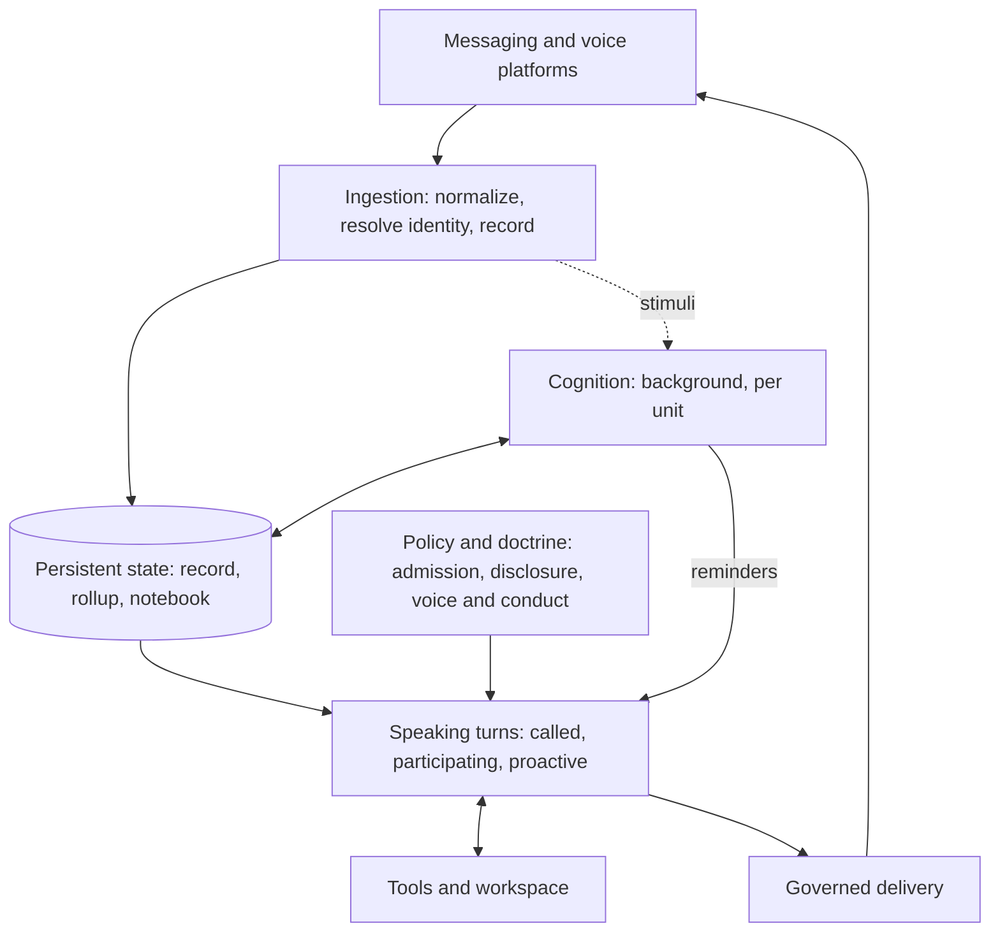

<p align="center">
  
</p>

<p align="center">
  
</p>

<h1 align="center">Nora</h1>

<p align="center"><strong>Earphones in.</strong></p>

<p align="center">
  <a href="LICENSE"></a>
  <a href="#development"></a>
  <a href="#project-status"></a>
  <a href="https://www.aikido.dev/"></a>
</p>

<p align="center">
  <code>sessionless</code> · <code>layered memory</code> · <code>cognition loop</code> · <code>social</code> · <code>self-hosted</code>
</p>

**Nora is a persistent member of one circle of friends, not a bot in their chat.**

She is in the rooms where they talk: Signal, Discord, WhatsApp, Instagram and a
voice channel. She keeps a working model of the circle's people, places and
plans, and acts on it unasked, within what each room may be told. When nobody
has called her she is still reading, still holding what is unsettled, and still
deciding whether this is the moment to speak. Usually it is not, and staying
quiet is a result she can reach on purpose.

She is built to be there over months, not to finish a task and leave. Nora is
experimental and self-hosted: the runtime and every store run on your own
hardware, and model inference and connected services can be external.

<p align="center">
  <a href="ARCHITECTURE.md">Architecture</a> ·
  <a href="GLOSSARY.md">Glossary</a> ·
  <a href="CONTRIBUTING.md">Contributing</a> ·
  <a href="deploy/README.md">Deployment</a> ·
  <a href="SECURITY.md">Security</a>
</p>

## Not an assistant

An assistant starts when you ask and ends when it answers. Nora's work is the
time in between.

| | A chat assistant | Nora |
|---|---|---|
| **Starts** | when you ask | when someone calls her, and when something changes: new conversation, a plan that moves, a reminder she set that comes due |
| **Owes** | an answer | an answer when called; otherwise nothing, and silence is a normal outcome |
| **Remembers** | a chat history, or a profile | a layered notebook: what was observed, what is still open, what each person and room is like, what she has learned about how to act here |
| **Continuity** | a session | no session at all: each turn is built from persistent state |
| **Scope** | one user, one thread | a circle of people and rooms across platforms, with one read boundary per social unit |
| **Changes** | when the model or the prompt is replaced | her accounts of people and the lessons she acts on are revised from evidence, while her voice and conduct are written by humans |

## Architecture at a glance

Nora is one body of persistent state with two ways of acting on it. **Speaking
turns** answer when she is called and decide whether to speak when she is not.
**Cognition** works in the background, keeping her model of the circle current
and deciding when something deserves a later look. Policy decides who may be
heard, what may be said where, and whether she may speak unasked. Her doctrine,
meaning her voice and conduct, is written by people and wins over anything she
derives.



| Part | Role |
|---|---|
| **Interfaces** | Adapters for Signal, Discord, WhatsApp, Instagram and voice turn each platform's events into one normalized shape. |
| **Ingestion** | Records permitted events, resolves who is speaking, handles media and raises stimuli. Nothing speaks from here. |
| **Persistent state** | PostgreSQL holds the record and what is derived from it, media has its own custody store, and a memory service supplies interpreted memory while the unified-memory migration completes. State is scoped to people, rooms and social units. |
| **Speaking turns** | A fresh agent per turn, built on the Strands Agents SDK from doctrine, transcript and scoped state. It reads and acts through tools, and speaks only through explicit, governed delivery. |
| **Cognition** | Background work that reads recorded stimuli, maintains notes, events and reminders, and can schedule its own next look. Slower passes revise her accounts of people and rooms and the lessons she has learned from how her actions landed. |
| **Policy and doctrine** | Room admission, grants and disclosure are deployment policy. Whether she may speak unasked in a room is its own grant, apart from what she may see. |
| **Workspace** | A persistent, room-scoped computer workspace and a bounded browser runner let her investigate and carry work from one turn to the next. |
| **Operations** | Docker Compose deployment, releases published to a `deployments` branch that Komodo applies, and health, metrics and tracing. |

Four ideas run through all of it:

- **Sessionless.** There is no chat session to resume. Each turn assembles its
  context from persistent state, speaks and ends. Cognition, browser and computer
  work keep bounded sessions of their own, so this does not mean a continuously
  running model. See the [glossary](GLOSSARY.md#nora-as-a-social-agent).
- **Silence is an outcome.** When an occasion arrives she reads the situation
  again, and the right answer may be that nothing needs saying.
- **The unit is the boundary.** Continuity does not grant shared access: people
  and rooms whose talk must not meet belong in different social units.
- **Learning changes context, not weights.** Lessons and accounts of people are
  revised from evidence. Doctrine is never rewritten by her.

The [architecture map](ARCHITECTURE.md) is the full runtime and code map. The
memory tiers are specified in the [tier model](design/cognition-loop/10-tiers.md)
and the [prior-art note](design/cognition-loop/80-prior-art.md) records what she
adopts and refuses from existing memory systems.

## A continuing presence

A group discusses dinner, changes the place and leaves the booking unresolved.
With the relevant features enabled, Nora can keep that matter in working state,
revisit it through cognition and arrange a later look. When the occasion arrives,
she reads the situation again: the booking may already be settled, so silence can
be the right outcome. Any investigation can leave files in the room's workspace
for another turn to continue. This is an illustration of how the parts connect,
not a receipt of a particular live interaction.

## Project status

Nora is actively developed as a personal project. Interfaces and deployment
requirements change, capabilities depend on the services and room policy each
operator configures, and you should expect to provision your own model services,
platform accounts and persistent storage.

## Start here

- [Implementation wiki](https://nora.67.zone/wiki/): connected concepts and contributor workflows, maintained with OpenWiki.
- [Glossary](GLOSSARY.md): the words that mean something specific here.
- [Architecture](ARCHITECTURE.md): runtime boundaries, data and deployment.
- [Decisions](docs/adr/README.md) and [design index](design/09-decision-index.md):
  rationale, trade-offs and design work, including proposals not yet implemented.
- [Contributing](CONTRIBUTING.md): development checks and pull requests.
- [Deployment](deploy/README.md) and the [operator runbook](docs/runbook.md).
- [Agent instructions](AGENTS.md): procedures for coding agents.

## Quickstart

Follow the [deployment guide](deploy/README.md) for the Compose setup. You need
Docker with Docker Compose on a Linux host, PostgreSQL supplied by Compose,
at least one provisioned messaging platform account, an OpenAI-compatible model
endpoint and a memory backend. Configure the example files for your own services
and explicitly allow the intended rooms before starting Nora.

## Development

Use Python 3.12 and [uv](https://docs.astral.sh/uv/) 0.13.4 or newer
(the emSign TLS fix). From a checkout:

```bash
uv sync --frozen --extra evals
make lint typecheck imports
uv run pytest -q tests/test_docs.py tests/test_architecture_doc.py
```

`make gate` runs static checks and the tests affected by the branch against
`origin/master`; unknown changes run the full suite. Database and object-store
tests need Docker. Live model evaluations are separate and need operator-owned
services and credentials; ordinary contributors do not need production access.
See [Contributing](CONTRIBUTING.md) for the full workflow, branch and pull
request rules, and local hooks.

## Configuration

The tracked examples describe three separate inputs:

| Example | Purpose |
|---|---|
| [config.example.toml](config.example.toml) | Services, models and optional capabilities |
| [identity.example.toml](identity.example.toml) | Platform accounts mapped to people |
| [policy.example.toml](policy.example.toml) | Allowed rooms, social units and grants |

Real `config.toml`, `identity.toml`, `policy.toml` and `.env` stay outside version
control. Secrets such as `OMNIROUTE_API_KEY` are environment values, never
values to paste into documentation. Example files are starting points, not a
ready-to-run production deployment: platform accounts, memory and model
services must be provisioned and policy must explicitly allow the intended rooms.

Nora's character is in `nora/doctrine/`, including `rooms/voice.md`. A deployment
that bind-mounts `nora/doctrine` can hot-reload it with `doctrine.reload = "mtime"`:
a valid edit is picked up on the next read with **no restart**. Broken reloads
retain the last good version. Runtime skills are baked into the image and need
a rebuild. Changes to character and constraints follow the ownership rules in
[AGENTS.md](AGENTS.md).

## Deployment

The reference deployment uses Docker Compose on a Linux host. The application uses bridge
networks; `build.network: host` is a build-time DNS workaround, not its runtime
network mode. Configure administration and network access for your own environment.

Releases are cut from Conventional Commit subjects, and a release is separate from
a deployment. Publishing a release builds the images and commits the selected bundle to
the `deployments` branch; where a [Komodo](deploy/komodo/README.md) Stack is
installed, it polls that branch and deploys the bundle, then writes a receipt. The
image records the source revision and its generated version manifest. The
[deployment guide](deploy/README.md) describes the procedure, and the
[runbook](docs/runbook.md) carries health checks and rollback constraints,
including database migrations. Do not use old phase tags as rollback targets.

Nora reads the release history shipped in her image with `version_list()` and
`version_read(version)`. The list includes the immutable running version and
recorded version metadata; the read returns one version's recorded notes and
changes. Both use the same baked snapshot, with no runtime GitHub access or
credentials. Releases after the build are invisible until another image is
deployed. Notes are capped at 2,000 characters and changes at 20 commit subjects,
so this is a release summary, not the complete live GitHub release body.
An absent or unreadable stamp is unavailable; an unrecorded version is not found.

## Help and contributions

Use [GitHub issues](https://github.com/mikeng-io/nora/issues) for reproducible bugs
and focused proposals. Include the revision, relevant configuration keys and a
minimal synthetic example. Keep credentials, personal conversations, account
identifiers and location data out of issues, logs and screenshots. See
[Contributing](CONTRIBUTING.md) for development checks and [Security](SECURITY.md)
for vulnerability reports. Follow the [Code of Conduct](CODE_OF_CONDUCT.md).
Maintenance is on a best-effort basis. Repository security, release automation
and merge rules are documented in [GitHub maintenance](docs/maintainers/github.md).

## License

Nora is licensed under the [MIT License](LICENSE). Third-party components retain
their respective licenses.
