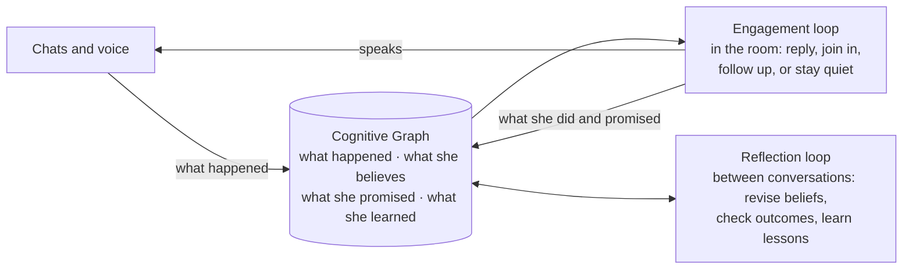

<p align="center">
  
</p>

<p align="center">
  
</p>

<h1 align="center">Nora</h1>

<p align="center"><strong>A personal AI assistant with social intelligence.</strong><br>
She works with you and the people around you, follows through, and learns from what actually happened.</p>

<p align="center">
  <a href="https://heynora.bot">heynora.bot</a> ·
  <a href="docs/guide/README.md">Guide</a> ·
  <a href="#how-she-works">How she works</a> ·
  <a href="#run-your-own">Run your own</a> ·
  <a href="ARCHITECTURE.md">Architecture</a>
</p>

<p align="center">
  <a href="LICENSE"></a>
  <a href="#development"></a>
  <a href="#project-status"></a>
  <a href="https://www.aikido.dev/"></a>
</p>

Nora is a personal AI assistant that understands people. Talk to her
one-on-one, or bring her into the chats where you already deal with others,
on Signal, Discord, WhatsApp and Instagram, or in a Discord voice channel. She
keeps track of who is who, what each conversation is working on and what she
has promised, across all of them.

Ask her something and she answers. In a shared chat she also follows along
when nobody asks: if there is something worth saying, she says it; most of the
time there isn't, and she stays quiet on purpose. Knowing when to speak, what
each person needs, and what may be said in front of whom is her **social
intelligence**.

She is built to stay for months, not to finish a task and leave. Every
promise she makes is checked against what actually happened, and that is how
she learns what works for you and for each group she is in. She is open source
and self-hosted.

## What it's like

In a shared chat:

> **Miles:** dinner fri? the dim sum place
> **Jo:** they're closed for renovation 😩
> **Kai:** the noodle place on the corner then
> **Kai:** i'll book it
>
> *The chat moves on. Nora notes that Kai's booking is still open.*
>
> *Thursday afternoon she looks again. Nothing says it is booked, so she speaks:*
>
> **Nora:** kai, still on for booking friday? the noodle place fills up
> **Kai:** oops. done, 7pm for four
>
> *Kai's confirmation closes it. If Kai had confirmed earlier, she would have
> said nothing at all.*

One-on-one it works the same way. If the reminders she sends you in the
morning get ignored and the ones after lunch get done, she keeps that as a
lesson about you, and her next reminder goes out after lunch.

This is an illustration. Names are made up, and what she may do depends on
the rooms and features each deployment allows.

## What she can do

| | |
|---|---|
| **Remember people** | Who is who, what they like, what they have said about themselves. Each person can see what she believes about them and correct it. |
| **Keep track** | Reminders, plans and follow-ups, yours, hers and a chat's. Each one stays open until something real closes it, so nothing is "done" because she said so. |
| **Join in, or not** | She reads a conversation she was not called into and decides whether to speak. Staying silent is a normal outcome. |
| **Suggest things** | A game on sale, a restaurant that suits everyone coming, an event worth knowing about, based on what you and each group actually take up. |
| **Plan together** | Events with RSVPs, reading polls, shared documents. |
| **Get around** | Maps, routes, transit, parking and weather, and location with consent. |
| **Make things** | Images, short videos, GIFs and documents. |
| **Do real work** | A persistent computer workspace, a browser and helper agents for longer jobs. She reports back when they finish. |
| **Look things up** | The web, and public posts on X, Instagram and LinkedIn. |
| **Talk and play music** | In a Discord voice channel: she answers aloud and runs the room's music queue. |

## How she works

Everything Nora knows, believes, has promised and has learned lives in one
place, the **Cognitive Graph**. Two loops work on it.



- **The engagement loop is Nora in the room.** It runs when someone calls her,
  when a conversation might want her, or when one of her own follow-ups comes
  due. Each time, she starts fresh from the graph, with no chat session to
  resume, and decides whether to reply, act or stay silent. When she finishes,
  a short debrief writes down what she left open, so the next time picks it up.
- **The reflection loop is Nora between conversations.** It never speaks. It
  works out what new events mean, revises what she believes about people and
  rooms, checks how her promises turned out, and schedules the next look.

Four rules make this trustworthy:

1. **Every belief cites its evidence.** A belief about a person points at the
   messages and events behind it, says how it was reached (they said it, or she
   inferred it) and how sure she is. A guess comes with a prediction that can
   prove it wrong. The person it is about can dispute it, and it disappears at once.
2. **Every promise names what would close it.** "Done when the booking is
   confirmed" closes only when someone confirms it. If time runs out, it
   counts as missed; if a source was down, it counts as unknown, not as her
   failure.
3. **She learns from outcomes, not applause.** Lessons come from whether what
   she set out to do happened, and from people correcting her, never from how
   many replies or reactions she got. A lesson is itself judged by how the
   decisions that relied on it turned out.
4. **Code checks, the model judges.** The model proposes what something means
   and what to do. Code decides what is admitted, enforces who may see what,
   and never guesses: a lookup that failed is "unknown", never "nothing".

Recommendations, follow-through and noticing that someone has gone quiet are
not separate features. They come out of the same two loops working on the
same graph, so getting better at one is learning, not new code.

## How she differs from a typical assistant

| | A typical assistant | Nora |
|---|---|---|
| **Works with** | one person, one thread | you, and the people and groups you deal with, across several apps |
| **Starts** | when you ask | when asked, when a conversation might want her, or when her own follow-up is due |
| **Owes** | an answer | an answer when asked; otherwise nothing, and silence is fine |
| **Remembers** | a chat history or a profile | beliefs with evidence, open promises, and lessons about you and each group |
| **Improves** | when the model or prompt changes | from the outcomes of her own actions; her personality is written by people, never by her |

## Privacy by design

- **Self-hosted.** The runtime and every store run on your own hardware. Model
  inference and connected services can be external.
- **Circles stay apart.** Rooms are grouped into circles, such as family and
  work, and a circle is a hard boundary: nothing she learns in one is read in another.
- **Each room decides.** Policy sets who she listens to, what may be said where,
  and whether she may speak unasked. She refuses to start if policy allows nothing.
- **People can see what she believes about them** and dispute it.

## Project status

Nora is an experimental personal project, developed in the open as a study of
assistants that live with people over time. It is not a product. Interfaces and
deployment requirements change, and capabilities depend on the services and
room policy each operator sets up. Expect to bring your own model service,
platform accounts and storage.

## Run your own

You need a Linux host with Docker Compose, at least one messaging account for
her, and an OpenAI-compatible model endpoint. PostgreSQL comes with Compose.

1. Follow the [deployment guide](deploy/README.md).
2. Copy the example settings and fill them in:

   | file | says |
   |---|---|
   | [config.example.toml](config.example.toml) | services, models and optional features |
   | [identity.example.toml](identity.example.toml) | which accounts belong to which people |
   | [policy.example.toml](policy.example.toml) | which rooms she may join, their circles and what each may do |

3. Allow the rooms you want, then start her.

The real `config.toml`, `identity.toml`, `policy.toml`, `secret.toml` and `.env`
stay out of version control. Secrets such as `OMNIROUTE_API_KEY` are
environment values, never pasted into a file you share.

**Her personality** is plain text in `nora/doctrine/`, including
`rooms/voice.md` for how she talks aloud. With `doctrine.reload = "mtime"` and
the folder mounted, an edit takes effect on her next turn with **no restart**,
and a broken edit keeps the last good version. People write her personality;
she never rewrites it.

Releases deploy automatically where [Komodo](deploy/komodo/README.md) is set
up; the [runbook](docs/runbook.md) covers health checks and rollback.

## Development

Nora is Python 3.12 on the [Strands Agents SDK](https://strandsagents.com),
with PostgreSQL as her store. Use [uv](https://docs.astral.sh/uv/) 0.13.4 or newer:

```bash
uv sync --frozen --extra evals
make lint typecheck imports
make test        # the tests your change can affect
```

[Contributing](CONTRIBUTING.md) has the full workflow, and
[AGENTS.md](AGENTS.md) the rules for coding agents. To go deeper:

| read | for |
|---|---|
| [Guide](docs/guide/README.md) | why Nora exists and the concepts behind her, in plain words |
| [Cognition design](design/cognition/README.md) | the Cognitive Graph and both loops, in full |
| [Architecture](ARCHITECTURE.md) | the runtime and where the code lives |
| [Glossary](GLOSSARY.md) | words that mean something specific here |
| [Decisions](docs/adr/README.md) and the [decision index](design/09-decision-index.md) | why things are the way they are |
| [Configuration](docs/configuration.md) | every setting, credentials and model endpoints |

## Help and contributions

Use [GitHub issues](https://github.com/mikeng-io/nora/issues) for reproducible
bugs and focused proposals, with a minimal made-up example. Keep credentials,
personal conversations, account identifiers and locations out of issues, logs
and screenshots. Security reports go through [Security](SECURITY.md). Follow the
[Code of Conduct](CODE_OF_CONDUCT.md). Maintenance is best-effort.

## License

Code: [MIT](LICENSE). Her art listed in `LICENSE` is all rights reserved, for
building and running Nora only. Third-party components keep their licenses.
