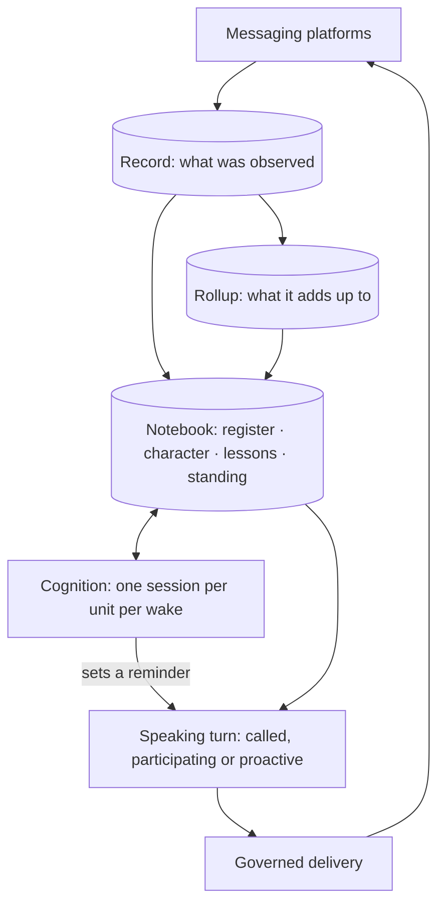

<p align="center">
  
</p>

<p align="center">
  
</p>

<h1 align="center">Nora</h1>

<p align="center"><strong>Earphones in.</strong></p>

<p align="center">
  <a href="LICENSE"></a>
  <a href="#development"></a>
  <a href="#project-status"></a>
  <a href="https://www.aikido.dev/"></a>
</p>

<p align="center">
  <code>sessionless</code> · <code>layered memory</code> · <code>cognition loop</code> · <code>social</code> · <code>self-hosted</code>
</p>

**Nora is a persistent member of one circle of friends, not a bot in their chat.**

She is in the rooms where they talk: Signal, Discord, WhatsApp, Instagram and a
voice channel. She keeps a working model of the circle's people, places and
plans, and acts on it unasked, within what each room may be told. When nobody
has called her she is still reading, still holding what is unsettled, and still
deciding whether this is the moment to speak. Usually it is not, and staying
quiet is a result she can reach on purpose.

She is built to be there over months, not to finish a task and leave. Nora is
experimental and self-hosted: the runtime and every store run on your own
hardware, and model inference and connected services can be external.

<p align="center">
  <a href="ARCHITECTURE.md">Architecture</a> ·
  <a href="GLOSSARY.md">Glossary</a> ·
  <a href="CONTRIBUTING.md">Contributing</a> ·
  <a href="deploy/README.md">Deployment</a> ·
  <a href="SECURITY.md">Security</a>
</p>

## Not an assistant

An assistant starts when you ask and ends when it answers. Nora's work is the
time in between.

| | A chat assistant | Nora |
|---|---|---|
| **Starts** | when you ask | when someone calls her, and when something changes: new conversation, a plan that moves, a reminder she set that comes due |
| **Owes** | an answer | an answer when called; otherwise nothing, and silence is a normal outcome |
| **Remembers** | a chat history, or a profile | a layered notebook: what was observed, what is still open, what each person and room is like, what she has learned about how to act here |
| **Continuity** | a session | no session at all: each turn is built from persistent state |
| **Scope** | one user, one thread | a circle of people and rooms across platforms, with one read boundary per social unit |
| **Changes** | when the model or the prompt is replaced | her accounts of people and the lessons she acts on are revised from evidence, while her voice and conduct are written by humans |

## What makes her different

These are design commitments with a record behind each, not a feature checklist.
The linked documents say what was adopted from existing memory systems, what was
refused, and what is not built yet.

**Sessionless.** There is no chat session to resume. Her continuity is the
persistent record and what is derived from it. Every speaking turn assembles the
relevant context for a fresh agent, speaks, and ends. Cognition, browser and
computer work do keep bounded sessions of their own; sessionless does not mean a
continuously running model. See the [glossary](GLOSSARY.md#nora-as-a-social-agent).

**A memory that knows how it knows.** The record is written by code at the
moment something happens. A rollup computes what it adds up to over an interval.
On top sits a notebook of four tiers, each answering one question through one write path: the **register** (what is the state of the unit's affairs), the
**character** of each person, room and unit (what it is like and how it
behaves), **lessons** (what she has learned about how to act here) and her
**standing** (where she stands toward a room, the unit or a person). Every
derived row carries how it was formed (told, deduced, abduced, induced or said),
its confidence, its lineage and its age. The [tier model](design/cognition-loop/10-tiers.md)
is the contract and the [prior-art note](design/cognition-loop/80-prior-art.md)
records what she takes from Honcho, Graphiti, Letta, Generative Agents and Mem0,
and what she refuses.

**A cognition loop, not a scheduled job.** Her presence is one
observe–orient–decide–act loop, closed through a human. Observing is plain code.
Orienting, deciding and acting are one agent session per unit per wake. That
session keeps the register and her standing, can schedule its own next look, and
can act only by setting a reminder; a speaking turn then composes it. When the
moment arrives she reads the situation again, so by then the right answer may be
that the matter is settled and nothing needs saying. Slower passes reflect on
each entity (character) and on each unit (lessons). See the
[cognition design](design/cognition-loop/00-intent.md).

**Social by construction.** Rooms are admitted explicitly. Whether she may ever
speak unasked in a room is its own grant, apart from what she may see. The social
unit is the read boundary: people and rooms whose talk must not meet belong in
different units. Unrequested participation passes a conversation window and,
when configured, a relevance gate. In any admitted room she answers when called.

**She grows inside limits humans set.** Lessons and character accounts are
revised from how her own actions landed. That changes stored context, never
model weights. Her doctrine, meaning her voice, conduct and constraints, is
written by people, is never rewritten by her, and wins over anything she derives.

## A continuing presence

A group discusses dinner, changes the place and leaves the booking unresolved.
With the relevant features enabled, Nora can keep that matter in working state,
revisit it through cognition and arrange a later look. When the occasion arrives,
she reads the situation again: the booking may already be settled, so silence can
be the right outcome. Any investigation can leave files in the room's workspace
for another turn to continue. This is an illustration of how the parts connect,
not a receipt of a particular live interaction.

## How it fits together



Individual agent invocations use the Strands Agents SDK; persistent stores supply
the continuity between them. Room policy controls admission and disclosure. The
[architecture map](ARCHITECTURE.md) describes the full runtime and its boundaries,
including the memory migration that is still in progress.

## Project status

Nora is actively developed as a personal project. Interfaces and deployment
requirements change, capabilities depend on the services and room policy each
operator configures, and you should expect to provision your own model services,
platform accounts and persistent storage.

## Start here

- [Implementation wiki](https://nora.67.zone/wiki/): connected concepts and contributor workflows, maintained with OpenWiki.
- [Glossary](GLOSSARY.md): the words that mean something specific here.
- [Architecture](ARCHITECTURE.md): runtime boundaries, data and deployment.
- [Decisions](docs/adr/README.md) and [design index](design/09-decision-index.md):
  rationale, trade-offs and design work, including proposals not yet implemented.
- [Contributing](CONTRIBUTING.md): development checks and pull requests.
- [Deployment](deploy/README.md) and the [operator runbook](docs/runbook.md).
- [Agent instructions](AGENTS.md): procedures for coding agents.

## Quickstart

Follow the [deployment guide](deploy/README.md) for the Compose setup. You need
Docker with Docker Compose on a Linux host, PostgreSQL supplied by Compose,
at least one provisioned messaging platform account, an OpenAI-compatible model
endpoint and a memory backend. Configure the example files for your own services
and explicitly allow the intended rooms before starting Nora.

## Development

Use Python 3.12 and [uv](https://docs.astral.sh/uv/). From a checkout:

```bash
uv sync --frozen --extra evals
make lint typecheck imports
uv run pytest -q tests/test_docs.py tests/test_architecture_doc.py
```

`make gate` runs static checks and the tests affected by the branch against
`origin/master`; unknown changes run the full suite. Database and object-store
tests need Docker. Live model evaluations are separate and need operator-owned
services and credentials; ordinary contributors do not need production access.
See [Contributing](CONTRIBUTING.md) for the full workflow, branch and pull
request rules, and local hooks.

## Configuration

The tracked examples describe three separate inputs:

| Example | Purpose |
|---|---|
| [config.example.toml](config.example.toml) | Services, models and optional capabilities |
| [identity.example.toml](identity.example.toml) | Platform accounts mapped to people |
| [policy.example.toml](policy.example.toml) | Allowed rooms, social units and grants |

Real `config.toml`, `identity.toml`, `policy.toml` and `.env` stay outside version
control. Secrets such as `OMNIROUTE_API_KEY` are environment values, never
values to paste into documentation. Example files are starting points, not a
ready-to-run production deployment: platform accounts, memory and model
services must be provisioned and policy must explicitly allow the intended rooms.

Nora's character is in `nora/doctrine/`, including `rooms/voice.md`. A deployment
that bind-mounts `nora/doctrine` can hot-reload it with `doctrine.reload = "mtime"`:
a valid edit is picked up on the next read with **no restart**. Broken reloads
retain the last good version. Runtime skills are baked into the image and need
a rebuild. Changes to character and constraints follow the ownership rules in
[AGENTS.md](AGENTS.md).

## Deployment

The reference deployment uses Docker Compose on a Linux host. The application uses bridge
networks; `build.network: host` is a build-time DNS workaround, not its runtime
network mode. Configure administration and network access for your own environment.

Releases are cut from Conventional Commit subjects, and a release is separate from
a deployment. Publishing a release builds the images and commits the selected bundle to
the `deployments` branch; where a [Komodo](deploy/komodo/README.md) Stack is
installed, it polls that branch and deploys the bundle, then writes a receipt. The
image records the source revision and its generated version manifest. The
[deployment guide](deploy/README.md) describes the procedure, and the
[runbook](docs/runbook.md) carries health checks and rollback constraints,
including database migrations. Do not use old phase tags as rollback targets.

## Help and contributions

Use [GitHub issues](https://github.com/mikeng-io/nora/issues) for reproducible bugs
and focused proposals. Include the revision, relevant configuration keys and a
minimal synthetic example. Keep credentials, personal conversations, account
identifiers and location data out of issues, logs and screenshots. See
[Contributing](CONTRIBUTING.md) for development checks and [Security](SECURITY.md)
for vulnerability reports. Follow the [Code of Conduct](CODE_OF_CONDUCT.md).
Maintenance is on a best-effort basis. Repository security, release automation
and merge rules are documented in [GitHub maintenance](docs/maintainers/github.md).

## License

Nora is licensed under the [MIT License](LICENSE). Third-party components retain
their respective licenses.
