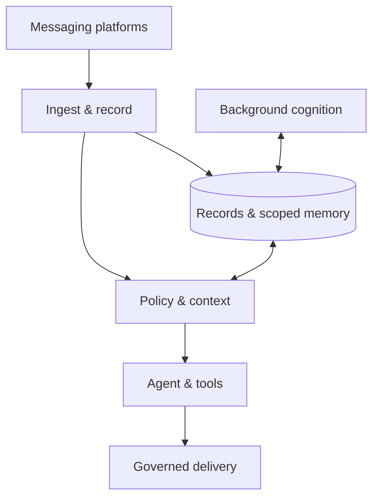

<p align="center">
  
</p>

<p align="center">
  
</p>

<h1 align="center">Nora</h1>

<p align="center"><strong>Earphones in.</strong></p>

<p align="center">
  <a href="LICENSE"></a>
  <a href="#development"></a>
  <a href="#project-status"></a>
</p>

<p align="center">
  <code>conversation</code> · <code>memory</code> · <code>voice</code> · <code>cognition</code> · <code>self-hosted</code>
</p>

Nora is an experimental, self-hosted social AI agent built to participate in
everyday life over time. She is present across Signal, Discord, WhatsApp,
Instagram and voice, carrying a working understanding of people, conversations
and unfinished matters beyond any individual exchange.

Her continuity lives in persistent state rather than an open chat session.
Memory carries experience forward; background cognition revisits what changes;
participation and proactive turns decide when something needs attention; and a
persistent sandbox workspace lets her investigate and carry out work. Responses
to her actions inform stored lessons and her account of herself, within
human-authored constraints. Each capability depends on configuration and room
policy.

<p align="center">
  <a href="ARCHITECTURE.md">Architecture</a> ·
  <a href="CONTRIBUTING.md">Contributing</a> ·
  <a href="deploy/README.md">Deployment</a> ·
  <a href="SECURITY.md">Security</a>
</p>

## Project status

Nora is actively developed as a personal project. She combines conversational
memory, permissioned participation, reminders, voice and background cognition.
Capabilities depend on the services and room policy configured by each operator.
Interfaces and deployment requirements can change; expect to provision your own
model services, platform accounts and persistent storage.

## A continuing presence

A group discusses dinner, changes the place and leaves the booking unresolved.
With the relevant features enabled, Nora can keep that matter in working state,
revisit it through cognition and arrange a later look. When the occasion arrives,
she reads the situation again: the booking may already be settled, so silence
can be the right outcome. Any investigation can leave files in the room's
workspace for another turn to continue. This is an illustration of how the
parts connect, not a receipt of a particular live interaction.

“Sessionless” describes this continuity: speaking turns construct fresh agents
from relevant persistent context. Cognition and computer work still use bounded
sessions internally. Nora's runtime and stores are self-hosted; model inference
and connected services can be external.

## How it fits together



Individual agent invocations use the Strands Agents SDK; persistent stores
supply continuity between them. Room policy controls admission and disclosure. Background cognition maintains
scoped state alongside the conversational path. The [architecture map](ARCHITECTURE.md)
describes the full runtime and its boundaries.

## Start here

- [Architecture](ARCHITECTURE.md): runtime boundaries, data and deployment.
- [Contributing](CONTRIBUTING.md): development checks and pull requests.
- [Decisions](docs/adr/README.md) and [design index](design/09-decision-index.md):
  rationale, trade-offs and design work, including proposals not yet implemented.
- [Deployment](deploy/README.md): prerequisites and the Compose lifecycle.
- [Operator runbook](docs/runbook.md): detailed implementation and recovery notes.
- [Agent instructions](AGENTS.md): procedures for coding agents.

## Development

Use Python 3.12 and [uv](https://docs.astral.sh/uv/). From a checkout:

```bash
uv sync --frozen --extra evals
make lint typecheck imports
uv run pytest -q tests/test_docs.py tests/test_architecture_doc.py
```

`make gate` runs static checks and the tests affected by the branch against
`origin/master`; unknown changes run the full suite. Database and object-store
tests need Docker. Live model evaluations are separate and need operator-owned
services and credentials; ordinary contributors do not need production access.
See [Contributing](CONTRIBUTING.md) for the full workflow and local hooks.

## Configuration

The tracked examples describe three separate inputs:

| Example | Purpose |
|---|---|
| [config.example.toml](config.example.toml) | Services, models and optional capabilities |
| [identity.example.toml](identity.example.toml) | Platform accounts mapped to people |
| [policy.example.toml](policy.example.toml) | Allowed rooms, social units and grants |

Real `config.toml`, `identity.toml`, `policy.toml` and `.env` stay outside version
control. Secrets such as `OMNIROUTE_API_KEY` are environment values, never
values to paste into documentation. Example files are starting points, not a
ready-to-run production deployment: platform accounts, memory and model
services must be provisioned and policy must explicitly allow the intended rooms.

Nora's character is in `nora/doctrine/`, including `rooms/voice.md`. With the
current deployment's read-only bind mounts and `doctrine.reload = "mtime"`,
a valid edit is picked up on the next read with **no restart**. Broken reloads
retain the last good version. Runtime skills are baked into the image and need
a rebuild. Changes to character and constraints follow the ownership rules in
[AGENTS.md](AGENTS.md).

## Deployment

The reference deployment uses Docker Compose on a Linux host. The application uses bridge
networks; `build.network: host` is a build-time DNS workaround, not its runtime
network mode. Configure administration and network access for your own environment.

[Deployment](deploy/README.md) describes the current build/recreate procedure
and a proposed pull-based GitOps replacement. Production deployment is still
operator/agent-driven; merging a PR does not install a deployment controller.
The [runbook](docs/runbook.md) carries health checks and rollback constraints,
including database migrations. Do not use old phase tags as rollback targets.

Releases are managed by [release-please](.github/workflows/release-please.yml).
A release and a deployment are separate: the image records the source revision
and, when available, its generated version manifest.

## Help and contributions

Use [GitHub issues](https://github.com/mikeng-io/nora/issues) for reproducible bugs
and focused proposals. Include the revision, relevant configuration keys and a
minimal synthetic example. Keep credentials, personal conversations, account
identifiers and location data out of issues, logs and screenshots. See
[Contributing](CONTRIBUTING.md) for development checks and [Security](SECURITY.md)
for vulnerability reports. Maintenance is on a best-effort basis.

## License

Nora is licensed under the [MIT License](LICENSE). Third-party components retain
their respective licenses.

Repository security, release automation and the free public setup are documented
in [GitHub maintenance](docs/github-maintenance.md).
