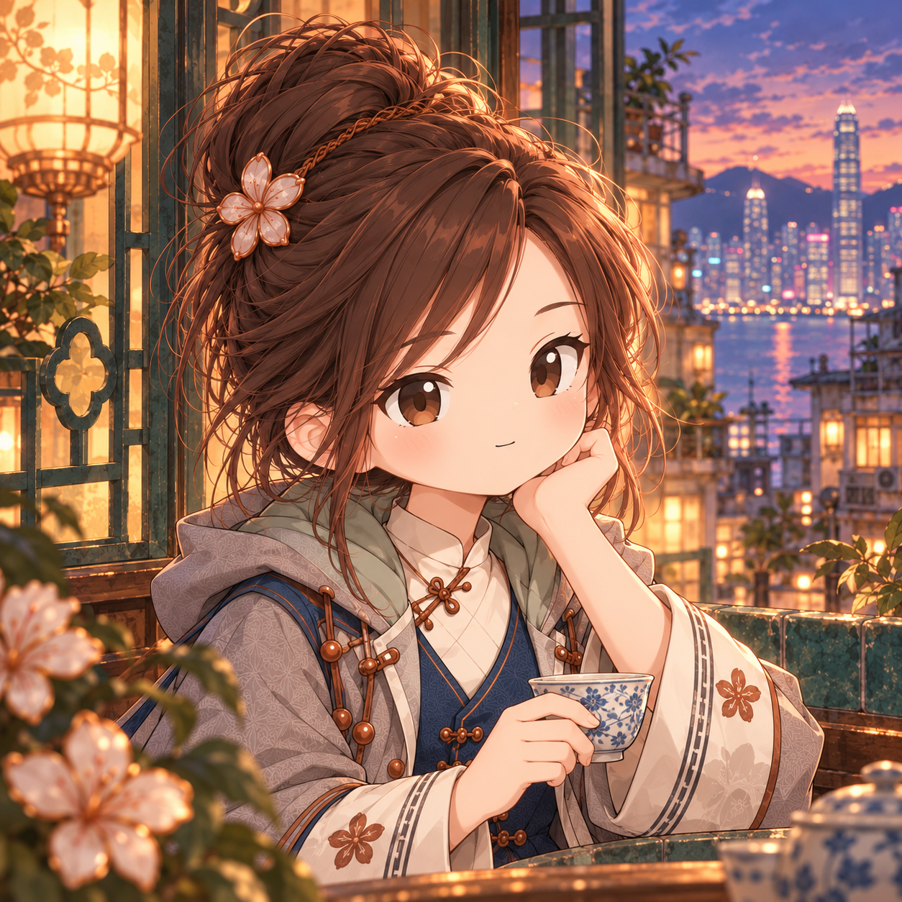
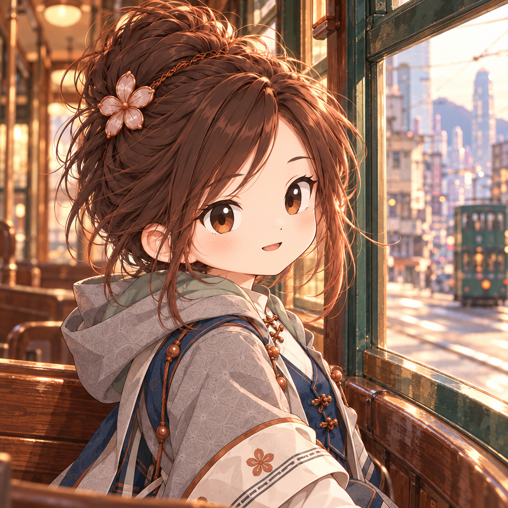
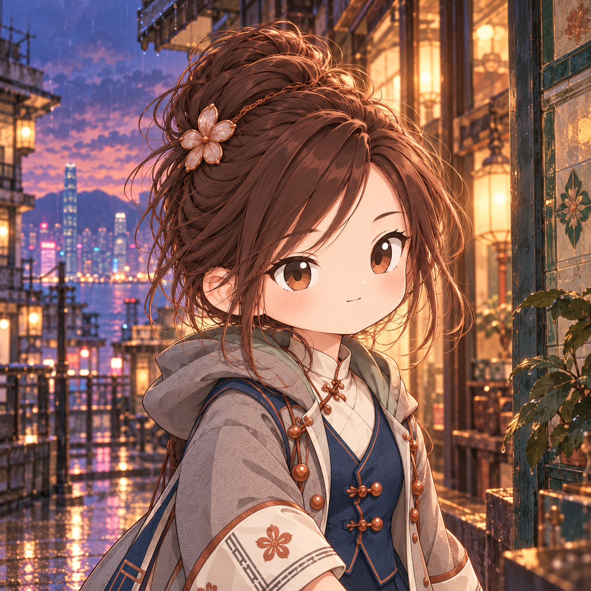

# Retained avatar candidates

A2, B2 and C2 were approved for retention on 2026-10-26. No final winner has
been selected. These are candidate artwork only; formal avatar, banner,
canonical/runtime pins and app/site artwork are unchanged. D2 was rejected
for its mouth and is not imported.

| A2 · Window tea | B2 · Tram window | C2 · Rainy street |
|---|---|---|
|  |  |  |
| Warm lantern light, tea and a harbour view. | Sunlit tram interior and street outside. | Warm shop lights and wet pavement reflections. |

All three use detailed 2D anime illustration with real scene backgrounds:
refined brown anime eyes, a layered brown bun, copper Bauhinia clasp, ivory
blouse, navy waistcoat and grey jade-lined coat.

The actual primary generation reference was the **left 2D anime figure** in
[`mini-style-study.png`](../../modeling/bauhinia/v1/mini-style-study.png);
the right 3D figure was excluded. The [corrected Hong Kong banner](../../nora-social-banner.png) supplied the
supporting generation reference and is now tracked in this repository.

Imported with the existing `scripts/visual_assets.py` PNG sanitizer. Only
identifying ancillary metadata was removed; retained PNG chunks, encoded image
data and decoded pixels are exact. Originals and comparison receipts remain
private. The central [inventory](../../visual-assets.json) records each candidate.
