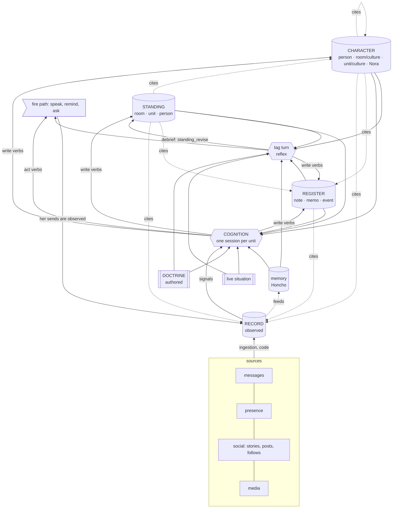

# 15 · Map

## 1. Five kinds of state, and the tiers among them

| kind | what makes it this kind | stores | written by |
|---|---|---|---|
| **Authored** | a person decided it | doctrine (`nora/doctrine/`: constraint, identity/voice, conduct, instrument); the Dreamer doctrine and skills; `<room>` and `policy.toml`; `identity.toml`; reference photos for faces ([60](60-faces.md) §2) | the operator |
| **Live** | computed for this turn, never stored | the clock; where she is (which platforms are up); the tool catalogue | code, per turn |
| **Observed** — tier **Record** | it happened and was seen | messages; her own sends and decisions; presence; social items and edges; perceptions (what media shows, whose face); face labels and templates ([60](60-faces.md) §2) | code (ingestion; the decision log and the fire path for her own acts) |
| **Derived by Nora** — tiers **Register**, **Character**, **Standing** | cognition concluded it from the Record | Register: note, memo, event · Character: person, room (culture), unit (culture), Nora · Standing: room, unit, person | cognition; the tag path for Register and room Standing |
| **Derived by a third party** — **memory** | Honcho concluded it | representation (Nora → person), self card (Nora → Nora), `remember` conclusions | Honcho; `remember` |
| **Operator-only** | tension rows ([55](55-self.md) §4) | cognition, via `character_revise`; read only by the operator |

## 2. Every context block, and where it comes from

The `_BLOCKS` rows in `nora/agent/prefill.py` (tag and fire turns both
assemble them), the system prompt, and the clock line, plus the ones this
bundle adds:

| block | kind / tier | subject | read by |
|---|---|---|---|
| doctrine (system prompt) | Authored | Nora | every turn |
| `<room>` (on tag and fire turns: `room_is` on `<presence>`) | Authored | a room | tag, fire (as `room_is`), cognition |
| `tool_catalogue` | Live | a room's tools | tag, fire |
| `presence` (where she is) | Live | Nora | tag, fire |
| now / today | Live | — | every turn |
| `group_transcript` | Record | a room | tag, fire, cognition |
| `people_in_window` | memory (Nora → people in the window) | a room | fire (participation) |
| `loop_decisions` | Record (her own decisions) | the unit | fire (participation, proactive), cognition |
| `notes` | Register · note | the unit | tag, fire, cognition |
| **`memos`** (new) | Register · memo | the unit | tag, fire, cognition |
| **`events`** (new; today only via `list_events`) | Register · event | the unit | tag, fire, cognition |
| `culture` | Character · room | a room; the unit | tag, fire, cognition |
| **`character`** (new) | Character · person | the people in the window | tag, fire, cognition |
| **`self`** (new) | Character · Nora | Nora | every turn ([55](55-self.md)) |
| `standing`, `standing_working_set` | Standing · room | a room | tag, fire, cognition |
| **`standing_unit`**, **`standing_person`** (new) | Standing · unit, person | the unit; a person | tag, fire, cognition |
| `self_card` | memory (Nora → Nora) | Nora | tag, fire |
| `peer_card`, `peer_history` | memory (Nora → person) | a person | tag; fire (`peer_card`) |

## 3. The graph

Solid arrows are writes and reads; dotted arrows are citations, which only
ever point down. The loop closes through the fire path: what she says becomes
Record, which the next session may read; it raises no signal ([20](20-observe.md) §3).

## 4. Who may write what

| writer | Record | Register | Character | Standing | memory | doctrine |
|---|---|---|---|---|---|---|
| ingestion (code) | **yes** | — | — | — | feed | — |
| cognition | — | **yes** | **yes** | **yes** | — | **never** ([55](55-self.md) §3) |
| tag turn | — | **yes** | — | room, via debrief | `remember` | — |
| operator | — | via Nora | — | — | — | **yes** |

Tension rows ([55](55-self.md) §4) are written by cognition through
`character_revise` and read only by the operator.
