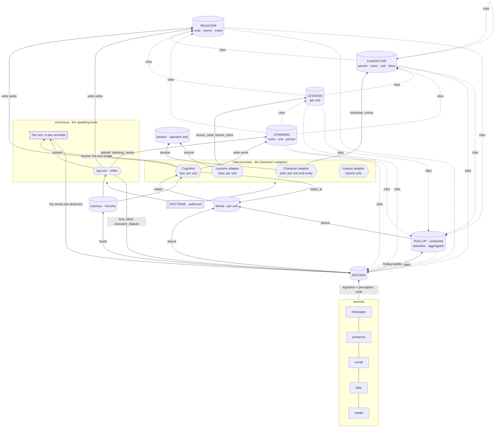

# 15 · Map

> 2026-10-03 (DEC-277): the shadow period is over. The Cognition session writes live (`[cognition] enabled`) and is the one background writer of notes, events, Standing and her reminders. The clocked note/proactive adaptors, the shadow machinery and `[cognition] mode` / `session_mode` / `shadow_session_seconds` named here are deleted; wording below that describes them is the plan as written, not current behaviour. See `70-migration.md`.

## 1. Every store, by layer

The layers are [05](05-data-model.md) §1's (DEC-249); "Live" is part of what a View assembles per turn, and Memory and the operator-only rows sit outside the flow.

| layer | what makes it this layer | stores | written by |
|---|---|---|---|
| **Authored** | a person decided it | doctrine (`nora/doctrine/`); the Dreamer doctrine and skills; `<room>` and `policy.toml`; `identity.toml`; reference photos for faces ([60](60-faces.md) §2) | the operator |
| **Live** (assembled into Views) | computed for this turn, never stored | the clock; her platform status (which platforms are up); the tool catalogue | code, per turn |
| **Record** | it happened and was seen | messages with edits, deletes and reactions; her own sends and decisions; presence fixes and collector polls; social items; play samples; perceptions (what media shows, whose face); face labels; `character_dispute` items; her tool calls and their results; her artifacts | code, at the moment it happens: ingestion for what others do; the turn and fire paths for her own sends, acts, tool calls and artifacts; the recording verbs `face_label` and `character_dispute` for a person's statement, authored by that person ([05](05-data-model.md) §1) |
| **Rollup** | code computed it from the Record | episodes: stay, trip, co-location, face co-appearance, outing, play session, daybook, response · aggregates: place, occupancy, rhythm, corridor and trip speeds, tie, play profile ([25](25-rollup.md)); face templates; anomalies are computed on read, not stored | code only |
| **Notebook**: its tiers **Register**, **Character**, **Lessons**, **Standing** | an adaptor concluded it: entries that cite the Record and Rollup and are never evidence ([05](05-data-model.md) §3) | Register: note, memo, event · Character: person, room (culture), unit (culture), Nora · Lessons: the unit's lessons · Standing: room, unit, person | Register: the Cognition adaptor and the tag path · Character: the Character adaptor only · Lessons: the Lessons adaptor only · Standing: the Cognition adaptor and the debrief |
| **Memory** (beside the flow) | Honcho concluded it | representation (Nora → person), self card (Nora → Nora), peer card, `remember` conclusions | Honcho; `remember` |
| **Operator-only** (outside the flow) | for the operator, never for her | tension rows ([55](55-self.md) §4); assess reports | the Character and Lessons adaptors; the Assess adaptor |

The Notebook is written only by the subconscious, one writer per tier, at or right after the cut-over
(DEC-249); until then the tag path and the debrief also write it, as the row
says.

## 2. The operator's first analogy, and the layer names that replace it

The analogy's words are not names ([05](05-data-model.md) §1); this table only
shows what each was pointing at.

| data stack | Nora |
|---|---|
| lake | **Record** |
| extract / enrich | ingestion and perception ([20](20-observe.md), [60](60-faces.md)) |
| transform, deterministic | **Rollup** ([25](25-rollup.md)) |
| transform, judged | the Dreamer's adaptors ([00](00-intent.md) §3) writing Register, Character, Lessons, Standing |
| warehouse | the **Notebook**: Register, Character, Lessons, Standing ([05](05-data-model.md)) |
| row-level security | **lineage** and `exclude_persons`, applied at assembly ([10](10-tiers.md) §3) |
| mart | **Views**: per-reader slices assembled at read time, never stored, under lineage for the reader's room and with withdrawal applied, through one assembly path: the tag and fire turns' pushed blocks (§3), the Cognition session's grounded agenda, portal pages, later recommendations ([05](05-data-model.md) §6 lists today's assemblers and where they depart from one path) |
| dashboard, analyst | the speaking turns, which speak from their View, and the Cognition session, which thinks with its own |
| queries | read tools (§4), each a View cut on demand |
| action | the act verb and the fire path |

## 3. Context pushed into the prompt: small indices only

Pushed blocks are few and short, because every per-turn line costs every turn
and a row that varies per turn ends the cached prefix's hit rate (the comment
on `culture` in `_BLOCKS`, `nora/agent/prefill.py`). Everything else is pulled
(§4). Every pushed block carries its age, and renders each row, field or
section only where its lineage passes for the room ([10](10-tiers.md) §3).

| block | layer · tier | subject | pushed into | size |
|---|---|---|---|---|
| doctrine (system prompt) | Authored | Nora | every turn | — |
| `<room>` | Authored | a room | proactive only today (`this_room_is` on `<presence>`, `nora/language/proactive.py` (deleted 2026-10-03, DEC-277)); tag and fire turns do not get it (`prefill.py` calls `render_presence` without `room_is`); note-candidates and culture get `description_for`. Cognition gets it for every bound room | one line |
| `room_members` | Authored (identity.toml, through the room's `persons` in policy.toml) | a room | tag, fire; not the relevance gate or the public summons | one line per listed person |
| `tool_catalogue`, `presence` (her platform status, not presence fixes), now | Live | — | tag, fire | — |
| `group_transcript` | Record | a room | tag, fire | window |
| `loop_decisions` | Record | the unit | fire (participation, proactive), cognition | recent |
| `notes` | Register · note | the unit | tag, fire, cognition | titles |
| **`memos`** (new) | Register · memo | the unit | tag, fire, cognition | titles |
| **`events`** (new) | Register · event | the unit | tag, fire, cognition | next 14 days and last 48 hours, one line each, with each field's mode and `as_of` |
| `culture` | Character · room | a room | tag, fire, cognition | capped |
| **`self`** (new, step 8) | Character · Nora | Nora | tag, fire, cognition, after the doctrine and below it; her whole account ([55](55-self.md) §3) | capped in lines |
| **`lessons`** (new, step 8) | Lessons | the unit | tag, fire, cognition, after the doctrine and below it | the unit's lessons, under a hard size cap ([50](50-character-and-standing.md) §6) |
| `standing`, `standing_working_set` | Standing · room | a room | tag, fire | as today |
| `self_card` | memory | Nora | tag, fire; deleted 2026-10-07 by the `self` block (DEC-292) | as today |
| `peer_card`, `peer_history`, `people_in_window` | memory | a person; the people in the window | tag, fire | as today |

**As built (step 2, lineage half, DEC-236).** The pushed blocks that render
derived rows today are `notes` (per row), `standing` and
`standing_working_set` (Standing's two sections) and `culture` (one section);
every other block is authored, live, this room's Record or memory. They
filter in `nora/agent/prefill.py` under `[lineage] mode`: `shadow` records
what would be withheld on the `agent.prefill` span and renders everything,
`on` drops a failing row or section whole and keeps the rest. A room's own
backfilled rows render byte-for-byte as before in that room.

## 4. Context pulled by a read tool

| tool | reads | returns | new? |
|---|---|---|---|
| `record_query(scope, from, to, author?, text?)` | the Record | messages and items in an interval; lexical search by pg_trgm, measured on Cantonese (design/dreamer-agent-loop/24-embedding-seam.md §2) | **new**: Postgres messages have no text index today; Honcho's search (`search_memory`, `search_memory_workspace`) is memory |
| `rollup_read(kind, subject, interval)` | the Rollup | episodes and aggregates | **new** |
| `where_been`, `routine_read` | the Rollup (presence) | stays, places, rhythm; a forecast from the rhythm (DEC-215) | exist; tag path |
| `note_read`, `note_search` | Register · note | a note body; matching notes | exist |
| `memo_read` | Register · memo | a memo body | **new** |
| `event_search(place?, person?, interval?)` | Register · event | events | **new**; `list_events` is per room, filtered by status only |
| `character_read(entity)` | Character | an account | **new**; instead of an always-on person block |
| `standing_read(subject)` | Standing | a room's, the unit's or a person's Standing | **new** |
| `social_items(person, interval)` | Record · social | ingested stories, posts, reels with their perceptions | **built** as `social_read` (below); the live `instagram_*`, `x_*`, `linkedin_*` reads stay on the tag path and are withheld from cognition ([20](20-observe.md) §2) |
| `about`, `ask_memory`, `search_memory`, `search_memory_workspace` | memory | Honcho | exist |

**`record_query` as built (step 2, DEC-236).** `record_query(start, end?,
scope, author?, text?)`: `from`/`to` are `start`/`end` (Hong Kong time, a
date meaning that day), `scope` is `this_room` or `all_rooms`, and `all_rooms`
reads only the unit's rooms whose `message` lineage passes for the turn's
room, whose live roster it reads for that (unreadable: no other room), saying
when some were left out. `author` resolves in this room only
(R-21). `text` matches by containment (`ilike`) or pg_trgm word similarity at
0.5, the value 24 §2 measured for a Cantonese term inside a sentence, both
served by `idx_messages_body_trgm`; a hit that only nears the words is marked
`near`. At most 30 hits, oldest first, each with its edit, reactions and a
`deleted` mark; a deleted message's words are withheld until step 2c hides it.
Statuses: ok, nothing_found, ambiguous, unavailable. Offered only with
`[record_query] enabled` (shipped `false`). Its verb, `query`, is new
(`tests/architecture/test_tool_names.py` says why). Vectors are not used (80
§4 leaves them optional).

**`social_items` as built: `social_read(person, interval)`** (2026-10-17),
named `<domain>_<verb>` because ADR 0015 §1 has a planned name follow the rule
before it is built. One person's recorded stories, posts and reels
([22](22-social-stream.md) §5) posted in the interval (`rollup_read`'s ISO 8601
form), newest first, read through `SqlSocialStreamStore.items_of`. Scope is the
`social` lineage predicate: the name resolves only among the persons the
agenda item's room lists, so an author that room does not list (or a `*` room)
answers like a name nobody uses. An item of a person with `social = false`,
and one with a `social_item_state` row (gone or hidden), is never read, the
store's own `_readable` rule. Each item says what it is (`Instagram story`,
`Instagram post, co-authored`) and when it was posted with its age; its
caption is marked as the author's published words (the `untrusted` framing
every memory-bearing result carries); `seen` is its media's title and
description, or `not read yet`; its `location` only where the `presence`
predicate passes for the author (the room's `location` flag and the live
DisclosureGuard). An item carrying an identifier is withheld whole (R-18), a
location carrying a coordinate is dropped alone (R-28). At most 20 items and
6000 characters, saying `truncated` when cut. Statuses: ok, nothing_found,
ambiguous, unavailable. No flag (a SELECT, like `rollup_read`); Cognition-only
(`DREAMER_LOOP_TOOLS`), never on the tag or fire path. No item is citable yet:
the result carries no row id, so no write can rest on one ([22](22-social-stream.md) §6).

Every read tool applies lineage for the room its turn or agenda item is bound
to. Cognition has no room of its own: each agenda item binds one, and that
item's room-scoped reads resolve through it ([30](30-cognition.md) §1).

## 5. The flow, drawn as a graph

A graph here is a way of reading the typed references between rows (cites,
about, links), not a store: nothing is a knowledge graph, and the storage is
relational ([05](05-data-model.md) §5, [80](80-prior-art.md) §5). The data
model's own flow, with the Views, is [05](05-data-model.md) §8.

Solid arrows are writes, reads and stimuli; dotted arrows are citations,
which only reach the Record and the Rollup (links between entries point down, [10](10-tiers.md) §2). What she says becomes Record and raises no stimulus
([20](20-observe.md) §3). Every adaptor reads the tiers and blocks it needs;
the read arrows are left out. The conscious and the subconscious are the operator's model
([55](55-self.md) §6): the subconscious drives the conscious, through the
pushed blocks and `remind`; the conscious reaches the subconscious only as
Record and as ordinary Register and Standing writes.

## 6. Who may write what

| writer | Record | Rollup | Register | Character | Lessons | Standing | tension | memory | doctrine |
|---|---|---|---|---|---|---|---|---|---|
| ingestion (code) | **yes** | — | — | — | — | — | — | feed | — |
| Rollup builder (code) | — | **yes** | — | — | — | — | — | — | — |
| Cognition adaptor | — | — | **yes** | — | — | **yes** | — | — | **never** ([55](55-self.md) §3) |
| Character adaptor | — | — | — | **only writer** | — | — | via `character_revise` | — | **never** |
| Lessons adaptor | — | — | — | — | **only writer** | — | via `lesson_write` | — | **never** |
| Assess adaptor | — | — | — | — | — | — | — (reports and metrics only) | — | **never** |
| tag turn | `face_label`, `character_dispute` | — | **yes** | — | — | room, via debrief | — | `remember` | — |
| operator, or the subject | face labels (portal, [60](60-faces.md) §2) | — | via Nora | — | the operator's rollback by id, through `lesson_retire` | — | — | — | operator only; changes when the humans all agree |

Tension rows are read only by the operator ([55](55-self.md) §4).

**Amended by DEC-249** ([05](05-data-model.md) §7): the tag turn's Register
writes and the debrief's Standing write move behind Cognition at or after the
cut-over, so the tag turn's row keeps only the two recording verbs and
`remember`; it hands off to Cognition through a strong-cue stimulus. The
diagram's `TAG → REG` and debrief arrows describe the tree until then.

## 7. The as-of dimension

Every store above except memory is append-only in system time
([10](10-tiers.md) §8), so each has a second axis: *as of T*. The blocks and
read tools read the current state (as of now); `nora snapshot --at T`
([70](70-migration.md) §2) reads every store as of T, with the doctrine,
skills, config and model route in force at T, and the Rollup rebuilt to the
watermark T. Memory has no such axis.
