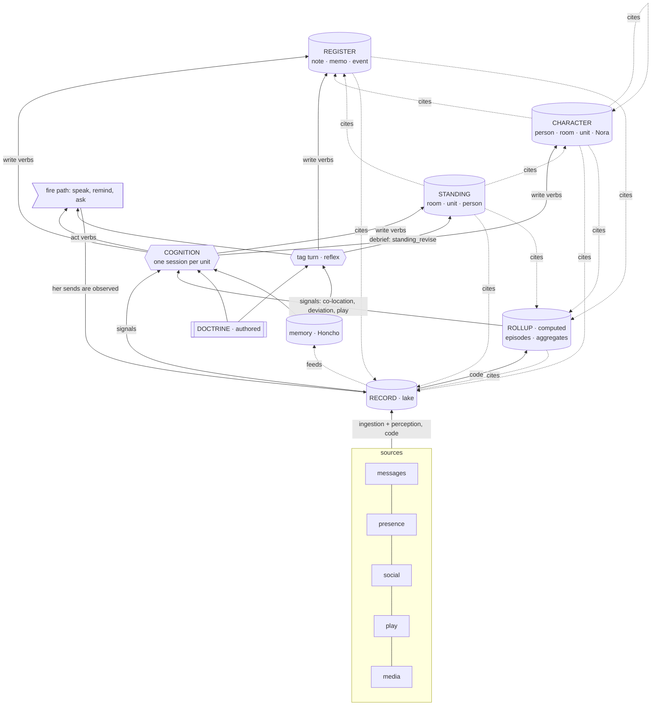

# 15 · Map

## 1. Every store

| kind | what makes it this kind | stores | written by |
|---|---|---|---|
| **Authored** | a person decided it | doctrine (`nora/doctrine/`); the Dreamer doctrine and skills; `<room>` and `policy.toml`; `identity.toml`; reference photos for faces ([60](60-faces.md) §2) | the operator |
| **Live** | computed for this turn, never stored | the clock; where she is (which platforms are up); the tool catalogue | code, per turn |
| **Record** | it happened and was seen | messages; her own sends and decisions; presence fixes; social items and edges; play samples; perceptions (what media shows, whose face); face labels and templates | code (ingestion; the decision log and the fire path for her own acts) |
| **Rollup** | code computed it from the Record | episodes: stay, trip, co-location, outing, play session, daybook · aggregates: place, rhythm, anomaly, route, tie, play profile ([25](25-rollup.md)) | code only |
| **Register**, **Character**, **Standing** | cognition concluded it | Register: note, memo, event · Character: person, room (culture), unit (culture), Nora · Standing: room, unit, person | cognition; the tag path for Register and room Standing |
| **memory** | Honcho concluded it | representation (Nora → person), self card (Nora → Nora), `remember` conclusions | Honcho; `remember` |
| **Operator-only** | for the operator, never for her | tension rows ([55](55-self.md) §4) | cognition, via `character_revise` |

## 2. The operator's analogy, laid out

| data stack | Nora |
|---|---|
| lake | **Record** |
| extract / enrich | ingestion and perception ([20](20-observe.md), [60](60-faces.md)) |
| transform, deterministic | **Rollup** ([25](25-rollup.md)) |
| transform, judged | **cognition** ([30](30-cognition.md)) writing Register, Character, Standing |
| warehouse | Rollup + Register + Character + Standing |
| row-level security | **lineage** and `exclude_persons` ([10](10-tiers.md) §3) |
| dashboard | small indices pushed into every prompt (§3) |
| queries | read tools (§4) |
| action | the act step and the fire path |

## 3. Context pushed into the prompt: small indices only

Pushed blocks are few and short, because every per-turn line costs every turn
and a row that varies per turn ends the cached prefix's hit rate (the comment
on `culture` in `_BLOCKS`, `nora/agent/prefill.py`). Everything else is pulled
(§4). Every pushed block carries its age.

| block | tier | subject | pushed into | size |
|---|---|---|---|---|
| doctrine (system prompt) | Authored | Nora | every turn | — |
| `<room>` (tag and fire: `room_is` on `<presence>`) | Authored | a room | tag, fire, cognition | one line |
| `tool_catalogue`, `presence` (where she is), now | Live | — | tag, fire | — |
| `group_transcript` | Record | a room | tag, fire | window |
| `loop_decisions` | Record | the unit | fire (participation, proactive), cognition | recent |
| `notes` | Register · note | the unit | tag, fire, cognition | titles |
| **`memos`** (new) | Register · memo | the unit | tag, fire, cognition | titles |
| **`events`** (new) | Register · event | the unit | tag, fire, cognition | next 14 days and last 48 hours, one line each, with reasoning and `as_of` |
| `culture` | Character · room | a room | tag, fire, cognition | capped |
| **`self`** (new) | Character · Nora | Nora | every turn | capped in lines |
| `standing`, `standing_working_set` | Standing · room | a room | tag, fire | as today |
| `self_card` | memory | Nora | tag, fire | as today |
| `peer_card`, `peer_history`, `people_in_window` | memory | a person; the people in the window | tag; fire | as today |

Every block applies lineage per room before it renders a row.

## 4. Context pulled by a read tool

| tool | reads | returns | new? |
|---|---|---|---|
| `record_query(scope, from, to, author?, text?)` | the Record | messages and items in a span; lexical search by pg_trgm, measured on Cantonese (design/dreamer-agent-loop/24-embedding-seam.md §2) | **new**: the Record has no search today |
| `rollup_read(kind, subject, span)` | the Rollup | episodes and aggregates | **new** |
| `where_been` | the Rollup (presence) | stays, places, rhythm | exists; tag path |
| `note_read`, `note_search` | Register · note | a note body; matching notes | exists |
| `memo_read` | Register · memo | a memo body | **new** |
| `event_search(place?, person?, span?)` | Register · event | events | **new**; `list_events` is per room, filtered by status only |
| `character_read(entity)` | Character | an account | **new**; instead of an always-on person block |
| `standing_read(subject)` | Standing | a unit's or a person's Standing | **new** |
| `social_items(person, span)` | Record · social | ingested stories, posts, reels with their perceptions | **new**; `instagram_read` stays the live fetch |
| `about`, `ask_memory`, `search_memory` | memory | Honcho | exists |

Every read tool applies lineage for the room the turn is in. Cognition, which
has no room, reads freely within its unit and applies lineage at the act step,
before anything leaves.

## 5. The graph

Solid arrows are writes, reads and signals; dotted arrows are citations,
which only point down. What she says becomes Record and raises no signal
([20](20-observe.md) §3).

## 6. Who may write what

| writer | Record | Rollup | Register | Character | Standing | memory | doctrine |
|---|---|---|---|---|---|---|---|
| ingestion (code) | **yes** | — | — | — | — | feed | — |
| rollup (code) | — | **yes** | — | — | — | — | — |
| cognition | — | — | **yes** | **yes** | **yes** | — | **never** ([55](55-self.md) §3) |
| tag turn | — | — | **yes** | — | room, via debrief | `remember` | — |
| operator | — | — | via Nora | — | — | — | **yes** |

Tension rows ([55](55-self.md) §4) are written by cognition through
`character_revise` and read only by the operator.
