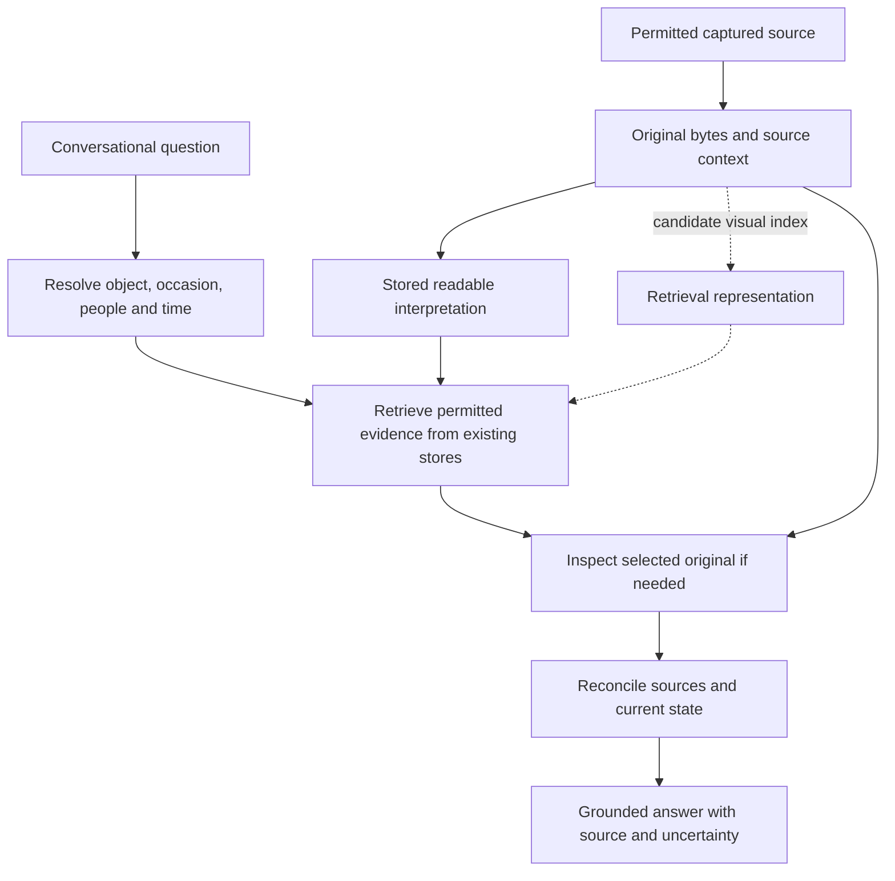

# Proposed coordination

Status: proposed. These are responsibilities to fit into Nora's existing
orchestration, not three mandatory new services or three additional model calls.

## Acquisition and answering have different flows

Acquisition makes a captured source discoverable. Answering identifies which
source matters now. A cached generic reading avoids re-reading every object;
a fresh specific read supplies a detail that generic comprehension omitted.
A video reader can supply timecoded observations to the reply model. An
embedding supplies candidates, not the final interpretation or truth.

## Resolve the question once

Resolve “that image”, “we”, “at that time” and “where we're going” against the
actual conversation context. Produce a computable reference/query with its
scope, object handles, time constraints and remaining ambiguity. Do not let
each downstream tool independently reinterpret the same raw sentence.

The model can interpret language, choose tools, reformulate searches and ask a
focused follow-up. Code binds handles to originals, applies access boundaries,
supplies timestamps, returns typed outcomes and preserves provenance. This
does not call for a mechanical intent classifier or a separate general planner.
Where the crucial occasion cannot be resolved, retain alternatives or ask for
the missing anchor; similarity must not silently select one.

## Retrieve by the property being asked about

An attached image has an exact reference: fetch that object before searching.
A current destination asks for an active agreement: read existing event/current
state and recent corrections before using semantic history. A historical meal
may require messages, media and their relationships, with visual search helping
when captions omit the food. Stored personal conclusions can help interpretation
but must not masquerade as direct records of an occasion.

Select the permitted room/unit/workspace boundary **before** searching its
index or store. A global search followed by a room filter is not the boundary.
Keep the existing disclosure and identifier-egress constraints. Retrieval of
person-related evidence must preserve whether the person authored a post,
appeared in it, or was explicitly associated with the event.

A candidate's embedding/reranker score orders candidates. It is not the
probability that a claim is true, and cannot override current canonical state.
Keep keyword and exact-reference retrieval where they work; embeddings do not
replace dates, source relationships or corrections.

## Assemble evidence that explains itself

The proposed shared result is an evidence packet assembled from existing
typed records. Field names and storage remain to be designed against existing
interfaces. Do not add a duplicate memory database just to realize this list.

| Evidence property | Why the answer needs it |
|---|---|
| Source reference and permitted scope | Re-open the source and explain where the claim came from |
| Person relationship, when known | Distinguish author, depicted person and participant |
| Capture/observation, publication and event times separately | Avoid treating upload time as dinner time |
| Reading or direct text, with derivation model/time | Distinguish model interpretation from an explicit statement |
| Coverage and read outcome | Distinguish unseen, outside searched range, unreadable and no match |
| Existing event link and superseding source, when supported | Distinguish old proposal from current agreement |

Unknown fields stay explicit. A meal association requires supporting context;
neither food recognition nor date proximity supplies every missing relationship.
The packet must identify which end of a transcript is newest and carry the age
of state whose freshness matters. Fit all model-facing blocks and occasions
through existing context assembly rather than a bespoke prompt builder.

The same comprehend → measure → serialize discipline applies: comprehend the
resolved question once; measure scoped evidence and source relationships
fail-closed; serialize canonical results and answer provenance through existing
audit surfaces. `ok`, `nothing_found` and `unavailable` remain distinct.
An inaccessible provider or missing index cannot become “you never posted it”.

## How the three answers would work

**Image:** resolve the attached handle; use its cached description for a broad
question. For “what does the small sign say?”, inspect the original with that
question. Report unreadable detail as unreadable. No semantic search is needed
to identify an already bound object.

**Destination:** identify the outing and participants; retrieve current plan
state and recent agreement. A later correction supersedes an earlier venue.
If there is only a proposal, say so. An old restaurant image may illustrate a
venue but cannot establish that it remains the destination.

**Dinner:** resolve the occasion; search permitted messages/media within the
relevant time/context, adding visual candidates if text misses them. Inspect
the selected original when the stored reading cannot answer. Verify how the
image relates to the occasion and people. Give the supported claim, such as
“the post around then shows sushi”; claim “we ate sushi” only with evidence of
that participation and event. If acquisition coverage is unknown, say Nora
could not establish the meal from the available sources.

## Smallest viable choice

1. Exercise existing tools with explicit references, adequate temporal context
   and grounded evidence assembly. This is the first candidate.
2. Add shared retrieval over existing stores, including WeMM visual search,
   only if representative journeys show the text path misses useful evidence.
3. A new event/entity memory subsystem is not justified by this probe. It
   creates another owner of truth and risks rebuilding deprecated tiers.

The preferred direction is the first choice, extending it to the second when
measured visual failures require it. Reopen this direction if existing stores
cannot represent a demonstrated source relationship or scoped query, or if
the integrated candidate fails the journey measurement. Hardware feasibility
and external leaderboards alone cannot settle the orchestration design.
