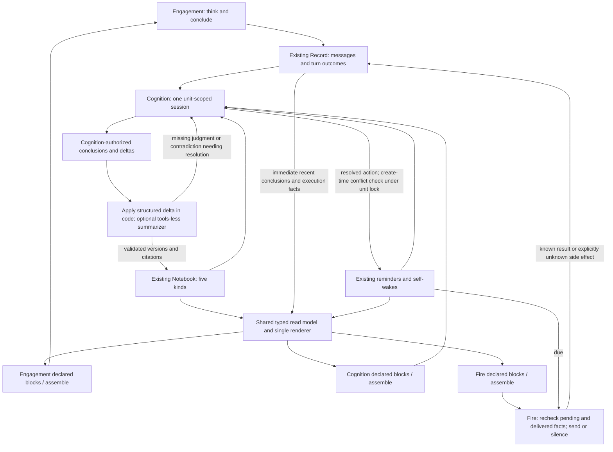

# 20 · Shared cognitive state

## 1. Authority and status

**Operator decision, 2026-10-30; design only.** This amends [00](00-design.md)
§§4–5 and the older writer/migration wording linked above. Standing remains an
operator shorthand for a shared persistent cognitive **state/view**, never a
sixth Notebook kind or a new store. The five kinds remain note, topic, lesson,
profile and decision. [10](10-relations.md)'s evidence/link distinction and the
amended graph-derived topic activity still hold. Cognition follows the
[one-session ruling](../unified-memory/29-one-cognition-session.md), not the
older three-session topology.

The operator-reported incident motivates more than a prompt cleanup: separate
creating sessions scheduled the same ask with different citation sets and room
addresses; optional note links were missing; neither had a complete pending
view. A local transcript prevented a local repeat, while a cross-room action
log said that Nora spoke without identifying the subject. This is incident
context supplied by the operator, not a new runtime audit or a claim that this
document fixes delivery. No production content is needed to reproduce it.

### Current source behavior, verified at `bf0b800c42aba8cb7b6cdb009913c53c5aa47f02`

| source read, including caller | what it establishes, not a target claim |
|---|---|
| `nora/engagement/pipeline.py`: `_run_turn` → `_debrief` → `nora/engagement/stages/debrief.py::run` | When wired and a trace exists, the debrief is awaited outside the response agent, in `finally` before the conversation slot is released. It uses a tools-less completion; an overlong answer may get a consolidate retry within the same timeout. It currently folds a room paragraph and working set, rather than merely applying recorded conclusions. |
| `nora/agent/prefill.py::build_prefill` → `_standing_block`, `_standing_working_set_block`, `render_ledger` | Legacy paragraph, findings and ledger can be rendered together through declared blocks. These are separate presentations today. |
| `nora/app/fire.py::build_context` → `_read_ledger` → `nora/agent/standing_ledger.py::read_ledger` | Fire independently builds context, then uses the common prefill. Ledger reads select unit/room entries and apply destination disclosure. A failed fire ledger read currently returns an empty tuple after recording the error; the target below must make that failure legible. |
| `nora/app/cognition_session.py::_session_input` → `render_agenda`; nested `remind` → `_pending_reminds` and `nora/domain/cognition_remind.py::check_remind` | The session builds its own agenda input. Reminder creation reads pending rows under the unit lock; the check compares platform, room and exact citation set. The nested tool can link a cited note, but that link is optional. |
| nested `remind` → `nora/infra/sql/reminders.py::SqlReminderStore.create` | A linked proactive note has a database conflict arbiter and a duplicate result. This does not establish identity for unlinked actions or actions with different source sets. |

These are source observations, not deployed flag verification. The next
sections are operator decisions and proposed mechanisms, not descriptions of
already-built shared state.

## 2. Producers think; consumers share the result

| participant | produces / consumes | permitted writer authority |
|---|---|---|
| **Engagement** | Thinks during the response; records concluded options, criteria, leaning and conditions with source identities/citations. Consumes the shared view, including recent actions before Cognition runs. | Writes its conclusion and execution facts to the **turn Record**. Does not directly author a persistent Notebook decision. |
| **Cognition** | Thinks across the **unit**, reading pending/recent actions and producer conclusions; resolves missing judgments, consolidates and decides. | Authorizes Notebook decisions and revisions through the existing persistence/admission path; records its own session. Origin room is provenance/destination, not an agenda read/edit boundary. |
| **Proactive fire** | Reads the state and current delivery conditions; executes the authorized action or remains silent. | Produces execution facts only in the ordinary path. A new substantive decision is retained in the turn Record for later Cognition, never silently written into Notebook. |
| **Standing updater** (optional) | Receives explicit producer conclusions/deltas and the addressed prior versions. Faithfully materializes/summarizes them. | No independent cognitive authority. Code applies structured deltas; an optional tools-less LLM handles prose only under the producer's authorization. It cannot discover or decide new content. |
| **Shared reader / renderer** | Projects the same canonical entries, pending reminders/self-wakes and messages/turn outcomes for each occasion. | Read-only; code distinguishes execution facts from judgments and labels completeness/freshness. No Engagement/Cognition duplicate copies. |

**No second thinker in the updater.** No graph search, tools, autonomous agent,
new judgment, decision, commitment or reminder. It preserves uncertainty and
contradictions with their sources. If a conclusion lacks a judgment needed to
apply it, return it **unresolved to Cognition**, never complete it by inference.
No change means no rewrite or new revision. Already structured means code,
not another model call. A faithful application of a Cognition-authorized delta
is Cognition's write; an Engagement conclusion remains Record until Cognition
authorizes consolidation. Summarizing it never promotes its authority.

The updater may live inside existing Cognition persistence. This design
requires no independent wake, service or extra model call. Replacing today's
room debrief with this restricted role requires changing its inputs and
contract; its present tools-less implementation alone does not satisfy that
restriction. No synchronous extra Cognition call delays the next response.

## 3. Proposed end-to-end architecture



The read model is a typed **projection**, not a global commitment ledger or a
receipt store. Start with Notebook, current reminders/self-wakes, messages and
`tag_trace` outcomes. Extend those existing records only for demonstrated
missing properties. A new store needs evidence that these cannot represent the
required facts; this proposal provides no such evidence.

Each entry retains its canonical id, kind, unit, unit/room scope, status,
version, source references and provenance. The projection also carries read
status (`ok`, `nothing_found`, `unavailable`), as-of time, coverage and unresolved
references. Recent conclusions are labeled **Record, not yet consolidated**;
Cognition's decision cites those records rather than copying them into another
Engagement-owned store. Resolve a recent delta against the version it names;
never choose a winner by prose order. Keep competing conclusions visible.

**Scope is not audience intersection.** Cognition's knowledge, reads and
decisions are unit scoped, including room-scoped entries within that unit with
their scope preserved. Do not intersect the entire cognition input with every
agenda destination's audience. Cross-unit reads remain forbidden. Engagement
and fire receive destination-appropriate projections; scope and disclosure
remain distinct. Apply the current operator `content_checks` reversal: disabled
content filters are not silently reinstated here; admission, unit read scope,
consent, freshness, availability, budgets, credentials and doctrine protection
remain. Content-filter enabled-mode disclosure rules still apply when enabled.

Each occasion declares the shared block in its **own** `_BLOCKS` and calls
`assemble`. The shared contract is the typed reader/renderer, not the claim
that Cognition magically uses Engagement's prefill table. Keep the existing
self-describing outer `ContextBlock`; use compact Markdown/labeled lines inside.
Structured ids, scope, versions and provenance remain in storage/tool outputs.
Escape inner content through the existing renderer; it is data, not instruction.

## 4. Trigger, lifecycle and failure behavior

```mermaid
sequenceDiagram
  participant E as Engagement
  participant R as Existing Record
  participant V as Shared view
  participant C as Cognition
  participant N as Notebook / persistence
  participant Q as Reminder store
  participant F as Fire
  E->>R: Persist concluded reasoning and actual send outcome
  E->>V: Next turn reads current state
  V->>R: Read recent facts / unconsolidated conclusions immediately
  Note over E,C: Next response need not wait for a Cognition wake
  C->>V: Existing stimulus/wake: read complete relevant unit state
  C->>N: Authorize decision; apply delta (optional faithful summarizer)
  alt identity unresolved or read incomplete
    C->>R: Retain unresolved result; do not schedule autonomous action
  else subject and action demonstrably resolved
    C->>Q: Under unit lock: reread pending/recent facts, check conflict, insert
    Q-->>C: Created or conflict (store constraint where applicable)
  end
  Q->>F: Due action
  F->>V: Fresh pending + delivered facts + destination conditions
  alt already delivered, superseded, or unavailable check
    F->>R: Silence with reason / unresolved check
  else still valid
    F->>R: Retain action attempt identity
    F->>F: Deliver
    F->>R: Persist known delivery or unknown side effect
  end
  C->>R: Later wake reads results and any new substantive conclusion
```

- **On producer completion:** retain the concluded reasoning, sources and
  execution outcomes before the next dependent read. Immediate send-before-
  Cognition visibility comes from existing Record/outcome reads, not a newly
  consolidated Notebook entry. A missing persistence result is unavailable,
  never evidence that nothing was sent.
- **On Cognition wake:** read the complete relevant pending/recent-action view
  across the unit, including other destinations; consolidate producer decisions
  and authorize changes. Relevance selection cannot silently omit conflicting
  actions. A capped/partial view must expose missing coverage and block a
  negative conflict conclusion until the required remainder is read.
- **On materialization:** apply only explicit deltas with matching base versions
  and resolving citations. No-change is idempotent. Stale base, missing source,
  malformed response or timeout preserves prior content and retains the delta
  as unresolved in existing session/turn state for later Cognition. No guessed
  empty prior, no deletion from a failed summary, no retry that re-judges.
- **At creation:** visibility is necessary but insufficient. Within the
  existing unit lock, re-read pending/recent actions and resolve conflicts for
  the same subject **and action**, independent of room and exact citations.
  Use the existing store's atomic constraint where applicable; serialize the
  decision with provenance. A new plan is not a sent action. Separate legitimate
  actions/destinations require explicit producer intent, not incidental room
  inequality. Constraint coverage must be proved for the resolved representation.
- **At fire:** recheck delivered facts as well as pending state and current
  destination eligibility; a claimed due row alone does not prove the action
  still needed. An intervening Engagement send must be seen. If the check is
  stale, incomplete or failed, report unavailable and withhold autonomous send.
  Code records silence, known success, failure and unknown outcome distinctly.
- **Unknown delivery side effect:** never mark success or blindly retry. Retain
  the attempt/action reference and uncertainty in existing outcomes; reconcile
  with transport/delivery evidence before another send. Scheduling locks and
  shared context do not promise exactly-once external delivery or close the
  check-to-send race; concurrent Engagement/fire delivery needs an explicit
  serialization/reconciliation proof in the build.

## 5. Subject/action identity: bounded open design question

The requirements above are **not an implementation-ready identity algorithm**.
Use an existing shared object reference when evidence demonstrates that it
names the same subject, and resolve the intended action separately (an ask,
a follow-up and an announcement are not automatically the same action).
A shared note can help; `note_id` alone cannot solve different or absent links.
Different citation sets can describe one subject. No universal semantic hash,
text equality, forced note creation or guessed linkage is authorized.

An ambiguous/unresolved autonomous schedule must surface **unresolved before
scheduling**, returning to its producer to clarify through evidence. It is not
unique, conflict-free or `nothing_found`. Cognition may investigate in its
normal session; the materializer may not. The build must demonstrate resolution
and conflict behavior on generated cases before claiming cross-room deduplication.
Existing explicit human reminders do not acquire a mandatory Notebook note.

## 6. Old-content mapping and cut-over

| old content | canonical destination / preservation requirement |
|---|---|
| room Standing prose, `Where it stands`; ledger decision | decision: retain options, criteria, leaning, conditions and source turn records; split unrelated questions without losing the original revision |
| `standing_working_set`, `Found, not yet given` | relevant decision's **Options**, retaining `source`, `found_at`, expiry and whether disclosed (and to which destination); a finding is not a commitment |
| finding without a demonstrable decision mapping | explicitly unresolved mapping, readable with its legacy source; Cognition resolves it; never discard an orphan or manufacture a decision |
| ledger commitment; person `I owe them` | note owed by Nora, preserving closure condition/status and provenance |
| thread and room topic pointers | topic activity under the amended graph design: code counts judged relation evidence; Notebook topic holds the account |
| person `How they take me` | profile, with its Record/Rollup evidence |
| reminder/self-wake and execution result | existing schedule/outcome records projected alongside Notebook; no duplicate ledger and no forced note for a human-requested reminder |

Build one integrated reader/renderer with legacy adapters, then measure content,
source, scope and status parity across all three occasions. Remove superseded
duplicate renderings only after parity, including unresolved legacy material.
Old stored rows/revisions remain readable; do not rewrite history or drop tables
as part of presentation retirement. Render parity alone does not satisfy the
creation/fire requirements. The legacy migration's tag-path ledger writer and
a debrief making new decisions are superseded by §2, not prerequisites.

## 7. Generated hybrid input example

All labels below are invented. This illustrates rendered data, not a schema or
an identity-resolution algorithm. The outer boundary has the existing block's
type explanation; production rendering supplies its declared metadata.

```xml
<shared_cognitive_state unit="synthetic-unit" status="ok" as_of="synthetic-clock">
Notebook judgments; recent Record conclusions and code-built execution facts.
Coverage: complete relevant pending/recent actions in this unit.

## Decision · synthetic-decision · v3 · unit scope · open
Question: which generated option fits the demonstration?
Options: option Amber; source=synthetic-tool-result; found_at=T-2h;
  expiry=T+1h; disclosed=no
Criteria: generated cost ceiling. Leaning: Amber if the source stays current.
Reopen if: source expires. Citation: synthetic-turn-A.

## Recent Record · not yet consolidated
synthetic-turn-B · room Beta · T-1m: concluded “wait for confirmation”.
This conclusion is preserved; it has not revised the Notebook decision.

## Execution facts · rendered by code
synthetic-action-A · subject=synthetic-shared-object · ask-confirmation
Destination: room Alpha. Delivery: confirmed at T-30s; source=synthetic-send.
Pending: none for this resolved action. New plan is not delivery evidence.

## Unresolved
synthetic-candidate-B: subject link ambiguous; autonomous scheduling withheld.
</shared_cognitive_state>
```

## 8. Focused acceptance and limits

These are acceptance properties for the build, not a mandated test count or
claims of tests run by this docs update. Use generated fixtures, real caller
assembly and the smallest checks that distinguish the failure.

| case | required observable result |
|---|---|
| Same subject/action, two rooms, different citation sets and no note link | Resolved shared-object case conflicts at creation under concurrency and is rechecked at fire; ambiguous case returns unresolved before scheduling. Room/citation inequality never proves uniqueness. |
| Engagement sends before next Cognition | Another room's relevant view and due fire see the delivered fact immediately; an unconsolidated substantive conclusion is labeled Record. No extra synchronous Cognition call. |
| No-change delta, repeated application | No Notebook rewrite/version churn or new model call for structured/no-change input. |
| Updater asked to infer a missing leaning, commitment or reminder | No new judgment/write; explicit unresolved result for Cognition, with prior versions and contradictory conclusions preserved. |
| Stale base, failed/unknown source or partial pending read | Unavailable/unresolved, never empty/no conflict; prior content readable; autonomous schedule/send withheld. A successful complete read is the positive control. |
| Two units; two destinations in one unit | No cross-unit reads; unit Cognition can consider the whole permitted unit without agenda-audience intersection; destination projection respects entry scope and current enabled-mode disclosure rules. |
| Human-requested reminder without a note | Remains representable and readable/firable under its existing semantics; no synthetic note inserted to satisfy autonomous identity checks. |
| Legacy findings, commitments and threads | All source/time/expiry/disclosure/status facts and old revisions survive; unmapped findings are visible as unresolved; no duplicate rendering after parity. |
| Pending conflict races; intervening send; unknown delivery side effect | Applicable store constraint rejects concurrent duplicate creation; fire reads newer delivered facts; uncertain side effect is neither success nor blindly retried. No exactly-once claim from a model view. |

**Limitations and reopening conditions.** This design settles authority and
presentation, not identity resolution, transport atomicity, render budgets or
an implementation migration. Reopen the identity mechanism if generated cases
show that an existing object reference cannot distinguish subject and action;
retain unresolved handling until resolved. Reopen the projection/storage choice
only if source inspection and a reproduction show that existing stores cannot
retain or read the required provenance/outcomes. Reopen cut-over if parity loses
any legacy row, scope, citation or finding. The operator's five-kind taxonomy and
writer authority remain closed decisions; new evidence is surfaced to the
operator rather than silently changing them. No new counters, global commitment
store, autonomous updater or deployment/config changes are part of this node.
