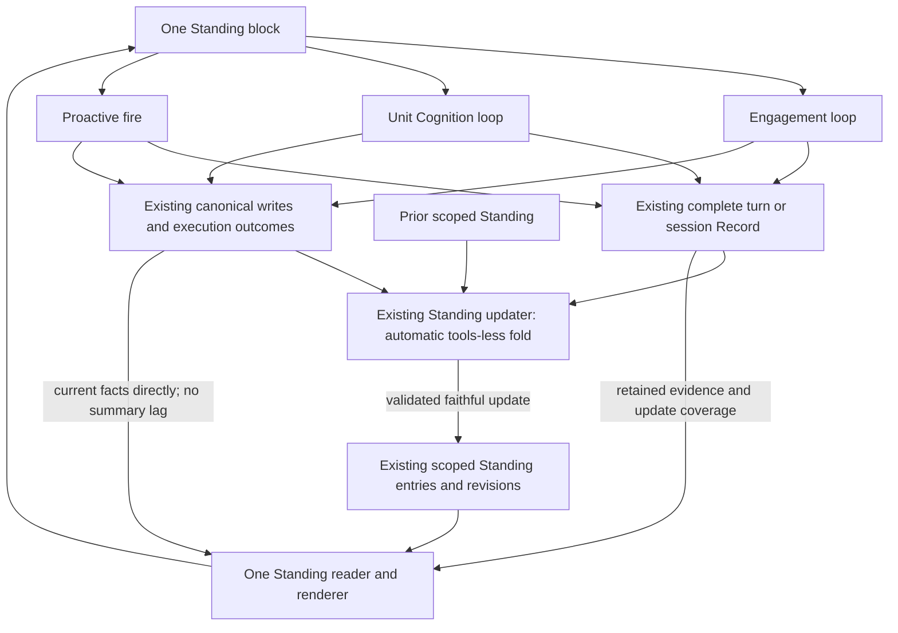

# 20 · One Standing

## 1. The problem and the decision

**Operator clarification, 2026-10-31; design target.** The separate Standing
paragraph, Standing working set and Standing Ledger overlap with pending
arrangements and loop outcomes. A turn can see part of Nora's state while
missing an arrangement or delivery recorded in another room of the same unit.
The reported repeated cross-room ask motivates both unified visibility and
code-level action deduplication; a summary alone cannot establish uniqueness.
No production conversation is reproduced here.

**Consolidate into the existing Standing.** One model of her current state, one
common rendering contract and one public context block named `standing`, used
by Engagement, Cognition and Proactive. Decisions, findings, arrangements,
commitments, open questions and actual outcomes appear together. This replaces
the earlier version of this node: a separate `shared_cognitive_state` block,
producer-called `decision_conclude`, and a wired debrief that does nothing are
not the target. Renaming the extra block alone does not complete consolidation.

Reuse the existing Standing updater and scoped Standing Ledger machinery;
remove superseded prompt, tool and presentation paths. Standing is a derived
presentation, not a sixth Notebook kind, a new memory store or another agent
loop. The five-kind Notebook taxonomy in [00](00-design.md) remains; converting
all legacy storage to that taxonomy is outside this consolidation.

## 2. Producers, updater and consumers

| participant | produces | consumes / authority |
|---|---|---|
| Engagement loop | Its ordinary recorded exchange: expressed decisions, tool calls/results, authored sends and actual turn outcome | Reads destination-appropriate Standing; thinks and acts normally. No extra self-report call. |
| Cognition loop | Its ordinary unit session Record, expressed decisions and existing canonical writes/schedules | Reads unit Standing across all unit rooms. Owns substantive Notebook judgments through existing verbs. No extra self-report call. |
| Standing updater | A faithful, source-grounded update of Standing after a completed loop | Reads prior Standing plus the complete retained Record and canonical results. Organizes decisions already expressed, work done, pending work and uncertainty. No new substantive decision or autonomous act. |
| Existing stores / execution code | Actual pending, firing, sent, failed, cancelled and unknown outcomes | Remain authoritative for schedules and execution. A model summary cannot change these states. |
| Proactive fire | An execution attempt and its actual result, retained through the existing Record/outcome path | Reads Standing and fresh action-specific checks; executes an authorized act or withholds. Its resulting facts feed later Standing reads. |
| Common Standing reader / renderer | One projection over existing scoped entries, legacy content and current canonical facts | Read-only; all three occasions use the same format through their own declared context assembly. |

**Standing is an auditor of the completed Record.** A tools-less LLM can read
and organize an expressed choice without a special structured declaration. It
cannot recover hidden reasoning, infer an unstated leaning, decide a new plan,
create a reminder or upgrade a failed attempt to success. Contradiction and
missing evidence remain explicit; Cognition can resolve them in its normal
loop. An incidental mention is not automatically a commitment.

The updater may revise derived Standing using the existing validated writer.
That is not authority to invent or revise a substantive Notebook judgment.
Engagement-derived content remains attributed to its Record; Cognition-derived
content retains its session and canonical-entry references. Summarizing either
does not silently change who decided it. Remove `decision_conclude` from both
tool surfaces and retire its routing instructions and eval cases.

## 3. Flow and update boundary



```mermaid
sequenceDiagram
  participant L as Engagement or Cognition loop
  participant R as Existing Record
  participant U as Standing updater
  participant S as Existing Standing persistence
  participant Q as Canonical schedule and outcome stores
  participant N as Next consumer
  L->>Q: Ordinary writes / action attempts
  Q-->>L: Actual results
  L->>R: Retain completed exchange and results
  L->>U: Automatic completion hook, no model-selected tool
  U->>S: Read prior and addressed revision
  U->>R: Read complete retained exchange
  U->>Q: Read canonical results needed for this update
  alt grounded change
    U->>S: Validated update with sources and expected revision
  else no change, incomplete evidence, failure or stale revision
    U->>S: Preserve prior; expose no-change or unavailable coverage
  end
  N->>S: Read scoped Standing
  N->>Q: Overlay current execution facts / action-specific checks
```

The Engagement completion hook and Cognition session completion hook invoke the
same updater contract automatically, including deliberately silent or failed
turns whose Records exist. Reuse the existing debrief occasion and context
assembly; no second Cognition session, autonomous wake, graph-search loop,
new service or agent tool is introduced. Fire is primarily a consumer: its
execution facts already enter canonical outcomes and need no new deliberation.

The updater's input is the **complete retained exchange for the completed
turn/session**, with ordinary visible assistant content, calls paired to actual
results, turn outcome, sources and coverage. A `turn_items` projection containing
only selected tool calls is not a substitute. Do not request, reconstruct or
persist private chain-of-thought. If the retained Record is capped or missing,
label that limitation; never claim it is complete or invent a decision to fill it.

Complete the local Record/save and bounded updater handoff before the next
queued dependent context is assembled. Reuse current timeouts and slot/session
release guarantees; cancellation or a failed store must not wedge the loop.
Cross-process reads may meet an update in progress: retain the prior and expose
the source watermark/coverage rather than claiming a newer complete snapshot.
Current sends and pending/firing/cancelled rows are read from their canonical
stores immediately, so no consumer waits for a prose fold to learn their state.

## 4. Scope, persistence and rendering

**One model does not mean one storage key.** Room Standing and unit Standing are
stored separately under their actual scope. Engagement's room-derived position
is room-scoped; Cognition's cross-room state is unit-scoped. Unit is the knowledge
read boundary. Room remains source/delivery context and any narrower disclosure
scope; an agenda's rooms are not the unit's complete room set.

Use existing scope-aware Standing Ledger entries/revisions for decisions,
commitments and threads, plus legacy Standing/working-set adapters where needed.
This already represents room and unit scope; do not fabricate a room id for a
unit or introduce a second store. Read legacy paragraphs/findings into the same
Standing representation. Keep old rows and revision handles readable. This task
does not force an unrelated Notebook kind migration or create notes merely to
hold summary text. Canonical reminders, self-wakes and sends stay in their own
existing stores and are projected, not copied into a rival lifecycle ledger.

Every item carries its id, scope, current state, source references, as-of time
and relevant version/closure condition. Options, criteria, leaning and reopening
conditions are retained when present. Findings retain source, found time, expiry
and disclosed/unsent status; preserve the existing 48-hour finding TTL. No
unrelated finding is dropped because it cannot be mapped to a decision; retain
its legacy provenance and unresolved relationship.

Cognition reads across the unit without intersecting every agenda audience.
Engagement and fire project for their actual destination. Preserve existing
per-entry and per-section lineage, exclusions, consent and enabled-mode
`visible_sections` / `ledger_permits` behavior; do not replace them with a
room-only test or invent new audience restrictions. The current content-check
reversal remains in force. Missing source or gate information is unavailable,
never permission to disclose. Updater source requirements are derived by code
from the Record/results and combined for every derived item, not asserted by
the summarizing model. Scope-aware validation and expected-revision checks
still apply to writes.

Each occasion declares **`standing`** in its own `_BLOCKS` and uses `assemble`.
Use the existing self-describing context wrapper and compact labeled prose
inside; no forced inner XML schema. Retire the separate standing-working-set,
standing-ledger and shared-cognitive-state renderings after content/source/scope
parity. Remove redundant injection work as well as duplicate visible text.
Notes unrelated to this consolidation and other unrelated context blocks keep
their existing roles; this is not permission to aggregate every memory surface.

## 5. Updates, failure and deduplication

- **No change:** preserve the current content/revision. Replaying the same
  Record is idempotent; bookkeeping alone must not create another revision.
  An unchanged decision does not become a fresh decision on every fold.
- **A change is grounded:** update only the affected items/sections, retaining
  still-open matters and omitted fields. A missing output section does not
  cancel an obligation. Competing source decisions remain visible until the
  responsible loop resolves them.
- **Failed update:** timeout, malformed output, missing evidence or stale base
  preserves prior state and exposes incomplete update coverage. No empty-prior
  overwrite, silent legacy fallback, or independent synthesis of a new plan.
- **Actual execution wins:** scheduled is not sent; attempted is not completed;
  cancelled remains cancelled. Known success, known failure and unknown side
  effect are distinct. Never blindly retry an uncertain external send.
- **At reminder creation:** canonical subject/action resolution and atomic
  checks cover the whole unit's pending and FIRING rows and recorded deliveries,
  independently of citation-set or destination equality. A multi-destination
  intent is explicit and inserted all-or-none. Ambiguous identity is unresolved,
  not a guessed unique action. Preserve ordinary human reminders without forcing
  a new note. Reuse the existing reminder store/constraint and unit lock.
- **At fire:** recheck the same resolved act's delivered/superseded facts and
  current destination eligibility. An incomplete required check withholds and
  reports unavailable. Unrelated old history or a display-only cap must not
  permanently prevent all proactive activity; distinguish coverage needed for
  this act from optional display coverage.

The unified Standing improves the model's awareness. Code-level arbitration is
still necessary for concurrent action creation and recorded delivery checks.
Unlinked conversational sends cannot be semantically deduplicated merely by
similar prose. Do not claim exactly-once transport or that consolidating prompts
closes the check-to-send race. Reopen only the smallest missing identity or
reconciliation mechanism when a generated/live case demonstrates that gap.

## 6. One rendered format

All names below are generated. The outer block uses normal context metadata;
this example is data, not instructions and not an inner machine-readable schema.

```xml
<standing unit="synthetic-unit" status="ok" as_of="synthetic-clock">
Nora's current state, organized from completed Records and canonical results.
Update coverage: room Alpha through synthetic-turn-A; unit through synthetic-session-B.

## Decisions and open questions
synthetic-decision · unit scope · open · revision 3
Question: which generated option fits? Options: Amber, Blue.
Leaning recorded in synthetic-session-B: Amber if the source remains current.
Reopen if: source expires. No confirmation recorded yet.

## Findings, not yet given
synthetic-finding · room Alpha · source=synthetic-tool-result
Found at T-2h; expires T+46h; bears on synthetic-decision; not yet disclosed.

## Arrangements and actual outcomes
synthetic-act · subject=synthetic-decision · action=ask-confirmation
Sent to the permitted destination at T-30s; source=synthetic-send.
Pending: none for this resolved act. A separate plan is still only planned.

## Still open / unresolved
synthetic-question: no expressed decision in the retained Record.
synthetic-attempt: delivery unknown; do not infer success or silently resend.
</standing>
```

## 7. Acceptance and cut-over

This matrix specifies behavior, not a mandated test count. Use generated cases,
real caller assembly and the smallest checks that fail when the property breaks.

| case | required observable result |
|---|---|
| Ordinary Engagement decision with no special tool | Completion automatically updates Standing from the full retained exchange; expressed choice and source survive. No `decision_conclude` in either catalogue. |
| Cognition decision, silent turn or unsuccessful tool call | The same automatic updater runs; the actual result is retained; silence/failure is not success. No extra deliberation or self-report obligation. |
| All three consumers | Exactly one Standing block with the common format; no competing paragraph, findings, ledger or shared-state block. Contents and sources formerly shown remain readable. |
| Room and unit state | Distinct scope keys/versions; whole-unit Cognition visibility, no cross-unit read; destination disclosure still matches real source/section predicates. |
| Repeated Record, no change, omitted section, stale base | No revision churn, lost open obligation or overwrite; valid changed input is the positive control. |
| Invented choice, missing source, contradiction, timeout | No invented judgment or schedule; prior retained with unresolved/unavailable coverage. |
| Pending, FIRING, sent, cancelled and unknown | Real canonical states visible promptly across unit rooms; summary text cannot override them. |
| Same resolved act in two rooms under concurrency | Atomic conflict; delivered act blocks a later duplicate; explicit legitimate multi-room batch remains all-or-none. |
| Legacy finding, decision or commitment | Content, provenance, TTL, status and enabled-mode disclosure survive; no forced lossy kind migration or dropped history. |
| A long history or unrelated display cap | Required act checks remain decidable; optional presentation bounds do not cause permanent whole-view fire starvation. |
| Record save/updater failure or cancellation | Slot/session releases within existing bounds; no silent fallback to a second thinker and no invented complete coverage. |

Measure Standing fidelity using the existing eval workflow on complete retained
Records and production-equivalent assembled input, with generated fixtures for
regressions. Compare retention of decisions/open work, actual execution state,
source/disclosure/TTL and single-block rendering. Retire conclusion-tool routing
cases; do not treat provider required-tool behavior as Standing acceptance or
expand this change into gateway routing repair. Report offline tests, live eval,
review, merge and deployment separately.

The design PR records this contract; implementation PR #460 must be reconciled
to it before acceptance. A green gate for the earlier tool-based architecture
is not acceptance of this contract. No new store, independent updater agent,
config/deployment change or expanded context-block family is authorized here.
