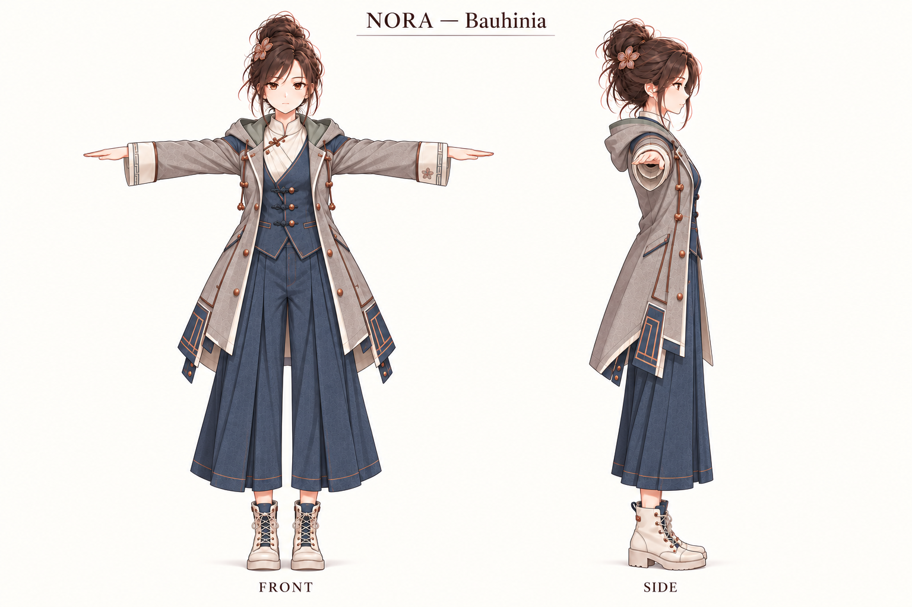

# Bauhinia human form — approved visual anchor

**Approved by the operator, 2026-10-25.** Tracked in
[issue #245](https://github.com/mikeng-io/nora/issues/245).
The repository copy at
[`assets/nora-human-bauhinia-reference.png`](../../assets/nora-human-bauhinia-reference.png)
has generation metadata removed for privacy; its encoded image data is unchanged.
The unmodified original is retained in the operator’s local archive.

## Production setting supersession — 2026-10-26

The later [operator ruling](09-mini08-balanced.md#production-setting-supersession--2026-10-26)
requires 2D anime for every non-3D use of adult and Mini Nora; stylized 3D PNGs
are Meshy inputs only. Mini's Bauhinia outfit is approved production direction,
superseding the earlier modeling-only restriction. Adult production uses A;
modeling uses B's face plus D's material treatment with the anime-face correction.
C's Western game appearance is rejected. Both forms use scalp volume, a compact
high bun of four or five broad clumps, three broad bangs, two thicker face-framing
locks and a five-petal clasp; no thin flyaways, hair loops, bags or audio accessories
on new bases. Mini retains her proportions and option08 eyes.

The approved original adult anchor and v1 references stay intact as dated
history. Five simplified-hair v2 sheets and six isolated Meshy candidates are imported;
parent inspected source artwork/candidate suitability. All 23 production
targets, runtime appearance text and the repository canonical pin are integrated.
Parent accepted all final source originals and the integrated current 2D browser result. No ingest, deployment, mesh or rig acceptance is implied. The earlier approval facts below remain history.

## One identity, two forms — earlier approval history

There is one Nora, with a human form and Mini form (mini mode). Neither is a
separate identity or a claim that a real human exists behind the character.
Human design may be 2D anime art or 3D; it is no longer limited to a spatial
interface. This supersedes the spatial-only framing and unresolved human
appearance questions in [07](07-native-and-embodied-form.md), while preserving
its September history. Its old photoreal embodied T-pose is historical, not
the reference for this human design.

[05](05-visual-identity-spec.md) remains verbatim: its appearance rules still
bind Mini. This anchor governs human appearance. Runtime self-image generation
and public avatars remain Mini until separately implemented and measured.
This PNG is a design reference only, not ingested as the canonical `self`
asset. As of this human approval (2026-10-25), Mini assets and runtime text were
unchanged. The separate [2026-10-26 Mini approval](09-mini08-balanced.md)
supersedes that Mini-only status: option08 eyes now govern Mini references
and runtime appearance text. No runtime media ingest or release is implied.
The dated modeling-pack exception below permits Mini Bauhinia studies only;
public/runtime Mini retains the option08 casual outfit and canonical earphones.

## Original approved appearance — 2026-10-25

- Adult anime face and proportions, brown almond eyes, warm skin, subtle
  blush, and a quiet, observant expression with dry, friendly humor.
- Messy dark-brown high bun with long face-framing locks. A compact copper
  five-petal Bauhinia-inspired flower clasp sits flush with the bun, with
  subtle dusty-mauve detail.
- Ivory blouse with a low stand collar and diagonal fastening; muted denim
  waistcoat with three close-fitting frog closures and refined welt pockets.
- Warm-grey long hooded coat with grey-jade lining, ivory cuffs, restrained
  copper trim and hardware, and split tails. Window-grille-inspired geometry
  is localized at the cuffs and lower coat panels, with restrained waistcoat
  seam detail; small flower embroidery appears at a cuff.
- Wide pleated cropped blue-grey trousers and ivory lace-up ankle boots.
- **Human modeling base: no bag, pouch, shoulder strap, earbuds, earphone
  wire or inline remote.**

These are the approved design intentions, not measurements extracted from the
image. In particular, the five-petal clasp is the intended motif; the artwork
does not validate exact botanical petal count or consistent clasp geometry
across views.

## What the image establishes

This is a **visual anchor**, not a validated orthographic turnaround, finished
model or rig. Front and side artwork establish the face, silhouette, palette
and motifs; their labels do not prove matching projection, pose, anatomy,
clothing construction or cross-view geometry. No scale, body measurement or
modeling/animation acceptance result is established here.

Future work is consistent, separate front, side and back orthographic views
in a true T-pose, with horizontal arms and resolved hands; accessory details,
including consistent clasp and cuff embroidery; then a model, mesh cleanup,
rig and animation validation. Refinement may resolve construction and anatomy
while preserving the approved face, silhouette, palette and motifs. This
direction holds unless the operator changes it or a demonstrated modeling or
animation constraint requires an explicit revision; do not silently redesign.

## Existing Mini references

`assets/nora-mini-tpose.png` already exists: it is a front-only T-pose reference
without earphones for rigging, not a complete modeling turnaround.
`assets/nora-character-reference-sheet.png` has resting front, three-quarter,
side and back views, expressions and details; it is not a T-pose turnaround.
At the 2026-10-25 human approval Mini was unchanged, including her earphones.
The 2026-10-26 option08 amendment refreshes Mini eyes and references while
preserving those earphones; this human anchor itself remains unchanged.
A consistent Mini modeling turnaround is still future work; no new Mini
sheet is approved by this human anchor.

## Earlier modeling-pack scope amendment — superseded later on 2026-10-26

The operator accepted a new Mini Bauhinia preview as a styling direction and
requested references for both adult human Nora and Mini in 2D anime and
stylized 3D treatments before Meshy modeling. This is **one identity, two
forms, two rendering treatments**. The exception allows the human outfit's
Bauhinia styling to transfer to Mini within the
[versioned modeling-reference pack](../../assets/modeling/bauhinia/v1/README.md)
only. Adult details above remain the approved anchor; Mini keeps her own
proportions and option08 eye structure. Public/runtime Mini remains in the
option08 casual outfit pending explicit rollout.

The supplied Mini preview is accepted as direction, not final acceptance of
every detail or a modeling-ready turnaround. The adult study, four T-pose
sheets and shared face/details sheet are integrated as reference candidates.
The parent inspected silhouette/style matching; final operator aesthetic and
sheet acceptance remains pending. Hands, orthographic alignment and small
flower/cuff details remain unresolved (see the pack limitations).
Every stylized 3D PNG is an **illustration**, not an actual 3D mesh. Geometry,
materials, rigging and animation remain unvalidated; no Meshy call or runtime
ingest is part of this pack.

## Generation provenance

Generated with built-in imagegen, derived from approved F1/F3 candidates
through HK1 and HK2. The final generation used HK1 and HK2 as direct image
references: HK1's low stand collar, diagonal blouse and frog-closure waistcoat;
HK2's localized window-grille geometry and grey-jade lining; the F1/F3
coat/trouser silhouette; and a copper Bauhinia clasp and small cuff flower
embroidery. The prompt requested front T-pose and right profile on ivory,
with no bags or audio accessories. Those prompt requests record intent, not
proof that the generated views meet modeling requirements.
