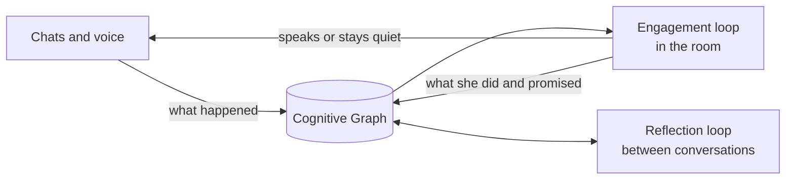

# How she works

Nora has one understanding of the world, the **Cognitive Graph**, and two
loops that work on it. Everything she can do comes from those three parts
working together. The words are defined in [concepts](concepts.md); the full
architecture is in the [design](../../design/cognition/README.md).

## The Cognitive Graph

The graph holds five kinds of thing, each with its own way of being proven:

| kind | is | proven by |
|---|---|---|
| **what happened** | messages, reactions, links, results of her own acts | being recorded |
| **patterns** | counts and baselines over what happened | computing them again |
| **beliefs** | what she thinks is true about people, rooms and things | the evidence they point at, never certain |
| **promises** | what she has committed to | the event that closes them |
| **people, rooms and things** | the anchors everything else is about | the deployment's records, or the links that connect them |

Every entry carries where it came from: which turn wrote it, from what
evidence, under which version of her personality and rules. Nothing is
silently overwritten; a correction is a new revision, so you can always see
why she believed something at the time.

Every entry also carries who it concerns and where it may be read. That is how
circles stay apart: a boundary is part of the data, not a filter added later.

## Four steps of thinking

Both loops think in the same steps:

1. **Observe**: record what happened, without interpreting it.
2. **Orient**: work out what it means, by reading the graph around it and
   proposing beliefs.
3. **Decide**: choose what to do, and make promises with conditions that can
   be checked.
4. **Act**: carry it out, or decide to stay silent.

A fifth step, **study**, comes later: checking how promises turned out and
what follows from that.

At every step the AI model proposes and code decides what is admitted. The
model never decides what is allowed; code never decides what something means.

## The engagement loop: Nora in a room

The engagement loop runs in three situations:

- **Called**: someone asks her something. A reply is owed.
- **Joining in**: a conversation she was not called into might want her. The
  room's policy decides whether she may consider it, and silence is the
  default.
- **Following up**: one of her own promises is due, by time or because
  something she was watching happened. She reads the room again first, and may
  still decide that nothing needs saying.

Each turn starts fresh. There is no chat session: she reads what the graph
holds about this room, these people and her open promises, and decides from
there. When the turn ends, a short **debrief** looks back at what happened and
writes down what is still open: a promise she made, a result she found but did
not share, a question that is still unanswered. The next turn picks it up.

The engagement loop is the only part of Nora that speaks, and everything it
sends passes the room's rules first.

## The reflection loop: Nora between conversations

The reflection loop never speaks. It:

- reads what happened since it last looked, and works out what it means;
- revises beliefs about people and rooms, citing the evidence;
- reconsiders promises whose reasons have changed;
- checks outcomes when promises close or run out of time;
- turns outcomes and corrections into lessons;
- schedules what to look at next.

When it decides something should be said, it makes a promise. The engagement
loop delivers it later, in the room, after reading the situation again.

## How she learns

Learning is a chain, and each link is recorded:

1. A promise closes with an **outcome**: achieved, dropped, missed or unknown.
2. The reflection loop turns outcomes, or a person's correction, into a
   **lesson**.
3. A later decision that relies on the lesson says so.
4. That decision's outcome counts for or against the lesson. A lesson that
   keeps being contradicted is revised or retired.

Only outcomes and corrections teach her. Replies, reactions and attention show
how something was received, not whether it was right, so she does not learn to
chase them. An independent AI judge, not the one that wrote the lesson, checks
whether learning actually changed her decisions.

## Why there are no special features

Suggestions, follow-through, planning and noticing that someone has gone quiet
have no code of their own. They come from the same loops working on the same
graph. For example, a room keeps sharing links to the same few games; a
pattern rises above the room's usual level; she forms the belief that the room
is into them, starts watching their prices, and when one goes on sale, makes a
promise to mention it. Whether people take her up on it becomes an outcome,
and the outcomes become a lesson about which suggestions this room wants.

Because the behaviour lives in what she believes and learns, not in code, it
can improve from evidence.
