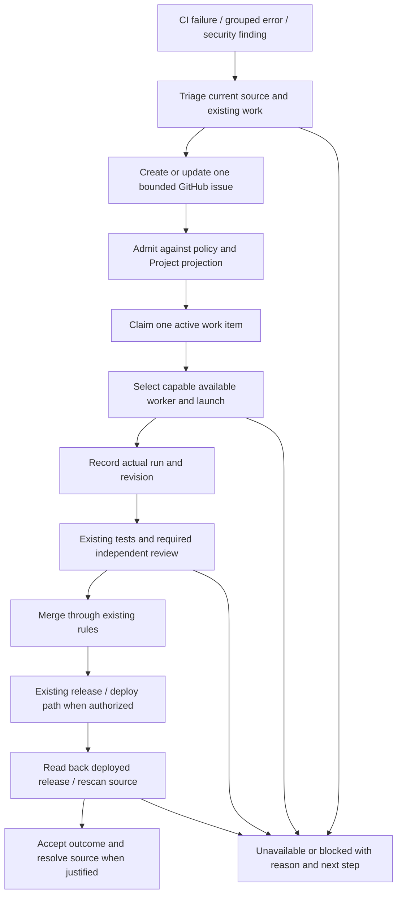

# AI engineering workflow proposal

2026-10-27 · **Proposal, not accepted implementation.** This study consolidates
repository inspection, official documentation and parent read-only account
observations. It provides no runtime execution proof and activates nothing.

## 執行摘要

建議保留 GitHub Issue 作為唯一任務合約，Project 8 只投影同一 Issue 的排程資料。
Devin 可負責合資格流程的執行、持續跟進及原生事件編排；目前沒有證據證明它能直接
調度本機 T3 等其他執行環境，或自行遵守看板的能力要求。先提議一條可信維護者的
PR／CI 分流及獲准修復流程，只補已證實缺少的接駁。Sentry、Aikido 訊號先核實及
分流；合併、審查完成與正式環境恢復是不同結果。本文不批准付費試行、安裝、啟用、
部署或更改風險接受狀態。

## Recommendation and evidence boundary

Keep GitHub Issues canonical and use native Devin execution and follow-up for
selected eligible flows, with a thin Project admission/reconciliation adapter
only where demonstrated necessary. Preserve design acceptance in Git and the
existing operator-facing orchestration boundary. Do not build a general
scheduler, add another task database, or adopt another tracker solely for a
trigger. This recommendation holds unless measured adapter maintenance or actual
multi-repository planning needs outweigh the native integration benefit.

The repository baseline is [the orchestration policy landed through
PR 279](https://github.com/mikeng-io/nora/blob/74f72817c27d8fea256179b18eda7a982b31c4dd/ORCHESTRATION.md)
and [MCP configuration landed through PR 280](https://github.com/mikeng-io/nora/commit/0d9739f43eea4eff84dd2441686654263fa23acb).
Neither implements a dispatcher. The
[root schema](https://github.com/mikeng-io/nora/blob/74f72817c27d8fea256179b18eda7a982b31c4dd/.agents/orchestration.schema.json)
owns structural vocabularies; it cannot prove permissions, link truth, competence
or acceptance. This proposal references those owners without copying their tier
catalogues, task bodies or status specification.

Evidence labels below matter: **source** means opened repository implementation;
**documented** means vendor capability; **account observation** means the parent's
authenticated read-only result on this date; **proposed** means future behavior.
Account observations are summarized without publishing private receipts and are
not independently reproducible from public documentation.

The account observation is: GitHub connected; no installed MCP servers or
Automations; Sentry marketplace MCP available but uninstalled; no Aikido
marketplace match; Linear uninstalled. Authenticated initialization, a 26-tool
catalogue and integration/automation/schema reads succeeded. The actual catalogue
supports custom STDIO MCP; this corrects any inference that a missing marketplace
entry makes Aikido impossible. These reads establish readability, not paid
execution, billing allocation or reviewer independence. Project workflow read-back
found only Auto-add sub-issues enabled; closure, merge and status workflows were
disabled. This study changes neither repository nor private-board settings.

## Ownership and the proposed flow

| Owner/artifact | Responsibility | Evidence it must reference |
| --- | --- | --- |
| Root policy/schema | Capability, review and artifact contract | Existing canonical policy, not vendor lanes |
| Git design and GitHub issue | Revisioned acceptance; one bounded task and its scope delta | Source identity, prerequisites and acceptance revision |
| Project 8 | Scheduling projection of that same issue | Issue, acceptance, active run and evidence links |
| Selected dispatcher | Admission and one active work claim per flow | Fresh permissions, source/head and existing run/PR |
| Worker and run receipt | Implementation and actual execution record | Runtime, exposed mode/options, input revision, head/base and checks |
| Orchestrator/reviewer | Independent assessment, landing and acceptance | Exact result, required review and relevant live read-back |
| Existing release/deploy path | Authorized publication and runtime verification | Published release, deployed revision and operational evidence |

Design acceptance coverage is a separate completeness question: accepted design
sections must link to bounded issues/acceptance references and their merge/live
evidence. Project progress, sub-issue percentages and DeepWiki do not establish
that coverage. Automatic rollup remains unbuilt; implementing it would require
enumerable scope and a consistent design-state vocabulary, without creating
another editable progress table here.

This is an outcome sequence, not a new status machine. A source-only task can end
at its specified merge acceptance; a production incident requires the later live
evidence. Missing evidence is unavailable. PR merge or review completion cannot
substitute for incident recovery. No new auto-merge, deployment, ignore or
accepted-risk behavior is proposed.

## Four routes and the missing Project event

| Route | Native value | Gap and assessment |
| --- | --- | --- |
| A. Current GitHub + Devin + thin Project adapter | Issue/PR/check triggers and ongoing session follow-up | Recommended; read admission before launch and reconcile outcomes |
| B. Organization-owned Project, existing repository | Organization Project-item/App webhooks | Can contain cross-owner issues without necessarily transferring Nora; still needs a Devin bridge |
| C. Linear as primary tracker | Native delegation, intake, activity and follow-up | Requires explicit authority migration and one canonical workflow |
| D. GitHub Agentic Workflows | Repository-owned agentic Actions with multiple engines | Optional future alternative; extra workflow maintenance and separate engine authentication |

GitHub documents `projects_v2_item` webhooks for organization Projects. The live
Devin catalogue advertises issue/comment/PR/review/check/push triggers and no
Projects V2 event. A drag to Ready on personal Project 8 therefore cannot be
assumed to launch Devin. An organization Project can
[contain issues from other owners](https://docs.github.com/en/issues/planning-and-tracking-with-projects/managing-items-in-your-project/adding-items-to-your-project),
but [webhook availability](https://docs.github.com/en/webhooks/webhook-events-and-payloads#projects_v2_item)
does not supply a native Devin Project trigger.

For the personal board, compare two small choices: a trusted explicit issue
command followed by a fresh board read, or bounded periodic reconciliation of
current board intent. The first gives immediate explicit intent; board-only drags
wait for another request. The second observes drags eventually but adds polling
and recovery work. Do not create mirror status labels. Parent GraphQL reads and
writes already work, but the deployed bot identity's scope remains unverified.
`GITHUB_TOKEN` cannot access Projects; a user-Project adapter needs a separately
authorized personal-project PAT route, as described by
[GitHub's Actions guidance](https://docs.github.com/en/issues/planning-and-tracking-with-projects/automating-your-project/automating-projects-using-actions).

The built-in GitHub `/devin` command handles **open PR comments** and routes
follow-up to an existing linked session; it ignores issue comments. An issue-side
command requires configured Automation. These are different interfaces, not two
spellings of an installed issue dispatcher.
([GitHub integration](https://docs.devin.ai/integrations/gh),
[Automations](https://docs.devin.ai/product-guides/automations))

Linear offers native delegation, playbook labels and mentions. Delegation
preserves the human assignee, and new Devin connections default to `!plan`, so
delegation need not mean implementation.
([Devin Linear](https://docs.devin.ai/integrations/linear),
[Linear assignment](https://linear.app/docs/assigning-issues))
GitHub Issue Sync does **not** synchronize Project custom statuses; existing
six-state parity cannot be claimed. A later migration must designate one task
and status authority, rather than relying on one-way issue creation to prevent
conflicts. ([Linear GitHub sync](https://linear.app/docs/github))

[GitHub Agentic Workflows](https://docs.github.com/en/copilot/how-tos/github-agentic-workflows/creating-github-agentic-workflows)
is public preview: Markdown instructions compile to committed lock YAML, with
Copilot, Claude, Codex or Gemini engines. Personal repositories/third-party
engines need appropriate tokens or API accounts; this does not inherit existing
T3 quota. It adds compiled workflow upkeep and is not the present recommendation.

## Native capability, adapter work and unknowns

| Surface | Native/documented | Missing adapter or account evidence |
| --- | --- | --- |
| Devin execution/follow-up | Sessions, GitHub collaboration, start/message Automation actions | No demonstrated dispatch into local T3 or other runtime workers, nor automatic board-tier enforcement |
| Project admission | GitHub API access | Trusted current-state read, active-work reconciliation and scoped bot identity |
| Sentry context/intake | GitHub issue actions and MCP investigation | Actual plan, capture, mapping, installation and authorization |
| Aikido context/intake | Existing read-only MCP access; AutoFix; documented tracker integration | Personal-repository tracker eligibility and cloud custom-MCP authentication |
| Review | Findings, optional checks and Auto-Fix | Exact check semantics and independent underlying vendor |

Devin is an execution runtime/platform, not a model vendor identity. Record its
actual exposed service mode and options honestly; underlying models/vendors may
be undisclosed. Never invent an attestation to fill a run receipt. If required
selection or different-vendor review evidence cannot be grounded, choose another
qualified route or mark unavailable; do not weaken root policy. Devin MCP and
handoff document local clients launching Devin, while Dynamic Workflows
coordinates Devin sessions. Neither demonstrates a universal local-worker
dispatcher. ([Devin MCP](https://docs.devin.ai/work-with-devin/devin-mcp),
[handoff](https://docs.devin.ai/work-with-devin/devin-handoff),
[Dynamic Workflows](https://docs.devin.ai/work-with-devin/dynamic-workflows))

## Sentry and Aikido intake

Sentry → GitHub → Devin is feasible conditional on native entitlement. Manual
GitHub create/link is documented for Team and above; automatic GitHub alert
creation requires Business/Enterprise. Actual Sentry plan, configuration and
production capture remain unverified.
([Sentry GitHub](https://docs.sentry.io/organization/integrations/source-code-mgmt/github/))
The source [capture helper](https://github.com/mikeng-io/nora/blob/74f72817c27d8fea256179b18eda7a982b31c4dd/nora/obs/errors.py)
requires enabled configuration and a DSN; the
[template](https://github.com/mikeng-io/nora/blob/74f72817c27d8fea256179b18eda7a982b31c4dd/config.example.toml#L1391)
is off, and
[build_app](https://github.com/mikeng-io/nora/blob/74f72817c27d8fea256179b18eda7a982b31c4dd/nora/__main__.py#L79)
does not pass a release. An image containing the SDK proves neither ingestion
nor deployed-release attribution. Sentry also misses failures represented only
by counters/status results; existing observability remains necessary.

Use organization/project/group identity and a source link; an event occurrence
is not a new task. Publish sanitized impact, times, reproduction and acceptance,
not raw event payloads. Cloud MCP investigation needs separate installation and
authorization; an ingest DSN is not a read-API token.
([Sentry MCP](https://mcp.sentry.dev/),
[issue API](https://docs.sentry.io/api/events/list-a-projects-issues/))
Native GitHub closure can resolve Sentry before deployment. Check regression
against the correct deployed release; source-fix measurement and live recovery
remain separate.

Aikido findings should pass through triage/reconciliation to an issue **or an
existing remediation PR**. Its native GitHub Issues setup requires organization
ownership, while the integration catalogue advertises paid access: neither
matches an established turnkey path for personally owned Nora. Do not assume
repository transfer.
([setup](https://help.aikido.dev/getting-started/task-management-systems/all-supported-task-trackers/github-issues),
[catalogue](https://integrations.aikido.dev/integrations/github-issues))
Existing Aikido MCP and GitHub reads can investigate findings. Integration
configuration remains unknown: the attempted API read returned 403 and the MCP
does not expose that inventory. No UI login is needed to finish this proposal.

Reconcile stable group/finding references, source revision, target and scan
freshness with later verdicts and existing PRs. Historical false-positive or
accepted-risk judgments can be reversed by newer evidence. A concrete discrepancy:
parent research found an old DOMPurify version in the feed after PR 222 merged,
while the [opened lockfile](https://github.com/mikeng-io/nora/blob/74f72817c27d8fea256179b18eda7a982b31c4dd/deploy/computer/render/package-lock.json#L1714)
contains 3.4.17. That is reconciliation work, not an already-admitted upgrade bug.
Do not turn every finding into a task or publish a raw finding dump.

Aikido AutoFix PRs already exist historically; choose one repair owner to avoid
competing writers. Its [automatic PR capability](https://help.aikido.dev/autofix-and-remediation/automation-and-merging/automatic-creation-of-pull-requests)
does not prove current enablement. The official
[Aikido Devin MCP guide](https://help.aikido.dev/ai-and-dev-tools/aikido-mcp/devin-mcp.md)
configures CLI/Desktop STDIO. Cloud custom STDIO is supported by the actual
catalogue and [Devin MCP documentation](https://docs.devin.ai/work-with-devin/mcp),
but authentication/runtime use is unvalidated. Ignore, snooze, accepted risk and
secret revocation remain separate dispositions, not successful code fixes.

## Admission, cost and review boundaries

Public events, bot comments and user-controlled payloads cross a real trust
boundary. Automation's `issue.user.login` identifies the issue author, not the
label actor; its check-run filter lacks PR-author verification. Re-read current
repository permissions, PR author/head/check producer, acceptance and active
work before launching. An LLM event filter cannot supply that authorization.
The account schema explicitly reports script preflight unavailable; documented
rollout capability cannot be assumed here.

Use one dispatcher per selected flow and source-ID → issue → run references to
deduplicate retries/concurrent triggers. A timeout after launch requires finding
the existing run before retrying. Native preflight item history, where available,
is bounded within an Automation; it is not cross-flow exactly-once delivery.
Queue overflow drops events. Small correlation/recovery state is sufficient;
no large custom database is proposed.
([Automation API](https://docs.devin.ai/api-reference/v3/automations/post-organizations-automations))

Bound invocation frequency, concurrency, queue depth, retries and per-session
spend before any authorized pilot. No actual budget is authorized here. Pro has
quota and possible on-demand consumption, not unlimited execution; readable tools
do not establish which allocation pays for a proposed run.
([billing](https://docs.devin.ai/admin/billing/self-serve))

Start Devin Review as advisory evidence. A custom review check can pass merely
because the reviewer finished, even with findings. Establish its exact SHA/check
meaning before making it required; do not enable Autoapprover. Unknown underlying
vendor prevents claiming independent-vendor compliance. Existing CI, required
rules, release planning and Komodo remain authoritative for their responsibilities.
([Review semantics](https://docs.devin.ai/work-with-devin/devin-review))

## One proposed case, recovery and acceptance

The first pilot candidate is trusted-maintainer PR CI triage and an admitted
repair, matching the existing research scope. Source intake initially stays
explicit/manual, or native only where eligible. This document starts no pilot.

1. Receive one CI failure and freshly verify trusted PR ownership, current head,
   check issuer/conclusion and bounded repair acceptance. Find the owning issue
   and existing PR/run before claiming work. A stale-head or unrelated failure
   produces no launch.
2. Read policy/Project prerequisites, select an evidenced capable route, and
   launch once. Record the real returned run reference and input revision.
   Missing auth/quota or an uncertain response is unavailable; reconcile first.
3. Inspect returned head/base, diff and existing named tests, with regression
   proof for a fix. Obtain required independent review of that exact head;
   completed Review alone is insufficient. Reopened/superseded work reuses the
   source relationship and checks whether a repair is still needed.
4. Merge only through existing checks/rules when authorized. If acceptance
   includes production recovery, use the existing release/deploy path and read
   back the deployed revision plus source rescan/runtime behavior. An unsuccessful
   deployment leaves that outcome incomplete even if the source fix merged.
5. Reconcile acceptance and source disposition. Duplicate events, closed source,
   missing run evidence, failed checks or an unresolved regression must not say
   Done. Link the reason and recovery step in the existing issue/run system.

Measure operator interventions/time, accepted outcomes per actual spend,
duplicate active work, false fixes/reopens and recovery success. Reopen the
Linear choice only when measured adapter maintenance exceeds native integration
benefit or multi-repository planning becomes an actual need.

## Documentation navigation and remaining checks

DeepWiki is a generated-navigation candidate, not authority over authored design
or runbooks. Preserve existing pages and publication until coverage, freshness,
source links and required export are validated.
([DeepWiki](https://docs.devin.ai/work-with-devin/deepwiki))
The [OpenWiki workflow](https://github.com/mikeng-io/nora/blob/74f72817c27d8fea256179b18eda7a982b31c4dd/.github/workflows/openwiki-update.yml)
is active, but parent account read-back found `OPENWIKI_AUTO_UPDATE` absent:
scheduled inference is gated off; manual dispatch remains enabled. Nothing was
disabled or deleted by this study.

Before a separately authorized implementation, check precisely:

- **Devin:** Nora repository scope, public-Automation opt-in, run identity/tool
  grants, actual quota/billing limits, preflight availability, service-mode
  read-back and any required vendor/independence evidence.
- **Project:** deployed identity's personal-board access, current fields and
  workflow settings; command/read versus periodic reconciliation choice.
- **Sentry:** plan, project identity, production capture and latest event,
  release/commit mapping, alert/closure rules and authorized read scopes.
- **Aikido:** actual tracker entitlement/personal-owner support, current routing,
  scan revision/time, later dispositions and existing PR ownership; custom cloud
  MCP auth only if that route is selected.
- **Acceptance:** exact check semantics and deployed-release/rescan evidence for
  the chosen case; DeepWiki coverage/export only if replacement is pursued.

These are account checks, not requests for new login or credential values.
Against the five Cs, this proposal preserves **Coherence** through one task and
repair owner, **Consistency** through existing artifacts, and **Conformance**
through unchanged policy and authorization. **Correctness** of live automation
and **Completeness** of end-to-end recovery remain unmeasured until a separately
authorized implementation produces the required evidence.
