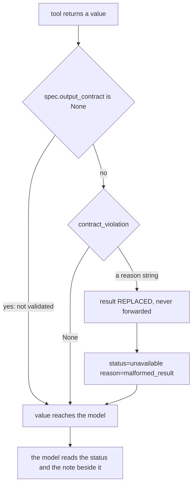
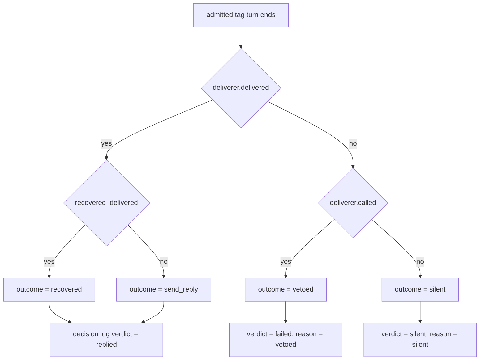

# The status and failure contract

Nora never raises its way out of a question. A store that will not answer, a model that returns
unparsable JSON, a gate whose provider 502s — each is turned into a word, returned or counted, and
the turn continues. This page is the one place those words are defined. Other pages link here
rather than restating a vocabulary, because a label set copied twice is the way one of the copies
drifts.

The contract has three **axes**. They share words, and that is the trap: `nothing_found` on a tool
result, `silent` on a turn and `recorded` on an ingest are three different propositions about three
different objects, counted on three different series.

| axis | decided by | vocabulary, and where it is declared | read by an operator on |
|---|---|---|---|
| **tool result status** | the tool itself, checked at one seam in `adapt()` | `nora.agent.ports.R27_CORE_STATES` + `DECLARED_STATUS_EXTENSIONS` → `OUTPUT_STATUSES` | per-tool counters (`nora_room_lookups_total`, `nora_tool_calls_total`, `nora_recall_total`, …) plus the generic `UnavailableOutcomes` alert |
| **turn outcome** | the pipeline that watched the turn end | `nora.domain.tag_trace.VALID_OUTCOMES` (+ `"unattributed"` for the counter); the fire path's own five constants | `nora_engagement_outcomes_total{outcome,audience}`, `nora_silent_failures_total{reason,platform,audience}`, `nora_participation_*`, the shared decision log |
| **ingest outcome** | `nora.ingest.pipeline`, once per message | `IngestOutcome`, a closed `Literal` of sixteen values | `nora_ingest_outcomes_total{platform,conversation_type,outcome}` |

Two adjacent vocabularies are *not* part of the status axis but obey the same rules: the Dreamer's
per-run `DreamStatus` (`ok` / `nothing_found` / `unavailable`) and the Relevance Gate's
`VerdictSource` (`model` / `fail_closed`) with its `GATE_ERROR_KINDS`. They are covered below where
they carry a rule the rest of the contract depends on.

## The core three, and why `unavailable` is never `nothing_found`

R-27 is the repository's signature measurement rule: a result is `ok`, `nothing_found`, or
`unavailable`, and **an error is never a pass**. The two conflations it forbids are not symmetric,
and both are silent:

- **ERROR-as-PASS.** A wiring gap reported as `nothing_found` makes an outage read as a confident
  denial. `who_said` is the canonical case (R-82): `EngagementContext._recent` returns `()` for a
  *failed* store read as well as for an empty one, so the window's emptiness already means two
  things at that seam. The tool therefore answers `unavailable` on an empty or absent window and
  never reads the store to make itself look better — otherwise an outage becomes "nobody said that"
  in the middle of a group argument.
- **PASS-as-ERROR, the same substitution in reverse.** A batch whose model response would not parse
  is `unavailable` at the Dreamer runtime, never `nothing_found`, because the loop must not advance a
  watermark past a batch nobody actually read. "Nobody read it" is a claim about the **run**, not
  about one model call: a sample that cannot be called at all — a timeout, an exception, no envelope
  — comes back `None` and is counted, and unreadability takes a run down only when **no** sample was
  readable. Being readable is a floor, not a guarantee: a batch somebody did read still ends
  `unavailable`, watermark held, if `accept` raises on what came back, `commit` faults, or
  `AccountNotRecordableError` is raised. `unavailable` is the state that holds the watermark.

The Dreamer's three run statuses and its cursor rule are stated once, in
[the Dreamer](../systems/dreamer.md#envelopes-caps-and-the-three-states): `ok` and `nothing_found`
advance the watermark, `unavailable` is held. `nothing_found` has exactly two producers — a blank
`inputs`, which is the general fire condition (an empty `commit` is still called, so time-driven
decay is not lost), and a run whose readable samples produced nothing at all. Neither is an outage,
and neither may be borrowed to describe one.

The same rule reaches past tool results. A failed media comprehension is counted
`status="unavailable"` with its reason and asserted never to be `nothing_found` — "a failed read is
never «there was nothing there»". A bounded read that stopped at its cap is `unavailable` wearing
`nothing_found`'s face if nobody counts the cut, which is why `nora_bound_truncated_total` exists.

Two invariants are worth carrying:

- **One event, one state.** A single call records exactly one of the three; a branch that fell
  through into a second `_record` shows up as a total of four across three calls.
- **`unavailable` can be an answer.** When computerd replies HTTP 200 with `unavailable`, that is
  something the computer *said*. `ComputerCallObserver.call(op, status, answered)` keeps that apart
  from "nothing usable came back" (refused, timed out, a 401 after a token rotation) — only the
  second drives `nora_computer_up` to 0. A call that answered `unavailable` is a fact about the
  workspace; a call that did not answer is Nora not reaching her computer at all.

## The tool-result vocabulary is a core, not a ceiling

The three core states are declared in `nora/agent/ports.py`. Beside them sits
`DECLARED_STATUS_EXTENSIONS`, a mapping from each extra status to its meaning; `OUTPUT_STATUSES` is
the union of the two, derived rather than hand-listed, and it is the single source the validator and
the structural tests read. Twelve extensions are declared at the time of writing — the count is
whatever the mapping holds, never a number restated elsewhere.

| status | what it says | why it is not `unavailable` |
|---|---|---|
| `ok` | done | — |
| `nothing_found` | the thing asked about is not there | — |
| `unavailable` | could not be checked | — |
| `refused` | disclosure veto (R-31): may not say | «I may not say» is not «I couldn't check» |
| `withheld` | disclosure veto on the memory axis | same, recall-ladder half |
| `ambiguous` | several candidates, none picked, so nothing was looked at | not «no entry at all» |
| `not_found` | the thing does not exist (R-27b) | a place a route does not serve is not «no such place» |
| `nothing_known` | no durable knowledge yet | the recall ladder's middle rung |
| `not_an_image` | media modality refusal | the read did not fail |
| `already_present` | the idempotent write had nothing left to do | nothing was attempted and failed |
| `no_route` | the routing provider found no way | a real answer from a working provider |
| `held_for_review` | the send was complete and something OUTSIDE the turn kept it | nothing is broken, and retrying cannot help |
| `started` | the call launched background work still running | it did start |
| `partial` | a search answered from an index still being rebuilt | what it did not find may still exist |
| `bad_arguments` | the call named an argument the tool does not take; nothing ran | a malformed CALL is not a broken TOOL (R-99) |

Two of these carry a live lesson. `held_for_review` was added after a participation turn read a hold
as a failure and rewrote the same reply four times. `bad_arguments` exists because `ReplyGuard`'s
veto text reaches the debrief and Standing fold unfiltered, so a malformed call read as a broken
tool would fold a false «I can't» into her self-knowledge; `unavailable` is also wrong on its own
terms, since «I could not check» stays true of the whole turn.

`refused` is also why ADR 0009 rejected the proposal to normalise the surface back to three states:
the executor measured ten distinct values on live tools, and collapsing `refused` into `unavailable`
would have converted «I may not say» into «I couldn't check» — the exact conflation R-27 exists to
prevent — across dozens of call sites at once.

### The seam that enforces it

`adapt()` wraps every native tool's callable once, so every result passes one choke point on its way
to the model. A declared `output_contract` names the keys the result must carry (`three_state` →
`status`; `messages` → `messages`), and a result that fails is *replaced*, never forwarded.

The output-contract seam in `adapt()`: one choke point, fail-closed, and `reason` is a stable,
greppable string an operator can search the log for.

Two boundaries are deliberate. **Exceptions propagate** — a tool that raises still raises, because a
raise is the invoke stage's business (its timeout and `llm_error` handling), and swallowing one here
would turn a crash into a quiet `unavailable` with nothing left to diagnose. And a tool whose result
is not an object with a declared shape (`now` returns a string, `send_reply` returns a bool) leaves
`output_contract` as `None`: not validated, because there is nothing of ours to check.

`load_transcript` is the one *status-free* data tool. It answers `{"messages": [...]}` on both its
paths, and validating it against `required: ["status"]` would turn every *successful* call into
`unavailable`. The `messages` contract exists so the recall ladder's middle rung survives the
validator instead of being sacrificed to it.

### The computer's fourth word: `denied`

`SandboxStatus` (`nora/domain/computer.py`) is `ok` / `nothing_found` / `denied` / `unavailable`,
and the type's docstring carries the whole rule:

- `ok` is done — **a command that exited non-zero is still `ok`**; its `exit_code` says how it went.
- `nothing_found` is the thing asked about not being there (a file, a match).
- `denied` is *refused as asked*: a path outside the workspace, an ambiguous edit, an oversized
  body, a bad token.
- `unavailable` is *could not be done now*: the computer is down, a timeout, an OS error. Never an
  empty success.

`denied` is the sandbox's word, not the disclosure guard's: `refused` on a tool result means Nora may
not say, `denied` means Nora's computer will not do. They are deliberately different words for
different owners. Every result type in that module also carries `reason`, defined as "anything that
is not `ok`, in words a model can act on".

## Fail-closed gates: what a failure resolves to

A gate that forwards on failure is not a gate. The rule is uniform — resolve to the safe answer —
and so is the second half: **never count the safe answer as the clean one.**

| gate | on failure it resolves to | so that it is not confused with |
|---|---|---|
| tool output contract (`adapt`) | `MALFORMED_RESULT` = `status="unavailable"`, `reason="malformed_result"` | a genuinely empty answer |
| Relevance Gate (`nora/ingest/relevance_gate.py`) | `no_go`, with `GateVerdict.source == "fail_closed"` | the model choosing `no_go` |
| engage policy (`nora/ingest/stages/gate.py`) | `EngageDecision(engage=False, reason="policy_error")`, counted on `nora_errors_total{stage="engage_gate"}` | a policy that decided not to engage |
| `who_said`'s transcript window | `unavailable` | `nothing_found` |
| Dreamer run (`DreamerRuntime.run`) | `unavailable`, batch and cursor held | `nothing_found` |
| disclosure / presence guards | the guarded answer (see [Policy and disclosure](../concepts/policy-and-disclosure.md)) | an answer that passed |

The Relevance Gate is the clearest example of the second half. Every non-answer — a transport error,
a timeout, a `finish_reason="length"` truncation, a body that does not parse, a verdict that is
neither value — resolves to NO-GO, and a truncated body is treated as an error rather than parsed,
because a cut-off JSON document can still parse into something shorter and wrong: an error wearing a
pass's face. But the two NO-GOs are different operational facts wearing the same verdict, so
`nora_relevance_gate_total` moves only on a real verdict and `nora_relevance_gate_errors_total`
carries one label per distinguishable failure (`call_failed`, `timeout`, `truncated`, `unparseable`,
`bad_verdict`, `no_context`, `no_instruction`). Pooled, the series could not tell «the provider
refused» from «the ceiling is too low for this arm» — two different fixes.

The Dreamer's failure path shows the same discipline applied to state rather than to a label. A
store timeout, an adaptor raising out of `accept`, a `commit` that faults, or a provider that would
not answer on **any** sample all finish the run as `unavailable`; the watermark is *not* advanced
and the schedule's `last_fired_at` is *not* stamped, so the next tick retries the same evidence
instead of spending it on nothing. (A provider that refuses one sample of several does
not take the run down with it: that sample is counted and the batch is judged on the ones that
answered. The rule being kept is «do not spend evidence nobody read», and one good read is a read.)
That rule settles one question — whether anybody read the batch — and says nothing about success. A
run with a readable sample behind it still ends `unavailable`, watermark held, if `accept` raises on
what the model returned, if `commit` faults, or if `AccountNotRecordableError` is raised.
`AccountNotRecordableError` exists to force exactly that outcome, and it is logged at WARNING without
a stack trace because it is an expected outcome rather than a fault.

## Deliberate silence versus failure

R-5 says never speak on failure: a group must not learn that Nora's provider is down. Silence is
therefore a *rule*, which makes it the one thing the instrumentation must not mislabel. Two
consequences follow.

**1. Silence has exactly one typed exception.** `nora/domain/errors.py` declares the failure
taxonomy (DEC-4): `FailureClass.INFRASTRUCTURE` and `GUARD_VETO` are silent, `REQUESTED_TOOL` is
`disclosable` — a tool the user explicitly asked for. Staying silent there reads as being ignored,
which is worse than admitting the tool failed. `NoraError` defaults to `INFRASTRUCTURE`, so an
uncategorised failure defaults to silence: speaking on an unknown failure is the outcome R-5 exists
to prevent.

**2. Restraint is recorded as restraint, never as failure.** The occasion decides whether silence is
a defect, and the counters follow the occasion rather than the word.

- On a **participation** turn, silence is the healthy default: the model was offered the floor and
  declined it. It is counted on `nora_participation_silence_total` and **never** on
  `nora_silent_failures_total`, "whose every reason is a malfunction". The gate is
  `ok=True and stop_reason not in BUDGET_STOP_REASONS`; a turn the token or turn cap cut off before
  it could decide *is* an ordinary malfunction and goes to `nora_silent_failures_total` with
  `audience="participation"`. The proactive occasion mirrors it on
  `nora_proactive_silence_total`.
- The **shared decision log** carries three verdicts, not two: `replied`, `silent`, `failed`, with
  `reason` holding the finer outcome. `failed` for a turn that chose not to speak would be a
  mislabel of R-5, and a later decider reading "tag failed" about it would read a working turn as a
  broken one. `DecisionVerdict` is a closed `Literal` (`spoke`, `silent`, `remind`, `decline`,
  `replied`, `failed`) so a reader's question and a writer's answer cannot drift.
- A **heartbeat or tag** turn may not end as restraint. A reminder that says nothing is broken
  (`nora/app/fire.py`'s comment draws exactly that line against participation), so a fire turn that
  delivered nothing returns `failed_error` rather than `silent`; and a tag turn was addressed, so a
  turn that never called a send tool is both the `silent` outcome on
  `nora_engagement_outcomes_total` and `nora_silent_failures_total{reason="no_send_call"}`. That is
  not a contradiction — the same word is doing different work on two axes.
- **R-97** keeps the participation half honest at the model level: a turn that went looking, came
  back empty, and tried to take the floor to say so must stay silent. Its named test drives five
  scripted twins through the real trigger path and then three controls — a lookup that answered
  `ok` still speaks, a turn that never opened a tool still speaks, and **a tag turn whose lookup
  came back empty still answers**, because there somebody asked and «I looked and there is nothing»
  is what she owes them. Arming R-97 on the tag path would turn every honest "I checked and it is
  not there" into `no_send_call` on the one path where silence is never right.

The tag turn's own partition is computed in one place, from state that already exists:

`recovered` versus `send_reply` is DEC-93's own split: a rising `recovered` share means the route is
not honouring `tool_choice=required`. `vetoed` and `silent` are both "nothing reached the room", and
only the second is restraint.

`timeout` and `llm_error` are turn outcomes the partition above never produces: `invoke.run` stamps
them on its own not-`ok` path (via its `_blank_trace`), where there is no delivery to inspect and so
nothing for the pipeline to correct. And `"unattributed"` is not a seventh value a turn can end in — it
is `trace is None`, meaning `invoke.run` never returned, or the outer `BaseException` handler
deliberately cleared a crashed turn's placeholder rather than retain a guessed label.

## The words a status must come with

A status name is not self-explanatory to a model, so **result interpretation lives in the result**.
ADR 0015 §3/§6 requires a short English `note` on every non-`ok` tool result saying how to read or
report that status; the tool's *description* names the statuses, and the result explains them, only
when that status comes back. The output-contract seam "carries a `note`; it does not add one".

Two gates enforce it, with different reach:

- `tests/architecture/test_every_status_carries_a_note.py` walks the AST of every module tool
  results are assembled in and fails on a dict literal whose `status` is a non-`ok` string with no
  `note` (a `**spread` may carry it). It has a positive control, so a broken walk cannot pass every
  module vacuously, and it checks that its own module list still exists.
- `tests/test_tool_surface_policy.py::test_every_listed_status_returns_a_note` checks each Level 3
  tool's *every* return — not at least one — against its own notes mapping and a named backend
  allowlist.

Both are static, so both admit what they cannot see: two backend call sites are covered by other
named tests, and the per-tool test's module comment records the return shapes it reads.

## Where each of these is counted

A metric name is append-only (renaming one starts a new empty series beside a frozen one), and a
**label vocabulary is derived from the code, never hand-copied**: one named `Literal` or tuple, with
`get_args` read by the help text and a runtime membership check wherever `make gate`'s mypy does not
reach. `IngestOutcome` is the precedent the rest cite.

| series | labels | answers |
|---|---|---|
| `nora_room_lookups_total` | `tool`, `status` | the three room-scoped tools, by how they answered; never sum `not_found`/`nothing_found` with `unavailable` |
| `nora_tool_calls_total` | `tool`, `status` | the tools with no counter of their own — deliberately not a superset of the above, or every volume sum would double |
| `nora_recall_total`, `nora_memory_search_total`, `nora_computer_calls_total`, `nora_media_join_total`, `nora_media_comprehension_total`, `nora_speech_transcriptions_total` | `status` (+`reason`) | one path's status axis, with the reason that produced a non-`ok` |
| `nora_dream_run_total` | `adaptor`, `status` | R-27's three states at the run: `unavailable` is counted, never silently absent |
| `nora_dream_sample_total` | `adaptor`, `status` | one run's N model calls, by whether that sample was readable — the series that tells «one of five samples timed out» from «the run failed» |
| `nora_dream_store_timeout_total` | `adaptor`, `phase` (`inputs` / `commit`) | a store phase the runtime's own wall clock cut off — a wedged store, not a provider that refused, and never the collaborator's own timeout |
| `nora_relevance_gate_total` / `_errors_total` | `verdict` / `kind` (+`conversation_id`) | the gate working versus the gate down, joinable to the room |
| `nora_ingest_outcomes_total` | `platform`, `conversation_type`, `outcome` | every way one message's ingest ended |
| `nora_engagement_outcomes_total` | `outcome`, `audience` | every admitted tag, by how the turn ended — not gated on the retention store |
| `nora_silent_failures_total` | `reason`, `platform`, `audience` | failures kept from the group; both shadow audiences included |
| `nora_participation_silence_total` / `_spoke_total`, `nora_proactive_*` | `platform` | restraint and speech as the healthy pair |
| `nora_bound_truncated_total` | `site` | where a bound actually bit |

Some paths keep a narrower vocabulary of their own where a core word would be less precise, and the
rule they keep is the same one. `nora_speech_transcriptions_total` uses
`ok / error / timeout / unsupported / empty`, keeping `empty` — a legitimate 200 with no words, a
wordless voice note — apart from `error`, for the reason `nothing_found` is kept apart from
`unavailable`: an operator must be able to tell an outage from an ordinary silent note.

Three operational rules follow from how Prometheus behaves:

- **The generic alert is derived too.** `UnavailableOutcomes` fires on
  `increase({__name__=~".+_total", status="unavailable"}[15m]) > 0`, so a counter added next month is
  covered on the day it ships rather than the day someone remembers to add a rule. It is written on
  `increase()` because a labelled series does not exist until its first increment.
- **`nora_computer_calls_total` is excluded from it.** One `unavailable` there is a call that hit a
  computerd restart, not an incident; `ComputerCallsFailing` is its thresholded rule, and leaving it
  in the generic one would page twice for the same thing.
- **Rare statuses are primed at zero.** `ComputerMetrics.prime()` creates every `(op, status)` and
  every `(tool, stage)` at 0 at start-up, because `increase()` over a series whose first sample is
  already 1 reads 0 — the first `unavailable` after a restart would otherwise be invisible to the
  rule written to catch it. The same reasoning makes a should-be-zero counter distinguishable from
  one that was never emitted.

Two series look like duplicates and are not. `nora_tagtrace_writes_total{outcome}` answers "did
retention get handed a trace" and only moves when the store is wired; `nora_engagement_outcomes_total`
does not ride on the store, because "what did the turn end as" must stay visible even if retention is
never wired.

## Gaps the source admits

Read this section as part of the contract, not as a disclaimer. Each item is named in the code or the
ADRs that own it.

- **The validator is mechanical only.** `contract_violation` checks the vocabulary and the shape; it
  cannot and must not judge whether a `refused` was really a disclosure veto or a lazy `unavailable`.
  That judgement stays with the tool author and the existing R-27/R-31 tests. "R-27 stops being a
  convention" is true of the *artifact*, not of its semantics.
- **MCP tool groups are not covered.** They are appended by the registry *after* `adapt()` runs and
  are deliberately not validated in this pass, so a status outside `OUTPUT_STATUSES` can reach the
  model through an MCP boundary.
- **`load_transcript` is status-free**, by decision — so the recall ladder's middle rung is a shape
  the vocabulary gate does not police.
- **Bounded reads close operator visibility, not model calibration.** `nora_bound_truncated_total`
  fires inside the store, so a bound that bites is visible whether or not anyone downstream thought
  about it; but the tool result is still handed to the model as `ok` with no hint that its list was
  a ceiling. Turning "there was more" into text the model reads is per-site render work, and the
  module says so rather than letting the next reader assume both halves shipped.
- **`nora/ingest` is outside mypy's reach**, so `IngestOutcome` is a claim rather than a check — hence
  the runtime membership test, which *logs a warning and records the unknown outcome anyway*:
  refusing to record an unexpected value would leave the least-understood case with no record at all.
- **The ingest trace is latent.** An ingest contains no model call, so its trace is plumbing and is
  sampled away before the collector; the counter is the live instrument and the `nora.outcome` span
  attribute is kept deliberately latent, so "ingest reaches the collector with nothing" measures the
  rule rather than an absence.
- **A run status cannot always separate two facts by itself.** `nora_dream_run_total{status}` is
  decided at the run, so on an adaptor with `AdaptorSchedule.samples > 1` it cannot say that *some*
  samples failed: one readable sample is enough for the batch to count as read, and a run that
  answered through one of five reads identically to one that answered through all five.
  `nora_dream_sample_total{status}` is the per-sample reading — «one of five timed out» versus «the
  run failed» — and `nora_dream_store_timeout_total{phase}` separates a wedged store from a bad
  afternoon at the provider, because both end the run `unavailable`. **Neither counter is a licence
  to call a provider failure an empty result.** The run-level status still says `unavailable`
  whenever no sample was readable or the accept/commit stage faulted on what they returned, and
  `nothing_found` still means a blank prompt or a run whose readable samples produced nothing.
- **An unlabelled increment is lost from the alarm.** `Metrics._full_labels` records `audience=""` for
  a call site that forgets the label, and A8 filters on `audience="tag"` — which is why `audience` is
  a required keyword, with no default, on `check_outcome` and `Deliverer`.
- **A crashed turn has no outcome.** The outer handler drops the placeholder trace rather than retain
  a guessed label, so that turn contributes nothing to `nora_engagement_outcomes_total`. It is
  *carried* by `nora_silent_failures_total{reason="handler_error"}` and a decision-log row instead —
  the log's claim is narrow and certain ("this turn faulted") where an outcome would have been a
  guess.

## Related reading

- [Engagement turn](../workflows/engagement-turn.md) — where a tag turn's outcome is resolved.
- [Participation](../workflows/participation.md) — the occasion where silence is the healthy answer.
- [Ingestion](../workflows/ingestion.md) — every `IngestOutcome` and where it is stamped.
- [The Dreamer](../systems/dreamer.md) — `DreamOutcome`'s three states, which of them advances the
  watermark, and the per-sample counters that read a degraded run.
- [Observability](../operations/observability.md) — how a counter, a span attribute and a log line
  divide these questions between them.
- [Policy and disclosure](../concepts/policy-and-disclosure.md) — the gates that fail closed on
  `refused` and `withheld`.
