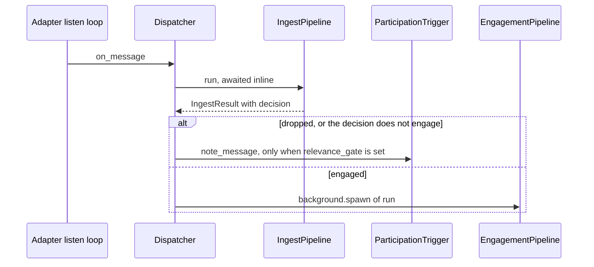
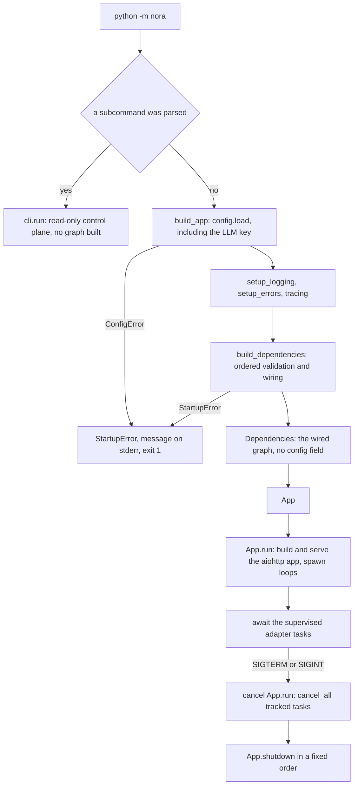

# Runtime topology

Nora's daemon is one asyncio process that is assembled exactly once, at one place, and then kept
alive by a fixed set of background loops. Three decisions carry the whole design:

- **One composition root reads `Config`.** Every other module receives collaborators. A stage that
  could reach the whole config would eventually reach for it, which is how a god object
  re-forms; `Dependencies` therefore has no `config` and no `settings` field at all, and a test
  asserts the absence rather than trusting the comment.
- **One long-lived object graph, shared.** One SQLAlchemy async engine, one model client, one
  `MediaJoin`, one `QuoteWindow`, one `ConversationSlots`, one `Debounce`, one clock. Where two
  instances would still *work* but could *disagree*, the graph holds one and passes it down.
- **Loops are disposable, the graph is not.** Every background loop is spawned through
  `BackgroundTasks`, holds no config, and treats its own failure as a logged, counted event rather
  than a process exit. Only the composition root and `nora.__main__` decide whether a loop exists.

This page is an implementation map, not a deployment guide. Compose services, ports, volumes and
restart policy belong to [deployment](../operations/deployment.md); the words a failing subsystem
answers with belong to [the status and failure contract](failure-and-status-contract.md).

## Who decides, who only sequences

| layer | module | what it actually decides |
|---|---|---|
| process | `nora/__main__.py` | whether this invocation is the daemon or a CLI subcommand; logging, error reporting and tracing wiring; which loops to spawn and in what order; signal handling; shutdown order |
| composition root | `nora/app/composition.py` | the only place that knows `Config`'s shape: ordered fatal validation, which optional subsystems are built at all, and which collaborator is shared |
| loop discipline | `nora/app/runtime.py` | how a periodic unit of work survives its own failures, and how adapters restart. Takes dependencies and intervals, never `Config` |
| pipelines | `nora/ingest/pipeline.py`, `nora/engagement/pipeline.py` | nothing per-message — they *sequence* stages, and every branch belongs to the stage that owns it |
| handoff | `nora/app/dispatch.py` | the one decision between the two pipelines: an admitted tag becomes a spawned turn |

`nora.__main__` is deliberately thin: `build_app` loads the config, awaits `build_dependencies`, and
constructs `App`. All ordered, fatal startup validation lives in the root itself, so adding a
fallible step is a change in one function rather than two files.

### Why `Dispatcher` lives in `nora.app`

`Dispatcher` is the successor to the single `Handler.on_event` method that used to run
`IngestPipeline`, read its `EngageDecision`, and hand an admitted tag to `EngagementPipeline`. Its
placement is forced by the layers contract: `nora.ingest` sits above `nora.engagement`, so ingest
may import engagement (the standing fold is triggered from the ingest path) while the reverse
import is forbidden. The thing that must import **both** therefore cannot live in either, and
`nora.app` is the layer above them, beside the root that builds it. Like `nora.app.runtime`, it
takes dependencies only — an `IngestPipeline`, an `EngagementPipeline`, a `BackgroundTasks` and an
optional `ParticipationTrigger` — never `Config`.

The split it implements is asymmetric on purpose. Ingest is awaited inline: it is deterministic and
constructs no Agent, so nothing in it is worth moving off the adapter's listener. An admitted tag
is different — a model call can take seconds or hang — so it is handed to `EngagementPipeline.run`
through `background.spawn`. The dispatcher does **not** own admission: debounce, in-flight and
self-tag checks are the engagement pipeline's own first step, so two rapid events resolve inside
the pipeline rather than racing here. An untagged message in an opted-in room is not admitted at
all; it is only *noted* with the participation trigger, when one exists.

The handoff `Dispatcher` owns: an awaited ingest, then either a note to the participation trigger or
a spawned engagement turn.

### The ports and boundaries that keep this testable

`nora/domain/ports.py` declares the seams as `Protocol`s with a hard constraint of its own: standard
library only, so no port can smuggle `aiohttp`, `sqlalchemy`, `strands`, `pydantic` or
`prometheus_client` into the domain. Several `Dependencies` fields are annotated with their port
(`audit: RecordStore`, `memory: MemoryStore`, `policy: EngagePolicy`, `assembler: ContextAssembler`)
precisely so mypy's strict override on `nora.app.*` becomes a permanent, statically checked proof
that the concrete class conforms — not a one-time `isinstance` name-check.

The boundaries are enforced by `pyproject.toml`'s import-linter contracts plus AST-level tests in
`tests/test_boundaries.py`:

- a `layers` contract orders the packages, and its last row is the property it exists to prove —
  nothing above `nora.domain` may be imported *by* `nora.domain`;
- `domain is framework-free`, which a stdlib allow-list test in `tests/test_boundaries.py` backs up
  so an unlisted framework name cannot slip past a deny-list;
- a contract named `only app and __main__ read config` forbids the listed stage packages from
  importing `nora.config`. `nora.subject` is deliberately absent: it composes the real graph for
  non-production callers, so it reads config for the same reason `nora.app` does;
- `nora` never imports `evals/` — separately tested, because import-linter only constrains the
  direction each contract names.

## The boot sequence, in order

`build_app` wraps exactly one step before the root — loading `cfg` — and that step is fatal:

| # | step | fatal? |
|---|---|---|
| 1 | `config.load(config_path)`: TOML parse, pydantic validation, and **the LLM key must be in the environment**. A `ConfigError` is re-raised as `StartupError` | fatal |
| 2 | `setup_logging` with the LLM key registered as a secret, then `setup_errors` (Sentry) — wired before anything that can fail, because a reporter installed after the crash reports nothing | — |
| 3 | tracing, if `[obs.tracing] enabled` | degrades: `log.warning` and continue, because tracing is never load-bearing and `nora.obs` may not import `nora.agent` to guard it itself |
| 4 | `load_persons(identity_file)` | fatal (`person mapping error`) |
| 5 | the reserved-`aiPeer` check: no human may hold `honcho.ai_peer`, or their words merge irreversibly into Nora's self-model card | fatal |
| 6 | `load_policy(policy_file)` | fatal (`policy error`) |
| 7 | the database URL, read from the env var named by `store.database_url_env` (default `DATABASE_URL`) | fatal if unset |
| 8 | `run_migrations(database_url)` — Alembic, synchronously, under a Postgres session-level advisory lock shared with the presence and analytics containers, and with a deadline so a lost race is an ordinary startup failure rather than a hang | fatal (`migration error`) |
| 9 | one `create_sql_engine`, then the stores over it: record, mobility, reminders, compute outbox, tool-call log, computer events and sessions, reasoning strip, tag trace, standing, media index, documents | — |
| 10 | `DoctrineStore`, then `get(applies_to="tag")` | fatal (`doctrine error`) |
| 11 | `AdapterRegistry.from_config`, then the "some platform must be enabled" check and a narrowing assertion that the registry's `signal` entry really is a `SignalAdapter` | fatal (all three) |
| 12 | `DreamerInstructions.objective_names()` — read unconditionally so a malformed objective names its file at startup rather than silently stopping the Dreamer hours later | fatal |
| 13 | `build_workspace_router` (policy × identity × config), `memory.ensure_workspace()`, then `foreign_workspaces()` | routing and foreign-workspace conflicts are fatal; an *unreachable* Honcho is not (re-checked on the first call) |
| 14 | `BackgroundTasks`, `Debounce` (hydrated before any adapter listens), `ConversationSlots`, the model client and `ModelSource` | — |
| 15 | `build_assembler(...)` — the one `TranscriptInjection` construction site both production and the offline harness call | — |
| 16 | media custody, `IngestPipeline`, the tool registry, `EngagementPipeline`, then the fire path | — |
| 17 | boot recovery: `heartbeat.recover`, `compute_poller_recover`, `publish_idle_gauge` — all unconditional | — |
| 18 | optional subsystems: Dreamer runtime, Cognition, OTP | mixed, see below |
| 19 | `Dependencies(...)` returned; `App` constructed | — |

Two ordering details are load-bearing rather than cosmetic. Boot recovery runs **before** the fire
path exists, and the rows it swept are returned so that `_tell_about_lost_jobs` can spawn once
`fire_path.speak` is available — otherwise a person who was told «I'm working on it» would hear
nothing ever, which is exactly the failure shape R-5 forbids. And `media_join`, `quote_window`,
`presence_reader` and the assembler are built **before** the fire path so the tag turn and the fire
turn hold the same instances; the fire path's context assembly is pinned to the same keyword set by
`tests/architecture/test_assembler_parity.py`, so a tier wired into one side and forgotten on the
other fails a test instead of silently rendering no `<notes>`.

### What is fatal

Everything above that loads an artifact the running process cannot be correct without: the three
config files, the LLM key, the database URL, migrations, the doctrine (tag), the Dreamer instruction
corpus, at least one platform adapter, memory routing, and a bound Honcho workspace that belongs to
another application. Optional subsystems add their own boot refusals rather than starting in a
state that only looks healthy: `[computer] enabled` without its bearer token, `[otp] enabled`
without its secret and API token, `[cognition] enabled` with no session hook, no instruction
prelude, an uninstalled mapped skill, or without `[notes] enabled` (a session writes the notebook),
`[lessons] enabled` with an empty doctrine-check objective, a reasoning effort the provider does not
accept, and a `[documents] public_url` that the egress identifier scan would block.

### What degrades

The root's asymmetry is consistent: a *bonus* feature degrades to `None`, and callers must already
behave with `None`; the *record* is never traded away for it.

- **Media custody** — off unless `[media] enabled` and a valid base64 32-byte key is present. A
  missing or malformed key is warned, not fatal: losing custody must never take the daemon down or,
  worse, write plaintext by accident. Off means no `MediaSourceRegistry` and no `BlobStore`, and the
  ingest media stage counts every attachment `not_configured` rather than failing silently.
- **A misconfigured RustFS blob backend** falls back to the filesystem store, not to custody-off.
- Keyless providers degrade their tools to `unavailable`: `route`, `search`, `image_gen`,
  `video_gen`, plus `PULSE_API_TOKEN` for the portal's games client.
- **Tracing**, the TTS speaker, an unreachable Honcho, `[dreamer] enabled` with no cursor store (a
  loud `log.error`, and the clock simply does not start), and Cognition units with no home room
  (counted and logged, those units are never woken).
- One startup invariant — the R-21/R-31 circle-subset pre-flight — is deliberately a *background*
  task, not a gate, because it needs the signal-cli roster and an unreadable roster must not stop
  Nora. The authoritative check stays per-call inside `where_is`.

The process lifecycle: one fatal path, one graph, one spawn list, one shutdown order.

The CLI path is worth naming because it shares the entry point but not the lifecycle: a subcommand
loads the config with `require_secrets=False` (the 3 a.m. case, where the key lives in the
container's environment and the operator's shell has nothing exported), never builds the graph, and
never starts a loop.

## What the graph owns

`Dependencies` is a frozen dataclass of named collaborators. Its docstring states the rule and the
reason: adding a named collaborator beats widening its reach, and the fields that are typed with a
port are the ones where the port proof is worth having. `adapter` stays the concrete `SignalAdapter`
because a handful of call sites are Signal-specific *by construction* (the Signal sender id, the
signal-cli roster, `/health`'s pinned `sse` block); everything that must work across platforms reads
`registry` instead.

Several fields exist because a harness must be able to reach the **deployed** instance rather than
build a second: `dispatcher`, `engagement`, `participation_trigger`, `relevance_gate`, `fire_path`,
`proactive_screen`, `clock`, `self_presence`. That is also why `App` exposes convenience properties
(`adapter`, `store`, `honcho`, `llm_state`) instead of forcing tests into privates.

### Optional wiring states, recorded as uncertain

The graph is a *shape*, not a statement about any deployment. The wiki must not imply that an
optional subsystem is on. These fields are `None` under documented conditions, and the code is
written so that each `None` is a legitimate three-state rather than a leak:

| field | `None` when | effect |
|---|---|---|
| `blobs` | media custody is off (flag, missing key, malformed key) | attachments recorded without custody; the portal's picture route answers `unavailable` |
| `wake_evaluator`, `cognition_runner`, `cognition_shutdown` | `[cognition] enabled = false` (the shipped default) | no stimulus stage, no wake tick, no session |
| `computer_sweeper`, `computer_probe` | `[computer] enabled = false` | no session sweep, no `nora_computer_up` series at all |
| `dreamer_runtime`, `language_store`, `dream_adaptors`, `dream_schedules` | `[dreamer] enabled = false` | the clock is not spawned; the schedule clock store is still built |
| `fire_path` | none of `[heartbeat]`, `[compute]`, `[participation]` is enabled | no turn behind any proactive occasion; the root logs an error for each flag combination that would otherwise look healthy |
| `participation_trigger` | `[participation] enabled = false`, or no fire path | nothing notes a quiescent window, so no participation turn can ever run |
| `relevance_gate` | `[relevance_gate] enabled = false`, or no fire path | no window is judged; the trigger and the room policy are both keyed on the gate |
| `speaker`, `voice_hub`, `voice_event_consumer` | `[speech.tts]` off, providerless, keyless, or no controller sidecar | voice verbs fail closed; the `/app/v1/voice/event` route does not exist |
| `social_poller`, `social_perception`, `story_expiry`, `otp`, `oauth_keepalive`, `memory_embed`, `games_client`, `persona_portal`, `presence` | their own flag, key or key-file is absent (story expiry additionally needs media custody for the bytes it deletes) | the feature is absent, not degraded |

The honest way to learn what a particular deployment wired is to read its `/health` and
`/app/v1/status` output, not to assume from this table. Note also what is *not* optional:
`health_recorder`, `dreamer_instructions`, `dream_schedule_clock`, `documents`, `artifacts`,
`revisions`, the standing store and the media index are built unconditionally, because they are
**Record** — «was the source healthy for that span» must be answerable for the whole history, not
from the day an operator flipped a flag.

## The loop inventory

Every periodic unit below runs in the same process. The "spawned in" column matters: the root
spawns the loops that need a collaborator only it can see (`fire_path`, the tool registry), and
`App.run` spawns the rest — after the HTTP server is listening, so `/health` answers while the
adapters are still coming up. Tasks spawned in the root start as soon as boot next yields, which is
*before* the port is bound: the tick loops sleep first, but the one-shot tasks among them (the
presence pre-flight, `_tell_about_lost_jobs`) run during boot.

| loop | module | spawned in | interval / trigger | what it owns | when it fails |
|---|---|---|---|---|---|
| adapter supervision | `runtime.supervise_adapter`, `start_adapters` | `App.run` | one task per enabled platform; restart with capped backoff 1 s → 60 s | one platform's `listen()` loop | logs, `nora_adapter_restarts_total{platform}`, retries; other platforms and the process survive |
| retention prune | `runtime.prune_loop` | `App.run` | 300 s (`PRUNE_INTERVAL_SECONDS`), only while `store.prune_enabled` | deleting rows past `max_per_conversation` | `nora_errors_total{stage="prune"}`, keeps looping |
| memory drain | `runtime.memory_drain_loop` | `App.run` | `[memory.index] drain_seconds` (60), unconditional | re-projecting what the index queued; one embed batch after each drain | `{stage="memory_drain"}`; the embed step fails separately as `{stage="memory_embed"}` and never stops the drain |
| debounce sweep | `runtime.debounce_sweep_loop` | `App.run` | 300 s tick, 3600 s TTL | bounding `Debounce`'s per-conversation entries | `{stage="debounce_sweep"}` |
| reminder heartbeat | `HeartbeatLoop.run` (`nora.app.heartbeat`) | root | `[heartbeat] tick_seconds` (60); needs `enabled` **and** a fire path | due-reminder turns, the conversation slot, deferrals | per-group `try/except`, `{stage="heartbeat"}`; the liveness gauge is stamped only by a pass that finished |
| compute poll | `ComputeJobPoller.run` (`nora.app.compute_poller`) | root | `[compute] poll_tick_seconds` (10); needs `enabled`, a fire path and at least one backend | delivering a finished job through `FirePath.speak` | `{stage="compute_poller"}`; a held slot is `deferred` and the row stays `PENDING` |
| Dreamer clock | `runtime.dream_loop` | `App.run` | `[dreamer] tick_seconds` (300); needs `enabled` and the cursor store | per-(adaptor, key) cycles, watermark written last | isolation per adaptor and per scope, capped backoff keyed on the (adaptor, key) pair |
| cognition wake | `wake.wake_loop` (`nora.app.wake`) | `App.run` | `[cognition] tick_seconds` (30); needs a `WakeEvaluator` | the evaluator tick that starts sessions | `{stage="cognition_wake"}` |
| participation clock | `runtime.participation_loop` | `App.run` | 2 s tick, 86 400 s room TTL; needs a trigger | closing quiescent windows, sweeping per-room cursors | `{stage="participation"}` |
| computer session sweep | `runtime.computer_sweep_loop` | `App.run` | `[computer.sessions] sweep_interval_seconds`; needs a sweeper | expiry bookkeeping for sessions | `{stage="computer_sweep"}` |
| computerd probe | `runtime.computer_probe_loop` | `App.run` | 30 s (`COMPUTER_PROBE_INTERVAL_SECONDS`), first probe immediately | `nora_computer_up` | the probe reports its own outcome; `{stage="computer_probe"}` is the second barrier |
| adapter liveness | `App._update_last_event_age` | `App.run` | 10 s | per-platform last-event-age gauges and health transitions as Record | a raising `health()` is logged and recorded `unknown` for that platform; the others are still published |
| log heartbeat | `nora.obs.logging.heartbeat` | `App.run` | 60 s | an INFO line when the ingest counters moved, DEBUG when they did not | — |

Two smaller groups are easy to miss. **One-shot units**: the adoption backfill (spawned with a start
delay, so a slow backfill never delays the adapters), the revision recorder (`record_start` then
`watch`, so `nora snapshot --at T` can say what was in force), the presence pre-flight, and
`_tell_about_lost_jobs`. **Units whose failure discipline lives in their own module**: the social
poller and its perception pass, story-media expiry, the Instagram summons consumer, the OAuth
keepalive and the sub-agent worker. Their internals are outside what this page verified; read the
module before assuming a failure shape.

### Flags gate the tick, not the store

This is the invariant to keep when adding a loop. `reminders`, the compute outbox, the tool-call
log, the computer audit log and session store, the reasoning-strip counter, the tag-trace store, the
standing store, the media index, the documents store and the dream schedule clock are all built
**unconditionally**, over the one engine. Only the tick that consumes them is behind a flag. The
reasons recur throughout the root:

- a tool must answer `unavailable` because the *feature* is off, not because the *store* was
  forgotten — and no test builds the production registry, so a missing store is a wiring accident
  nothing catches;
- boot recovery must have somewhere to sweep: `heartbeat.recover` and `compute_poller_recover` run
  unconditionally, and `publish_idle_gauge` binds the "not running" sentinel so a disabled heartbeat
  does not export `0.0`, which reads identically to "ticked a moment ago";
- an instrument that is off by default answers nothing, and the questions it exists to answer span
  deploys;
- the memory drain is unconditional because *every* store write projects into the index, so there is
  always a queue a failed projection may have filled.

The exceptions prove the rule: a subsystem's *runtime* collaborator (`SandboxRuntime`,
`SqlStimulusStore`, `SqlLanguageStore`, `DreamerRuntime`, the `MemoryEmbedWorker`) is built only
with its flag, which is exactly why the loop above it cannot be spawned unconditionally.

## Keeping the process alive

`App.run` builds one aiohttp `web.Application` and serves it through `obs.health.serve`, bound on
`0.0.0.0:<obs.metrics.port>` — one app carrying `/health` and `/metrics`, every `/app/v1/...` route,
the OTP routes when `[otp] enabled`, and the voice routes whose event endpoint exists only when a
controller consumer was wired. `[obs.metrics].port` is a required config field (`config.example.toml`
uses 9100), so the port is configured rather than compiled in. Two things follow from the ordering:
the HTTP server starts **before** the adapters, so `/health` is already answering while a platform is
still connecting; and the watermark seeding and orphan reclamation that precede the Dreamer and
Cognition clocks are `await`ed, not spawned, so neither loop can race its own precondition.

`App.run` then ends with `await asyncio.gather(*adapter_tasks)` and `finally:
await deps.background.cancel_all()`. Adapter tasks are the only awaitable the process is willing to
block on: when they are cancelled, every other tracked task is cancelled before shutdown begins, so
no *new* wake or turn can start while the graph is being taken apart.

`run_until_stopped` installs the stop handlers. The first `SIGTERM`/`SIGINT` cancels `App.run` and
**removes the handlers**, so a second signal takes the default action and ends the process at once;
without the handler, `docker stop`'s `SIGTERM` would kill the process without unwinding and
`App.shutdown` would be reachable only by Ctrl-C. `shutdown` then runs in a fixed order, and each
step is first for a reason:

1. `cognition_shutdown` — sessions hold the model client and the database closed below, and a
   session cancelled here records itself `cancelled` with its stimuli still pending, instead of
   vanishing with a wake that reads «in flight»;
2. `subagent_backend.shutdown` — jobs in flight are cancelled while their rows can still be failed
   by the next boot's recovery;
3. the health runner is cleaned up (the port is released);
4. `client.close()`;
5. `audit.aclose()`, which disposes the **one** engine that every store shares. `PresenceStore`'s own
   `aclose` is deliberately not also called on it.

One absence worth stating plainly: a `StartupError` raised halfway through `build_dependencies` has
no partial-graph teardown. The engine may already exist and nothing disposes it explicitly —
`App.shutdown` only exists once `App` does, so the process exits and loop teardown takes the pool
with it.

## Extension points

Adding a periodic unit is a five-step shape, and every step has a place:

1. build the collaborator in `build_dependencies`, and decide explicitly whether the **store** is
   unconditional while the **runtime** is gated;
2. gate the flag in the root, never inside the loop — the loop must not know a flag exists;
3. expose it as a named field on `Dependencies`, never as a wider reference;
4. spawn it: in `App.run` with an interval read from `Config` at the root, or in the root itself when
   it needs a collaborator built later (the fire path is the precedent);
5. give it `prune_loop`'s discipline — `try/except Exception`, `log.exception`, and
   `nora_errors_total{stage="..."}`, then keep looping. If the unit of work is a *list* of keys,
   isolate per key instead (`dream_loop`), because one failing scope must not starve the others.

In `nora/app/runtime.py`, keep the narrow local `Protocol` per loop (`_PrunableStore`,
`_DrainsIndexQueue`, `_SweepsComputerSessions`, `_ProbesComputerd`, `_ClosesParticipationWindows`):
it is what stops a loop reaching for a method it has no business calling, and it is why `RecordStore`
has no `prune` — retention is the runtime's policy, not something a stage programs against.

## Focused tests

- `tests/test_composition.py` — the graph's contract: `test_dependencies_do_not_expose_settings`
  (no `config`/`settings` attribute), `test_no_enabled_platform_refuses_to_start`,
  `test_the_liveness_gauge_is_seeded_even_with_the_heartbeat_off`,
  `test_compute_boot_recovery_sweeps_a_stranded_row_even_when_disabled`,
  `test_compute_enabled_without_an_adapter_boots_and_spawns_no_poller`,
  `test_computer_refuses_to_start_without_its_token`,
  `test_media_custody_is_off_when_the_key_env_is_unset`,
  `test_build_dependencies_never_wires_the_real_database`.
- `tests/unit/test_runtime.py` — the loop discipline: a spawned task survives GC because of the
  strong reference, `cancel_all` cancels every tracked task, each sweep survives a failing pass, and
  a failing adapter is restarted and counted while its sibling keeps running.
- `tests/architecture/test_assembler_parity.py` — production's `composition.py` and the offline
  harness call `build_assembler` exactly once each with the **same** keyword set, neither constructs
  `TranscriptInjection` directly, and the two `FirePath(...)` sites are pinned the same way. It
  compares names only, and says so.
- `tests/test_boundaries.py` — the doctrine read boundary, the `permissive_policy` prohibition in
  `composition.py`, the stdlib-only rule for `nora.domain`, and «`nora` never imports `evals`».
- `tests/test_health.py` — the pinned `/health` shape, including the `sse` key the deployment's
  watchdog reads.

## Related

- [The status and failure contract](failure-and-status-contract.md) — the vocabulary a failing loop
  or a degraded collaborator answers with.
- [State and scopes](state-and-scopes.md) — what the stores over that one engine describe.
- [Sessionless continuity](../concepts/sessionless-continuity.md) — why so much of the graph is
  Record rather than memory in the process.
- [The tool surface](../concepts/tool-surface.md) — the registry the root builds once and every turn
  shares.
- [Ingestion](../workflows/ingestion.md) — the pipeline `Dispatcher` awaits.
- [Deployment](../operations/deployment.md) — services, ports, volumes and restart policy.
