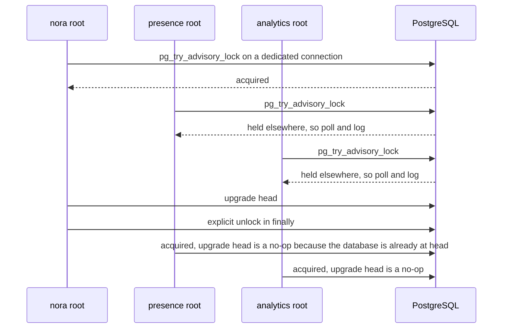
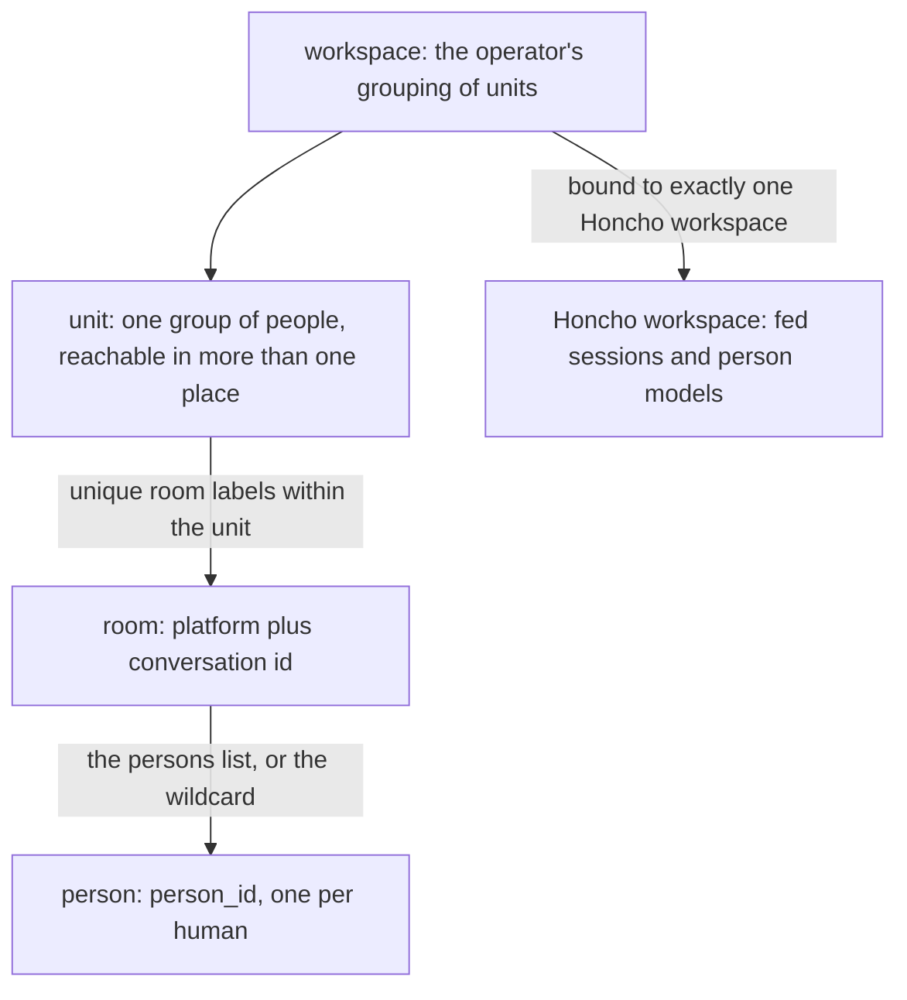

# State, scoping and durability

Three questions decide everything on this page, and they are answered by different mechanisms:

- **What survives a restart?** PostgreSQL rows, content-addressed blob bytes, and three TOML files that
  live outside the database entirely. A row is a promise; a blob is the promise kept. A fourth,
  external surface survives too — Honcho, holding copies of the messages she was fed and its own
  derived models — and it is the one surface no backup or restore path here covers.
- **What can be thrown away and rebuilt?** The memory index, the Rollup builds, and every vector.
  They are projections over the durable tables, and the schema declares them as such rather than
  leaving it to memory.
- **What bounds a read?** A hierarchy of scope keys — workspace, unit, room, person — resolved from
  the live policy and the live roster on every read, never stored as an access-control list.

Two boundaries are worth stating before the detail. Nothing here publishes a credential or a host
value: environment variables are described by *name* only (`store.database_url_env`, the media
encryption key variable, the RustFS credential variables), and the composition root is their one
reader. And this page is about persistence and scoping, not process assembly — the boot order and the
object graph belong to [runtime topology](runtime-topology.md), and the words a failing subsystem
answers with belong to [the status and failure contract](failure-and-status-contract.md).

## The state map

| surface | lives in | durable? | rebuilt or dropped by |
|---|---|---|---|
| append-only store tables (`APPEND_ONLY`, each with its own system-time column) | PostgreSQL | yes — never changed after insert, so the row *is* its own history | nothing |
| tables that change in place — including `messages` itself (`delivery_status`, `hidden_at`, a corrected `ts`), `note`, `standing`, `media_objects`, `persona`, `rollup_build`, `presence_stays` | PostgreSQL + `row_history` | yes — the trigger appends each version in the same transaction | nothing |
| `row_history` | PostgreSQL | yes | the snapshot copies it up to T on its own terms |
| `memory_node`, `memory_edge`, `memory_projection_queue`, `memory_index_state` | PostgreSQL | **derived** | `nora memory rebuild`; a restore leaves them empty |
| `rollup_build` and the unit rollups | PostgreSQL | derived, but versioned: a superseded build is never touched again | a new build switched in |
| Persona lines, notes and their revisions, standing, culture, lessons, memos | PostgreSQL | durable **interpretation** — append-only revision chains | nothing: a change is a row |
| Honcho: each conversation session's fed messages (`content`, `peer_id`, `metadata`), and the person models, peer cards and conclusions derived from them | the external Honcho service | yes, but outside every backup here: never restored, and never the record | a new workspace starts empty; `nora memory backfill` replays the local Record into it; `nora memory detach-unit` deletes a departed unit's sessions |
| blob bytes for attachments, stickers, story frames, computer audit payloads | filesystem under `store.data_dir`, or an S3-compatible bucket | yes, as ciphertext | only a story frame's, at its bound |
| `blob_tombstone` | PostgreSQL | yes — the record that bytes were deliberately deleted | nothing |
| `config.toml`, `identity.toml`, `policy.toml` | the host, bind-mounted | yes, but *outside* the database | operator edit + restart |

The four-way classification is not a comment somebody wrote once. `nora/infra/sql/history.py` names,
for every table in the schema, which of four things it is — `HISTORY_TABLES` (changes in place, and
its versions go to `row_history`), `APPEND_ONLY` (with the column holding its system time),
`DEFERRED` (changes in place and not yet restorable as of T; currently empty), and `NOT_RESTORED`
(not state a restore needs, each with a stated reason). `tests/infra/test_row_history.py` fails when a
table appears in none of them, or when the migrated database's triggers disagree with
`HISTORY_TABLES`. So adding a table puts the author in front of the durability question rather than
in front of a silently incomplete restore.

The `NOT_RESTORED` reasons are worth reading once, because they are the honest version of "derived":
`memory_node` is *"derived; nora memory rebuild"*; `tag_trace`, `tool_call_log` and
`reasoning_strip_log` are traces no turn reads; and a dozen tables are deprecated tiers whose code is
gone but whose rows are kept. `HISTORY_TABLES` covers the tables a restore does need, and the
mechanism is a trigger (`nora_row_history()`), not versioned rows with a head view — the docstring's
argument is that a versioned-rows scheme means changing every write statement and every read's
`WHERE`, and a history that misses one write site is silently incomplete, whereas a trigger records
every path by construction.

System time on an append-only table is the column `APPEND_ONLY` names for it — usually `recorded_at`,
and `created_at` for `tool_call_log` and `computer_events` — and `recorded_at` defaults to
`clock_timestamp()` rather than `now()`, because `now()` is the transaction's start: a row inserted
late in a long transaction would otherwise claim to have been held before rows written ahead of it.

## The one surface outside the database

Honcho is the one state surface outside both the database and the host's files, and the only one that
holds a copy of the Record's own text. The client is `nora/infra/honcho/client.py`, speaking HTTP to
`[memory] base_url`, and **it is never load-bearing**: every method logs and returns a benign value
(`None`, `False`, `[]`) on any failure, which is the deliberate opposite of the record store's
contract — a failed append there drops the message rather than degrading quietly
([ADR 0001](../../docs/adr/0001-honcho-is-interpretation-not-record.md)). Three things live there:

| what it holds | written by | read back by |
|---|---|---|
| the conversation's **session messages** — each fed message's `content`, its speaker's `peer_id`, and the `metadata` the caller attached | the ingest memory feed (human messages, mapped senders only), the reply path's feedback stage (every sent message, under the `ai_peer`), the media comprehension feed, and `nora memory backfill` | `session_messages` (the backfill alone), `search` (semantic search over raw messages), and Honcho's own deriver |
| **person models** — conclusions (per named unit scope once `[units]` exists) and peer cards (workspace-wide, since the card endpoint takes no scope), keyed by the `(observer, observed)` pair | the deriver, and `conclude` (the `remember` tool, one settled fact) | `representation`, `peer_card`, and the portal's own-memory page |
| **named scopes** and their members | `ensure_scope` / the session join, at session creation and at startup | every scoped read |

**A feed carries the text, not only a conclusion about it.** `feed` posts
`{"messages": [{"content": …, "peer_id": …}]}` to `/sessions/{id}/messages` in the conversation's
routed workspace, after configuring the speaker as observable (`observe_me`) so the
`(nora, person)` pair derives, and each message keeps whatever `metadata` the caller attached. So
what a wrong binding writes into another group's workspace is a person's words, not a summary of
them, and nothing in the client rewrites them: Honcho keeps a message's content once and its API
updates metadata only, which is why an edit is fed as a **new** message framed
`[edited an earlier message; it first said: «…»]` with `edit_of_ts` in the metadata, and why a media
comprehension's reading is identifier-screened before it is fed at all — that text is durable, two
consumers read it, and a peer card can hand it back to a model that never re-screens.

**The reverse read exists, and it is not a transcript.** `session_messages` posts to the session's
paginated message-list endpoint and returns `{"peer_id", "content", "metadata"}` records in Honcho's
order — `[]` for a session that does not exist yet, `None` for a page it could not read or a
workspace that is not Nora's. Its one caller is `nora memory backfill`, which must know what a
session already holds before it writes; no turn uses it. Nothing here reads Honcho's messages back
into the Record: there is no import path, no read there has the Record's ordering or window, and a
session holds only what was actually fed.

**Absence is repaired by replaying the Record.** A conversation's session id is derived from the
conversation id alone (`nora-conv-<key>`), so it is the same string in every Honcho workspace, while
the models are per workspace. A new workspace therefore starts empty, and `nora memory backfill
--unit …` replays the unit's rows from the transcript through the same `ensure_peer` / `feed` calls
the live path makes — same session id, same peer ids, same observer configuration, same `metadata` —
plus each row's own `created_at`, so a replayed message is dated when it was said. Dry run by
default; a session that already holds messages refuses the run unless `--resume`, which then skips
every message it already has, matched by speaker and `ts` (and `edit_of_ts`). `nora memory detach-unit`
is the only thing that deletes there: it removes a departed unit's sessions and rebuilds the cards,
and cannot reach a conclusion stored under no session.

**Ownership is a marker, not a name.** Every workspace Nora creates is stamped
`nora_owner = <ai_peer>`; the default `memory.workspace_id` is hers without one, because it predates
the marker and holds every deployment's history. A *bound* workspace that holds sessions and carries
neither is another application's: every call routed to it is refused for the life of the process and
`foreign_workspaces` makes startup fail naming it. That refusal and the routing refusals below are
what stand between one line of `identity.toml` and speech written where it does not belong.

## One engine, one pool, one URL

`nora/infra/sql/engine.py` is deliberately tiny and its docstring says why: nothing here is
file-shaped. A PostgreSQL URL has no parent directory to create, no PRAGMAs to set on connect, and
the read-only engine's guarantee comes from the server, not from a URI flag.

- `create_sql_engine(url)` is the application's read/write engine over a full
  `postgresql+asyncpg://…` URL, taken from the environment variable *named* by
  `store.database_url_env` (default `DATABASE_URL`). The value is host-injected, so a credential
  never lands in a committed file.
- `create_readonly_sql_engine(url)` opens every connection with
  `default_transaction_read_only=on`, so an `INSERT`/`UPDATE`/`DELETE` raises
  `ReadOnlySqlTransaction` at the server. In the deployment it is additionally pointed at a
  `GRANT SELECT`-only role — defence in depth on top of the session setting — but the guarantee does
  not depend on which URL it is handed. Its callers are the strictly-read operator commands, the
  eval subject's readers and `nora snapshot`'s source reads (`nora/app/cli.py`).

Within one process there is exactly **one** engine, and every store shares it: the record store, the
presence reader, mobility, reminders, the compute outbox, tool-call log, computer events and sessions,
reasoning strip, tag trace, standing, media index and documents. Because the presence reader is handed
the record store's engine rather than building its own, `SqlRecordStore.aclose()` disposes the pool for
both, and `PresenceStore.aclose` is deliberately *not* called on the shared engine: a second
`create_sql_engine` call would fork the pool and split the lifecycle. Each *process* has its own — the
presence collector and the analytics deriver build their own engine against the same database, which is
why the migration concurrency guard below exists at all.

## Migration discipline

Alembic is run **programmatically**, never through `alembic.ini` at runtime: `alembic_config(url)`
sets `script_location` to `nora/infra/sql/migrations` and `sqlalchemy.url` to a synchronous URL, so a
missing or unmounted ini can never stop Nora from starting. (The ini exists at the repo root for CLI
use — `uv run alembic check`, `uv run alembic revision --autogenerate`.) Migrations run synchronously
against `postgresql+psycopg://`, while the application speaks `postgresql+asyncpg://`;
`sync_url_for` swaps the driver so one `DATABASE_URL` remains the single source of truth.

**The concurrency guard.** Three containers built from the same image — `nora`, `presence` and
`analytics` — each call `run_migrations` at their own startup, so two can race the same DDL on the
shared database and one would fail. `run_migrations` and `stamp_head` therefore wrap their Alembic
call in a PostgreSQL **session-level advisory lock** on a dedicated connection (so a caller that
already holds a connection or is inside its own transaction is never touched).

Three composition roots race one advisory lock; a loser polls, then finds the database already at head.

A losing process **polls** rather than blocking, and that is not fussiness: a plain blocking wait
deadlocks against this repo's `CREATE INDEX CONCURRENTLY` migrations, because those wait on
transactions that are themselves waiting for the lock, and PostgreSQL's own deadlock detector cannot
see a lock it does not track. It logs once when it starts waiting and again on an interval, and raises
past a deadline rather than waiting forever, so a composition root's existing `try/except` surfaces an
ordinary startup failure instead of an unexplained hang. The lock is released in `finally`, including
on an Alembic failure, so one caller's error never wedges the database for the next; `engine.dispose()`
would eventually release it too, but the explicit unlock is what makes release immediate rather than
incidental to connection teardown.

**Single head.** `alembic upgrade head` refuses to boot with more than one head, and the failure mode
is nasty: two branches cut from the same parent each write `down_revision = <that head>`, git merges
both files without a conflict, and every test that does not actually migrate stays green.
`tests/architecture/test_alembic_single_head.py` is the check that used to depend on somebody typing
`alembic heads`: it parses each revision module's `revision` and `down_revision` out of the AST (an id,
a tuple of ids for a merge revision, or `None` for the root), and asserts the graph resolves to exactly
one head. Two properties keep the check honest — a floor of 50 revisions, so a walk that stopped
reading files fails loud instead of reporting a suspiciously empty single head, and positive controls
that reconstruct the failure in a `tmp_path` (two branches off one parent must read as two heads; a
merge revision naming both must resolve the fork).

### Why forward is the only direction the runtime takes

The runtime only ever moves a database **forward**: `run_migrations` calls `command.upgrade(cfg,
"head")` and `stamp_head` calls `command.stamp(cfg, "head")`, and those are the only two operations in
`nora.infra.sql` that ever change a schema (the rest of its Alembic surface only *reads* revisions):
`current_revision`, `head_revision`, `revision_is_known`. Migrations also declare a `downgrade()`, but
the only callers are tests, which use it to place a database *before* a migration and then re-upgrade,
proving that the upgrade handles rows written under the older schema. There is no production path that
takes a database backwards.

Nothing promises that a binary **older** than the database can serve it, and two mechanisms say so
explicitly:

- `revision_is_known(revision)` answers "is this a revision *this checkout* defines" with **no
  database connection at all**, from the local script directory. Because the repo keeps one linear
  chain, a revision this checkout recognises is by construction an ancestor of (or equal to)
  `head_revision()` — never a sibling branch. So "known" and "not known" is exactly the behind/current
  versus ahead distinction, and it costs two string comparisons.
- `SourceRevisionMismatchError` is that distinction made operational. It is raised in two places,
  deliberately the same type: `nora.subject.sandbox.refuse_if_source_diverges_from_head` refuses
  up-front, with no query, when the source is **ahead** of this checkout's head (or carries no
  revision this checkout recognises at all — an unmigrated database has no "behind" to be). And
  `nora.infra.sql.snapshot.snapshot` catches `UndefinedColumnError`/`UndefinedTableError`
  (SQLSTATE `42703`/`42P01`, driver-agnostic) from any of its five reads and re-raises the same type,
  naming both revisions — the fail-closed net for a source that is **behind** head and turns out to be
  missing a column a newer migration added. A behind source is allowed to run, deliberately: most
  migrations add nothing those reads select, and refusing every routine deploy lag would refuse nearly
  every ordinary run.

The one thing that *cannot* detect a binary/database disagreement is the health surface.
`SqlRecordStore.stats()["schema_revision"]` reports `head_revision()` — what this process expects —
not `current_revision()`, the database's `alembic_version` row. That is a hot-path decision
(`current_revision()` opens a new synchronous connection per call) and the docstring admits the
consequence plainly: it can never disagree with the code it runs inside, which also means it cannot
detect the one failure mode a schema-shape check exists for. Read it as "what this process expects",
never as "what the database is".

### The schema gate is not `alembic check`

`alembic check` is good for column presence, column type and server defaults, and that is all it
claims. It is provably blind to `CHECK` constraints and to index ordering, and it reports permanent
phantom drift on expression indexes — which is why `migrations/env.py` excludes those indexes from
autogenerate, *both registrations or neither*: an index excluded there without a row in the test's
expectation table is an index nothing checks at all. The real gate is
`tests/infra/test_schema_parity.py`, which reads PostgreSQL's own catalogues — every
`sa.CheckConstraint` in `schema.py` compared against the migrated table, the `ts DESC` ordering read
from `pg_index.indoption`'s per-column DESC bit, expression indexes compared via `pg_get_indexdef`,
and the migrated database compared against a checked-in normalised `pg_dump` baseline.

## Blob custody

Attachments are the most PII-heavy data in the system, and the record's promise depends on them. A
body carrying `[image a3f2c1]` claims that `a3f2c1` can be produced, so custody is taken **before**
the audit write, inline, not spawned: spawning the copy would write the promise first and keep it
second. A custody failure degrades honestly instead — the body keeps the parser's bare `[image]` with
no handle, and `nora_media_custody_total{status=…}` counts the reason. The message is still recorded
in full.

`BlobStore` is `put`/`get`/`delete`, S3's shape, with two implementations that share a port and an
encryption story: `FilesystemBlobStore` (the default, `store.data_dir/media`) and `RustfsBlobStore`
(an S3-compatible object store, `[media.rustfs]`, shipping off). Swapping them is one constructor in
the composition root, changing no stage, no schema and no recorded key.

| property | filesystem | RustFS |
|---|---|---|
| key | sha256 of the **plaintext**, so dedup and verifiability survive encryption | same |
| layout | `<root>/<first2>/<rest>` — git's sharding, so one directory never accumulates everything | the digest itself; an object store's flat namespace needs no sharding |
| write | temp file in the same directory, then `os.replace` (atomic only within a filesystem) | a plain `PUT`; a duplicate is idempotent because a fresh GCM nonce over identical plaintext is safe |
| duplicate bytes | an existing path is left alone and its mtime touched | always uploads; a HEAD-then-PUT check would add a race window to save a rare re-upload |
| concurrency | every call in a worker thread (`asyncio.to_thread`) | `boto3` in `asyncio.to_thread`, not `aiobotocore` |

Both seal bytes with the same `BlobCipher`: AES-256-GCM, `nonce || ciphertext`, a fresh 12-byte random
nonce per blob stored as the first 12 bytes. GCM is chosen because it is *authenticated* — a blob read
back under the wrong key raises `InvalidTag` instead of decrypting to garbage, which is what lets `get`
distinguish "wrong key or corrupt blob" from "these are the bytes". The cipher is **required**, not
optional: there is no plaintext-on-disk mode to fall into by accident. Custody being off is a decision
made above the store (the composition root wires no store, and the stage counts `not_configured`), not
a plaintext degradation inside it. The key is host-injected; `[media] encryption_key_env` *names* the
variable holding the base64 of 32 bytes, and a missing or malformed key degrades to custody OFF rather
than crashing the daemon.

The key is validated as 64 lowercase hex characters in both stores, and *refused* rather than filtered.
The reason is the same in each: `get` is the half of this port a retrieval tool would one day expose to
a model-supplied argument, so an unvalidated key is a path segment or an arbitrary object key. A shape
the store could not have produced is structurally impossible to look up.

`get` returning `None` means **absent, and only absent**. An unreadable-but-present blob (permissions,
a bad disk) raises, because that is an operator problem that must not be reported as "there was never
anything there" — the same distinction the roster's `available` flag carries, made here by an exception
since this side has no network.

## Retention and deletion

| what | sweep | window | what goes | what stays |
|---|---|---|---|---|
| conversation rows | `SqlRecordStore.prune_all`, spawned as `prune_loop` | `[store] max_per_conversation`, gated by `[store] prune_enabled` | messages past the window, their edits/reactions/deletes (cascade), and their memory-index nodes in the same transaction | everything else; the delete is itself a `row_history` version |
| presence fixes | the presence collector's own `_prune_loop`, off the write path | `[presence] retention_days` | location fixes past the window | derived places, stays, trips and every Rollup row |
| a story frame's bytes | `StoryMediaExpiry` | `[social] story_media_keep_days` after the frame's `expires_at` once perception and embedding exist, else `story_media_keep_max_days` | the blob bytes, tombstoned in `blob_tombstone` | the row, the description `media_objects` holds, and any vector |
| every other blob | nothing | — | nothing | held until an operator removes it |
| Honcho's fed messages, conclusions and cards | no sweep here, and this client configures none of the service's own retention | — | what `nora memory detach-unit` deletes from a departed unit's old workspace: its sessions, and with them the messages, their embeddings and the documents under them | every conclusion stored under no session, and every card until it is rebuilt |

Two design points are worth carrying out of that table. First, pruning is a **periodic sweep, never
part of the write**: a correlated-subquery prune per message would cost O(rows-per-conversation) on
every insert, and the ingest path's documented failure posture under contention is to drop the message.
Second, `prune_enabled` is a separate key from `max_per_conversation` on purpose — «keep everything» is
not expressible as a number, and widening the window to fake it would keep `prune_all`'s `row_number()`
scan over the whole table running every tick in order to delete nothing. Off means the loop is not
merely wider but never started; toggling it is a restart, not a code change.

The sweep's failure discipline is the loop's, not the store's: a failing prune is logged and counted
(`nora_errors_total{stage="prune"}`) and the loop continues. A retention fault must never take the
process down.

**Exactly one kind of blob is ever deleted**, and it takes two questions to answer:

- *Which bytes?* Only a story frame's, and only the bytes: the row, the perception's description and
  the vector all stay, and the frame is then unembedded, which is counted rather than an error.
- *May these bytes go?* `nora.infra.sql.blob_refs.held_elsewhere` asks, and it reads **every** column
  that names a key — `messages.media_json`, `sticker_index.sha256`, `computer_events`' `request`,
  `result` and `output_ref`, `computer_exports`, `document_revision.media`, `media_objects.sha256`,
  `social_item.media_ref`, and the JSON payloads of `compute_jobs` and `reminders`. `BLOB_KEY_COLUMNS`
  is that list; `NOT_BLOB_KEYS` is every column that looks like a key and names no blob *that must
  stay*, each with a reason. A test fails on a schema column that looks like a key (or is JSON, which
  can hold a key under any name) and appears in neither list — so a new store that names blobs is read
  here, or says why not.

That exhaustiveness is the point. A deletion that treated a blob no media row names as garbage would
silently hollow out the computer audit trail, which references blobs from Postgres.

There is also a race to close: a room message carrying the same bytes stores them (`put`) *before* it
writes the row naming them, so a check can see no row while the bytes are already promised. The answer
is `PUT_GRACE_SECONDS` — bytes put within an hour are kept — plus the ordering inside each store, where
`delete` renames the file aside atomically and reads its mtime there: a `put` before the rename shows
as recent and the file is put back; a `put` after it finds no file and writes a new one. Either way no
`put` is lost, and a crash while the file is aside is undone by `_recover` on the next process's first
use of the store.

## Scope keys

Every read in Nora is bounded by a hierarchy the operator writes down in `policy.toml` and
`identity.toml`. It is a *namespace*, not an access-control list: nothing stores "who may read what",
and a read's scope is recomputed from the live policy and the live roster each time.

The four keys, and the one external binding that hangs off the widest of them.

| key | literal form | set by | where it is enforced |
|---|---|---|---|
| **workspace** | an identifier matching `^[a-zA-Z0-9_-]+$`, or the implicit `DEFAULT_WORKSPACE` | `policy.toml`'s `[units.<unit>] workspace = …`; bound to a Honcho workspace by `identity.toml`'s `[workspaces.<name>]` | `Policy.workspace_of`, `Policy.unit_workspaces`, and `nora.app.memory_routing` |
| **unit** | a free string; `Conversation.unit` defaults to the shipped unit name | `[[conversations]] unit = …` | `load_policy`'s unique-room-name invariant; `MemoryScope.units`; `SqlRollupRead`'s `WHERE unit = …`; `character_key(unit, person_id)` |
| **room** | `room_key(platform, conversation_id)` → `platform:conversation_id`; matched over `id` **and** `also_ids` | `[[conversations]]` `id`/`also_ids` | `Policy.is_allowed` (the room must be listed); `MemoryScope.rooms` / `origin_room`; every `RecordStore` verb keyed by `conversation_id` |
| **person** | `person_id`, also the Honcho peer id by construction | `identity.toml`'s `[[persons.<id>.<platform>]]` accounts | `Policy.is_allowed` (the sender must be allowed *in that room*); `MemoryScope.listed_here` / `persons` / `exclude_persons`; `rollup_read`'s required subject set |

Three of those need more than a sentence.

**The unit is the boundary, and its invariants are checked at startup.** `load_policy` refuses a unit
with duplicate labels after case/spacing folding or a reserved network label that would hide ambiguity.
Several rooms may share a platform (room-topology migration step 3); it refuses two home rooms in a unit (a unit has
exactly one room its proactive adaptor stands in); it refuses two voice rooms or two music channels in
one guild; it refuses duplicate conversation ids, an unlabelled room, and a policy that allows nothing.
`[units]` is optional, but when present it must be **complete and exact**: a unit some room uses with
no entry would belong to no workspace, and an entry no room uses is a typo or a stale line. Either is a
startup error, in this file's refuse-to-start shape — a silently-denied Nora is indistinguishable from
a working one, so a loud failure is the only honest one.

**A Nora workspace is not a Honcho workspace.** The first is the operator's grouping of units; the
second is the Honcho tenant whose peers are that grouping's people. `nora/app/memory_routing.py` is the
one place they meet — the composition layer, because `nora.infra` may not import the policy — and
`nora.infra.honcho` only ever sees Honcho ids, never a policy. It refuses, as a startup error, every
way the three files can disagree: a binding in `identity.toml` when `policy.toml` declares no
`[units]`; a binding for a workspace no unit uses; and **two Nora workspaces on one Honcho workspace**,
which would merge their people into one set of person models — the exact thing keeping them separate
exists to prevent. It is a startup error rather than a guess because a guessed Honcho workspace is a
person's speech written into another group's person models — the client posts each message's
`content` with its `peer_id` to the conversation session's `/messages`, and the deriver builds that
workspace's models from it — and no later edit takes it back: an edit is a further message, not a
correction of the stored one, and the only removal path is the operator's `nora memory detach-unit`.
The same file also refuses a conversation id that two rooms in *different* units both answer to,
since routing is by conversation id alone.

**Scope is applied inside the statement, not after it.** `SqlMemoryIndex` filters on every node it
returns — the seed scan, the `about` seeds, and each hop's join — so a node out of scope is never read
into the process and a graph path is cut at its first out-of-scope node by construction. The filter is
stated as one SQL predicate in that module's docstring and mirrored in Python by
`nora.domain.memory_index.in_scope`, which the contract suite holds to the same answers. `MemoryScope`
is built per read by `nora.agent.memory_search.scope_for` from the live policy and the live roster, and
carries `units`, `rooms`, `listed_here`, `people_here`, `exclude_strict` (the room cannot vouch for who
is in it — a wildcard room, an unmapped account, an unreadable or degraded roster), `presence_persons`,
`room_persons`, and a keyword-only `social_off` with no default, because a scope that forgot the
opt-outs would read them all.

Two smaller consequences of the same rule:

- A person-scoped node (a stay, a trip, a social item) is readable only where its person passes — and a
  place is a node of its own precisely so the presence gate can apply to it while the item stays
  readable by its caption.
- A `persons = "*"` room establishes **nobody's** membership when the operator has adopted the
  hierarchy: it admits whoever is in the room, and the policy cannot say who that is. So
  `workspaces_of_person` does not count it, and a person only in such rooms belongs to no workspace
  and is shown nothing, rather than a guessed one.

## The three config files

| file | answers | changes when | loaded |
|---|---|---|---|
| `config.toml` | ports, models, timeouts, feature switches, retention windows | the deployment changes | once, at startup; also bind-mounted read-only into the two voice sidecars, which read their own sections with stdlib `tomllib` |
| `identity.toml` | **who people are** — one `[[persons.<id>.<platform>]]` block per account, all resolving to one `person_id` | a human joins | once, at startup |
| `policy.toml` | **who may talk to her, and where** — rooms, units, persons, workspace structure | trust changes | once, at startup |

Keeping them apart is DEC-8's argument, restated in `nora/policy.py`'s own docstring: an allowlist
buried among port numbers is an allowlist nobody reviews. `identity.toml` and `policy.toml` are loaded
once and never re-read, so editing either without a recreate changes nothing and warns you about
nothing — the tell is an unmapped-sender counter, not an error. All three are `extra = "forbid"`, so a
mistyped key is a crash rather than a silent default, which is why the deploy procedure is edit a copy,
`nora config validate` the copy, then `cp` it into place in place (so the bind mount keeps its inode)
and recreate.

Everything here names a person by `person_id` and never by a phone number or a platform id, and every
secret is reached by *name*: `store.database_url_env`, `[media] encryption_key_env`, the RustFS
`access_key_env`/`secret_key_env`, and the LLM key. Adding an account to `identity.toml` therefore
grants it access everywhere that person is already allowed — one edit, not one per room — with the
consequence stated in the file: allowlisting a person grants *every* account they hold.

The memory hierarchy is deliberately split across all three (DEC-214): `policy.toml` says which
workspace a unit belongs to, `identity.toml` binds a Nora workspace to its Honcho workspace, and
`config.toml`'s `memory.workspace_id` is only the back-compat default — the Honcho workspace of the
implicit workspace a policy with no `[units]` puts every unit in. That is why
`nora/app/memory_routing.py` exists as the composition-layer mediator rather than a reader in any one
of them.

## A store failure must say `unavailable`, never "nothing"

This is the persistence half of the repository's signature rule (R-27), and it has a mechanical
consequence rather than a stylistic one. **An empty list is a claim about the world.** If a query that
failed, or a projection that was never built, or a bound that clipped the answer, returns `[]`, then
downstream code cannot tell «there is nothing» from «I could not see», and a tool reports
`nothing_found` — a confident denial — in the middle of an outage. The codebase therefore pushes the
distinction as far down as it can:

- `SqlRecordStore.media_rows` and `external_file_rows` **raise** on a database error, unlike the
  transcript reads that return empty for an empty window. The docstring is explicit about why: the
  caller is a tool that must say `unavailable`, not «no photos».
- `SqlMobilityStore._read_build` raises `NoRollupBuildError` when no Rollup build is current yet. A
  fresh database has nothing derived to read, and that is not «nothing found»; every reader above the
  store already answers an exception as `unavailable`.
- `Room._read` returns `Roster(available=False)` when no roster source is wired or the source raises.
  A composition that answered "nobody is here" would make a wiring mistake look like a quiet group.
- `nora.domain.bounds` exists because a `limit=N` that returns `tuple[T, ...]` destroys the one fact
  PostgreSQL knew — whether an N+1th row existed — at the exact point it was known. Its remedy is
  over-fetch by one, so the bound's bite becomes a bit rather than a silent clip.
- The documents service catches a store exception and returns `ReadResult("unavailable", …)` with a
  note, never an empty document.

So when a reader has to change, the question to ask is not "what does an empty result mean here" but
"can a caller distinguish a failure from an absence at this seam" — and if it cannot, the fix belongs
at the seam, not in a smarter caller. The vocabulary itself, and every counter that records these three
states, is [the status and failure contract](failure-and-status-contract.md).

## The tests that hold this together

| test | what it proves |
|---|---|
| `tests/contract/test_audit_store_contract.py` | one suite parametrized over `SqlRecordStore` **and** `FakeRecordStore`; adding a behaviour to one without the other fails here, which is what stops the fake drifting and integration tests going green against behaviour production does not have. Scoping, ordering, tie-breaks, edits and limits are all asserted through it. |
| `tests/architecture/test_alembic_single_head.py` | the revision graph resolves to exactly one head, with a revision-count floor and two positive controls |
| `tests/infra/test_alembic.py` | `upgrade head` builds the schema from nothing, is idempotent, reaches head, and `alembic check` detects a missing column |
| `tests/infra/test_schema_parity.py` | the migrated database matches `schema.py` on CHECK constraints and on the `DESC` index ordering read from `pg_index.indoption` |
| `tests/infra/test_row_history.py` | every table is in exactly one durability class, and the database's triggers agree with `HISTORY_TABLES` |
| `tests/infra/test_blob_refs.py` | a schema column that looks like a blob key is either read by `held_elsewhere` or says why not |
| `tests/unit/test_honcho_workspaces.py`, `tests/test_honcho.py` | every call reaches its unit's workspace and named scope and an unroutable one is refused without a request; `feed` posts exactly `{"messages": [{"content", "peer_id"}]}` after the observer configuration, never raises on a failure, and a foreign workspace is refused and named |
| `tests/unit/test_memory_backfill.py` | a replay writes nothing without `--apply`, feeds in timestamp order the way live ingestion does, and refuses a session that already holds messages unless `--resume` |

To follow these outwards: the boot order and what degrades at startup is
[runtime topology](runtime-topology.md); the durable record's semantics and the memory index over it is
[memory and record](../concepts/memory-and-record.md); the room-level trust flags
(`location`, `relevance_gate`, `proactive`) and the disclosure gates built on them are
[policy and disclosure](../concepts/policy-and-disclosure.md); the operator-facing keys are
[configuration](../operations/configuration.md); volumes, bind mounts and restart policy are
[deployment](../operations/deployment.md); and the derived presence/Rollup builds are
[presence and rollup](../systems/presence-and-rollup.md).
