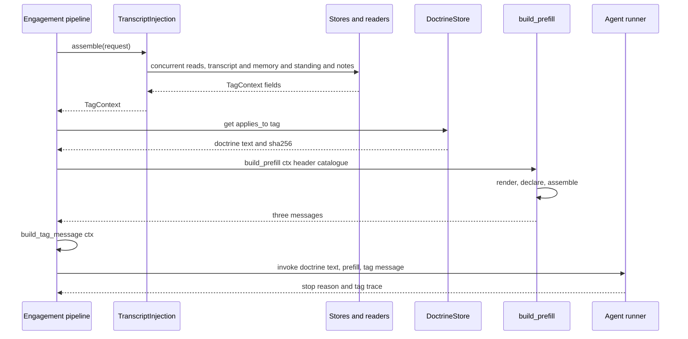
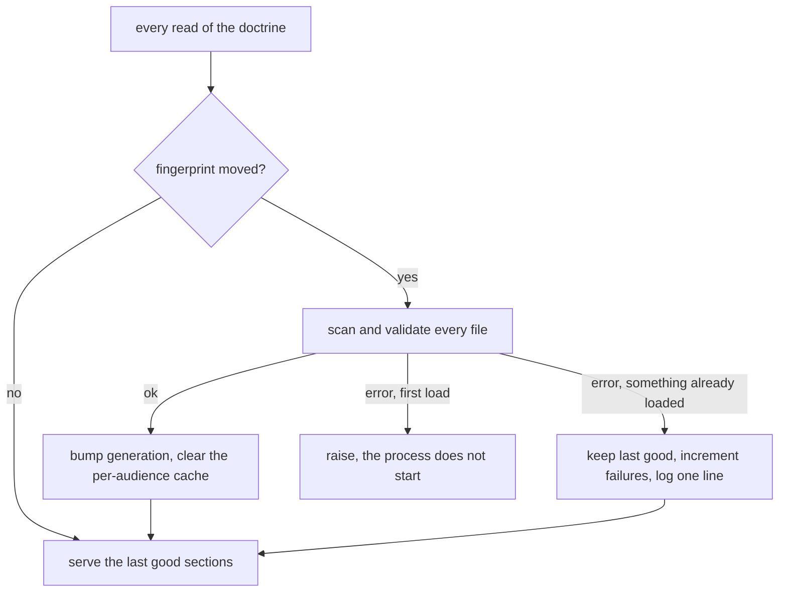

# Context assembly

Context assembly is the single route by which a prompt reaches a model. A module that
sends a prompt declares a module-level `_BLOCKS` table, builds every piece as a typed
`ContextBlock`, and walks the table with `assemble`; it never joins rendered blocks by
hand. The rule is enforced by discovery, not by a list: ADR 0021 records the operator's
decision that "every agent assembles through context assembly, no exception", and
`tests/architecture/test_every_model_call_is_a_declared_occasion.py` finds the
occasions itself.

## What one turn's prompt is made of

The tag turn (and the fire turn that reuses the same renderer) emits a fixed shape:

| position | message | contents | cost tier |
|---|---|---|---|
| 1 | `system` | `Doctrine.text` — `<nora_doctrine>` sections for the audience, then `<runtime_context>` | static head |
| 2 | `user` | `<context_header>` — the situation paragraph plus how to read the material | static head |
| 3 | `user` | the clock line, then every assembled block in `_BLOCKS` order | per turn |
| 4 | `assistant` | `CLOSING_LINE`, so the reply begins in her own voice | static head |
| 5 | `user` (the first agent turn) | `build_tag_message` — `replying_to` then `tag_message` | per turn |

Three messages are deterministic prefill (`nora/agent/prefill.py`'s module docstring);
the tag message is handed to the agent loop as the invocation prompt, so it is the last
thing the model reads and the first thing it answers. The split between rows 1–2 and row
3 is a cache decision, argued in `_context_header` and `BlockKey`: a prefix cache matches
on an exact byte prefix, so assembly keeps the static head (doctrine, header, resident
tool schemas) byte-identical across tags and across within-turn loop calls, and pushes
every volatile fact into the following message. Identical bytes are what make the head
eligible for a hit; whether a given route charges less for them is a property of the
serving provider and model, measured on that route rather than asserted by the prompt.
`<context_header>` deliberately contains nothing that changes between tags.

How a tag turn reaches the model: reads, doctrine selection, prefill assembly, then the tag message as the invocation prompt.

Two contexts feed the same renderer. `nora/engagement/context.py`'s
`TranscriptInjection.assemble` gathers the tag path's reads concurrently and returns a
`TagContext`; `nora/app/fire.py`'s `FirePath.build_context` builds its own `TagContext`
for a scheduled occasion from a synthetic message. Both call `build_prefill`, which is
why R-13/R-13b escaping is pinned to one function: a second prefill that re-rendered the
same transcript would sit outside those named tests while looking correct. Only the
situation paragraph differs — the tag path takes `TAG_HEADER`, a fire turn passes its own
`Event.header(...)` builder from `framing.FIRE_HEADERS`.

Both sides are wired through `nora/app/assembler.py`'s `build_assembler`, the one
construction site for `TranscriptInjection`: production's composition root and the
offline/eval pipeline each call it, and `tests/architecture/test_assembler_parity.py`
parses both call sites and fails unless they pass the same set of keyword arguments. A
collaborator added to one side and forgotten on the other would leave every eval measuring
a prompt production never builds — an agent silently missing `<standing>` or `<notes>`
while the header still said they came with the turn. The same test pins the two
`FirePath(...)` sites, because a tier missing from `FirePath.build_context` renders no
`<notes>` at all on the fire path.

## Doctrine: kinds, audiences and authority

Doctrine is content, not code: one Markdown file per section under `nora/doctrine/`,
recursively — `core/`, `rooms/`, `instruments/`, `public/` — and `nora/doctrine/loader.py`
is the only module that reads it. Frontmatter uses the Agent Skills shape so a file can be
promoted to a real Skill later.

`kind` is the field the loader exists to enforce, because it is the only part of the
authority model that can be mechanised. The taxonomy splits by *source of truth* rather
than by topic:

| kind | status | meaning | gate the loader applies |
|---|---|---|---|
| `constraint` | authored | hard rules; a MUST | may not be weakened with RFC 2119 advisory keywords |
| `conduct` | authored | how she behaves in the room; a SHOULD | may not be hardened with absolute keywords |
| `identity` | authored | who she is; describes, carries no normative force | no normative keywords, no tool names |
| `instrument` | authored | an instruction to a measurement, not to Nora (`participation.md`) | exempt from the tool-name and RFC 2119 rules |
| `situation` | derived | the running turn itself | a file claiming it is refused: an authored copy of a derived fact is a cache with no invalidation |

`applies_to` is a closed vocabulary — the nine audiences that actually consume doctrine
(`tag`, `heartbeat`, `participation`, `proactive`, `relevance_gate`, `dreamer`, `reaction`,
`summons`, `speech_format`) plus `always`. The vocabulary is closed because nothing
downstream could tell a typo from a deliberate exclusion: `get()` filters on string
membership, so an unknown name would silently remove a file from every prompt while the
reload-failure counter stayed flat. `_audiences` therefore refuses it at parse.

Three properties make the declared authority checkable rather than rhetorical:

- **The label is enforced and rendered by the same field.** `kind` gates the file in
  `_scan` *and* is written into `<section kind="…" name="…" description="…">` by
  `_open_tag`. A section asserting its own rank in prose sits inside the very section
  whose rank is in question; an attribute states it from outside, and label and rule
  cannot disagree.
- **Ordering is a strict partial order, not a chain.** `authority_above` /
  `authority_below` may name another section or one of the terminals
  (`situation`, `message-content`, `tool-output`). `check_authority_graph` enforces
  irreflexivity, symmetry (if A says B is below it, B must list A above) and acyclicity —
  the last because two sides written to agree on an impossible precedence are perfectly
  symmetric and perfectly meaningless. Peers inside a tier (`identity` with `voice`,
  `silence` with `conduct`) deliberately name neither.
- **Documentation fields are mandatory but never rendered.** `not_here` (non-empty) states
  the file's boundary, `change_policy` says whether the operator alone may edit it, and
  neither reaches the model. The assembled order is `order`, not filename; a duplicate
  `name` or `order` fails the scan.

`get(applies_to=…)` filters sections by membership (or `always`), assembles them in
`order`, appends `<runtime_context>` (display name, trigger, and a language hint — omitted
for `summons`, where the reply follows the comment rather than the group) and caches the
result per audience. The relevance gate reads `doctrine_text` only, never `.text`: `.text`
carries the canary, the string LeakGuard treats as proof her prompt leaked, and the gate
runs on another provider with no LeakGuard.

## An operator edit reaching a live process

Doctrine is bind-mounted, so `[doctrine] reload` decides the lifecycle:

| `reload` | behaviour | used by |
|---|---|---|
| `mtime` (default in `config.example.toml`) | every read re-fingerprints the directory — path, `st_mtime_ns` and size per file — and rescans only when the fingerprint moved | production; an edit is live on the next turn, no rebuild |
| `startup` | freezes the corpus after the first successful scan | tests and one-shot tools |

Size is in the fingerprint beside mtime because an edit written back at the original
timestamp (a restored backup, `rsync --times`, an editor that preserves timestamps) moves
no clock, and the resulting failure is the worst kind: the operator sees the change on
disk while the running process serves the old text with nothing logged.

The failure path is the design, and it is asymmetric on purpose:

The reload state machine: hot edits are tolerated after a good load and refused at startup, so a process never runs with no instructions.

- **A failed live rescan changes nothing the model reads.** The previous good sections keep
  being served, `nora_doctrine_reload_failures_total` increments, and one
  `doctrine_reload_failed: … (keeping the last good doctrine)` line is logged. The
  fingerprint is advanced so the broken file is not re-parsed on every read. Only a
  *successful* scan bumps the watcher's `generation`, and only a bumped generation clears
  the per-audience assembly cache — so a failed reload cannot invalidate an assembly.
- **A failed first scan raises.** A process that starts with no instructions and says
  nothing about it is the error-reported-as-nothing-found failure one layer down. With
  `[doctrine] strict = false` a single invalid file is skipped with a warning; it does not
  soften the first-load rule.
- **A scan that succeeds with fewer sections is not a failure.** Renaming a file to `.bak`
  or truncating it is a *good* scan with less in it, and the counter stays flat. That is
  exactly the relevance gate's case, so the gate refuses to send when its audience
  resolves to zero sections or an empty body, failing closed — a gate with no instruction
  still returns a parseable verdict, which would report as a working one.
- **The digest is a repo gate, not a runtime guard.** `DoctrineSection.sha256` is taken
  over `render_section` — the bytes served, `description` included — so
  `tests/test_doctrine_version_parity.py` can refuse a served edit that reaches `master`
  without a version bump. An operator editing the corpus on the deploy host runs no
  pytest; the gate is against the silent change and claims nothing more. `Doctrine.sha256`
  over the whole assembly is what `/health`, the tag log line and `GET /app/v1/doctrine`
  report.

## The prefill block table

`_BLOCKS` is `tuple[tuple[str, int, BlockKey], ...]` — name, order, scope key — and it is
the whole of what the tag path may serve. There is no `header` column: each block says
what it is in its own opening tag, so a separate catalogue would be a second copy of the
same fact, free to disagree (ADR 0013 deleted it).

The table is read three ways:

- `_ROW` derives `name -> (order, key)`, so a block function looks its own row up rather
  than repeating it, and `_block(name, body=…, attrs=…)` is the only constructor the
  prefill's renderers use.
- `restamp` (and the prefill's `_restamp`) stamps a block built *outside* this prompt —
  `render_notes`, `render_standing`, `render_decisions`, `render_self` all live in their
  own packages and have callers that assemble nothing — with this prompt's `order` and
  `key` and nothing else. `row[block.name]` raises `KeyError` for a name the caller never
  declared, because a block reaching a prompt with no row is a declaration bug rather than
  a block quietly served at `order=0`.
- `_declared` returns the table with each rendered block attached, plus an empty stub for
  every entry that produced nothing. That is observability, not padding: the `agent.prefill`
  span annotates `blocks_declared`, `blocks_rendered`, `blocks_empty` and `size_chars`, so
  a block that had nothing to say is visible by name.

`build_prefill` then runs render → declare → assemble, and `assemble` sorts by `order` and
drops any block whose body is empty. An absent block says nothing at all: a block she does
not receive is a block she is never told about, which is why a description that discusses
absence must also say the read may not have happened (R-27).

`BlockKey` (`global` | `unit` | `room` | `person` | `turn`) is not a cognition tier — it is
what the block's content varies by, and therefore how many distinct prefixes exist because
the block is in the prompt. The count is structural: a `room`-keyed block in the head makes
the head differ per room, a `person`-keyed one makes it differ per person, and a `turn`-keyed
one makes it differ on every request, so in each case the prefix stops matching from that
block onward. Every row is narrower than `global`, which is why every block is served in the
per-turn message; the field defaults to `turn` because that is the safe end. The two
mistakes are not symmetric. One wrongly declared `turn` costs only the cache line it never
had — the block really is per turn, so no two requests were going to share it — while one
wrongly declared `global` fragments the prefix permanently and across every room, because a
varying value inside a byte-identical head ends the match for everything after it. A slow
rewrite interval does not pay for that: the head is read every turn, and a value that varies
per room ends the match in every room where it differs. ADR 0012 puts the same weight on the
declaration — `BlockKey` carries the cache argument alone, and the structural argument, not
a measurement, is what it rests on.

### The ordered table

Rows 1–75 are the prefill body, rendered inside the second message after the clock line.
Rows 80 and 90 are declared in `_TAG_MESSAGE_BLOCKS` and rendered by `build_tag_message`
in the message *after* the prefill; `assemble` drops their empty stubs from the body.

| order | block | scope key | renders when |
|---|---|---|---|
| 1 | `self` | `unit` | the room's unit has a Character · Nora account with a non-blank body (`render_self`) |
| 2 | `lessons` | `unit` | the unit has at least one non-blank active lesson |
| 3 | `tool_catalogue` | `room` | tools are deferred (`[llm] defer_tools = true`, off by default), so `ToolSurface.prompt_catalogue` hands the turn a non-empty index of the admitted set |
| 4 | `room_members` | `room` | the room's `persons` list maps at least one identity (never a `persons = "*"` room) |
| 5 | `presence` | `turn` | always — falls back to `Presence.minimal` (the network alone) when no reader is wired |
| 20 | `peer_card` | `person` | the sender is a mapped person and the memory store returned a card |
| 30 | `peer_history` | `person` | the tagger's recalled card is non-empty |
| 35 | `people_in_window` | `room` | at least one speaker in the window has conclusions; only the participation occasion fills this |
| 36 | `recalled` | `turn` | the memory pre-fetch returned at least one item |
| 40 | `notes` | `unit` | the note tier has standing notes (and lineage did not withhold them) |
| 42 | `memos` | `unit` | the unit has at least one kept memo |
| 50 | `loop_decisions` | `unit` | a decision log row exists for the unit |
| 54 | `culture` | `room` | the room has a culture section (a folded room, and `[culture] enabled`) the lineage view shows |
| 55 | `unit_culture` | `room` | the room's unit has a culture account |
| 56 | `character` | `room` | at least one listed person of the room's unit has a Character account |
| 57 | `computer` | `turn` | a computer reader is wired and this room is using the computer |
| 58 | `documents` | `turn` | `[documents]` is on and this room has a document |
| 59 | `subagents` | `turn` | `[subagent] enabled` and this room has a job in the window (tag path only) |
| 60 | `standing` | `room` | the debrief left a position for this conversation and lineage shows it |
| 65 | `standing_working_set` | `room` | the standing working set is non-empty and lineage shows it |
| 70 | `group_transcript` | `room` | the shown window has at least one row; carries `window="N"` |
| 75 | `spoken_turn` | `turn` | the message being answered was spoken in a voice channel (`NormalizedMessage.voice`) |
| 80 | `replying_to` | `turn` | the message quotes a row that resolves *inside* the window (tag message) |
| 90 | `tag_message` | `turn` | always (tag message) |

Three properties of that order are load-bearing:

- **It widens, then breaks scope on purpose.** `self` → `lessons` → `peer_card` →
  `peer_history` → `notes` → `loop_decisions` → `culture` widens from her own account, to
  theirs, to the unit's settled claims and open questions, to the room's own slang.
  `standing` at 60 is the narrowest thing in the prompt (one conversation), and it sits
  last because it is not on that axis: it is "where you had got to", and the thing it is
  about is the transcript directly underneath it. `standing_working_set` follows it so the
  read order is position → what she has not told the room → what has been said since.
- **The transcript is last but one.** It is adjacent to the message it explains, and its
  `#n` handles are a per-render index over `ctx.transcript` — a closed set of 1..N, so an
  out-of-range `send_reply(reply_to=n)` is refusable and no raw platform id reaches the
  model. `window` is `len(ctx.transcript)`, not the configured `context_window`, because
  the fetch is sized past the window to chase a reply's quote outside it.
- **The persona switch keeps the rows.** With `[persona] render` on, `_PERSONA_REPLACES`
  (`self`, `peer_card`, `peer_history`, `people_in_window`, `culture`, `unit_culture`,
  `character`) are not rendered, their stubs leave the declared list, and the `<persona>`
  blocks are stamped into those same orders — so the read order survives the cutover.

The relevance gate carries its own two-row table — `group_transcript` at 10,
`standing` at 20, both keyed `turn` — and renders it through the same `ContextBlock` and
`assemble`. The keys are declared for the gate's own prompt, not copied from the tag table:
the gate's request is not part of the tag path's prefix, so `turn` there would not mean what
`room` means here. It does not reuse the tag path's assembler, because every block that
assembler learns to add would silently widen the gate's closed input; declining the
assembler never meant declining R-13, so the gate still escapes and still frames. Its
`<standing>` renders `(none)` rather than nothing, because `assemble` would drop an empty
body and the sentence explaining what its absence means would go with it.

## A block says what it is, and its type says it

ADR 0013 moved every description from the call site into a registry.
`nora/domain/block_types.py` declares each type once as
`BlockType(name, description, annotations)`; `ContextBlock.description` and
`ContextBlock.annotation` are read-only properties looked up by `name`. There is no
`note=` parameter and no `header=`, so two renderers cannot describe the same block
differently, and inventing a description is indistinguishable from declaring a type — a
visible act in one reviewable file.

Both halves of that claim are enforced at construction, in `__post_init__`:

- `attrs` is a free tuple the caller fills, and `render()` writes it *before* the derived
  pair. `attrs=(("description", "…"),)` would emit two `description=` on one element —
  ill-formed XML whose first occurrence most readers take. `description` and `fields` are
  refused there, and every attribute *key* is validated against `[A-Za-z_][\w.-]*` because
  keys are written raw while only values are escaped.
- An undeclared `name` raises at construction, not at render: `assemble` drops an empty
  body before `render()` runs, so raising only at render would be silent on exactly the
  turns where the block had nothing to say.

`render()` emits `<name attrs… description="…" [fields="…"]>` followed by the body, and it
is the only way a block becomes text — there is no `text` field and no path around it.
`annotation` is the same registry's `annotations` pairs joined as `` `field` is … ``;
that is where a field's meaning lives now that the "what you can see" catalogue, the two
`how_to_read_*` legends and the tag prompt's `Notation:` paragraph are gone. A type-level
annotation may not name a tool, because the relevance gate renders the same type and holds
no tools.

Two shapes are worth knowing before adding a block:

- **Two renders that differ in what a *field* means are two types.** `<batch>` and
  `<room_messages>` were split because `n` is the row id to cite in one and a 1..N
  position in the other; `<now>` and `<today>` because one is a moment with a zone and the
  other a day. `<untrusted>` was split three ways (`transit_remark`, `fetched_page`,
  `social_post`) because one wrapper had been telling a model that a web page was a transit
  remark.
- **One tag with two names is one type.** `<open_notes>` rendered `<notes>`' own rows
  through `<notes>`' own renderer under a name nobody argued for; declaring both recorded
  the accident as a distinction, and the two descriptions had already drifted.

Descriptions are written to a bar the tests can partly check: a reader who knows no
vocabulary of ours can act on it. Say what the block is, whose words are in it, what its
absence means, and what *not* to conclude.

## Escaping, rendering and the authored text around the blocks

Escaping is unconditional in the shared renderers, not a flag a renderer remembers:

- `escape` (`&`, `<`, `>`) closes the tag boundary (R-13); `escape_attr` also closes the
  double quote; `legal` strips the C0 control characters XML cannot carry at all, so a body
  that escapes to nothing is dropped as empty.
- `one_line` closes the *line* boundary — the one `escape` is blind to. Without it, one
  member's words can render under another member's name. `render_rows`' `RowStyle` varies
  only presentation (handle style, time style, brackets, self-name); `escape` and
  `one_line` are deliberately not fields there.
- `render_messages` / `render_elements` put one record in one element: identity (handle,
  age, author, `replying_to`, `edited`, `was`) becomes attributes where `escape_attr` closes
  the quote, and the body keeps its paragraphs and line breaks because `escape` makes a
  forged `</m>` unwritable. A newline is not a separator; a tag is. A `None` attribute is
  dropped rather than rendered empty, because a symbol that can mean "unknown" invites a
  model to emit one.
- `wrap_outside_text(name, source, text)` is the one wrapper for text from outside (a
  transit remark, a fetched page, a social post), and `name` is required and positional so
  a caller cannot forget to override the default and mislabel a web page.

Around the blocks, Nora's own code also speaks in plain sentences: the situation
paragraph, the clock line, the closing line, the fire headers, the summons' head. Those are
not blocks — a `ContextBlock` cannot render without an opening tag, and giving them one
would change what the model reads — so they live in `nora/domain/framing.py`, one frozen
dataclass per piece with a `render()` of its text. Every person- or store-controlled value
enters through `_put`, the only function there that calls `escape`, and the way it enters is
named at the call: `escaped` (the default), `carried` (the text is a block body that escapes
itself once, so escaping here would double it), `joined` (as `carried`, but refuses a
non-`str` as `str.join` did), or `system` (computed by code, never typed by a person).
Nothing reaches the model unescaped except what a block escapes for itself or what code
computed. The rendered bytes are pinned by goldens, because changing a word there is a
model-visible change.

## What enforcement actually pins

| check | test | pins |
|---|---|---|
| one block injector | `tests/architecture/test_one_block_injector.py` | every module that opens and closes an element by hand is either routed through `ContextBlock` or classified with a written reason; a stale classification fails too |
| typed blocks | `tests/architecture/test_every_block_declares_its_type.py` | every rendered name has a `BlockType`, every `BlockType` is rendered, descriptions are sentences rather than labels (≥8 words), carry no internal vocabulary (`tier`, `adaptor`, `injector`, …), and any sentence about absence carries the R-27 hedge in the same sentence |
| declared table matches builds | `tests/architecture/test_the_registry_is_exhaustive.py` | for each declared occasion, the blocks it builds (literal `ContextBlock(name=…)`, plus four known shared builders) equal its `_BLOCKS` rows, in both directions |
| every prompt assembled | `tests/architecture/test_every_model_call_is_a_declared_occasion.py` | every module that calls a model by a known door, or defines `inputs`, has a non-empty module-level `_BLOCKS` **and** a call to the `assemble` imported from `nora.domain.blocks`; a hand `.join` of `.render()` results is a violation even beside a working `assemble` |
| framing in one place | `tests/architecture/test_framing_is_one_typed_place.py` | one header builder per `Event` kind, `FRAMING` lists exactly the builders defined, every interpolation is a named `_put` call, every non-escaped value is pinned as a triple, and no five-word prompt string is built outside `framing` in the consumer modules |
| a varying block never claims the head | `tests/test_prefill.py::test_no_block_in_this_table_belongs_in_the_cached_head` | no built block is keyed `global` while it is served per turn — the one declaration that would let a varying block move into the byte-identical head, which is why the check reads the built blocks rather than the table |

The enforcer's net is per module and per call shape, and ADR 0021 is explicit about the
gaps rather than recording them as debt: hand-built text inside a classified module, a
model door it does not know (Honcho's `chat`, image generation, an aliased call), a call
reached only through an imported helper, or code outside `nora/`. A classification entry —
MECHANISM, RUNNER, or EXEMPT "an authored prompt plus media" — is a judgement only review
stops. Every such entry names a real module and a written reason, and the test re-checks
that the module still exists and still calls a model.

## Adding a block or an occasion

1. Declare the type in `nora/domain/block_types.py`: a description of what the block
   *is*, whose words are in it, and what absence means — and no tool names in a
   type-level annotation.
2. Add a row to the occasion's `_BLOCKS` with an `order` and the narrowest honest
   `BlockKey` — never `global` for a block you serve per turn, whatever its rewrite
   interval — then build through `_block` (or `ContextBlock` plus `restamp` when the
   renderer lives in another package). Escape the body yourself if you compose it.
3. Update the occasion's goldens. A declared, assembled prompt can still be a bad prompt;
   the architecture tests check how it is built, and the eval suites check what it does.
4. A new occasion follows the same shape: `_BLOCKS` plus `assemble`, or a classified
   entry with a reason. There is no ledger and no ceiling to put a violation in — ADR 0021
   deleted them when they emptied, because a ledger that only shrinks is still a place to
   put a violation instead of fixing it.

## Related

- [Engagement turn](../workflows/engagement-turn.md) — the turn that calls the assembler and delivers the reply.
- [Sessionless continuity](../concepts/sessionless-continuity.md) — why the context is rebuilt from stores each turn.
- [Memory and record](../concepts/memory-and-record.md) — the stores behind `peer_card`, `recalled`, `notes` and `standing`.
- [Persona and provenance](../concepts/persona-and-provenance.md) — the switch that replaces seven block rows with `<persona>`.
- [Configuration](../operations/configuration.md) — `[doctrine]`, `[llm] defer_tools` and every flag named above.
- [Changing the system](../contributing/changing-the-system.md) — the gates a prompt change has to pass.
