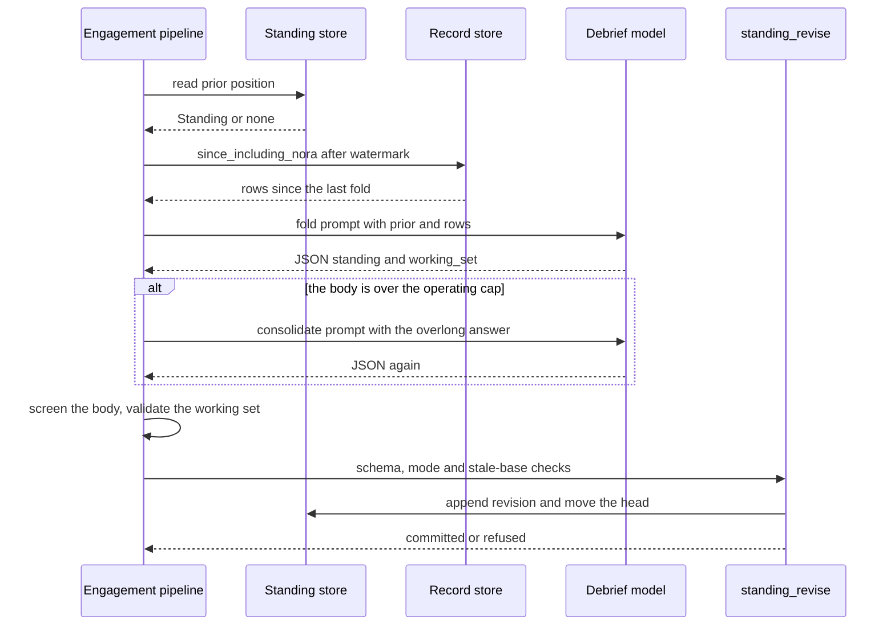
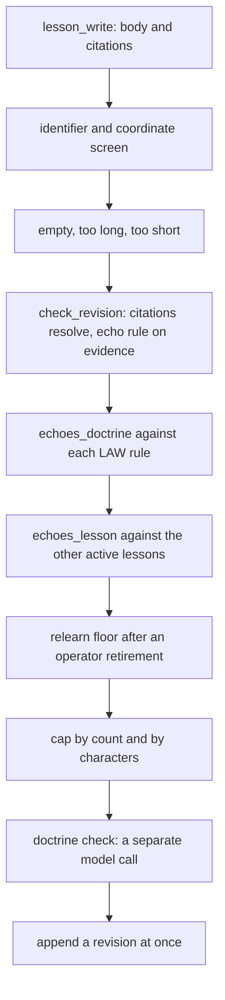
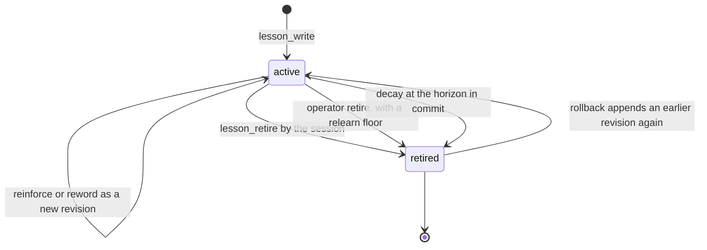

# Contextual learning

Contextual learning is the part of Nora that changes what she carries into the next
turn, rather than what the model is. Nothing here touches model weights. Nothing
here edits authored doctrine: a lesson that restates a rule is refused, a lesson
that would loosen one is refused and recorded for the operator, and the doctrine
files themselves are only ever changed by a human. What changes is rows —
a position, an account, a lesson — and each of them re-enters a prompt through the
block table described in [Context assembly](context-assembly.md).

The shared unit underneath all of it is the **response episode**: one of her sends
paired with what followed it. `ARCHITECTURE.md` states the boundary plainly —
response episodes connect her sends with subsequent responses, and "Lessons and her
own character account derive contextual learning from those outcomes; this changes
stored context, not model weights or human-authored doctrine"
(`ARCHITECTURE.md#L28-L30`).

## What learns, and what it is allowed to change

| tier | what it holds | key / scope | how it changes | where it re-enters |
|---|---|---|---|---|
| `Standing` | one short paragraph: where this conversation stands | `(platform, conversation_id)` | rewritten in place every turn by the debrief fold | `<standing>` and `<standing_working_set>` |
| `Culture` | an account of what a room is and why | the room's `primary_id` | appended revision chain, head pointer | `<culture>` |
| `Culture` (`#unit`) | what the unit is across its rooms | `<unit>#unit` | appended revision chain | `<unit_culture>` |
| `Culture` (`#character`) | an account of a person in that unit | `<unit>#character:<person>` | appended revision chain | `<character>`, `character_read` |
| `Culture` (`#nora`) | what she is like in that unit | `<unit>#nora` | appended revision chain | `<self>` |
| `Lesson` | one practice: what to do differently here | the unit | appended revision chain per lesson | `<lessons>` |

Two properties make this safe to run unattended. First, **every write is a checked
verb**: a model proposes, code disposes, and a refused write never reaches the
store. Second, **the caps are refusal thresholds, never reservations**: an
over-long fold is refused and the model is asked to consolidate, an over-full room
is refused with a `detail` naming what to do instead, and nothing is ever silently
truncated. A rolling summary that quietly drops its oldest line is the failure this
design is built against — "silently dropping the oldest position is how a rolling
summary quietly becomes a recent summary" (`nora/domain/standing.py#L54-L58`).

Lessons and Character/Culture are deliberately not the same kind of thing, and the
Lessons objective says so in its own words: a lesson "is practice: one thing to do,
or stop doing, here. It is not a description of the group or of yourself (that is
written elsewhere), and it is not one of your rules restated"
(`nora/dreamer/objectives/lessons.md#L15-L21`). Character and Culture are accounts
of what things are *like*; a lesson is about what she *does*.

## Response episodes: the shared unit of outcome

Episodes are derived, not live. The analytics Rollup folds the Record into
`response` rows: one per send of hers, with the replies that quoted it inside the
window, its reaction and edit counts, and an outcome
(`nora/domain/rollup.py#L881-L900`). The outcome vocabulary is closed and each
member means something specific (`nora/domain/rollup.py#L907-L924`):

| outcome | meaning |
|---|---|
| `open` | the window still runs past the newest Record time; the answer can still change |
| `responded` | a reply, reaction, edit or unquoted `follow` landed inside the window |
| `silent` | closed window, nothing came, an answer *was* expected, and the platform was proved up |
| `unanswered` | closed window, nothing came, and no answer was expected |
| `unknown` | an answer was expected, but the platform was not proved up — an outage is not silence |

The window is a Record fact, not a wall clock: `open` lasts while the Record shows
the window still running. The window length is `[analytics]
response_window_seconds` and the unquoted-follow rule is `follow_window_seconds`,
defaulting to 3600 and 120 seconds (`config.example.toml#L647-L651`). A message that
quotes nothing still answers her when it names her, or when it comes within the
follow window of her latest send in the room and mentions nobody else
(`nora/domain/rollup.py#L840-L878`).

Two consequences matter downstream. Sessions read **only the current Rollup build**,
and never `open` or `unknown` rows: an outcome that can still change, or an outage,
is not evidence (`nora/infra/sql/character.py#L549-L584`). And an episode is
**cited, never linked** — its handle is `response:<her send's id>`, which is what a
session puts in `citations` (`nora/domain/culture.py#L311-L321`).

`Episode.is_evidence` is the predicate that decides whether an episode can carry a
citation at all: it drew a reply, reaction or edit, or an answer was expected and
none came. An episode whose only responses are unquoted follows is *not* evidence,
because the session is shown her send and nothing of the follow messages
(`nora/domain/culture.py#L522-L540`). The `response` rollups are not exposed through
the `rollup_read` tool — that tool reads `stay`, `trip`, `colocation`, `outing`,
`daybook` and `tie`, and `response` is "the Lessons adaptor's, not a session's"
(`nora/domain/rollup_read.py#L34-L40`).

## Three learning inputs, three authorities

Keeping the inputs apart is what makes the tier debuggable: each has a different
writer, a different scope, and a different claim to authority.

| input | what it is | who writes it | what it lands in |
|---|---|---|---|
| her own turn outcome | the finished turn, including the steps and how it ended | the debrief stage's second model | `Standing` |
| the unit's Rollup episodes | her sends with what followed in each window | code, from the Record | `rollup_response`, cited by Lessons and Character · Nora |
| the operator's revisions | retirement, rollback, config, objective and doctrine edits | `nora lessons`, `config.toml`, `nora/doctrine/` | append-only lesson revisions, plus startup gates |

The operator's input is the only one with a *veto*. `nora lessons retire ID --why
TEXT` appends a retirement whose `relearn_after` is the newer of the newest Record id
the lesson cited and the newest Record id now; a later lesson whose whole evidence is
no newer than that floor is refused `relearn`, so a practice the operator removed is
only learned again from outcomes *after* the removal
(`nora/language/lesson_book.py#L336-L367`, `nora/app/lessons_cli.py#L1-L13`).
`rollback --to N` appends revision N again as the newest revision, which is how a
retirement is undone as well as how a reworded lesson is put back. Both are dry runs
without `--apply` (`nora/app/cli.py#L1167-L1205`).

## The debrief fold: `Standing`

Standing is a position, not a record — what Nora currently thinks about this
conversation, rewritten every turn and lossy by design, "which is exactly why
nothing that has to survive may live here" (`nora/domain/standing.py#L1-L31`). It is
written by the **debrief stage**, and the four placement decisions in
`nora/engagement/pipeline.py#L1161-L1205` are the whole reason it works:

1. It runs in the pipeline's `finally`, so it reviews **every completed turn** —
   success, an R-5 silence, a veto, a timeout. Reviewing only delivered replies would
   measure the path that already works, and a deliberate silence is the decision most
   likely to be wrong in a way nobody complains about.
2. It runs **before `release_and_dispatch`**, so it holds the conversation's slot on
   purpose. The cost lands on the second person queued behind a busy conversation,
   not on the person being reviewed, who already has their reply.
3. `completed` is already final by then, so an escape here cannot make
   `deliver.truncation_reason` report a partial reply on a turn that sent a whole one.
4. `debrief.run` never raises, and the call site still wraps it in `try/except
   BaseException` — because an exception inside a `finally` would skip the statement
   that releases the per-conversation lock.

It is a **second model**, not the one that replied: a different call, seeing the whole
turn including its own outcome. Nora's own tools cannot do this, because `ReplyGuard`
cancels the next model call once the terminal budget is spent
(`nora/engagement/stages/debrief.py#L1-L22`).

### Ordering: what it must read first

The fold has an order it cannot reorder, and each step has its own refusal label
(`nora/engagement/stages/debrief.py#L458-L548`):

- **The prior position is read first.** A fold that cannot see what is already there
  writes a second row beside a wrong one. A store that cannot be read is
  `unavailable` and the fold does not run at all — "a fold against a guessed-empty
  prior is the two-contradictory-rows failure. An ERROR is never a PASS"
  (`nora/engagement/stages/debrief.py#L497-L518`).
- **Then the watermark batch**: `since_including_nora(after_id=prior.last_folded_row_id,
  limit=fold_batch)`, so the fold sees the stretch since it last folded, including her
  own rows. A failed read is `unavailable`, never a fold against a guessed-empty
  stretch.
- **The media join degrades rather than fails.** Its failure is deliberately outside
  the read's `except`: `enrich` falls back to the unmodified rows, and folding it into
  that handler would report `unavailable` — a fold that did not happen — when what
  happened is a fold on thinner evidence (`nora/engagement/stages/debrief.py#L549-L569`).
- **The prior is always rendered into the prompt**, including on the retry. Withholding
  it would read to the model as "no position yet — this is the first fold".

How one finished turn becomes the next turn's `<standing>`: prior read, watermark batch, one model call with at most one consolidate retry, then the single write verb.

### Overflow refuses and consolidates; it never truncates

When the body will not fit `[standing] max_chars`, the write is refused, the model is
told the cap and its own over-long answer, and asked to consolidate — **one retry,
inside the same timeout**. One `asyncio.wait_for` wraps the whole fold including the
retry, because the budget the slot can afford is a total and a retry bounded on its
own would add up to twice it on exactly the turn that was already slow. A second
overflow writes nothing at all and the prior position stands: "a coherent stale
position beats a sentence cut in half" (`nora/engagement/stages/debrief.py#L585-L640`).

The working set (`Found, not yet given`) is a second, small field beside the body,
with its own budget, render and TTL (`nora/domain/standing.py#L33-L39`). It runs
after the body's own checks, so a refused paragraph leaves the prior standing whole,
working set included. Its rules are code-side, not model-side:

- `found_at` is stamped by the write path from `now_ms`; a model-supplied value is
  never trusted, and a re-stated item keeps the `found_at` it already had.
- A new item's `source` must equal a tool name this turn's `<steps>` actually showed —
  equality, not substring, because a substring match let a paraphrase of the room's
  question pass as "sourced". An unmatched item is dropped and counted.
- A carry-forward past `WORKING_SET_TTL_HOURS` is dropped deterministically, whatever
  the model does. An overflow refuses the whole new set and keeps `prior`, with no
  consolidate retry.

All of that is `nora/engagement/stages/debrief.py#L287-L408`, and
`nora/language/standing_render.py#L78-L116` applies the same TTL at render time.

### Screening happens before the write

Everything the model wrote is screened by `nora.agent.dream_screen` **before** the
write, not before the read. The trace holds raw tool results, so there is a path from
a coordinate to a row that is injected into every subsequent turn — persisting by
design rather than by attack. Standing is an *input* to later turns, which is why the
gate belongs at the write, where the content class changes
(`nora/engagement/stages/debrief.py#L84-L91`, `#L642-L656`).

The renderer hedges the same risk from the other side: `<standing>` is the one
injected block that is *hers*, and it still says it may be out of date. The hedge is
a sentence in the type, not an `untrusted` attribute, and it is also what stops the
block becoming the place a wedding venue lives — she has to be told that this block
forgets (`nora/language/standing_render.py#L1-L31`).

### One write verb, one head shape

Every writer of a room's Standing goes through `standing_revise`, so every row passes
the same validator. The pure half holds the allowed modes (`deduced`, `abduced`,
`said`) and the section schema: `Where it stands` is required and non-blank, while
`I hold open` and `I owe` are optional and, when given, must not be blank — a caller
that means to clear a section omits it (`nora/domain/standing_revise.py#L1-L108`).
The async half resolves a caller's `base_revision_id` against the stored head and
refuses a stale one; `base_revision_id=None` means the caller asserts no base
(`nora/domain/standing_revise.py#L111-L142`, `nora/infra/sql/standing_revise.py#L1-L25`).

The verb is shared. The debrief is one caller; the Cognition session's
`standing_revise` tool is the other, writing with `source="cognition"` and passing
the `revision` it read as its base (`nora/app/cognition_session.py#L2218-L2265`). That
is the extension seam for any future writer: call the verb, do not construct a
`Standing` and write it yourself.

**Two caps do two jobs** (`nora/domain/standing.py#L48-L125`): a database-checked
absolute ceiling of 4000 characters, and an operating cap (`[standing] max_chars`,
default 1200) that the sink refuses at. Config above the ceiling refuses to *start*.
The working set mirrors the split at 20 items / 2400 bytes absolute over 5 items /
600 characters operating.

### The watermark advances on exactly one condition

`last_folded_row_id` moves only on a fold that read new rows — to `batch[-1].id`, the
furthest row the batch saw, so a batch capped at `fold_batch` leaves the rest for the
next fold. On an empty batch it is carried forward unchanged. Every refusal path
above the write returns before that point, so a refused fold does not consume the
stretch it failed to use (`nora/engagement/stages/debrief.py#L694-L716`).

## Character and Culture: accounts of what things are like

A Character session is one Dreamer run for one `(unit, entity)` key, whatever the
entity is — a room, a person, the unit, or Nora herself. Each is handed its evidence
by code, may look things up with its read tools, and writes through
`character_revise(entity, body, citations)` or closes with
`character_no_change(entity, why)` (`nora/language/character_session.py#L1-L19`).

Four keys share one store and one chain, distinguished by suffix
(`nora/domain/culture.py#L438-L497`):

| form | key | written from |
|---|---|---|
| room | the room's `primary_id` | that room's messages, notes, description and read tools |
| unit | `<unit>#unit` | its rooms' current culture revisions |
| character | `<unit>#character:<person>` | that person's messages across the unit's rooms |
| nora | `<unit>#nora` | Rollup response episodes someone responded to |

The chain is the point. `Culture.head_revision_id` is a pointer, not a copy: a single
account is a snapshot written by a model with no memory of the one before, so the
order is the only thing here a per-turn prompt could not re-derive
(`nora/domain/culture.py#L199-L247`). `parent_revision_id` means "the same thing,
earlier" and never "superseded" — nothing in this tier retires, because a quiet
room's culture is not stale, it is accurate. The parent is read **inside** the commit
transaction under `FOR UPDATE`, never passed in by the adaptor, because a parent
captured before the model call is a parent that may have moved
(`nora/infra/sql/culture.py#L1-L23`).

Writes are **staged**, not immediate: code checks each verb call as it is made and
answers a refusal the model can act on; an accepted call is staged; `accept` returns
what was staged; the runtime stamps provenance (`instruction_sha256`, `model`,
`established_by`); `commit` appends it. So a refused write never reaches the store,
and the model never writes its own provenance
(`nora/language/character_session.py#L1-L19`).

`check_revision` is the shared gate for all four keys
(`nora/domain/culture.py#L373-L435`):

- the body is non-empty and within `BODY_MAX_CHARS`;
- at least one citation, and every citation must resolve to something this session
  was **handed** — a message id, a `social:<network>:<id>` item, or a
  `response:<n>` episode;
- the body carries no message or item numbers it was shown (`ids_in_body`): numbers
  belong in `citations`, and an account that reads "(6888, 7020)" is a record of
  messages, not a description;
- the **echo rule**, on for Character · Nora and for Lessons: a revision whose
  citations are all her own sends is refused, because her account must rest on how
  people responded;
- `min_episodes`, which is 3 for Nora's own account — one reaction is an anecdote.

Sizing is a budget question here, not a quality one. `BODY_MAX_CHARS` is 20,000, a
corruption ceiling that sits below the database's 32,000, and it is deliberately far
above what the model writes: a refusal on length is a coin the fold tosses every fire,
so a rejected account holds the watermark and the fold re-draws. The token budgets are
sized on `ACCOUNT_CHARS_OBSERVED_MAX` instead, and `ACCOUNT_OUTPUT_TOKENS` converts
characters to output tokens with the CJK-heavy worst case (`nora/domain/culture.py#L98-L197`).

A session that settles nothing raises `AccountNotRecordableError` and holds its
watermark, up to `MAX_CONSECUTIVE_REJECTIONS` (3) times for one batch; the third
unsettled run of the same batch is counted `abandoned` and the fold advances past it
(`nora/domain/culture.py#L145-L150`). The outcome vocabularies are closed sets — the
room's own `written`, `unchanged`, `kept`, `refused`, `unsettled`, `abandoned` — and
the adaptor raises rather than counting an undefined label
(`nora/domain/culture.py#L120-L144`).

## Lessons: practice about what she does

A lesson is one revision chain per lesson, kept per unit, never overwritten and never
deleted. Reinforcing, rewording and retiring each append a revision; the head (the
highest `seq`) is what it says now. A retirement is a revision whose `state` is
`retired`, so an operator's rollback is one more revision that copies an earlier one
back (`nora/domain/lessons.py#L1-L28`).

Two structural differences from Character, each forced by the data
(`nora/language/lesson_book.py#L1-L27`):

- **A lesson write commits at once**, where an account is staged. The cap is judged
  against what the unit holds *now*, and a session that retires one lesson and then
  writes another must see the retirement count.
- **The operator reaches the same book.** `retire` and `rollback` take `by`, and the
  CLI calls the same `LessonBook` a session's verbs use.

### What a write must clear

`check_lesson` is pure — it is handed everything it judges, so every refusal is
testable without a database (`nora/domain/lessons.py#L211-L267`). The order is the
cheap checks first and the model call last:

Where one refused lesson stops: the checks a `lesson_write` call passes, cheapest first, with the one model call last.

Each refusal is a member of `LESSON_REFUSALS` and carries a `detail` telling the model
what to do instead — retire one before writing another, reinforce the lesson that
already says this, cite episodes people responded to rather than her own sends.

The echo test is defined once and used twice: text is case-folded and stripped to
letters and digits, cut into overlapping 5-character runs, and a lesson *echoes*
another text when at least 80% of its runs also occur there. It catches a lesson that
quotes a rule (or a sibling lesson) and not one that merely shares a topic word. It is
a restatement test, not a contradiction test: a lesson that contradicts law shares no
runs with it and is the doctrine check's job
(`nora/domain/lessons.py#L100-L125`, `#L170-L186`).

Caps, all of them refusal thresholds (`nora/domain/lessons.py#L59-L98`): a body of at
most 400 characters and at least 12 normalised characters; at most 12 active lessons
and 2400 characters of them per unit; at least 3 distinct episodes per write
(`LESSON_MIN_EPISODES`), a floor not lowered to what a stale wake happened to show,
because a lesson changes what she *does*. A lesson citing a correction — a message
that told her how to act — is exempt from the three-episode floor: one correction is
enough on its own, which is the point of the fast path.

### The doctrine check runs last

A separate instrument call reads the lesson against the law subset that reaches a
unit's turns, `LAW_SURFACES = ("core/", "rooms/")` — `public/` and `instruments/`
carry law too, but no lesson ever reaches those surfaces
(`nora/domain/doctrine_check.py#L30-L37`). Three verdicts, and only one lets the write
through:

- `consistent` — the write proceeds;
- `conflict` — one `Tension` row is written for the operator, the lesson is refused
  with `loosens_law`, and the refusal names the doctrine *file*, never the judge's
  reasoning: "a session told how it was caught is a session taught to reword around
  it" (`nora/language/lesson_book.py#L295-L334`);
- `error` — a timeout, a cut-off, unparseable output or no law to check against:
  `check_unavailable`, the lesson is refused, and no tension row is written. An
  instrument error is not a pass (`nora/domain/doctrine_check.py#L79-L107`).

The check must be a model other than the one writing lessons, and config refuses to
load if `check_model` resolves to the Dreamer's model — "a judge on the writer's own
model grades its own homework" (`nora/config.py#L4266-L4285`). The shipped wiring is
deliberate about transport too: the check uses the relevance gate's raw JSON
completion rather than the Strands client the debrief uses, because the Strands path
returns an empty answer on a live lesson, and empty is an `error`
(`nora/app/composition.py#L4188-L4214`). Operator-facing tension rows are readable
with `nora lessons tensions`.

### Waking, handing over, and decaying

A Lessons session is one Dreamer adaptor per unit, and its evidence is **closed**
response episodes — `unanswered` included, `open` and `unknown` never
(`nora/language/lessons.py#L1-L16`). Three things wake a unit's key
(`nora/language/lessons.py#L149-L227`):

1. `[lessons] wake_batch` closed episodes past the key's watermark;
2. `[lessons] stale_seconds` with any new episode;
3. a held lesson reaching `[lessons] horizon_seconds` — which counts as a full batch
   so the key wakes and `commit` can retire it.

There is a fourth, faster path: a message addressed to her that reads as an
instruction about how she acts ("stop", "next time", "唔好", "下次") wakes the unit
once it is `correction_quiet_seconds` old, so the conversation around it has settled.
The pattern is deliberately recall-leaning — a false positive costs one session that
judges it and closes unchanged, a miss costs only the wait for the batch — and it is
never the correction's content that a session acts on (`nora/domain/lessons.py#L270-L299`).
A known gap is stated in the code: a correction sent during the quiet window of a
running session is not fast-pathed, though it still reaches a session through the
episodes it is part of.

Two handing-over rules keep a session honest. `newest` returns nothing and leaves the
cursor **unmoved** when fewer than `LESSON_MIN_EPISODES` arrived, because no write
could cite so few; the run is then blank and `commit` still runs the decay. And **a
lesson is never shown by id**: the Dreamer's screen refuses any verb argument carrying
a UUID, so each held lesson is shown as `L1`, `L2`, …, and a refusal's `detail` is
rewritten to use the handle — or, for a lesson the session never saw, "a lesson the
operator retired" (`nora/language/lesson_book.py#L144-L182`).

Decay is code, in `commit`, and it runs on every run including a blank one: a lesson
whose head is older than `[lessons] horizon_seconds` after the session ran — it may
have just reinforced it — is retired, counted `decayed`
(`nora/language/lessons.py#L490-L514`).

A lesson's life is a chain: every transition is an appended revision, including the retirement and the rollback that undoes it.

Because the store appends under a compare-and-set on the head, a lesson that moved
between a writer's read and its append is refused `conflict` instead of retried — it
was judged against a head that is gone. `uq_lesson_revision_seq` decides a race in the
database, so two writers cannot fork a chain (`nora/infra/sql/lessons.py#L1-L12`,
`#L122-L173`).

## Where each one re-enters the prompt

Re-entry is the block table in `nora/agent/prefill.py#L124-L216`. Order matters more
than the numbers suggest: doctrine is the system prompt and is read first, so
everything learned here is read *under* it.

| block | order | scope key | renders when |
|---|---|---|---|
| `<self>` | 1 | unit | `[culture]` on, the unit has Nora's account, and the room may show it |
| `<lessons>` | 2 | unit | `[lessons] render` on, the unit holds active lessons, and `Policy.shows_self_in` |
| `<loop_decisions>` | 50 | unit | her own loop has decisions to show for this unit |
| `<culture>` | 54 | room | the room has been folded at least once |
| `<unit_culture>` | 55 | room | the unit has an account |
| `<character>` | 56 | room | accounts exist for the people in this turn |
| `<standing>` | 60 | room | a position row exists for this conversation |
| `<standing_working_set>` | 65 | room | at least one item is still inside its TTL |

Three properties of that placement are load-bearing:

- **`<self>` then `<lessons>` are first**, directly after the doctrine, so the law is
  read before practice and can win over it.
- **`<standing>` sits last, immediately before the transcript, and that breaks the
  widening-scope order on purpose.** Scope alone would put the narrowest thing first;
  it sits at the back because it is "where you had got to", and the thing it is about
  is the transcript directly underneath it — read in order, the pair says *here is
  where you were, here is what has been said since* (`nora/agent/prefill.py#L855-L900`).
- **Every read is bounded and fail-soft, and a failed read is counted, never
  silent.** A position that exists and could not be fetched must not look like a room
  with no position (`nora/engagement/context.py#L919-L956`); a lessons read that fails
  renders no block and increments `nora_errors_total{stage}` (`nora/language/lesson_render.py#L49-L77`).

An empty block is never rendered as an empty block: a room she has never folded is not
a room she considered and concluded nothing about, so `render_standing`,
`render_lessons` and `render_culture` all emit `None` rather than a placeholder.
Lessons also inherit the R-31 rule that governs her own account: they are written from
her sends in every room of the unit, so a room that may not show `<self>` does not
show them either (`nora/engagement/context.py#L731-L747`).

Character accounts reach prompts by a second route as well: `character_read` serves a
room's or a person's account to a background session, keyed through one function so
every room of a unit that lists a person names the same account
(`nora/agent/character_read.py#L19-L46`). Under `[persona] render` the Persona view
replaces these prose blocks — the switch described in
[Persona and provenance](persona-and-provenance.md); the sessions keep writing, so
flipping it back is the whole rollback (`config.example.toml#L991-L1003`).

## The decision log: the same shape, one tier weaker

`nora/domain/decision_log.py` is the other place where what happened re-enters a
prompt, and it is worth keeping distinct from the tiers above: it holds **what the
loop itself did**, not what anything is like. Three decision paths can each take a
room's floor — the relevance gate plus the participation turn, the proactive act turn,
and the tag turn — and this table is the shared state that lets each see what the
others did. Without it, one path could answer a question, the tag turn a second later
re-derive the whole answer, and the proactive decider raise the same question in
another room (`nora/domain/decision_log.py#L1-L45`).

Two invariants are worth knowing before touching it:

- **Each reader excludes the writer that answers its own recurring question.** A
  decider reading back its own last verdict is a decider agreeing with itself, which
  is not evidence about anything.
- **The relevance gate neither writes nor reads**, by decision rather than omission: a
  block of what she has raised carries "does Nora have something true to add?" in
  under a new label, and the gate is a pure function on both sides.

The write path is `DecisionLogRecorder.record`, which bounds the call, swallows every
exception and counts it. A log write must never fail a turn: a store that stops
answering must cost a thinner prompt on the next decision, never a dropped reply
(`nora/domain/decision_log.py#L83-L101`).

## Configuration and operations

| key | default | what it gates |
|---|---|---|
| `[standing] enabled` | false | builds the debrief `Wiring`; `None` costs nothing and holds no slot |
| `[standing] max_chars` / `fold_batch` / `timeout_seconds` / `store_timeout_seconds` | 1200 / 40 / 20.0 / 5.0 | operating cap, rows per fold, model call, each store await |
| `[standing] max_slot_hold_seconds` | 60.0 (shipped file: 150.0) | startup gate on the whole hold: `timeout_seconds + STANDING_STORE_CALLS_PER_FOLD × store_timeout_seconds` |
| `[culture] enabled` and its batch keys | false | room, person, unit and Nora sessions, plus `<culture>`, `<unit_culture>`, `<character>`, `<self>` |
| `[lessons] enabled` | false | builds the Lessons adaptor; requires `[dreamer] enabled` |
| `[lessons] render` | false | wires `ActiveLessons`, so `<lessons>` appears at all |
| `[lessons] wake_batch` / `stale_seconds` / `horizon_seconds` / `batch_limit` | 50 / 604800 / 5184000 / 100 | waking, the 60-day decay, and how much one session reads |
| `[lessons] correction_quiet_seconds` | 600 | the correction fast path; 0 is off |
| `[lessons] check_model` and `check_*` | inherit `[llm]` | the doctrine check's model, budget and timeout |

The slot-hold validator is not gated on `[standing] enabled`, deliberately: "a number
which lies is wrong on the page whether or not it is running, and «the moment it IS
switched on is the worst time to discover it meant something else»"
(`nora/config.py#L4206-L4250`). Note that the constant is **four** store awaits per fold
— prior, watermark batch, media join, revised position
(`nora/domain/standing.py#L65-L83`) — while the shipped comment in
`config.example.toml` still describes five, listing a note-proposal call that no longer
exists; the validator and the arithmetic follow the constant
(`config.example.toml#L1058-L1067`, `tests/unit/test_debrief.py#L831-L843`).

Operationally, the metrics that answer "did it learn anything, and where did it stop":

| series | reads as |
|---|---|
| `nora_debrief_total{outcome}` | one label per fold: `written`, `refused_overflow`, `screened`, `malformed`, `unavailable`, `timeout`, `cancelled`, `error` |
| `nora_debrief_seconds` | latency, observed on every exit including failures; kept separate from `nora_tag_latency_seconds` |
| `nora_debrief_prior_total{prior}` | `read` vs `absent` — makes "this fold read nothing" a reading rather than an assumption |
| `nora_standing_overflow_refusals_total{stage}` | `first` (it retried) vs `final` (the prior stands) |
| `nora_standing_working_set_unsourced_dropped_total`, `…_expired_dropped_total`, `…_overflow_refusals_total` | which rule dropped the item |
| `nora_lessons_session_total{outcome}` | `written`, `retired`, `kept`, `unsettled`, `abandoned`, `decayed` |
| `nora_lessons_correction_wake_total`, `nora_self_tension_total{doctrine_file}` | the fast path fired; a lesson pulled against law |
| `nora_culture_fold_total{outcome}`, `nora_character_session_total{outcome}` | the account sessions' settle states |

## Failure modes worth recognising

| symptom | what it means | where to look |
|---|---|---|
| `unavailable` rises, `malformed` does not | the output ceiling or the input size is wrong, or a store did not answer — not a prompt problem | `_truncated`, `_check`, the prior and batch reads |
| `malformed` rises | the objective text or the schema drifted | `nora/dreamer/objectives/standing-debrief.md`, `_body` |
| `nora_standing_overflow_refusals_total{stage="final"}` | the model cannot consolidate under `max_chars`; the prior stands and nothing is written | `_fold`, the consolidate prompt |
| a debrief log says "whether it committed is unknown from here" | the write was cancelled mid-statement; the next fold reads whatever landed | the `standing_revise` `except` |
| `nora_lessons_session_total{outcome="unsettled"}` | the session neither wrote, retired, nor closed, so the watermark holds | `LessonsAdaptor.accept` |
| `abandoned` | the third unsettled run of one batch; the batch is consumed | `_reject` |
| a lesson refused `check_unavailable` on every attempt | no law, an empty objective file, or the judge's model is answering empty | `DoctrineCheck`, `[lessons] check_model` |
| `nora_errors_total{stage="standing"}`, `"tag_lessons"` or `"fire_lessons"` | the read failed; the turn ran with a thinner prompt | the fail-soft readers in `nora/engagement/context.py` and `nora/app/fire.py` |

Every one of those is a refusal or a degradation, not a corruption: the prior state
stands, and the next turn or the next fold gets another chance. That is the shape the
whole tier is built to have.

## Tests that pin the contract

- `tests/unit/test_debrief.py` — one scripted model client that answers differently
  per call, so the truncated `finish_reason`, the overflow-then-consolidate round trip
  and the cancellation are all reachable. It also pins that the prior is read before
  the write, that `unavailable` and `malformed` stay distinct, that a hanging store
  cannot hold the slot, and — by walking the AST of `run` — that
  `STANDING_STORE_CALLS_PER_FOLD` matches the awaits the stage actually makes.
- `tests/unit/test_standing.py`, `tests/unit/test_standing_revise.py`,
  `tests/infra/test_standing_revision.py` — the caps, the schema, the stale-base
  refusal and the revision chain.
- `tests/unit/test_culture_adaptor.py`, `tests/unit/test_character_session.py`,
  `tests/unit/test_character_nora.py`, `tests/contract/test_culture_store_contract.py`
  — staged writes, the echo rule, `min_episodes`, and the head/parent chain.
- `tests/unit/test_lessons_checks.py` — the echo test by coverage of 5-character runs,
  the no-relearn floor, the caps, and that every refusal reason is in the vocabulary.
- `tests/unit/test_lessons_adaptor.py` — handles never ids, the three-episode floor,
  settle-versus-abandon, the horizon wake and the correction fast path.
- `tests/infra/test_lessons.py` — the append-only store, the compare-and-set conflict,
  an operator retirement that cannot be re-learned from the same evidence, rollback
  undoing a retirement, and the CLI round trip.
- `tests/unit/test_lessons_block.py`, `tests/unit/test_character_render.py`,
  `tests/unit/test_culture_render.py`, `tests/unit/test_debrief_render.py` — what the
  blocks render, and what they render as nothing.
