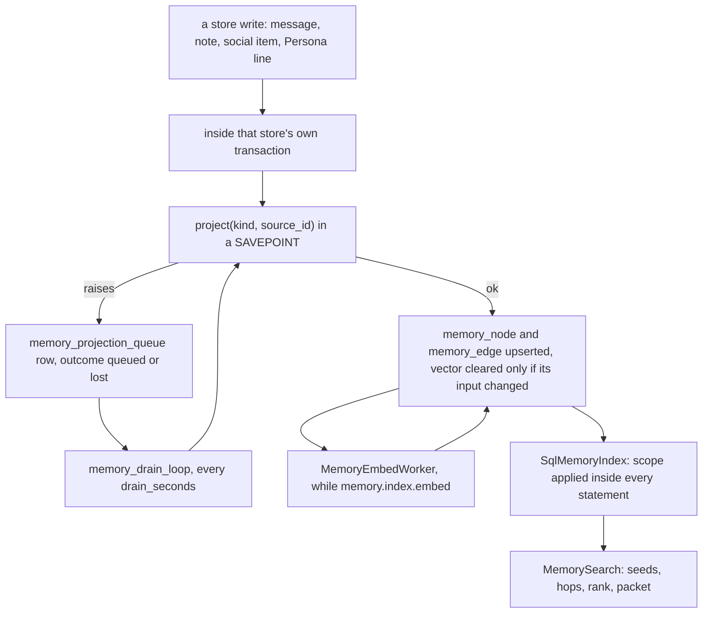
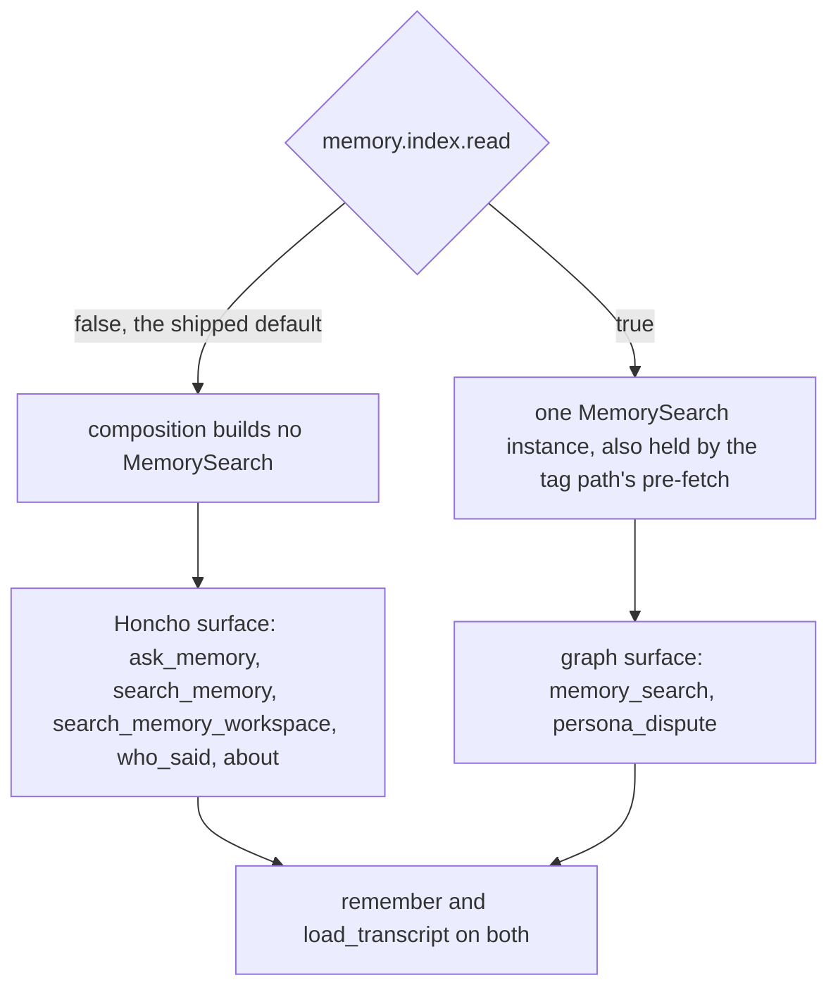

# Record, index and interpretation

Nora keeps three different things that are easy to call "memory", and the whole
memory design is an argument about not confusing them.

| layer | store | what it holds | authority |
|---|---|---|---|
| **the Record** | PostgreSQL (`SqlRecordStore`, the record store) | what was literally said, verbatim, with edits | authoritative; it is what the runtime's guarantees are about |
| **the memory index** | PostgreSQL `memory_node` / `memory_edge` | a *projection* of every other store into one node table and one edge table, for retrieval | derived; rebuildable, never restored, never hand-written |
| **interpretation** | Honcho (conclusions about people), and now Persona accounts | what a deriver concluded *about a person* | best-effort; may be absent |

The Record is one layer seen through two windows — the recent transcript injected
into every turn, and `load_transcript` for everything older — not two systems
([context assembly](context-assembly.md)).

[ADR 0001](../../docs/adr/0001-honcho-is-interpretation-not-record.md) fixes the
first two layers' relationship in one sentence — the record store is the RECORD,
Honcho is the INTERPRETATION — and gives the operative test for any derived read:
**could she have read this in the transcript?** If yes, the derived read is
negative value: it costs tokens and wall clock and invites her to repeat the room
back to itself. The ADR's text still says "SQLite" because it predates the
2026-08-07 move to PostgreSQL; `GLOSSARY.md` restates the doctrine against the
current store and adds that the derived row is *memory*, never a second copy of
the Record.

The distinction earns its keep because it keeps two silences apart: an empty
transcript read means *nothing was said*, while an empty conclusion read means
*nothing was concluded* — a much weaker claim. That is why Honcho's read types
carry an explicit reachability bit (`Recollection.reachable`,
`MessageHits.reachable`) rather than returning a bare list, and why the two
clients in `nora/infra` have deliberately opposite error contracts: the record
store fails loudly, `HonchoClient` swallows every failure and returns a benign
value so a Honcho outage never blocks a reply.

## The memory index: one writer, one reader

The index is four tables (migration `0105_memory_index`): `memory_node`,
`memory_edge`, `memory_projection_queue`, `memory_index_state`. Its closed
vocabularies live in `nora/domain/memory_index.py`, read by the tables' CHECK
constraints, by the projector and by the projection counter's help text, so the
three cannot drift; adding a kind or a relation is a schema change with a
migration, never something a model invents (`tests/infra/test_schema_parity.py`
holds the two spellings together).

- **Node kinds**: messages and their attachments, the Notebook (note, memo,
  event, lesson, culture/"character" account), Rollup episodes (outing, stay,
  trip), the social stream and its media and tagged place, Persona lines, and
  five entity hubs (`person`, `room`, `unit`, `nora`, `place`).
- **Relations**: a closed set of nineteen edges (`authored_by`, `in_room`,
  `about`, `cites`, `during`, `located_in`, `depicts`, …).
- **States**: `live`, `retired`, `superseded` — a retired note keeps its node,
  marked, instead of vanishing from search.

`nora/infra/sql/memory_index.py` is the **one writer**, and the design constraint
that shaped it is that Nora has no shared unit of work: each store method that
writes an indexed table calls `project` (or `drop`, `reproject_media`,
`project_episodes`) *inside its own* `engine.begin()` block, on the same
connection, beside the write. Every projection runs in a SAVEPOINT, so a
projection that fails rolls back only itself: the store's write stands, the
source lands on `memory_projection_queue`, and the outcome is counted
`nora_memory_projection_total{outcome="queued"}`. If even the queue write fails
the outcome is `lost` and only a rebuild finds it. The asymmetry is deliberate
and stated in the module: *a message the index missed is a search miss until the
next pass; a message lost because its index row failed is a lost message.*

*The write path: the store's transaction is the only place a source row and its
node change together, and the drain loop is the repair path.*

Because the projector re-reads the source row on the caller's connection and
upserts or drops accordingly, one function serves an insert, an edit, a hide and
an attribution. `rebuild` walks every source through the same `project` and
`reproject_episodes` the live paths call, so **a rebuild equals live projection
by construction** — which is what makes "wipe and rebuild" an honest repair. The
architecture gate `tests/architecture/test_every_indexed_kind_is_projected.py`
holds the other half of the contract: every function that writes a table in
`INDEXED_WRITES` must itself call a projector, because a write path with no
projection produces a search miss nobody can distinguish from an absence.

Two consequences worth knowing before changing anything:

- **What a node's text may hold is constrained.** A message's node holds the
  body; an attachment's holds its reading; never a sender id, a raw envelope, a
  coordinate, or (for an episode) a place name. Hub nodes carry no text except a
  place node, which carries the venue or area name only. The index is therefore
  not a place to look for identifiers — and the read withholds any item whose
  text *does* carry one (`scan_identifiers`).
- **The index is not restorable.** A snapshot restore copies none of the four
  tables (`NOT_RESTORED` in `nora/infra/sql/history.py`), so a restored database
  reads `never` until someone runs `nora memory rebuild`.

## Embeddings: the node is its own queue

`nora/infra/sql/memory_embed.py` is one batch per tick of the same drain loop,
and only while `[memory.index] embed` is on. There is no separate embeddings
table: `memory_node.embedding` is the queue.

- **What is embedded.** Text, for most kinds. An image attachment or an image
  social medium is embedded from its *bytes* (read from the blob store); a video,
  voice note or document is embedded from its reading's text. The store records
  which input was used (`embed_input`: `text` or `bytes`), so only a change to
  *that* input clears the vector and the worker's bookkeeping with it — a reading
  landing on an image that was embedded from its bytes does not throw the vector
  away, and a re-projection of an unchanged row costs no model call.
- **Model changes are one statement.** Before its first batch the worker requires
  the embedder to report serving the configured GGUF file (`/props`), then clears
  every vector of another fingerprint. The fingerprint
  (`<gguf name>@<sha256 prefix>`) is stored per vector, so a vector made by
  another model simply reads as unembedded.
- **Every failure is recorded on the node.** Outcomes are `ok`, `unavailable`
  (the embedder or blob store did not answer — the tick stops, so a dead server
  costs one call per tick and gives up on nothing), `rejected`, `empty` (nothing
  to embed), `error`, and `given_up` counted *in addition* when a failure was the
  node's last allowed attempt (`EMBED_MAX_ATTEMPTS = 8`). Backoff is exponential
  from one minute to a six-hour cap. `embed_error` stores a short class
  (`unavailable:HTTP 503`, `rejected:HTTP 400`, `error:KeyError`, `empty`) and
  never a node's text.
- **Images are throttled** (`embed_images_per_hour`, default 120): once the hour's
  budget is spent the pick leaves attachments out, so texts are never queued
  behind images.
- **Text is truncated, not chunked.** A text cut to fit the server's micro-batch
  is stored like any other and counted on
  `nora_memory_embed_truncated_total{kind}` — that counter is the signal that
  chunking should exist.

## Retrieval: scope, seeds, hops, rank, cut

`nora/agent/memory_search.py` is the one retrieval service over the index. It is
called by the `memory_search` tool *and* by the tag path's pre-fetch, so both
read exactly one implementation.

**Scope, per read.** `scope_for` builds a `MemoryScope` from the live policy and
the room's live roster: the reading room's unit and every room of it, the persons
this room lists, who is present, the listed persons whose presence passes here,
and (required, never defaulted) the persons whose `identity.toml` block sets
`social = false`. The arrays go *down* to the index, which applies them inside
every statement, so the walk can only step onto nodes a read returned and a path
is cut at its first out-of-scope node. The full scope predicate and its
listed-room and presence rules are documented in
[state and scopes](../architecture/state-and-scopes.md).

**Seeds**, in order, each node seeded once:

| seed | what it reads | notes |
|---|---|---|
| media | nodes holding the same `sha256` as a picture the message carries | pins above the literal pins; pre-fetch only |
| exact | a literal handle, URL, id-like token, or the name of a person this room lists | `EXACT_LIMIT = 10`; the first `PINNED_LIMIT = 5` are pinned ahead of every other hit |
| dense | the nearest in-scope nodes of the configured model's vectors | the question is embedded once with the model's query instruction |
| lexical | the question's terms via pg_trgm | the fallback when there is no query vector; beside a dense seed it reads only nodes no vector of the current model reaches yet |
| about | nodes `about` a person this room lists | scored `PERSON_SEED_SCORE = 0.45`, not a cosine |

`places` is a special case: a place the question names anchors the walk
(`PLACE_SEED_SCORE = 1.0`), descends `located_in` at most `PLACE_DEPTH = 2` levels
(a city to its districts to their venues) and is never returned itself.
`PLACE_CEILING = 500` anchors is a safety cap, and meeting it answers `partial`
rather than silently cutting.

**The question's narrowing** (`memory_search`'s `kinds`, `since`, `until` and
`person`) rides on the same scope object (`MemoryScope.only`) and is applied
inside the index's reads, never as a cut of a top-k. `since`, `until` and `person`
narrow seeds and hops alike, so a node outside them is never read, never returned
and never bridges the walk; naming a person the room does not list cannot narrow
at all, and the tool answers `unavailable` rather than a false `nothing_found`.
`kinds` is different on purpose: it narrows the *seeds* and the *answer*, not the
hops, so the seeds run once with it and once without, the walk crosses any kind,
and only the asked kinds are ranked and returned. The five categories a model
names — `messages`, `media`, `notes`, `events`, `places` — each map to a set of
node kinds (`KINDS_BY_CATEGORY`); an episode has no vector and its text is only a
kind and an interval, so `places` is mostly reached by a hop from what was said
during one.

**Expansion**, both edge directions, from the best `FRONTIER_WIDTH = 20` nodes of
the last hop, each step multiplying the parent's relevance by the relation's
weight (`REL_WEIGHT`: `cites` 0.9 down to `in_room` 0.3). Two rules ride on top
of scope:

- **The hub rule.** A person, room, unit, Nora or place node is kept only as a
  direct neighbour of the node that reached it and never put on the next
  frontier — two hops through a person reaches everything ever said about them,
  which is a search on the person, not an expansion of the question. The one
  exception is the named-place anchor above.
- **The listed-room rule.** An edge *to* person P is followed only if the reading
  room lists P and, when the node it came from was said in a room, that room lists
  P too. Talk about someone in a room they are not in is not evidence about them.

Floors: a seed scored by its cosine is kept above `DENSE_FLOOR = 0.38`; a lexical
seed and every hop are kept above `RELEVANCE_FLOOR = 0.1`. The walk stops early
when a hop keeps nothing (adaptive depth), at `NODE_BUDGET = 60` nodes, or at the
requested hop count — never past `HOP_CEILING = 4`. `memory_search` takes no
depth, so it searches at `DEFAULT_DEPTH = "low"`, which is two hops.

**Rank and cut.** Everything is sorted with the pinned exact hits first, then by
relevance times age decay (`HALF_LIFE_DAYS = 180`, and
`SOCIAL_HALF_LIFE_DAYS = 1095` for social items, which are dated when they were
posted). The packet is then cut *as it is rendered*: the pinned hits always, then
in rank order until `PACKET_TOKENS = 2_000` is spent or relevance drops more than
`SCORE_GAP = 0.2`, at least `MIN_RESULTS = 3` and never past `RESULT_MAX = 30`.
The tag path's pre-fetch uses the same cut on `PREFETCH_TOKENS = 1_500`, because
it rides every turn whether or not she needs it; a miss there is not a dead end,
since the tool reads the rest at the full budget.

**A synthetic example.** In a made-up room that lists `sam` and `kit`, the
question "where did we go for Sam's birthday dinner?" seeds a message by its
words, expands `in_room` to the room hub (kept, not expanded), reaches the event
the message was `during`, and from that event the venue place hub as a direct
neighbour. The answer carries each item's kind, age, a handle where the kind has
one, the text, and the path that reached it (`message (matched) → during →
event`); the venue's *name* can appear, its address cannot.

## What a search answer means

Statuses are the contract, and they are shaped by one rule: an unfinished index
must never read as "you never said that".

| status | means |
|---|---|
| `ok` | the index is complete, every node in scope was searchable, and hits were found |
| `nothing_found` | a real miss: a complete index, no backlog, every node in scope searched, nothing kept |
| `partial` | something was found, but the index is unfinished — not `complete`, a non-empty projection queue, the seeds fell back to lexical, the place anchors were cut, or a scope-local embedding backlog (or an unvectored node when the question had no terms) |
| `unavailable` | fail closed on any error, counted, never an empty answer |
| `withheld` | the tool level: everything that matched was withheld whole because its text carried an identifier |

Two details make `partial` predictable rather than mysterious. A node that has
waited for its vector for less than `BACKLOG_TICKS = 3` drain periods is *fresh*,
not a backlog — the worker's next ticks will embed it and the lexical seed reads
it meanwhile, so it does not hold answers `partial`. A node the worker gave up on
does not either (one poisoned file would otherwise hold every answer `partial`
forever). The residual `unembedded - fresh` count is the backlog. Whether that
backlog exists is counted *within the search's scope*, so a node waiting in
another unit cannot spoil this room's answer.

Concretely: with `[memory.index] embed` off, every answer is the lexical
fallback's `partial`, by design. With the embedder down, the same. `unavailable`
means "I could not check" and the tool's note tells the model to say so — it is
never a licence to say there was nothing.

## Which retrieval surface a deployment gets

`[memory.index] read` is the READ switch, and it selects exactly **one**
memory tool surface, wherever tools are built. The projection runs either way.
This is the first of the cutover's two axes; the second — what a prompt renders
about a person — has its own section below, and neither setting moves the other.

*One flag, one surface: the tool builder filters a single list, so no occasion can
hold both.*

The exclusivity is structural, not conventional. `build_tool_specs` ends with one
filter over `on_memory_surface(name, graph=memory_retrieval is not None)`, and
that builder is what the tag path, the fire turn, the Cognition session, every
Dreamer adaptor and the sub-agent worker all go through. `ToolRegistry` then
withholds the same unselected set, so the prompt's tool catalogue, the routing
digest and `withheld_tools()` — Cognition's `read_surface` — all agree with what
was actually built. `tests/unit/test_memory_surfaces.py` pins the resulting sets
as literals at each assembly point, so a surface gaining or losing a verb is a
decision somebody writes down.

The one place both surfaces are built together is the introspection build:
`ToolRegistry._introspection_specs` passes `all_memory_surfaces=True` so
`catalog()` and `tool_param_names()` describe every tool the code declares. That
build is never offered to a turn, so a deployment's catalogue can name
`ask_memory` while the same process's turns hold `memory_search`.

Surface membership, precisely:

- **Honcho surface** (`HONCHO_MEMORY_TOOLS`): `ask_memory`, `search_memory`,
  `search_memory_workspace`, `who_said`, `about`. `who_said` is deprecated and is
  planned to go with the rest of the surface.
- **Graph surface** (`GRAPH_MEMORY_TOOLS`): `memory_search` and `persona_dispute`.
  A profile question here is `memory_search` with `person`, not a separate verb.
- **Both**: `remember` (a Honcho conclusion off the graph, a Persona `told` line
  on it, through `nora.domain.persona.plan_write`) and `load_transcript` (the
  Record, which is not memory at all).
- **Only with the graph**: the tag path's `<recalled>` pre-fetch. With no
  `MemorySearch` wired the assembler builds no pre-fetch — the surface is Honcho's
  and the block is absent, not empty.

**Which surface a *room* gets is the deployment's answer, not the room's**: the
flag is process-wide. What differs per room is the *scope inside the read* — the
unit boundary, the listed-room rule, presence, `social = false` — which is why a
`memory_search` in one room can search a unit's other rooms while the culture fold
(`ROOM_ONLY_MEMORY_ADAPTORS`) reads its own room alone. On the Honcho side the
same job is done by routing a room to a unit, a unit to a Nora workspace, and a
Nora workspace to a Honcho workspace with a named `scope.<unit>` (see
[state and scopes](../architecture/state-and-scopes.md)); `nora/app/memory_routing.py`
refuses to guess, because a guessed Honcho workspace is one group's speech written
into another group's person models.

`[memory.index] read` and `[memory.index] embed` are independent, and the
interesting operator state inside this axis is "enabled, not embedded": the graph
surface is on, no node has a current vector, and every answer is `partial` from
the lexical seed until `[memory.index] embed` is turned on and the worker catches
up.

## The cutover's other axis: what a prompt renders

The migration has two axes, and neither moves the other. The first is *which
retrieval surface answers* — `[memory.index] read`, above. The second is *what
a prompt renders about a person*: `[persona] enabled` beside `[persona] render`,
which is what the Persona sessions replace. Because the two are separate
settings, the four combinations all exist:

| `[memory.index] read` | `[memory.profile] write` + `read` | verbs the model is offered | person and culture blocks in the prompt |
|---|---|---|---|
| off, the shipped default | off, the shipped default | `ask_memory`, `search_memory`, `search_memory_workspace`, `who_said`, `about` | the seven legacy blocks, each only while its own reader is wired |
| off | on | the same Honcho verbs, and `remember` writes a Honcho conclusion | `<persona>` instead of all seven |
| on | off | `memory_search`, `persona_dispute` | the seven legacy blocks |
| on | on | `memory_search`, `persona_dispute` | `<persona>` instead of all seven |

*Two switches, four states: graph retrieval with the old blocks, and Honcho
retrieval with `<persona>`, are both real deployments.*

What each half of the second axis is:

- `[persona] enabled` runs the Persona Dreamer sessions — `persona-person`,
  `persona-room`, `persona-unit`, `persona-nora`, and the `persona-verdict` judge
  — which write typed `persona_line` rows. On its own it is a **shadow**: nothing
  reads those lines and no prompt changes. It needs `[dreamer]` and `[culture]`.
- `[persona] render` is **the switch on this axis**, and it is wired only beside
  `enabled` (`cfg.persona.enabled and cfg.persona.render`): composition then
  builds the read-only `PersonaHeads` reader, the assembler fills
  `TagContext.personas`, and the prefill renders each entity's account as
  `<persona>` *instead of* seven blocks — `self`, `peer_card`, `peer_history`,
  `people_in_window`, `culture`, `unit_culture`, `character`
  (`_PERSONA_REPLACES`). A switched turn does not merely hide those blocks: the
  assembler makes none of those reads. Off is the whole rollback *on this axis*,
  which is why those rows stay in `_BLOCKS` even when they are not declared.
- The index only receives `persona_line` nodes while `render` is on; the shadow's
  lines join at the flip through the flip's rebuild, never through the projection
  queue. Reads also gate them: a `persona_line` node is out of scope unless the
  read carries `persona_render`, so flipping the flag back hides nodes an earlier
  live rebuild projected without needing another rebuild.

The axes cross in two small places, both in the composition root. `MemorySearch`
is handed `persona_render=cfg.persona.enabled and cfg.persona.render`, so a graph
read can scope `persona_line` nodes in or out — the only read that looks at the
other axis. And the `remember` tool is the Honcho conclusion whenever no
`MemorySearch` is wired, so on the mixed state (Persona rendering on, index off)
the model's saved fact lands in Honcho, not in the Persona account its own prompt
renders. [Persona and provenance](persona-and-provenance.md) owns the accounts
themselves, their citations and the dispute path.

What is being replaced matters for reading the Honcho surface honestly. The peer
card is Honcho's model-authored distillation of who a person is, and the
`<peer_history>` block is `representation` — Honcho's conclusions about them, with
the leading batch timestamp stripped. Both are labelled in the prompt as inferred
and unverified, because they are: the card's endpoint takes no scope, so within a
Honcho workspace it blends that workspace's units, and the conclusions arrive
undated (the stamp is per derivation batch, not per fact). Those are exactly the
properties a typed, cited Persona account is meant to remove.

## What is still Honcho, honestly

The migration is **incomplete**, and the repository says so in its own map:
`ARCHITECTURE.md` states that Honcho is still wired while the unified-memory
migration proceeds and that "its planned retirement is not a completed cutover."
Concretely, with the graph surface on and Persona rendering:

1. **Ingestion still writes to Honcho on every message.** `ingest/stages/memory_feed`
   feeds each human message under the sender's peer into the conversation's
   session, spawned off the listener path, *before* the engage gate. The tag path's
   `engagement/stages/feedback` feeds only Nora's own sent messages under the
   `nora` peer (one peer's stream holds one speaker's words — DEC-36), building
   her self-model. Neither is gated by `[memory.index] read`: the graph surface
   reads no Honcho, but Honcho keeps accruing.
2. **The portal still reads Honcho.** `GET /app/v1/memory` builds its showcase
   from `MemoryStore` (per Nora workspace the caller belongs to), regardless of
   the index flag; Persona accounts are added to that payload only while
   `[persona] render` is on.
3. **The Honcho surface is still the default, and only half of the way back.** Both
   settings ship off, so a fresh deployment offers the Honcho verbs and renders
   the seven blocks — but they are two switches, not one. With *both* on, no tag
   prompt reads Honcho at all: the peer card and the `representation` reads are
   skipped with the blocks they fill. What still reaches Honcho on that
   deployment is what writes to it (ingestion, the feedback stage, the migration
   commands) and the portal.
4. **Retirement is planned in steps.** `who_said` is deprecated and "goes with the
   rest of the Honcho surface at step 9"; the Persona switch is step 8 of the same
   sequence. Until those land, a reader should assume both systems are live in
   some deployments at once — which is why the two surfaces are kept *exclusive per
   deployment* rather than blended.

### Rolling back across both axes

There is **no single flag** that puts a deployment back on Honcho retrieval *and*
the legacy person blocks. What the code supports is a setting on each axis, then a
process reload:

1. `[memory.index] read = false` — `build_tool_specs` offers the Honcho verbs
   again and withholds the graph's, and the assembler is handed no `MemorySearch`,
   so the `<recalled>` pre-fetch is absent rather than empty. Nothing else moves:
   the projector, the drain loop and the embedding worker keep running on their
   own flags, and Honcho was never switched off.
2. `[persona] render = false` — no `PersonaHeads` is wired, `TagContext.personas`
   stays empty, and the seven blocks render again from their own readers.
   `[persona] enabled = false` on top of that also stops the sessions writing; it
   is not needed for the prompt, because `render` alone decides what is read.
3. Reload the process. `config.toml` is read once at boot and both readers are
   built there; no turn re-reads either flag, so there is no in-process flip.

Neither switch substitutes for the other. Turning retrieval off does not clear the
Persona reader — a switched turn keeps rendering `<persona>` and keeps skipping the
seven reads — and turning Persona rendering off does not restore graph retrieval,
because `memory_search` is wired from the index flag alone. A half-rollback is a
supported deployment rather than a broken one; it is simply a state the operator
has to choose deliberately. Both flags, and the boot-time read they share, are
tabulated in [configuration](../operations/configuration.md).

### Operator commands, and what they actually change

Only some migration commands change what the runtime reads. The Honcho-side ones
change what Honcho's reads return; the index-side ones change what `memory_search`
can answer.

| command | writes | what changes for a read |
|---|---|---|
| `nora memory rebuild [--dry-run] [--embeddings-only [--other-models]]` | the index | `complete` is the precondition for a graph-surface answer ever reaching `ok` (a fresh or restored database reads `never` and answers `partial`); `--embeddings-only` clears vectors, all or only other models', for the worker to backfill, so dense seeds are missing until it does and answers stay `partial` |
| `nora memory backfill-places` | places' `located_in` edges | a place question can anchor the walk at areas resolved before that migration |
| `nora memory backfill --unit … [--apply] [--resume]` | Honcho | replays a unit's recorded human messages into that unit's own Honcho workspace, the same feed live ingestion makes, so that workspace's conclusions are built from its own rooms |
| `nora memory carry-conclusions --workspace … --before … [--apply]` | Honcho | copies pre-cutover session-less `(nora → person)` facts into every unit scope of one workspace, so scoped reads can see what was told before scopes existed; `--before` is required and only unambiguous, single-workspace people are copied |
| `nora memory detach-unit --from-honcho-workspace … --peers-file … [--apply] [--refresh-cards]` | Honcho | after a backfill has landed, deletes the departed unit's sessions from the workspace it left and then rebuilds the recorded peers' cards, because two of Nora's reads (the peer card and the portal) are unscoped |

The ordering matters: backfill, then detach (detach refuses while a dry-run
backfill would still feed anything), and `rebuild` before switching the read flag
on. `rebuild` is idempotent and refuses to run beside another rebuild (a Postgres
advisory lock, `RebuildRefusedError`); the drain loop keeps running during it,
which is safe because both call the same projector and write the source's current
row.

## Invariants, failure modes, extension seams

- **A projection failure never undoes a store write**, and the queue's length is
  the index's health. A row stuck on the queue keeps answers `partial`, not wrong.
- **The index is derived everywhere**: not restored, not hand-edited, and
  `rebuild` is defined as the same functions live writes call — so "rebuild equals
  live" is structural, not an aspiration.
- **Dangling edges are legal.** Edges join `memory_node` at the hop, so an edge
  into a hidden message or a switched-out episode reaches nothing; deletes remove
  only the edges their own projection owns.
- **Fail closed, never invent.** A room outside the policy yields no scope
  (`unavailable`); a name the room does not list is `unavailable` with a note
  saying "I could not check" rather than a false `nothing_found`; an item whose
  text carries an identifier is withheld whole.
- **The index's health is observable**: `nora_memory_projection_total{kind,
  outcome}`, `nora_memory_search_total{status}`, `nora_memory_embed_total{outcome}`,
  `nora_memory_dense_short_total` (a scoped HNSW scan came back short),
  `nora_memory_embed_truncated_total{kind}`, `/health`'s `index` block (the state
  row and queue length, reported whichever surface is on), and `nora memory
  rebuild`'s own counts (kinds and numbers, never an id or a text).
- **To add a node kind or relation**: extend the vocabulary in
  `nora/domain/memory_index.py`, write the CHECK migration, teach the projector
  (and add the source table to `INDEXED_WRITES` so the architecture gate demands
  the call), extend `EMBEDDED_KINDS` if it should have a vector, and update the
  scope predicate if it needs a scope of its own. Skipping any one of these fails a
  parity, projection or contract test rather than degrading quietly.

## Focused tests

| test | what it holds |
|---|---|
| `tests/architecture/test_every_indexed_kind_is_projected.py` | every write to an `INDEXED_WRITES` table projects; only the projector writes the `memory_*` tables |
| `tests/infra/test_schema_parity.py` | the migration's CHECK lists and the Python vocabularies agree; the expression and DESC indexes' shapes |
| `tests/contract/test_memory_index_contract.py` | `SqlMemoryIndex` and `FakeMemoryIndex` agree on the scope predicate, hubs as direct neighbours only, and the three seeds |
| `tests/unit/test_memory_surfaces.py` | the two surfaces' verb sets, as literals, at every assembly point |
| `tests/test_composition.py` | through the real composition root: the assembler and the registry hold the same `MemorySearch` on the graph surface and none off it, Cognition's wired set follows the flag, and `[persona] render` decides whether the person/character adaptors are built beside the Persona ones |
| `tests/unit/test_ask_memory_index_flag.py` | `ask_memory` is the Honcho path off, and not offered on |
| `tests/unit/test_memory_search.py`, `tests/unit/test_memory_search_tool.py` | the walk's seeds/hops/floors and the tool's statuses and notes |
| `tests/integration/test_memory_scope.py`, `test_memory_dense_seed.py`, `test_memory_vectors.py` | scope, the two-stage dense seed, and the worker's bookkeeping against real Postgres |
| `tests/integration/test_memory_rebuild.py`, `tests/infra/test_memory_projection_*.py` | rebuild equals live projection, per source family |
| `tests/unit/test_memory_backfill.py`, `test_memory_carry.py`, `test_memory_detach.py` | the migration commands' refusals, dry runs and idempotency |

## Related

- [Context assembly](context-assembly.md) — where `<recalled>`, `<peer_card>` and
  `<persona>` reach a prompt, and what each block is allowed to claim.
- [State and scopes](../architecture/state-and-scopes.md) — the unit, room and
  person keys, the scope predicate, and Nora-workspace-to-Honcho-workspace
  routing.
- [Failure and status contract](../architecture/failure-and-status-contract.md) —
  the three-state answer, `nothing found` versus `unavailable`, and the metric
  axes these paths increment.
- [Persona and provenance](persona-and-provenance.md) — the typed accounts the
  switch renders, and how a line is cited and disputed.
- [Tool surface](tool-surface.md) — budgets, levels, deferral and the resident set.
- [Runtime topology](../architecture/runtime-topology.md) — what the composition
  root wires at boot, including this flag.
