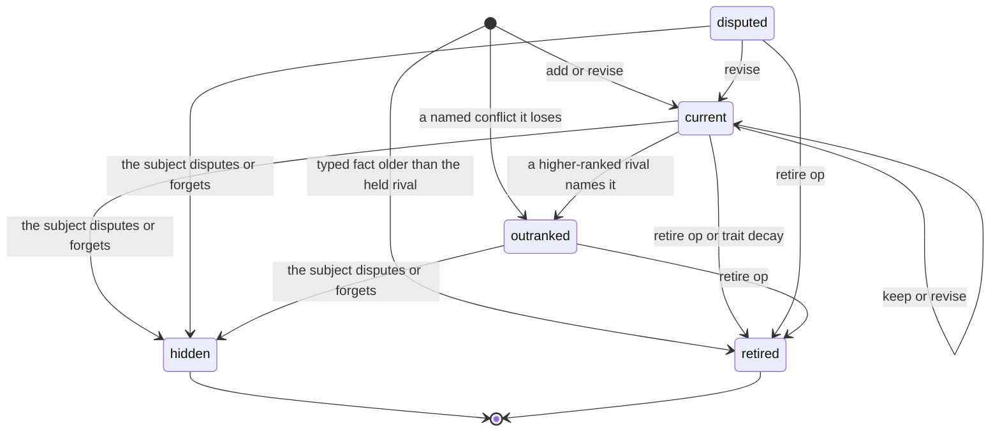
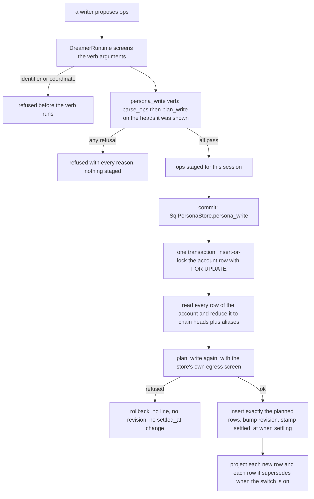
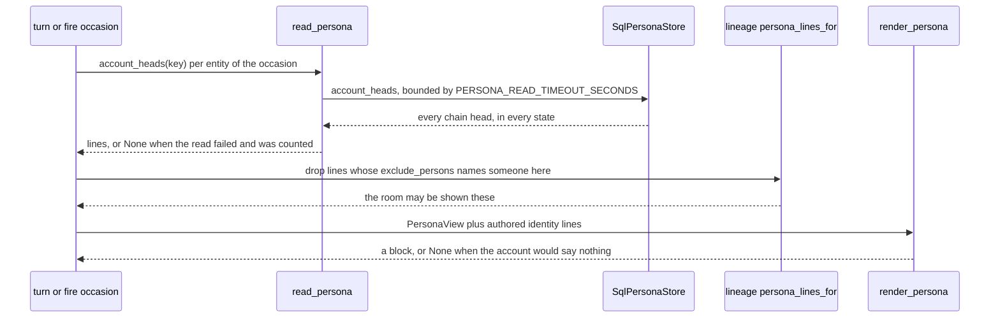

# Persona: typed account lines, reasoning modes and supersession

An **account** is who or what an entity is *to Nora*, and the Persona tier is the
store and the contract behind it. The design doc the source cites as
`design/unified-memory/45` states the split the implementation keeps: **the
structure is the container, the content is prose.** The parts, kinds, reasoning
modes, citations and states of a line are typed and checked; what a line *says*
is not enumerated, so nothing decides whether "organises plans" is a good thing
to believe — only whether it may be written at all, on what evidence, and by
which writer.

The tier has one table for accounts (`persona`, one row per entity, changed in
place) and one for their lines (`persona_line`, append-only). An account is its
**chain heads**: the rows nothing supersedes. A change is never an `UPDATE`; it
is a new row whose `supersedes` names the one it replaces, so the history of a
belief is the physical history of the table (`nora/infra/sql/schema.py`,
`nora/infra/sql/persona.py`).

That shape makes the interesting questions write-time questions, and the answer
to all of them lives in one function, `nora.domain.persona.plan_write`: it takes
the account's held lines, the ops a writer asks for and what that writer was
shown, and returns either **every refusal** (nothing is applied) or **the exact
rows to insert**. The store runs it inside the write's own transaction, so the
model proposes and code disposes.

## Which account, and which writer produces it

The same `Account` type and the same validator serve every entity kind
(`human`, `nora`, `agent`, `room`, `unit`), and the key form says which account
it is: `<unit>#character:<person_id>` for a person, a room's `primary_id` for a
room, `<unit>#unit`, `<unit>#nora` (`nora/domain/culture.py`,
`split_culture_key`). What differs between writers is *what they are shown* and
*what a line of their account may mean*, and every row records who wrote it in
`written_by_session`. (`agent` is a legal entity kind, but no session in this
tree registers one: the four kinds with adaptors are below.)

| account | entity kind | producer | evidence it is given |
|---|---|---|---|
| one person's account | `human` | the `persona-person` Dreamer adaptor (`PersonaPersonAdaptor`), one session per (unit, listed person) | their messages in the rooms that list them, the messages that mention them, the response episodes they answered, their social items, their Rollup ties, the disputes of their lines |
| a room's account | `room` | `persona-room` (`PersonaCollectiveAdaptor`, `kind="room"`) | that room's visible messages, excluding hers (her own words never support a claim about anyone) |
| the unit's collective account | `unit` | `persona-unit` | its rooms' culture heads **and** the Record rows those cite — prose is context, never a substitute for a citation's time, speaker and room |
| Nora's own account | `nora` | `persona-nora` | the unit's closed response episodes: how the rooms answered her. Her sends are read for their time and never made citable |

The three collective writers share one implementation because settlement and
validation are identical; only names, populations, evidence and cursors differ
(`nora/language/persona_collective.py`). A turn and the hypothesis judge also
reach the same table, but on different terms:

- a **turn** writes a `told` identity fact through the graph surface's
  `remember` tool, and it can *introduce* one: `remember_told` builds a
  `PersonaAddOp` when the told-line revision condition does not apply, then
  writes it through `persona_write` with the message citations that raised the
  turn and tag provenance (`written_by_session="tag"`, `apply_decay=False`,
  because a turn never decays an account), staged against the cited messages and
  only the room that lists the subject. The revision condition is narrow: a
  single-valued fact key (`SINGLETON_FACTS`) with exactly one held identity line
  of it, still `current` or `disputed`, `told` by this same teller — then the op
  is a `PersonaReviseOp` of that line instead. When exactly one such line is held
  but the condition fails (another mode, or another teller), the add carries it
  as `conflicts_with`, so code's precedence rather than the tool decides which of
  the two stands. The same turn also records a dispute through `persona_dispute`
  (`nora/agent/tools.py`);
- the **`persona-verdict`** judge sets a hypothesis's verdict
  (`written_by_session="persona-verdict"`) — deliberately not the writer that
  produced it (`nora/language/persona_verdict.py`).

`remember` is therefore not an exception to the judge, only a caller of it whose
`citable` set is built from the turn: the subject is the speaker unless a
`person` is named and resolved against the room roster (`not_found`, or
`ambiguous` when the name fits several), a room that lists nobody by name yields
an empty `listed_rooms` so the line is refused, an `instruction` is never told
about someone else, and an unwired store, a cited message missing from the
transcript or a write that loses the revision race is reported `unavailable`
rather than as a save — only an `ok` result licenses «it is saved». Only the
dispute and verdict transitions bypass `persona_write`, and each copies a chain
head and changes only the fields it owns — a line's `state`, or its
`verdict`/`verdict_by`/`verdict_at` — so neither can introduce a claim.

## The line: part, kind, mode and the floor under each mode

A line has one `part`. The part decides which kinds and which reasoning modes are
legal, and the mode decides how much evidence the line must rest on. `part`,
`kind` and `mode` are closed vocabularies mirrored by the table's `CHECK`
constraints, so a bypassing insert cannot store what the judge would refuse.

| part | kinds | modes | evidence floor enforced at write time |
|---|---|---|---|
| `identity` — who or what it is | actor: `name`, `role`, `relationship`, `attribute`, `instruction`; collective: `name`, `purpose`, `norm` | `told`, `deduced` | **told**: cites only the message(s) it was said in, and `told_by` is the person who said them. An `instruction` is `told` by its own subject, never by anyone else and never deduced. **deduced**: at least 2 premises, counted as citations plus `draws_on` lines, none of them `abduced`, every premise line `current` |
| `character` — what it is like | `trait` | `deduced`, `induced` | **deduced**: as above. **induced**: at least 3 instances on at least 2 calendar days counted in Hong Kong time, **or** one `rollup:<kind>:<subject>` aggregate key |
| `hypothesis` — why it is like that | `explanation` | `abduced` | at least one `current`, `induced` `character` line it explains (in `draws_on`), plus a `prediction`, its `prediction_observable`, and a `prediction_window_end` still ahead of now |

The floors are constants, not configuration: `DEDUCED_MIN_PREMISES = 2`,
`INDUCED_MIN_INSTANCES = 3`, `INDUCED_MIN_DAYS = 2`, and the "two days" clock is
`PERSONA_HKT` — fixed at UTC+8, never the host's timezone. A line also says one
claim in at most `LINE_MAX_CHARS` (300) characters, says something at all, and
carries no ids in its text: message and item numbers belong in `citations`, and
a line's own identifier never appears anywhere in it.

Identity is the one part that is *typed* rather than free prose. `fact_key` names
a field of `FACT_KINDS` and `fact_value` must match that field's shape —
`birthday` is month/day with an optional year, `relationship` is a relation plus
either a person id or an unresolved name, `languages` and the other list fields
treat `[]` as an explicit "none", `attribute` is a normalised label plus value
and optional source unit, and age/height additionally require a numeric value
with a source unit. `validate_fact` is that contract, in one place, so every
authored surface renders the same value the store accepted
(`nora/domain/persona.py`). A prose-only identity row is history: it is never
promoted to a typed fact, never renders, and never enters the memory index.

## What a line may cite

A citation is not a URL or a free string. It is an identifier for something the
writer was actually shown, and `PersonaCitable` — built by **code** from the
prompt inputs, not by the model — is the closed set of what that call may cite:

| citation form | what it names |
|---|---|
| `<n>` | one Record message by id, with its time, speaker and room |
| `response:<send id>` | one Rollup response episode: her send and what followed |
| `rollup:<kind>:<subject>` | one Rollup aggregate key, for `colocation`, `outing`, `daybook` or `tie` |
| `social:<network>:<item id>` | one social item, on its author's account only, on its `taken_at` day, in no room |

Everything else is refused as `unresolved_citation`, and the refusal text tells
the writer which four forms exist. On top of resolution sit four rules that make
provenance mean something:

- **A line is never a citation.** Naming a line (by handle, uuid or a shown id)
  in `citations` is `line_in_citations`: a line another line rests on goes in
  `draws_on`, which is what the deduced and abduced floors count.
- **The listed-room rule.** Evidence about a person counts only if it was said in
  a room that lists them; a citation from anywhere else is `unlisted_room`, and a
  room that lists nobody by name yields an empty `listed_rooms`, so nothing can be
  written from it.
- **A social item is evidence about its author alone.** Citing one on anyone
  else's account is `social_not_author`, and a `told` line may never cite one at
  all — it is published words, not a message said to someone in a room.
- **Egress is screened, not trusted.** Text, the formatted fact, the prediction
  and the observable each pass `text_offence` (`nora/agent/dream_screen.py`), the
  same R-18/R-28 identifier-and-coordinate screen the rest of the pipeline uses.
  The store holds the screen so no writer can forget it, and the Dreamer runtime
  screens a verb's arguments *before* the verb runs, so the model reads a reason
  and can rewrite the line.

A synthetic example, invented for this page — "Robin" is not a real person:

```text
P1  identity  attribute  mode=told     cites=101                    told_by=Robin
    occupation: illustrator
P2  character trait      mode=induced  cites=101,102,103
    posts finished drawings late at night
P3  hypothesis explanation mode=abduced draws_on=P2 cites=101        window=2026-11-30
    works to a deadline that slips?  observable: rollup:tie:example-unit|R,N
```

`P1` may only be written if message `101` was said by Robin in a room that lists
Robin. `P2` needs three instances across two Hong Kong days, or one aggregate
key. `P3` needs `P2` to still be current and induced, a prediction, an
observable, and a window that has not closed.

## Precedence: how a conflict is settled

Writers do not decide who wins a disagreement; they name it. An op carries
`conflicts_with` (a handle), and code ranks the two lines:

| rank | line |
|---|---|
| 3 | `told` by the account's subject |
| 2 | `told` by someone else |
| 1 | `deduced` |
| 0 | `induced` |
| none | `hypothesis` — a question, never a fact that outranks one |

The higher-ranked line stands; the lower becomes `outranked` as a new row, and
**both lines stay**. Three consequences follow, and all three are enforced:

- a conflict between lines on the same footing is `same_rank` — the writer is
  told to revise or retire the rival instead of adding one;
- naming a hypothesis as a party to a conflict is `conflict_hypothesis`;
- rewording an `outranked` line does not win it back: a `revise` with no named
  conflict keeps the successor `outranked`. Only a new named conflict, ranked by
  code, can restore it.

## The states, and which of them a write can produce

A line's `state` is a small vocabulary with one meaning each. The states a line
is **held** in — it occupies a cap slot and a writer may act on it — are
`current`, `disputed` and `outranked`; the rest are terminal for that writer.

| state | held? | how a chain head gets there | how it leaves | renders? |
|---|---|---|---|---|
| `current` | yes | `add`, or `revise` | `keep` or `revise` (stays `current`); `retire`; the subject's own dispute or «forget that» → `hidden`; losing a named conflict → `outranked` | yes |
| `disputed` | yes | someone other than the subject disputed a line that matched | `revise` → `current`; `retire`; the subject's dispute or forget → `hidden` | yes, marked `(disputed)` |
| `outranked` | yes | lost a named conflict, at its own write or when the winner was written | `retire`; the subject's dispute or forget → `hidden`; a `revise` without a named conflict keeps it `outranked` | never |
| `hidden` | no | the subject's own dispute or «forget that» matched it | terminal: no handle, no render, and its index node is dropped | never |
| `retired` | no | a `retire` op (which must say `why`), the 60-day trait decay at a settling session, or a typed fact whose evidence is older than the held rival | terminal | never |
| `superseded` | no | *not written by the write path*: it is the memory index's derived node state for a row a successor names | — | never |
| `refuted` | no | *not written by the write path*: a hypothesis is refuted by its `verdict`, not by its `state` | — | never (see verdicts) |



The diagram is the chain head only: an old row keeps its own state forever,
because `persona_line` is append-only. `superseded` and `refuted` are legal values
in the state vocabulary and in the table's `CHECK`, but no Persona writer produces
them — the index derives "superseded" from the successor row, and a refuted
hypothesis is still a hypothesis whose `verdict` is `refuted`.

### Caps, decay and support

Two caps bound an account's held prose: 5 `character` lines and 3 open
`hypothesis` windows per account, and exceeding them is `over_cap` with the way
out named in the refusal ("retire a line in the same call", "wait for a window to
close"). A hypothesis holds its slot until its window closes **whatever its state
or verdict**, so retiring one early frees nothing. Identity is deliberately not
capped, and `tests/infra/test_persona_store.py` pins that.

A trait is not immortal. `TRAIT_DECAY_MS` is 60 days: when a session *settles*
(`apply_decay`, which the store also uses to stamp `persona.settled_at`), a held
`character` line neither kept with new evidence nor revised is retired by code. A
bare `keep` with no citations is not new evidence — it writes nothing — and a
line added in the same call that rests on a decaying trait is refused
`premise_not_current`. Re-citing evidence the line already had does not stop the
clock.

`support_count` and `last_supported_at` carry the trail of that: a Rollup
aggregate supports as of now, a Record row or episode as of when it was said, and
the set difference against the roots already persisted with the old citations is
what counts as *fresh*. That is why a Rollup rebuild with the same underlying
rows cannot inflate support or refresh an age, and why rewording an unchanged
typed fact preserves the assertion time and grounding instead of counting as a
second assertion.

## The judge, and the transaction that refuses

`plan_write` is pure: heads in, plan out. It judges every op, returns before the
decay and cap checks if any op was refused, and checks the caps last — so **one
refused op refuses the whole call**, with every reason a `PersonaRefusal` carrying
`reason` (a member of the closed `PERSONA_REFUSALS` vocabulary), a `detail` the
model can act on, and the op's index. Nothing is repaired on the writer's behalf.



The store transaction (`SqlPersonaStore._write`) is where the guarantees actually
land:

- the account row is `SELECT ... FOR UPDATE`d, so two writers serialise;
- `expected_revision` is a compare-and-set: a write against a revision newer than
  the one the session read is a `conflict` and changes nothing — the next wake
  reads the new account;
- a refused plan rolls back, so a refused write leaves no line, no revision bump
  and no `settled_at`;
- `uq_persona_line_supersedes` (a unique partial index on `supersedes`) lets a
  row be superseded at most once, so a forked chain is unrepresentable; the
  losing inserter gets an `IntegrityError` that the store reports as `conflict`;
- the table's `CHECK` constraints repeat the rules a column can carry — kind per
  part, mode per part, 300 characters, at least one citation, `told_by` exactly
  when `told`, a prediction exactly when `abduced`, at least one `draws_on` for
  `abduced`, at least two premises' worth for `deduced` — as a second line of
  defence behind the judge.

A session settles once. A second `persona_write` in the same session is refused
`settled`; a session that calls neither verb ends **unsettled**, and
`accept` raises instead of spending the batch, so the evidence watermark holds
and the same person-source revisions are handed again. That is the difference
between "nothing was learned" and "the write never happened": the tier refuses to
record the first as though it were the second.

## Disputes: the other door into a line's state

A dispute is a Record item about an account, not a write op. `record_dispute`
takes who disputed, the claim as they put it, the message they said it in, and
the kind — `dispute` («that's wrong») or `forget` («take that away») — and rules
on it in its own transaction:

| condition | effect |
|---|---|
| the claim matches a held line and the requester **is** the account's subject | `hidden`: a new row supersedes the matched one |
| the claim matches a held line and the requester is someone else | `disputed`: the line is marked, awaiting weighing |
| no held line matches (or several do) | `recorded`: the row lands and nothing is touched; the account's session weighs it |
| `forget` from anyone but the subject | refused `forget_not_subject`, nothing written |

Matching is by code (`match_disputed_line`): exact after case-folding and
whitespace collapsing, else a **unique** containment either way, and a claim
shorter than 12 characters never matches by containment. Hiding the *wrong* line
is worse than weighing an unmatched dispute, so zero and several matches both
mean "record it and let the session weigh it". A collective account has no
subject, so it can be disputed but never forgotten through this door.

Disputes and turn-written `told` lines are also *stimuli*: `pending_told` counts
`told` lines a turn wrote since `persona.settled_at`, `pending_disputes` counts
disputes since then, and either one counts as a full wake batch — so a «remember
this» or a «that's wrong» reaches the account's next session at once instead of
waiting for a batch. Until the first session settles the account, that session is
the backfill and is handed the legacy prose head and the rows it cited, once, as
a gap checklist — never as an uncited source of typed facts.

## Hypotheses: graded by someone else

A hypothesis is a question with a deadline, so the tier keeps two things apart
that a lesser design would merge: the line's `state` (whether it stands in the
account) and its `verdict` (`open`, `confirmed`, `refuted`, `expired`,
`unknown`). A verdict is never the writer's, and `record_verdict` is deliberately
not a `persona_write` op.

The docket is live state, not a cursor: a unit's hypotheses whose `verdict` is
`open` and whose `prediction_window_end` has passed. For each, **two judges, one
door**:

- if `prediction_observable` *is* one Rollup key (exactly, via
  `countable_observable`), code judges it in `commit`: one read of that key over
  the window, `confirmed` when a row overlaps it, `expired` when none does,
  `unknown` when the build could not be read;
- otherwise the model judges, handed the prediction, the observable, the window
  and the window's Record rows — and nothing the Persona adaptor wrote.

`record_verdict` refuses a line that is not an open, window-closed hypothesis of
that account, returns `conflict` if it moved or was already judged, and refuses
`open` as a verdict (absence of a verdict is what `open` means). `unknown` is
counted on its own label and is never treated as success.

## Rendering an account back into context

The read is one bounded, fail-soft call per occasion, `read_persona`, mirroring
the culture read: a default five-second timeout (a caller may pass its own), a
failed read drops *that* account's view and increments `nora_errors_total{stage}`
with the occasion's stage name, and an account that does not exist yet is an empty
tuple rather than an error. The rendering rules are the write rules seen from the
other side:

- only `current` and `disputed` lines render; `disputed` keeps rendering marked
  `(disputed)` because it is awaiting weighing, while `hidden`, `outranked` and
  every terminal state never do — an `outranked` line is never shown as a current
  fact;
- `identity:` lines render first: the **authored** ones from `identity.toml`
  (names, aliases, and platform display names — never a handle), which carry no
  mode because they are never written as lines, then told identity facts with
  their teller named. A typed fact renders only while its `valid_from`/
  `valid_until` covers now; a prose-only identity row does not render at all;
- `character:` renders the traits; `open questions:` renders the hypotheses, and
  **only while their prediction window is open**, as questions (a `?` is appended
  when the text lacks one). A confirmed hypothesis stays a hypothesis;
- a line whose `exclude_persons` names someone in the rendering room is dropped by
  the assembler *before* the view is built, so the renderer never sees it. (The
  write path's ops carry no `exclude_persons` today; every read path already
  honours the column.)
- the block is `None` when an account would say nothing — an entity with no
  account yet is not an entity she looked at and found featureless. Bodies are
  capped per account (2,500 characters, 4,000 for Nora's own) and the turn's
  person blocks share one 12,000-character budget with a closing
  `[N more characters not shown]` marker, so the group never exceeds the cap.



Each block is stamped into the row of the block it replaces: Nora's at `<self>`,
the room's at `<culture>`, the unit's at `<unit_culture>`, and the persons at
`<peer_card>` under their shared budget. `character_read` answers from the same
accounts when the switch is on, as plain text with the newest rendered line's
time attached.

## Configuration and the switch

`[persona]` has exactly two switches, both off by default
(`nora/config.py`, `PersonaConfig`):

| key | meaning |
|---|---|
| `enabled` | turns the Persona sessions on: `persona-person`, `persona-room`, `persona-unit`, `persona-nora` and the `persona-verdict` judge. On its own this is the **shadow**: the sessions write `persona_line` and nothing reads it, so no prompt changes |
| `render` | **the switch.** On, prompts read accounts through `read_persona` and render `<persona>` blocks instead of `<peer_card>`, `<peer_history>`, `<people_in_window>`, `<culture>`, `<unit_culture>`, `<character>` and `<self>`. Ignored unless `enabled` is also on |

`render` is also the rollback: flipping it off restores the Honcho and
prose-culture blocks, with the accounts still being written. When `enabled` and
`render` are both on, a Persona write additionally projects its rows into the
memory index in the same transaction (and marks the rows they supersede); during
the shadow those lines join the index at the flip through `nora memory rebuild`,
which converges on the source's current row so a rebuild equals live projection
([memory and Record](memory-and-record.md)).

Operationally the tier is observable in three counters: `nora_persona_session_total`
by outcome — the adaptor counts `written` (the landed write), `kept` (settled with
none), `refused` (one refused verb call) and `unsettled`, and the counter's closed
vocabulary also carries `abandoned` for the third unsettled run of one batch —
`nora_persona_verdict_total` by `{verdict, judge}` so code's and the model's
verdicts are never conflated, and `nora_errors_total{stage}` for the fail-soft
reads. Two operator commands sit on top: `nora memory persona-history` reports
historical coverage and can restart an incomplete shadow pass, and
`nora memory persona-retry-media --key <account>` queues one ordinary attempt for
that account's pending cached media (`nora/subject/persona_coverage.py`,
`nora/infra/sql/persona_inputs.py`).

## Invariants worth keeping

If you change this tier, these are the properties the code assumes:

1. **Nothing is a line unless `plan_write` returned it** (or a dispute/verdict
   door copied a head and changed only its own field).
2. **No `UPDATE` of `persona_line`, ever** — a change is a successor row, and a
   row is superseded at most once.
3. **Every premise is followed to its chain head.** `chain_heads` returns the
   aliases that let a revision keep premises revised since, and a premise that
   changes in the same call is refused rather than silently re-pointed.
4. **The revision is the compare-and-set.** A session reads the revision before
   the lines, so a write that lands in between is a `conflict`, never a write on
   shifted handles.
5. **A session either settles or holds its evidence.** Unsettled is not
   "nothing learned"; it raises, and the same revisions come back.
6. **Provenance survives the write.** `citations` are what was shown, `draws_on`
   is what other lines it rests on, `written_by_session` is who wrote it,
   `as_of` is the evidence's own time, and `support_count` only grows on evidence
   it did not already have.

## Where to read the code

- [nora/domain/persona.py](../../nora/domain/persona.py) — vocabularies,
  `plan_write`, `rank`, `handles_for`, `validate_fact`, `format_fact`
- [nora/infra/sql/persona.py](../../nora/infra/sql/persona.py) —
  `SqlPersonaStore`: the transaction, disputes, docket and verdicts
- [nora/infra/sql/schema.py](../../nora/infra/sql/schema.py) — the `persona`,
  `persona_line` and `persona_dispute` tables and their `CHECK`s
- [nora/language/persona.py](../../nora/language/persona.py) — the person
  session: inputs, the two verbs, `accept`/`commit`
- [nora/language/persona_collective.py](../../nora/language/persona_collective.py)
  — the room, unit and Nora sessions
- [nora/language/persona_verdict.py](../../nora/language/persona_verdict.py) —
  the hypothesis judge
- [nora/language/persona_render.py](../../nora/language/persona_render.py) —
  `read_persona`, `render_persona`, budgets

Focused tests: `tests/unit/test_persona_rules.py` is one test per rule of the
judge (each fails if its rule is removed); `tests/infra/test_persona_store.py`
covers the real-Postgres transaction, revision, refusal, row `CHECK`s, disputes
and the docket; `tests/infra/test_remember_persona.py` covers the turn's
`remember`/`persona_dispute` doors; `tests/infra/test_persona_verdict.py` covers
both judges over a seeded Rollup build; `tests/infra/test_persona_collective.py`,
`tests/unit/test_persona_social_input.py`,
`tests/infra/test_memory_projection_persona.py` and
`tests/integration/test_eval_persona_writer.py` cover the collective sessions,
the social-input rules, the index projection and the synthetic writer harness.

## Where this sits

Persona is the *interpretation* layer of memory — conclusions about people —
as distinct from the Record it cites and the index that retrieves it
([memory and Record](memory-and-record.md)). Its accounts are assembled into
turns by the block machinery described in [context assembly](context-assembly.md),
the sessions that write them run in the Dreamer
([the Dreamer](../systems/dreamer.md), [cognition](../workflows/cognition.md)),
and the rules a line is judged against are the same kind of write-time contract
that contextual learning applies to lessons
([contextual learning](contextual-learning.md)).
