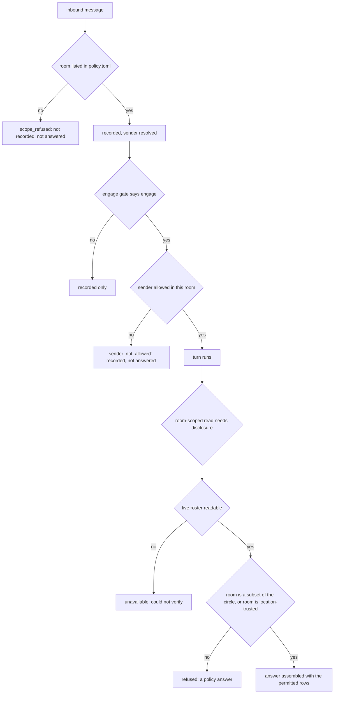

# Policy, admission and disclosure boundaries

Nora answers people in rooms. Almost everything interesting about her safety comes
from one design choice: **the answer to "may I" is never inferred, it is written
down, and the shipped answer is no.** Three files carry the three different
questions, and they are split because they change on different schedules:

| file | question | changes when |
|---|---|---|
| `config.toml` | how does the deployment run | deploy cadence |
| `identity.toml` | who is a person, and which accounts are theirs | a human joins |
| `policy.toml` | who may talk to her, where, and about what | **trust** changes |

The split is the argument for the whole page: an allowlist buried among port
numbers is an allowlist nobody reviews ([`nora/policy.py`](../../nora/policy.py)
module docstring). Configuration keys for these files live in
[Configuration](../operations/configuration.md); this page is about the rules
they express and the code that enforces them.

Two objects are both called "policy", and confusing them defeats the checks:

- the **allowlist** — `nora.policy.Policy`, loaded from `policy.toml`. It has
  `is_allowed` and answers "who may be here".
- the **engage policy** — `nora.domain.ports.EngagePolicy`
  (`CompositePolicy`), which answers "is this message addressed to her at all".
  It has no `is_allowed`.

`HeartbeatLoop` takes a narrow `_Allowlist` protocol naming only `is_allowed`,
precisely so that passing the engage policy in its place cannot happen quietly
(`nora/app/heartbeat.py`).

## The grant model

`policy.toml` is read **once at startup**; a change needs a restart. Everything it
declares is a list of people, named only by `person_id` from `identity.toml`:

- Never a phone number, a platform id or a role. `default = "deny"` is the only
  accepted value — the loader's validator refuses anything else, on the grounds
  that an allow-by-default Nora would join any group she is added to and there is
  no second gate behind this one.
- Naming a `person_id` grants **every account that person holds**. Allowlisting
  `*person-a*` admits their work and personal numbers alike, because
  `identity.toml` maps both to the same `person_id`.
- An allowlist with **no conversations refuses to start** rather than running
  mute. Under R-5 a silently-denied Nora is indistinguishable from a working one
  in a quiet group, so the loader converts every "you have configured nothing"
  state into a loud startup error ([Failure and status
  contract](../architecture/failure-and-status-contract.md)).

### What a room entry can say

Each `[[conversations]]` entry is a bundle of answers **about people**. All the
trust flags default to `False`, and being allowed to answer when tagged never
implies any of the others.

| key | meaning | default |
|---|---|---|
| `platform`, `id` | the conversation the platform reports; `id` is what she speaks into | required |
| `also_ids` | additional ids matched identically (a Telegram supergroup's retired chat id, a re-encoded group id) | none |
| `label` | what the room is *called* in every model-facing render; never matched on | required |
| `persons` | `person_id`s who may trigger her here, or `"*"` for anyone in the room | `[]` (nobody) |
| `unit` | the social unit this room belongs to; only same-unit rooms may ever be relayed between | `"nora"` |
| `tools` | MCP server *names* a tag in this room may hold | `[]` (none) |
| `location` | relaxes `where_is`'s disclosure gate for the whole room | `false` |
| `relevance_gate` | the Relevance Gate may consider this room's untagged traffic | `false` |
| `home_room` | the one room of its unit the proactive adaptor stands in | `false` |
| `proactive` | a `kind="proactive"` reminder row may fire here | `false` |
| `voice` | every voice channel in this guild speaks into this room | `false` |
| `music_channel` | a sibling channel id where this guild's music announcements land | absent |
| `description` | what kind of room this is, in the operator's words, rendered as data | absent |

A blank `description` or `music_channel` is normalised to absent, so "absent" and
"present but empty" are one state rather than two.

Matching folds `id` and `also_ids` into one set, because which form a platform
hands over varies by message (a Telegram supergroup's retired chat id, a
re-encoded group id). **Speaking and keying** do not: `primary_id` is the id the
operator actually wrote, and it is what anything durable addresses the room by —
the culture store's key, a relay's destination, the post-upgrade version
announcement — because sending to a retired form fails and the folded set has no
"which one" answer to give.

`persons = "*"` is a deliberate exception to identity mapping: the room is the
trust boundary, so an unmapped sender is *answered* but never remembered (no
`person_id`, nothing fed to memory). An explicit list still excludes `None`, which
is why an unrecognised sender in a `persons = ["*person-a*"]` room is refused.

The per-room `tools` list is the operator's MCP grant, and the tag pipeline is
where it is read. `EngagementPipeline` takes it off the **same loaded `Policy`**
the rest of the turn uses — `convo.tools`, and the empty set if the room is somehow
unlisted — into a local `allowed_mcp`
([`nora/engagement/pipeline.py`](../../nora/engagement/pipeline.py)), then hands
that one set to both consumers:

- **`ToolRegistry.budgets(allowed_mcp=...)`** folds an MCP tool's call-count
  ceiling in **only** for a server named in the set, and that mapping is what
  `deliver.build(budgets=...)` gives `ReplyGuard`. It is a disclosure rule as much
  as a budget one: R-7's unknown-tool veto message renders the whole budgets dict,
  so an unconditional fold would name a `pulse_*` tool to a room that may not call
  it.
- **`ToolRegistry.surface(..., allowed_mcp=...)`** (and its `build()` wrapper)
  appends the named groups' tools to the turn's list, after the natives and
  *resident* — they are already Strands objects and are never deferred onto the
  shelf — so a group the room did not name never reaches `Agent(tools=...)` for
  that tag at all.

The precision matters: the set selects which MCP groups *this turn* may hold and
how their budgets fold into the guard. It is not a second admission gate, and it
draws no line inside a group — `ToolScope` still admits native tools by platform
and grant, while naming a server appends that group's tools wholesale (see
[Tool surface](tool-surface.md) for the mount mechanics). Deny-by-default runs all
the way through: `tools = []` is the default, `build_mcp_tools` returns only the
servers that connected so "not configured", "unreachable" and "token rejected" are
one absent state, and a name no mount produced simply resolves to nothing. The
loader does not check `tools` entries against `config.toml`'s mount table either,
so a mistyped server name is a silent no-op rather than a startup refusal — unlike
`[llm.budgets]`, whose unknown names are rejected at config load.

A **fire turn gets none of them**: participation, a proactive row, a reminder, a
relay and a finished job are occasions nobody asked for, so `FirePath` builds them
with `allowed_mcp` at its empty default and passes none to its `surface()` call
([`nora/app/fire.py`](../../nora/app/fire.py)); a Dreamer pass calls the same
`surface()` without naming a group. The tag path is the only place a room's `tools`
has any effect, and it widens that room's *replies*, never her unprompted speech.

Synthetic example, no deployed value:

```toml
default = "deny"

[[conversations]]
platform  = "signal"
id        = "*group-id*"
unit      = "u1"
label     = "Room A"
persons   = ["*person-a*", "*person-b*"]

[[conversations]]
platform  = "discord"
id        = "*guild-id*/*channel-id*"
unit      = "u1"
label     = "Room A (chat)"
persons   = "*"
location  = false      # explicit: this room is NOT trusted with positions
```

### Startup refusals

`load_policy` turns every ambiguous or partially-written answer into a
`PolicyError` that stops the process. The pattern is consistent: *never resolve a
"which one did you mean" by guessing.*

| condition | why it is fatal |
|---|---|
| file missing, invalid TOML, unknown keys (`extra="forbid"`), `default != "deny"` | the grant must be a complete, readable statement |
| the same conversation id listed twice on one platform | the second entry is unreachable, so one allowlist is doing nothing |
| an allowed room with no `label` | two unlabelled rooms render identically to the model, and a raw id must never reach the wire |
| two `home_room = true` in one unit | the proactive adaptor's room would be a guess — a disclosure decision nobody made |
| `voice = true` on a non-Discord platform, an id that is not `<guild>/<channel>`, or two voice rooms per guild | speech has no fallback: an unmarked guild answers 400 |
| a `music_channel` on a non-Discord platform, a room id that names no guild, a value that is not 17–20 ASCII digits, a destination that is itself a listed room, or two per guild | an announcement channel is written to and never read, so it must not be a room |
| two rooms of one unit on one platform | a unit holds at most one room per platform; everything that addresses "the unit's room on X" leans on it |
| `[units]` present but a room's unit is missing, or an entry no room uses | the hierarchy must be complete and exact, or no workspace can be named |
| a workspace name outside `^[a-zA-Z0-9_-]+$` | an unbound workspace name is used verbatim as a Honcho workspace id, which Honcho refuses — at feed time, silently |
| no conversations at all | the loud failure R-5 requires |

### What the loaded `Policy` exposes

`Policy` is frozen, holding the rooms plus three indexes built at load time
(`(platform, id) → Conversation`, guild → voice room, guild → music room). Its
reads are all "deny unless stated":

- `conversation(platform, id)` — the room, or `None`.
- `is_allowed(platform, conversation_id, person_id)` — **the grant predicate**:
  an unlisted room denies; `persons is None` (the `"*"` case) allows anyone;
  otherwise the person must be in the list.
- `voice_room(...)` — `None` is a *refusal*; `music_channel_for(...)` — `None` is
  a *fallback* to where the session started. Both resolve by guild explicitly,
  never "the only room in that guild".
- `home_rooms()` — unit → its home room; a unit with none is absent, never guessed.
- `proactive_allowed(platform, conversation_id)` — the room must be listed **and**
  flagged `proactive`. No person is checked, because a proactive row is owned by
  Nora's own `ai_peer` id, which is nobody in `identity.toml`.
- `shows_self_in(...)` / `shows_self_to_unit(unit)` — the R-31 gate on her
  unit-wide `<self>` account: it is written from her sends in *every* room of the
  unit, including location-trusted ones, so it renders only where the audience
  already holds that trust (a `location` room, or a unit in which no room is
  location-trusted).
- `workspace_of(unit)` / `unit_workspaces()` — the workspace > unit > room
  hierarchy ([State and
  scopes](../architecture/state-and-scopes.md)).

`permissive_policy()` allows every room and every sender and exists for the
offline/eval harnesses only, which drive synthetic conversation ids no real
`policy.toml` would list. A boundary test asserts the production composition root
never references it.

## Two gates on one inbound message

Admission is split deliberately, because the two halves protect against different
things and want different blast radii (`nora/ingest/stages/scope.py`):

1. **The room** is checked *before the audit write*. A conversation the operator
   did not allow is never recorded — being added to a group is not something the
   operator controls, so deny-by-default would be hollow if the refusal still
   wrote message content to disk. Discovery does not depend on this: `nora groups`
   reads signal-cli's `listGroups` directly.
2. **The sender** is checked *after* the audit and only once something would
   actually be answered. In an allowed room an unrecognised sender is exactly what
   `nora persons pending` needs to see; refusing to record them would make
   identifying them impossible.

Both refusals are counted (`nora_denied_conversations_total`,
`nora_denied_senders_total`) and the ingest outcome is annotated
(`scope_refused`, `sender_not_allowed`, …), because a denial that leaves no trace
is R-5's wrong silence.

A direct message is in scope only from somebody `identity.toml` knows: a 1:1 chat's
only member is its sender, so "is this room allowed" and "is this person known"
are the same question there. The separate `[dm] persons` list is validated but
**inert today** — the Signal parser drops every non-group message, and the
composition root warns at startup when the section is non-empty.

### The engage gate and the relevance-gate verdict

The engage gate is a `CompositePolicy`: first match wins, deterministic policies
first and short-circuiting, so a later slow or failing policy can never stop an
explicit tag from working. In order: trigger text (`is_tagged`, R-11's own
matching rules), a structural @-mention, a reply to one of her messages, a voice
note, the voice-wake marker, and — last, and only when `[relevance_gate] enabled`
— `RelevanceGatePolicy`. All self-matching is against her *own identifier set*,
never a display name, and `admission` separately refuses a trigger from her own
account (R-12).

Two properties matter more than the list:

- **Failure degrades closed.** The stage that calls the engage policy catches
  everything and returns `engage=False, reason="policy_error"`, counted on
  `nora_errors_total`. The gate reason is annotated *separately* from the outcome
  precisely because a classifier outage would otherwise look like `no_trigger`.
- **A relevance-gate verdict is not an admission.**
  `RelevanceGatePolicy` never engages: an untagged message in an opted-in room
  comes back `relevance_gate=True, engage=False`, a *candidate*. The dispatcher
  only notes it with the quiescence trigger; it never reaches
  `EngagementPipeline`. Whether a window closes, whether the Relevance Gate then
  says GO, and whether a turn runs at all are the trigger's cadence and the gate's
  verdict ([Participation](../workflows/participation.md)). The gate itself is
  fail-closed with one distinct error label per failure
  (`call_failed`, `timeout`, `truncated`, `unparseable`, `bad_verdict`,
  `no_context`, `no_instruction`), so "the gate never answered" can never be
  reported as a decision.

The room half of that decision lives in `policy.toml`, not `config.toml`: "may
answer when tagged" and "may speak uncalled" are a trust distinction. Both are
needed — a room flag with `[relevance_gate] enabled = false` does nothing.

## Identity resolution to people

`identity.toml` builds **one reverse index** at startup:
`(platform, id_value) → person_id`, flattened across every account and every id
form, so every id a person presents resolves to one `honcho_peer_id` and one
memory. That flattening is also the matching rule on the other side: a sender
arrives as one opaque string, and Nora never gets to know which kind it was.

The per-platform id-kind vocabulary is closed and lives in
`nora/domain/identity.py`:

| platform | matchable kinds |
|---|---|
| signal | `phone`, `uuid` (the ACI) |
| telegram, discord | `user_id` |
| whatsapp | `phone`, `lid` |
| instagram | `fbid` (messaging), `igid` (public/social) |
| life360 | `member_id` |
| pulse | `steam_id` |

Three keys are never part of that sender-matching index, on any platform:

- **`display_name`** — refused at construction, not silently dropped: a profile
  name is user-controlled and spoofable.
- **Handles / `username`** — accepted in the file as metadata for a human reader,
  and **never used to resolve a sender**: `Persons.resolve` is one lookup in the
  index above, so a handle cannot decide who sent something. A handle renames, and
  on most platforms the freed name can be taken by somebody else; indexing it
  would silently unmap a person and resolve an impostor *as* them, while
  everything downstream trusts `person_id` completely. One narrow, opposite
  direction is allowed: an operator-recorded Instagram `username` lets a name
  *lookup* — `Room.find`, scoped to this room's own roster — say who a tag means
  (`Persons.instagram_username_owners`), because an Instagram tag is
  `@<handle>` and a person's name is often nothing like it.
- **`label` and life360's `circle_id`** — operator-authored free text and
  membership metadata. `circle_id` is not decoration: it is how the presence
  collector groups members into circles, which keeps circle membership in the
  gitignored `identity.toml` rather than the tracked config.

Malformed identity is a startup error, not a runtime surprise: an unknown kind, a
`display_name` key, an account block listing no matchable id, an id mapped to two
people, the same id pasted into two blocks of one person, or a `former_person_ids`
entry colliding with a live id all raise `PersonsError`. The single tolerated
repeat is a life360 `member_id` across *different* circles, because that names an
account, not a circle.

`Membership` (admin/member) is **descriptive only**. Policy never grants on
membership: checking admin status is a per-message platform round trip, and
granting by it would hand authorisation to whoever can promote a group admin —
the policy file would stop being a complete description of who has access.

An unmapped sender is an expected outcome, not an error: ingest resolves them to
`None`, counts `nora_unmapped_senders_total`, logs a redacted id, and continues.
The symptom set is otherwise empty — the message is audited, the gate runs, and
the display name renders — so the counter and the `person_known` trace attribute
are the only live tells that mapping failed.

## Disclosure is several gates, not one check

The instruction the code keeps repeating is that **disclosure is decided where an
answer is assembled**, not where text leaves: by the time text exists, the
disclosure is already authorised. Six distinct gates implement that, and they are
not interchangeable.



The caption: the ordered gates a message and an answer pass through — room,
sender, live roster, subset/location trust, then assembly.

### 1. The room grant

The grant predicate is `is_allowed(platform, conversation_id, person_id)`: the
room must be listed and the sender allowed within it. Its **room half** is also
asked directly at scope (`Policy.conversation`), before the audit write; the full
predicate is applied at the sender gate, at fire time for reminders (a row may be
thirty days old, so the allowlist is re-checked per row rather than per
conversation), for `kind="proactive"` rows through `proactive_allowed`, and for a
relayed message: `send_to` requires the requester to be allowed in the
*destination* room independently of the unit rule.

### 2. The roster and the subset check

Two opposite shapes, both fail-closed:

- **Resolve within scope** for ordinary room tools. `RoomView.people` is built
  from the *platform's own membership list for this conversation*, intersected
  with `identity.toml` — never from the address book. A person who exists but is
  not in the room is not "found and rejected", they are absent from the index
  entirely, because resolve-then-filter would leak membership through the
  difference between "no such person" and "not here". `unnamed` counts accounts
  that resolve to nobody, reported as a number, never as ids — the ids are exactly
  what R-18 exists to keep off the wire. `degraded` means the scope narrowed to
  the tagger alone because the roster could not be read.
- **Subset for presence.** `DisclosureGuard` needs the inverse: it refuses to
  disclose a circle member's position into a room containing somebody *outside*
  the circle. An empty circle never permits; an unreadable or degraded roster
  never permits (the subset cannot be *verified*); a room with no resolved people
  never permits, because `frozenset() <= anything` verifies nothing. It refuses
  rather than omits: a silent omission reads to the group as "I don't know where
  they are", and a refusal says why.

### 3. Location trust — a whole-room switch

`location = true` is the operator saying "I trust THIS room with my location". It
relaxes **both** the subset check and the unnamed-account refusal, because real
rooms permanently hold sealed-sender members with no id to map. It is a
room-level switch, not a per-condition one (DEC-79).

Every waiver is counted (`nora_presence_disclosure_waived_total`) and logged, so a
zero refusal count can be distinguished from "the room filled up with strangers".
The startup pre-flight is the other half: for every non-trusted policy room it
reads the roster and calls `check_disclosure_invariant`, publishing
`nora_presence_circle_subset_ok` and logging an ERROR the day the group stops being
a subset of a circle — per conversation, so a passing room cannot overwrite a
failing one's alarm on the same circle. A location-trusted room is skipped there,
because its group is *deliberately* not a subset and the gauge would be a
permanent false alarm.

### 4. Degraded-roster refusal

Trust can overrule what a roster *says*; it can never overrule the *absence* of
one. A degraded (tagger-only) view reaches no disclosure even in a trusted room,
and it answers `unavailable`, not `refused` — R-27: an ERROR is never dressed as a
policy decision, because "someone here is outside the circle" is a claim about the
room and a wedged signal-cli is not.

`where_is` therefore answers with five distinct statuses:

| status | meaning |
|---|---|
| `ok` | a position with its age, recorded time and movement, plus a stale note past the edge |
| `not_found` | nobody *in this conversation* goes by that name (says nothing about elsewhere) |
| `ambiguous` | more than one person here matches; ask which |
| `refused` | a policy answer: the room is not a subset of the circle, or holds an account Nora cannot name |
| `unavailable` | the room could not be read (unavailable **or** degraded), or there is no usable fix |

The same one decision — `presence_audience(view, circle, location_trusted)` —
answers for *derived* presence too (a place a person goes, what is usual for them),
so `where_been`/`routine_read` and the Cognition rollup line cannot drift.

### 5. Lineage at assembly

Derived rows carry a `lineage`: the `(kind, subject, origin room)` set their
citations reach down to. `nora.agent.lineage` is one pure predicate per kind, each
answering for ONE entry and ONE room, applied when a pushed block renders and when
a read tool returns:

| kind | B may be shown it when |
|---|---|
| `message` | B is the origin room; or A and B are in one unit, B's listed persons are a subset of A's, neither lists `*`, and B's **live** roster is readable, whole, fully named, and holds only listed persons of A |
| `presence` | B's `location` flag is on **and** the live guard passes for that person in B |
| `face` | B is the media's origin room; or the person is listed in B and B passes the media's own lineage |
| `social`, `play` | the subject is a listed person of B |
| `perception` | B passes the lineage of the item it reads |

Details that carry the design:

- **`*` on either side denies.** A `*` origin has no roster a subset can be
  checked against, so nothing from it leaves it; a `*` target is refused.
- **The live roster is what counts, not the listed one.** A listed-persons subset
  says nothing about an account that joined and was never listed, so an unreadable
  or degraded roster, or any unnamed account, denies.
- **Unknown is deny.** A kind with no predicate (including the deliberate
  `unresolved` kind), a section with no entries, or no origin: shown only in the
  row's origin room, and nowhere when it has none.
- **`presence` does not get the flag's waiver.** Here the flag *and* the guard must
  both pass; an unmapped account in B is ignored rather than counted, so a flagged
  room can pass past it — but nothing counts that pass on the waiver metric, which
  is why the two paths are not the same check.

`exclude_persons` is the **withdrawal predicate**, checked beside lineage for the
whole row: a row naming anybody is withheld from a room listing one of them, from
a `*` room, from a room with unmapped accounts, and from a room whose roster could
not be read or holds one of them. It withholds every section at once rather than
editing the row.

Lineage mode ships **off** (`[lineage] mode`: `off` | `shadow` | `on`). `shadow`
runs the predicates on every prefill and records what they *would* withhold on the
prefill span (`nora.prefill.lineage_withheld`) while still rendering everything.
`record_query` applies lineage whatever the mode says and never returns a message
its room may not be shown. An item with no lineage of its own is treated as
unknown: a `face` or `perception` entry that reads it is shown only where that
entry came from.

### 6. Reply screening and the egress floor

`nora/agent/egress.py` holds two predicates because there are two questions:

| predicate | matches | applied to |
|---|---|---|
| `scan_identifiers` | E.164 with a leading `+`, an ACI/PNI-shaped UUID, conventional secret prefixes (`sk-`, `ghp_`, `xoxb-`, …) | **every exit**: a tool result the model will reason over, an argument leaving for a third party, a fetched page title in a link card, a name lifted into the prompt |
| `scan_reply` | the identifier floor **plus** a coordinate pair | text addressed to the group |

Design points:

- **No model-name veto.** `x_read` legitimately relays third-party content that
  names models, and refusing a whole reply for a quoted model name would cost real
  answers. A test pins that R-18 cannot see a model name in a reply.
- **Deliberately not matched**: free-standing digit runs (prices, dates, counts,
  version numbers), and the LLM credential (it is never in the model's context, so
  a pattern for it could only ever fire on a false positive).
- **It fails closed and the refusal is counted.** Blocking costs one silent reply;
  leaking is not recoverable, because the message is on every member's device
  before anyone can react. Reason `egress_block` lands on
  `nora_silent_failures_total` and the kind on `nora_egress_blocks_total`.

The `Deliverer` in `nora/agent/guards.py` is where a reply is screened, and the
order there is the contract: empty-reply refusal, made-up-link removal, media
carry, then **R-6** (`LeakGuard`: the canary, a verbatim doctrine span of
`min_span` characters, and the prompt's own `<m n=...>` transcript markup), then
**R-18** (`scan_reply`), then the participation send cooldown, then composition of
the outbound message. Both R-6 and R-18 check the **rendered and the drafted** form
of the text: removing a Markdown delimiter can reveal a doctrine span, and every
identifier pattern is word-boundary anchored, so `*+852…*` matches raw and not
converted. A text transformation must never sit in front of a fail-closed guard
without the guard seeing both sides.

The same floor guards the two non-reply exits that speak into a room:

- `send_to` (`nora/agent/relay.py`) resolves the destination only within the
  source room's **unit** — a room of another group is not "refused", it does not
  exist from there — requires the requester to be allowed in the destination, then
  runs `scan_reply` on the attributed text `"<name>: <body>"` before checking
  transport health.
- A link preview's fetched title and description are screened with
  `scan_identifiers` before a card is attached; a card that trips it is dropped and
  counted.

Two further exits are screened by `nora/agent/security.py`, which is the same
floor at a different boundary (R-28) rather than a second policy:

- **A tool argument leaving for a third party.** `looks_like_coordinate` refuses
  a decimal `lat,lng` pair in a place or route argument, and `_names_a_person`
  refuses an argument naming somebody in `identity.toml` — a home address is
  written *around* a name («陳生屋企»), so the check is a substring, not a match.
  `screen_and_resolve_place` is the three-phase sandwich the place tool and
  `GatheringService` share: the outbound screen, the call wrapped so an exception
  degrades to `unavailable` rather than a silent turn, then a **return-path**
  screen on Google's own `name`/`address`, because a third party's echo of an
  identifier is as much a leak as one Nora wrote. Its twin
  `screen_and_locate_place` returns the coordinate on purpose (the caller stores
  it) and must never hand its result to a tool result.
- **A trace.** `trace_safe` treats the collector as an egress and applies
  `scan_identifiers` then `looks_like_coordinate` to a prompt, withholding the
  **whole** text with the pattern named rather than redacting block by block:
  whole-text is the accepted cost, and provenance survives because the caller
  stamps the `*_sha256` and the turn's row is in Postgres, so the text is
  re-derivable by reference exactly when it is not readable inline. This one is a
  **caller obligation, not a chokepoint** — `generation` takes already-screened
  text, and a Strands-instrumented loop records message content from the inside,
  so the screen does not run before every span. Read it as the floor a new
  generation span must apply, not as a guarantee that every span has it.

## Lifecycle, revocation and ordering

- **Startup only.** `policy.toml` and `identity.toml` are read once; mapping is
  startup-only, so "I fixed `identity.toml` but never restarted" is a real state
  the on-disk file cannot reveal.
- **Trust can be withdrawn between write and fire.** A reminder row is re-screened
  per row at fire time (`failed_policy`); a proactive row is re-screened for the
  room's `proactive` flag *and* the note it is about — retired, or revised on the
  tag path since the row was linked, cancels it (`cancelled_note_retired`,
  `cancelled_note_moved`). With no proactive screen wired, a proactive row fails
  rather than firing unscreened.
- **Moving a home room means clearing the old flag**, exactly as withdrawing a
  person from `persons` is: the screen reads the row's room, so a row written into
  a room that later stopped being the home room still fires there while its flag is
  on.
- **Speech has no fallback; music does.** An unmarked guild's voice utterance
  answers 400 (`no voice room for this guild`) rather than being recorded into a
  guessed room; an unset `music_channel` announces where the session started.
- **A room the operator never listed is invisible to reads.** `record_query` and
  `by_refs` bound every read by the caller's rooms: a row from a room not listed is
  never selected, and a platform-deleted row is hidden by the same transcript
  select every read shares.

## Extension points

- **A new platform id kind** is one entry in `_ID_KINDS` plus one field on
  `_PersonEntry` and one name in `PLATFORM_FIELDS`; the account validator walks the
  tuple, so a new platform costs one field. Do not add a handle kind.
- **A new engage policy** is a class satisfying `EngagePolicy`, appended to the
  composite. Deterministic policies must come before network ones. A classifier
  *replaces* nothing — a trigger policy that can fail would stop explicit tags from
  working.
- **A new room trust flag** means a `Conversation` field with a `False` default, a
  matching `_ConversationEntry` field (the model is `extra="forbid"`, so the entry
  is what makes the key legal at all), and its own startup refusal if two rooms
  could claim one answer.
- **A new lineage kind** is a constant in `nora/domain/lineage.py`'s closed `KINDS`,
  a predicate in `PREDICATES`, and a schema change if it must persist — a kind with
  no predicate is denied outside its origin room by construction.
- **A Dreamer adaptor keyed on a unit** may not declare room-scoped tools unless it
  is granted a real home room (`UNIT_SAFE_TOOLS`): a unit is not a conversation, so
  those reads would answer *empty* rather than fail, and "I could not check" would
  be reported as "there was nothing".

## Where the behaviour is pinned

- `tests/test_policy.py` — the grant predicate (listed/unlisted room and person,
  the `*` wildcard, an unlabelled room refusing to start), the per-unit and
  per-platform refusals, the `location` / `relevance_gate` / `home_room` flags, the
  `tools` allowlist's parse and empty default, and `permissive_policy`'s
  inertness.
- `tests/unit/test_engagement_pipeline.py` — the MCP grant enforced at assembly: a
  room whose `tools` omits `pulse` never has a `pulse_*` tool in the list the tag
  hands `Agent(tools=...)`, and a room that names it does.
- `tests/unit/test_tool_registry.py` — `budgets()` admitting an MCP tool only for
  an allowed server, the unauthorized room's R-7 veto message never naming one,
  and `surface()`/`build()` appending only the allowed groups.
- `tests/unit/test_policy_units.py` — the unit/workspace hierarchy and the
  one-room-per-platform rule.
- `tests/test_boundaries.py` — the production composition root never uses
  `permissive_policy`.
- `tests/test_whereis.py` — `DisclosureGuard`, the refusal/`unavailable` split, the
  waiver and the startup invariant.
- `tests/unit/test_lineage.py` — one predicate per kind, each with a room it must
  pass and a room it must not; unknown is deny; a surprise withholds; a same-room
  read renders byte-for-byte as before lineage existed.
- `tests/unit/test_egress_predicates.py` — what the two predicates match, and what
  they deliberately leave alone (a price, a date, `lat 22.4 lng 114.1`).
- `tests/test_gatherings_service.py` — the R-28 sandwich end to end: a raw
  coordinate refused before the call, a query naming a known person refused, and a
  Google-returned `name` that trips the screen stripped from the stored venue.
- `tests/test_where_been.py`, `tests/unit/test_dream_screen.py` — the argument-side
  coordinate check and the identifier floor on a dream feed.
- `tests/test_guards_deliverer.py` — the both-forms rule: a number wrapped in
  emphasis is caught in the draft and invisible after conversion.
- `tests/unit/test_relevance_gate.py`, `tests/unit/test_heartbeat_loop.py` — the
  gate's fail-closed labels and the per-row revocation screen.

## Related reading

- [Failure and status contract](../architecture/failure-and-status-contract.md) —
  why every refusal here is a counted, typed answer rather than a silence.
- [State and scopes](../architecture/state-and-scopes.md) — workspace, unit,
  room, and the scoping every read resolves inside.
- [Memory and record](memory-and-record.md) — what an unmapped sender's messages
  are and are not fed to.
- [Configuration](../operations/configuration.md) — the keys behind these flags
  (`[relevance_gate]`, `[participation]`, `[lineage]`, `[tools.mcp]`).
- [Ingestion](../workflows/ingestion.md) — the stage order these gates sit in.
- [Participation](../workflows/participation.md) — the quiescence window and the
  verdict that follows the room opt-in.
