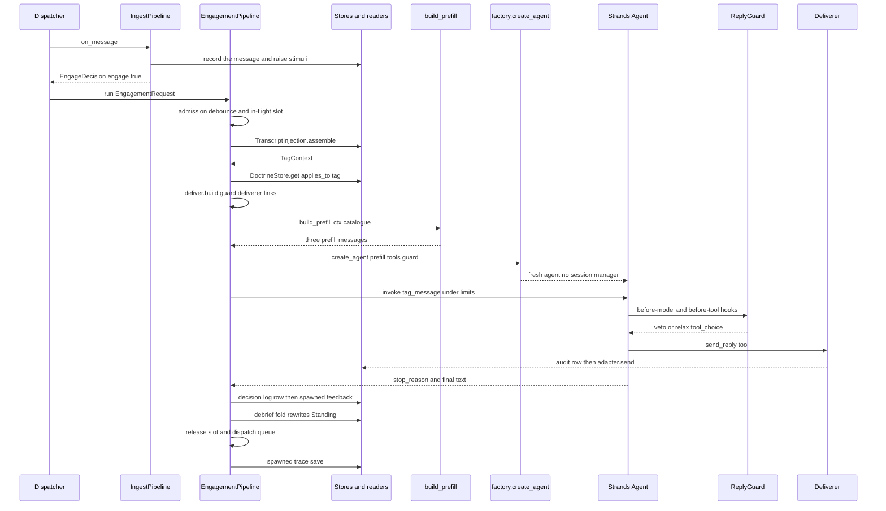
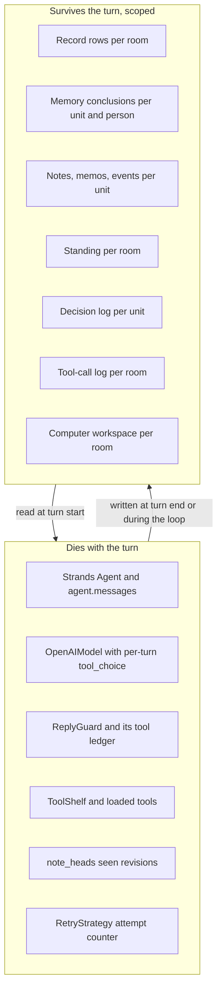

# Sessionless continuity

Nora's continuity belongs to persistent state scoped to people, rooms and social units.
Messaging and voice are interfaces into that state, not conversations that hold it. Each
speaking turn constructs a fresh Strands agent from assembled context, with no SDK session
manager; background cognition has its own bounded sessions. Sessionless operation therefore
means **continuity independent of a chat session, not an absence of sessions inside the
implementation** ([`ARCHITECTURE.md`](../../ARCHITECTURE.md#L8-L36)).

Both halves of that sentence are load-bearing, and either one alone would be a different
system:

- If the first half failed — if a turn resumed a previous turn's agent — continuity would
  depend on a process-local object surviving. It does not: the agent, its message list, its
  model and its guard are constructed inside one invocation and discarded when it returns.
- If the second half failed — if nothing were stored — the second turn would know nothing.
  What she "remembers" is whatever the stores said at turn start, re-rendered into a prompt.

Two things this page is *not* claiming. It is not claiming continuity is complete or always
correct; the last section names the gaps. And it is not claiming the codebase contains no
sessions: the Cognition loop, the Dreamer and subagent jobs each have a bounded session with
a beginning and an end. The distinction being drawn is about *where the speaking path's state
lives*, not about a word being absent from the tree.

## One turn, from arrival to next-turn-visible state

How a turn reaches the model and what it leaves behind: reads, doctrine, per-turn objects, then the writes that make the next turn continuous.

The order is fixed by `EngagementPipeline._run_turn`, and it is the order that makes the
whole design work
(`nora/engagement/pipeline.py#L617-L795`):

1. **`TranscriptInjection.assemble`** reads the stores concurrently and returns one frozen
   `TagContext` (`nora/domain/models.py#L457-L470`).
2. **`MentionRenderer.rehydrate`** restores @-mentions from `raw_json`, so a name does not
   reach the model as U+FFFC.
3. **`DoctrineStore.get(applies_to="tag")`** supplies the system prompt and its sha256.
4. **`deliver.build`** constructs the turn's `DeliveryHandle`: `ReplyGuard`, `Deliverer`,
   `LinkCarry`, `ToolCallLog` and `ReasoningStripWatch`
   (`nora/engagement/stages/deliver.py#L40-L91`).
5. **`ToolRegistry.surface`** admits this turn's tools, from the room's platform, its MCP
   allowlist and the occasion.
6. **`build_prefill`** renders the block table into three messages; `build_tag_message`
   renders the message she is answering.
7. **`invoke.run` → `LiveAgentRunner.invoke` → `factory.create_agent`** builds the agent and
   runs it under one wall clock and three loop caps.
8. After it returns: the decision-log row, the memory feed of her replies, then — in the
   `finally` — the Standing fold, the slot release with the next queued turn dispatched, and the
   trace save.

## The agent exists for one turn

`create_agent` is the only constructor in the tree allowed to build a Strands `Agent` for a
speaking turn (spec C.7), and every argument it passes is part of the sessionless claim
(`nora/agent/factory.py#L357-L387`):

| argument | value | what it decides |
|---|---|---|
| `messages` | `list(pre_fill)` | the turn's history **is** the three assembled messages; nothing else is inherited |
| `session_manager` | `None` | the SDK never saves or restores this conversation |
| `conversation_manager` | `NullConversationManager()` | nothing is trimmed or evicted inside the loop |
| `retry_strategy` | fresh `ModelRetryStrategy` | the attempt counter is per agent, so two overlapping turns cannot share a backoff |
| `model` | `ModelSource.create()` — one per tag | `tool_choice` is mutated mid-turn and must not be shared |
| `plugins` | one `AgentSkills` per agent | its per-agent skill state never spans two turns |
| `callback_handler` | `None` | no stdout handler on the production path |
| `load_tools_from_directory` | `False` | the tool list passed in is a ceiling, not a default |
| `trace_attributes` | per turn | one findable span per agent |

The agent is then thrown away. `LiveAgentRunner.invoke` builds it, records
`baseline = len(agent.messages)`, runs it, extracts a `TagTrace` from what the loop appended,
and returns `(stop_reason, text, trace)`
(`nora/app/agent_runner.py#L167-L249`). `factory.draft_from_exhausted_loop` says the quiet
part out loud when it restores `tool_choice` in a `finally`: "the agent is discarded next line
anyway" (`nora/agent/factory.py#L743-L749`).

**Why `NullConversationManager` and not a sliding window.** Mid-turn eviction was rejected
outright, not deferred: a window that drops a tool result mid-loop lets her reason from
something that has since been deleted and then contradict herself with no trace of why
([ADR 0003](../../docs/adr/0003-context-budget-deferred-read-the-counter.md#L143-L159)).
Per-turn pressure is handled by the three loop caps in `build_limits` and by the size of what
the prefill renders, never by forgetting.

**The one continuation inside a turn.** `LiveAgentRunner.invoke` may send at most one follow-up
message back into the *same* agent — same messages, same tools, same guard (so no budget is
re-granted), under whatever remains of the same caps — and only when the first pass ended
`end_turn`. It is asked once, and it never crosses a turn boundary.

## What one `OpenAIModel` per tag buys, and what it costs

The process holds exactly one `AsyncOpenAI` client, built by the composition root and threaded
through `Dependencies.client`. It holds **one `OpenAIModel` per tag**, because the model
carries `params`, and `tool_choice` is per-turn state: `required` on the first call so she
cannot answer in prose, then `auto` once `ReplyGuard` has seen a terminal verb. Two
conversations run concurrently — the in-flight lock keys on `(platform, conversation_id)` —
so a shared model would apply one tag's relaxation to another tag's first call, which is the
silent-turn failure shape (`nora/agent/factory.py#L81-L139`,
`nora/agent/tool_choice.py#L34-L66`).

This is the general rule the design follows: **objects that carry mutable turn state are
constructed per turn; values that are immutable are shared.** `ModelSpec` and `RetryPolicy` are
frozen scalar records for exactly that reason — the numbers are shareable, the objects built
from them are not (`nora/agent/factory.py#L142-L288`).

## Two lifetimes

The whole design in one picture: nothing crosses the boundary in memory, and everything crosses it through a scoped store.

## What the prefill brings back

The prefill is three deterministic messages plus the invocation prompt
(`nora/agent/prefill.py#L971-L1097`):

| # | role | contents |
|---|---|---|
| 1 | `user` | `<context_header>` — the situation paragraph and how to read the material; deliberately free of anything that changes between turns |
| 2 | `user` | the clock line, then every block in `_BLOCKS` order that had something to say |
| 3 | `assistant` | `CLOSING_LINE`, so the reply begins in her own voice |
| 4 | `user` (invocation prompt) | `build_tag_message` — `replying_to`, then `tag_message` |

The block table is the list of what she can know, and each row names its scope
(`BlockKey` is `global`/`unit`/`room`/`person`/`turn`). Every row is narrower than `global`,
which is why every one of them is served in the per-turn message rather than the cached head
(`nora/agent/prefill.py#L107-L216`, `nora/domain/blocks.py#L50-L67`). Grouped by what they
rehydrate:

| what the block rehydrates | blocks | owning read |
|---|---|---|
| her own position here | `standing`, `standing_working_set` | the Standing store, rewritten by the previous turn's fold |
| what she learned here | `lessons`, `self`, `unit_culture`, `character`, `culture` | lesson and culture tiers |
| the people | `room_members`, `peer_card`, `peer_history`, `people_in_window` — replaced by `<persona>` blocks when `[persona] render` is on | `identity.toml` via the room's list; the memory client's conclusions |
| the unit's open questions | `notes`, `memos`, `loop_decisions` | note, memo and decision-log stores |
| what she already made or is running here | `computer`, `documents`, `subagents` | the computer's workspace, the document store, subagent job rows |
| the room as it is | `group_transcript`, `presence`, `spoken_turn` | `RecordStore.recent`, the presence reader, the message's own transport |
| what her memory holds relevant to this message | `recalled` | the memory index's pre-fetch |
| what she may call | `tool_catalogue` | the same admitted tool set the turn was built from, when tools are deferred |

Three properties of the assembly matter for continuity:

- **One clock, one lineage view.** The clock is read once for the whole prefill, so the time
  she is told and the ages on every transcript line are computed against one fixed `now`; the
  lineage view is decided once and gates the four derived blocks.
- **The transcript window is stated, not implied.** `<group_transcript window="N">` carries
  `len(ctx.transcript)`, so «nobody said that» and «that is not in what you were shown» stay
  distinguishable.
- **Handles are positional over the tuple that was shown.** `#n` indexes
  `ctx.transcript` itself, so `send_reply(reply_to=n)` resolves against the same rows she
  read, not a fresh query that may have moved.

`TranscriptInjection.assemble` (tag path) and `FirePath.build_context` (scheduled and
unprompted occasions) both produce a `TagContext` and both render through this one
`build_prefill`, which is why the escaping rules are pinned to one function. A queued turn is
assembled **at the moment it takes the slot**, so it sees the replies of every turn ahead of it
in line (`nora/engagement/pipeline.py#L445-L467`).

## What carries across turns

Continuity is the union of these stores, each read back into the prompt by the block that needs
it. The scope column is the key the store uses; the same keys are described in
[State and scopes](../architecture/state-and-scopes.md).

| carrier | owner | scope | written | read back as |
|---|---|---|---|---|
| Record rows (every permitted message) | `RecordStore` | room | ingest, before the engage gate | `<group_transcript>`, `load_transcript`, `who_said` |
| Nora's own sent messages | memory feed via `feedback.run` | conversation session, `nora` ai peer; recall is unit-wide | after a delivered turn, spawned | her self-model card |
| Human messages' conclusions | memory feed during ingest | conversation session, sender's peer; recall is unit-wide | ingest, ambient | `<peer_card>`, `<peer_history>`, `<people_in_window>` |
| Notes (tracked uncertainties) | note store | unit | note verbs on a tag, and the Cognition session | `<notes>` |
| Memos | `MemoStore` | unit | memo verbs | `<memos>` |
| Events and gatherings | gathering store | unit and room | `event_propose` and `event_revise`, and the Cognition session | the `event_search` tool and the Cognition agenda |
| Standing | Standing store | room (`platform` + `conversation_id`) | the debrief fold after every completed turn | `<standing>`, `<standing_working_set>` |
| Lessons | lessons tier | unit | contextual learning from response episodes | `<lessons>` |
| Culture, room and person accounts | culture tier | room, unit, person | background folds | `<culture>`, `<unit_culture>`, `<character>`, `<self>` |
| Her own turns' dispositions | decision log | unit | at turn completion | `<loop_decisions>` (participation and proactive occasions only) |
| Successful cacheable tool calls | `ToolCallLogStore` | room | during the loop, by a hook | the `recall_lookups` tool |
| Documents | document store | room | document verbs | `<documents>` |
| Subagent jobs | job rows | room | `SubagentRunner` | `<subagents>` |
| Computer files and processes | computerd | room | computer tools | `<computer>` |
| Reminders, stimuli, self-wakes | their stores | unit and room | Cognition verbs, ingest | the heartbeat and the Cognition agenda |

Two consequences worth stating plainly:

- **Most of that table is not a transcript.** Only the Record rows hold the room's words
  verbatim; Standing is a *position* keyed on a
  room, notes are keyed on a unit and shared across its rooms, and memory conclusions are
  keyed on a person. Continuity is scoped, and the scopes disagree with each other on purpose.
- **A restart loses nothing that matters.** The integration harness rebuilds the whole
  pipeline against the same database and memory double, and the second turn still sees the
  first exchange — because the first exchange came from the database, not from an agent
  (`tests/integration/test_statelessness.py#L21-L34`).

## What does not carry, and must not

These are per-turn by construction. Each one is a correctness requirement, not an
implementation accident, and each has a place where sharing them would be a bug:

| per-turn state | owner | why sharing it would be wrong |
|---|---|---|
| `tool_choice` on the model | `nora.agent.tool_choice` | one tag's `auto` relaxation would silence a concurrent tag's first call |
| tool budgets, spent ledger and the spoken latch | `ReplyGuard`, built per turn by `deliver.build` | a per-tool budget is a per-turn allowance |
| retry attempt counter and backoff | `ModelRetryStrategy`, per agent | one turn's retries would decide another's delay |
| activated skills and their per-agent state | one `AgentSkills` plugin per agent | skill state is keyed by agent and must not span turns |
| loaded deferred tools | the per-turn `ToolShelf` | what one turn loaded is not a grant to the next |
| which note revision each note was last seen at | `note_heads`, a closure in `build_tool_specs` | a process-wide dict would let a read in one conversation license a write in another |
| fetched link previews | `LinkCarry`, one per turn | the tools and the sender must share one carrier, and only within one turn |
| `agent.messages` | the `Agent` | it *is* the turn; nothing reads it after the invocation |

`note_heads` is the clearest small example: the compare-and-swap a note write needs requires a
revision both sides can name, so the read records the head in the turn's own closure and the
write reads it from there. `build_tool_specs` runs once per turn, so the dict is born and dies
with the turn by construction (`nora/agent/tools.py#L13297-L13312`).

A second group is in-process state that dies with the process. Its loss is *not* a continuity
loss, and it is worth separating from the table above:

| in-process state | what a restart costs |
|---|---|
| the per-conversation lock and FIFO queue (`ConversationSlots`) | turns waiting in the queue are dropped; their callers get silence, not a wrong answer |
| debounce timestamps (`Debounce`) | one extra admitted tag, nothing worse |
| the Honcho client's session, member and peer-config caches | extra round trips only: the session id is derived from the conversation and rebuilt on the next call |
| `llm_state.last_success_at` | a health reading, never injected into a prompt |

## Delivery is what makes the write-back trustworthy

She speaks by calling a tool. `send_reply` is the only way she can send, `ReplyGuard` vetoes
anything outside the admitted tool set and flips the model to `auto` once a terminal verb has
run, and `Deliverer` is the only caller of `adapter.send` — constructed in exactly one place,
`deliver.build`. `deliver.build` itself has **four** callers, pinned as a set of modules by an
architecture test: `nora/engagement/pipeline.py` (the tag path), `nora/app/fire.py` (the fire
path), `nora/app/summons.py` and `nora/app/otp.py`
(`tests/architecture/test_only_two_paths_can_send.py#L55-L71`).

The test's filename and docstring still say "two paths"; that is historical. `CALLERS` is the
contract, and another caller of `deliver.build` — in a fifth module — still fails the test. The
comparison is per module rather than per call site, which is why the participation shadow
mirror and the relevance-gate shadow channel, both of which build a deliverer inside
`fire.py`, are not separate entries: DEC-188 settled that a second call site *within* an
admitted module is fine (`nora/app/fire.py#L2516-L2527`).

Each caller also names its own `audience` — `tag`, `heartbeat`, `summons`, `one-time-code` —
the required keyword on `deliver.build` that labels every guard's silent-failure counter and
the latency and stop-reason series with which loop was speaking, so a summons or a one-time
code cannot spend the tag path's failure budget (`nora/domain/audience.py#L26-L70`,
`nora/engagement/stages/deliver.py#L92-L111`).

Two of the four are exceptions to the speaking-turn shape, and each scopes its own send where
it is built:

- **The summons builder is a staging/guard path, not a sender.**
  `SummonsOccasion._turn` passes `send_permitted=False`, so `send_reply` runs every guard the
  tag path runs — the empty-reply check, the doctrine leak scan, the identifier egress scan,
  the markdown render — and text that survives them is *held* on `held_texts` instead of
  reaching `_attempts`, the audit row or the wire (`nora/app/summons.py#L487-L507`,
  `nora/agent/guards.py#L436-L452`). Its `store` and `adapter` are `_NoRoom` stand-ins that
  raise on any attribute access, so a wiring bug is loud rather than a row written into some
  room (`nora/app/summons.py#L222-L231`). Publication happens afterwards and elsewhere,
  through the Instagram bridge's guarded comment write, which has its own AST test pinning
  one call site and pinning that it is handed `held[0]` — the first held reply and nothing
  else (`nora/app/summons.py#L687-L689`,
  `tests/architecture/test_the_summons_writes_in_one_place.py#L58-L80`).
- **OTP is a fixed-template direct message to an identity-listed person.** No model writes it,
  and the identifier a caller supplies is resolved against `identity.toml`, so there is no way
  to name an address that is not in the file. It is still built through `deliver.build`, which
  is precisely what puts the guards and the audit-first write between the code and the wire;
  the audit row records the template with the code blanked (`record_text`), so the plaintext
  code is never at rest (`nora/app/otp.py#L151-L169`).

What survives is narrower than the test's name, and it is the load-bearing part: `Deliverer` is
the only caller of `adapter.send` and is constructed only in `deliver.build`, so every send
that actually reaches a platform adapter passes the same guards and the audit-first write. The
two exceptions either never reach an adapter (summons) or reach it with no model in the loop
(OTP).

That chain is why the write-back is honest: only `Deliverer.sent_texts` is fed to memory, so
the store never learns about a draft she composed and then did not send. And because
`ReplyGuard` cancels the next model call once the terminal budget is spent, **nothing in her
own loop runs after the reply** — which is precisely why the Standing fold is a separate,
second model rather than a reflection she performs
(`nora/engagement/stages/debrief.py#L8-L13`).

## The post-turn writes, and their order

| step | who writes | awaited? | why that ordering |
|---|---|---|---|
| 1 | decision log row | **awaited** | rows land at turn *completion*, ordered before the next decider reads them |
| 2 | memory feed of her replies (`feedback.run`) | spawned | off the reply path; a failed write must not cost a delivered reply |
| 3 | Standing fold (`debrief.run`) | **awaited, holding the slot** | the next queued turn's fresh assembly must see the new position |
| 4 | slot release, with queue dispatch in the same synchronous step | — | no incoming tag can race in between |
| 5 | `TagTrace` retention | spawned | a silent or vetoed turn is still worth retaining, and the save must not delay the queue |

Two of those have properties that are easy to lose in a refactor:

- **The fold reads the current Standing before writing the next.** A fold that cannot see what
  is already there writes a second row beside a wrong one. On overflow it refuses and asks for
  a consolidation, and a second overflow writes nothing at all — a coherent stale position
  beats a sentence cut in half (`nora/engagement/stages/debrief.py#L71-L90`).
- **The decision-log write is deliberately awaited rather than spawned.** A spawned write would
  not be ordered before the next turn's read, and that ordering is the whole property
  (`nora/engagement/pipeline.py#L1040-L1094`).

The tools write during the loop, not after it: notes, memos, reminders, events, documents and
computer actions are all tool calls, each validated and committed through its tier's live
store. `ToolCallLog` is a `HookProvider` that appends one row per successful cacheable call,
best-effort, and a failed write "must never cost the reply that already went out"
(`nora/agent/guards.py#L666-L733`). `recall_lookups` reads those rows back — scoped to the
conversation, newest first, inside a seven-day window and a total-character budget — so a
previous turn's lookups are available without any of them being in the agent's history
(`nora/agent/tools.py#L13226-L13295`, `nora/domain/tool_call_log.py#L1-L10`).

The fire path is the second module in `CALLERS` and runs the same turn machinery: `build_prefill`,
`build_tag_message`, `deliver.build` and `feedback.run` are reused, while `admission.run`,
`audit_stage`, `memory_feed_stage`, `indicate`, `ContextAssembler.assemble`, `invoke.run` and
`check_outcome` are deliberately refused, each for a stated reason
(`nora/app/fire.py#L24-L53`). So an unprompted turn produces the same kind of stored outcome
as a tag turn, and the next tag sees it.

## Where the implementation does have sessions

A session here is a bounded unit of model work with its own start, budget and recorded
outcome. None of them is on the speaking path, and none is *resumed*: each starts blank from
persisted inputs and writes its results back into the stores.

| bounded session | one per | what bounds it | what it starts from | what it leaves |
|---|---|---|---|---|
| **Cognition session** | one wake with a non-empty agenda | rounds, tokens and a wall clock; `max_items` per agenda, `max_strikes` per item | a `Situation` and `Agenda` built by pure code from the unit's stimuli | an append-only session row, close rows, the tiers' own writes, a watermark move |
| **Dreamer adaptor sample** | one sample | a per-sample guard, a per-sample budget, a per-sample wall clock | the adaptor's instruction corpus and its batch | proposals or tier writes, plus a run row |
| **Subagent job** | one job | sliding window of 40 messages, the three loop caps, a wall clock | a brief as the invocation prompt, empty messages, a closed tool list | a report, `document_id`s, a progress checkpoint |
| **Browse sub-agent** | one browser task | sliding window of 24 messages, sequential tool execution, step budgets inside the tools | a brief | page results |

The Cognition loop is the one most often mistaken for the speaking path, so its boundaries are
worth stating. `[cognition] enabled` governs whether a wake starts a session at all; an agenda
with no items is **not a session** and makes zero model calls, by control flow rather than by
a flag (`nora/app/cognition_session.py#L47-L53`). The situation and agenda are computed once,
by pure functions, from the stimulus rows — "interpret once", so nothing downstream re-reads
raw stimuli (`nora/domain/cognition_session.py#L1-L38`). Every wake ends exactly one way:
`closed` (the loop returned and every item was closed or carried with a strike), or `failed`,
`timeout`, `cancelled`. Only `closed` advances the unit's watermark; a failed session leaves its
stimuli pending, which is the honest reading of "the work did not happen". The session row is
written once and never revised, carrying the situation, the agenda, the consumed stimulus range,
the doctrine sha256, the injected skill versions, the config revision and the model id and
route — a replayable record of *inputs*, not a resumable transcript
(`nora/infra/sql/migrations/versions/0078_cognition_session.py#L8-L46`).

Each Dreamer sample builds its own guard for the same reason each tag does: the guard owns a
spent ledger, so a shared one would let an earlier sample's calls count against a later
sample's ceiling, and `max_memory_calls` is a per-pass ceiling rather than a lifetime allowance
(`nora/agent/dreamer.py#L1539-L1582`). `LiveCognitionAgentRunner` is the same shape for a
session (`nora/app/cognition_agent_runner.py#L1-L18`).

Subagent and browse agents are the only two that pass a real `conversation_manager`, and the
reason is inside one invocation rather than across turns: a job runs hundreds of rounds, so the
oldest steps scroll away and a checkpoint re-anchors the place into the pinned brief
(`nora/agent/factory.py#L460-L540`, `#L543-L586`). They still pass `session_manager=None` and
still start blank.

## Known gaps and limits

- **Memory writes and memory reads are scoped differently.** The Honcho client now keys one
  session per conversation — `nora-conv-<key>`, created at workspace level, holding every
  speaker as its own peer — while recall is deliberately unit-wide with no `session_id`, and
  disclosure is gated by the room roster at the tool layer instead
  (`nora/infra/honcho/client.py#L877-L946`, `#L1142-L1158`). ADR 0002 records the deferral
  that preceded this and the deadline it carries; its recommendation is
  session-per-conversation, and its warnings about what the deferral costs are still the right
  way to read the current state
  (`docs/adr/0002-honcho-session-binding-deferred.md#L51-L115`). The cutover away from Honcho
  is incomplete; see [Memory and record](memory-and-record.md).
- **The transcript window is finite and old context is not re-derived.** Beyond the window she
  cannot see, and the block tells her the width so silence is legible. A model that does not
  know how far back it can see cannot tell "nobody said that" from "not in what you were shown".
- **A cancelled turn writes nothing.** The reasoning-strip flush and the post-turn writes are
  deliberately outside the cancellation path: awaiting there on a cancelled task re-raises, and
  a record of something that already happened must never change how a turn ends. A turn
  cancelled outright therefore leaves no trace beyond what it had already committed
  (`nora/engagement/stages/invoke.py#L217-L237`).
- **Spawned writes are best-effort.** The memory feed, the trace save and the tool-call log can
  fail without failing the turn. Continuity is only as good as the last successful write, and
  the counters that say a write failed are the only evidence that it did.
- **Standing can be stale.** A fold that overflows twice leaves the prior position standing.
  That is the chosen failure mode, and it means the row she reads can describe a position she
  has since moved past.
- **Continuity of behaviour is stored context, not learning in the weights.** Lessons, culture
  accounts and Character rows change what the next prompt contains; no model weight is trained
  and no authored doctrine is rewritten. See [Contextual learning](contextual-learning.md).
- **The computer's state outlives the turn but not the room.** Files and processes persist in a
  room-scoped workspace and reach her only as a rendered `<computer>` block read fresh each
  turn. See [Computer and browser](../systems/computer-and-browser.md).

## Focused tests

- `tests/integration/test_statelessness.py` — two tags are two independent invocations with
  three prefill messages each and no carry-over into `agent.messages`; a simulated restart keeps
  continuity through the database only; a fresh `ReplyGuard` is built per tag.
- `tests/test_factory.py` — `test_create_agent_is_stateless_by_construction`,
  `test_the_dream_agent_is_stateless_by_construction`, `test_two_agents_share_no_state` and
  `test_two_dream_agents_share_no_state` pin "no agent memory, ever; continuity is the store",
  and `test_create_agent_installs_the_prefill_as_conversation_history` pins the prefill as the
  only history.
- `tests/architecture/test_no_retained_per_tag_state.py` — drives real tags through the real
  pipeline and counts live `ReplyGuard` instances after two batch sizes, so a retained per-tag
  guard cannot pass.
- `tests/architecture/test_only_two_paths_can_send.py` — `Deliverer` is the only caller of
  `adapter.send`, is constructed only in `deliver.build`, and `deliver.build`'s `CALLERS` is
  exactly `{nora/engagement/pipeline.py, nora/app/fire.py, nora/app/summons.py,
  nora/app/otp.py}`; a fifth module calling `deliver.build` fails the test. The filename and
  docstring are historical — the four-module set is the rule — and
  `tests/architecture/test_the_summons_writes_in_one_place.py` pins the summons' single
  publication call through the bridge's comment write.
- `tests/architecture/test_assembler_parity.py` — production and the offline harness build the
  transcript injection through one function with the same keyword set.
- `tests/test_model_per_tag.py` — `tool_choice` relaxation cannot cross a tag boundary.
- `tests/architecture/test_slot_held_awaits_are_bounded.py` — every await performed while the
  conversation slot is held is bounded, which is what keeps the post-turn writes from wedging a
  room.
- `tests/test_boundaries.py::test_strands_import_boundary` — only `nora.agent.**` may import
  `strands`, which is what keeps the per-turn construction in one module.

## Related

- [Context assembly](context-assembly.md) — the block table, doctrine by audience, and the
  escaping rules the prefill inherits.
- [The engagement turn](../workflows/engagement-turn.md) — the tag path stage by stage.
- [Cognition](../workflows/cognition.md) — stimuli, the wake evaluator and the bounded session.
- [State and scopes](../architecture/state-and-scopes.md) — workspace, unit, room and person as
  the keys every store uses.
- [Memory and record](memory-and-record.md) — Record versus interpreted memory, and the Honcho
  cutover's current state.
- [Contextual learning](contextual-learning.md) — how outcomes become stored lessons and
  accounts.
- [The tool surface](tool-surface.md) — what a turn may call, and how deferred tools are
  loaded per turn.
- [Runtime topology](../architecture/runtime-topology.md) — the process that owns these objects.
- [The status and failure contract](../architecture/failure-and-status-contract.md) — what a
  silent turn, a failed write and an unavailable read each mean.
