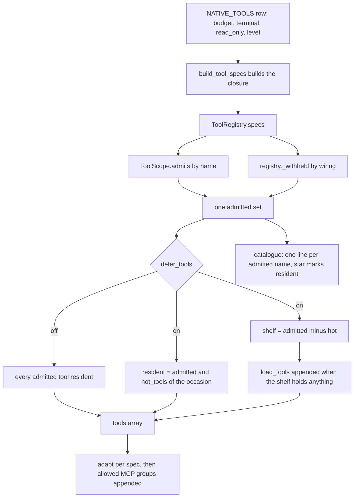
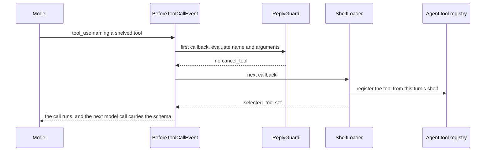
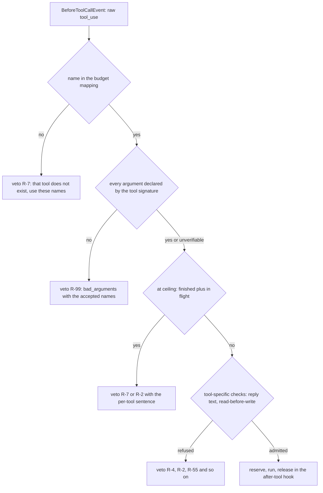

# The tool surface: scopes, shelves, budgets and the guard

Five kinds of loop hand a tool list to a model: a tag turn
(`nora.engagement.pipeline`), a fire turn (`nora.app.fire`: participation, the
proactive act, reminders), every Dreamer adaptor
(`nora.agent.dreamer.RegistryToolSource`), the sub-agent worker
(`nora.agent.subagent_tools`) and a public summons (`nora.app.summons`). They
differ in *what they may see*, and nothing else is allowed to decide that.
`ToolRegistry.surface()` is the only builder ([`nora/agent/surface.py`](../../nora/agent/surface.py)
module docstring), so a tool that a loop cannot call is never advertised to it,
and a tool that is advertised is always one it can load.

Enforcement lives in three other places, and this page covers all four layers:

| layer | question it answers | owner |
|---|---|---|
| scope | may this occasion *see* the tool | `ToolScope` ([`surface.py`](../../nora/agent/surface.py)) |
| shelf | may this turn *load it later* | `ToolShelf` + `load_tools` |
| budget | may this turn *call it again* | `ReplyGuard` / `DreamGuard` ([`guards.py`](../../nora/agent/guards.py)) |
| contract | is the *result* shaped as declared | `adapt()` ([`ports.py`](../../nora/agent/ports.py)) |

## One builder, three objects

`ToolRegistry.surface()` returns a `ToolSurface` holding three things derived
from one admitted set:

- **`ToolScope`** — which tools this occasion may see. Pure and framework-free:
  a platform, whether a Dreamer built the set, an optional grant ceiling, whether
  this is a person's tag turn, and whether it is the worker. It is the object
  `admits(name)` is asked of.
- **`ToolShelf`** — the tools held *out* of the model's `tools` array this turn.
  It is created inside `surface()`, closed over by the `load_tools` closure, and
  stocked once with the held set. Because it is per turn by construction, a
  loaded schema cannot leak into another room's turn or regrow the resident set
  over the process's life.
- **`ToolSurface`** — `tools` (what `Agent(tools=...)` receives: resident tools,
  then `load_tools` if the shelf holds anything, then admitted MCP groups),
  `resident`, `shelf`, `admitted`, a lazily rendered `catalogue`, the `hooks` the
  agent must register, and `limits()`.

`surface.py` imports no `strands` (ADR 0008's framework-free boundary for
`nora.agent.surface`): the tools it holds are opaque objects the registry
adapted, and registration goes through the agent the framework hands
`load_tools` at call time.

The per-turn build: one admitted set, split into resident tools and the shelf, with the catalogue rendered from the same names.

## What it means for a tool to exist

A native tool is callable because of a row in one table plus a callable built by
`build_tool_specs`, and the row comes first:

1. **A `NativeTool` row in `NATIVE_TOOLS`** ([`nora/agent/tools.py`](../../nora/agent/tools.py)).
   `budget` is positionally required — there is no default — because an entry in
   this table is exactly what R-7's default-deny reads as permission. The table
   adds only what a schema has no slot for: cost, terminality, time axis, source
   tier, cacheability, the read/act line, the failure contract triple, the output
   contract, the description level, link inputs and the hot-on occasions.
2. **A `_spec("name", call)` entry** in `build_tool_specs`'s tuple. `_spec()`
   copies every declared field off the row and raises `KeyError` when the name is
   missing, so "R-7's default-deny arrives at build time instead of at the
   model's first call".
3. **A wired collaborator.** `ToolRegistry.__init__` computes a `_withheld` set
   from what the composition root did *not* build: with `[computer]` off every
   computer tool is withheld, with no document publisher the document tools are,
   `record_query` without its Record read, and so on. Withheld means "offered to
   no occasion in this process and absent from the Relevance Gate's digest", so
   an unconfigured tool costs no prompt and cannot be routed to. The memory
   surface is the same mechanism in reverse: `memory_search` and the Honcho verbs
   are mutually withheld, one surface per process.
4. **`adapt()`** turns the `ToolSpec` into the Strands tool object, deriving the
   model-facing description and `inputSchema` from the callable's own docstring
   and type hints (or from explicit `description`/`schema` when set).

One row is deliberately *not* built here: `"skills"` is `plugin=True`, so it gets
a budget (R-7 admits it) while the `AgentSkills` plugin registers the actual tool.
That is the shape a tool takes when another component owns its body.

## The one-surface rule

Every occasion draws from the same `ToolRegistry`, and the surface is the only
decision about which tools an occasion sees. Concretely, `surface()` computes
`admitted = [spec for spec in specs if spec.name != LOADER_TOOL and scope.admits(spec.name) and spec.name not in self._withheld]`,
then derives three artefacts from *that list*:

- `tools` — the resident specs adapted, plus the loader when the shelf is non-empty.
- the shelf — `admitted` minus the hot set, when deferring.
- the catalogue — `_digest_lines(admitted, hot=resident)`, one line per admitted
  native tool, `*` marking the resident ones.

So the catalogue cannot name a tool the turn cannot reach. The defect this
prevents is concrete: `ToolRegistry.tool_catalogue()` renders the *declared*
table, and a Signal room rendered from it would advertise the six Discord music
verbs, for which `load_tools` would then answer `unknown` on every attempt
(`tests/unit/test_tool_surface.py::test_a_signal_catalogue_names_no_tool_a_signal_turn_cannot_load`).

Two smaller consequences of the same rule:

- `prompt_catalogue` is the catalogue **only while something is deferred**; with
  every admitted tool resident the schemas already say it all and a second copy
  is what DEC-150 deleted the capability block for. `[llm] defer_tools` ships
  `false`, so by default the catalogue does not enter the prompt at all.
- `build()` is `surface(...).tools` and nothing else. There is one path, so a
  caller that only wants the list cannot get a different answer than the caller
  that also places a catalogue.

`capability_digest()` is the same table cut for a *different reader*: the
Relevance Gate, which has to judge whether an answer could exist without being
able to call anything. It lists read-only tools only, minus the loader, the
tag-only tools (`TAG_ONLY_TOOLS`), the withheld set and the Dreamer-only loop
reads — so the gate cannot offer something a reply cannot do, and a tool added to
`NATIVE_TOOLS` appears on the next start with nothing to edit.

## Scope: the five dimensions

`ToolScope.admits` applies its checks in a fixed order: the grant first, then
`TAG_ONLY_TOOLS`, then `WORKER_ONLY_TOOLS`, then the declared-table short circuit
(`platform is None` admits everything), then the platform cut, then the
tag-readable loop tools, then the Dreamer-only set.

| dimension | field | what it decides | a tool it excludes, and why |
|---|---|---|---|
| platform | `platform` | the room's platform; `None` is the *declared* table rather than one room | `play_music` from a Signal room: the music verbs are Discord-only, so shipping them elsewhere costs prompt tokens for a tool that could only answer `unavailable` |
| Dreamer-built | `dreamer` (true iff `dream_adaptor` is non-empty) | tools only a background pass may hold | `search_memory_workspace` from every tag turn: it returns verbatim lines from the whole workspace, so a room could otherwise surface words said by people in none of its units |
| grant ceiling | `grant` (`frozenset[str]` or `None`) | the adaptor's, worker's or summons' own allowlist on top of the scope | `note_read` from a public summons: `PUBLIC_GRANT` names only the web and X reads, `media_fetch`, the clock, arithmetic and `send_reply`, so nothing that reads a room, roster, memory, note, person or place is held |
| tag turn | `tag_turn` | true only for a person's tag; false for a fire turn, a Dreamer pass, a worker and a summons | `subagent_create` from a fire turn: handing work to a background worker is a person's move, and the worker itself would recurse |
| worker | `worker` | true only for the sub-agent worker | `checkpoint_update` from a tag turn: it writes the worker's progress record, and a tag turn must not hold the worker's checkpoint |

Two properties of the grant are easy to get wrong, and both are pinned:

- **A grant is a ceiling, never a way past another cut.** Granting
  `play_music` to a Signal room admits nothing there — the platform check still
  runs (`test_a_grant_is_a_ceiling_on_every_part_of_the_surface`).
- **The loop-tool sets are asymmetric on purpose.**
  `TAG_READABLE_LOOP_TOOLS` (today `rollup_read`) is admitted to a tag turn and to
  a Dreamer pass, and refused to a fire turn and to a worker, because "where have
  we been together lately" is a thing a person asks; `DREAMER_LOOP_TOOLS` minus
  that one (`standing_read`, `character_read`, `social_read`) is refused to every
  tag turn, so a reply neither pays their prompt nor can route to them.

Withheld-by-wiring is a *fourth* filter that runs after the scope. It is not a
scope dimension: it says this process never built the collaborator, not that this
occasion may not see the tool.

## Deferral: the shelf, `load_tools`, and the catalogue block

`defer=True` keeps only the hot set resident and shelves the rest.
`HOT_TOOLS` ([`nora/agent/tools.py`](../../nora/agent/tools.py)) *declares* that
set: one `frozenset` literal naming `web_search`, `send_reply`, `note_read`,
`web_fetch`, `now`, `search_memory` and `memory_search`. The literal itself is
computed from nothing at run time, and it has two readers — the builder ships the
members the occasion admits, and the catalogue renderer marks exactly those names
(the `*` on a line) — so a marker cannot say a tool is already loaded that the
builder left on the shelf. Nothing becomes unreachable for being left out: every
other admitted tool is one `load_tools` call away, which is the trade deferral
makes.

Two entries of the seven are worth stating in their own right. `send_reply` is
resident because a turn must never have to fetch its terminal verb: `ReplyGuard`
ends the turn by observing it (DEC-21/DEC-32), so a turn that had to load it
before it could reply is a turn that can fail to end.
`memory_search` occupies `search_memory`'s slot on the graph memory surface,
because the two surfaces are never built together (`GRAPH_MEMORY_TOOLS`,
DEC-316): at most one of the two is ever admitted, so the hot set contributes at
most six residents before any `hot_on` extras, and deferring the graph verb while
its Honcho counterpart stayed resident would cost the graph surface a load round
trip the Honcho one never pays. `play_music` is deliberately absent because it is
Discord-scoped: free there and absent elsewhere. A tool that is hot only on one
*kind* of turn, rather than on every turn, does not belong here at all; it
declares `NativeTool.hot_on` instead.

`hot_tools(occasion)` adds every tool whose `NativeTool.hot_on` names the turn's
occasion. The vocabulary is closed (`TOOL_OCCASIONS`, today `{"voice"}`), an
unknown occasion raises rather than reading as "no extras", and a text turn's
surface is byte-identical with or without any `hot_on` declaration.

The loader is plumbing, not a capability: `LOADER_TOOL` (`load_tools`) is
excluded from `admitted`, from the catalogue, from `tool_catalogue()` and
explicitly from `lookup_tools()`, so a successful load is never mistaken for the
turn having found something. It is in `tools` only when the shelf holds
something, and its own row is three calls, `read_only`, `three_state`, level 2.

`load_onto` / `ToolSurface`'s loader answers R-27's shape, and the statuses are
the model's instruction for what to do next:

| status | when | note |
|---|---|---|
| `ok` | at least one name resolved (a *partial* resolve is still `ok`: the tools that resolved are registered, and reporting the failure would throw away work that succeeded) | one clause per non-empty list: `unknown` names to re-read the catalogue for, `refused` names to ask for in the next call |
| `nothing_found` | no name resolved | the catalogue is in front of her, so this is an invented or mistyped name: re-read it rather than retry the string |
| `unavailable` | there is no registry to load onto | «Loading isn't possible right now», distinct from `nothing_found` by conduct.md's own rule |

`LOAD_TOOLS_MAX_NAMES = 4` caps *names per call* — the budget caps calls, not
tokens, and without the name cap one call could register the whole shelf. Names
beyond the cap come back in `refused`. Asking twice for a name that is already
resident or already loaded this turn is `already_loaded`, not an error, because
`register_dynamic_tool` raises on a duplicate.

A shelved tool called by name on the first attempt: the guard decides first, then `ShelfLoader` registers it from *this turn's* shelf only.

`ShelfLoader` exists because Strands has no such tool registered and would answer
"Unknown tool", costing one wasted model call per cold tool and a prefix-cache
miss with it. It is registered *after* `ReplyGuard` (hook order in
`factory.create_agent` is the guard, then `ToolCallLog` when one is wired, then
the surface's `tool_hooks`, then the reasoning watch) so a vetoed name is never
registered, and it touches nothing that is not on this turn's shelf — a name off
the shelf is left exactly as Strands found it.

Deferring also moves one number: `ToolSurface.limits()` raises the loop's `turns`
cap by one when anything is shelved, because a deferred turn spends one model
call on `load_tools` before the call that uses what it loaded, and `turns` is a
shared ceiling (R-8). The token caps are left alone — a deferred turn's prompt is
smaller, which is the point of deferring.

## Budgets: one table, three layers, one number

`NATIVE_TOOL_BUDGETS` is derived from `NATIVE_TOOLS` (`{name: spec.budget}`) and
is the single table both `ToolRegistry.budgets()` and every guard read, so the
number enforced and the number declared cannot drift (DEC-10). A tool becomes
budgeted by appearing in that table, with no edit to `guards.py`.

`ToolRegistry.budgets()` assembles the mapping the guard is constructed with, in
three layers:

1. **the table** — every `NATIVE_TOOLS` row, so every native name is admitted and
   every other name is default-denied;
2. **`[llm.budgets]`** — a per-deployment *delta* applied over the table rather
   than instead of it. Unknown names and values below 1 are **refused at config
   load** (`nora.config.LLMConfig`'s validator, against the live `NATIVE_TOOLS`),
   because a typo in `{"send_replies": 8}` would otherwise leave an operator
   certain they had raised a cap that never moved, and a budget of 0 would make
   the tool unreachable rather than cheaper;
3. **MCP group budgets** — one flat number per server, folded in **only for
   server names in `allowed_mcp`**. The R-7 veto message renders the whole dict's
   keys, so an unconditional fold would tell a conversation with no allowlist
   entry that `pulse_server_status` exists the moment the model named any wrong
   tool.

The other declarations follow the same pattern: `terminal_tools()`,
`cacheable_tools()`, `lookup_tools()` (`read_only` **and**
`output_contract == "three_state"`, minus the loader) and `read_only_tools()`
(the Dreamer's *ceiling*, never a grant) are all derived from the table and
hand-listed nowhere.

One number, two readers: `budgets["send_reply"]` is both `ReplyGuard`'s R-7
ceiling and `Deliverer.message_cap`, indexed rather than `.get`-ed with a
fallback, because a registry with no `send_reply` is a wiring fault and a default
would let it start and then bound her replies by a number nobody chose. Raising
the cap in `NATIVE_TOOLS` is therefore required to allow a second message, and
R-2's latch refuses the message once it is raised — both halves are pinned in
`tests/test_guards_replyguard.py`.

Two other loops derive their own guard mapping, and the difference matters:

- **the Dreamer** reads budgets off the *built* tools (`_tool_budgets`), so a
  name the adaptor's tool source declined to build is absent from `budgets` and
  is vetoed by default rather than admitted with a ceiling it cannot spend.
  Overrides apply in three layers, widest first: the row's own number,
  `[llm.budgets]`, then `[dreamer.budgets.<adaptor>.tool_calls]`; a key naming a
  tool the adaptor does not hold refuses the boot instead of conjuring a budget
  entry, because a name in `budgets` *is* permission.
- **the Cognition session and the sub-agent worker** use the table as a pure
  membership set: `budgets=dict.fromkeys(names, 0)` with `per_tool_ceilings=False`.
  Their per-call cost is bounded by rounds, tokens and the wall clock instead
  (DEC-247), and the guard keeps the safety half: R-7, R-99 and the result cap.

## The guard: enforcement, not advice

`ReplyGuard.evaluate` is pure and SDK-free so every rule is testable without
Strands; `_before_tool` is the thin adapter that turns a returned sentence into
`event.cancel_tool`, i.e. a refusal the model reads instead of a tool result. The
hook fires on the **raw `tool_use` the model emitted, before Strands validates
it**, which is why an out-of-schema argument is reachable here at all.

`evaluate`'s order: membership, then undeclared arguments, then the per-tool ceiling, then the tool-specific refusals.

The three shapes a surface has to refuse — a tool that is absent, an argument the
tool does not declare, a result over its cap — are each a veto or a substitution,
never a suggestion:

- **Absent tool.** `if tool_name not in self._budgets` is R-7's default-deny. The
  veto names the tool as non-existent and lists the names that do exist
  (`_list_tool_names`, sorted so the message is deterministic). This is the same
  check that stops a model inventing a tool.
- **Undeclared argument.** `unknown_arguments_veto` fires when the raw call
  carries a key the tool's own signature does not declare. Strands' generated
  pydantic model ignores extra keys (pydantic v2's default), so
  `media_fetch(file=...)` would otherwise arrive empty. The veto is a JSON
  result with `status: "bad_arguments"` and a `note` naming both what it sent and
  what the tool accepts — `bad_arguments`, not `unavailable`, because a malformed
  *call* must not fold a false «I can't check» into her self-knowledge. Two
  cases are deliberately "cannot verify" rather than "reject": no `param_names`
  table at all (a bench test), or no entry for this tool (`skills`, or an MCP
  tool, neither of which `build_tool_specs` builds). `conversation_id` is exempt
  because R-3 counts an invented one and never vetoes it.
- **Over-cap result.** The Dreamer's guard clamps a tool result's text in its
  after-tool hook against `TOOL_RESULT_CAPS` — 8000 characters for `web_fetch`
  and `web_search`, 4000 for the memory verbs (`search_memory`,
  `search_memory_workspace`, `about`, `ask_memory`, `memory_search`) — and
  appends a marker naming the cap, so a truncated result reads as truncated
  rather than as the whole answer. The Cognition session reads the same table
  (`nora.app.cognition_wiring`), one table and two readers. On the tag path the
  caps live in the tools themselves (`LOAD_TRANSCRIPT_MAX = 60` rows with a
  default of 25, `RECALL_LOOKUPS_MAX = 30` rows and an 8000-character budget).

The ceiling itself has a shape worth knowing, because the model's next move
depends on the sentence:

| tool kind | what the veto says |
|---|---|
| `send_reply` | labelled R-2 although the *budget* refused it: "you already sent your reply". The budget is checked **before** R-2's latch, which is half of DEC-32 |
| `skills` | the one budgeted tool whose repeat call returns *different* content, so the sentence must be true at any budget and any directory size |
| a write verb | "only a call that returned ok did anything: say what was not done, and do not say it was" |
| any other read | "you have that context, answer from what you already have" |

The count is finished calls *plus* admitted-and-still-running ones, so the
ceiling holds inside one model turn's parallel batch; a reservation is released
on every path, including a failed or vetoed call, and a failed call consumes no
budget (DEC-33). A guard bug fails open and is logged rather than killing the
turn.

**Two layers, not one.** The guard's deny list is the budget *mapping*, which on
the tag path is the whole `NATIVE_TOOLS` table — a superset of any one occasion's
surface. A name that is in the table but not on the surface (a music verb in a
Signal room, a withheld computer tool) passes `evaluate` and then reaches
Strands' own "Unknown tool", because the surface, not the guard, is what makes a
name dispatchable. The Dreamer is the exception where the two coincide, since it
derives its mapping from the built tools.

## Naming, description and contract-metadata rules

The rules a tool's *texts* must satisfy are ADR 0015's
([`docs/adr/0015-tool-surface-policy-v2.md`](../../docs/adr/0015-tool-surface-policy-v2.md));
the rules its *metadata* must satisfy are ADR 0008's
([`docs/adr/0008-tool-contract-metadata.md`](../../docs/adr/0008-tool-contract-metadata.md)).
Both are enforced by tests, not by review alone.

**Names.** A new tool is `<domain>_<verb>`, `[a-z0-9_]` and at most 64 characters
(the conservative intersection of Anthropic's and MCP's charsets). The verb comes
from a documented constant in
[`tests/architecture/test_tool_names.py`](../../tests/architecture/test_tool_names.py),
so a new verb is a PR that says why, not a new ADR. Names that predate the rule
are frozen in a snapshot whose SHA-256 is pinned, and a rename moves a name to
`_RENAMED_SINCE` — the exempt set only shrinks, so a tool added after the ADR can
never be exempted. A rename is measured one at a time (`tool_selection`); the
doctrine's catalogue gate uses the same table (`tool_names()`), so an authored
`identity`/`conduct` file cannot name a tool the registry does not have.

**Descriptions.** The first paragraph is the tool's catalogue line and carries
what the tool does, when to call it, and where it is not obvious what it returns;
as a rendered line (`- name — paragraph`) it fits 40 tokens. Everything after it
is sized by a declared level:

| `level` | content | ceiling (cl100k, over the text Strands sends) |
|---|---|---|
| 1 | what + when + what it returns, 3 to 4 sentences | 80 tokens |
| 2 | level 1 plus one behaviour-changing constraint (a MUST or SHOULD) | 160 tokens |
| 3 | level 1 plus a contract: statuses or refusals she must act on differently | 320 tokens |

Ceilings are starting values and each moves only with a measurement recorded
beside the constant. Result interpretation belongs in the *result* — a `note` that
appears only when that status comes back — not in the description, with
`send_reply` the named exception (it returns a string, so its
`sent`/`held_for_review`/`refused` contract stays in the description). Fixed
options are `Literal`s or enums, not prose. RFC 2119 is a register: MUST is turn
correctness, SHOULD is style. Descriptions are English with at most one distinct
non-English run (a trigger the tool fires on), and carry no em or en dashes. The
dash ban is scoped to the descriptions and specs the tests read; the catalogue
renderer still separates name from line with a dash, and ADR 0015 says that
separator changes to a colon before `defer_tools` is ever turned on.

**Contract metadata** is *declared, never derived*, because after a timeout there
is nothing left to derive it from:

| field | values | consequence |
|---|---|---|
| `side_effect_state` | `none`, `confirmed`, `unknown` | what an interrupted call may have done; `not_applied` is deliberately not declarable, because only a particular call can have failed before applying |
| `idempotency` | `idempotent`, `non_idempotent` | whether replaying with the same arguments has the same effect |
| `retry` | `safe`, `unsafe_without_key`, `never` | whether the harness may replay after an `unknown` |
| `output_contract` | `three_state`, `messages`, `None` | what the result must carry; the only one of the four with a *runtime* reader |

All three of the first triple must be declared **explicitly** on every row
(`tests/test_tool_contract_metadata.py` reads the source, not the constructed
dataclass, because a forgotten declaration and a deliberate default are
byte-identical afterwards), and the vocabularies are closed sets in
`nora/agent/tools.py`. `output_contract` is checked inside `adapt()` — one choke
point, fail-closed, a bad result replaced with
`{"status": "unavailable", "reason": "malformed_result"}` rather than forwarded.
That seam, and the status vocabulary it validates against, are documented in
[Failure and status contract](../architecture/failure-and-status-contract.md).

**The exemption list is empty.** Every rule above covers every tool today
(`_NOT_YET_REWRITTEN` is a `frozenset()`), and the shrink-only test still holds
the name, so adding a tool back is an exemption the build refuses for anything
newer than the 2026-09-24 snapshot. A new tool meets the policy from its first
commit.

| rule | check |
|---|---|
| name charset, `<domain>_<verb>`, snapshot never edited | `tests/architecture/test_tool_names.py` |
| opening paragraph is an L1 and fits a catalogue line | `tests/test_tool_surface_policy.py::test_the_opening_paragraph_is_an_l1` |
| level declared and inside its ceiling | `test_every_rewritten_tool_declares_a_level`, `test_a_rewritten_description_fits_its_level` |
| no dashes, at most one non-English run | `test_no_dash_in_a_rewritten_tool_spec`, `test_at_most_one_non_english_string_in_a_rewritten_tool_spec` |
| no text silently dropped after `Args:` | `test_no_text_after_args_is_silently_dropped` |
| every listed status returns a `note` | `test_every_listed_status_returns_a_note` |
| RFC 2119 register, style labelled | `test_a_must_is_turn_correctness_not_style`, `test_style_guidance_is_labelled` |
| contract triple declared, vocabularies closed | `tests/test_tool_contract_metadata.py` |
| output contract holds at runtime | `tests/test_output_contracts.py` |
| scope, shelf and loader behaviour | `tests/unit/test_tool_surface.py` |

## The MCP mount seam

MCP is the one place tools enter the surface without passing through `adapt()`.
`build_mcp_tools` ([`nora/agent/mcp.py`](../../nora/agent/mcp.py)) takes plain
`McpMount` values (name, base URL, token env var, flat budget) and returns one
`McpToolGroup` per server that actually answered: budget plus the discovered
tools.

The seam's contract is "never raise, make the piece absent":

- a mount is loaded **per server**, not batched. Against the installed
  `mcp`/`strands-agents`, a per-server `continue_on_error` makes `load_servers()`
  silently *drop* a mount whose config fails to resolve (a missing
  `${env:VAR}`), which would misalign a positional zip;
- three failure points are caught and logged separately — config resolution,
  connection, discovery — and the server's tools are simply absent. A dead server
  never stops Nora from starting;
- name collisions are resolved by dropping the *discovered* tool: the claimed set
  is seeded with `NATIVE_TOOL_BUDGETS`, so a native name is never dropped in
  favour of an MCP one, and the first server processed wins between servers;
- the group's tools are appended **resident, after** the native tools, so a turn
  with an MCP group pays every schema;
- the group joins the guard's budget mapping only when its server name is in
  `allowed_mcp` — the same set the surface appended from, so the R-7 veto message
  can never disclose an MCP tool name the conversation cannot call;
- MCP tools have no entry in `tool_param_names()`, so R-99 cannot verify their
  arguments and therefore does not reject them, and they are not validated
  against an output contract (ADR 0008 defers structured error bodies to that
  boundary).

## Changing a tool

Adding a tool, changing a description or renaming one is a procedure, not an
edit: read ADR 0015, follow the `nora-tool` checklist, run `make gate`, and put
the before/after `tool_selection` (routing) and `tool_reporting` (does she report
a status as that status) numbers in the PR. The change procedure and the eval
commands belong to [Changing the system](../contributing/changing-the-system.md);
this page states what the rules are and what enforces them.

## Focused tests

- [`tests/unit/test_tool_surface.py`](../../tests/unit/test_tool_surface.py) —
  the one-surface rule: deferral is the plain build when off, catalogue and shelf
  come from the admitted set, a grant is a ceiling, the Dreamer-only verb needs
  the Dreamer, `load_tools`' statuses and per-call cap, `ShelfLoader` against the
  real Strands loop, and the voice occasion's declared resident extras against
  their schema-token ceiling.
- [`tests/unit/test_tool_registry.py`](../../tests/unit/test_tool_registry.py) —
  every declared tool is exposed; budgets, terminality, time axis, source tier
  and the read/act partition; MCP budgets only for allowed servers; budget
  overrides move exactly one tool.
- [`tests/test_tool_surface_policy.py`](../../tests/test_tool_surface_policy.py) —
  ADR 0015's description rules, level ceilings, dashes, non-English runs and the
  per-status `note`.
- [`tests/architecture/test_tool_names.py`](../../tests/architecture/test_tool_names.py) —
  name charset and shape, the pinned snapshot digest, and a mutant test proving
  the shape check still catches `read_instagram`.
- [`tests/test_tool_contract_metadata.py`](../../tests/test_tool_contract_metadata.py)
  and [`tests/test_output_contracts.py`](../../tests/test_output_contracts.py) —
  the contract triple and the runtime output-contract seam.
- [`tests/unit/test_tool_catalogue.py`](../../tests/unit/test_tool_catalogue.py) —
  the catalogue's resident markers agree with the builder that ships them.

## Related reading

- [Failure and status contract](../architecture/failure-and-status-contract.md) —
  what a status means, and the `adapt()` seam that enforces it.
- [Context assembly](./context-assembly.md) — where the catalogue block sits in
  the prompt, and why it renders only when tools are deferred.
- [Policy and disclosure](./policy-and-disclosure.md) — the room grants and
  disclosure gates that decide *whether* a tool may answer, once it is callable.
