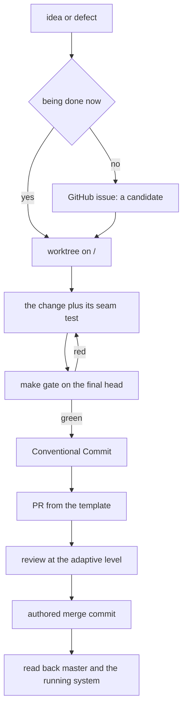
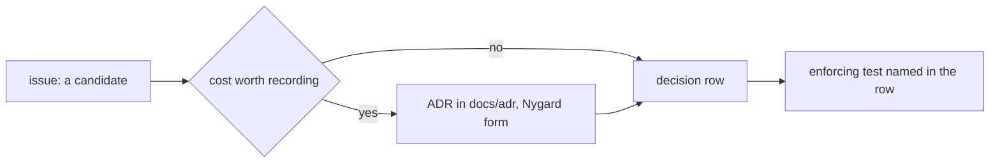

# Changing the system: seams, conventions and decision records

Nora is changed the same way everywhere: pick the seam the capability belongs to, move
every artefact that seam touches in one commit, and let the mechanism that already owns
that seam's shape refuse a wrong one. This page is the map of those seams, the working
conventions that decide whether a change lands, and the record chain that makes the
decision findable a year later.

It is a contributor's page. The terse rules an agent working *inside* the repo must not
violate (the gate, the "Never" list, the operational constraints) are
[`AGENTS.md`](../../AGENTS.md); the branch, commit, PR and issue conventions for getting
work *into* the repo are [`CONTRIBUTING.md`](../../CONTRIBUTING.md); the reasoning and the
war-stories behind every terse rule are [`docs/maintainers/conventions-rationale.md`](../../docs/maintainers/conventions-rationale.md).
The per-task procedures are the agent skills under
[`.agents/skills/`](../../.agents/skills/), one per recurring task. This page links to all
four rather than restating them, and adds the part that is spread across them: which
artefact answers which question.

## The path a change takes

Every change, a one-line doc fix included, starts in its own worktree on its own branch cut
from `origin/master`, and reaches `master` by a merge
([`CONTRIBUTING.md`](../../CONTRIBUTING.md) §Branch naming). The reason is structural
rather than ceremonial: the deploy host's checkout is the bind-mount source for
`nora/doctrine` and `nora/dreamer`, so on `master` there is no step between "I changed a
file" and "it is live" — a worktree restores that step, and the merge becomes the moment
somebody decides ([`AGENTS.md`](../../AGENTS.md) §Never).

Where a change attaches: an issue is filed only for work not being done now, and the gate runs once on the final head, not per fix round.

The order and the checks per step are the `nora-land` skill
([`.agents/skills/nora-land/SKILL.md`](../../.agents/skills/nora-land/SKILL.md)). Two
consequences worth stating up front:

- **Landing a merge does not move you back into the checkout.** The next change starts in
  a new worktree too; a session that merged and kept editing in place nearly produced an
  image build out of a mid-refactor tree ([`AGENTS.md`](../../AGENTS.md) §Never).
- **One committing agent per worktree.** Two agents against one checkout have swept each
  other's staged work into the wrong commit.

## Where a change can attach: the six seams

A seam is a place where a new capability is *expected* to arrive, which is why each one
already has an artefact shape, a validator, and a line the review expects to see. Choosing
the wrong seam is the common failure: a rule about calling one tool belongs in that tool's
description, judgement across several tools belongs in a runtime skill or in doctrine, and
a capability is a tool ([`docs/adr/0016-skill-policy.md`](../../docs/adr/0016-skill-policy.md) §1,
[`.agents/skills/nora-tool/SKILL.md`](../../.agents/skills/nora-tool/SKILL.md) §1).

| seam | artefact that carries it | what decides its shape | the gate that refuses a wrong shape |
|---|---|---|---|
| model-facing tool | one `NativeTool` row plus one `_spec` closure in [`nora/agent/tools.py`](../../nora/agent/tools.py) | [ADR 0015](../../docs/adr/0015-tool-surface-policy-v2.md) | `tests/architecture/test_tool_names.py`, `tests/test_tool_surface_policy.py`, `tests/test_tool_contract_metadata.py`, the budget pin |
| runtime skill | `nora/skills/<name>/SKILL.md` | [ADR 0016](../../docs/adr/0016-skill-policy.md) | [`nora/skills/loader.py`](../../nora/skills/loader.py), `tests/test_skill_content.py`, `tests/test_skill_loader.py` |
| doctrine section | `nora/doctrine/**/*.md` frontmatter and body | [`nora/doctrine/loader.py`](../../nora/doctrine/loader.py) | the three loader checks, `tests/test_doctrine_version_parity.py`, `tests/architecture/test_doctrine_is_classified.py` |
| Dreamer objective | `nora/dreamer/objectives/<name>.md` (plus an optional prelude) | [`nora/instructions/dreamer.py`](../../nora/instructions/dreamer.py) | `tests/unit/test_dreamer_instruction_goldens.py`, `tests/unit/test_objective_parser_parity.py` |
| store port | a `Protocol` in [`nora/domain/ports.py`](../../nora/domain/ports.py) plus a concrete implementation under `nora/infra/` | the domain's framework-free rule | the port's contract suite, `tests/architecture/test_port_fakes_live_in_nora_testing.py`, `tests/architecture/test_store_methods_have_production_callers.py` |
| capability flag | a section in [`nora/config.py`](../../nora/config.py) and [`config.example.toml`](../../config.example.toml) | `extra="forbid"` plus the composition root | [`nora/app/composition.py`](../../nora/app/composition.py), `tests/test_env_template.py`, `nora config validate` |

One cross-cutting rule outranks all six: **every model prompt is assembled through context
assembly**, and the enforcer discovers prompt-building modules by AST rather than reading a
list ([ADR 0021](../../docs/adr/0021-every-prompt-is-assembled-and-the-enforcer-finds-it.md),
`tests/architecture/test_every_model_call_is_a_declared_occasion.py`). A seam that hands a
prompt to a model joins that machinery; see
[context assembly](../concepts/context-assembly.md) for how an occasion declares its
`_BLOCKS` table.

### A model-facing tool

What a tool *is* once it exists — scopes, shelves, budgets, the guard — is
[the tool surface](../concepts/tool-surface.md). What changes it:

1. **Read [ADR 0015](../../docs/adr/0015-tool-surface-policy-v2.md) first.** Its §6 table
   says which rule is a test and which is review; the `nora-tool` skill is the order of the
   commands.
2. **Name it** `<domain>_<verb>`, lowercase and underscores, at most 64 characters, with the
   verb taken from `VERBS` in `tests/architecture/test_tool_names.py`. A new verb is added
   there in a PR that says why no existing verb fits.
3. **Declare the row** in `NATIVE_TOOLS` with budget, `terminal`, `time_shiftable`,
   `source_tier`, `cacheable`, `read_only`, the contract triple, `output_contract` and
   `level`; register the closure with `_spec("<name>", <function>)`; add its budget to
   `test_budgets_match_todays_table` in `tests/unit/test_tool_registry.py`, which pins the
   whole table. The row comes first: `_spec` raises `KeyError` for a name absent from
   `NATIVE_TOOLS`, so R-7's default-deny arrives at build time instead of at the model's
   first call ([`nora/agent/tools.py`](../../nora/agent/tools.py)).
4. **Write the description to the level's ceiling**, with the first paragraph as the
   catalogue line (what it does, when to call it, what it returns when that is not obvious).
   Everything the model must read goes above `Args:`.
5. **Shape the result**: `status` is `ok`, `nothing_found` or `unavailable`, plus a declared
   extension such as `refused` where the tool needs one, and interpretation lives in the
   result's `note`, not in the description.

**What refuses a wrong shape.** `tests/architecture/test_tool_names.py` (charset, shape, the
pinned snapshot digest); `tests/test_tool_surface_policy.py` (the 40-token opening with a
when-trigger, the level ceiling, no dashes, at most one non-English string, nothing lost
after `Args:`, the MUST/SHOULD register); `tests/test_tool_contract_metadata.py` (side
effects) and `tests/unit/test_tool_registry.py` (the read/act partition). A non-`ok` result
without a `note` is caught generically by
`tests/architecture/test_every_status_carries_a_note.py`, whose `RESULT_MODULES` tuple must
name any new module that assembles tool results.

**Review evidence.** For any change to a name, a first paragraph or a level: a
`tool_selection` run with `--reasons` on `master` and on the branch, both results in the PR;
`tool_reporting` with `--judge` when interpretation moves into a result; and a check that the
eval fed the tool the same result shapes production does. A rename needs that measurement
first ([ADR 0004](../../docs/adr/0004-tool-naming-is-measured.md), ADR 0015 §6).
A merged tool is live only after an image rebuild — a tool edit is not picked up from a bind
mount — so the last step is one real call read back through `nora-deploy` and
`nora-readback`.

### A runtime skill

Nora's own skills live in `nora/skills/<name>/SKILL.md` and are what the model-facing
`skills` tool activates at runtime; the agents' procedures in `.agents/skills/` are a
different thing with a different gate ([`AGENTS.md`](../../AGENTS.md) §Adding or changing a
skill).

1. **Place it, in this order** (ADR 0016 §1): needed on every turn is doctrine; a capability
   is a tool; a rule about calling one tool is that tool's description; judgement other
   domains also need is doctrine; only then a skill. Write the answer in the PR.
2. **Frontmatter is `name` and `description` only.** `authority_above`, `authority_below`
   and `change_policy` are refused by `parse_skill` — a skill is below doctrine and above
   message content, and nothing reads those keys for a skill
   ([`nora/skills/loader.py`](../../nora/skills/loader.py)).
3. **Name equals the directory**, 1–64 lowercase alphanumerics or hyphens. The
   **description** says what the skill covers, when to load it, and what it is not for, in
   the second person; the **body** is judgement only, not a tool manual and not restated
   doctrine.
4. **Measure before and after**: body tokens, description tokens, and the reach number from
   Langfuse are the inputs to the placement decision, and they are not carried over from
   ADR 0016's own dated table.

**What refuses a wrong shape.** `nora/skills/loader.py` (name, required keys, forbidden
authority keys, non-empty body) and `tests/test_skill_content.py` (the "Not for" half, the
80-token description, the per-skill scenario list, the 1,500-token body ceiling measured
with whitespace collapsed, no dashes), plus `tests/test_skill_loader.py` for the rule that a
message may name a skill but never load one.

The loader's refusals are **gate checks, not runtime guards**: the live agent loads the same
directory through Strands' own `AgentSkills(strict=False)`
([`nora/agent/factory.py`](../../nora/agent/factory.py)), which never calls `parse_skill`, so
a keyed skill would load in production regardless. That asymmetry is stated in the loader's
own docstring, and it is why the tests are the enforcement.

**Review evidence.** The placement answer, the token and reach numbers with their windows,
the `skills` rows of `tool_selection`, and the note that the humanizer and the lost-rule
audit ran. `nora/skills` is copied into the image and is **not** a bind mount, so a skill
edit deploys with a rebuild; editing the file on the host deploys nothing and reports
nothing.

### A doctrine file

Doctrine is content, not code: the files a turn's `system_prompt=` is assembled from, selected
by audience. `kind` is the field the loader exists to enforce, because the prompt is split by
*source of truth* rather than by topic — `constraint`, `identity`, `conduct` (and
`instrument`, a measurement's instruction) are authored, while `situation` is derived and
must have no file at all.

1. **Add the section under `nora/doctrine/`** with the full required frontmatter: `name`,
   `description`, `order`, `applies_to`, `version`, `kind`, `authority_above`,
   `authority_below`, `not_here`, `change_policy`
   ([`nora/doctrine/loader.py`](../../nora/doctrine/loader.py)).
2. **Pick `applies_to` from the closed `AUDIENCES` vocabulary.** It is closed because nothing
   downstream could tell a typo from a deliberate exclusion; adding an occasion means adding
   it there, and that is the point.
3. **Bump `version` and repin the digest** in `tests/test_doctrine_version_parity.py`. The
   pin is over the *rendered* section, so `description` cannot be rewritten without moving
   it, and the gate catches the unannounced edit — never a deliberate bump.
4. **Classify the section** in the doctrine's `classification.yaml` side table, or
   `tests/architecture/test_doctrine_is_classified.py` refuses it. That refusal is
   deliberately not a load-time check: live doctrine reloads on mtime and must not be
   refused because a table lags it.

**What refuses a wrong shape.** `check_kind_boundaries` (an `identity` or `conduct` file may
not name a tool, including a bare snake_case identifier), `check_normative_register` (a
`constraint` is a MUST, a `conduct` line a SHOULD, `identity`/`voice` neither, so a
contradicting RFC 2119 keyword is a category error), and `check_authority_graph` (every
`authority_*` name resolves, the two sides agree, and the relation is acyclic).

**Lifecycle and operations.** `nora/doctrine` is a read-only bind mount with
`[doctrine] reload = "mtime"`, so on the deploy host an edit **is** a deploy — which is why
work happens in a worktree. The shared watcher keeps serving the last good scan when a live
edit breaks a file and counts a reload failure, but a broken corpus at *startup* raises in
strict mode ([`nora/instructions/reload.py`](../../nora/instructions/reload.py)). A PR touching
`nora/doctrine` or `nora/dreamer` describes in **What** that it reaches production at
that host's next pull with no image rebuild.

**Review evidence.** The version bump and the repinned digest in the same commit, the
classification entry, and a stated answer for whether the sentence belongs to an authored
kind or is derived.

### A Dreamer objective (the per-agent objective)

The Dreamer runs one doctrine and many objectives; an objective is what one adaptor is for
and changes when that one job is retuned ([`nora/instructions/dreamer.py`](../../nora/instructions/dreamer.py)).

1. **Add `nora/dreamer/objectives/<name>.md`** with `name`, `kind`, `version`,
   `applies_to`, `description`, `change_policy`. The key set is deliberately not the
   doctrine's: `order`, `authority_*` and `not_here` have no meaning where objectives are
   selected by name. `kind` here is descriptive and **none of the doctrine's gates run**.
2. **Give it a prelude only if it needs a different shared doctrine.** A prelude lives in
   `nora/dreamer/preludes/` and replaces the shared doctrine for the objectives its
   `applies_to` names; two preludes for one objective, or a prelude naming no loaded
   objective, are refused.
3. **Have an adaptor name it.** `for_objective` is called with `adaptor.objective`; an
   unknown name raises with the list of names that do exist, and `for_objective` refuses to
   assemble the doctrine alone.
4. **Pin it.** Every shipped objective except `cognition` has a golden in
   `tests/fixtures/dreamer_instructions_pre_prelude_goldens.json`; a new objective with no
   golden fails `test_the_goldens_cover_every_shipped_objective_but_cognition`.

**What refuses a wrong shape.** The loader's required-key check and prelude rules; the
goldens, which compare each objective's whole assembled text, digest, versions and raw body;
and, for an objective that returns structured fields,
`tests/unit/test_objective_parser_parity.py`, which checks the objective's own worked
example against the fields the parser actually reads.

**Review evidence.** The blast radius, stated. The digest every row carries covers doctrine
**plus** objective, so editing the shared `dreamer/doctrine/dreamer.md` changes every adaptor
at once and is the largest change in the subsystem; a prelude is how one adaptor is changed
alone. Nothing regenerates a golden silently — changing one is a model-visible change for
another adaptor and belongs in a change that says so.

### A store port

Ports are the domain's declarations and the phases plug into them; concrete classes live
elsewhere ([`nora/domain/ports.py`](../../nora/domain/ports.py)). The port file is the
standard library plus three named siblings, and the `domain is framework-free` import
contract makes that a build failure rather than a comment
([`pyproject.toml`](../../pyproject.toml)).

1. **Declare the shape in `nora/domain/ports.py`.** Each shape encodes a decision — a bare
   `bool` where retryability matters, a health object instead of a `dict`, a store that
   degrades to an empty value on the turn's critical path — so simplifying one back to the
   obvious version reintroduces the bug it avoids.
2. **Implement it under `nora/infra/`** and wire it in the composition root. A stage never
   sees `Config`; it receives the collaborator.
3. **Add it to the port's contract suite** under `tests/contract/`. A port never gains a
   second implementation — **including a test fake** — without a shared contract suite both
   pass.
4. **Put a shared fake in `nora/testing/`**, parametrized into that suite. An inline class is
   local scaffolding only; a fake defined inside a test module is invisible to every contract
   suite, which is what makes the rule unenforceable by hand.

**What refuses a wrong shape.** The contract suite itself; the import contracts
(`uv run lint-imports`, in every gate run); `tests/architecture/test_port_fakes_live_in_nora_testing.py`,
whose `_ALLOWED` list only shrinks and is checked in both directions; and
`tests/architecture/test_store_methods_have_production_callers.py`, which makes a store
method with no production caller a classified, pinned inventory item rather than an
accident. A contract suite scopes its database to the *module*, not the test — build once per
file and `TRUNCATE` between tests.

**Review evidence.** That both implementations pass the same suite, that a new method has a
caller in `nora/` or a pinned reason it does not, and that the port stayed pure.

### A capability flag

A capability is switched by configuration read in the composition root, not by a flag consulted
at the call site. `nora/config.py` is a frozen pydantic tree where `extra="forbid"` is
deliberate: a typo in a key would silently disable Nora, so an unknown or missing key is a
startup failure. `config.toml` is untracked; **`config.example.toml` is the committed record of
the config's shape**.

1. **Add the field to the section model** in `nora/config.py`, with the shipped default —
   capability sections default to `enabled = false` — and a validator if the value has a shape
   (an unknown tool name in `[llm.budgets]`, or a value below 1, is a startup failure).
2. **Add the key to `config.example.toml`** with a comment that says what it is and what an
   operator must know to set it. History, dates, issue numbers and measurements belong in
   git and the issue, not in the template.
3. **Build the collaborator in the composition root** only when the flag is on. This is the
   load-bearing half: with no collaborator the registry **withholds** the tools that would
   need it, so an unconfigured capability costs no prompt and cannot be routed to, instead of
   answering `unavailable` on every call
   ([`nora/agent/registry.py`](../../nora/agent/registry.py),
   [`nora/app/composition.py`](../../nora/app/composition.py)).
4. **Validate, never hand-edit, a live file.** `nora config set`/`unset` validate against
   the schema, write atomically (temp file plus rename), keep the comments and print what
   changed; `nora config validate` and `nora config path` are the read-side checks. Secrets
   stay in the environment and are referenced by name
   ([`nora/app/config_cli.py`](../../nora/app/config_cli.py)).

**What refuses a wrong shape.** `config.load()` refuses at boot and in `nora config
validate`; `tests/test_env_template.py` pins the template's top-level section set and
compares the template against the deployment key by key when a real `config.toml` is present
(it skips in CI and fresh worktrees, by design); `tests/architecture/test_config_comes_from_the_template.py`
keeps tests reading the template through one fixture instead of the deployment's values.

**Review evidence.** The template entry and its comment, the startup failure paths for bad
values, and the off-path behaviour: flag off means the collaborator is absent and the tools
are withheld — not present and failing. See [configuration](../operations/configuration.md)
for the three files and their lifetimes.

## Conventions that gate review

### The gate, and when to run it

While iterating, `make test-affected` judges the last commit and `make test-fast` runs the
whole suite in parallel. **Before claiming a PR is done**, `make gate` runs once on the
final head: `ruff`, `mypy` and `lint-imports` in full, then the tests the branch's diff
against `origin/master` can reach — the whole suite when it cannot map the diff, and
nothing only on an explicit `NONE`. `make full-gate` is the unconditional serial run
([`AGENTS.md`](../../AGENTS.md) §Gate commands).

- **Read the gate by its exit code, never through a pipe.** `make gate | tail` returns
  `tail`'s status; write the log, capture `RC=$?`, then read the log.
- **A docs-only change has its own selector** (`make test-affected BASE=origin/master
  INCLUDE_WORKTREE=--include-worktree`), because the doc readers live in `tests/` and a
  hand-picked list omits real ones.
- **A fresh worktree needs `uv sync --extra evals` once**, or pytest dies at collection on
  the eval modules.
- **"Types clean" is scoped:** the `typecheck` target covers a named set of packages, so a
  green gate means those are clean, not that the tree is.

### Branches, commits and merges

- **Branch** `<type>/<kebab-slug>`, cut from `origin/master` after a fetch.
- **Commit subject** `type(scope): description`, with a closed 17-type list enforced by
  `scripts/check_commit_subject.py` through the `commit-msg` and `pre-push` hooks that
  `make hooks` installs. Adding a type means extending the table in
  [`CONTRIBUTING.md`](../../CONTRIBUTING.md) **and** the checker's `TYPES` map in the same
  commit. `wip:` is refused; `--no-verify` needs the reason in the body.
- **The body carries the why**: what was broken, what was measured, what shipped, what it
  does not cover.
- **The subject is the release note.** release-please builds the changelog and the GitHub
  Release from `feat`, `fix`, `security`, `perf`, `change` and `doctrine` subjects; there is
  no release fragment and no hand tag ([`AGENTS.md`](../../AGENTS.md) §Releases).
- **Merge with a real merge commit** (`--no-ff`, or `gh pr merge --merge`) and an **authored**
  `merge: <the arc>` subject given on the command line, with `--match-head-commit`. Never
  squash or rebase-merge. `gh pr merge --merge` without `--subject` writes GitHub's default,
  and no hook sees a server-side merge, so the rule has to be carried in the command.
- **The PR title** repeats the commit shape, with `(#N, DEC-M)` appended only when it closes
  an issue or lands an indexed decision. **`Closes #N`** only when the PR fully resolves it;
  a multi-PR track is referenced as a plain `issue #N`.

### The PR body

File it through [`.github/pull_request_template.md`](../../.github/pull_request_template.md):
`What`, `Also`, `Gate on the merged tree`, `Closes`, in that order, deleting
what does not apply. `Summary` and `Test plan` are retired headings, not synonyms. The set
and order are pinned by `tests/architecture/test_contribution_conventions.py`, so changing a
heading deliberately means changing the template, the pin and the `CONTRIBUTING.md`
paragraph in one commit. The `Contribution content` workflow validates live PR titles and
bodies (populated `What` and `Gate on the merged tree`, template order, no unfilled
prompts); it checks structure, **not the truth of a claimed gate result**.

### Proving a fix

A fix is not done when the gate is green. It is done when reverting the exact production
line turns a **named** test red, and that result is reported beside the gate output
([`maintainer conventions`](../../docs/maintainers/conventions.md#proving-a-fix-mutation) §Proving a fix: mutation). Two harness rules, each of which
silently turns "caught" into a lie: `pytest` exit code 5 means nothing was collected, and a
mutant must die from the reverted behaviour rather than from a `NameError` in the
replacement text. Tooling is `scripts/mutate.py` with a table under `scripts/mutations/`;
it is deliberately **not** part of `make gate`, because a mutation table records what a
branch proved rather than a check that runs forever.

### Enforcers that will find your change anyway

These are the tests that discover a new thing instead of reading a list, so a seam that skips
its own test still meets one of them:

| if the change | this refuses it |
|---|---|
| builds a prompt outside context assembly | `tests/architecture/test_every_model_call_is_a_declared_occasion.py` |
| declares a `_BLOCKS` table that disagrees with what the module builds | `tests/architecture/test_the_registry_is_exhaustive.py` |
| increments a metric that is not declared | `tests/architecture/test_every_recorded_metric_is_declared.py` |
| adds a doctrine section with no classification | `tests/architecture/test_doctrine_is_classified.py` |
| reads `config.toml` from a unit test | `tests/architecture/test_config_comes_from_the_template.py` |
| puts a new file at the `tests/` root | `tests/architecture/test_tests_root_takes_no_new_files.py` |

Where a new test belongs follows what makes it *true*, not what it is about: `unit/` for no
I/O, `contract/` for one suite and N implementations, `integration/` for the wired pipeline,
`architecture/` for properties of the source. A new behavioural rule also gets an entry in
the decision index and a named test in `tests/test_acceptance_rules.py::RULE_TESTS`.

## The decision-record chain

Four artefacts, four different jobs, and using the wrong one is how reasoning gets lost
([`maintainer conventions`](../../docs/maintainers/conventions.md#issue--adr--decision-row) §Issue → ADR → decision row,
[`docs/adr/README.md`](../../docs/adr/README.md)):

The chain: an issue is a candidate, an ADR records a decision that will look wrong without its context, and the row plus its test records what landed.

| artefact | carries | lives in | the question it owns |
|---|---|---|---|
| GitHub issue | a *candidate*: something not yet decided or not yet built | the repository's issue tracker | "is this agreed, and what is still missing?" |
| ADR | a *decision with a cost*: an alternative rejected, a trade accepted, what got worse | `docs/adr/NNNN-*.md` | "why this, and what did we give up?" |
| decision row | a *landed* decision and the test that enforces it | the decision index | "which test guards this?" |
| enforcing test | the behaviour itself | `tests/` | "does it still hold?" |

The consequences section of an ADR **must include what got worse**: an ADR with only upside
is marketing, and the next reader will not trust the rest of it. ADRs are Nygard-form
(Context / Decision / Consequences), numbered in the order **merged**, immutable once
accepted — an accepted ADR is changed by a new ADR, and the only edit to the old file is its
Status line (`proposed` → `accepted` → `superseded by NNNN`).

A decision row is appended to the index's last table with `| ID | Statement | Enforcing
test |`; the statement is the decision in bold, then provenance, what it supersedes or
reverses, and the reading that would reopen it. The last column names backticked test paths
that exist, or says `NOT ENFORCED`, `DEPRECATED`, `DEPRECATED IN PART` or `REVERSED`. Rows are
marked, never renumbered and never deleted, because other documents cite the number.

**What refuses a wrong record.** `tests/architecture/test_decision_index_tests_exist.py`
(a named test must exist, or the row must say it does not);
`tests/architecture/test_decision_index_ids_are_unique.py` (duplicate IDs, with `R-6b` and
`R-6` kept distinct); `tests/architecture/test_doc_references_resolve.py` (a backticked
repository path that no longer exists is a dangling citation); and the `RULE_TESTS` registry
gate that every enforced rule's test still collects.

### Deciding on evidence, and taking a number

A decision changes on **new evidence** — a measurement, a read-back, an executed probe, a
file that says otherwise — and not on a better-argued restatement of a known position.
Either change it and state the evidence in one line, or hold it and say what reading would
overturn it; write the reversal condition when you decide, so a flip is visible as a flip
([`AGENTS.md`](../../AGENTS.md) §Decisions change on EVIDENCE).

A reversal also has to sweep the files that quoted the old answer: grep the withdrawn
vocabulary across the design corpus and the docs, and mark rather than delete.

**Never take a DEC-, R-, ADR- or issue number from a chat agreement or from memory.** Read
the index or `gh issue list` at *merge* time, not at claim time: two sessions that
coordinate carefully can still both be wrong, and duplicate ADR numbers did land on the same
day because each branch took the next free number from its own base. Numbers are never
reused; a retired decision keeps its number and gains a marker.

## What not to hand-edit

Some artefacts are generated, live, or pinned on purpose. Editing them by hand produces a
change that looks like a fix and is either overwritten or silently untrue:

- **The wiki.** `openwiki/` is a generated evidence index refreshed by a scheduled workflow;
  update source and docs and let it regenerate
  ([`AGENTS.md`](../../AGENTS.md) §OpenWiki).
- **The live config.** `config.toml` is untracked and bind-mounted on the deploy host. Change
  it through `nora config`, which validates against the schema and writes atomically; an
  unvalidated hand edit is caught only by `extra="forbid"` crash-looping.
  `config.example.toml` is the committed record.
- **The bind-mounted instruction corpora.** On the deploy host an edit under `nora/doctrine` or
  `nora/dreamer` **is** a deploy (mtime reload, no gate, no build), while an edit under
  `nora/skills` deploys nothing at all; neither is a way to change production
  ([`AGENTS.md`](../../AGENTS.md) §Never).
- **Migrations.** `alembic revision --autogenerate` is not trusted for the expression index
  that is excluded on purpose, so a revision touching it is hand-written; and after every
  merge `uv run alembic heads` must print exactly one line, or the container fails to boot.
- **Release artefacts.** No release fragment, no hand tag, no hand-written changelog entry:
  the commit subjects are the input and release-please produces the rest.
- **Pinned digests and goldens.** The tool-name snapshot digest, the doctrine version and
  rendered-digest pin, the Dreamer instruction goldens and the contribution-heading pins are
  contracts. Change one deliberately, in the same commit as the thing it pins, and never
  regenerate it to make a diff go green.

## Related reading

- [Quickstart](../quickstart.md) — the shortest path from a clone to a running change.
- [Runtime topology](../architecture/runtime-topology.md) — the composition root every flag
  and collaborator passes through.
- [The tool surface](../concepts/tool-surface.md) — what a tool is once it exists: scopes,
  shelves, budgets and the guard.
- [Context assembly](../concepts/context-assembly.md) — how a new occasion declares its
  blocks, and why a hand-built prompt fails.
- [Configuration](../operations/configuration.md) — the three config files, their lifetimes
  and the capability flags.
- [Verification](../testing/verification.md) — the gate, the contract suites and the eval
  layers in more depth.
