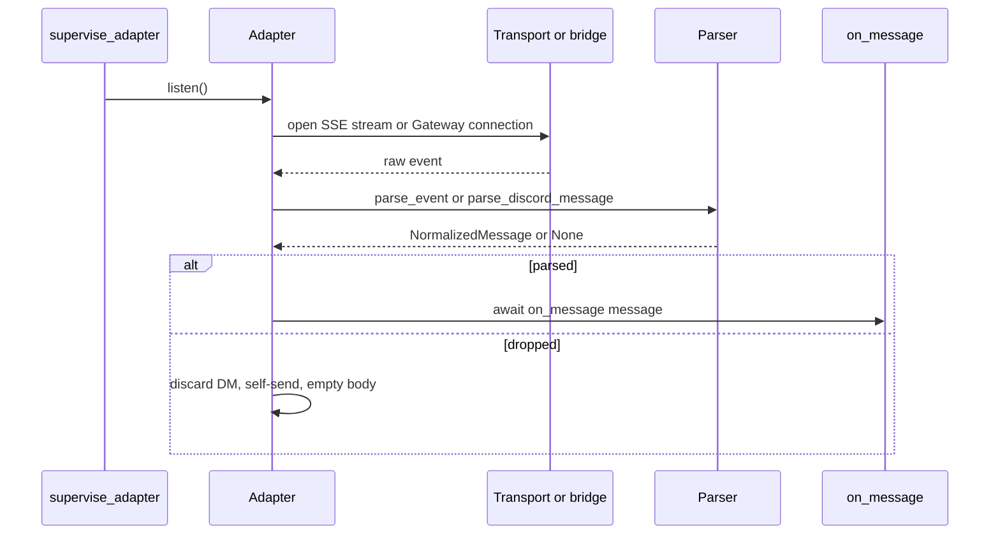
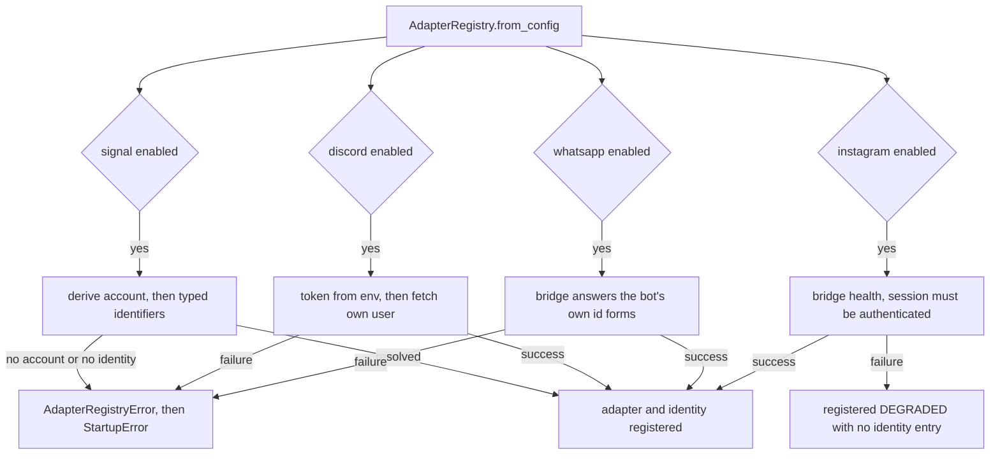

# Platform adapters and their bridges

Nora speaks four messaging transports, and they are one contract with four implementations. The
contract is `nora.domain.ports.PlatformAdapter`: an object that knows one platform's wire, resolves
who Nora is on it, streams normalized messages in, and sends, reacts and reports health out. The
implementations are `SignalAdapter`, `DiscordAdapter`, `WhatsAppAdapter` and `InstagramAdapter`,
registered by name in one `AdapterRegistry`.

The split that shapes everything else: **three of the four transports hold their session in a
separate process** — signal-cli, the whatsapp-bridge and the instagram-bridge — while Discord's
client lives inside Nora's own process. The adapter is what makes that difference invisible to the
rest of the system: `nora.ingest`, `nora.engagement` and the delivery path see a platform name, a
`NormalizedMessage` and a `SendResult`, never a bridge.

One `listen()` call per platform, with parse-and-drop inside the adapter: `on_message` is only ever
called with a normalized message.

## What an adapter must provide

| member | shape | why it is on the port |
|---|---|---|
| `platform` | `str` attribute | Named `platform`, not `name`, so it matches `PlatformIdentity.platform`, `AdapterHealth.platform` and the `platform=` metrics label |
| `resolve_identity()` | `async` → `PlatformIdentity` | R-12 needs to know Nora's own id forms; the value is what self-recognition is tested against |
| `listen(*, on_message)` | `async`, keyword-only callback | The inbound half: one stream, one callback, no transport shape exposed |
| `send(*, target, text, mentions=(), styles=(), preview=None, attachments=(), quote=None)` | `async` → `SendResult` | The outbound half, with decoration that may be ignored |
| `react(*, target, emoji, to_author, to_timestamp, to_message_id="", remove=False)` | `async` → `ReactionResult` | Reacting is a platform capability like sending, not a separate capability protocol |
| `health()` | `async` → `AdapterHealth` | The transport's own statement about itself, per platform |

Two conventions are load-bearing rather than stylistic. Every method is keyword-only after `self`
(`tests/test_ports.py` pins it), because a positional parameter added to a port later is a breaking
change at every call site. And `mentions`/`styles`/`preview` are **the only defaulted parameters on
the send path**: they are decoration on a message that must go out regardless, so every failure
upstream of the adapter — an unresolvable name, a preview that would not fetch — degrades to the
plain message and never to a refusal. A future adapter therefore satisfies the port the day it is
written, and adding real support is a change to that adapter alone.

`SendResult` is a record, not a `bool`, because a platform can answer a rate limit with a retry
delay and a bare success flag would burn the one attempt the delivery latch allows. `ReactionResult`
carries `supported` beside `ok`, so "this platform has no reactions" stays distinguishable from "the
reaction failed" — only one of those is worth an alert.

## Parsing belongs to the adapter, and not to the port

The port deliberately has **no `parse()`**. A `parse()` on the port would force every adapter to
pretend its transport is dict-shaped, which Discord's Gateway events are not: one is a `discord.py`
`Message` object with a guild, channel, author and attachment list attached to it, the other is a
JSON envelope. So each adapter owns a parser that is tested directly against its own transport
shape, and `listen()` does the parse-and-drop step itself — a `None` from the parser (a DM, a
sync message, a self-send, an empty body) never reaches `on_message`, and `nora.ingest` never sees a
raw platform event. `tests/test_signal_adapter.py` asserts both halves: `parse` is absent from the
public surface, and the drop case fails if an unparseable event is forwarded.

All four parsers converge on one normalization contract (`NormalizedMessage`), and the parts of it
that are easy to get wrong are the structural ones: `mentions` is a separate set of id forms because
Signal puts an object-replacement character in the body where a name was; `quote` is a pointer
(author, timestamp, and the platform's message id where it has one) rather than a copy of the
parent's text; `media` records what the platform *said* about each attachment and downloads nothing;
`message_id` carries the platform's own handle on the message, which is empty on Signal because
Signal addresses a message by author and timestamp; and a reaction or a delete arrives as a `Touch`
on a message, never as a message of its own — a bare emoji rendered as a transcript line would add a
turn that never happened.

## Identity: resolved once, before anything can use the adapter

`AdapterRegistry.from_config` is the only builder. It walks one `if platforms.<x>.enabled:` block per
platform, constructs the adapter, and **resolves that adapter's identity inline before registering
it**; the returned registry is frozen and does no I/O of its own. A failure becomes
`AdapterRegistryError`, which `nora.app.composition.build_dependencies` re-raises as `StartupError`.

Fail-fast is the point, and the reason is specific: R-12 (`nora.engagement.stages.admission`) tests
membership in a resolved `PlatformIdentity.aliases`, so an adapter whose identity nobody could
establish must never be handed to the rest of the process pretending everything is fine — that is
exactly the shape of bug that would let Nora trigger herself. A disabled platform is built and
resolved by no one, silently.

The four identity paths, and what the registry does when one fails. Only the last block degrades.

Every adapter memoizes `resolve_identity()` after its first call, because `/health` polls it on every
scrape and a network hit on every poll would be absurd for a question whose answer cannot change
while the process is alive; `EngagementPipeline.run` also calls it per tag, which is an in-process
lookup rather than a round trip. The memoization boundary differs and the difference is deliberate:

- **Signal** memoizes on success *or* degradation. The primary account is authoritative; the typed
  identifier enrichment is best-effort, so a degraded derivation is still a stable answer.
- **Discord, WhatsApp and Instagram** memoize on **success only**. WhatsApp's bridge answers 503
  until its socket opens, and Instagram's bridge answers a checkpointed session with 200 and a
  *cached* `self` block — caching that would register an adapter as fully healthy while every send
  conflicts, so the failure is raised and retried, never stored.

`AdapterRegistry.self_aliases()` collapses the resolved identities into one frozenset of bare id
values, which is what `MentionPolicy` and `ReplyToNoraPolicy` membership-test — "did somebody tag
Nora?" answered the same way wherever the message came from. R-12's self-tag check deliberately does
*not* use that union: it reads `identity_for(message.platform)` and stays strictly per-platform.
Identity is matched on immutable ids only; a renameable handle is not a matchable kind on any
platform, and `Identifier` refuses to carry one. The bare-digit id spaces on Discord, WhatsApp and
Instagram overlap by convention rather than by construction, and the reachable consequence is
bounded and stated rather than assumed: a cross-platform false positive could engage a turn that did
not tag her, never miss one, and never resolve a person to the wrong `person_id`.

## The one deliberate exception: Instagram degrades instead of refusing

On Signal and Discord, failing to resolve identity means somebody typed a misconfiguration. On
Instagram it means **a captcha happened overnight**, and under the unmodified rule one checkpoint
stops Nora starting at all — Signal and Discord included. So an enabled Instagram adapter that cannot
authenticate is **built and registered degraded**, and degraded means precisely three things:

- **no sends.** `send` and `react` refuse without an HTTP call, and the refusal is not retryable: a
  checkpoint needs a human, and retrying a challenged account is how a captcha becomes a ban. A
  degraded `react` answers `supported=False` rather than `ok=False`, because it has not tried and
  failed — it cannot try at all.
- **no events.** `listen` blocks forever without opening the stream. It never *returns*, because
  `supervise_adapter` treats a return as "listen finished, call it again" and would spin; and it does
  not ingest the events the bridge would happily serve, because Nora could not answer any of them.
- **visible.** `degrade()` logs one ERROR line naming the reason, and `health()` reports
  `degraded=True` with that reason as `detail`. A silently degraded adapter is indistinguishable from
  a quiet room, which is the whole failure this exists to prevent.

Two scope guards keep the exception from becoming a general loosening. First, a degraded Instagram
adapter is registered with **no entry in `identities`**, and that omission is load-bearing:
`self_aliases()` is a union over that mapping, so a placeholder identity kept for rectangular shape
would put its placeholder value into the very set the mention and reply-to policies test — inventing
an answer to "who is Nora" is the exact R-12 bug class fail-fast exists to prevent, and a degraded
adapter emits nothing, so nothing ever asks for its identity. Second, the exception is not extended
to WhatsApp, which carries the same latent exposure but whose pairing is stable enough that a
failure there is treated as a startup error.

Startup and runtime are two different ways to lose the session and only one of them is visible to
`from_config`. `health()` also reports a session that was authenticated at boot and checkpointed
later, by reading the listener's heartbeat state; the startup half is latched until restart, and the
runtime half tracks the live heartbeat, so a session that recovers stops being reported as degraded
without a restart.

## The four platforms

Each table reads the same way: where the transport comes from, how Nora learns who she is on it, what
the parser must refuse, and what a failure looks like.

### Signal

| transport | bridge or direct API | identity derivation | what the parser must drop | degradation behaviour |
|---|---|---|---|---|
| signal-cli's HTTP surface: an SSE stream for inbound, JSON-RPC over one POST endpoint for send, react, roster and attachment bytes | bridge — the daemon is a separate container on the private network, publishing no port; it holds the device registration in its own state volume | two steps: the account (from the configured override, because the daemon serves no route and no RPC that reveals it) then typed identifiers from one batched JSON-RPC call | envelopes that are not a `receive`, DMs, sync messages and receipts, edited-message framings handled as edits, self-sends, reactions and deletes as messages, empty bodies | account resolution is fatal; identifier enrichment never raises — it counts `nora_identity_enrichment_degraded_total{platform,reason}`, publishes `nora_identity_aliases{platform}` on every path including total failure, and falls back to the primary alone |

Signal is the only platform with a counted enrichment path, and the reason is specific to that daemon:
one id form is missing from the answer another call gives, so the two calls are batched, neither is
trusted to stand in for the other, and any partial answer is measured rather than merely logged. The
parser also carries forward-compatible readings for wire fields the deployed daemon does not yet
emit, gated so a sender cannot name a file into a transcription path.

### Discord

| transport | bridge or direct API | identity derivation | what the parser must drop | degradation behaviour |
|---|---|---|---|---|
| a Gateway WebSocket inside Nora's process (`discord.py`), with REST calls for send, react and attachment bytes | direct API, no bridge: the bot token is resolved from the environment by the composition root and threaded in | one authenticated REST call returning the bot's own snowflake, plus its display handle read off the same response | DMs, Nora's own messages, and every gateway event kind that is not a message, edit or touch | fail-fast: a missing token is refused before the adapter is built, an identity failure is a registry error, and `health()` reports `connected=False` honestly before the first `listen()` |

Two Discord specifics matter to anyone changing it. The client is built **per attempt** inside
`listen()`, because a closed `discord.Client` cannot be restarted: `start()` on one returns
immediately, which under a supervisor that only backs off on exceptions would become a hot loop
against the Gateway with no log line and no restart counter. And inbound events are serialized **per
channel** with an `asyncio.Lock`: `discord.py` dispatches every gateway event as its own task, so a
message and its edit could otherwise be ingested concurrently, and an edit landing while the new
message's insert was still waiting on attachment custody would find nothing and be dropped as an
orphan. Discord's `send` also owns a voice branch — a spoken turn is answered through the audio
controller, with a fallback to text when speech fails (see
[voice and speech](../systems/voice-and-speech.md)).

### WhatsApp

| transport | bridge or direct API | identity derivation | what the parser must drop | degradation behaviour |
|---|---|---|---|---|
| the whatsapp-bridge's HTTP routes plus an SSE stream | bridge — a containerized Baileys daemon that holds the paired companion-device session; the adapter holds no token and no account | one bridge call returning the bot's phone and, when the bridge reports it, its lid — the two id forms its own parser normalizes sender ids into | non-message event types, `from_me`, status-broadcast and newsletter addresses, and turns carrying neither text nor media | fail-fast: an unpaired or unreachable bridge is a startup failure, not a deaf adapter — identity is the only thing that can fail, because the bridge holds the session |

The bridge answers two event kinds at listener level and never forwards them: a heartbeat, which is
what keeps `last_event_age_seconds` honest in a quiet room, and a `dropped` notice saying its bounded
buffer overflowed while no client was connected — logged loudly with the running total, because audit
rows were lost upstream and nothing here can recover them. WhatsApp is also the platform whose
attachments get **no** custody handle (see below), so its media is recorded as a label and a
description of what arrived, never as bytes Nora holds.

### Instagram

| transport | bridge or direct API | identity derivation | what the parser must drop | degradation behaviour |
|---|---|---|---|---|
| the instagram-bridge's HTTP routes plus an SSE stream | bridge — a daemon holding a full cookie session, which is why the adapter is configured by URL only | one bridge health call whose `session` must read exactly `authenticated`, then the interop fbid as primary and the public Instagram id beside it | any event kind other than message, edit, reaction or unsend; `from_me` (structural, computed by the bridge rather than inferred here); turns carrying neither text nor media; a missing or empty room id | **degrades**: registered degraded, refuses sends, ingests nothing, one startup ERROR line, and `health()` reports the reason |

The Instagram parser carries the same shape of honest gap as the rest of the platform layer: the
inbound event has no group/one-to-one discriminator and the bridge exposes no thread-info route, so
the parser reports `group` and the effective deny-by-default is the policy file's exact-string room
list. The `is_group` field is honoured the day the bridge grows it, so there is one place to change.
Instagram also has one event kind with no room counterpart at all: a `summons` event is handed to a
`SummonsSink` and never reaches ingest, because it is not a room message — the ordinary message event
the bridge sends beside it is the room's copy.

## Reactions: one call, two addressing schemes

`react()` lives on the port and takes both message-addressing schemes at once, defaulted and additive:
`to_author`/`to_timestamp` and `to_message_id`. Signal addresses a message by who sent it and when,
Discord by a snowflake that cannot be reconstructed from those two, and WhatsApp and Instagram by
their own message ids — so each adapter uses the one its platform speaks and ignores the rest. The
`to_message_id` value comes from `NormalizedMessage.message_id`, which the Discord, WhatsApp and
Instagram parsers fill and Signal's leaves empty.

The engagement layer's reaction stage never lets a reaction cost a reply: it uses `getattr` rather
than a protocol check, so an adapter with no `react` at all is counted `unsupported` and skipped,
every exception is caught and counted `failed`, and only a genuine `ok` counts as `sent`. Reactions
are also where the three-state answer pays off — `supported=False` is a wiring gap, `ok=False` with
`supported=True` is a platform that tried and failed.

## Media sources: separate from the adapter, keyed by platform

Fetching attachment bytes is **not** on the adapter port. It is its own `MediaSource` port, bound to
one platform, with a `fetch` that **never raises** — a `MediaBytes` value carries the difference
between "could not fetch" and "fetched nothing", because the caller is the ingest path and an
exception there would cost the message to save bytes that are only ever a bonus. The reason it is
separate is the same reason each platform needs its own fetcher: one Signal fetcher asked for a
Discord snowflake can only answer `not_found`, a reason that reads like "the platform lost it" when
the truth is "wrong daemon".

`MediaSourceRegistry` makes "this platform has no fetcher" a value the media stage can count rather
than a wrong call it cannot see:

| platform | handle the parser records | fetcher | exposure |
|---|---|---|---|
| Signal | signal-cli's own attachment id (and a private sticker token) | JSON-RPC to the daemon that already serves send and roster, so no second mount of somebody else's filesystem | bounded by a size ceiling; a miss and an unknown method are different reasons |
| Discord | the sticker's id and format; for attachments, the CDN URL on the event | derives the sticker URL from id and format, and allowlists the attachment hosts before a socket opens | an attachment URL comes off the event, so the host allowlist is the mitigation |
| Instagram | the CDN URL itself, whose query string carries its own signature | fetches it directly, allowlisting two registrable domains by leading-dot suffix | the same event-supplied-URL exposure, mitigated the same way |
| WhatsApp | nothing — the event carries the fact of media, not a handle | none | the media stage counts every attachment `not_supported`, which is a different thing to fix than custody being off |

The registry is built unconditionally for the three platforms that have a fetcher, not gated on each
platform being enabled: a fetcher for a platform producing no messages costs nothing, while gating it
would make custody depend on two settings instead of one.

## Health and degradation reporting

`AdapterHealth` is what one transport can say about itself right now, and its `degraded` flag is a
**third state, not a spelling of `connected=False`**. A disconnected adapter is one whose socket is
down and which the bridge is expected to heal on its own; a degraded one is present, registered and
structurally unable to act until a human intervenes. Collapsing them would either flap the container
healthcheck on an ordinary captcha or — the failure that actually matters — report a platform as
merely quiet while Nora is silently absent from every room on it.

Health flows out on two independent paths:

- **`/health`** publishes one entry per enabled platform with `connected`, `last_event_age_seconds`,
  `degraded`, `detail` and the resolved `account`. A platform whose `health()` raises is recorded
  disconnected rather than omitted, since an absent key would read as "not enabled". Crucially, a
  **degraded** platform does not make Nora unhealthy: a 503 would fail the container healthcheck and
  take the other platforms down with it, so the state is reported in the entry instead.
- **The `source_health` record** samples those same values every 10 seconds and writes a row per
  state *transition*, so "every source was healthy for this interval" becomes a query rather than an
  assumption.

| recorded state | condition |
|---|---|
| `up` | connected, not degraded, and an event within the staleness threshold |
| `stale` | connected and not degraded, but no event for longer than that threshold — a socket that says it is open and delivers nothing is not `up` |
| `degraded` | present, unable to act until a human intervenes |
| `down` | not connected |
| `unknown` | `health()` itself raised — «could not check» is not «down» |

The staleness threshold is the same one the platform-silent alert fires on, so the record and the
alert agree on what "silent" means. This is also why the listeners keep heartbeats: a container
healthcheck on a bridge proves only that its HTTP layer serves, and the real socket-death detector is
the per-platform last-event age one layer up. The transports are independent — adapter supervision is
one task per platform, restarted with capped backoff and counted per platform, and a failing
`listen()` is scoped to its own platform and its own `/health` entry; one platform's health must
never mask another's. The supervision and liveness loops themselves are
[the runtime topology](../architecture/runtime-topology.md).

## The bridge services and the session they hold

Three bridges exist because their platforms have no headless API worth speaking directly, and each
holds the thing Nora must not: a live session.

| service | what it is | what it holds | how Nora talks to it |
|---|---|---|---|
| signal-cli | a JVM daemon in its own container, no published port | the device registration — losing it loses the registration, not just history | SSE for inbound, one JSON-RPC endpoint for everything else |
| whatsapp-bridge | a small Node daemon over Baileys, paired once on first run as a companion device | the paired session and its key material | HTTP routes for send, media, edit and react, SSE for inbound, a health route for drops |
| instagram-bridge | a Go daemon holding a browser-shaped session | the cookie session plus its reconnection and sequence state | HTTP routes for send and react, SSE for inbound, a health route that answers success while checkpointed on purpose |
| Discord | none — the client is in Nora's process | nothing on disk; the bot token comes from the environment | Gateway and REST |

Two rules keep the sessions where they belong. First, every bridge's state sits on a volume mounted
**only** into that bridge container and deliberately outside the directory Nora bind-mounts: she has
no business reading transport credentials. Losing one of those volumes means re-pairing or logging in
again, not losing message history. Second, each bridge's own healthcheck proves only that its HTTP
layer serves — it cannot prove the platform socket is alive. The instagram-bridge's health route
answers success while a session is checkpointed by design, because a challenge is a normal operating
state and a restart fixes nothing; treating it as unhealthy would flap the container and take the
other platforms down with it.

The instagram-bridge has one further, deliberate asymmetry worth knowing about: it is the only bridge
that writes anything public, and that single write is a switch rather than a behaviour — off unless
the deployment says exactly `on`, rate-capped and spaced before any call, with a latch persisted
across restarts once the platform answers with an action block.

## Startup and restart

`build_dependencies` treats the registry as an ordered, fatal startup step: `AdapterRegistryError`
becomes `StartupError`, and a registry with no `signal` entry refuses to start even though the
registry itself tolerates zero enabled platforms — the rest of the composition has no code path that
runs without an adapter. After boot, each adapter's `listen()` is run by a supervisor that restarts
it with capped exponential backoff and counts the restart, because a naive gather over several
adapters either takes the process down on one adapter's bug or hides a dead listener behind a
still-healthy `/health`. A `listen()` that *returns* rather than raising is therefore never benign:
it becomes a hot loop, which is why Discord builds its client per attempt and a degraded Instagram
adapter blocks forever. See [deployment](../operations/deployment.md) for the service layout and
[troubleshooting](../operations/troubleshooting.md) for what a reported degradation means
operationally; the policy side of who may talk to Nora where is
[policy and disclosure](../concepts/policy-and-disclosure.md), and how a normalized message becomes a
record is [ingestion](../workflows/ingestion.md).

## Extension points

- **A fifth platform** is one more `if platforms.<x>.enabled:` block in `from_config`, an adapter
  meeting the port, a parser tested against that transport's own shape, and an identity derivation
  that fails fast (or, with a stated reason of the Instagram kind, degrades). It needs a
  `MediaSource` only if its attachments can be fetched. Nothing above the platform layer changes: the
  registry returns the port type, and both `send` and `react` already carry the two addressing
  schemes a new transport might need.
- **`own_handle()` is not on the port.** Discord and Instagram expose it, because presence wants to
  tell Nora what people type to reach her; Discord caches it from the identity call and Instagram
  reads it live per call. It is display text only and can never become a mention id — the identity
  model refuses a renameable handle as a matchable kind.
- **Platform-specific event kinds and surfaces ride the adapter.** A summons event has no room
  counterpart and is handed to a sink instead of ingest; Discord's music commands, voice joins and
  voice sends hang off the same adapter. The test for whether something belongs there is whether the
  layer above would have to know which platform it is.

## Tests that matter

- `tests/contract/test_port_conformance.py` — all four adapters satisfy `PlatformAdapter`, including
  a *degraded* Instagram adapter; a degraded adapter that stopped satisfying the port would be
  refused one layer later, after all.
- `tests/test_platform_registry.py` — an enabled platform is built with its identity resolved, a
  disabled one is built by no one, and an unreachable daemon fails the registry rather than producing
  a blind adapter.
- `tests/unit/test_instagram_degradation.py` — a checkpointed bridge still lets the registry build,
  a degraded adapter neither sends nor reacts and says why, a degraded `listen()` does not return,
  and a session checkpointed *after* startup degrades the live adapter.
- `tests/test_signal_adapter.py` — parse-and-drop inside `listen()`, `parse` absent from the public
  surface, identity idempotent, and the primary always among the aliases.
- `tests/unit/test_adapter_health_recorder.py` — degraded is its own recorded state with its reason,
  a raising `health()` is `unknown` not `down`, a connected socket delivering nothing is `stale`, and
  platforms are tracked apart.
