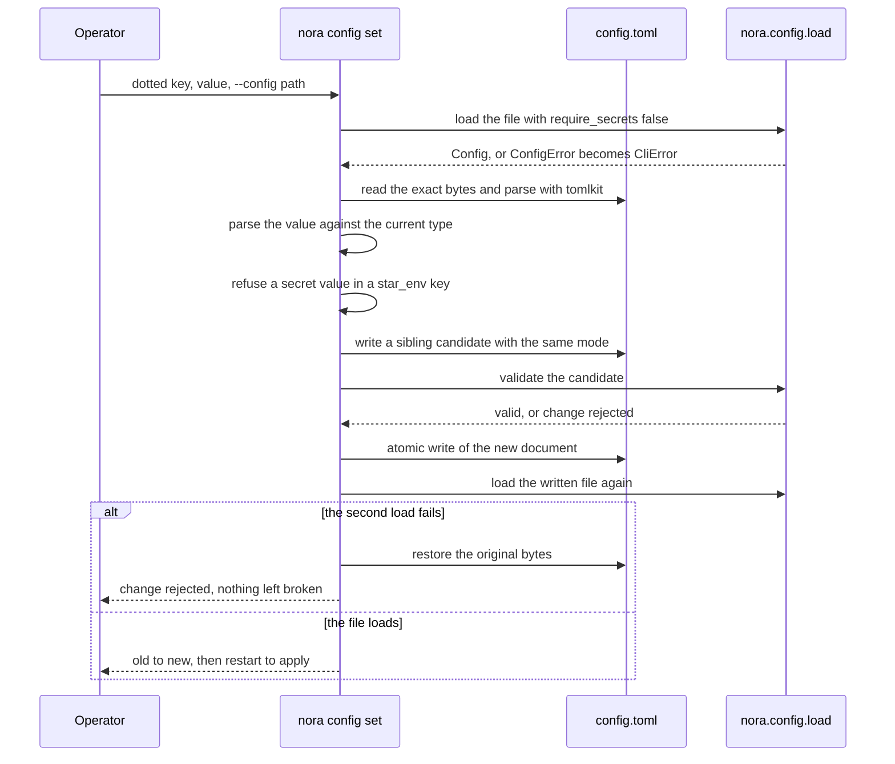
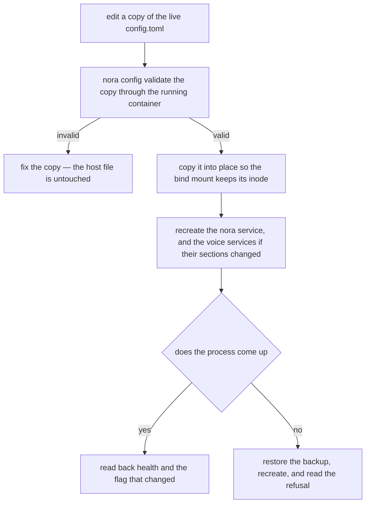

# Configuration: capability flags, validation and the config CLI

Nora is configured by three TOML files that nobody edits through a UI, and almost every
interesting question about a deployment is a question about one of them: *is the Dreamer on?*
*which platforms does she answer on?* *who may talk to her here?* The files are strict on
purpose. `nora/config.py` opens with the reason: a typo in `engagement.trigger.text` would
silently disable her, so `extra="forbid"` is on every model, an unknown key is a startup failure,
and so is a missing *required* one — never a default
([`nora/config.py`](../../nora/config.py)).

Three properties carry the rest of this page:

- **The committed template is the only public record of the shape.** `config.toml` itself is
  untracked, so [`config.example.toml`](../../config.example.toml) is what anyone reasoning about
  a deployment from the repo reads, and a test pins both its key set and its values against the
  live file when one happens to be present.
- **Validation refuses rather than guesses.** A missing *section* is a default; a misspelled
  *key*, an out-of-range number, or two sections that contradict each other is a refusal at load
  time, before any subsystem is constructed.
- **Every secret is a name, never a value.** Config fields end in `_env` and hold the *name* of an
  environment variable that the host injects; the value lives in `.env` on the deploy host and is
  never readable from this repository.

The capability flags are the other half of the subject, and the largest, because Nora ships with
almost every optional subsystem inert. A flag is not a preference toggle: it decides whether an
object is constructed at all, and the shape of what a caller sees when it is not is part of the
contract ([the failure and status contract](../architecture/failure-and-status-contract.md)).

## Three files, three lifetimes, three review surfaces

| file | answers | changes when | loaded | who reviews the change |
|---|---|---|---|---|
| `config.toml` | how the deployment runs: ports, models, timeouts, budgets, feature switches, retention | the deployment changes | once at startup, by `nora.config.load` | a deploy review — and a second, unrelated process for the sections the voice containers read |
| `identity.toml` | **who people are**: one `[[persons.<id>.<platform>]]` block per account, all resolving to one `person_id` | a human joins, or gets another account | once at startup, by `load_persons` | a roster review: the diff is a list of people, and every account a person holds |
| `policy.toml` | **who may talk to her, and where** — rooms, units, per-room trust flags | trust changes | once at startup, by `load_policy` | a trust review: deny-by-default room grants, read as a list of people |

`config.toml` points at the other two: `identity_file` and `policy_file` are fields of the schema
and resolve relative to the config file's own directory. All three are gitignored, all three are
read once and never re-read, and all three are handed to the revision recorder at boot, so
`nora snapshot --at T` can say which three files were in force
([`nora/__main__.py`](../../nora/__main__.py)).

**The split is a review-surface split, not a security boundary.** Anyone who can read one file
can read all three; nothing about `policy.toml` is more protected than `config.toml`. The argument
is the one `nora/policy.py` restates: *an allowlist buried among port numbers is an allowlist
nobody reviews*. Each file changes on a different clock and is read by a different reviewer, so
merging them would make a trust change arrive as a diff hunk between a port and a timeout. The
security boundary is elsewhere and is a different mechanism entirely: the secrets live in `.env`
on the host, and the config files hold only the names of the variables
([policy, admission and disclosure](../concepts/policy-and-disclosure.md) covers what the grants
mean; [state and durability](../architecture/state-and-scopes.md) covers the same three files as
state that lives outside the database).

Two consequences of the load-once lifetime are worth knowing before editing anything live:

- editing `identity.toml` or `policy.toml` without a recreate changes nothing and warns about
  nothing — the tell is an unmapped-sender counter, not an error;
- `config.toml` is *also* bind-mounted read-only into the two voice containers, which read
  `[speech.stt]` and `[speech.wake]` with stdlib `tomllib` at their own startup. Those sections
  have the same load-once lifetime in a different process, so a change needs that container
  recreated.

## The schema: one frozen tree, one reader

`nora.config.load()` is the only reader of `config.toml` in the daemon
([`nora/config.py`](../../nora/config.py)). It parses with `tomllib`, validates with pydantic
against `Config`, and returns a tree that is **frozen**: every model is
`ConfigDict(extra="forbid", frozen=True)`, so nothing downstream can mutate a loaded value, and
nothing downstream receives it either — the composition root is the one place allowed to read the
tree and it hands out dependencies, not `Config`. The edge is one-way and enforced: `nora/config.py`
may import `nora.domain` (a ceiling constant is imported rather than restated, so the startup
refusal and the database's own `CHECK` cannot come to disagree), and an import-linter contract
named *only app and `__main__` read config* lists every package that may not import it —
`nora.subject` deliberately absent, because its job is composing the real graph.

What the validation guarantees, in the order it happens:

1. **TOML.** A parse error becomes `ConfigError` with the path and the decoder's message.
2. **Shape and type.** An unknown key anywhere is fatal; a required key that is absent is fatal; a
   value outside its range or outside a closed set is fatal. This is the whole reason the file
   cannot silently mean something else.
3. **Paths.** `identity_file`, `policy_file`, `store.data_dir`, `doctrine.dir` and `[dreamer] dir`
   are resolved against the *config file's own directory*, with `~` expanded, so a checkout and a
   container that mount the file at different absolute paths still agree on what the relative
   paths mean. Validating a `Config` without that base context raises
   `base directory context is required to resolve paths` rather than guessing a cwd.
4. **Cross-section relations.** A `model_validator` on `Config` refuses configurations that are
   individually well-typed and jointly meaningless (next section).
5. **One secret, only for the daemon.** With `require_secrets=True` (the default, and the daemon's
   behaviour) a missing `llm.api_key_env` variable is a startup failure: a Nora who starts without
   a model key is a Nora who is silently unable to answer.

### Required sections, defaulted sections, derived values

The tree is deliberately asymmetric. Three kinds of section exist, and the difference is
operational:

| kind | examples | behaviour when the section is absent |
|---|---|---|
| **required** | `[platforms]`, `[llm]`, `[memory]`, `[store]`, `[engagement]`, `[doctrine]`, `[obs]`, `[evals]` | load fails |
| **defaulted, inert** | `[dreamer]`, `[cognition]`, `[standing]`, `[notes]`, `[culture]`, `[lessons]`, `[persona]`, `[participation]`, `[relevance_gate]`, `[music]`, `[compute]`, `[computer]`, `[otp]`, `[image_gen]`, `[video_gen]`, `[presence]`, `[search]`, `[online]`, `[weather]`, `[social]`, `[preview]`, `[route]`, `[analytics]`, `[memory_index]`, `[heartbeat]`, `[documents]`, `[record_query]`, `[external_files]` | loads with the feature **off** |
| **defaulted, on** | `[media]`, `[engagement.trigger]` (`enabled = true`), `[engagement.reactions]`, `store.prune_enabled` | loads with the feature **on** |

Two further shapes sit inside sections: per-adaptor budget blocks
(`[dreamer.budgets.<name>]`, keyed by adaptor, so an absent block falls back to class defaults)
and keyed or listed tables (`[tools.mcp.<name>]`, `[media.describe.<modality>]`,
`[speech.tts] sidecars`).

Three of the inert sections are read by a *different* process than the daemon: `[presence]` by
`python -m nora.presence`, `[analytics]` by `python -m nora.analytics`, and `[speech.wake]` by the
voice-wake container (nothing in the nora process reads that one). The daemon still validates all
of them, so a typo in a knob the daemon never uses is caught by the daemon's own load — and the
analytics process has its own refusals, e.g. `enabled` with no Life360 subject to derive.

Defaults live in code, not in the template. The template documents them, and it deliberately
*omits* at least one key — `store.prune_enabled` — because a test loads the template to pin the
code default, and writing the key would silently delete that assertion. A comment in the file
argues the case for `false` instead.

Some values are **not keys at all**. `search.api_key_env` is a property that returns the selected
backend's variable name, and `Config.dreamer_model()` / `dreamer_max_tokens()` fold a sibling
section's fallback into one place so no caller can reach past it to a raw `""` or `0`. A derived
value is not settable: writing `search.api_key_env` into the file is refused, because the schema
has no such field and `extra="forbid"` rejects it — the operator sets `[search.tavily]` or
`[search.exa]`, and the property follows `provider`.

## Validation refuses rather than guesses

The cross-section validators are where configuration stops being a form and becomes an argument.
Each one exists because the failure it prevents is **invisible at runtime**: the deployment looks
healthy and does nothing, or promises something it cannot keep.

| refusal | why the alternative is a silent lie |
|---|---|
| `[relevance_gate] enabled` requires `[participation] enabled` | the gate decides whether a turn happens; with no turn behind it every GO reaches nothing and the room never hears anything — indistinguishable from a gate correctly declining |
| `[cognition] enabled` requires `[dreamer] enabled` and an explicit `[dreamer.budgets.cognition]` block | a session borrows the Dreamer's model, tools and objectives; without a block it would run on class defaults nobody chose |
| `[lessons] enabled` requires the Dreamer, and a `check_model` that differs from the Dreamer's model | a doctrine check on the writer's own model grades its own homework |
| `[subagent] enabled` requires the Dreamer, `[compute] enabled`, and its own budget block | the worker reports once through the compute outbox and runs for minutes, not for a default |
| `[video_gen] enabled` requires `[compute] enabled` | a clip renders, is paid for, and is never delivered |
| `[social.poll]` and `[social.instagram.summons]` require `[social.instagram]`; `[social.linkedin]` requires `[social]` | each reads through a backend that would not exist |
| `[reminders] min_lead_seconds` must exceed `[heartbeat] tick_seconds` | a reminder created with the minimum lead comes due inside the tick already running, and she answers later than she promised |
| `[standing] timeout_seconds + 5 × store_timeout_seconds ≤ max_slot_hold_seconds` | the debrief holds a live conversation's slot, so the sum of the bounds is the number that matters, not any one of them |
| `[dreamer] max_unit_hold_seconds`, when explicitly set, must exceed the derived known-bounded minimum | a wall clock that fires before a legitimate run finishes turns a working tier into one that fails quietly |

Section-local validators cover the rest, and they are the same posture one level down: a
`prompt_window` above `context_window`, a `min_chars` above `max_chars`, a poll floor above its
ceiling, a `[computer]` default run timeout above its ceiling, a `[llm.budgets]` entry naming an
unknown tool, a `[dreamer.budgets.<name>.tool_calls]` key naming a verb the adaptor does not
declare, or a per-tool call ceiling inside a block whose adaptor has no such ceiling at all (it
would bound nothing while reading as if it did).

**Whether a check is gated on `enabled` is itself a decided question**, and the two postures are
both argued in place. The standing slot-hold sum and the reminder-lead check are *not* gated: a
number that lies is wrong on the page whether or not the feature runs, and the moment the operator
flips `enabled` is the worst possible time to discover it meant something else. The shadow-channel
checks *are* gated, and the reason differs between two otherwise identical validators:
`[relevance_gate] shadow` defaults to `true`, so the unconfigured instance is
`shadow = true, shadow_channel = ""` and an ungated check would refuse a section nobody enabled,
while `[participation] shadow` defaults to `false` and its check is unconditional.

Failures land in one chain: pydantic `ValidationError` → `ConfigError` → `StartupError` → `main()`
prints `startup failed: …` and exits 1. In compose that is a crash-loop, which is the intended
reading — a container that will not stay up is the honest version of "this file is wrong", where a
graceful degradation to a mute Nora is not.

## Secrets: names in config, values in `.env`

The repository's convention (DEC-8) is that every credential field is named `*_env` and holds the
*name* of an environment variable, never the value. That convention is load bearing enough that the
CLI enforces it by suffix, and it has three distinct enforcement points, because "a secret is
missing" means three different things:

| tier | what happens | fields |
|---|---|---|
| **load-time, daemon only** | `load(require_secrets=True)` raises `ConfigError` — *refusing to start* | `llm.api_key_env` |
| **boot-time, when the subsystem is enabled** | composition raises `StartupError` naming the variable; the process will not start | `store.database_url_env`; `[computer] token_env`; `[otp] secret_env` and `api_token_env` |
| **warn and degrade** | a logged warning naming the variable, and the capability answers as unconfigured | `[route] api_key_env`; `[search] api_key_env` (the selected backend's); the three `[google]` variables; `[media] encryption_key_env`; `[media.rustfs] access_key_env`/`secret_key_env`; `[online] api_key_env`; the image-lane refresh tokens |

The split is the same posture as the flags. A capability Nora cannot run without (the database, a
computer token, the OTP signing key) is a refusal, because an empty OTP key would hash every code
under nothing and an empty computer token would answer every call `unavailable` in front of the
group. A capability laid down *beside* the record — media custody, a map, a search backend — must
never take the daemon down: `[media]` with a missing or malformed key turns custody **off** with a
warning, never plaintext and never a crash, and a misconfigured RustFS backend falls back to the
filesystem blob store rather than to custody off.

The read-only operator commands pass `require_secrets=False` on purpose. The key lives in `.env`,
which docker compose injects into the *container*; an operator running `nora groups` from his own
shell, typically with the container stopped — exactly when he needs it — has no such variable
exported, and a command that constructs no model client should not refuse to list group ids over a
credential nothing on its path uses.

Nothing on this page publishes a value, a host or an endpoint. Where a variable name appears, it is
the name the committed template itself states.

## The `nora config` CLI

`nora config` is the operator's mutation surface
([`nora/app/config_cli.py`](../../nora/app/config_cli.py)). It exists because `config.toml` is a
large, schema-validated TOML that is easy to corrupt by hand, and because a hand edit's only
feedback is a crash-loop. The read-only commands (`nora groups`, `nora persons pending`) answer
"what is the state"; this answers "change a setting".

| command | does |
|---|---|
| `nora config get <dotted.key>` | print one value; fails with `no [section]` or `not set`, not a traceback |
| `nora config set <dotted.key> <value>` | set one key, validated, atomically; prints `old -> new` and the restart command |
| `nora config unset <dotted.key>` | remove one key, validated the same way; prints what it was |
| `nora config validate` | parse + full schema validation, printing `ok — <path> is valid` |
| `nora config path` | print the resolved config path (useful inside a container) |

`--config` defaults to `config.toml` and works on both sides of the subcommand
(`nora --config c.toml groups` and `nora groups --config c.toml`), because the subcommand's copy
uses `argparse.SUPPRESS` so it cannot overwrite the top-level value with a second default.

Five properties are load-bearing, each enforced by something rather than promised:

- **Comments survive.** The file carries hundreds of lines of rationale, and the repo's convention
  is that a terse key is safe only because the comment explains *why*. Reads go through
  `tomllib`/`tomli`, writes through `tomlkit`, so an edit never strips the prose that keeps the
  next operator honest. (`tomli_w` would drop every comment in the file — that is why the write
  side is not it.)
- **The write is atomic.** `mkstemp` in the same directory (`O_EXCL`, random name, so a predictable
  `.tmp` sibling cannot be pre-seeded as a symlink), the original mode applied with `fchmod`
  *before* content is written, `fsync`, then `os.replace`. A crash mid-write leaves the old file
  intact, and a `0600` config is never briefly visible as `0644`.
- **The change is validated twice.** Before the write, the mutated document is serialised to a
  `.candidate` sibling, loaded through the *daemon's own* `load(..., require_secrets=False)`, and
  the candidate is deleted — so the on-disk config is never invalid, not even for a moment, which a
  write-then-rollback design cannot promise against SIGKILL. After the write the file is loaded
  again, and any failure restores the exact original bytes.
- **A value's type is decided against the key's current type.** A TOML literal is honoured only
  when its type matches what the key already holds (or the key is new); otherwise the expression
  stays a plain string. Without that rule `+85299998888` — a valid TOML *integer* — would be
  stored as a number and rejected by a string field, when the operator plainly meant a phone
  number.
- **Secrets are names here too.** A key ending in `_env` accepts only a valid environment-variable
  name (`[A-Za-z_][A-Za-z0-9_]*`), refuses anything that looks like a secret value, and redacts the
  value it prints. The CLI never touches `.env`.

It also never restarts anything. It prints
`restart to apply: docker compose up -d --force-recreate nora` and stops: restart authority stays
with the operator.

*The `nora config set` path: two validations, one atomic write, and the old bytes kept until the
result is known good.*

## Validate before apply, on a live deployment

The deploy convention is one sentence: **every app provides a CLI subcommand for config mutation
that validates the change against the schema, writes atomically, and prints what changed.** No
config change reaches a process unvalidated.

On the deploy host the CLI cannot write the live file from inside the container — the bind mount
answers `EBUSY` — so the live procedure is the operator's, not the tool's:

1. edit a **copy** of the live `config.toml`;
2. `nora config validate` that copy through the running container (the command reads a path, so a
   copy is enough);
3. `cp` it into place so the bind mount keeps its inode (an in-place overwrite, not a rename or a
   new file);
4. recreate the affected services;
5. restore the backup on any failure.

*The live procedure: validate a copy, copy in place, recreate, and keep the backup until the
process is known to be up.*

An unvalidated hand edit of the live file is **never** the procedure: `extra="forbid"` catches a
broken file only by crash-looping, which is a slow and noisy way to learn that a key was spelled
wrong. `nora config set` is the right tool when the file is writable; the copy-and-cp loop is the
right tool when it is not.

The other deployment-visible readers are the voice containers, which load `[speech.stt]` and
`[speech.wake]` from the same file at their own boot. A `[speech]` change therefore needs those
services recreated too, and no warning tells you so — the daemon validates the sections it never
reads, which is precisely why a typo there is caught at load instead of at 3am.

## The capability flags

Every row below is a switch that changes what code exists at runtime — a boolean `enabled`, a mode
that has an inert setting, or a credential whose resolution gates a lane — never a tuned value. "On"
means what is constructed or mounted; "off" means what is *absent*; the last column is what a person
or a model sees, which is the only part that reaches the outside. Most ship **off** in the committed
template: the posture is that a copied file must never start speaking, spending or reaching a third
party on a fresh operator's behalf. The rows that ship on say so.

### Inbound and outbound surfaces

| flag | on | off | how absence shows up |
|---|---|---|---|
| `platforms.signal.enabled` (default **on**) | the Signal adapter, its roster and her send path | no Signal adapter — and startup **refuses**, since the pipeline has no code path that runs without one | the process will not start |
| `platforms.discord.enabled` | Discord adapter, snowflake identity, Discord roster, guild voice and `/music` registration | no Discord adapter | Discord rooms never receive; the `online` voice arm has no client |
| `platforms.whatsapp.enabled` | WhatsApp adapter over the local bridge | no adapter | WhatsApp group ids never match |
| `platforms.instagram.enabled` | the Instagram *messaging* adapter (separate knob from `[social.instagram]`) | no adapter; enabled-but-unauthenticated runs degraded rather than stopping startup | sends refused, nothing ingested, `/health` reports the platform degraded |
| `engagement.trigger.enabled` (default **on**) | `TriggerTextPolicy` in the composite engage policy | the trigger phrase is not a way in; `@mention`, a reply to her, a voice note and a wake transcript still are | turning it off narrows the ways in, it does not silence her |
| `engagement.reactions.enabled` (default **on**) | 👀 while she works, then ✅ or ⚠️ | she writes nothing to the group but the reply | a tag that dies leaves **no observable trace in the room** — the reason this one defaults on under R-5 |

### Media, voice and the computer

| flag | on | off | how absence shows up |
|---|---|---|---|
| `media.enabled` (default **on**) | attachment custody: source fetchers plus an encrypted blob store | no custody at all | attachments recorded as a placeholder with no handle |
| `media.encryption_key_env` resolves | AES-256-GCM custody of blob bytes | warning, custody **off** — never plaintext, never a crash | handles exist, bytes were not kept |
| `media.rustfs.enabled` | S3-compatible blob store instead of the filesystem | `store.data_dir/media` | a misconfigured backend falls back, it does not fail the boot |
| `media.comprehension` (default **on**) | one model read per medium at ingest, in the background | no model reads any media | handles in the body, nothing described, no description claimed; a voice note's STT transcript is still written |
| `speech.stt.enabled` | `SenseVoiceTranscriber` wired into ingest custody | no transcriber | a voice note is recorded as a bare handle |
| `speech.tts.enabled` (plus `provider`, `sidecars`) | a speaker and one audio controller per guild | no speaker; joins and speech fail closed | voice answers never happen |
| `speech.wake.enabled` | the `voice-wake` container's 「喂 Nora」 gate (a separate process reading this file) | container healthy but idle | the daemon reads nothing in `[speech.wake]`; it only validates it |
| `computer.enabled` | `ComputerdRuntime`, the probe, the `<computer>` block reader, the `nora_computer_up` metric | no runtime; **every computer tool answers `unavailable`** | the event and session stores are still built, so a call made while off is audited |
| `computer.browse.enabled` | the browser sub-agent over computerd's CDP websocket | `computer_browse` unavailable | one tool, not a whole tier |

### Background tiers and the Dreamer family

| flag | on | off | how absence shows up |
|---|---|---|---|
| `dreamer.enabled` | `DreamerRuntime`, the per-adaptor schedules, and the stores its passes read | **nothing is constructed** and no adaptor ticks | no background writes; the Dreamer is the model every tier below borrows |
| `culture.enabled` | room, person, unit and Nora-own account folds, and the `<culture>`/`<character>`/`<unit_culture>`/`<self>` blocks | no adaptor, no schedule entry, no store | live prompts carry no accounts; a room renders nothing until its first fold |
| `persona.enabled` / `persona.render` | one shadow session per listed person writes typed lines; `render` swaps the peer card and prose blocks for `<persona>` | sessions absent / prompts unchanged | the shadow is the default: the sessions write and nothing reads them |
| `lessons.enabled` / `lessons.render` | one session per unit writes lessons through checked write verbs; `render` adds `<lessons>` | no session / no block | an unwritten lesson is invisible rather than wrong |
| `standing.enabled` | the debrief fold and the `<standing>` block | the debrief stage returns without awaiting anything | `<standing>` never renders — and note this is the one tier whose work runs inside the live reply slot |
| `notes.enabled` | `SqlNoteStore`, the `<notes>` index read on every tag, the note tools | no store is built | the `<notes>` block never appears; the note tools are not offered |
| `cognition.enabled` | the stimulus store and writer, the wake evaluator, the Cognition session, Nora's own notebook writes | no stimulus is written and no evaluator runs | a unit is never woken; sessions never start |
| `subagent.enabled` | the `SubagentDesk` the four model-facing tools call, the `SubagentBackend` registered under the subagent kind for the compute poller, and the `<subagents>` reader; a tag turn is offered `subagent_create`, `subagent_list`, `subagent_read` and `subagent_cancel` | nothing is built — no desk, no backend, no `<subagents>` block, and no backend registered for its kind (`compute_backends` stays empty unless another flag registers one) | the four tools are withheld from every surface, so no turn is offered them and the gate's digest cannot route to one; a call that reaches a closure anyway answers `unavailable` and starts nothing |
| `participation.enabled` | `ParticipationTrigger` (quiescence windows) — **still inert per room** | no trigger; the dispatcher drops the participation verdict | no window is ever evaluated |
| `relevance_gate.enabled` (+ `shadow`) | the room policy, the admission call, and in shadow mode the verdict poster | no gate policy at all | with `participation` on and the gate off, boot **logs an error**: the window machinery belongs to the gate, so nothing at all happens |
| `heartbeat.enabled` | the tick that fires due reminders | no tick | reminders can still be created — the caps in `[reminders]` apply either way |
| `music.enabled` | `MusicPlayerManager` and the `/music` slash commands | the commands are never registered | no `/music` surface exists in the guild |
| `compute.enabled` | the compute-job poller's tick | no poller | the job store is built unconditionally; with no backend registered the poller stays idle and says so |
| `store.prune_enabled` (default **on**) | the 300 s retention sweep over the record store | the sweep is **never spawned**, not merely widened | the record is kept in full; every sweep scans the whole table to delete nothing, which is why the flag exists instead of a huge window |
| `otp.enabled` | the OTP service and the `/app/v1/otp/*` routes | no service, no routes | the portal's sign-in path does not exist |
| `presence.enabled` | a `PresenceStore` reader in the daemon; the collector is its own process (`python -m nora.presence`) | no reader | `whereis` answers `unavailable`; with no Life360 circle in `identity.toml` it warns and stays unavailable |
| `analytics.enabled` | the rollup process (`python -m nora.analytics`) computes stays, places and anomalies | inert, nothing derived | the derived tables stay empty; enabled with nothing to derive, that process refuses to start |

### `[subagent] enabled`: a runtime collaborator and a tool surface

One row of the table above buys a model-facing tool surface as well as a runtime collaborator.
`subagent_create`, `subagent_list`, `subagent_read` and `subagent_cancel` are ordinary native
tools on the tag path ([`nora/agent/tools.py`](../../nora/agent/tools.py)), and they are wired
twice over:

- **Built only under the flag.** Composition constructs `SubagentDesk` over the compute-job store
  — and the `<subagents>` reader beside it — only when `cfg.subagent.enabled`, and passes the desk
  to `ToolRegistry`; the backend is built *after* the registry, because the worker's own closed
  tool list is derived from the registry, and it is then registered under the subagent kind for
  the poller and attached to the desk and the reader
  ([`nora/app/composition.py`](../../nora/app/composition.py),
  [`nora/agent/subagent_tools.py`](../../nora/agent/subagent_tools.py)). With no desk, the registry
  adds all four names to its withheld set, so they cost no prompt, cannot be loaded from the
  catalogue, and a call that still reaches one of the closures answers `unavailable` —
  "nothing was started" — rather than reporting a launch that did not happen.
- **Admitted to a tag turn only.** They are `TAG_ONLY_TOOLS`, and the closures re-check the same
  provenance as a second layer: a fire turn, a Dreamer pass, a cognition session and the worker
  itself are never offered them, and `subagent_create` additionally needs the turn's requester —
  a job is started *for the person who asked, in a turn they started* — refusing otherwise with
  `unavailable` and launching nothing. The room is never an argument: the desk takes this turn's
  platform and conversation id and checks every row against them. Because the tools are tag-only
  they never enter the Relevance Gate's capability digest either: a participation window is not a
  tag, so it is never told she can answer from them.

`subagent_create` builds the `SubagentBrief` from its arguments (title, objective, deliverable,
the decisions settled with the room, workspace-relative `inputs`, `document_ids`) and asks the
desk to launch the worker; the desk writes the `compute_jobs` row and answers `started` with the
job's id, `bad_arguments` before anything starts, or `unavailable` when it cannot act. What the
job then does, what the poller delivers, and how the brief, checkpoint and documents are kept
apart are [sub-agent jobs and documents](../systems/subagents-and-documents.md)' subject, not
this page's. Configuration-wise the surface is what the flag buys, and the section itself carries
only two keys: `enabled`, and `reasoning_effort` (default `low`, and typed as the provider's closed
set, so a misspelling refuses to start) — the worker's model is `[dreamer] model`, with no separate
setting. Undo is the flag and a restart: both the desk and the backend are built once at boot, and
the enable-side refusals are in the cross-section table above.

### Tools, external data and telemetry

| flag | on | off | how absence shows up |
|---|---|---|---|
| `search.enabled` (+ the selected backend's key) | `web_search` and `web_fetch` through Tavily or Exa | the registry holds no provider | both tools answer `unavailable`, never a silent empty |
| `route.enabled` (+ key) | the `route` tool, and a Map's place lookup | no route client | `route` and a Map's places answer `unavailable`; a keyless section warns rather than failing the boot |
| `weather.enabled` | the `weather` tool (keyless, free) | no provider | answers `unavailable`; off by default for posture, not for cost |
| `online.enabled` | the Steam half of `online_now` | no Steam client | `online`/`playing` answer `unavailable`, with a warning if the key is unset; the `voice` arm is gated on the Discord platform, not on this section |
| `social.enabled` / `social.instagram.enabled` / `social.linkedin.enabled` | `x_read`/`x_search`, `instagram_read`/`instagram_search`, `linkedin_read`/`linkedin_search` | each backend absent | LinkedIn's tools stay registered and answer "not set up" — a distinct absence from a withheld tool |
| `social.poll.enabled`, `social.instagram.summons.enabled` | the member poller and the comment-summons consumer | no poller / no consumer; summoned turns additionally default to `dry_run` | nothing is read or posted; a summons that arrives while off is counted and dropped |
| `preview.enabled` | OpenGraph link cards on outbound replies | a reply carrying a link goes out with no card | the reply itself is unchanged |
| `reaction.enabled` (+ `GIPHY_API_KEY`) | the GIF picker on a tag turn's first reply | her words go out unchanged | any failure sends the reply as written |
| `memory_index.enabled` (+ `embed`) | the memory-graph tool surface: `memory_search` over the index, and the Honcho memory tools are not offered; `embed` adds the vector worker on the same drain tick | the Honcho surface is offered instead and `memory_search` does not exist | with `enabled` on and `embed` off, every search answers `partial` from the lexical fallback — and the index is written by every store's own write either way |
| `documents.enabled` | the three document tools and the `<documents>` block | no turn is offered any of the three, and no room renders the block | she can still point to a document by title when `public_url` is empty |
| `record_query.enabled` | the recorded-messages-over-a-span tool | not offered | Cognition's own record window is independent of it |
| `external_files.enabled` (+ `[google]` variables) | opening shared Google Doc/Sheet/Slides links | a posted link is still recorded as a handle | opening answers `unavailable` |
| `assess.mode = "on"` | `nora assess run-nightly` may run and write an `assess_report` row | the command is **refused**, not silently a no-op | an operator gets a message, not a stack trace |
| `tools.mcp.<name>.enabled` | an MCP server mounted as a tool provider | nothing mounted | empty means no server, which is the default |
| `lineage.mode` | `off` filters nothing; `shadow` records what would be withheld and still renders everything; `on` drops the failing sections | `off` is the shipped answer | separation by unit, not by filter, is the documented posture; Memory carries no lineage anyway |
| `obs.tracing.enabled`, `obs.errors.enabled`, `evals.langfuse.enabled` | spans with the chosen exporter, Sentry exception capture, Langfuse export (the last also needs `--export-langfuse` on the CLI) | no exporter | tracing is never load-bearing: a bad endpoint logs a warning and the app continues |

## Flags gate the tick, not the store

The invariant to hold in your head when reading any row above: turning a feature **off** removes
its *runtime collaborator* and its *loop*, not its storage. The tool-call log, the computer event
and session tables, the reasoning-strip counter, the tag-trace store, the standing store, the
documents store, the reminder tables, the compute outbox and the dream schedule clock are all built
over the one engine regardless of their flag. [Runtime
topology](../architecture/runtime-topology.md) owns the argument; here it is a configuration rule
with three consequences:

- a tool must answer `unavailable` because the *feature* is off, not because a store was forgotten
  — and no test builds the production tool registry, so a missing store is a wiring accident
  nothing would catch;
- boot recovery needs somewhere to sweep, and an idle gauge must not export `0.0` (which reads
  identically to "ticked a moment ago"), so `heartbeat.recover` and the compute recovery run
  unconditionally;
- an instrument that is off by default answers nothing, and the questions it exists to answer span
  deploys.

The exceptions are the collaborators themselves — `SandboxRuntime`, `SqlStimulusStore`,
`SqlLanguageStore`, `DreamerRuntime`, the embed worker, the OTP service — which are built only with
their flag, and are exactly why the loop above them cannot be spawned unconditionally.

## The committed template is the contract

`config.toml` is untracked (it became so because the live file is a bind-mount source the operator
edits in place, and every merge touching it fought an uncommitted working change). That leaves
[`config.example.toml`](../../config.example.toml) as the only committed record of the shape, and a
small set of gates keeps it honest:

- **The template's top-level key set is pinned.** `tests/test_env_template.py` compares it to an
  explicit set, so changing the section list is a deliberate edit rather than drift. What that gate
  does *not* catch is a section added to the schema that no deployment writes yet — nothing compares
  the code's section list to the template's.
- **The template still loads through the real schema.** A key present in both files and spelled
  wrong in both would pass a text diff and fail at startup; this check is what makes the parity
  tests a contract against `nora/config.py` rather than a diff of two files.
- **Key-level and value-level drift** are checked against a live `config.toml` when one exists in
  the checkout, with an allowlist of differences (`_MAY_DIFFER`) that names *why* each one may
  differ: host topology, the operator's own ON decisions, and model lanes that name OmniRoute
  combos defined outside this repository. A key the deployment sets and the template omits is a
  failure (`_MAY_BE_ABSENT` names the handful of deliberate exceptions).
- **The Dreamer budgets are compared as typed maps**, not as text, so an adaptor budgeted in one
  file and not the other is named rather than reported as a missing key.
- **Comments are an operator reference, not a changelog.** `tests/architecture/test_example_toml_comments_are_reference.py` fails on issue numbers, dates and review stories in the template's
  comments; history belongs to git.

Those drift checks **SKIP** where there is no `config.toml` — a fresh clone, CI, every dev
worktree — and that is recorded as a known gap rather than a silent pass. What runs automatically
instead is narrower: the eval subject's config is materialised from the live file and the run
refuses to start if the two disagree, which protects the *computed* eval config, not the
checked-in text a reader consults.

The same convention reaches the test suite: a test gets its config from the template, through one
fixture, and only the handful of modules pinned in the gate — those whose subject *is* the
deployment, plus the one file that copies the template — read the real file. The gate reads the AST
rather than grepping, so a message string that mentions the filename is not an offence
([`tests/architecture/test_config_comes_from_the_template.py`](../../tests/architecture/test_config_comes_from_the_template.py),
rule R-B in [`docs/maintainers/conventions-rationale.md`](../../docs/maintainers/conventions-rationale.md)). [Changing the
system](../contributing/changing-the-system.md) carries the workflow; [deployment](deployment.md)
carries the host procedure.

## Adding a capability flag

The shape a new optional subsystem takes, in the order the pieces matter:

1. **A field with a default**, on the section model, inside a `ConfigDict(extra="forbid", frozen=True)`
   model. Default it **off** unless a missing section must preserve prior behaviour.
2. **A cross-section validator** on `Config` if the flag implies another, and an argument in the
   docstring for whether it is gated on `enabled`. The failure it prevents must be named in terms
   of what a reader would *see*, because a silent lie is the only failure these checks exist for.
3. **One gate in `build_dependencies`**, building **nothing** when off. The loop or the tick is
   gated; the store is not (previous section). This function is the only place allowed to know
   `Config`'s shape.
4. **A chosen absence shape**, deliberately: withheld from the registry (a tool that does not
   exist), registered and answering `unavailable` (a tool whose backend is off), registered and
   answering "not set up" (a distinct, honest degradation), a prompt block that never renders, a
   loop that is never spawned, or a refusal to start. The options are not interchangeable.
5. **A template section with the reasoning comment** — what the key is, what an operator must know
   to set it, and no history. If the deployment will opt in while the template stays inert, add the
   key to `_MAY_DIFFER` with the reason.
6. **A budget block** if it is a background pass that borrows the Dreamer: a missing block falls
   back to class defaults, and if those defaults cannot run the pass, the flag must require an
   explicit block instead of inheriting one nobody chose.
7. **Tests**: a probe in `tests/test_config.py` (unknown key, missing key, the refusal itself), a
   case in `tests/unit/test_config_cli.py` if an operator edits it through the CLI, and a template
   entry so the shape gates keep passing.

## Focused tests

| test | holds |
|---|---|
| [`tests/test_config.py`](../../tests/test_config.py) | unknown, nested-unknown and missing keys are startup failures; paths resolve against the config file's directory; the tree is immutable; a missing LLM key refuses; per-section refusals (shadow channels, budgets, floors, presence, social pollers) |
| [`tests/unit/test_config_cli.py`](../../tests/unit/test_config_cli.py) | `get`/`set`/`unset`/`validate` round-trip through the real parser; comments survive; the write preserves mode and leaves no temp files, on success or failure; a wrong type fails **before** the write and the file's bytes are unchanged; a `*_env` key refuses a secret value and redacts what it prints |
| [`tests/test_env_template.py`](../../tests/test_env_template.py) | the top-level key set; the template loads through the model; drift against a live file with the argued allowlist; Dreamer budget parity; no `top_p` anywhere |
| [`tests/architecture/test_config_comes_from_the_template.py`](../../tests/architecture/test_config_comes_from_the_template.py) | only a pinned deployment-subject test reads the real `config.toml`, plus the positive control that a pinned file still does |
| [`tests/architecture/test_example_toml_comments_are_reference.py`](../../tests/architecture/test_example_toml_comments_are_reference.py) | template comments describe; they are not a log |

## Related

- [State, scoping and durability](../architecture/state-and-scopes.md) — the same three files as
  state outside the database, and what a restart does and does not preserve.
- [Policy, admission and disclosure](../concepts/policy-and-disclosure.md) — what `policy.toml`
  grants mean, and the disclosure gates behind them.
- [Runtime topology](../architecture/runtime-topology.md) — the boot sequence, what is fatal, what
  degrades, the loop inventory, and "flags gate the tick, not the store".
- [Failure and status contract](../architecture/failure-and-status-contract.md) — why an absent
  capability answers `unavailable` rather than an empty result.
- [Tool surface](../concepts/tool-surface.md) — which tools exist, and how a withheld tool differs
  from one that answers `unavailable`.
- [The Dreamer](../systems/dreamer.md) — the tier most of the required budget blocks belong to.
- [Sub-agent jobs and documents](../systems/subagents-and-documents.md) — what the worker does
  once `subagent_create` has launched it: the brief, the job lifecycle, and the documents a job
  produces.
- [Voice and speech](../systems/voice-and-speech.md) — the sections the voice containers read from
  this same file.
- [Deployment](deployment.md) — the host procedure this page's validate-before-apply section
  belongs to.
- [Changing the system](../contributing/changing-the-system.md) — the gates a config change has to
  pass.
