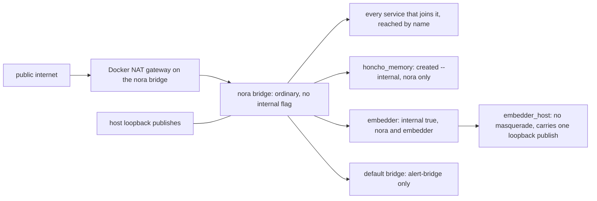
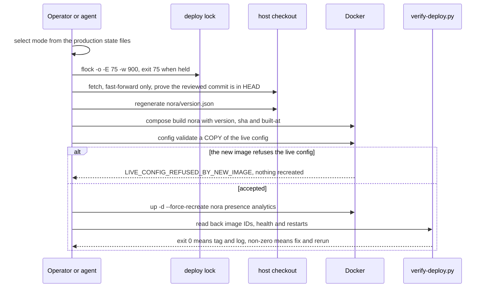
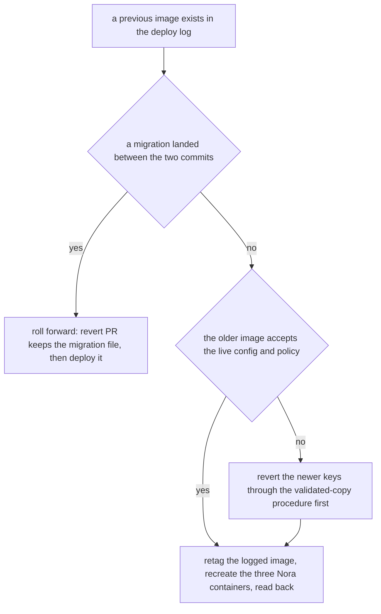

# Deployment

The running system is one root Compose project plus a family of images built from this repository.
Both deployment procedures in the tree — the checkout procedure and the off-by-default
Komodo release path — keep to one shape: produce a stamped artifact, prove the live configuration is
still accepted by it, then recreate a cohort. That order is not stylistic, because each step can
refuse before the next one touches anything that is running
([`docker-compose.yml`](../../docker-compose.yml), [`Dockerfile`](../../Dockerfile)).

The checkout procedure applies when an installation selects checkout mode. Which procedure is in
force is a property of the installation and cannot be read off the repository — a checkout being
present here says nothing either way. Step 0 of
[`nora-deploy`](../../.agents/skills/nora-deploy/SKILL.md) is the contract, and
[which procedure applies](#which-procedure-applies) below is this page's reading of it.

Two facts decide most of what a reader gets wrong here, and both are stated first for that reason:

- **In checkout mode, live-mounted content changes behaviour without an image change.** Doctrine,
  Dreamer instructions, and all three TOML files reach the process through bind mounts, not through
  the image. A `git pull` that only moves text under `nora/doctrine/` is a complete deploy; a `git pull`
  that moves code is not a deploy at all until the image is rebuilt *and* the containers recreated.
  Where those mounts are absent, the same edit is an image change.
- **A host-network build is not a host-network container.** The `build:` blocks that install OS packages
  set `network: host`, which governs only how that build's own steps reach the network; the containers
  created from those images declare bridge networks and publishes themselves
  ([`deploy/README.md`](../../deploy/README.md)) — and, as the networking section argues, publishing is
  not the same question as egress. That is a checkout-mode statement: a Komodo stack deploys pre-built
  images from a generated file with no `build:` stanzas, so nothing builds there at all.

Process assembly — the boot order, the object graph, loop ownership — belongs to
[the runtime topology](../architecture/runtime-topology.md). What each container *keeps* is on
[state, scoping and durability](../architecture/state-and-scopes.md), the schema-and-config story is
[configuration](configuration.md), and the alert path out of these services is
[observability](observability.md).

## The service inventory

Every row is a service in the root project. The `published ports` column reports what the file
declares: nine services forward a port onto the host's loopback address, and several rows record no
`ports:` at all — those are addressed by service name from their peers.

| service | image / command | published ports | persistent state | health signal |
|---|---|---|---|---|
| `nora` | `nora:latest` — the image's own entrypoint `uv run --no-sync python -m nora --config config.toml` | `127.0.0.1:9100` only; joins `nora`, `honcho` (`honcho_memory`), `embedder` | `./data` → `/app/data` (blobs), `./state` → `/app/state` (rotating OAuth chains), `config.toml`/`identity.toml`/`policy.toml` read-only, doctrine + Dreamer directories read-only | the container healthcheck reads `/health` on `:9100` (200 healthy, 503 not); Prometheus scrapes `/metrics` on the same port |
| `presence` | same `nora:latest`, entrypoint overridden to `python -m nora.presence` | `127.0.0.1:9101` | none of its own — fixes land in the shared Postgres | `/health` on `:9101` |
| `analytics` | same `nora:latest`, entrypoint overridden to `python -m nora.analytics` | `127.0.0.1:9103` | none of its own | `/health` on `:9103` |
| `app` | `nora-app:latest`, built from `./app` (the friend-group web portal) | `127.0.0.1:3400` → `:3000`; reaches `nora` as `nora:9100` | `identity.toml` read-only (the portal's roster is the same bytes as Nora's) | none declared in Compose |
| `site` | `nora-site:latest`, built from `site/Dockerfile`; **profile `site`** | `127.0.0.1:3401` → `:8080`; not on `nora` | none | none declared |
| `db` | `pgvector/pgvector:pg18` | `127.0.0.1:5435` → `:5432` | named volume `db-data` | `pg_isready -U nora -d nora` |
| `signal-cli` | `signal-cli:0.14.7`, built via `deploy/signal-cli` after `fetch.sh` | **nothing published** | `./state/signal-cli` — device registration, not just history | JSON-RPC `version` over `/api/v1/rpc` |
| `whatsapp-bridge` | `whatsapp-bridge:0.1.0` (Node/Baileys) | **nothing published** | `./state/whatsapp` — the paired session | `curl /health` |
| `instagram-bridge` | `instagram-bridge:0.1.0` (Go) | **nothing published**; reaches the host collector at `host.docker.internal:4318` | `./state/instagram` — cookies plus reconnect state | `curl /health` (200 while checkpointed, by design) |
| `rustfs` | `rustfs/rustfs:1.0.0-rc.1` | **nothing published** | named volume `rustfs-data`; root credentials are required (`:?`) variables | a non-failing `curl` on `:9000/` — any HTTP answer counts, because every route is SigV4-signed |
| `stt` | `stt:latest`, built from `deploy/stt` | **nothing published** | named caches `stt-huggingface-cache`, `stt-modelscope-cache` | `/health` on `:8000`; `start_period` is 900 s for the first weight download |
| `voice-sidecar` | `voice-sidecar:latest` (Node, `@discordjs/voice`) | **nothing published** | named volume `audio-controller-state` (a bind mount would mask the image's `chown`) | `/health` on `:4600`, healthy while idle without a token |
| `voice-wake` | `voice-wake:latest` (Python wake gate) | **nothing published** | none — PCM is transient end to end | `/health` on `:4601`, healthy while idle |
| `embedder` | `ghcr.io/ggml-org/llama.cpp:server-…` pinned **by digest**; **profile `embedder`** | `127.0.0.1:8092` → `:8080`, carried by the `embedder_host` network | `EMBEDDER_MODELS_DIR` bind-mounted read-only | llama-server's own `/health` |
| `prometheus` | `prom/prometheus:v3.7.3` | `127.0.0.1:9190` → `:9090` | named volume `prometheus-data`, 30-day retention | `/-/healthy` |
| `alertmanager` | `prom/alertmanager:v0.28.1` | `127.0.0.1:9193` → `:9093` | named volume `alertmanager-data` | `/-/healthy` |
| `alert-bridge` | `nora-alert-bridge:latest`, built from `deploy/alert-bridge` | **nothing published**; joins `nora` **and** the default bridge | none — it keeps no state on purpose | `urllib` GET on `:9110/health`, by name from Alertmanager |

Two host paths are Compose-only overrides rather than config keys:
`${NORA_DATA_HOST_ROOT:-./data}` for the blob directory (the eval sandbox points it at a scratch
directory) and `${EMBEDDER_MODELS_DIR:-./models/embedder}` for the embedding model files.

Three properties of this table are load-bearing rather than incidental:

1. **`nora`, `presence` and `analytics` share one image build and one image reference.** `presence`
   and `analytics` declare no `build:` stanza at all, and each overrides the image `ENTRYPOINT`
   rather than appending a `command:`, because a command would arrive as an argument to the daemon's
   own entrypoint. What that shares is the build and the reference, not guaranteed identical running
   code: each container keeps the image ID it was created from, so a tag that has moved plus a partial
   recreate leaves containers on the older image while `docker ps` shows the same tag three times.
   Cohort recreation plus the image-ID readback in `scripts/verify-deploy.py` is what makes the
   running code coherent.
2. **A profile is not started by a plain `up`.** `site` and `embedder` are opt-in services, so their
   absence from `docker compose ps` is normal and their presence in the file is not a promise that
   they run.
3. **Every publish in this file is loopback, and several services declare no `ports:` at all.**
   Nine services bind a port to `127.0.0.1`; the three transport session stores, the object store, the
   speech and voice containers and the alert bridge declare none, and are addressed by service name
   from their peers. A `ports:` entry configures forwarding on a host address; leaving it out removes
   that forwarding, not the container's own address on the bridge.

## Inbound publishes, and outbound connectivity

These are two independent axes, and conflating them is the most common misreading of this file. A
published port is **inbound**: it decides what on the host (and, if bound to `0.0.0.0`, on the LAN)
can open a connection into a container. Egress is decided by the network's gateway, not by `ports:`.

The `nora` network — the project's own bridge, joined by nearly every service — is an **ordinary
bridge with no `internal` flag**, so Docker gives it a NAT gateway and every container on it can
open outbound connections. That is not an oversight: it is how `signal-cli` reaches Signal, how the
WhatsApp and Instagram bridges reach their servers, how `stt` downloads its weights on first boot,
how `nora` reaches the model router, the search APIs and `honcho:8000`, and how both
`nora` and `instagram-bridge` reach the host's OTLP collector through
`host.docker.internal:host-gateway`. Only two networks in the file have no way out, and both are
deliberate.

| network | who is on it | what it decides |
|---|---|---|
| `nora` (project bridge) | nearly every service | an ordinary bridge: name resolution for every peer **and** outbound connectivity through Docker's NAT. Its gateway is the default route, which is why the two networks below are internal rather than additional ordinary bridges |
| `honcho` — declared `external`, name `honcho_memory` | `nora` **and nothing else** | Honcho answers with no authentication and is not in this repository, so the protection is where it listens. Created by hand as `docker network create --internal honcho_memory`: no gateway, so joining it cannot move nora's default route. Absent, *every* `up` that names `nora` fails immediately and names it, before touching the running container |
| `embedder` (`internal: true`) | `embedder` and `nora` | the model server needs no egress, and an internal network has no gateway, so joining it cannot move nora's default route |
| `embedder_host` (`enable_ip_masquerade: false`) | `embedder` only | exists solely to carry the loopback publish for host-side evaluation: Docker publishes no port for a container whose only network is internal, and with no masquerade the publish is docker-proxy on the host connecting in, which gives the model server no NAT route out |
| default bridge | `alert-bridge` | it keeps `nora` so Alertmanager can post to it by name, and adds the default bridge for its own outbound traffic to the Discord REST API. Its comment records the other half of the reason: it no longer needs to reach `signal-cli` at all |

*Two axes in one picture: one gateway for everything on the ordinary bridge, and two internal
networks that only exist to reach one service each.*

"Private network" here is an addressing and naming statement rather than an isolation one: several
services declare no `ports:` and are reached by service name from their peers, and on a Docker daemon
host a container's bridge address is reachable without any published host port ([the bridge
driver](https://docs.docker.com/engine/network/drivers/bridge/)). A `ports:` entry therefore
configures forwarding on host addresses, and its absence removes that forwarding rather than
excluding the host. What the tree actually restricts is the two gateway-free networks
(`honcho_memory`, created `--internal`, and `embedder`, declared `internal: true`), which nora joins
only to talk to those two services, plus the sandbox VM's own egress policy
([Nora's computer](../systems/computer-and-browser.md)).

The Honcho arrangement is pinned by
[`tests/architecture/test_honcho_is_reached_by_a_private_network.py`](../../tests/architecture/test_honcho_is_reached_by_a_private_network.py):
the external declaration, the exact member list (`["nora"]`), the `--internal` form of the create
command that [`docs/runbook.md`](../../docs/runbook.md) documents, and the absence of any
`host.docker.internal:8000` route back to memory. Its rollback order is the inverse of its cutover
for the same reason: put the config back first, reopen the port second, recreate nora from an old
compose file last.

## The image and the version stamp

### What the Dockerfile bakes

`python:3.12-slim`, uid/gid 1000 (so bind-mounted `./data` is writable without a runtime `user:`
override), a pinned `uv`, and `curl` + `ffmpeg` — the transcode decoder Discord's voice client
shells out to. Dependencies are installed with `uv sync --frozen --no-dev --extra sentry`, so the
deployment image *can* report errors while `nora/obs/errors.py` stays inert without a DSN. The
entrypoint runs with `--no-sync` so the container never reaches PyPI at runtime.

Configuration is deliberately **not** in the image: `config.toml`, `identity.toml`, `policy.toml` and —
in checkout mode — the doctrine tree are bind-mounted at run time, and the image ships only the
`*.example.toml` templates. Anything an operator would want to change without a build is therefore
outside the artifact, and anything inside it is code.

### The stamp chain, and why it is a chain

The version Nora reports cannot be a runtime lookup: the build context has no `.git` and the
container may not reach a forge, so an API answer would describe the *repository* rather than the
artifact, and the two disagree the moment a deploy lags a merge. So the stamp is baked, and three
separate pieces make disagreement impossible rather than unlikely
([`nora/infra/version.py`](../../nora/infra/version.py)):

1. **Generate, on the host.** `scripts/gen_version_manifest.py` writes `nora/version.json` from
   `git describe --tags --match 'v[0-9]*'` plus each version's changelog section and commit subjects.
   A dirty tree is refused, because a manifest is a claim about an artifact and an uncommitted tree
   is an artifact no commit describes.
2. **Copy, in the same snapshot.** The manifest arrives with the same `COPY nora/ ./nora/` that
   copies the code, so the version reported and the code running come from one filesystem snapshot.
3. **Gate, inside the build.** `scripts/check_version_stamp.py` compares the baked manifest against
   the `NORA_VERSION` build argument and fails the build on a mismatch either way round: a claimed
   version with a different manifest, or a claimed version with no manifest to read.

Two cases are deliberately *allowed*, and both matter operationally. An **empty** `NORA_VERSION`
builds UNSTAMPED — `docker compose build` for a config change must not force an operator to invent a
tag — and in that case the gate *deletes* any stale `nora/version.json` left in the build context, so
an unstamped image answers `unavailable` instead of reporting a version it is not running. The other
case is a checkout whose tags were never fetched: the build is then stamped from the newest tag it
holds, which is still a true description of HEAD, and the runbook's table maps each stamp shape
(`vX.Y.Z`, `vX.Y.Z-N-g<sha>`, or none) to what actually happened.

The reader side is one module with a fail-closed contract and **no exceptions**: absent, unreadable,
malformed JSON, or a well-formed file of the wrong shape all land in the same `_reason`, and every
lookup turns that into `unavailable`. The three statuses — `ok`, `nothing_found` (the manifest was
read and has no such version) and `unavailable` (nothing could be read) — exist so a caller reading
only `status` cannot confuse "she cannot check" with "that version never existed".

`NORA_GIT_SHA` and `NORA_BUILT_AT` are separate build arguments from the version, and for an ordinary
unversioned deploy they are the only provenance: [`nora/app/revisions.py`](../../nora/app/revisions.py)
records them, the three config files as read, and both corpora at each boot, which is what makes
"what code was in force at T" answerable for a deploy that has no release tag. Recording is never
load-bearing: a failed write is counted and the process runs on.

## Lifecycle: ordering, health and shutdown

`depends_on` is used only where "the process exists" is not enough. `nora` waits for `signal-cli`
`service_healthy` (her first act is to attach an SSE listener, so a merely-spawned daemon is a
silent one) and for `db` `service_healthy`; `app` waits for `nora` to be healthy because it proxies to
it. `presence` and `analytics` also wait for a *serving* Postgres because each runs the migration
chain itself at startup.

`/health` is a status document, not a liveness ping — and its healthy/503 boundary is a decided
policy, not an accident:

- an adapter that is **disconnected** makes the response 503; an adapter that is **degraded** does
  not, because a 503 would fail the container healthcheck and take the other platforms down with it;
- the store, Honcho, and the doctrine store each contribute to the verdict;
- `config.<file>.stale` is a canary for the single-file bind-mount trap: `identity.toml` and
  `policy.toml` are loaded once, an atomic edit changes the inode, and only a recreate — not a
  restart — serves the new bytes. The staleness field is how `/health` says so
  ([`nora/obs/health.py`](../../nora/obs/health.py)).

Stopping is a designed interval rather than a default. `docker stop` sends SIGTERM, and the daemon
handles it ([`nora/__main__.py`](../../nora/__main__.py)): adapters and loops stop, a running
Cognition session gets `SESSION_SHUTDOWN_GRACE_SECONDS` (30 s) to finish, what remains is cancelled
and records its wake `cancelled` so the unit is freed, then the model client and store close. The
`nora` service therefore sets `stop_grace_period: 75s` — the session grace plus 30 s for the rest —
and a second signal still ends the process immediately for an operator who cannot wait.
[`tests/architecture/test_the_stop_grace_covers_the_shutdown.py`](../../tests/architecture/test_the_stop_grace_covers_the_shutdown.py)
pins both the compose figure and the constant *as literals*, precisely because a grace of zero would
satisfy a naive `grace + rest <= stop_grace_period` assertion.

## Which procedure applies

Two deployment procedures exist in the tree, and **which one an installation uses is a property of
that installation, not of the repository**. [`nora-deploy`](../../.agents/skills/nora-deploy/SKILL.md)
makes the selection step 0, before any file or service is touched, and gives it an order:

- **A production receipt exists** (`release-deploy.json`) → **Komodo owns deployment**. Images arrive
  from a published release bundle and a native Stack deployment recreates the owned cohort, so the
  checkout steps must not be run at all — a master pull changes none of the image-owned files, and
  rebuilding local tags would restore exactly what that path removed.
- **Both state files confirmed absent** (`release-deploy.json` and `release-attempt.json`) →
  **checkout mode**: the host holds a git checkout, the image is built there, and only a VERIFIED
  deploy is tagged and logged. The rest of this section describes that transaction.
- **Unreadable state, or Periphery unavailable** → **UNVERIFIED**. Never a licence to guess checkout
  mode.
- **An outstanding attempt** (`release-attempt.json`) requires native failure recovery even when no
  success receipt exists.

*The checkout transaction, in the only order that lets each step refuse before the next touches a
running container.*

In checkout mode the transaction runs in this order, which is the order the guarantees depend on:

1. **One deployer at a time.** Every checkout deploy, config edit and rollback runs under
   `flock -o -E 75 -w 900 /tmp/nora-deploy.lock`. `-o` closes the descriptor for everything the
   script starts, so a long-lived child cannot inherit the lock and hold it after the deploy has
   finished — a leaked lock is indistinguishable from a deploy that never ends.
2. **The change is merged, and the checkout is the merge.** The script refuses a dirty or ahead
   checkout, fast-forwards only, and asserts the reviewed commit is an ancestor of HEAD before it
   builds anything.
3. **Build a stamped image.**
4. **Validate the live config against the new image, before recreating anything.** This is the step
   that turns "the merge removed a config key" into a refusal with nothing touched, instead of a
   crash loop of all three containers: the live file still holds a key the new schema forbids, and a
   deploy that skipped this step would recreate three containers onto a config they reject at
   startup. The candidate must be a **copy** outside the checkout: Docker creates a missing bind
   source directory as root, and the next pull then fails.
5. **Recreate the cohort, by name.** `nora presence analytics` — never `nora` alone (see below).
6. **Read back.** `scripts/verify-deploy.py` answers the two questions the recreate cannot: is every
   container that *asked for* this image actually on the image just built, and is it up and healthy a
   grace period later. It selects containers by `Config.Image` (the reference given at create time)
   rather than by `--filter ancestor` or the `docker ps` display value, because both of those
   *exclude* the stale container it exists to catch; and it treats `running` as insufficient, because
   a crash loop is `running` between restarts. `STALE` names a container to recreate, `DOWN` points at
   its logs. The same module exposes a second entry point, `verify_services(project, images)`, which
   selects the expected cohort by Compose project and service labels *before* comparing digests, so a
   service that is missing altogether cannot fall out of the denominator.
7. **Tag and log, only on success.** A verified image becomes `nora:sha-<commit>` and a line in the
   deploy log. This ordering is what makes a failed deploy impossible to roll *onto*.

### What a deploy must move together

| change | reaches the process through | must move |
|---|---|---|
| `nora/` code, `nora/skills`, `evals/`, `pyproject.toml`, `uv.lock` | `COPY` in the Dockerfile | rebuild, then recreate `nora presence analytics` |
| `nora/doctrine`, `nora/dreamer` (edit) | directory bind mounts, `reload = "mtime"` | pull only — and the reload is visible in `/health`'s `doctrine_sha256` with `nora_doctrine_reload_failures_total` unmoved |
| a doctrine or Dreamer file the **code maps** (added/renamed/deleted) | same mounts, but the running image does not know the name | image and pull together |
| `config.toml` | file mount into `nora`, `presence`, `analytics`, `stt`, `voice-wake` | validated copy, then recreate all of them |
| `identity.toml` | file mount into `nora`, `app`, `presence`, `analytics` | recreate those; loaded once |
| `policy.toml` | file mount into `nora` and `analytics` | recreate both; loaded once |
| `deploy/<svc>/`, `app/`, `site/` | that service's own image | build and recreate that service |
| `nora`, `voice-sidecar`, `voice-wake` | three images, two changed seams plus a control plane | all three, or none |

Three recurring failures live in that table. A pull plus a `restart` deploys **no code** — the old
image keeps running. `--force-recreate nora` alone leaves the other two containers on the image they
were created from while `docker ps` shows the same tag for all three; when the live config carries
keys a stale image's schema forbids, those containers reject them at startup (`extra_forbidden`) and
enter a restart loop that the recreate's own exit status never reports. And the voice images are
asymmetric: `voice-sidecar` and `voice-wake` build their own images, so `verify-deploy.py` cannot see
them, and a half-deploy fails *in the far container* — an old gate reads a new hello frame as audio
from an empty speaker and tears the connection down in a loop, a new gate drops frames from an old
sidecar and still reports `healthy` — while the near container's healthcheck stays green.

The environment is part of the same discipline: Compose does not inherit host `.env` values into a
service, so a variable that is not listed in a service's `environment:` is invisible to it however
present it is on the host. A key that is absent there produces `unavailable` forever rather than a
crash — except where an enabled adapter cannot authenticate, which is a crash loop by design.

## Rollback is schema-and-config compatibility, not image retagging

In checkout mode the retag is the last, smallest step. What decides whether a rollback is possible at
all is whether the older image can run against the state the newer one left behind, in two
independent dimensions.

*Why a rollback is a compatibility question first: the retag at the bottom is the only step that is
free, and it runs last.*

- **Schema.** Every startup runs `alembic upgrade head`, so a database ahead of an image's revision
  set fails that image at boot. The rollback procedure therefore diffs the migration versions
  directory between the two commits and refuses with `MIGRATION_SINCE` rather than producing a
  container that cannot start. The follow-up revert PR must **keep** the migration file: the database
  is already at that revision, and every container fails at start on a revision its image does not
  know. Revert the code that uses the table, never the file that creates it. Where schemas are
  genuinely incompatible, the options are roll forward or a tested database restore — not a retag.
- **Configuration.** `config.toml` and `policy.toml` are bind-mounted and strictly validated
  (`extra="forbid"`), so an older image meeting a newer key crash-loops loudly until the files match
  the image. Rolling `nora` back therefore means reverting the keys through the validated-copy
  procedure first; a stale key is not a warning, it is a boot failure.
- **What a rollback is not.** Only VERIFIED deploys are tagged and logged, so the previous entry in
  the deploy log is the only legitimate target, and `NO_PREVIOUS` means roll forward instead. Three
  processes share one image, so a rollback recreates `nora presence analytics` together, for the same
  reason a deploy does.
- **Concurrency is inside the database too.** The migration chain takes a Postgres session-level
  advisory lock on a dedicated connection, and a loser *polls* for it rather than blocking — a
  blocking wait deadlocks against the `CREATE INDEX CONCURRENTLY` migrations, because a parked loser
  is itself an in-progress statement. A deadline turns a stuck winner into an ordinary startup
  failure instead of a silent hang
  ([`nora/infra/sql/migrations_runner.py`](../../nora/infra/sql/migrations_runner.py)).

A retag itself touches no data: the store is not part of the image, so rolling the image back leaves
every row where it was. What cannot be undone by any rollback is data written *after* the newer image
started writing it — which is the same statement as the schema rule, seen from the other end.

## Deployment paths that exist

Three paths are in the tree besides the checkout transaction. None of them becomes the procedure in
force by merging code; each is an installation decision.

- **Komodo release deployment** ([`deploy/komodo/README.md`](../../deploy/komodo/README.md)) is off by
  default *in the repository*: the publisher job is gated on the repository variable
  `RELEASE_IMAGES_ENABLED`, and the example Procedure ships with `schedule_enabled = false`
  ([`.github/workflows/release-images.yml`](../../.github/workflows/release-images.yml),
  [`deploy/komodo/resources.example.toml`](../../deploy/komodo/resources.example.toml)). What it would
  change is substantial: images arrive from a registry selected by digest on a generated `deployments`
  branch; the generated Compose file **removes** every `build:` stanza and the doctrine/Dreamer source
  mounts, so "the image's own instructions become authoritative"; relative host binds become
  `${NORA_RUNTIME_ROOT:?}` paths so private config and transport sessions stay outside Komodo's
  managed clone; and a wrapper installed on the host
  ([`scripts/komodo_deploy.py`](../../scripts/komodo_deploy.py)) holds the same deploy lock through
  pull, candidate validation, recreation, readback and a receipt. An outstanding-attempt marker
  refuses reapplication of a failed candidate, and there is no blind automatic rollback — the same
  schema argument as above, stated by that procedure in its own words. Its owned cohort is every
  repository-built service plus `presence`/`analytics`; `site` stays opt-in and third-party
  infrastructure images are excluded from automatic recreation. Turning it on is a documented
  installation: a disposable rehearsal, an explicit cutover and a first manual run before the
  schedule is enabled at all.
- **The bare-metal systemd path** ([`deploy/nora.service`](../../deploy/nora.service),
  [`deploy/install.sh`](../../deploy/install.sh)) is kept for reference and as a fallback, and it
  predates the Postgres cutover: its `EnvironmentFile`, `ProtectSystem=strict` hardening and
  `IPAddressDeny=any` egress floor describe a host process running against a local SQLite file. Its
  documented rollback is `git checkout <previous-tag>` plus a restored v1 database, which is a
  different operation from the container-era one.
- **The opt-in profiles.** `site` and `embedder` are real services that a plain `up -d` does not
  start; enabling either is a profile decision with its own prerequisites (a tunnel route for the
  site, model files and an internal network for the embedder), not a side effect of deploying.

One path is retired rather than inactive: `deploy/watchdog.sh` is deleted, replaced by Prometheus
rules, Alertmanager and `alert-bridge`. Its condition became a rule (`PlatformSilent`), and the reason
it was never worth keeping as a fallback was that its delivery path was a non-zero exit — see
[observability](observability.md).

## Surfaces adjacent to the deploy

Three integrations sit next to the Compose deploy: each is a mechanism in this repository, and each
depends on an installation step this repository cannot perform or verify.

- **Nora's computer and its backup units.** The sandbox VM is not a service in the root project; it
  runs as two **user** systemd units under [`deploy/computer/`](../../deploy/computer/README.md) —
  `nora-computer.service` runs `computerd` in the foreground of an `sbx exec` so systemd restarts it,
  and `nora-computer-backup.timer` fires `nora-computer-backup.service` on a nightly calendar
  (`Persistent=true`, so a night the host was off is made up at the next start) to run
  `nora-computer backup`. The reason the archive is a unit rather than a tip in a runbook: a recreate
  or a destroy deletes the VM's `/workspace`, so the archive is the only copy that survives one, and
  `nora-computer destroy` takes a verified backup first and refuses without one. Installing them is
  symlinks into `~/.config/systemd/user` plus `systemctl --user enable --now`, as that README
  documents; that a host has done so, and that an archive exists and verifies, is a reading from the
  host (`systemctl --user list-timers`, then the archive's own digest), not a fact this page can
  assert. [`tests/unit/test_nora_computer_backup.py`](../../tests/unit/test_nora_computer_backup.py)
  drives `backup`, `restore` and destroy's backup against a stub host with a real tar and a real
  `sha256`, and marks the real `sbx` crossing UNVERIFIED.
- **The tracing collector.** The container half of the contract is here: `[obs.tracing]` in
  `config.toml` chooses the exporter (`otlp_http` plus an endpoint), and `instagram-bridge` is given
  `http://host.docker.internal:4318/v1/traces` directly. The collector that receives those spans is a
  host service this repository does not own, and its two downstream pipelines are described only
  from documentation in [observability](observability.md). Whether a span arrives therefore depends
  on that installation's configuration, and an absent trace is a statement about the pipeline, not
  about whether a deploy succeeded.
- **The alert bridge.** `alert-bridge` is a Compose service but a deliberately separate failure
  domain: the most important alert this stack sends is "Nora is down", so delivery cannot depend on
  Nora being up. It is stdlib-only with no retry queue, no state and no dedup — Alertmanager already
  does grouping and repeat, and re-implementing it would mean two components disagreeing about
  whether anyone was told — and it posts to Discord's REST API rather than holding a Gateway session.
  With `ALERT_DISCORD_CHANNEL` unset it renders and logs the alert and says at ERROR that it dropped
  it, which is the honest outcome rather than a silent success.

## Focused tests

| test | what it pins |
|---|---|
| [`tests/architecture/test_the_stop_grace_covers_the_shutdown.py`](../../tests/architecture/test_the_stop_grace_covers_the_shutdown.py) | the compose `stop_grace_period`, the session grace as a literal, and that the entrypoint runs the app only under the signal handler |
| [`tests/architecture/test_honcho_is_reached_by_a_private_network.py`](../../tests/architecture/test_honcho_is_reached_by_a_private_network.py) | the external `honcho_memory` network, its single member, the `--internal` create command, and that no compose environment line routes memory through the host |
| [`tests/test_env_template.py`](../../tests/test_env_template.py) | every `*_env` name in the example config *and* in each section's defaults is actually listed in the `environment:` of the service that reads it — Compose passes an explicit list, not the host `.env` |
| [`tests/architecture/test_compose_gives_nora_no_container_control.py`](../../tests/architecture/test_compose_gives_nora_no_container_control.py) | no service mounts the host Docker socket, read as parsed YAML so a long-syntax mount cannot hide |
| [`tests/test_version_stamp_build.py`](../../tests/test_version_stamp_build.py) | generator, build gate and reader agreeing, against a real throwaway git repository with real tags |
| [`tests/unit/test_release_deployment.py`](../../tests/unit/test_release_deployment.py) | the release bundle covers every `build:` service, refuses a foreign or mutable pin, strips `build:` and the doctrine mounts, and never recreates services when host validation fails |
| [`tests/unit/test_nora_computer_backup.py`](../../tests/unit/test_nora_computer_backup.py) | the backup holds the rooms' files and excludes browser credential profiles, and restore refuses an archive whose members could write outside a room |
| [`tests/architecture/test_voice_path_never_swaps.py`](../../tests/architecture/test_voice_path_never_swaps.py) | `mem_limit` equal to `memswap_limit` on the voice path, so resident model weights are not paged out |
| [`tests/test_deploy_assets.py`](../../tests/test_deploy_assets.py) | the historical systemd unit's hardening, and that the Dreamer tree is package data *and* a read-only directory mount |

What none of them can prove is the thing the readback exists for: that the containers running on a
host are on the image that was just built. That question is answered only at the moment of deploy, by
`verify-deploy.py`, and the answer is a non-zero exit rather than a message.

## Reading a deploy that looks green

- `docker ps` showing `nora:latest` three times proves the tag was *requested*, not that all three
  containers are on the current image. Compare image IDs.
- `docker compose exec` proves the **file**, not the process: a loaded-once config file is in effect
  only in a container started after the edit, and `/health`'s `config.<file>.stale` is how the running
  process says which of the two it is reading.
- "It publishes nothing" answers an inbound question. Every container on the ordinary `nora` bridge
  still has a route out, so egress expectations have to be read off the network, not off `ports:`.
- Declaring no `ports:` removes a host-forwarded address, not the container's reachability: on a
  Docker daemon host its bridge address answers without one. The credential-holding rows are
  identified by what the file forwards, not by a boundary it draws.
- A container that is `running` may be a crash loop between restarts, and a healthcheck that only
  proves the HTTP layer serves says nothing about whether the platform websocket behind it is alive.
  That second question is deliberately moved one layer up, to the per-platform
  `last_event_age_seconds` on `/health` and the `PlatformSilent` rule.

## Where to read next

- The three TOML files as lifetimes and review surfaces, and which flag builds which subsystem:
  [configuration](configuration.md).
- What each container keeps, what it can rebuild, and why the store is outside the image:
  [state, scoping and durability](../architecture/state-and-scopes.md).
- The process these containers run, as one object graph:
  [runtime topology](../architecture/runtime-topology.md).
- The alert path `/health` and `/metrics` feed: [observability](observability.md).
- The adapters behind the transport containers:
  [platform adapters](../integrations/platform-adapters.md).
- The sandbox VM, its egress policy and its restore path:
  [Nora's computer and the browser](../systems/computer-and-browser.md).
- Proving a deploy did what it claimed: [verification](../testing/verification.md), and the
  symptom-first recovery paths in [troubleshooting](troubleshooting.md).
