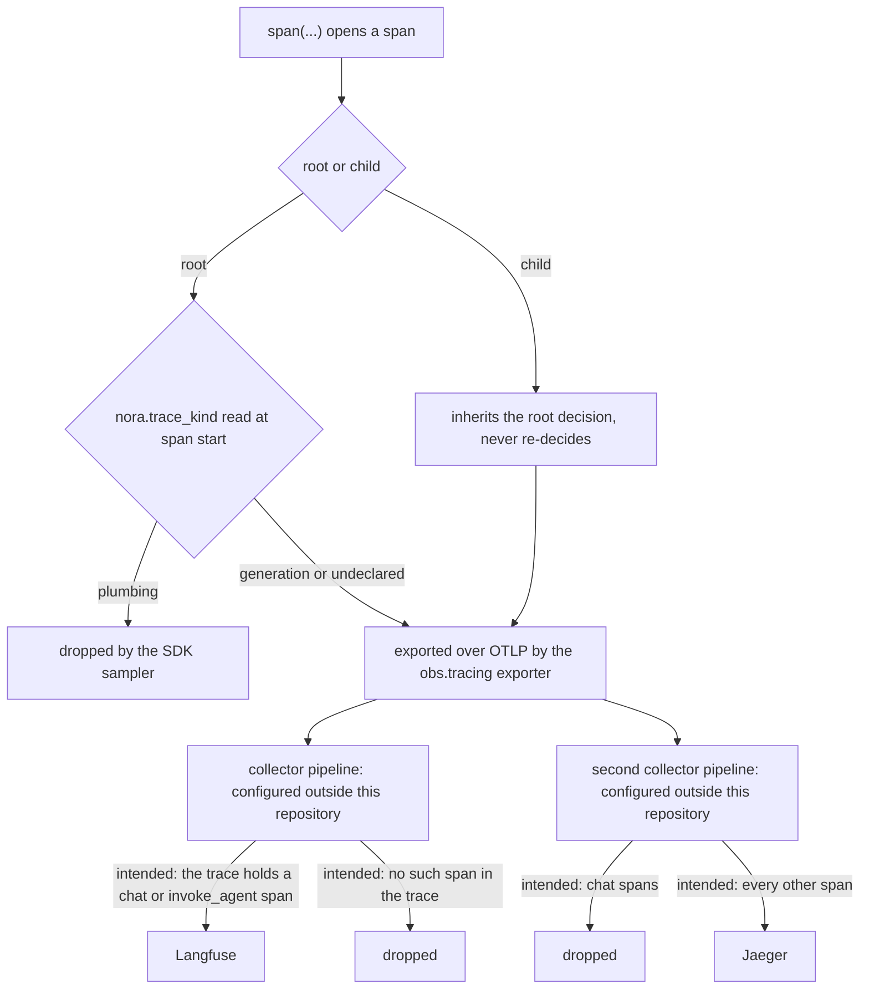

# Observability

Nora is instrumented in four places and answers one endpoint about itself, and the boundaries
between them are drawn rather than stylistic: the codebase's highest-volume entry point is
ingest plumbing that contains no model call, so exporting it would bury the turns an
LLM-observability tool exists to show ([`../../nora/obs/tracing.py`](../../nora/obs/tracing.py),
[`docs/observability.md`](../../docs/observability.md)). This page is the map: which signal
answers which question, how a span physically leaves the process, what makes a span a
*generation*, how a metric series becomes readable, and what `/health` aggregates and omits.

Two vocabulary rules run through everything here and are owned elsewhere: the three-state
result vocabulary (`ok` / `nothing_found` / `unavailable`) applied to instruments is
[the failure and status contract](../architecture/failure-and-status-contract.md), and the
container-level consequences of `/health` returning 503 are [deployment](deployment.md)'s.
When something is already broken rather than merely unreadable, start from
[troubleshooting](troubleshooting.md).

## Signal to question

Pick the signal from the shape of the question, not from the store that happens to be open.

| signal | lands in | answers | shape of the question | the wrong tool for |
|---|---|---|---|---|
| **metrics** | Prometheus, scraped from `/metrics` | how many, how often, with what outcome | aggregate, over the whole deployment | "why was *this* turn slow" |
| **traces** | Langfuse, plus Jaeger for everything except the `chat` spans when the collector is wired as documented | what happened in this turn, in what order, at what cost | one instance, re-derivable | how often anything happens |
| **logs** | stdout, JSON lines | what one line of code saw | forensic, after the fact | any count or rate |
| **errors** | Sentry | which stack trace, how often, and is it new | grouped per exception | anything that does not raise |
| **health** | `GET /health` on the metrics port | are the process and its named dependencies answering *now* | one verdict plus a body | whether a turn, a delivery or an export works |

Two rules keep those apart. The first is the trace boundary (R-76, below): a trace reaches an
LLM-observability tool only when the work under it *can contain a model call*. The second is the
same judgement one signal over — if the answer is "how many, how often, with what outcome", it is
a counter, and a log line restating it on an interval is a third copy of a number two other
systems already hold, emitted by the one store that cannot be summed
([`docs/observability.md`](../../docs/observability.md)).

## How a span leaves the process: one filter here, a collector elsewhere

Only the first filter is in this repository. Whatever happens after the exporter belongs to a
collector configured outside it, on the host that runs it — so this page describes the two
downstream pipelines as the *documented intent* of an integration, never as something this repo
can verify or enforce.

*The span's route out of the process: the one sampler decision this repository owns, then two
pipelines whose documented intent is shown here as intent.*

**① The SDK sampler** is `ParentBased(root=_PlumbingIsNotATrace())`, built by
`build_sampler()` and installed by the provider setup in
[`../../nora/obs/tracing.py`](../../nora/obs/tracing.py). It decides **roots only**; a child
inherits whatever its root was given and never re-decides. That composition is load-bearing for
two different reasons: a stage span with no model call in it (`engagement.admission`, the `store.*`
reads) must stay in the middle of a real turn so an early exit is legible, and a queued tag's turn
— re-attached to a captured context whose root span already ended — must land in the trace that
admitted it. A per-span rule would punch holes in exactly those traces
([`tests/test_span_skeleton.py`](../../tests/test_span_skeleton.py)).

Three properties of that sampler are easy to get wrong:

- **It is fail-open.** Only an explicit `plumbing` drops. An undeclared root is exported, and an
  unrecognised `nora.trace_kind` is logged as a warning and exported anyway, because erring
  towards export costs visible noise that complains about itself while erring towards silence
  costs an invisible missing trace for a model call.
- **`nora.trace_kind` on a non-root is inert**, not an error — it reads as though it were working.
- **It reads attributes set at span start.** `span()` takes its attributes as arguments for that
  reason; a kind added by `annotate()` one line later is one the decision was already made
  without.

**② What the collector does with those spans is not in this repository.** It is two independent
pipelines in the collector's own configuration, which this repo can neither read, nor test, nor
enforce; the repo's side of the contract ends at posting OTLP/HTTP to the endpoint it is
configured with. What it can state is the *intended design* those pipelines are documented
around ([`docs/observability.md`](../../docs/observability.md)):

- the Langfuse pipeline is intended to **tail sample per trace**: keep a *whole* trace iff the
  trace holds at least one span whose `gen_ai.operation.name` is `chat` or `invoke_agent`, after a
  decision wait. A per-span filter cannot express that — Nora's app root carries no GenAI marker,
  so a span filter would drop the root and orphan the model call underneath it;
- the Jaeger pipeline is intended to drop **only `chat` spans**, the ones carrying prompts and
  reasoning. That has to be an exact match on the operation name rather than "has the
  attribute", because Strands stamps `gen_ai.operation.name` on `invoke_agent`,
  `execute_event_loop_cycle` and `execute_tool` too.

If a collector is in fact configured the documented way, an absent span means:

| what happened | Langfuse | Jaeger |
|---|---|---|
| a turn that reached a model call | the whole trace, including the plumbing under it | everything except its `chat` spans |
| a root declared `plumbing` (e.g. ingest) | nothing — dropped by the SDK before export | nothing — never left the process |
| an undeclared root with no model call under it | nothing — the tail sampler sees no span it keeps | its non-`chat` spans |

So "it is not in Jaeger" is evidence about `chat` spans only, and absence from one store is never
absence of the work. The first filter is testable from inside the repo; for the second, the
collector's own configuration is the only authority, and a deployment's collector is a fact about
that installation rather than about this codebase.

**The export side is the repository's own, and it is one config section.** `[obs.tracing] enabled`
decides whether a provider is installed at all; `exporter` picks `console`, `file` (written to
`endpoint` treated as a path) or `otlp_http` (posted to `endpoint`, with auth headers taken from the
environment variable `headers_env` *names* — a name, never a value). An unknown exporter name raises
inside setup, and the composition root catches it: a bad endpoint or an unreachable collector logs a
warning and the application continues, because tracing is never load-bearing
([`../../nora/__main__.py`](../../nora/__main__.py),
[`../../nora/agent/telemetry.py`](../../nora/agent/telemetry.py),
[`../../config.example.toml`](../../config.example.toml)). Past that point **export failures are
silent by design**: the span is handed to `BatchSpanProcessor`'s background thread and nothing in a
turn waits on, or hears from, the wire.

**The drop is unexported, not deleted, and its numbers move rather than disappear.** A plumbing
root still opens and still records; what it carried is on a counter —
`nora_ingest_outcomes_total{platform, conversation_type, outcome}` carries an ingest's ending, with
`nora_messages_total` and `nora_media_custody_total` beside it. Reversing the decision for one
entry point is a single declaration on that root, never a widening back to "export everything and
sample".

**What a trace holds once it arrives.** `TraceIdentityProcessor`, registered on the provider so it
sees Strands' spans and Nora's own alike, stamps two things and is never load-bearing — a failure
costs the stamp, not the span: a **session** (`session.id` plus `gen_ai.conversation.id`) taken
from `nora.conversation_id`, or from `nora.dreamer.pass_id` for a Dreamer unit, else inherited from
the parent; and an **observation type** from the span name, first match wins
([`../../nora/agent/telemetry.py`](../../nora/agent/telemetry.py)). A session id Langfuse would
drop (too long, or not ASCII) is left unstamped rather than truncated. `user.id` is deliberately
*not* stamped: a group room has many senders and would name a person on a trace whose attributes
are provenance only.

**What a model call owes.** Which span shape a call site gets depends on whether it goes through
the Strands Agent SDK at all: an Agent-backed call needs no instrumentation code (the SDK opens
`invoke_agent` and `chat` itself, and extra fields ride `Agent(trace_attributes=...)`), while a raw
`chat.completions.create` call instruments through `start_raw_model_span`/`end_raw_model_span` so
the span vocabulary stays the SDK's. Two architecture gates hold the line from either side — one
scanning for hand-typed `gen_ai.*` literals outside `nora/agent/telemetry.py`, one enforcing that a
raw client carries its own bound, `finish_reason` read and usage annotation. A local STT service is
**not** a generation: its outcome is
`nora_speech_transcriptions_total` with R-27's states, and the words it produces reach a trace only
through the comprehension pass over the transcript.

## Metrics: declared before recorded, primed before trusted

Everything Nora measures is split into two files with a deliberate seam: `metric_specs.py` holds
**what** is measured — name, help text, label names — while `Metrics` holds **how**, one class with
a `prometheus-client` registry inside it. Metric names are append-only (a rename breaks dashboards
and alerts silently), the full set is `DECLARED_NAMES`, and every label vocabulary is derived from
the domain `Literal` or tuple the call sites already use rather than hand-copied into the help text
([`../../nora/obs/metric_specs.py`](../../nora/obs/metric_specs.py)). One `Metrics` instance is
built per process by composition and threaded through the dependency graph; tests build a fresh one
because `CollectorRegistry` has no reset
([`../../nora/obs/metrics.py`](../../nora/obs/metrics.py)). Reads are *partial-label*: a query names
the labels it cares about and sums over the rest, and a call site that omits a declared label
records `""` rather than crashing.

**A recorded name that is not declared fails quietly, which is why a test exists.** `Metrics.inc`
falls past its counter branch to a bare dict lookup and raises `KeyError`; a call site inside an
`except Exception` swallows that as the failure of whatever it wrapped, so the series is absent from
`/metrics` *and* the error counter reports a failure that did not happen.
`tests/architecture/test_every_recorded_metric_is_declared.py` is the gate: an AST sweep over every
recording call site under `nora/`, resolving string literals, module-level constants and two-arm
conditionals, and **deriving** the set of private forwarding wrappers (`self._inc(name, ...)`)
rather than hand-listing them — the wrappers are exactly where unchecked names hide. Anything the
derivation cannot read must be pinned in `_UNRESOLVABLE`, keyed by file, enclosing function, method
and argument text, and a pin that no longer matches fails the test too. Two positive controls assert
the sweep actually read what it is supposed to, so a green run means "checked and clean" rather than
"found no code to check". What the gate cannot see is stated in its own docstring: labels (an
undeclared label is dropped silently) and a name bound at construction rather than at the call.

**Priming, absence and zero are three different readings.** A labelled Prometheus series does not
exist until its first increment, and `increase()` over a series whose first sample is already 1
reads 0 — so the first `unavailable` after a restart would be invisible to the rule written for it.
`ComputerMetrics.prime()` therefore creates every `(op, status)` and every
`(tool, stage)` at zero, and `nora_computer_up` is deliberately *not* primed: a 0 written before the
first probe would be a lie. That labelled gauge is what makes "not applicable" the absence of the
series, so `ComputerDown` (`== 0`) cannot fire on a deployment with the computer switched off
([`../../nora/app/computer_metrics.py`](../../nora/app/computer_metrics.py)). The same discipline
governs gauges that must keep moving: a liveness gauge bound at **scrape time**
(`Metrics.gauge_function`) shows a climbing age when the loop behind it stops, whereas a gauge
written from inside its own loop can only detect a loop that is up and failing — which is why
`nora_heartbeat_last_tick_age_seconds` is bound to a function and
`nora_presence_last_collection_age_seconds` is not. The heartbeat's own clock is seeded at
construction rather than starting at zero, and a deployment running with `[heartbeat] enabled =
false` binds the series to a "not running" sentinel, because an *unbound* prometheus gauge exports
`0.0` — the same number a healthy loop exports a moment after it ticks
([`../../nora/app/heartbeat.py`](../../nora/app/heartbeat.py)).

The mirror-image rule is that **a declared metric with no call site is a lie**: it renders its
`# HELP`/`# TYPE` header and nothing else, which on a dashboard reads "this never happens" rather
than "this is not wired". Ship the name with its increment, or not yet. The same reasoning explains
a series that is deliberately *not* declared: there is no `nora_reminders_pending`, because a
declared-but-unpublished gauge renders `0.0` forever — indistinguishable from a measured empty
backlog — and publishing it from the tick would be worse than absent when the tick is switched off.

## Logs and errors

`setup_logging` puts `structlog` in front of the stdlib root logger and renders **JSON lines to
stdout**; every call site uses plain `logging.getLogger`, and third-party records ride the same
`foreign_pre_chain` into the same stream. `tag_id` is bound through
`structlog.contextvars` for the lifetime of a turn, so lines carry it without it being threaded
through call signatures. The field set is fixed: `ts` (RFC 3339, UTC), `level` (what a human greps),
`severity_number` (what a machine compares), `logger`, `message`, `tag_id` inside a turn, and the
exception fields.

- **Severity is a number as well as a word.** `level` sorts alphabetically, so "at least a warning"
  cannot be expressed over it; `severity_number` carries the OTel band base, and a level outside the
  mapping gets **no field rather than a guessed one** — the same absence discipline as everywhere
  else.
- **An exception is three fields, not one blob.** The traceback stays in `exception` so saved greps
  keep working, and `exception.type` / `.message` / `.stacktrace` are derived from it; a traceback
  whose shape cannot be parsed sets neither derived field rather than half of one.
- **A log line is not a metric.** The health server runs with `access_log=None`, because one INFO
  line per `/health` and `/metrics` poll would dominate the log, and the heartbeat logs at INFO only
  when its counters moved (the first beat always at INFO, because it records where they started).
  The stated cost: an idle-but-alive deployment emits nothing at the default level, so the log alone
  no longer distinguishes idle from dead — that is `/health`'s and the `nora_*` gauges' job.

**Sentry holds the other half, and the split is architectural.** This codebase is built not to
raise, so its characteristic failure is a counter label rather than a traceback. Sentry sees every
`log.exception` site (a record at ERROR with `exc_info`) plus anything escaping to the top; it does
**not** see an `unavailable`, and those are the Prometheus rules' to catch
([`../../nora/obs/errors.py`](../../nora/obs/errors.py)). It is errors only —
`traces_sample_rate` is 0, because a second tracing pipeline would write a second, incompatible
trace id for the same turn. Configuration is `[obs.errors] enabled`, `dsn_env` (an environment
variable *name*, never the value; unset or empty means off, not an error) and `environment`;
`include_local_variables=False` keeps frame locals off the wire. No `release` is passed, so "is this
new since the last deploy" is not answerable from an issue — the composition root's comment says
what would make it so.

## Health: what it aggregates, and what it cannot prove

`GET /health` sits on the same aiohttp app as `/metrics` (`[obs.metrics] port`) and never raises: a
dependency that fails answers a false or `unavailable` field, not a 500.

| field | counts toward 200/503 | what it establishes |
|---|---|---|
| `sse` (connected, last event age, platform, account) | yes | the primary adapter's connection |
| `platforms` (one entry per enabled platform: connected, last event age, degraded, detail, account) | yes, unless degraded | every enabled platform, not just the primary |
| `store` | yes | the record store answers `stats()` |
| `honcho` | yes | the memory service is reachable |
| `doctrine_sha256` | yes (a failed read is unhealthy) | the doctrine actually loaded, by hash |
| `omniroute.last_success_at` | **no** | reported, never a verdict |
| `errors_since_restart` | **no** | a restated counter, not a check |
| `index` (status, queue) | **no** | a memory-index rebuild must not flap the container |
| `config.*.stale` | **no** | the edited file is not the file this process loaded |
| `uptime_seconds`, `strands_version` | **no** | provenance for a bug report |

Two deliberate asymmetries in that table matter more than the rows. A **degraded** platform — one
that is registered, answers no sends and emits no events — is reported in its entry but does not
make Nora unhealthy, because a 503 would fail the container healthcheck and take the other platforms
down with it. And the per-platform map exists at all because without it a wedged second platform
would leave `/health` at 200 on the primary adapter alone.

**A green health check does not prove a working deployment.** It proves that the named dependencies
answered at poll time. It does not prove:

- that the **model provider** can be reached — `last_success_at` is reported and never aggregated;
- that any **turn, determination or delivery** completes, or that a reply reaches a room;
- that spans or log lines **leave the process** — export happens on a background thread, a wrong
  `[obs.tracing]` endpoint or path fails silently, and what the collector then keeps is its own
  configuration's decision;
- that any **background loop is running** — the heartbeat, presence and analytics daemons publish
  gauges their own alerts read, and a stalled cognition wake loop is alerted on by nothing at all;
- that **writes** work — `store.stats()` is a read;
- that the **collector, alertmanager or bridge** are alive, or that Sentry is configured at all;
- that a **config edit took effect** — `config.*.stale` reports it, and the remedy is a container
  recreate rather than a restart (see [configuration](configuration.md) and
  [deployment](deployment.md)).

## Reading a missing signal back

In the order worth checking, because each step is cheaper than the next:

1. **Is the work running at all?** Read the counter for that path first. A missing span and an idle
   path look identical in a collector, and the counter is what separates "not instrumented" from
   "not running".
2. **Was it declared plumbing?** A root with `nora.trace_kind = "plumbing"` never leaves the
   process, so no store can show it and the only evidence left is the counter beside it. That makes
   a `plumbing` declaration on an entry point whose work somebody later wanted to see a silent blind
   spot rather than an error.
3. **Is it a root when you think it is a child, or the reverse?** Trace ids answer this and nothing
   else does — a rootless span *is* a trace, so "one trace with gaps" and "N traces" are the same
   picture until the ids are compared. Context inherited by `create_task` is the usual cause; the
   rule is to capture the context where work was admitted and attach it where it runs.
4. **Which store should have it?** Under the pipelines' documented intent, a generation is in
   Langfuse and absent from Jaeger by filter; agent, cycle and tool spans are in both; a plumbing
   root is in neither.
5. **Did the export itself fail?** Past the exporter the span is on `BatchSpanProcessor`'s
   background thread, so a failed or 404-ing `[obs.tracing] endpoint` surfaces nowhere in the
   application — silence is the designed behaviour, not a symptom to look for.

Tests assert against production's rule rather than a convenient one: the `exported_spans` fixture is
built with `build_sampler()`, so an assertion about "what reaches the collector" is not measuring a
provider no deployment runs, and `setup_agent_tracing` is asserted to *register* its provider —
without that call the process global stays a proxy whose tracers are no-ops, and every span becomes
a silent nothing while raising no error
([`tests/test_tracing.py`](../../tests/test_tracing.py)).

## Alerting: rules that fire on an absence

The readers are a Prometheus that scrapes the `nora`, `presence` and `analytics` exporters and
itself every 30 s, an Alertmanager that groups and throttles, and an **alert-bridge** container that
posts to the chat API. The bridge is deliberately separate and stdlib-only: Nora already holds a chat
connection, but an `/alerts` route on her own app would make the most important alert this stack can
send — "Nora is down" — depend on Nora being up
([`../../deploy/prometheus/prometheus.yml`](../../deploy/prometheus/prometheus.yml),
[`../../deploy/prometheus/rules/nora.yml`](../../deploy/prometheus/rules/nora.yml)).

Every rule is an absence, which is why this stack exists alongside Sentry rather than instead of it:
`TargetDown` on `up == 0`, `HeartbeatStalled` on a climbing tick age, `PlatformSilent` on adapter
event age, presence and analytics collection age, the music divergence between what Nora believes
and what the audio controller reports, the computer, the OAuth lanes, and one generic rule over
**every** `*_total` carrying `status="unavailable"` except `nora_computer_calls_total`, which has its
own thresholded rule so one computer call cannot page twice. Thresholds are deliberately slack: a
rule that cries wolf is a rule somebody mutes.

Three limits are stated rather than left to be discovered. There is **no dead-man switch**: if
Prometheus, Alertmanager or the bridge stops, nothing says so, and `PrometheusNotIngesting` is
evaluated *by* Prometheus and so cannot report its own death. The bridge answers the webhook with
success even when its chat POST fails, so a transient failure loses that alert for the repeat
interval. And several known-bad shapes are deliberately not alerted on — a restart loop, a rising
error count, a stalled cognition wake loop, a stimulus backlog — because a cognition problem is read
from the rows when someone notices. The full rule list, and the reasoning behind each threshold, is
[`docs/observability.md`](../../docs/observability.md).

## Per subsystem: the series worth knowing

Two or three per subsystem, chosen because they answer a question the owning page raises. The logic
of each path belongs to its own page; this is only what to read back.

| subsystem | series | why that one |
|---|---|---|
| ambient ingest (see [the runtime topology](../architecture/runtime-topology.md)) | `nora_messages_total`, `nora_ingest_outcomes_total{platform, conversation_type, outcome}`, `nora_media_custody_total` | the ingest trace is deliberately unexported, so these carry what it would have said; `nora_media_custody_total{status="not_configured"}` is the silent degrade attachments hit |
| [the engagement turn](../workflows/engagement-turn.md) | `nora_tags_total`, `nora_engagement_outcomes_total{outcome, audience}`, `nora_tag_latency_seconds` | admitted tags, how each turn ended (`recovered` against `send_reply` is the tell that the route is not honouring `tool_choice=required`), and end-to-end latency |
| [participation](../workflows/participation.md) | `nora_participation_silence_total{platform}` / `nora_participation_spoke_total{platform}`, `nora_relevance_gate_errors_total`, `nora_relevance_gate_seconds` | silence is the healthy outcome and has its own series — a budget-cut turn is a *silent failure* instead; the gate has a decided-versus-could-not-decide split so "the room was quiet" and "the gate is down" are different readings, and its latency is recorded on failures too |
| model calls on either path | `nora_llm_latency_seconds{audience}`, `nora_errors_total{stage}` | the latency histogram is labelled by audience because the two populations have different timeouts; the stage vocabulary names which half of a context read went blind |
| delivery and refusal | `nora_replies_total{status, platform}`, `nora_silent_failures_total{reason, audience}` | delivery attempts by outcome, and failures kept silent from the room — an unlabelled increment records `audience=""` and drops out of the filters that matter |
| the heartbeat and cognition | `nora_heartbeat_last_tick_age_seconds`, `nora_stimulus_pending_age_seconds{aggregate="max"}` | a loop that stopped shows a climbing age rather than a frozen one; the pending age is a backlog that only grows when the wake evaluator is not running |
| presence and analytics (separate processes) | `nora_presence_last_collection_age_seconds{aggregate="max"}`, `nora_presence_circle_subset_ok{platform, aggregate="min"}`, `nora_analytics_rollup_age_seconds{aggregate="max"}` | "the daemon is up but not collecting", which `up == 0` cannot see; the subset gauge is the disclosure invariant (a room's people inside the circle), reduced by minimum across rooms and circles so a failing check cannot be hidden by a healthy one |
| [the portal and web API](../systems/portal-and-web-api.md) | no series of its own; `nora_errors_total{stage}` and the log | the routes are mounted on the same app as `/health` and `/metrics`, so requests are not counted per route and the access log is off; the friend-facing `/app/v1/status` is a *filtered re-projection* of health's facts, never `/health` itself |
| Nora's computer | `nora_computer_up{target}`, `nora_computer_calls_total{op, status}`, `nora_computer_audit_failures_total{tool, stage}` | up is what Nora's own contact saw; the calls counter separates "answered and failed" from "did not answer", and the audit failures are the only place a missing audit row shows up |
| music | `nora_music_wedged_guilds{aggregate="sum"}`, `nora_music_liveness_total{verdict}` | count of guilds with a measured wedged/ended verdict; unknown polls are excluded and `verdict="unknown"` has its own rule |
| OAuth lanes | `nora_oauth_refresh_refused{lane}`, `nora_oauth_last_refresh_timestamp_seconds{lane}`, `nora_oauth_refresh_failures_total{lane, reason}` | the alerts read the timestamp gauges rather than the counters, because a rare counter reads empty after a restart, and a refused refresh never heals by retrying |

A series that is *absent* is a third thing, not zero: an unset `nora_note_index_entries` means the
notes feature is off, a `0` means it is wired and empty, and an `unavailable` label means Nora could
not check. Reading any of those as "not happening" collapses the distinction R-27 exists to keep.
