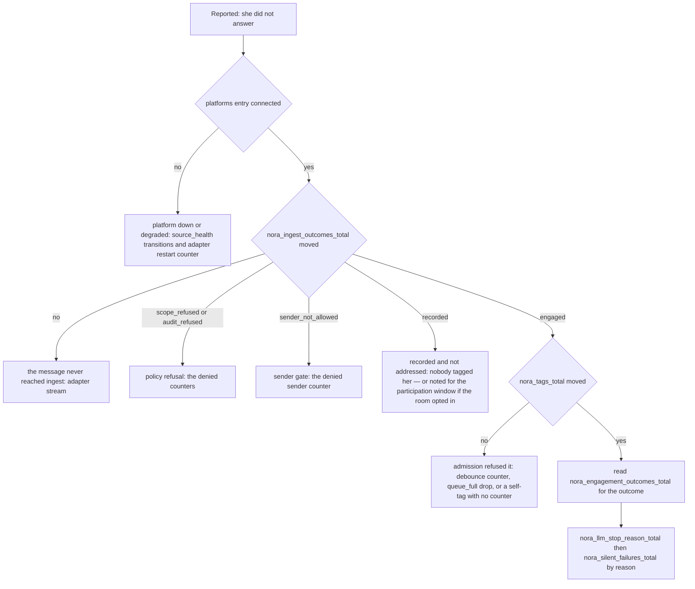

# Diagnosing a failure

Nothing here is a procedure library. The commands and their checks live in
[`docs/runbook.md`](../../docs/runbook.md) and in the
[`nora-readback`](../../.agents/skills/nora-readback/SKILL.md) and
[`nora-prove-fix`](../../.agents/skills/nora-prove-fix/SKILL.md) skills; this page is the
map above them. What it supplies is the part a runbook cannot: for each symptom, which
flow owns it, which hypothesis each counter or attribute separates, and whether the answer
is already obtainable without writing anything.

## The premise: silence is the default failure mode

Every rule below exists because this system fails by saying nothing.

- **The tag path is one speaking route, not the only one.** An untagged message in a room
  the operator opted in is *noted* by the participation window — never admitted — and can
  be answered later through the shared speaking path, subject to the send permission and
  the SEND cooldown; the scheduled and proactive occasions (a reminder coming due, a
  finished compute job, a relay, a `kind="proactive"` row) speak through that same path
  ([the participation window](../workflows/participation.md),
  [proactive occasions](../workflows/proactive-occasions.md)). Each is conditional on its
  own flags and room grants, and neither of the last two ships on: participation needs
  `[participation] enabled`, `[relevance_gate] enabled` **and** `relevance_gate = true` on
  that room's `[[conversations]]` entry, and a proactive row needs `[heartbeat] enabled`
  and `proactive = true` on the room it fires into
  ([`nora/config.py`](../../nora/config.py), [`nora/policy.py`](../../nora/policy.py)). So
  the runbook's "she only ever speaks when tagged" (S1) is the default posture, not the
  inventory of senders: an unanswered message is the normal outcome of the tag path, and
  "she did not answer" is not by itself a symptom of anything — but which routes this
  installation actually has is a fact to establish, never to assume
  ([`docs/runbook.md`](../../docs/runbook.md),
  [`nora/app/dispatch.py`](../../nora/app/dispatch.py)).
- **Silence is preferred to a wrong answer** (R-5), and an instrument reports three states
  — `ok` / `nothing_found` / `unavailable` — where an error is never a pass
  ([the failure and status contract](../architecture/failure-and-status-contract.md)).
  A refusal and a healthy quiet room are therefore *supposed* to look alike in the room.
- **The failures are kept out of the room on purpose.** A guard block, a send failure, a
  budget cut and an audit write that failed all leave the group with nothing, and the only
  trace is a counter or a log line the group never sees.

So **absence of an error is not evidence of success**, and the page's first job is to say
which instrument could have carried the failure that did not happen. A green `/health`
proves only that the named dependencies answered at poll time: it does not prove that the
model provider is reachable (`omniroute.last_success_at` is reported and never aggregated),
that any turn or delivery completes, that spans or log lines leave the process, that a
background loop is running, or that writes work — `store.stats()` is a read
([observability](observability.md), [`nora/obs/health.py`](../../nora/obs/health.py)). A
tracing failure is non-fatal by design, so its symptom is silence rather than an error; the
alert bridge answers its webhook with success even when the chat POST fails
([`docs/runbook.md`](../../docs/runbook.md)).

## The order that works for every symptom

First name the **routes** this installation actually has, because each one carries a
different counter and silence means something different on each: the tag path, the
participation occasion in an opted-in room, and the scheduled or proactive occasions the
fire path runs. An installation may have one, two or three, since neither of the last two
ships enabled, and a diagnosis that assumes the tag path is the only sender will read a
disabled route as a quiet one ([the participation window](../workflows/participation.md),
[proactive occasions](../workflows/proactive-occasions.md)). Then:

1. **Is the path running at all?** Read that path's counter. A missing span, an empty log
   and an idle path are identical; the counter is what separates "not running" from "not
   instrumented" ([observability](observability.md)).
2. **Was it refused, or could it not check?** A deliberate refusal has its own counter, and
   an `unavailable` result is never a `nothing_found`. Folding the two together is how a
   policy refusal gets investigated as an outage.
3. **Is this the process that should be answering?** Image and config freshness are
   separate facts from behaviour: `config.<file>.stale` and the version stamp answer them,
   and the remedy for a stale bind-mounted file is a recreate, not a restart
   ([deployment](deployment.md)).
4. **Is the evidence absent, or zero?** An absent series means "nothing since the last
   restart" — never "never happened" — and a `0` needs a positive control.

The same four questions in order, for the silence case; each branch names the series that
decides it. The `recorded` branch is where a tag-shaped reading stops being the whole
answer: the message may be a participation candidate, and from there the Relevance Gate and
participation series — not `nora_ingest_outcomes_total` — carry what happened next.

## Symptom: she never answers

The owning flows are [ingestion](../workflows/ingestion.md) (did the message become a
record?) and [the engagement turn](../workflows/engagement-turn.md) (did the record become
a reply?), with who-may-talk settled by [policy and disclosure](../concepts/policy-and-disclosure.md).
Two rows below belong to the other routes, because "she never answers" is also what a
disabled or refused participation route looks like.

| cause hypothesis | evidence that distinguishes it | owning page |
|---|---|---|
| the platform is not delivering | `nora_adapter_last_event_age_seconds{platform}` absent (no instrument) or climbing, paired with `platforms.<name>.connected` | [platform adapters](../integrations/platform-adapters.md) |
| the room is not in `policy.toml` | `nora_denied_conversations_total` rising; nothing was recorded at all, because the room gate runs before the audit write | [policy and disclosure](../concepts/policy-and-disclosure.md) |
| the room is allowed but the sender is not | `nora_denied_senders_total` rising; the message **is** audited, so it appears in `messages` and was simply not answered | [policy and disclosure](../concepts/policy-and-disclosure.md) |
| the message was dropped mid-ingest | `nora_ingest_outcomes_total{platform,conversation_type,outcome}` — `scope_refused`, `audit_refused`, `sender_not_allowed`, `engaged` or `recorded` | [ingestion](../workflows/ingestion.md) |
| the tag was engaged but dropped before a model ran | `nora_tags_total{platform}` flat while `nora_ingest_outcomes_total{outcome="engaged"}` moves: `nora_tags_debounced_total` (R-9), `nora_tags_dropped_total{reason="queue_full"}` (R-30 flood bound), or her own account's trigger, which moves no counter at all (R-12) | [the engagement turn](../workflows/engagement-turn.md) |
| she answers, but not to the tag | `nora_identity_aliases{platform}` at `1`: her own id forms collapsed to the configured primary, so a self-send is not recognised as hers (a healthy Signal start reads 3) | [platform adapters](../integrations/platform-adapters.md) |
| she answers and remembers nothing | `nora_unmapped_senders_total{platform}` rising; she replies and addresses the person by profile name while writing nothing to Honcho | [memory and record](../concepts/memory-and-record.md) |
| the turn ran and failed | `nora_silent_failures_total{audience="tag"} / nora_tags_total`, target under 1% (spec E.6) | [observability](observability.md) |
| the room opted in, and every untagged window was judged «not worth a turn» | `nora_relevance_gate_total{verdict,platform,conversation_id}` moving with `no_go`, while `nora_participation_silence_total` and `nora_participation_spoke_total` stay flat — a `no_go` is not a turn, so no participation series moves | [the participation window](../workflows/participation.md) |
| nothing untagged was ever noted, so no window closed | all three of `nora_relevance_gate_total`, `nora_participation_silence_total` and `nora_participation_spoke_total` flat: `[participation] enabled`, `[relevance_gate] enabled` or the room's `relevance_gate` is off, or the room's traffic never reached ingest at all | [the participation window](../workflows/participation.md) |
| the gate is down, which reads exactly like a quiet room | `nora_relevance_gate_errors_total{kind,platform,conversation_id}` climbing; a fail-closed `no_go` is deliberately **not** in the verdict series, so `go/(go+no_go)` there stays a true admission rate | [the participation window](../workflows/participation.md) |

Three refinements matter more than the table.

**The `audience="tag"` filter is load-bearing.** The heartbeat's fire path and the
participation and proactive occasions share `nora_silent_failures_total`; unfiltered, a
handful of failed reminders blow a budget whose denominator counts only tags, and the alarm
then points at the conversation path
([`nora/obs/metric_specs.py`](../../nora/obs/metric_specs.py)). An unlabelled increment
records `audience=""` and drops out of every filter that matters — most damagingly at the
`handler_error` site.

**A refusal is counted, never inferred.** The two denial counters split the two policy gates, and
the split decides where to look: a denied *conversation* leaves no audit row at all, while a
denied *sender* leaves an audible record — the ingest records `sender_not_allowed` and bumps
`nora_denied_senders_total`, so that failure's fix is the conversation's `persons` list, while
the other one's is the room list `nora groups` prints.
The one drop with no counter of its own is a trigger from her own account (R-12), which is
logged at INFO and deliberately not answered; a debounced tag has `nora_tags_debounced_total`
and a flooded one `nora_tags_dropped_total{reason="queue_full"}`, and a *queued* tag is still
counted in `nora_tags_total` (plus `nora_tags_queued_total`), so a queue is a delay and not a
silence ([`nora/engagement/stages/admission.py`](../../nora/engagement/stages/admission.py)).

**An ingest is plumbing, so its trace is never exported** (R-76). Do not go looking for it
in a trace store: `nora_ingest_outcomes_total` is where "what happened to the messages" is
answered, and its `outcome` vocabulary is `IngestOutcome` in
[`nora/ingest/pipeline.py`](../../nora/ingest/pipeline.py).

## Symptom: a platform is wedged

Owned by [platform adapters](../integrations/platform-adapters.md); the counters and the
alert rules by [observability](observability.md).

| cause hypothesis | evidence that distinguishes it | note |
|---|---|---|
| the socket is dead | `nora_adapter_last_event_age_seconds{platform}` climbing past the staleness threshold, with `platforms.<name>.connected: true` | a socket that says it is open and delivers nothing is the `stale` state, not `up` |
| nothing has ever been received | the series is **absent** | a label-child is created on first write; `absent(...)` is the alert, and absence reads as "no instrument" |
| it is quiet, not wedged | Discord stamps its age only on messages and on connect/resume, so a large age there can mean nobody talked | Signal ticks on every envelope, receipts and typing included, so a large age there means wedged |
| the listen loop keeps dying | `nora_adapter_restarts_total{platform}` | restarts are capped-backoff and counted per platform |
| the platform is registered and cannot act | `/health` `platforms.<name>.degraded: true` with `detail` | a degraded platform does **not** make `/health` 503, because a 503 would fail the container healthcheck and take the other platforms down with it |
| it has been in the same state for a while | the `source_health` record, one row per state transition (`up` / `stale` / `degraded` / `down` / `unknown`) | the sampler runs every 10 s, so a shorter flap is invisible here, exactly as it is to the liveness gauges |
| the gateway is fine but room-scoped tools say "I can't check" | the `nora.discord.roster` logger: forbidden roster (privileged intent off), an unpaginated guild over 1000 members, or a malformed `<guild_id>/<channel_id>` | invisible in `/health`; the gateway is healthy and messages flow |

The `unknown` state exists so that «could not check» is never read as «down» (R-27), and the
`source_health` write path fails soft: a hung or failed write is retried on the next sample
and counted `nora_errors_total{stage="source_health"}`
([`nora/app/source_health.py`](../../nora/app/source_health.py)). The staleness threshold
the sampler uses is the same one `PlatformSilent` fires on, so the record and the alert
agree on what "silent" means. A read-only way to answer "was every source healthy for this
interval" is therefore a query rather than an assumption.

## Symptom: a turn ends silent

Owned by [the engagement turn](../workflows/engagement-turn.md); the delivery boundary is
`nora/engagement/stages/deliver.py` and the guards are `nora/agent/guards.py`.

The `Deliverer` writes one field on every exit, `last_outcome`, and it is the single place
that separates her choice from the process's from the platform's. Read it before reading
any counter, because it names the counter:

| `last_outcome` | what it means | counter that moved |
|---|---|---|
| `""` (never called) | the model never called `send_reply` | `nora_silent_failures_total{reason="no_send_call"}` — or the cap's own name |
| `empty_reply` | she called the tool with nothing in it | `{reason="empty_reply"}` |
| `cooldown_held` | the participation SEND cooldown held it; the text is retained for the shadow mirror | **none** — no counter moves and no audit row is written, only an INFO line |
| `cap_spent` | R-2's message cap for this tag was already spent | `nora_guard_vetoes_total{rule="R-2"}` |
| `doctrine_leak` | the leak guard blocked the text | `nora_leak_blocks_total` and `{reason="doctrine_leak"}` |
| `egress_block` | an identifier or coordinate would have left the room | `{reason="egress_block"}` |
| `audit_write_failed` | the row could not be appended, so she stays silent | `{reason="audit_write_failed"}` |
| `send_failed` | every guard passed and the platform rejected the bytes | `nora_replies_total{status="failed"}` and `{reason="send_failed"}` |
| `sent` | delivered | `nora_replies_total{status="sent"}` |

`{reason=…}` in that column is shorthand for
`nora_silent_failures_total{reason=…,platform=…,audience=…}`; nothing else on the row is a
silent-failure increment.

| cause hypothesis | evidence that distinguishes it | owning page |
|---|---|---|
| the loop was cut off by a budget cap | `nora_llm_stop_reason_total{reason,audience}` — `limit_turns` / `limit_total_tokens` against `end_turn` | [the engagement turn](../workflows/engagement-turn.md) |
| she chose not to speak | `nora_engagement_outcomes_total{outcome="silent"}` rather than `failed` | [the engagement turn](../workflows/engagement-turn.md) |
| a guard stopped every attempt | the same series with the guard's own reason, and *no* `no_send_call` on top of it | [the tool surface](../concepts/tool-surface.md) |
| some messages went out, then it stopped | `nora_partial_replies_total{reason}` — `delivered` is true, the group got the check mark, and `nora_silent_failures_total` never moves | [observability](observability.md) |
| a healthy silence, not a fault | `nora_participation_silence_total` / `nora_proactive_silence_total` — silence is the healthy outcome for those occasions and never lands in `nora_silent_failures_total` | [cognition](../workflows/cognition.md) |
| a reminder never fired because a tag held the slot | `nora_heartbeat_deferrals_total` — the tick completed, nothing failed, the fired counter is flat; `nora reminders list` marks the rows `OVERDUE` | [the runtime topology](../architecture/runtime-topology.md) |

Two traps. A budget-cut turn is **byte-identical** to a model that declined, which is why
`nora_llm_stop_reason_total` is recorded on every completed invocation including the healthy
`end_turn`/`tool_use` ones: a series that carried only `limit_*` could not say what fraction
of turns were cut off. And a held reply is the one branch with no counter at all — if the
question is "did she produce something she never sent", the log line is the only evidence,
and an idle process logs nothing at INFO, so the log alone does not separate idle from dead.

## Symptom: a wake never fires

Owned by [cognition](../workflows/cognition.md). The rows are `cognition_wake_outcome`,
`cognition_session` and `stimulus`; the gauges and counters below only say where to look.

| cause hypothesis | evidence that distinguishes it | note |
|---|---|---|
| the unit can never be woken | `nora_cognition_session_units{state="no_home_room"}` non-zero | set at boot with `[cognition] enabled`; a unit needs a `home_room = true` room in `policy.toml` |
| the trigger never held | `nora_stimulus_total{kind,cue}` flat — no `message`, `time`, `rollup`, `self`, `social` or `play` stimulus was appended | a person's reply to her inside the reply-quiet window is consumed and never trips a trigger |
| a brake held it | `nora_cognition_wake_deferred_total{brake}` — `single_flight`, `cooldown`, `backoff`, `concurrency` | counted once per unit per tick while it holds, so it measures how long a brake holds |
| the wake fired but no session ran | `nora_cognition_session_skipped_total{reason}` — `no_home_room` (also recorded failed, so its stimuli stay pending) or `empty_agenda` | no model call is made on either |
| the session could not finish inside its bounds | `nora_cognition_session_limit_total{limit}` and `nora_cognition_session_ended_total{outcome="failed"}` | a failed wake returns its stimuli to pending and applies the failure backoff |
| the unit stopped re-waking on input it cannot process | `nora_cognition_stimuli_struck_total{reason="failed"}` | code strikes the stimuli a unit failed `max_consecutive_failures` sessions in a row |
| a restart ate the session | `nora_cognition_wake_reclaimed_total` above 0 at start, and `cognition_wake_outcome` rows with `outcome = 'cancelled'` and a `restart` detail | a `cancelled` outcome neither counts toward the backoff nor strikes a stimulus |
| there is a backlog nobody is draining | `nora_stimulus_pending_age_seconds{aggregate="max"}` climbing; `0` means nothing pending, and the series is **absent** until the evaluator's first tick | |

`nora_cognition_wake_total{reason,mode}` is the positive control: it names the reason a wake
did fire (`settled`, `strong_cue`, `batch`, `max_age`, `time`, `self`). Without it, "no wake"
and "no evaluator" are the same reading. There is deliberately no cognition alert: the loop's
health is read from the rows when someone notices.

## Symptom: memory looks empty

Owned by [memory and record](../concepts/memory-and-record.md); session continuity and the
Persona axis by [sessionless continuity](../concepts/sessionless-continuity.md).

| cause hypothesis | evidence that distinguishes it | what it cannot tell you |
|---|---|---|
| the memory service is down | `/health` `honcho.reachable: false` (also a 503) | whether a *write* is being refused |
| her card stopped appearing | `nora_peer_card_empty_total{platform}` rising | **why**: the client catches every transport failure and returns the same empty card, so a dead endpoint, a timeout, a 4xx and a genuinely empty card all arrive as one `[]` — and do not expect `nora_errors_total{stage="peer_card"}` to partition it, because an outage lands in the peer-card series and that stage stays near zero |
| the person resolves to nobody, so nothing is fed | `nora_unmapped_senders_total{platform}` rising | she still replies normally, which is why this looks like health |
| the pre-fetched recall block went blind | `nora_errors_total{stage="tag_prefetch"}` | the turn went on without the block by design |
| a read was truncated, not empty | `nora_bound_truncated_total{site}` — a read that stopped at its limit is `unavailable` wearing `nothing_found`'s face | how many rows were left |
| the index is incomplete | `/health` `index.status` (`never` / `building` / `complete`) and `index.queue`; `nora_memory_search_total{status="partial"}` | it is reported and never counts toward 503, because a rebuild must not flap the container |
| a projection was lost | `nora_memory_projection_total{kind,outcome}` — `queued` (the store write stood, the projection did not) against `lost` (the queue write failed too, so only a rebuild finds it) | which node: the labels carry the kind and the outcome, never the row |
| vectors are missing or stale | `nora_memory_embed_total{outcome}` and `nora_memory_search_total{status="unavailable"}` | the search fails closed rather than guessing |
| a startup backfill silently did nothing | `nora_lazy_adoptions_total{platform}` flat together with `nora_adoption_failures_total{platform}` rising | a failed feed is left unmarked on purpose, to retry on the next start |

The one operator question this table cannot answer is "is this *her* workspace": a bound
`honcho_workspace` that holds sessions and lacks her owner marker belongs to another
application, and she refuses to start on it.

## Symptom: the computer is down

Owned by [the tool surface](../concepts/tool-surface.md); the series are declared in
`nora/obs/metric_specs.py` and created by `nora/app/computer_metrics.py`.

| cause hypothesis | evidence that distinguishes it | note |
|---|---|---|
| the computer is off in config | `nora_computer_up{target}` is **absent** — not `0` | with `[computer]` off the whole observer does not exist, so `ComputerDown` (`== 0`) cannot fire on an absence |
| computerd is unreachable | `nora_computer_up{target="computerd"} == 0` | set by the timed probe and by every call, so it moves on a quiet night and the moment a real call fails |
| computerd answered but could not do it | `nora_computer_calls_total{op,status="unavailable"}` with `op` one of `run`, `read`, `write`, `edit`, `files`, `fetch`, `put`, `state` | every `(op,status)` is created at zero at start, because `increase()` over a series whose first sample is already 1 reads 0 |
| the tool answered and the audit row is missing | `nora_computer_audit_failures_total{tool,stage}` (`blob`, `row`, `session`, `lease`, `export`, `media`) | a should-be-zero counter; the tool call itself still answered |
| the reply was written without live machine state | `nora_computer_context_machine_unread_total{reason}` — `timeout` or `unavailable` | the reply was not held for it |

The distinction the gauge encodes is the one worth keeping: an HTTP 200 carrying
`status: "unavailable"` is computerd *speaking*, and a refusal or timeout is Nora not being
able to reach her computer at all.

## Symptom: a document was refused

Owned here, because two components share it and neither page claims it: the judge is
[`nora/documents/check.py`](../../nora/documents/check.py) and the one publish path is
[`nora/app/documents_service.py`](../../nora/app/documents_service.py).

The checker has three outcomes and never collapses them: `ok` (every rule held), `refused`
(the document breaks a rule; the findings say which and where), and `error` (the checker
itself failed, nothing is known about the document, and it is never treated as `ok`). It
checks shape first, then the generated JSON Schema, then the rules a schema cannot state,
and it stops at the first group that fails. A refusal is not an outage: the findings go back
to the model so it can fix the file and export again.

Below, `{...}` continues `nora_tool_calls_total{tool="document_publish"}`.

| what the model saw | what happened | evidence |
|---|---|---|
| `bad_arguments` with findings | refused on a rule; nothing stored | `nora_tool_calls_total{tool="document_publish",status="bad_arguments",reason="findings"}` |
| `bad_arguments`, invalid JSON | the spec arrived as text | `{...status="bad_arguments",reason="not_json"}` |
| `bad_arguments`, stale revision | someone revised it a moment ago | `{...reason="conflict"}` |
| `bad_arguments`, archived or deleted | a revision of a document that is not `active` is refused as `document_not_active` | `{...reason="not_active"}` |
| `not_found` | no such document **in this room** — the same answer for an unknown id and for another room's document | `{...status="not_found"}` |
| `unavailable` | the checker or the store failed; nothing is known to have been stored | `{...status="unavailable"}` plus a `document_publish failed` traceback in the log |
| she said she made one and no document exists | the tool was called and stored nothing | the `reply_document_not_saved` warning, and the not-saved note appended to the reply |

The durable evidence is asymmetric: a published document is a `documents` row with a
`document_revision` and, on a state change, a `document_state` row; a refusal leaves no row
at all. So "was it refused, or was the call never made" is answered by the tool counter and
the log, not by the database. There is no operator command for documents — read the rows
and the log.

## The operator command surface: read versus write

The control plane is [`nora/app/cli.py`](../../nora/app/cli.py), and its read-only half is a
guarantee rather than a promise:

- the record store is opened through `create_readonly_sql_engine`, so every connection sets
  `default_transaction_read_only=on` and a write raises at the server; in the deployment it
  also connects as a `GRANT SELECT`-only role whose write privileges do not exist
  ([`nora/infra/sql/engine.py`](../../nora/infra/sql/engine.py));
- nothing here builds an adapter, binds the metrics port, opens the SSE stream, runs a
  migration or constructs an LLM client, and `config.load(..., require_secrets=False)` keeps
  a missing provider key from failing a command that never talks to the provider — so the
  read commands work with the Nora container **stopped**;
- the only daemon calls go through an allowlist of two read methods on signal-cli's
  directory, and a broken daemon degrades to a sentence with an exit code, never a
  traceback.

| command | what it answers | writes? |
|---|---|---|
| `nora groups` | every group signal-cli knows, with its id and policy verdict | no |
| `nora persons pending` | senders in the audit DB that map to nobody, correlated into accounts, with a paste-ready stanza | no |
| `nora presence members` | your Life360 circles and members, to paste into `identity.toml` | no |
| `nora reminders list` | every reminder still pending, soonest first, with what is overdue | no |
| `nora measure participation` | the four ambient measures, with the ceiling printed under each | no |
| `nora lessons list` / `show` / `tensions` | a unit's lessons, one lesson's revisions, the lessons the doctrine check refused | no |
| `nora config get` / `path` / `validate` | one setting, the resolved config location, schema validity | no |
| `nora snapshot --at <t>` | every store as of T plus the doctrine and config in force | only with `--into <empty db>` or `--files-out <dir>`; with neither, or with `--dry-run`, it writes nothing |
| `nora memory persona-history` | Persona coverage receipts | only `--restart` writes, and only with `--apply` |
| `nora memory persona-retry-media` | queue one media retry for one account | only with `--apply` |
| `nora memory backfill` / `carry-conclusions` / `backfill-places` | replay one unit's messages into its Honcho workspace; copy pre-cutover facts; give venues their district | only with `--apply` |
| `nora memory detach-unit` | delete a moved unit's rooms from the workspace it left (step 1), then rebuild the recorded peers' cards (step 2) | step 1 only with `--apply`, irreversible; `--refresh-cards` is step 2, writes, and refuses to be combined with `--apply` |
| `nora events backfill-units` | set `unit_id` on every pre-migration event | only with `--apply` |
| `nora lessons retire` / `rollback` | retire a lesson, or put an earlier revision back as newest | only with `--apply` |
| `nora memory rebuild` | re-project every store into the memory index | **writes by default**; `--dry-run` counts only |
| `nora assess run-nightly` | run every nightly data-quality check and print the report | **writes an `assess_report` row by default**; `--no-record` prints only |
| `nora config set` / `unset` | change one setting | yes — atomic temp-and-rename, validated before and after, prints the restart command but never restarts |
| `nora xai-login` / `nora openai-codex-login` | run a device login for an OAuth lane | yes — appends a refresh token to the host `.env`, never the database |

Four things that table is really saying:

**`--apply` is the convention, and its two inversions are the ones that catch an operator.**
Every command in the repair family is a dry run without `--apply`; `memory rebuild` and
`assess run-nightly` are the exceptions that write unless told not to. Outside that family,
`config set`/`unset` and the two device-login commands write by design, and `snapshot` writes
only into the target you name.

**Read-only is enforced, not merely intended.** A `cancel` subcommand for reminders was
deliberately left out because it would have broken both guarantees at once; cancelling one
reminder is the model's job, in the conversation it was set in, and the operator's switch is
`[heartbeat] enabled = false` plus a restart.

**Read-only does not mean side-effect free in the world.** `nora groups` and
`nora presence members` query a live daemon or a third-party API. What is guaranteed is that
nothing is written to the record store, to the host, or to the daemon.

**A read that cannot see is reported as `n/a`, not as zero.** `nora measure participation`
prints `n/a (nothing considered)` when a measure did not run, because a `0` there would be
indistinguishable from "it never happens" — and it refuses a refusals file that does not span
the window asked for, for the same reason.

## What counts as evidence

The procedure and its traps are the [`nora-readback`](../../.agents/skills/nora-readback/SKILL.md)
skill; four of its rules are what this page's tables assume:

1. **Pick the store by the question**, and report each claim as store, query, window,
   reading, `VERIFIED` / `UNVERIFIED` / `FAILED`. A null from an instrument that cannot see
   the thing is not evidence.
2. **A write verb is measured by fetching the thing back.** An HTTP 200 is a claim about the
   request — an accepted reaction that never arrived was recorded as a pass for a day — so
   `accepted` is `UNVERIFIED` until a row or a trace says otherwise.
3. **An absent series means "nothing since the last restart", never "never happened".**
   Labels are created lazily and the process restarts; a rare counter reads empty almost
   always, so a durable row or a trace is what closes a question about rarity.
4. **A zero needs a positive control.** A crashed stage also reads `0`; assert the positive
   outcome beside the zero and read back what was written.

When the question is "did the fix work", the standard is narrower still: a fix is done when
reverting the exact production line turns a **named test** red and restoring it turns that
test green. A green gate is not that claim, and "reverting X reddens Y" may be written only
for a revert that was watched to redden that test in that run — otherwise write "expected",
not "verified" ([`nora-prove-fix`](../../.agents/skills/nora-prove-fix/SKILL.md),
[`CONTRIBUTING.md`](../../CONTRIBUTING.md), `scripts/mutate.py`).

## What this page does not cover

Recreating, reordering or rolling back containers, and what a partial deploy breaks, are
[deployment](deployment.md)'s. The full counter catalog, the span filters and the alert rules
are [observability](observability.md)'s. Which file a setting belongs in, and why an edit
needs a restart, is [configuration](configuration.md)'s. The incident history behind each
rule — including the shapes that are deliberately not alerted on — is
[`docs/observability.md`](../../docs/observability.md) and
[`docs/runbook.md`](../../docs/runbook.md).

## Related

- [Observability](observability.md) — the signals, the declaration and priming rules, and
  what a green health check cannot prove.
- [Deployment](deployment.md) — images, the version stamp, recreate versus restart.
- [Platform adapters](../integrations/platform-adapters.md) — what a reported degradation
  means, and why `degraded` is a third state.
- [Ingestion](../workflows/ingestion.md) and
  [the engagement turn](../workflows/engagement-turn.md) — the tag-shaped flow a silence is
  usually hiding in.
- [The participation window](../workflows/participation.md) — the quiescence trigger, the
  Relevance Gate's verdict and error series, the send cooldown and the shadow switches.
- [Proactive occasions](../workflows/proactive-occasions.md) — the fire path behind
  reminders, compute results, relays and `kind="proactive"` rows, and why a silent one is a
  recorded success.
- [Cognition](../workflows/cognition.md) — wakes, stimuli, brakes and session outcomes.
- [Memory and record](../concepts/memory-and-record.md) — Honcho, the memory index and what a
  search answer means.
- [The tool surface](../concepts/tool-surface.md) — the three-state result vocabulary every
  table above assumes.
