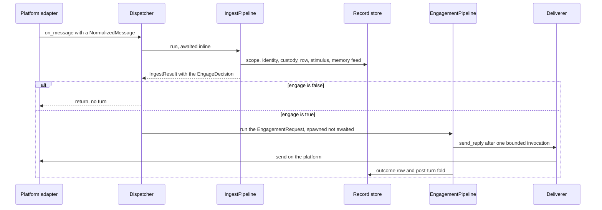

# Quickstart

Nora is an experimental, self-hosted social agent who takes part in rooms on Signal, Discord, WhatsApp and Instagram, and in voice. She answers messages, keeps unfinished matters in persistent state, revisits them through background cognition, and can work in a room-scoped sandbox workspace. Her continuity belongs to that state rather than to an open chat session: each speaking turn constructs a fresh Strands agent from assembled context, while background cognition and computer work use bounded sessions of their own ([Sessionless continuity](concepts/sessionless-continuity.md)).

Two things to settle before reading further:

- **[`ARCHITECTURE.md`](../ARCHITECTURE.md) is the map** of the current implementation; the ADRs carry the *why* ([`docs/adr/README.md`](../docs/adr/README.md)). Design proposals and historical measurements do not prove a feature is built or deployed.
- **Enabled capabilities, room grants and deployed values are operator configuration**, and this public wiki does not publish them. Which flags are on, which rooms are allowlisted, which models and endpoints are in force: those live in an operator's own `config.toml`, `identity.toml` and `policy.toml`. Implementation evidence here is the source and the focused tests each page names — never a claim about someone's running installation.

## The three files that define a deployment

| Input | Answers | Tracked starting point |
|---|---|---|
| `config.toml` | how the deployment runs: platforms, models, budgets, timeouts, feature switches | [`config.example.toml`](../config.example.toml) |
| `identity.toml` | **who people are**: one `[[persons.<id>.<platform>]]` block per account, all resolving to a single `person_id` | [`identity.example.toml`](../identity.example.toml) |
| `policy.toml` | **who may talk to her, and where**: rooms, units and per-room trust flags, deny-by-default | [`policy.example.toml`](../policy.example.toml) |

`config.toml` points at the other two through its `identity_file` and `policy_file` fields ([`config.example.toml`](../config.example.toml#L1-L2)), and its schema is a frozen pydantic tree with `extra="forbid"`, so an unknown key or a missing one is a startup failure rather than a default ([`nora/config.py`](../nora/config.py#L3854-L3860)). All three are gitignored, read once at startup, and never re-read; secrets stay in the host's `.env` as variable *names*. [Configuration](operations/configuration.md) owns this split, the validated schema and the flag table; [State and scopes](architecture/state-and-scopes.md) owns the same three files as state outside the database.

The process itself is thin: `python -m nora --config config.toml` loads the config, builds the object graph through `nora.app.composition.build_dependencies`, and runs an `App` until `SIGTERM` or `SIGINT` ([`nora/__main__.py`](../nora/__main__.py#L63-L103)). Health and metrics come from the one aiohttp app on `[obs.metrics] port`, which also answers `/health` — `9100` in the example template ([`config.example.toml`](../config.example.toml#L1363-L1364)). `python -m nora.presence` and `python -m nora.analytics` are separate daemons from the same codebase with their own endpoints ([Runtime topology](architecture/runtime-topology.md)).

## The shortest path through one message

*One inbound message: ingest runs inline on the listener's path, an admitted tag's turn is spawned, and only the Deliverer sends.*

1. **Parse.** A `PlatformAdapter.listen()` loop hands an already-parsed `NormalizedMessage` to `Dispatcher.on_message`; the port deliberately has no `parse()` ([Platform adapters](integrations/platform-adapters.md)).
2. **Ingest, inline.** `IngestPipeline.run` is awaited because it is deterministic and builds no agent: scope → identity → media custody → the record row → the durable stimulus → the memory feed → the engage gate, each a span under one `ingest` root ([`nora/ingest/pipeline.py`](../nora/ingest/pipeline.py#L303-L406)).
3. **Decide, and record the outcome.** `IngestResult` carries the message plus an `EngageDecision`; the ambient majority ends `recorded`, never as a turn, and a room the operator never allowlisted ends `scope_refused` before anything is written ([Ingestion](workflows/ingestion.md)).
4. **Or speak.** `engage=True` becomes an `EngagementRequest` that is spawned, never awaited, because a model call can hang: admission, context assembly, one bounded invocation, and delivery through the single sender, then the post-turn fold ([A tag turn](workflows/engagement-turn.md)). Two other admission paths exist and are deliberately *not* third pipelines: participation notes an untagged candidate message for a quiescence window ([Participation](workflows/participation.md)), and proactive occasions re-read the situation at action time ([Proactive occasions](workflows/proactive-occasions.md)).

## Route by task

| If you want to… | Read |
|---|---|
| understand what a speaking turn *is* when there is no session | [Sessionless continuity](concepts/sessionless-continuity.md) |
| trace an inbound message to its recorded row | [Ingestion](workflows/ingestion.md) |
| trace a tag to a delivered reply | [A tag turn](workflows/engagement-turn.md) |
| explain an unprompted turn | [Participation](workflows/participation.md), [Proactive occasions](workflows/proactive-occasions.md) |
| follow background work that nobody asked for | [Cognition](workflows/cognition.md), [The Dreamer](systems/dreamer.md) |
| see how one prompt is built | [Context assembly](concepts/context-assembly.md) |
| find where memory and recall come from | [Record, index and interpretation](concepts/memory-and-record.md) |
| change what she learns from outcomes | [Contextual learning](concepts/contextual-learning.md), [Persona](concepts/persona-and-provenance.md) |
| check who may address her, and what she may disclose | [Policy, admission and disclosure](concepts/policy-and-disclosure.md) |
| see which tools an occasion gets, and how they are constrained | [The tool surface](concepts/tool-surface.md) |
| follow a failure through every subsystem | [The status and failure contract](architecture/failure-and-status-contract.md) |
| know what runs in the process, and in what order it boots | [Runtime topology](architecture/runtime-topology.md) |
| know what is durable and how it is scoped | [State and scopes](architecture/state-and-scopes.md) |
| add or rename a tool | [The tool surface](concepts/tool-surface.md) then [Changing the system](contributing/changing-the-system.md) |
| add a capability, skill, doctrine file or flag | [Changing the system](contributing/changing-the-system.md) |
| change a setting without corrupting the file | [Configuration](operations/configuration.md) |
| deploy, recreate or roll back | [Deployment](operations/deployment.md) |
| read metrics, traces, logs, errors or health | [Observability](operations/observability.md) |
| prove a change is safe | [Verification](testing/verification.md) |
| work on messaging transports and their bridges | [Platform adapters](integrations/platform-adapters.md) |
| work on the computer, the browser or exports | [The persistent computer](systems/computer-and-browser.md) |
| run a sub-agent job or render a document | [Sub-agent jobs and documents](systems/subagents-and-documents.md) |
| touch voice input or speech output | [Voice](systems/voice-and-speech.md) |
| touch the portal API or web surfaces | [The portal API](systems/portal-and-web-api.md) |
| touch presence collection or the Rollup | [Presence and rollup](systems/presence-and-rollup.md) |

## Route by symptom

Diagnosis itself is [Diagnosing a failure](operations/troubleshooting.md)'s page; these are the flows each symptom lands in.

| Symptom | Owner |
|---|---|
| she never answers at all | [Troubleshooting](operations/troubleshooting.md), then [Ingestion](workflows/ingestion.md) for the outcome label |
| she answers in one room and not another | [Policy and disclosure](concepts/policy-and-disclosure.md) |
| a turn started and ended with nothing sent | [A tag turn](workflows/engagement-turn.md) — the recovery nets and the silent outcomes |
| a platform is wedged or reported degraded | [Platform adapters](integrations/platform-adapters.md) |
| an unprompted turn never happens | [Participation](workflows/participation.md), [Proactive occasions](workflows/proactive-occasions.md) |
| a wake never fires | [Cognition](workflows/cognition.md) |
| memory looks empty | [Record, index and interpretation](concepts/memory-and-record.md) |
| a tool keeps answering `unavailable` | [The tool surface](concepts/tool-surface.md), [Status and failure contract](architecture/failure-and-status-contract.md) |
| the computer is down | [The persistent computer](systems/computer-and-browser.md) |
| a document was refused | [Sub-agent jobs and documents](systems/subagents-and-documents.md) |
| a live config edit changed nothing | [Configuration](operations/configuration.md) — the load-once lifetime |
| a deploy misbehaves | [Deployment](operations/deployment.md) and [`docs/runbook.md`](../docs/runbook.md) |

## How to read a page here

- **Three states, never two.** Tool and subsystem results are `ok` / `nothing_found` / `unavailable` ([`nora/domain/ports.py`](../nora/domain/ports.py#L2685-L2693), and the discipline is stated in [`AGENTS.md`](../AGENTS.md#L33-L38)); a wiring gap is `unavailable`, and a deliberate silence is neither a success nor a failure.
- **A flag gates the tick, not the store.** An optional tier that ships inert still has its store built; "not enabled" and "not built" are different answers ([Configuration](operations/configuration.md)).
- **Evidence is source plus focused tests.** Each page ends with the tests that pin its contract, and [`tests/README.md`](../tests/README.md) explains what makes a test file true — a fake, a real backend, an AST property. `make gate` runs lint, types, import contracts and the diff-reachable tests, and a green gate proves the source, not a running deployment ([`AGENTS.md`](../AGENTS.md#L462-L485), [Verification](testing/verification.md)).
