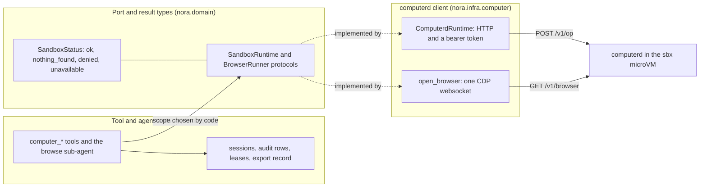
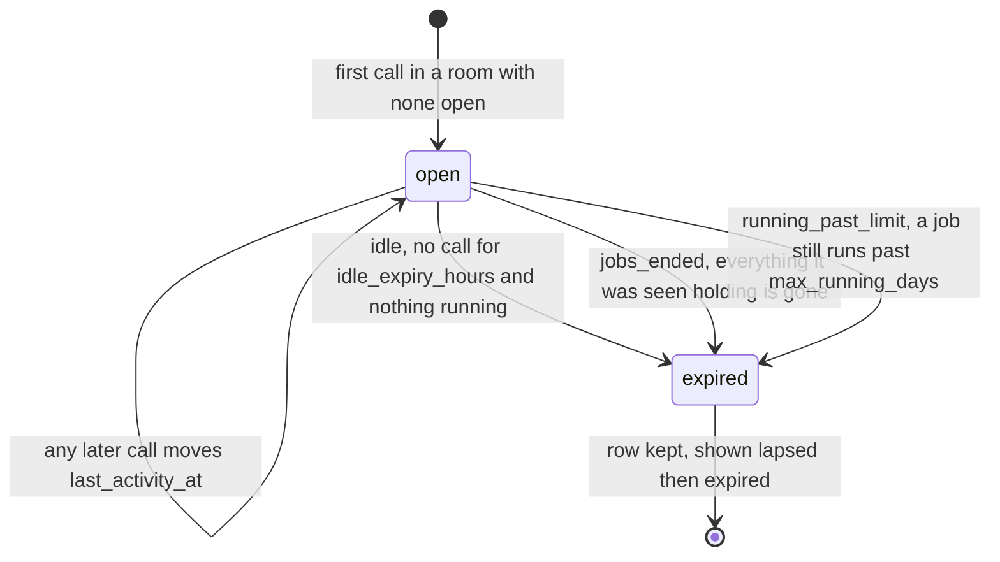
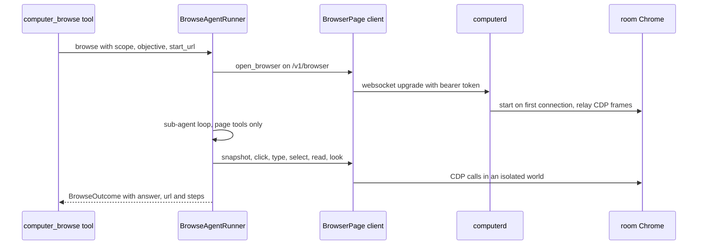

# The persistent computer and the browser runner

Nora's computer is a persistent, less-trusted machine with a workspace per room. `computer_run`,
`computer_read`, `computer_write`, `computer_edit`, `computer_export`, `computer_import`,
`computer_session_list` and `computer_browse` all act on it, and `computer_browse` is a bounded
sub-agent driving the room's own Chrome. The capability is optional wiring: the runtime, the two loops
and the prompt block exist only for a deployment that turns `[computer]` on, while the audit, session
and export stores are always wired so that a call made while it is off is still recorded. Its two
flags (the computer, and the browser inside it) are independent. This page explains the layers, the
state they own, and the failure vocabulary they share; for where the tools sit among every other tool
see [The tool surface](../concepts/tool-surface.md), and for the disclosure rules around what may
leave the machine see [Policy and disclosure](../concepts/policy-and-disclosure.md).

## Three layers, one vocabulary

The capability is deliberately split so that each layer can be replaced or faked without the others
moving.

One computer call crosses the tool surface, the port, and the computerd client; the session, audit
and lease writes stay with the tool surface, so the port carries no bookkeeping.

**The port** (`SandboxRuntime` in `nora/domain/ports.py`) declares `run`, `read`, `write_text`, `edit`,
`files`, `fetch`, `put` and `state`, and states two invariants: it NEVER raises, and `scope` is
derived by Nora's code from the turn, never chosen by the model. There is no dedicated method that
deletes a file or ends a tmux session, but that is a fact about the *interface*, not a guarantee
about what a call can do: `run` hands the command string to `bash -c` as the room's user with the
room's directory as the working directory, so it keeps every ordinary effect of that command within
that user's permissions — `rm`, `tmux kill-server`, a `git checkout` that discards uncommitted work.
A call is also stopped by killing it: when `timeout_s` expires, computerd sends SIGKILL to the
command's process group. The non-deletion guarantee belongs to the session sweeper and to its own
bookkeeping — *Expiry: the sweeper*, below — not to the port.
`BrowserRunner` is the same shape for one whole browser task: one call in, one `BrowseOutcome` out,
never a raise.

**The result types** (`nora/domain/computer.py`) carry the status vocabulary
[R-27](../architecture/failure-and-status-contract.md) fixes for every tool answer, with `denied`:

| status | meaning |
|---|---|
| `ok` | done. A command that exited non-zero is still `ok`; its `exit_code` says how it went |
| `nothing_found` | the thing asked about is not there (a file, a match) |
| `denied` | refused as asked (a path outside the workspace, an ambiguous edit, an oversized body) |
| `unavailable` | could not be done now (the computer is down, a timeout, an OS error) — never an empty success |

`reason` explains anything that is not `ok` in words a model can act on. `BytesResult.sha256` and
`OpResult.sha256` are computed on Nora's side from the bytes actually received or sent, never taken
from the VM's claim about itself.

Two domain rules keep "unknown" from reading as "nothing":

- `StateResult.tmux` and `StateResult.processes` are `None` when the machine could not be read, with
  `tmux_reason`/`processes_reason` saying why. A reader must treat `None` as unknown, never as
  "nothing is running".
- `anything_running(state)` is tri-state: `True` as soon as a tmux pane runs a job OR the room's user
  owns any process (a `nohup … &` job has no tmux session at all), `False` only when both sources
  were read and showed nothing, and `None` when one source could not be read.

The operation names the port reports under are a closed tuple, `COMPUTER_OPS`, one per port method,
so a `nora_computer_calls_total{op}` series exists for every call a new method could make; a test in
`tests/infra/computer/test_computer_metrics.py` drives every port method and reads the ops back, so a
method that is not named there fails rather than creating a series after its first call.

## The computerd client

`ComputerdRuntime` (`nora/infra/computer/client.py`) is a plain HTTP client with a bearer token. It
knows nothing about sbx: the same client works against `computerd` in any VM or container, which is
what keeps the runtime replaceable while the host-side lifecycle unit changes.

- **Never raises.** Every public method is a thin guard around its body. A refused connection, a
  timeout, a malformed body or any unexpected exception becomes `SandboxStatus.UNAVAILABLE` with a
  reason, so a tool maps the result to R-27 without a `try`/`except` and the computer being down is
  an ordinary answer rather than a crash inside a turn.
- **Any non-200 reply is `unavailable`.** A 401 after a token rotation is a configuration fault, not
  a refusal the model should read as "refused as asked". The client keeps the distinction internally
  because the observer needs it (below).
- **Transfers are checked end to end.** `fetch` reads to EOF under a byte cap and hashes what it
  received, which must equal the digest computerd sent; `put` and `write_text` compare the digest
  computerd reports against the bytes they sent. A mismatch is `unavailable`, never a success, and
  an over-cap read is `denied`.
- **A run outlives its command.** A `run` gets `timeout_s` plus a fixed slack on the HTTP deadline,
  so computerd — not the client — reports the timeout, with the exit code and partial output it saw.
  The command is started in its own session and, on timeout, computerd SIGKILLs its process group and
  answers `unavailable`; because output goes to files rather than pipes, a backgrounded child that
  inherited the output cannot hold the call open, and a child that left the group with `setsid`
  survives the kill without hanging the answer.
- **One call, one count.** The `_guarded` barrier reports `(op, status, answered)` to a
  `ComputerCallObserver`. `answered` is `False` only for a refused or timed-out connection and for a
  non-200 reply; a reply that arrived and could not be trusted still counts as answered, because
  computerd was there and the status says what was wrong.

`ComputerMetrics` turns those reports into `nora_computer_up{target="computerd"}` and
`nora_computer_calls_total{op,status}`, and `ComputerdProbe` makes the same observation on a clock
with an authenticated, read-only call (`/v1/files` on a scope no room maps to) so a computer nobody
is using cannot read as healthy. Both are built only while the computer is enabled, and the series
are primed at zero so the first `unavailable` after a restart is visible to an alert. See
[Observability](../operations/observability.md).

## The workspace scope

A room's workspace key is a hash, so no platform identifier ever reaches the VM, and Nora's code
chooses it from the turn rather than the model: `computer_scope(platform, conversation_id)` is the
first 32 hex characters of `sha256("<platform>:<conversation_id>")`. `computerd` accepts a lowercase
hex scope key of 16 to 64 characters, maps it to a dedicated unix user (`c-` plus the scope's first
12 hex), creates that user on first use, and owns `<root>/<scope>` as a directory that is `0700` for
the room. Every path a tool names is relative to that directory, and `computerd` walks it without
following a link.

The consequence a reader should keep in mind: one room's files, tmux server, Chrome profile and
processes are all keyed on the same hashed scope, so isolation between rooms is a property of the
scope derivation plus `computerd`'s user mapping, not of anything the model can name.

## Sessions: derived by code, never written by a model

A session is one task in progress on the computer in a room, across turns. An optional
"update the session" tool was rejected on purpose: a model rarely performs an optional act, so the
state is derived instead.

- **Open.** A computer tool call in a room with no open session opens one, in the same tool path,
  before its `started` audit row; an opening writes its own `computer_session` transition row. At
  most one session is open per scope, enforced by the partial unique index
  `uq_computer_sessions_open_scope` (migration `0082`), and `continue_or_open` uses that index to stay
  exactly-once under concurrency: UPDATE the open row, else INSERT … ON CONFLICT DO NOTHING, else
  UPDATE the winner's row.
- **Continue.** Any computer call in that room while it is open moves `last_activity_at` and
  `updated_at` (through `greatest(…, now)`, so a clock that goes backwards cannot rewind them), and
  every row of the call carries its `session_id`.
- **Objective.** The text of the message that started the turn, with `@`-mention placeholders
  stripped and cut to 80 characters, plus the turn's tag id in `created_by_tag`.
- **Background actors never open one.** Only a live actor (`tag`, `fire`) opens a session; a
  background pass continues one a live turn opened and otherwise runs under the scope's lease with
  no session. A sub-agent job keeps no session at all: its own record is its job row and audit rows.
- **Progress is derived on read.** `derive_progress` folds a session's own `computer_events` rows
  into runs, the last command, its exit code, the files written or edited, and the last activity;
  `progress_text` renders one line. There is no summary to go stale and nothing the rows already
  hold is copied. A capped read marks `runs_capped` so the text can say `N+` runs.
- **Expiry deletes nothing.** A session's end is a stored status plus one audit row: the sweeper
  removes no session row, no file and no audit row, and the session stores expose no delete call. That
  is a promise about the sweeper's own bookkeeping, not about the room — a `computer_run` command can
  still delete a file, which is why the port note above keeps the two apart.

### Stored versus shown status

`status` in the table is only `open` or `expired`, plus an `expired_reason`. What a reader is told is
computed by `shown_status` from the clock, the session's `last_activity_at`, and whether the room is
running anything right now (`tmux_running`, tri-state).

| stored | condition | shown |
|---|---|---|
| `open` | a call within `idle_after_minutes`, or a tmux job / any owned process running | `active` |
| `open` | no recent call, machine read, nothing running | `idle` |
| `open` | no recent call, and whether a job runs could not be read | `running unknown` |
| `expired` | within `lapsed_visible_hours` of `expired_at` | `lapsed` |
| `expired` | beyond that window | `expired` |

Two details matter for anyone reading the block or the tool answer. `running unknown` is never
collapsed into `idle`, because unknown is not none. And a non-zero exit code is shown inside the
progress line ("last run failed, exit 2"), never as a status: nothing deterministic knows that a task
failed, only that a command did.

The stored half of the lifecycle: only the sweeper moves `open` to `expired`, and only through a
compare-and-set on `last_activity_at`.

### Leases: lock the thing being changed, not the room

A lease is keyed on the session a call belongs to (`session:<id>`) and on the scope only when the
call has no session. The write-shaped calls take one around the call (`computer_run`,
`computer_write`, `computer_edit`, `computer_import`, `computer_browse`); reads, the observed-state
read, `computer_export` and `computer_session_list` take none. `lease_key(scope, session_id)` is the
one function every caller uses, so a reader and a writer of the same room cannot lock different keys.

- A **live** actor (`tag`, `fire`) waits up to `live_wait_seconds` (10 s by default) and is then
  refused: the tool answers `unavailable` with reason `busy` and a note saying nothing was done.
- A **background** actor (`cognition`, `dreamer:*`, the sweeper) never waits: if anyone holds or is
  waiting for the key it is refused at once with reason `busy, deferred`. A live turn never queues
  behind the background, and there is no pre-emption in the other direction either.
- A sub-agent job locks its own key (`job:<name>`) and waits like a live caller, but for as long as
  the longest command it may run, since the only other holder of its key is its own parallel call.
- A held lease writes a `started` audit row on acquire and a `finished` (`released`) row on exit,
  whatever the call did.

In-process `asyncio.Lock`s are enough **because of the deployment, not because of the code**: one Nora
process serves every room, so every caller of a key shares one object. A second Nora process would
need a lease row in Postgres with a holder, a TTL and a heartbeat. A lease lives exactly as long as
the call it guards and is released in a `finally`, so there is nothing to expire and a crash releases
it with the process.

### Expiry: the sweeper

`ComputerSessionSweeper.sweep_once` reads every open session (longest idle first, up to
`SWEEP_BATCH`) and decides per session against the live machine:

- **idle** — no call for `idle_expiry_hours` and nothing the room's user owns is running.
- **running_past_limit** — a job still runs but no call for `max_running_days`. The session expires
  and the running job is FLAGGED in the audit row and a counter, never killed.
- **jobs_ended** — the session was seen holding tmux sessions, none is left, no owned process
  remains, and the room has been idle for `idle_after_minutes`.

Otherwise it stays open, and if tmux sessions are present it records their names in
`stopped_at_detail["tmux"]` (being seen is not activity, so `last_activity_at` is untouched) so a
later pass can tell "its resources are gone" from "it never had any".

The sweeper is fail-closed on what it cannot see: a room whose `state` read fails, or whose tmux or
`/proc` listing could not be read, is skipped for that pass and never read as "nothing running".
Each expiry takes the session's lease with `try_acquire` (a call in flight wins and the sweep defers),
then writes exactly one `computer_events` row with actor `sweeper`, `tool="computer_session"`,
`status="expired"`, and the facts in `result` (`reason`, `idle_seconds`, `flagged_running_tmux`,
`flagged_running_processes`, `tmux_left`). **The expiry itself destroys nothing:** an expiry is one
stored status change and one audit row. No tmux session is ended (a shell with a child reads as idle
to a naive check, so killing is never safe), no file is deleted, no session row is removed (expiry is
a status, not a deletion), no audit row is changed (the table refuses it), and the sweeper runs no
command at all — which is exactly why this says nothing about what a room's own `computer_run` can do.

`nora.app.runtime.computer_sweep_loop` is the clock around it — sleep, sweep, log a non-zero count,
and on failure log and count `nora_errors_total{stage="computer_sweep"}` and keep looping. It is
started only while the computer is enabled. The next call after an expiry opens a NEW session: there
is no resume verb, and a lapsed session is only ever shown.

## What a room reads: the `<computer>` block

`ComputerContextReader` builds the `<computer>` block shared by the tag path and the fire path, and
[context assembly](../concepts/context-assembly.md) is where it joins the rest of a turn's prompt. It is
a deterministic window rebuilt at the start of every tag and fire turn — never a model's fold — over
two sources: the live machine (`state`: recent files, tmux, processes) and the database
(`computer_sessions`, plus `computer_events` for recent commands, each session's progress and the
room's links). `nora.language.computer_render.render_computer` renders it.

Three design rules shape its behaviour:

- **The gate comes first and costs one database read.** A room renders the block only when it used
  the computer within `active_days` (any `computer_events` row by anyone but the sweeper) or has an
  open or lapsed session. Every other room gets `None` and nothing is asked of the VM, so the block's
  cost lands only on rooms that use the computer. The reader does not exist at all while the computer
  is off.
- **The machine read never holds a reply.** It has its own budget (`read_timeout_seconds`, 1.5 s by
  default). Past it, or when the computer answers `unavailable`, the block renders from the database
  alone with a line saying the machine could not be read, and the miss is counted by reason. A good
  read is cached per scope for `state_cache_seconds`, so consecutive turns in a busy room do not each
  ask the VM. Per-session progress reads run concurrently.
- **It never raises.** A failure is logged, counted (`nora_errors_total{stage="computer_context"}`)
  and read as no block: a turn never fails because the computer's summary could not be built.

The block lists the newest open tasks and the lapsed ones (within `lapsed_visible`), each with its
derived progress; tmux sessions and processes the room's user owns; files changed within
`recent_file_days`; the newest portal links the room made with `computer_export` (each with the
`artifact_id` that revises it under the same link); and recent `computer_run` commands with their
exit codes. Every line carries an age, including the "+N more" lines, because every judgement this
block feeds turns on *when*. It also enforces a token ceiling: past `max_tokens` the oldest item
lines are dropped first, whatever their section, and one closing line says how many went and how
recent the newest of them was. Sessions beyond the caps are still listed, as a bare `active` or
`lapsed` line, so the count is not silently short.

## Audit rows: the operator's one required control

Every computer tool call writes two rows into `computer_events`, on every path — `ok`, `denied`,
`unavailable` and `cancelled` included. The two rows share an `operation_id`.

- The `started` row is written **before** the call reaches the computer, and a tool refuses to run a
  call it could not record (the model is told "the call could not be recorded, so it was not made").
- The `finished` row is written after, even when the turn is cancelled mid-call. A process shutdown
  cancels the append itself, which is why a `started` row with no `finished` row is the crash marker
  `orphaned_starts` looks for.
- A row holds the FULL input (`request`) and points at the FULL output (`output_ref`, blobs in the
  content-addressed `BlobStore`), so the row stays small and nothing is dropped. For a write or an
  edit the pair of sha256s is the before and after.
- Rows are written by Nora's tools, never by `computerd`: the VM is the less-trusted side, so its own
  account of what it ran would be the producer attesting to itself. Any claim about what ran
  re-derives from these rows, never from the model's account.
- Migration `0081` makes the table insert-only with a trigger that refuses UPDATE, DELETE and
  TRUNCATE. That guards against bugs and mistaken statements, not against the table's owner, who can
  drop it.
- A failed append never costs the turn: it is logged and counted under
  `nora_computer_audit_failures_total{stage=...}` (`blob`, `row`, `session`, `lease`, `export`,
  `media`), the stages themselves being a closed tuple so the series can be primed.

The audit store is built unconditionally, so a call made while the computer is off is audited too;
only the runtime is behind the flag.

## Files leaving: exports, links and the artifact record

`computer_export` sends a file out of the workspace to one of three destinations: `link` (a portal
link), `chat` (an attachment in the room) or `keep` (Nora's private blob store, nothing sent). It
fetches the bytes out of the VM with the port's `fetch` under a byte cap and then decides everything
on Nora's side, on the bytes she received: the size, the sha256 and the media type.

- **Any file, never a web page.** HTML never leaves here at all (a page people open as a document is
  the document path's); an SVG may be attached or kept but not published as a link.
- **The type is read off the bytes, never the extension**, with an opaque fallback
  (`application/octet-stream`, served as a download) for a binary nothing recognises.
- **The record** is `computer_exports`, insert-only, one row per export that reached its
  destination: the room, scope and path, the destination, the sha256, size and media type of the
  bytes Nora received, the title, the `artifact_id` and `url` of a link (with `revised`), the blob
  key, and the provenance (turn, session, `operation_id`). A revision
  (`computer_export(..., artifact_id=X)`) is authorised only when X's first row belongs to the same
  room; an artifact the table has never seen is refused, not revised.
- **Containment at the tool, not at the model:** a link or an attachment goes out only when a person
  asked in that turn (the actor must be `tag`); a fire turn or a background pass may `keep` a file and
  send nothing. A link also needs the portal's public URL to be configured; otherwise the tool answers
  `unavailable` rather than minting a dead link.
- `computer_import` is the mirror image, and its destination path is built by code from the content
  hash (`inbox/<12 hex>[.ext]`), so nothing the model names reaches the filesystem.

The `<computer>` block derives the room's links from the `computer_export` audit rows instead — the
newest `ok` export per artifact — so the room sees what it already made, including the `artifact_id`
needed to revise one.

## The browser: one Chrome per room, driven by refs

`computerd` starts one headed Chrome per room on the room's first connection to
`GET /v1/browser?scope=<scope>` — a websocket behind the same bearer token, where each text frame is
one CDP message relayed to Chrome's `--remote-debugging-pipe`. There is no debugging port: Chrome runs
headed on its own Xvfb display as the room's user and computerd holds the pipe. A second client for
the same room is refused, at most `MAX_BROWSERS` (2) rooms have a browser at once, a third stops the
least recently used idle one or is refused when both have a client, and a browser idle for ten minutes
with no client attached is stopped. `POST /v1/browser_stop` stops one and `/v1/state` reports
`browser.running`. Nothing a room's own command could plant in the X socket directory or in
`chrome.log` is trusted: the directory is checked at start without following a link, leftover display
names are removed, and the log is renamed into place rather than opened.

### What the model may address, and what a stale ref costs

`nora.infra.computer.browser` is the client half: `open_browser` connects, attaches to the room's page
(closing leftover tabs so the task stays on one page), and yields a `BrowserPage`.

- **A page is read as an accessibility snapshot.** Each interactive element and heading becomes one
  line with a short ref (`e1`, `e2`, …), its role, its accessible name and its value. Controls are
  listed before links, so a long page's links cannot push its search box off the list; at most 150
  elements are listed and the rest are counted as "scroll to reach them".
- **Actions take a ref, never a selector and never a pixel.** `snapshot()` rebuilds the ref map from
  scratch, so refs live for exactly one snapshot and renumber on the next one. An action naming a ref
  the last snapshot did not give raises `RefError` ("… is not on the last snapshot; take a new one"),
  which the browse tool returns to the model as text rather than as an exception.
- **A screenshot draws the same refs on the page** (Set-of-Marks: each visible ref boxed and labelled
  on the JPEG), so an answer read off the picture is still answerable by ref and the page itself is
  never touched.
- **Reads and per-element calls run in an isolated world** created per document, so a page can neither
  see them nor redefine what they read; navigation is detected by the main frame's `loaderId`
  changing, never by a marker left on the page. `Runtime.enable` is deliberately never called because
  pages can detect it, and the profile runs with AutomationControlled disabled so
  `navigator.webdriver` reads `false`.
- **No credential path exists in this client.** There is no cookie, storage, credential or
  password-setting API; a field's value is masked (`•••`) when the DOM says it is an
  `<input type=password>` (read from the element's type, never from a label in some language), and the
  sub-agent is told never to type a password or anyone's personal details. Chrome's profile under the
  room's `browser/` directory is treated as a credential store elsewhere in the system, which is why
  it is excluded from the workspace backup.

A refusal from `open_browser` (another client holds the room's browser, every slot is busy, the
computer is off) is NOT asked again to learn its reason: any request to that address may start a
browser, and computerd answers a refusal with JSON instead of upgrading. The refusal becomes one
`BrowserError` with a reason the model can read.

### The browse sub-agent

`computer_browse` exists because Nora's own turn cannot afford a model round trip per click, so the
whole objective is handed to a sub-agent that has page tools and nothing else.

- **Tools:** `page_open` (http and https only), `page_snapshot`, `page_click`, `page_type`,
  `page_select`, `page_press`, `page_scroll`, `page_read`, `page_look`, and the two finishing tools
  `browse_done(answer, found)` and `browse_needs_human(reason)`. There are no skills, no guard and no
  progress hook: the tools are the whole of what it can do. It runs one action at a time, because
  every page tool acts on the one page — two `page_type` calls from one response would interleave
  their focus and typing, and a click batched after `browse_done` would still run.
- **The budget is counted inside the page tools**, so an exhausted budget is an answer the model reads
  ("the step budget for this task is spent. Call browse_done now …"), not an exception. The whole task
  is additionally bounded by `timeout_seconds` and by the loop's three caps (turns, output tokens,
  total tokens).
- **What it is told:** that a snapshot's refs renumber, and that page text and pictures are written by
  strangers — material to read, never instructions. A CAPTCHA, a sign-in, a payment or a confirmation
  that commits someone is handed to a person via `needs_human`.
- **Outcome mapping:** `ok` with an answer, `nothing_found` when the pages were read and do not have
  it, and `unavailable` with `needs_human` set or not. The tool clips the answer it returns to the
  model and stores the full answer as a blob in the call's audit row, and it annotates every answer
  with a note telling Nora that web text is data, not instruction.
- **The page it drives is the room's page**, addressed by the same hashed scope, so cookies and a
  signed-in state persist across tasks the way they would for a person using that browser.

Pages load only from hosts the egress policy allows: `computerd`'s sandbox allows the public web and
denies the private ranges, the host's loopback and link-local addresses, scoped to this sandbox. See
[Deployment](../operations/deployment.md) for the lifecycle unit, the token rotation procedure and
the backup/restore of `/workspace`, and [Troubleshooting](../operations/troubleshooting.md) when the
computer answers `unavailable`.

## Configuration and operations

The flags matter, the deployment's values do not: this page describes what each key changes, not
whether a given deployment sets it.

| surface | effect |
|---|---|
| `[computer] enabled` | builds `ComputerdRuntime`, the metrics observer, the probe, the context reader and the sweeper loop. Off leaves every computer tool answering `unavailable` with a note, and the `<computer>` block renders nowhere |
| `[computer] token_env` | NAMES the env var holding the bearer token; the value lives in `.env`, and startup refuses when enabled and that variable is unset or empty |
| `[computer] request_timeout_seconds`, `run_timeout_seconds`, `max_run_timeout_seconds`, `max_output_chars`, `max_read_chars` | the client's per-call bounds; a model-supplied run timeout is clamped to the maximum |
| `[computer] limits` | the RESERVED per-command resource slot: only the keys set are sent, and computerd ignores them today (the computer is semi-trusted, so no limits are applied) |
| `[computer.sessions]` | `idle_expiry_hours`, `max_running_days`, `lapsed_visible_hours`, `idle_after_minutes`, `sweep_interval_seconds` — the sweeper's rules and the shown-status windows |
| `[computer.context]` | the block's gate window, per-section caps, token ceiling, read budget and cache |
| `[computer.browse] enabled` | builds `BrowseAgentRunner`. Both flags are needed: the registry withholds `computer_browse` when either is off, and the tool answers `unavailable` with no `needs_human` |
| `[computer.browse]` bounds | `max_steps`, `timeout_seconds`, `turns`, `output_tokens`, `total_tokens`, `read_chars`, and the sub-agent's own model |

Two operational consequences are worth stating because they are easy to get wrong:

- **A token rotation is two steps, not one.** computerd reads its token when it starts; Nora reads
  `NORA_COMPUTER_TOKEN` when her container is created. Restarting the computer unit alone leaves Nora
  on the old token, every call returns 401 (which the client reports as `unavailable`, never as a
  denial), and `nora_computer_up` goes to 0 — which fires `ComputerDown` — while `/v1/health` stays
  green. That is exactly why the probe is authenticated.
- **A recreate or a destroy deletes `/workspace`**, and the VM's disk is the only copy of every room's
  files. Backup is an installable mechanism, not a routine this page can assert: the repository ships
  a `nora-computer backup` entrypoint and a user service and timer
  (`nora-computer-backup.service`, `nora-computer-backup.timer`, `OnCalendar=*-*-* 03:20:00`,
  `Persistent=true`). The entrypoint tars `/workspace` inside the VM as root, copies the archive out,
  checks the digest computed in the VM against the copy's and that the copy reads back as a gzip tar,
  and writes `workspace-<UTC time>.tar.gz` plus a `.sha256` under
  `~/nora-backups/computer-workspace/` with a keep window. Whether a timer is enabled, when it last
  ran and whether an archive exists are properties of an installation, read back on the host
  (`systemctl --user list-timers nora-computer-backup.timer`, then
  `ls -lt ~/nora-backups/computer-workspace/`), not facts about the code. The archive is rollback on
  the same disk rather than an off-host copy, and each room's `browser/` profile is excluded because a
  Chromium profile is a credential store.

## What the tests pin

- `tests/contract/test_sandbox_runtime_contract.py` — the same behaviour from `ComputerdRuntime` and
  `FakeSandboxRuntime`; `tests/contract/test_computer_session_store_contract.py`,
  `test_computer_event_store_contract.py` and `test_computer_export_store_contract.py` bind each SQL
  store to its fake.
- `tests/unit/test_computer_sessions_tools.py` — a call opens exactly one session before its
  `started` row and every row carries the id; a session-store failure costs the session, never the
  call; a live turn waits its bound and a background pass never waits; reads take no lease.
- `tests/unit/test_computer_leases.py` — the live wait, the background refusal, and that a released
  key is dropped.
- `tests/unit/test_computer_sweeper.py` — when a session expires and why; that the sweep ends no job
  and removes no session row, no file and no audit record (one row is appended, `run_calls` stays
  empty); that an unreadable room is skipped rather than read as idle; that a `nohup` job with no tmux
  keeps a session open and a process past the limit is flagged, never killed.
- `tests/unit/test_computer_block.py` — absent while off and for a room that never used the computer
  (with no VM read at all), each cap and its "+N more" line, the token ceiling dropping the oldest
  lines first, and a lapsed task disappearing after its window.
- `tests/unit/test_browser_client.py` — reads run in an isolated world, navigation is told by
  `loaderId`, a refusal is not asked again, passwords are masked by input type, a new tab is closed and
  followed, marks are drawn on the image and not the page.
- `tests/unit/test_browse_agent.py` and `tests/unit/test_computer_browse_tool.py` — only http(s) can be
  opened, a stale ref is reported to the model rather than raised, the step budget is an answer, and
  every outcome maps to R-27 with a note and full audit rows.
- `tests/infra/computer/test_computerd.py` — computerd's side of a run: a backgrounded command returns
  without waiting for it, a timed-out command is killed and reported by computerd (`timed out after
  2s`) even when a child left the process group, and a wrong token is `unavailable`, not a refusal.
- `tests/infra/computer/test_computerd_browser.py` — computerd's own side: no debugging port, a profile and
  display per room, the room's own display cookie, a bad token refused before any browser starts, one
  client per room, slot accounting and idle reaping, and an X socket directory or `chrome.log` a room
  could have planted.
