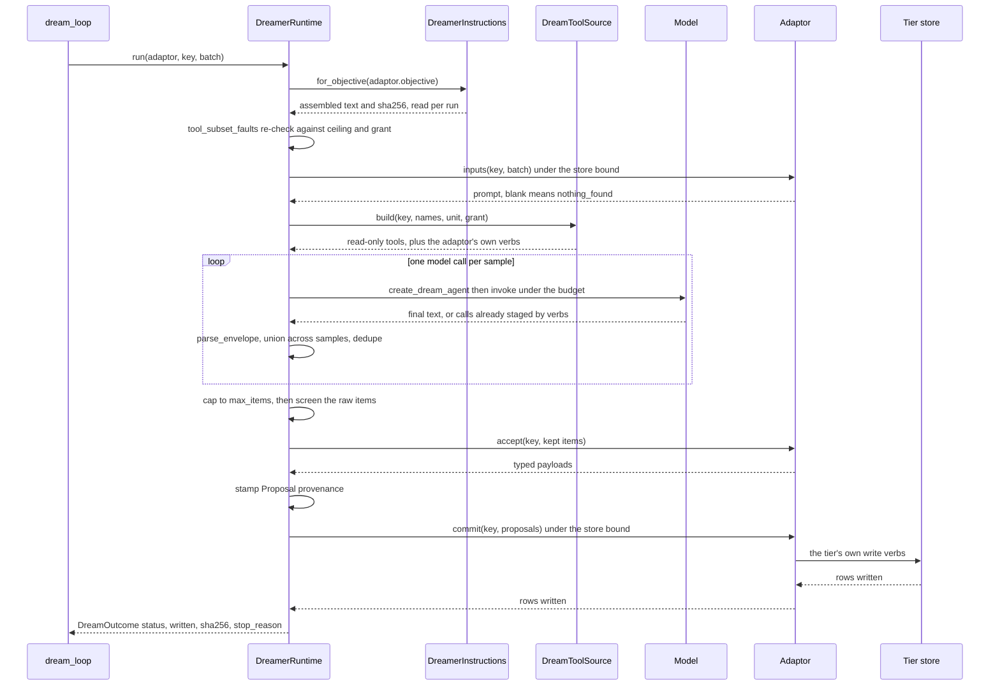
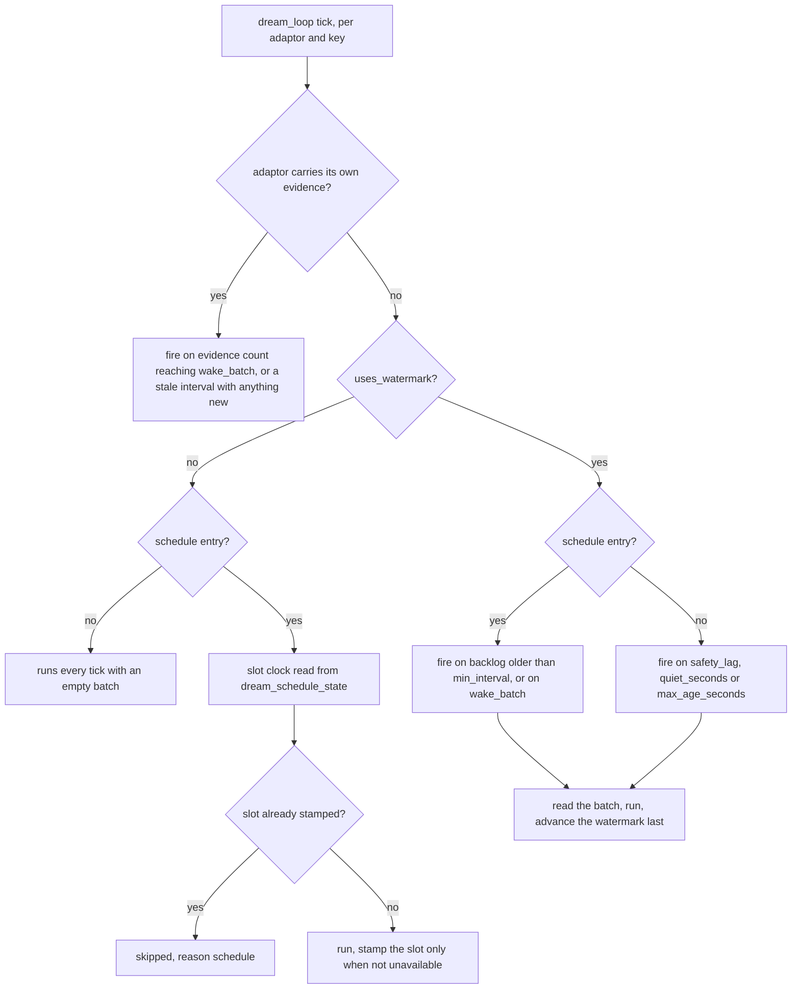

# The Dreamer: unattended model work, adaptors and the screening contract

The Dreamer is **the runtime, never a tier**. It is the background agent that reads
what the record already holds, asks a model to research something over it, and hands
the answer to code that decides what lands. It runs between turns, on its own clock,
and nothing it produces reaches a room on its own: `RegistryToolSource.build` passes
`deliverer=None` for every build, so no tool it holds can speak
(`nora/agent/dreamer.py`, `RegistryToolSource.build`).

Everything tier-specific — what to research, over which batch, with which tools, and
how an answer becomes rows — arrives through the `DreamAdaptor` port
(`nora/domain/ports.py`). The runtime owns the loop, the tool ceiling, the budgets and
its own doctrine, and it never names a tier's value type: `accept` returns
`object`, each payload is wrapped in a `Proposal` carrying provenance only the runtime
knows, and `commit` writes.

The load-bearing split is **the model proposes, code disposes**, narrowed by the route
each adaptor takes. There is no `write_fact`, no `send_reply`, and no write tool in the
default set — an adaptor's own verbs are *added* to the read-only set rather than being
defaults. An envelope adaptor returns structured data; a staged verb adaptor is handed
typed closures that validate as the model calls them and *stage*; an adaptor whose
checked verbs write when called (Lessons) commits inside the sample. Whichever the shape,
the runtime validates, screens and stamps, and the adaptor's `commit` — code, not a model
call — reports what landed and drives the rest of that tier's own tick, including
Lessons' decay.

## The fixed run order

One call is `DreamerRuntime.run(adaptor, key, batch)`, which wraps `_run_body` in a
span named `dream:<adaptor>` and annotates the outcome. The order below is the
design; each step exists because the next one is not allowed to see unvalidated
model output.

1. **The instruction is read per run**, before anything else, and its digest is
   captured (`instructions.sha256`), so a hot-reload landing mid-run cannot split one
   batch's rows across two digests.
2. **The tool subset is re-checked** with the same `tool_subset_faults` the startup
   check runs. A fault is loud and returns `unavailable`; it does not raise, because a
   background loop must not take its own clock down.
3. **`inputs` renders the prompt**, bounded by `store_calls_per_tick ×
   [dreamer] store_timeout_seconds`. A blank prompt is the general fire condition:
   `commit(key, ())` is still called (so time-driven decay holds) and the run reports
   `nothing_found`.
4. **Tools are built from names** through `DreamToolSource`, then the adaptor's own
   write verbs are adapted and appended, then the per-tool budgets are computed off
   the *built* tools.
5. **The model loop runs `samples` times**, each sample its own agent, guard, timeout
   and envelope parse.
6. **The union is deduped, capped, then screened** — in that order, at item
   granularity.
7. **`accept`, stamp, `commit`** — typed parse, provenance, the tier's own store.

Two adaptor shapes travel this path. An **envelope adaptor** returns
`{"<envelope_key>": [ ... ]}` and its `accept` parses items. A **verb adaptor**
(`adaptor.verbs(key=...)`) is handed typed closures that validate as the model calls
them; a returned loop means the sample was readable and yields `()`, and `accept` reads
what the verbs did. For Culture, Character and Persona those closures *stage*, while
Lessons' checked verbs write when they are called. All four are verb adaptors: their
objectives tell the model to write with a tool, never in its reply.

## The adaptor contract

`DreamAdaptor` is a `@runtime_checkable` protocol with declared fields the runtime
reads *before* it builds anything, and three methods.

| field | meaning |
|---|---|
| `name` | watermark identity, metric label and trace name at once; renaming it is a data migration, not a rename |
| `key_kind` | which population the loop ticks it over: `scope`, `unit`, `entity` |
| `uses_watermark` | false for an adaptor that reads live state rather than a message cursor |
| `objective` | an objective *file name* under `nora/dreamer/objectives/`, never the text |
| `envelope_key` | the top-level key the objective tells the model to return |
| `tools` | tool *names*; a narrowing of the read-only ceiling, never a widening |
| `store_calls_per_tick` | awaited collaborator call **sites** in `inputs` + `commit`; the multiplier for both store bounds |

The three methods each carry one rule that the tests hold:

- **`inputs(key, batch) -> str`** must render `""` when there is nothing to reason
  about — that blank string is the fire condition, and a model call on it is waste.
  An empty batch is a real state, not an error.
- **`accept(key, items)`** does the typed parse and **drops a malformed item silently**
  rather than raising, so one bad element cannot discard a batch that was otherwise
  fine. Returning fewer values than it was given is ordinary. The one legal raise is
  for a model result that was *read and is being discarded*: the runtime maps any
  exception to `unavailable`, which holds the watermark, so the batch is folded again
  rather than spent.
- **`commit(key, proposals, now_ms) -> int`** returns rows **written**, not proposals
  offered — a tier may legitimately refuse its own proposals. `commit(key, ())` is a
  legal and meaningful call; *not calling* `commit` is the different, third state.

The runtime never calls a sink directly. A tier's write is often two verbs in order
(propose the new row, then supersede the old one naming `replaced_by`), and knowing
that sequence means knowing the tier's value type — so the store is the adaptor's own
constructor-injected collaborator, and `commit` is where a tier sequences its writes.

`tests/contract/test_dream_adaptor_contract.py` is the shared suite: it asserts the
port's *behaviour*, never a tier's vocabulary (a legal batch parses; a malformed item
is dropped while its siblings survive; an empty commit is legal and reaches the sink;
`tools` stays inside `read_only_tools()`; the objective names a file that exists).
It also runs the runtime's own order — **screen, then `accept`, then `commit`** — so a
legal batch must survive the screen, still resolve, and still land. Two of its tests
are controls: a `screen` that rejects nothing must itself be shown to reject a uuid,
and the implementation map must not shrink. Today the map holds **one entry, a
fake**; every real adaptor is exercised by its own unit suite plus the architecture
tests below, not by this contract.

## The ceiling, and the one grant

The hard line is *the Dreamer may look and may not act*, and it is enforced twice
with the same function on purpose:

- **`verify_tool_subsets` at startup** raises `AdaptorToolError` — a background agent
  holding an act verb is not a condition to discover from a metric.
- **`tool_subset_faults` inside every run** re-checks, because the objective corpus
  hot-reloads and an adaptor rebuilt between ticks would otherwise be measured once,
  at a moment that has passed.

The faults are independent axes:

1. **read vs act.** A name outside `ToolRegistry.read_only_tools()` is an act verb.
   The Cognition session's own tools (`DREAMER_LOOP_TOOLS`: `rollup_read`,
   `standing_read`, `character_read`, `social_read`) are refused to any adaptor, and a
   grant derived from the read-only ceiling would otherwise swallow them.
2. **room-scoped vs unit-safe.** A unit-keyed adaptor's `key` is a unit name, not a
   conversation id. Every room-scoped read would answer **empty**, not fail — which is
   «I could not check» reported as «there was nothing», the substitution R-27 forbids.
   `UNIT_SAFE_TOOLS` is the hand-listed set of reads that resolve their unit from the
   supplied key, or resolve no unit at all (and a test measures it against
   `read_only_tools()` so a new read tool is unclassified rather than silently
   admitted).

`RegistryToolSource` is the only place a name becomes a tool, and it has its own two
guards behind the name-level ones: only a `read_only_tools()` name is ever built, and
the `Room` it hands `ToolRegistry.build` has **no roster source**, so a room-scoped
tool that slipped through answers `unavailable` rather than disclosing. Both guards
have one named exception — `AdaptorGrant(home_room=True)` — and it is a widening for
adaptors that ask, never a default.

The grant resolves through **two maps, one per key kind**, because what the key
already names differs:

- a **unit-keyed** adaptor's room is *chosen* per unit in `policy.toml`
  (`home_room = true`) and looked up in `home_rooms`;
- a **scope-keyed** adaptor's key already *is* a conversation, so the room is looked up
  in `scope_rooms` by that same key — an identity, not a disclosure decision. That is
  why `culture_grant()` is `home_room=True` with no act verb: without it every
  room-scoped read the culture pass declares answers `unavailable` off the empty room.

A home room is built with the real roster source for its platform, Nora's `self_ids`
(so her account is skipped rather than counted unnamed) and `location_trusted` from
the room's own `location` flag. A grant that resolves **no** room falls back to the
closed shape, counts `nora_dream_home_room_missing_total`, and logs once per
(adaptor, room-or-unit) — never a guessed room.

> **The one act verb is retired, the mechanism is not.** `remind` was the single
> allowance past the read-only ceiling (DEC-162), for the proactive adaptor, with every
> other field of the row stamped by code under `dream_adaptor` provenance. The
> proactive adaptor is **deleted** (DEC-277), and no live adaptor declares an act verb:
> the Cognition session's `remind` is one of its own closures
> (`nora/app/cognition_session.py`), not a registry tool, which is exactly what
> `cognition_grant()` says. `AdaptorGrant` is still how a scope-keyed adaptor is given
> its own room.

## The instruction corpus

`DreamerInstructions` (`nora/instructions/dreamer.py`) reads `nora/dreamer/`, a
read-only bind mount:

- `doctrine/` — **exactly one** file, true of every run; two files is a startup error,
  because the digest covers doctrine + objective and the assembly order would then
  depend on a filename nobody chose;
- `objectives/` — one per adaptor, selected **by name**;
- `preludes/` — a prelude *replaces* the shared doctrine for the objectives it names
  in `applies_to` (the Cognition session writes the group's notebook, so «You look;
  you do not act» is false for it, and editing the shared file would change every
  adaptor's text and digest at once);
- `skills/` — text the Cognition session injects after its instruction, per agenda
  kind. It lives here so it hot-reloads with the rest of the Dreamer's text.

`for_objective(name)` assembles two tagged parts (`<dreamer_doctrine name="…">` and
`<dreamer_objective name="…">`) and hashes **exactly the joined string it sends**, with
`instruction_sha256` — the same joiner and function `nora.doctrine.loader` uses, so the
digest cannot name text the model did not read. The pair rides one `InstructionSet`
(`text`, `sha256`, `versions`) because a caller that read the text here and the digest
elsewhere would eventually stamp a row with the hash of instructions it did not send.
The hash covers the **pair**, not the objective alone: an edit to the shared doctrine
changes every adaptor at once and must leave a trace on every row.

**The digest is read per run, never cached at construction** (DEC-128). The corpus
hot-reloads off the mount; a digest captured at `__init__` keeps naming the corpus as
it was at process start and looks correct the whole time, because wrongly-stamped rows
are indistinguishable from right ones.

Reload is `nora.instructions.reload.DirectoryWatcher`: `reload = "mtime"` re-fingerprints
path, mtime **and size** on read (a restored backup keeps its timestamp), the last good
scan keeps being served while a counter climbs, and a broken corpus at *startup* raises
— a process that starts with no instructions and says nothing is the
`unavailable`-reported-as-`nothing_found` failure one layer down. A moved generation
clears the assembled-text cache. An unknown objective name raises rather than
assembling the doctrine alone: a run against its doctrine and no objective answers
nothing while looking ordinary.

## Envelopes, caps and the three states

`parse_envelope` is the runtime's validation and it is deliberately small: no
`jsonschema` dependency for one call site. The envelope must be a JSON object carrying
the adaptor's declared key, whose value is a **list of mappings**. It:

- **rejects** a response over `MAX_ENVELOPE_CHARS` (200 000) outright — a response 20×
  any legal one is evidence the model was doing something other than answering;
- **tolerates a preamble** by scanning for `{` with `json.JSONDecoder.raw_decode`
  (not hand-rolled brace counting, which breaks on `no source for the 5" pipe`);
- **takes the last valid envelope, not the first**, because every objective prints the
  empty form as its nothing-found instruction, and taking the first would read a
  quoted instruction as a real answer and advance the watermark past a batch that was
  read;
- **never raises**. `None` means the batch was not read; a well-formed empty list means
  «I looked and there was nothing». Those are different values on purpose.

After the union across samples is deduped by byte-identical fingerprint (phrasing
differences are the adaptor's identity rule, not the runtime's), the run applies its
item cap: `MAX_ITEMS` (64) unless `AdaptorSchedule.max_items` overrides it. The cap is
**drop-shaped** while the watermark still advances, so the drop is counted —
`nora_dream_screened_total{reason="cap"}` with the count in one increment.

`DreamOutcome.status` is R-27's three-state vocabulary one layer up, and it is decided at
**two** boundaries rather than one: a *sample* boundary inside the model loop, and an
*accept/commit* boundary after it.

| status | meaning | watermark |
|---|---|---|
| `ok` | the model returned items, or proposals were produced, or rows were written | advances |
| `nothing_found` | a well-formed empty list from every readable sample, or a blank `inputs` | advances (the batch was empty) |
| `unavailable` | no sample was readable at all, or a readable run's `accept` raised, its `commit` faulted, or the tier answered `AccountNotRecordableError` | **held**, and the schedule slot's `last_fired_at` is not stamped |

**At the sample boundary, unreadability is per sample, not per run.** Prose, a truncated
or wrong-key envelope, a timeout and a killed loop all mean the same thing for *that*
sample: it increments `nora_dream_sample_total{status="unavailable"}` and is **skipped**,
and the remaining samples still run. The run becomes `unavailable` at that boundary only
when the loop's `readable` count is zero — the `readable == 0` return — because «nobody
read this batch» is what holds a cursor, while one good read of it is a read. That return
comes before the screen, before `accept` and before `commit`: the post-sample
screen/accept/commit sequence is skipped, so the outcome reports `written=0` and whatever
`commit` would have done at the end of the run — including Lessons' time-driven decay —
does not happen. It is not a rollback, though: side effects of adaptor verbs that already
completed inside a sample stay, and the existing Lessons pass is the case in point, its
checked verbs writing and committing when the model calls them ([Lessons: practice about
what she does](../concepts/contextual-learning.md#lessons-practice-about-what-she-does)).
`tests/unit/test_dreamer_runtime.py` pins both halves against a scripted envelope adaptor:
`test_one_unreadable_sample_does_not_lose_the_others` (two samples, one prose and one
valid → `ok`, one row written, one `ok` and one `unavailable` sample counted) and its
positive control `test_every_sample_unreadable_is_an_unavailable_run` (`unavailable`,
`written` 0, and its own sink recording no `commit`, two `unavailable` samples).

**A readable run can still end `unavailable` later, and that is a second rule rather than
a contradiction of the first.** Once at least one sample was readable, the try spans
`accept` and `commit` and three things end the run `unavailable` with `written=0`:
`accept`'s narrow raise (the adaptor read its model's result and refuses to record it),
a `commit` that faults — a raise, or a store phase cut off at its own bound — and
`AccountNotRecordableError` from a Character session that settled nothing, which the
adaptor has already counted. Every one of them holds the cursor, and that is the whole
point of catching there: an adaptor that refused a result it did read does not also spend
the messages it read. No watermark advances and no schedule slot is stamped, so a batch
that was read this way is still there for the next tick.

`ok` is about what the *model* returned, not how many rows survived: a batch every
item of which was screened out is still `ok`, because `nothing_found` would be the
claim «there was nothing». That case is named separately by
`nora_dream_empty_after_screen_total`. `DreamOutcome.stop_reason` is an optional
diagnostic passed through from the model call: on its own it proves neither that an
envelope was readable, nor that the run succeeded, nor that nothing was written.

## The screen: before any tier type exists

`nora/agent/dream_screen.py` exists because **Dreamer output reaches the model**.
Whatever an adaptor persists is rendered back into a later turn's prefill; Nora's own
identifier and coordinate screens sit on *her* egress, and an adaptor writing to its
sink is a second path into the prompt that passes neither of them. A page saying «her
number is +85290000101» becomes a stored line that renders on every subsequent turn,
long after the run that wrote it is forgotten.

It therefore runs on the model's **raw envelope items**, after the cap and before
`accept` — before any tier type exists — for three stated reasons:

- screening a parsed object would require every adaptor to expose its own text for
  inspection, one more surface a tier can forget something on; an item is a `Mapping`
  and needs no cooperation;
- an item still carries the fields the typed parse **drops**, and a parse that ignores
  an unknown key is exactly the parse that would hide the key an injection wrote into;
- it still drops at **item granularity**, so one poisoned item never costs its
  siblings the run.

The walk is recursive over every string reachable in the item, **mapping keys
included**, because a model under injection will write content into the key half of a
pair. The predicate is `scan_identifiers` — the reply's floor by name, not
`scan_reply` — plus three sink-only patterns: an email, a 15-or-more-digit id, and a
labelled `lat … lng …` pair. A word like 「haiku」 must survive into a store, and the
suite pins the choice so it cannot be flipped by accident.

A rejection is a `Rejection(index, reason, path)` — deliberately **not** the offending
text, because a log line that reproduces it copies a phone number out of a store that
refused it into a file that keeps it forever. Drops are counted
(`nora_dream_screened_total{adaptor, reason}`) and logged, never silent and never
fatal: an empty batch is two empty tuples, an ordinary outcome.

The same predicate is reused rather than copied:

- `DreamerRuntime._screened` wraps each adaptor verb, so a verb call whose arguments
  carry an identifier or a coordinate is **refused with a reason the model can act
  on** before it runs (a staged write reaches a store that renders into later prompts
  exactly as an item does);
- `text_offence` is the same check on one string, injected into `SqlPersonaStore` as
  its write screen.

A known boundary is stated rather than implied: the screen reads strings. A scalar
float cannot hide any of the patterns; a coordinate deliberately split across two
numeric fields whose renderer later joins them would be, and the answer is that the
renderer, not the screen, is what gets patched.

## Budgets, ceilings and the guard

`AdaptorBudget` is **per adaptor, never one global number**: proving a fact is worth
more model calls than glossing a word, and a single ceiling would starve the first or
overpay for the second. Its numbers are unmeasured starting points, not measurements.

| field | what it bounds |
|---|---|
| `turns`, `total_tokens`, `output_tokens` | Strands' three R-8 caps for one sample's loop |
| `timeout_seconds` | the wall clock around one sample; **not optional** |
| `max_memory_calls` (default 2) | reads across *all* memory verbs together, per pass |
| `max_tool_calls` (`None` = no ceiling) | every tool call of one pass, over the whole grant |
| `tool_calls` | this adaptor's delta over the per-tool table, by tool name |

A deployment need not write one block per adaptor: when
`[dreamer.budgets.culture]` is set, every Character, Lessons and Persona session
inherits those numbers (`composition.py`'s `setdefault`), because the loop shape is the
same — a handed batch, a few reads, one account written. An adaptor with no block of its
own is not unbounded, it is bounded by the runtime's `default_budget`.

`timeout_seconds` is a **required field on `AdaptorBudget`** (the config's own default is
120 s) rather than an optional one, because a hung Dreamer call is **quiet**: the loop
marks the key `running` and skips it on every later tick without ever raising, so the
exponential backoff — which only engages on an exception — never fires. Three ceilings
stack, widest first: `NativeTool.budget` (the tool's own table), then `[llm.budgets]`
(the deployment delta, the same one a tag turn reads), then
`[dreamer.budgets.<adaptor>.tool_calls]`. A key naming a tool the adaptor does not
declare is a **boot failure**, not a silent no-op: the pass would run on the table's
number while `config.toml` recorded a raised one, and the only tell would be a veto
counter nobody watches.

`DreamGuard` (`nora/agent/dream_guard.py`) is a **separate guard, not a weakened
`ReplyGuard`**. It holds no `Deliverer`, has no `terminal` parameter, does not relax
`tool_choice`, and registers **tool hooks only** — never `BeforeModelCallEvent`, which
is the hook whose `cancel` is how `ReplyGuard` ends a turn. It structurally cannot end
one. The stopping condition belongs to the runtime: the model declining to call
anything, under `tool_choice="auto"`, inside a wall clock.

Five rules, each its own label on `nora_dream_guard_vetoes_total{adaptor, rule}`:

| rule | what it does |
|---|---|
| `R-7` | default-deny: a tool absent from `budgets` is vetoed, which in an unattended loop is the tell that an objective and its grant disagree |
| `tool-budget` | the per-tool ceiling, from the same `CallLedger` `ReplyGuard` holds, reserved before a call and released after so a parallel batch is measured against itself |
| `R-99` | an argument the tool's own signature does not declare, through the same `unknown_arguments_veto` the tag guard calls |
| `memory-budget` | the pass's memory ration is spent: the call is **answered** `unavailable` with a note, not vetoed |
| `pass-budget` | the same shape over every verb, which is what sizes `max_tool_calls` |

A veto returns a corrective sentence; a budget refusal returns a *tool result* shaped
`{"status": "unavailable", "note": ...}`. They are separate methods because they
produce different things, and the note never offers a way out — a model told a hard
cap declines the work rather than spending less — so it names what to do instead and
tells the model to finish. The refusal reaches the model as an `unavailable` result,
not as the SDK's raw cancellation error, because an error invites the retry the ceiling
exists to stop.

The guard also clamps tool results in `_after_tool`: `web_search`/`web_fetch` at
8 000 characters, memory verbs at 4 000, with a marker naming the cap so a truncated
result reads as truncated rather than as the whole answer. `MAX_ENVELOPE_CHARS` bounds
only the *outgoing* envelope; an unbounded tool result re-entering the loop could spend
the run's whole token context.

**One guard per sample**, because it owns a `CallLedger` and a ledger is spent state: a
shared one would let the first sample's calls count against the second's, and
`max_memory_calls` would stop being a per-pass ration.

## The clock: fire conditions and schedules

`AdaptorSchedule` is a name-keyed value like `AdaptorBudget`, deliberately **not** a
field on the protocol (a defaulted non-method member on a `@runtime_checkable` protocol
breaks `isinstance` for every adaptor that does not declare it).

Three wake shapes, and the difference is what the key's own signal is:

- **shared watermark shape** (no schedule entry): `lag > safety_lag`, or `lag > 0` with
  `quiet_seconds` of silence, or the watermark row older than `max_age_seconds` — the
  last fires at zero lag on purpose, and is the only condition that reaches a quiet
  room;
- **scheduled watermark-bearing**: `lag > 0` and the watermark row at least
  `min_interval_seconds` old, **or** `lag >= wake_batch` (the evidence wake: enough new
  messages fire at once, whatever the age);
- **watermark-free on a schedule**: fires on its **slot**,
  `floor((now − phase_offset) / min_interval)`, with no backlog required — which is
  what lets a time-driven pass fire in a silent room.

The slot is not elapsed time, for two reasons that are both about failure: an in-process
clock resets on every restart, so «daily» would mean «once per deploy»; and elapsed
time cannot express a **phase offset**, which is how adaptors with a data dependency
(one writes a queue, the next drains it) are ordered when the loop dispatches them
concurrently with no ordering. `SqlDreamScheduleClock` keeps the last fire in
`dream_schedule_state`; a missing row means «never fired», never «fired at 0», because
epoch 0 is a real instant any slot arithmetic will happily compute against.

**The stamp goes after the run and never on `unavailable`.** Stamping first would not
prevent a concurrent copy (the loop's per-key `running` set does that) but would burn
the whole day on a 429 that outlived the retry policy, and the backoff would clear on
the very next tick because a schedule hold returns `None`. It would also write
`last_fired_at` for a run that did nothing — R-27's forbidden substitution, in the one
table an operator reads to ask whether the clock is alive.

Other per-adaptor numbers: `batch_limit` (how much of the record one fire reads),
`max_items` (the envelope cap, which the runtime *drops* past while the watermark still
advances), `samples` (model calls per fire, run in sequence, worst case N × timeout),
and `seed_at_head`, which starts a first-run scope at the record head rather than at 0
— for an adaptor whose output is one evolving head, replaying the room's past would
install old slices as what the room is *now*.

## The loop around it

`dream_loop` (`nora/app/runtime.py`) is the Dreamer's clock and it is a sibling of
`prune_loop` with four differences that are not stylistic:

- **the try/except is per scope**, and each scope's cycle is dispatched as its own
  tracked task — inline awaiting would serialize every room behind one slow room, and
  the per-scope lock would be unreachable dead code;
- **the backoff comes from `supervise_adapter`** rather than from `prune_loop`, because
  this talks to an external model provider, where a 429 answered at full cadence makes
  the outage worse;
- **failure isolation is per `(adaptor, key)`**, because adaptors have different value
  densities and letting the riskiest silence the cheapest is backwards. The stated cost
  is that the first tick of a provider outage needs one failure per pair;
- **one wall clock wraps the whole unit** (`[dreamer] max_unit_hold_seconds`), because
  the cursor reads around the two bounded store phases — `clock.last_fired`,
  `record_fire`, every `language.*` watermark read, `record.since`, `media_join.enrich`
  — are bare awaits, and any one hanging would leave the key in `running` forever.

A unit already `running` is skipped and counted
(`nora_dream_skipped_total{reason="in_flight_adaptor"}`); a unit whose backoff has not
elapsed is skipped silently; a unit released by the wall clock deliberately does **not**
advance the backoff, so it is tickable on the very next tick. A `unavailable` status
from the runtime is treated as a failure even though nothing raised — otherwise the
exponential could never engage on the one failure it exists for. After repeated
failures the batch limit shrinks (`nora_dream_batch_shrunk_total`) and heals itself.

Watermarks are advanced **last**, and only on `ok`/`nothing_found`; a watermark behind
the oldest surviving row means messages were deleted before they were read, which is
counted (`nora_dream_evidence_lost_total`) rather than re-read.

## The adaptors that exist, and the ones that do not

**Live** — wired into the composition root's `dream_adaptors`, gated by the section
named, each with its own objective file:

| adaptor | objective | gate | key kind | writes through |
|---|---|---|---|---|
| `culture` | `culture` | `[culture] enabled` or `[persona] enabled` | `scope` (room `primary_id`) | `character_revise` / `character_no_change` |
| `character-person` | `character-person` | same block | `entity` (unit, person) | the same two verbs |
| `character-unit` | `character-unit` | same block | `entity` (unit) | the same two verbs |
| `character-nora` | `character-nora` | same block | `entity` (unit) | the same two verbs |
| `persona-person` | `persona-person` | `[persona] enabled` | `entity` | `persona_write` / `persona_no_change` |
| `persona-verdict` | `persona-verdict` | `[persona] enabled` | `unit` | `record_verdict` |
| `persona-room`, `persona-unit`, `persona-nora` | `persona-room`, `persona-unit`, `persona-nora` | `[persona] enabled` | `entity` | `persona_write` |
| `lessons` | `lessons` | `[lessons] enabled` | `entity` (unit) | the lesson book's checked verbs, which write when called |

Two things about that table are worth stating because the shape looks uneven:

- **the four culture-group adaptors are dropped when a persona index exists or
  `[culture]` is off** (the composition root removes them by name), so a cutover does
  not run two account writers over the same entity;
- **the key kinds differ** and the loop resolves a population per kind — `scopes()` for
  `scope`, `units()` for `unit`, and `adaptor.keys()` for `entity`. An unknown kind is
  logged and the adaptor does not run, rather than being guessed at or silently skipped.

`cognition` is the **fourth kind of Dreamer work and not a `DreamAdaptor`**: it has an
objective (`cognition`) and a prelude that replaces the shared doctrine, a
`cognition_grant()` with a real room and no act verb, and a `[dreamer.budgets.cognition]`
block — but it runs through `CognitionAgentRunner` rather than `DreamerRuntime`, with
one `DreamGuard` per call built with `per_tool_ceilings=False` and no envelope. A
session is bounded by rounds, tokens and a wall clock alone, and the config refuses a
cognition budget that sets `max_memory_calls`, `max_tool_calls` or `tool_calls`. See
[the cognition workflow](../workflows/cognition.md).

**Retired, and the machinery left behind** — marked rather than implied, because the
set is not the historical set:

- **`note-candidates`, `note-curation`, `note-merge`, and the `proactive` adaptor** were
  deleted 2026-10-03 (DEC-277). The Cognition session is the one background writer of
  notes, events, Standing and Nora's own reminders. What survives of the proactive
  adaptor: the home room (generalised to each agenda item's bound room), the
  decide/compose split, the per-room `proactive` flag, and the row-driven bridge out —
  now the session's `remind`, whose row is composed and sent by the fire path
  (`kind="proactive"`), never by a Dreamer pass.
- **the generic `DreamSink` port is gone.** `propose`/`supersede` are now referenced
  only in docstrings and migrations; `DreamAdaptor.commit` drives each tier's own
  collaborator instead, and Culture explicitly models its store as append-only rather
  than as a sink whose `supersede` it must never call.
- **the knowledge ("fact") tier and the language tier** were deprecated 2026-09-07 and
  their code deleted. Some test fixtures and comments still carry their item shapes
  (`tests/unit/test_dream_screen.py` uses `note-candidates` / `note-curation` envelopes
  as its worked examples); that is a fixture, not a shipped adaptor.
- **`doctrine-check` and `standing-debrief`** are objectives in the corpus that no
  `DreamAdaptor` names: `DoctrineCheck` reads `doctrine-check` per call through
  `objective_body`, and the debrief stage reads `standing-debrief`. They are Dreamer
  *corpus* without a Dreamer pass.

## Signals worth knowing

Counters and gauges are named where they are minted; the ones an operator asks about
first:

- `nora_dream_run_total{adaptor, status}` — the three states, per adaptor;
  `nora_dream_written_total`, `nora_dream_run_seconds`.
- `nora_dream_skipped_total{reason}` — `in_flight_adaptor` (a unit still running) and
  `schedule` (the slot is held); without it, «never fires» and «nothing to do» are the
  same series.
- `nora_dream_sample_total{status}` and `nora_dream_stop_reason_total{reason}` — a cut
  loop versus a finished one.
- `nora_dream_screened_total{adaptor, reason}` (`identifier`, `coordinate`, `cap`) and
  `nora_dream_empty_after_screen_total` — a working screen versus a silent model.
- `nora_dream_guard_vetoes_total{adaptor, rule}` — a sustained non-zero on a read verb
  is the instrument for a ceiling that is too low for the work.
- `nora_dream_store_timeout_total{phase}`, `nora_dream_unit_timeout_total`,
  `nora_dream_batch_shrunk_total`, `nora_dream_home_room_missing_total`,
  `nora_dream_evidence_lost_total`, and
  `nora_dreamer_instruction_reload_failures_total`.

See [observability](../operations/observability.md) for how these are exposed.

## What pins it

- `tests/contract/test_dream_adaptor_contract.py` — the port's behaviour, the runtime's
  screen-accept-commit order, and the two controls that keep the suite from being
  vacuously green.
- `tests/contract/test_dream_schedule_clock_contract.py` — the clock's «absent means
  never fired» rule, shared by the Postgres and in-memory implementations.
- `tests/unit/test_dreamer_runtime.py` — every path through `run` against a **scripted**
  model, each fake returning the specific wrong shape its case is named for (prose,
  truncated JSON, wrong key, timeout, a raising commit).
- `tests/unit/test_dream_screen.py`, `test_dream_guard.py`, `test_dream_memory_budget.py`
  and `test_dream_guard_wiring.py` — per-item drops with a benign sibling, the veto and
  refusal rules, the per-pass ration driven through the **real** Strands loop, and the
  production wiring of R-99's `param_names`.
- `tests/unit/test_dreamer_instruction_goldens.py` and `test_dreamer_assembly_goldens.py`
  — byte-for-byte instruction text and digests for every objective but `cognition`, and
  the adaptor's `inputs()` text. Nothing regenerates a golden: changing one is a
  model-visible change.
- `tests/architecture/test_dream_store_calls_are_declared.py` — counts awaited
  collaborator sites off each adaptor's own AST and fails when
  `store_calls_per_tick` disagrees, refusing outright any construct the counter cannot
  follow; `accept` must hold none.
- `tests/architecture/test_dream_unit_is_wall_clocked.py` — the structural half of the
  «no unit is held forever» proof.
- `nora/testing/dream_schedule.py` and `nora/subject/dreaming.py` — an offline harness
  that mirrors the three things a real fire does (read the batch with `record.since`,
  join media at `path="dreamer"`, call `DreamerRuntime.run`) without measuring the
  clock.

## Changing it safely

A new tier is a new adaptor, not a new parameter:

1. **Add the objective file** under `nora/dreamer/objectives/`, with the frontmatter
   the loader requires (`name`, `kind`, `version`, `applies_to`, `description`,
   `change_policy`) and a body that either prints the exact `{"<envelope_key>": [... ]}`
   form its adaptor declares, or tells the model to write through one of its verbs.
2. **Write the adaptor** with the declared fields, a blank-returning `inputs`, an
   `accept` that drops rather than raises, and a `commit` that sequences its own store
   writes and returns rows written. Count its store sites honestly; the architecture
   test will.
3. **Wire it** in the composition root with a schedule and a budget block — inherited
   from `[dreamer.budgets.culture]` when the deployment set one, otherwise the
   runtime's default ceiling — and, if any of its reads are room-scoped, a grant,
   choosing between `home_rooms` (unit-keyed) and `scope_rooms` (scope-keyed).
4. **Let the startup check refuse you** if the tool subset escapes the ceiling, if a
   per-tool ceiling names a tool you do not hold, or if your objective does not exist.
   Those refusals are the design.
5. **Keep the prompt from rendering an identifier.** Whatever `inputs` shows, the model
   can echo, and an echoed uuid is dropped by the same screen that protects the store —
   silently, with the run still reporting `ok`. Render an ordinal handle and keep the id
   in your own map.

Related reading: [the tool surface](../concepts/tool-surface.md) for how a name becomes
a tool and what the ceiling means, [configuration](../operations/configuration.md) for
`[dreamer]` and `[dreamer.budgets.*]`, [Persona and provenance](../concepts/persona-and-provenance.md)
for what the stamped `Proposal` provenance is for, and
[contextual learning](../concepts/contextual-learning.md) for what the passes feed.
