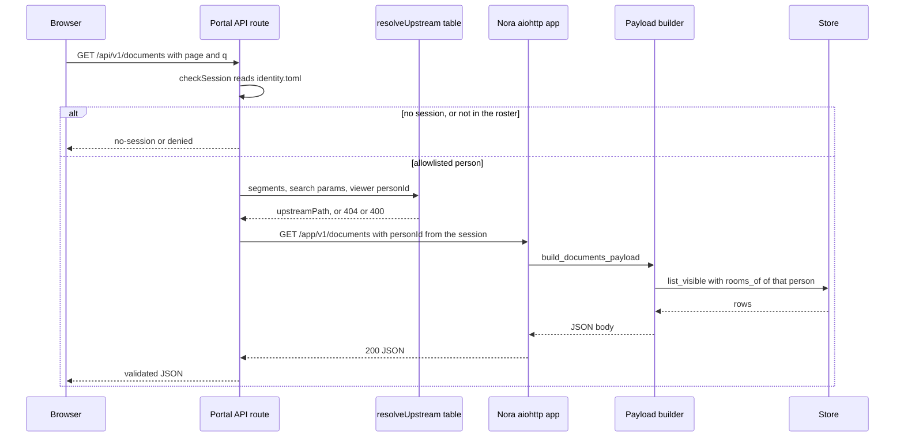

# The portal API and the web surfaces

Nora's agent loop talks to chat platforms; everything else that a human looks at talks to one HTTP
surface. `/app/v1/*` is that surface: the friend-group portal's data (a separate Next.js container),
the voice sidecars' ingest and callback endpoints, and whatever an operator or a script calls with
curl. It is deliberately *read-mostly* — each route reads one collaborator and re-projects it, and
the only writes are the portal's document state and revision actions, the one-time-code pair, and
the voice ingest and controller-callback routes.

The module is a collection of `register_*` functions over one `aiohttp` application
([`nora/web/api.py`](../../nora/web/api.py), [`nora/web/__init__.py`](../../nora/web/__init__.py)),
and most of what follows is a consequence of that single decision.

## One app, four registers

| register | file | adds |
|---|---|---|
| `build_health_app` | [`nora/obs/health.py`](../../nora/obs/health.py) | `GET /health`, `GET /metrics` |
| `register_web_routes` | [`nora/web/api.py`](../../nora/web/api.py) | status, skills, tools, doctrine, memory, persons, games, presence, events, documents — and, at its own end, calls `register_document_history_routes` and `register_artifact_routes` |
| `register_otp_routes` | [`nora/web/otp.py`](../../nora/web/otp.py) | `POST /app/v1/otp/request`, `POST /app/v1/otp/verify` — only when `[otp] enabled` |
| `register_voice` | [`nora/web/voice.py`](../../nora/web/voice.py) | `POST /app/v1/voice/utterance`, plus `POST /app/v1/voice/event` when a controller consumer was wired |

`App.run` builds the health app first, hands it to each register function, and only then serves it
([`nora/__main__.py`](../../nora/__main__.py)).

## Why `register_*` and not a second app

The docstring states the reason plainly: a `build_*_app` returning a new `web.Application` "would
mean a second port" ([`nora/web/api.py`](../../nora/web/api.py)). `register_web_routes` takes an
existing application and parks every collaborator in it under a `web_*` key; nothing about the
route surface can start its own server.

Four things follow, and each is worth checking before adding an endpoint:

- **One port is the whole exposure decision.** The routes share `[obs.metrics].port`
  (`config.example.toml` still annotates it "also serves `/health`"), so publishing the port on
  loopback only, and keeping the portal container on the private compose network, covers the agent's
  metrics and the friends' document page at once. See
  [deployment](../operations/deployment.md) for the publish rules and
  [runtime topology](../architecture/runtime-topology.md) for the startup ordering.
- **There is no per-app middleware seam.** No `/app/v1` read consults a token, a cookie or a header;
  Nora trusts the network in front of her. Authentication for reads therefore lives *only* in the
  portal (below), and the one endpoint pair that must not be reachable by anyone on that network
  carries its own bearer.
- **The surface is answerable before the agent is.** The HTTP server is served before the adapters
  connect, so `/app/v1/*` answers while Nora is still coming up — and what it answers in that window
  reflects the stores, not the platforms. `/health` is where a mid-connect platform is visible as
  `connected: false`; the portal routes never invent a verdict about one.
- **Registrations are ordered by key, not by type.** `register_artifact_routes` and
  `register_document_history_routes` read `app["web_artifacts"]`, `app["web_rooms_of"]`,
  `app["web_persons"]`, `app["web_documents"]` and `app["web_blobs"]`, which `register_web_routes`
  sets. They are called at the end of it, and calling them first would silently route to handlers
  that raise `KeyError`.

## The auth seam

Two mechanisms meet, and neither is in the other's file.

**Portal half.** `checkSession()` is "the ONE place session + allowlist logic lives" — the page gate
and every `/api/v1` read call it, because a page gate alone never protected the routes the pages
fetch from ([`app/src/server/session.ts`](../../app/src/server/session.ts)). It reads the same
`identity.toml` bytes Nora's process reads, cached and re-read on mtime change, so a person removed
from the roster is out on their next request. Two sign-in paths end as one `person_id`: Discord
through the account's `user_id`, or a one-time code through the person Nora verified it for.

**The proxy table.** `ROUTES` in [`app/src/server/upstream.ts`](../../app/src/server/upstream.ts) is
one table instead of one route file per endpoint, and the difference between endpoints is a column.
It enforces: GET only, a path not in the table is a 404 and is never forwarded, only the query
parameters a route names are forwarded, `scope: "self"` routes get `personId` from the *session* and
a browser-supplied one is ignored, path parameters must match an id charset and are re-encoded, and
literal segments beat parameters so `presence/analytics/places` can never be read as a person called
`analytics`.

**The one bearer token.** `otp.py` says it outright: the OTP pair is "a bearer token, unlike every
other `/app/v1` route", because those two hand out a `personId` for a code, which is a sign-in. The
token comes from `[otp] api_token_env`, is compared in constant time, and an empty token makes
`register_otp_routes` raise so composition cannot start misconfigured. The portal holds the same
value server-side, never sends it to the browser, and offers code sign-in only when it is set
([`app/src/server/otp.ts`](../../app/src/server/otp.ts)).

## Route groups by what they read

| group | routes | reads | 200 body |
|---|---|---|---|
| **status** | `/status` | `RecordStore.stats`, `MemoryStore.health`, pending reminders | `{uptime_seconds, store{reachable}, honcho{reachable}, reminders{count, next_due_at, upcoming[]}}` |
| **roster** | `/persons`, `/persons/{personId}` | `identity.toml` via `Persons`, plus a Pulse cross-reference | array of `{personId, displayName}`; a profile object |
| **memory** | `/memory?personId=` | `MemoryStore.peer_card` + `representation`, one per Nora workspace | array of `{person_id, display_name, reachable, identity[], episodes[], workspace?, persona?}` |
| **catalogs** | `/doctrine`, `/skills`, `/tools` | doctrine files, the skills directory, `ToolRegistry.catalog()` | arrays of section/skill/tool objects |
| **live presence** | `/presence`, `/presence/places`, `/presence/{person_id}/history` | `PresenceReader` over the `identity.toml` circles | `[{personId, displayName, current}]`, `[{name, lat, lng}]`, `{hours, from, to, points[]}` |
| **derived analytics** | `/presence/analytics/{places,rhythm,routes}` | the current Rollup build through the mobility store | `{subjects[]}`, `{subjectId, bins[], windowDays}`, `{subjectId, trips[], corridors[]}` |
| **documents** | `/documents`, `/documents/{id}`, `/documents/{id}/media/{sha}`, `/documents/{id}/revisions[/{n}]` | `DocumentStore` scoped to `rooms_of(person)` | `{documents[], page, pageSize, total, state, query}`, a detail object, raster bytes, revision lists |
| **artifacts** | `/artifacts`, `/artifacts/{ref}`, `/artifacts/{ref}/download` | `ComputerExportStore` scoped to `rooms_of(person)` | `{artifacts[], page, pageSize, total, query}`, a summary object, bytes with range support |
| **events** | `/events`, `/events/{id}` | `GatheringService` scoped to the viewer | array of gathering objects; one object |
| **games** | `/games/servers` and `…/{id}/{status,graph,weekly,world,progress,save-history,insights,players,players/{playerKey},activity,sessions}` | Pulse's REST API through `PulseGamesClient` | Pulse's own body, passed through unchanged |

Three of those groups deserve a note about *shape ownership*. `status.py` is deliberately a filtered
re-projection of `/health`, not the full body — a friend-facing page carries none of the operator
dashboard's platform/SSE/doctrine internals, and it names reminders by due time, platform and
conversation only, never a reminder's text or its requester. `memory.py` returns both of Honcho's
distinct reads (`identity` claims and dated `episodes`) and never merges them, and with
`[persona] render` on it also attaches the caller's own Persona accounts, whose cited messages
resolve to text only where the room names the viewer in the policy this process loaded — never
because they were in the room when the message was sent. `games.py` is a thin projection
over a sibling service's documented wire contract, so the payloads are Pulse's shapes, validated
client-side by the portal's zod schemas.

## The failure shapes

Read handlers are written so a collaborator's failure becomes an answer rather than a raised
exception. A failure becomes one of four answers, and which one is a decision rather than an
accident:

- **`unavailable` (503)** — "could not check". A route whose collaborator is absent — `web_blobs` is
  the one the deployed graph can leave `None`, when media custody is off
  ([`nora/app/composition.py`](../../nora/app/composition.py)), and the documents, artifacts and
  rooms keys are optional in the registration signature so tests can exercise that state — or whose
  read raised answers 503 with a `status`/`error` marker, never an empty 200. The derived-presence
  routes are wrapped in `_needs_a_build` precisely so a fresh database with no Rollup build says
  `{"error": "unavailable", "reason": "no Rollup build yet"}` instead of "this person has no places,
  no rhythm and no routes" ([`nora/web/api.py`](../../nora/web/api.py),
  [`nora/domain/rollup.py`](../../nora/domain/rollup.py)).
- **`not_found` (404)** — and always the *same* 404 for "does not exist" and "not yours". A document
  the viewer may not read, a deleted one, a picture the document does not name, an artifact outside
  the viewer's rooms, an event they neither made nor answered: none of these get a distinct
  `forbidden`, because an id must not confirm that a thing exists.
- **`refused` (400)** — the caller's bug: a `personId` that is not a person this deployment knows, a
  malformed UUID, a bad JSON body, a `q` longer than the limit or carrying a control character, a
  non-numeric or non-positive `days`/`hours`, an unknown `state` filter. Free text is *refused*, never
  cut, so a query never silently means something else; windows are *clamped* (`days` to 90, history
  to 30 days and 5000 points, `page`/`pageSize` to their bounds), because there a smaller answer is
  still an honest one.
- **`conflict` (409)** — only the revision restore: a revision that landed since the viewer looked is
  never overwritten, and a revision of an archived document is refused the same way.

The games routes add one rule of their own: every `GamesUnavailableError` becomes the single fixed
body `{"error": "games backend unavailable"}`, with the real exception logged server-side, because
the exception legitimately carries diagnostics that must not reach a browser. A store that is down is
also never "not found" — the document state write logs and answers 503 rather than pretending the
document vanished. The guarding is per collaborator, not per framework: `/status` catches its store
and Honcho health checks but not the reminders read, so a reminders failure there surfaces as a
server error rather than as `unavailable`.

## The access boundary

Three visibility tiers exist, and no route crosses from a narrower one to a wider one.

- **Room-derived** — documents, artifacts, events, and the evidence text inside a memory entry. The
  gate is a *callable*, `rooms_of(person_id)`, so `nora.web` never imports a `Policy` — but the
  callable does not read `policy.toml` either. Composition binds it as
  `functools.partial(rooms_named, allowlist)`, and `allowlist` is the one `Policy` `load_policy`
  returned while `build_dependencies` was running
  ([`nora/app/composition.py`](../../nora/app/composition.py)); `rooms_named` then walks *that*
  captured policy's `conversations` on each call. A read therefore re-asks the question (nothing
  caches the room set between requests) and never re-reads the file, so re-evaluating the callable
  cannot see a room-membership edit made on disk: a `policy.toml` change lands when the process is
  recreated, the load-once lifetime [configuration](../operations/configuration.md) documents.
  Nothing on the portal side revokes access by itself. This is *not* how the portal's own gate above
  ages: `checkSession()` re-reads `identity.toml` on an mtime change, so a roster edit is live there.
  The two gates read different files and go stale on different clocks — a roster removal lands on the
  next request, a room-membership edit in `policy.toml` on the next recreate.

  The set is every `(platform, conversation_id)` a room's entry answers to — `id` and `also_ids`
  alike, because a document records the form it was made under. Two rules sit inside it. A room with
  `persons = "*"` names nobody — the policy cannot say who is in it — so `rooms_named` leaves it out,
  and only a document's creator reads what was made there. The creator clause is separate and
  unconditional: a creator who has left still reads their document, but is not told the room's label,
  because a label is shown only to a viewer whose own rooms include that room. Both halves reach the
  database as one predicate — `created_by = person_id` OR the document's `(platform,
  conversation_id)` among the viewer's rooms — so a search applies the same rule in the statement
  that lists ([`nora/infra/sql/documents.py`](../../nora/infra/sql/documents.py),
  [`nora/web/documents.py`](../../nora/web/documents.py)).
- **Roster-wide, by product decision** — presence positions and history, the persons roster and
  profiles, status, doctrine, skills and tools. Every allowlisted viewer sees every circle member.
  This is stated as a choice, not an oversight: `DisclosureGuard` answers "may *this room* be told?",
  and a portal page is not a conversation with a roster to check a circle against.
- **Self-only** — `/memory`, which requires `personId`, returns `[]` for a missing or unrecognized one
  rather than falling back to anyone else's data.

Two derived constraints keep the boundary from widening by accident. The analytics routes resolve
their subject against the same circle roster the presence route renders (`_analytics_subject_ids`), so
an unknown or non-member `subjectId` gets an empty shape and no store read — the endpoint is not an
oracle. And there is no port method that lists activity across every room: `/status` omits a
"recent activity" field for exactly this reason, since `RecordStore.recent()` is scoped to one
conversation.

The write routes obey the read gate rather than inventing a second one. `POST /documents/{id}/state`
lets whoever may *read* a document archive, delete or restore it; a deleted document is out of reach.
`POST /documents/{id}/revisions/{n}/restore` republishes an old spec as a *new* revision through the
store's compare-and-swap, recording `portal:<person_id>` as the writer, and refuses on an archived
document. Downloads are the strictest of all because they are served from the origin holding the
session cookie: media type is read off the bytes again, only a raster picture may display inline for
documents, and every response carries `nosniff`, `Content-Security-Policy: sandbox` and
`no-store` ([`nora/web/artifacts.py`](../../nora/web/artifacts.py),
[`nora/web/documents.py`](../../nora/web/documents.py)).

## Wiring, lifecycle and what `None` means

`register_web_routes` takes every collaborator as a keyword — store, memory, reminders, persons,
games client, presence reader and circles, mobility store, skills directory, gatherings service,
doctrine store, documents, `rooms_of`, `room_event_shown`, blobs, `room_label`, artifacts, the
persona trio, `workspaces_of` — and stores each under an `app[...]` key. `None` is a meaningful
value, not a wiring accident: it means the feature is off for this deployment, and the route answers
its own `unavailable`/empty shape. The stores themselves are built unconditionally over the one
engine; only the ticks that consume them sit behind flags, which is what lets a handler say "this
feature is off" instead of "somebody forgot the store" (see
[runtime topology](../architecture/runtime-topology.md)).

`started_at` is created once in `App.run` and passed to both `build_health_app` and
`register_web_routes`, so `/health`'s uptime and `/app/v1/status`'s `uptime_seconds` can never
disagree about when the process started.

Two route pairs are mounted conditionally and are the surface's own edge cases. The OTP pair exists
only with `[otp] enabled` and a token. `POST /app/v1/voice/utterance` always exists and resolves a
guild to the one room the operator marked for speech, refusing a guild with none rather than guessing;
`POST /app/v1/voice/event` exists only when the audio controller's consumer was built. Neither voice
route authenticates: the only caller is a sidecar on the private network, and policy plus the engage
gate still apply downstream.

## Extending the surface

Adding a read is a five-part change, and skipping a part is how an endpoint ends up either invisible
or unguarded: a payload builder in `nora/web/<area>.py` that never raises and returns `None` for "not
visible"; a handler plus `add_get` in `register_web_routes`; an `app[...]` key; a `Dependencies` field
so composition can supply the collaborator (a callable whenever the answer depends on policy); and a
row in the portal's `ROUTES` table with `scope: "self"` if the answer is person-scoped. A *write* is
not a portal read and needs its own argument, its own gate, and its own test — the document state and
revision routes, and the one-time-code pair, are the templates.

## Tests

`tests/web/` is organised by what each file proves rather than by route:

| file | establishes |
|---|---|
| [`tests/web/test_api.py`](../../tests/web/test_api.py) | route shapes and defaults; that a games 503 never leaks the real exception text; that bad query params are 400 and not 500 |
| [`tests/web/test_status.py`](../../tests/web/test_status.py), `test_doctrine.py`, `test_skills.py`, `test_tools.py`, `test_persons.py` | the catalog and status projections |
| [`tests/web/test_memory.py`](../../tests/web/test_memory.py) | own-entry-only scoping; missing or unknown `personId` is empty, not everyone |
| [`tests/web/test_presence.py`](../../tests/web/test_presence.py), [`test_presence_analytics.py`](../../tests/web/test_presence_analytics.py) | presence shapes, the 10 m stay-point snap, empty shapes when presence is off, the 90-day window cap, and that no Rollup build is a 503 rather than an empty 200 |
| [`tests/web/test_documents_api.py`](../../tests/web/test_documents_api.py), `test_documents_search_api.py`, `test_document_history_api.py` | room-scoped visibility against the real `rooms_named` over a real `Policy` (never a stub that agrees by construction), the creator exception, "not visible" equal to "not found", a down blob store as `unavailable`, handle resolution as no oracle, the room label withheld from a creator outside the room, state transitions |
| [`tests/web/test_artifacts_api.py`](../../tests/web/test_artifacts_api.py) | rooms-only listing, kept files never served, byte typing, and 206 range answers |
| [`tests/web/test_otp.py`](../../tests/web/test_otp.py) | that without the token nothing is requested or checked, and that verify answers one fixed refusal |

Two of those tests read as live revocation and are not. Both
`test_removing_a_person_from_a_room_revokes_access_on_the_next_read` and
`test_leaving_the_room_revokes_on_the_next_request` reassign the test world's `Policy` object and
then re-request, which proves the read is not cached — each request re-evaluates the callable rather
than reusing a room set from an earlier one. The documents test says so in its own comment: the
object is loaded at startup, so *"in production a removal takes effect at the next restart."* They
pin next-read evaluation against the policy the process holds, not a live membership change.

Related: [memory and the record](../concepts/memory-and-record.md),
[policy and disclosure](../concepts/policy-and-disclosure.md),
[presence and rollup](presence-and-rollup.md),
[subagents and documents](subagents-and-documents.md),
[the failure and status contract](../architecture/failure-and-status-contract.md),
[observability](../operations/observability.md).
