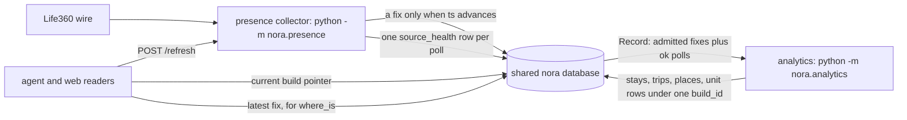
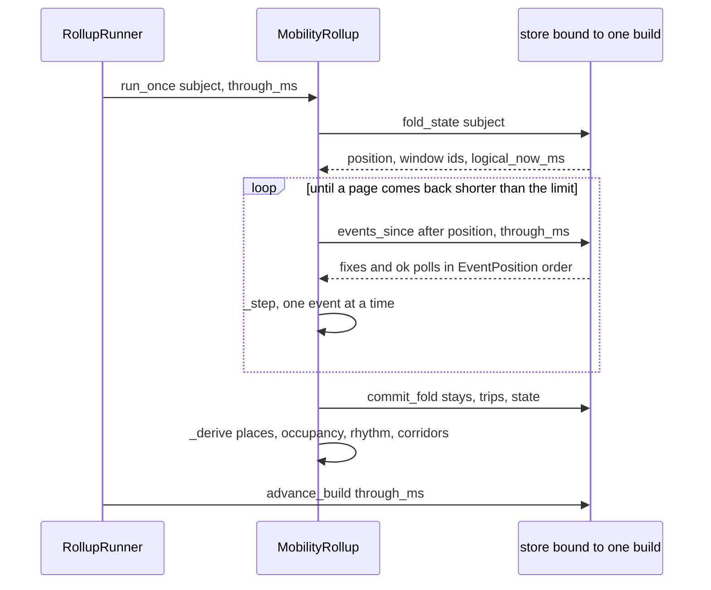
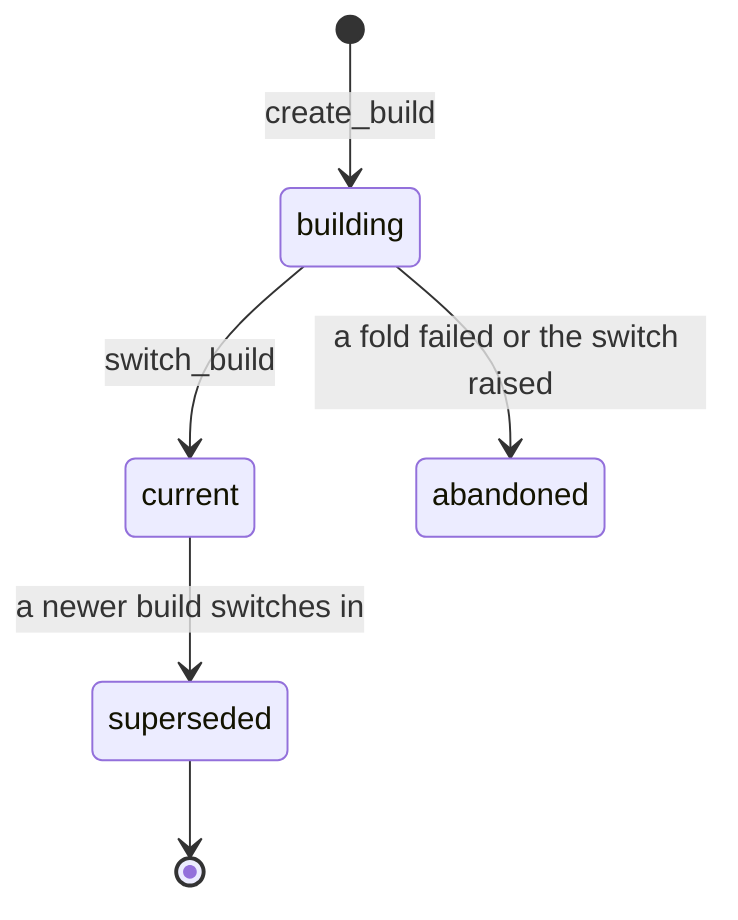

# Presence collection and the Rollup's derived view

Derived presence in Nora is made by **two processes that are not the agent**. Neither
is a module inside `nora`: one records what the outside world said, the other folds what
was recorded into rows a reader can cite.

| process | command | owns | endpoint |
|---|---|---|---|
| the agent | `python -m nora` | reading presence and the Rollup; its read path never talks to Life360 | `:9100` |
| presence collector | `python -m nora.presence` | Life360 credentials, the poll loop, `presence_fixes`, `presence_places`, its own `source_health` poll rows | `:9101` (`/metrics`, `/health`, `POST /refresh`) |
| analytics | `python -m nora.analytics` | the fold, the derived aggregates (places, occupancy, rhythm, corridors), the unit rollups, `rollup_build` | `:9103` (`/metrics`, `/health`) |

The three share **one image and one Postgres database** and nothing else: the collector
and the analytics daemon each build their own object graph from `Config`
(`nora/presence/composition.py`, `nora/analytics/composition.py`), each runs
`alembic upgrade head` itself on start, and each is a separate compose service with an
entrypoint override rather than a subcommand of the agent
(`docker-compose.yml`, the `presence` and `analytics` services). That is what makes
them independently survivable: with the collector down nothing new is recorded, so
`where_is` answers from the last stored fix with its age while the Rollup keeps folding
what was already recorded; with the analytics daemon down the collector keeps recording and
every derived read keeps answering against the last build. Both ship **inert**: `[presence]
enabled` and `[analytics] enabled` default to false, an unused process logs that fact and
exits 0, and enabled-but-misconfigured refuses to start with a readable
`PresenceStartupError` / `AnalyticsStartupError` rather than running silently broken.

The three processes and the tables each writes. The agent's presence readers never hold a Life360 credential; the analytics daemon never calls Life360 or a geocoder. The one exception is an operator command, not a read path: `nora presence members` (`nora/app/cli.py`) reuses the *same* `Life360Client` for a single authenticated discovery read and prints the circle/member ids an operator pastes into `identity.toml` — one Life360 library, not a second implementation.

## The collector: a change recorder, not a sampler

`PresenceCollector` (`nora/presence/collector.py`) runs **one asyncio loop per circle**
plus a periodic prune loop, and each cycle is `collect_once`, kept separate from the loop
so the whole behaviour is testable against one cycle with no daemon running.

One cycle, in order:

1. **Read the circle.** The client owns token handling; `ReadStatus` keeps `challenge`
   (a body that is not JSON) and `banned` (a fresh token refused) apart from a generic
   `unavailable`, because the collector alarms differently on each.
2. **Classify every member and count it.** `WireState` names six states, and only some
   of them produce a fix: `live` and `stale` are positions, while `sharing_off`,
   `disconnected`, `no_fix` and the read-level `unavailable` are **known states, not
   gaps**. They ride the per-cycle metric (`nora_presence_member_states_total`) and the
   member's last stored fix, never a null-island row. A member the operator never mapped
   to a `person_id` is recorded as nothing at all.
3. **Write a fix only when the time advanced.** The dedup is not in the loop: it is
   `PresenceStore.record_fix` (`nora/infra/sql/presence.py`), which reads the member's
   latest stored `ts`, compares, and inserts-or-skips in **one transaction**. Polling buys
   no freshness — a stationary phone returns the identical fix for many minutes — so the
   table is a time series of *distinct* fixes and two reads of an unmoved member produce
   one row.
4. **Trip the canaries.** A `challenge` read and an unexpectedly **empty circle** each
   increment `nora_presence_canary_total` (`reason="non_json"` / `reason="empty_circle"`).
   An empty circle is deliberately *not* a success: it does not stamp the last-success
   time, so the heartbeat keeps climbing through exactly the outage it exists to expose.
   This fragility lives here and nowhere else — Nora reads a local table and never sees it.
5. **Refresh saved places, after the member read.** Two gates, not one: a success waits
   out the hourly refresh interval, and a failure backs off `cadence * 2^failures` capped
   hourly. Without the failure gate a places-endpoint 403 would re-POST the credential
   every member cycle. Placed *after* a clean member read on purpose: a cycle that could
   not read members has no business spending a second call on the same struggling account.
6. **Publish liveness, then record the poll.** The heartbeat gauge
   (`nora_presence_last_collection_age_seconds`) is the age of the circle's last
   *success*, falling back to the time the circle was first attempted — so a collector
   that has never succeeded emits a *climbing* age from boot instead of no series, and
   "not running" and "up but never collecting" cannot look identical. The poll's own
   outcome is then appended to `source_health` as one row, bounded by a five-second write
   timeout; a failed write is counted and never raised.

The collector does **not** reverse-geocode. It stores Life360's own label (or none), so no
per-tick billed geocoding happens for addresses nobody reads; an address is fetched on
demand by the agent when a model actually asks. See
[configuration](../operations/configuration.md) for the credential-naming posture.

### Cadence: two floors, the larger one wins

`sleep_seconds` returns `max(adaptive, backoff)`:

- **Adaptive.** While any member is `is_driving`, the next cycle polls at the moving floor;
  while nobody is, a still counter grows and the interval ramps toward the still ceiling.
  Driving is the movement flag, not "a fix was written" — Life360 pushes a fresh `ts` for a
  parked phone too.
- **Ban-safe back-off.** The base cadence grown `* 2^auth_failures`, capped so a wedged
  account is retried no more often than hourly. Ban safety is never traded for freshness:
  a 429 lengthens the sleep regardless of who is driving.

Both exponents are clamped before exponentiating, because a still counter that grows
unbounded (a circle parked at home for days) would otherwise raise `OverflowError` outside
the loop's `try` and take down the whole collector.

### The two other duties

- **Retention.** A sweep every six hours deletes fixes older than `retention_days` —
  time-windowed, not count-windowed, and off the write path so a retention chore never
  contends with a collection write.
- **On-demand refresh.** `POST /refresh?person_id=` is served by the collector
  (`nora/presence/__main__.py`) precisely so no Life360 credential lands in Nora. It
  pings the phone and then polls until a fix newer than what was stored lands or the
  caller's timeout elapses, bounded so an on-demand request can never become the tight
  read-loop the back-off exists to prevent. It is **skipped entirely while the loop is
  backing off** (`auth_failures > 0`), because that is exactly when the account is most
  rate-sensitive; `where_is` then answers from the stored fix rather than `unavailable`.
  Statuses are 200 once a fresher fix is written, 408 on timeout or nothing fresher, 400 for
  a missing person id, 503 when collection is disabled, and 502 on a raised error — **never
  a 500**, because a broken refresh must degrade to the stored fix. There is deliberately no
  rate limit or coalescing: the endpoint is reachable only on the private compose network,
  and `where_is`'s own per-tag budget is the only caller-side bound.

## The fold: Record order, and a clock that is not the wall clock

`MobilityRollup` (`nora/analytics/rollup.py`) is *a pure function of the Record and a
logical watermark*. It reads one person's Record events — their fixes, plus the
collector's **successful** polls of their circles — and folds them **one at a time**
through `_step`.

### The ordering model

Every Record event sits at a position `(recorded_ms, rank, id)`
(`nora/domain/rollup.py`, `EventPosition`):

| component | meaning |
|---|---|
| `recorded_ms` | when Nora wrote the row (system time at write) |
| `rank` | tie-break between sources: a fix (`FIX_RANK = 0`) before the poll that fetched it (`POLL_RANK = 1`) |
| `id` | the row's own primary key |

Every run reads **strictly after** its stored position and **at or before** its watermark,
in that order (`SqlMobilityStore.events_since`, `nora/infra/sql/mobility.py`, which reads
each source in order, cuts at the limit, then merges — so the result is the first `limit`
events of the merged stream). That is the whole determinism argument: how the Record is cut
into runs cannot change what the fold sees.

Two things decide which Record rows are events at all:

- a fix is admitted only when `accuracy_m <= 100` and `wire_state == "live"` — so a
  `stale` fix is *stored* (and `where_is` will show it with its age) but is never folded,
  and no coarse fix enters a stay or a trip;
- a poll is admitted only when `outcome == "ok"`.

**A failed poll is not evidence of time passing.** `PollEvent` is the Record's statement
that its clock *reached* `at_ms`; a `challenge` or `banned` poll says the collector could
not look, and the fold never reads one (R-27: missing data is not absence of activity).
That asymmetry is deliberate, and it is also why a poll is only ever time evidence, never
place evidence.

### The clock

The fold's clock is `FoldState.logical_now_ms`: the newest time the Record has shown for
this person — a fix's `ts`, a successful poll's `at_ms`. A stay closes when a later fix, or
**a poll proving the time passed with no fix**, shows that it ended. The wall clock enters
exactly once, in the daemon, to choose *which* watermark to build to (`now -
grace_seconds`, so a row whose transaction committed a moment late is still inside it); it
never enters *what* is computed at that watermark.

Why it must be this way: deciding a tail (an open stay's close, a trip's settlement, a
provisional arrival's hold, a place label's staleness) on wall time makes a tick-by-tick
run and a batch re-derive disagree. The first would evaluate between every pair of fixes,
the second once at a `now` long after every fix, so every tail inside the history would be
decided by the *next fix* instead. A phone that reports once, goes quiet for most of an
hour, then reports again from the same spot is **one stay** tick by tick and **two** in the
batch under a wall clock. On the Record's clock the answer depends only on whether a poll
falls inside the silence — one stay without, two with — and it is the same on every
schedule (`tests/unit/test_rollup_determinism.py`).

### One step at a time

`_step` is a pure function of the state, the window of undecided fixes, and the event:

- A **fix** joins the window. A fix older than `frontier_ts` — the newest time already
  finalised output reaches — is dropped as *late* and counted in `late_fixes`; a stay once
  written is never re-cut by a straggler.
- A **poll** only moves the clock, and re-evaluates the window **only when the move crosses
  a deadline some decision reads**: some window fix's `ts` plus `settled_seconds` (trip
  settlement) or plus `DWELL_CAP_MS` (a stay's close and hold, the arrival hold). Every
  other poll would change nothing, and skipping it is what keeps a rebuild over months of
  polls affordable.
- What stays undecided is everything from the earliest held fix onward, kept **in time
  order**, never "every id above a mark": a fix's id is when its row was written, and the
  window is a stretch of time. Trimming by id would keep a closed stay's fixes in the
  window and rewrite the stay at every later event.

One run for one subject: page through the Record after the stored position, fold each event alone, commit the fold and its resume state in one transaction, then re-derive what changed.

`commit_fold` writes the output **and** where the fold now stands in one transaction, so a
run that dies before committing writes nothing and the next one folds the same events again
from the same state. `run_once` is idempotent: a second call at the same watermark reads no
event and writes nothing.

## Builds: what a run is a function of, and how the pointer moves

Every presence Rollup row carries the build that computed it (`build_id`). One row of
`rollup_build` is `current`, and **that row is the pointer** every reader resolves; the
analytics process writes through a store *bound* to its own build, and every reader the
agent, the tools and the portal use is *unbound*, so a switch moves all of them at once.
Writing through an unbound store raises — a read cannot silently become a write
(`nora/infra/sql/mobility.py`, `scoped` / `unbound`).

A build records two things about the code that made it:

- `CODE_VERSION` — the version of *what a run computes* (`nora/analytics/runner.py`).
  It is bumped with any change to the rows a run produces.
- `params_sha256` — a digest of every `RollupConfig`/`UnitConfig` parameter a row is a
  function of. The pacing knobs (`tick_seconds`, `safety_lag`, `max_age_seconds`,
  `batch_limit`, the backfill pair, `grace_seconds`) are excluded by an explicit
  `_PACING` set, because changing them cannot change a row.

`ensure_build` compares both against the running code: a current build made by other code
(other deploy) or other parameters (a config change), **or no build at all**, triggers a
rebuild into a new build rather than extending the old one. A rebuild folds the whole
Record to the watermark, raises *no* stimulus (the next tick on the new build raises
whatever is current), and then switches the pointer.

A build's life. `switch_build` is one transaction, so a reader sees either the old build whole or the new one whole.

`switch_build` is a single transaction that marks the previous `current` build
`superseded` (recording which build superseded it), marks the new one `current`, and
re-projects the memory index's episodes for the new build — so an index reader never sees
two builds' outings at once. A superseded build's rows are never touched again and never
deleted: a citation that resolved in one build resolves to *different row ids* in the next,
which is exactly why rows are cited as `(kind, subject, interval)` and resolved by overlap
(`Citation`, `resolve_by_overlap`). Nothing above the Rollup may key on a row id.

Failure is also a state: if a fold fails, the run does not advance the build's watermark,
and a rebuild that cannot complete calls `abandon_build` so a half-built build is
`abandoned` rather than orphaned. A switch that raises rolls back whole, and the build it
leaves `building` is then abandoned.

### When no build is current

There is a real state where nothing has been derived yet: a fresh database, before the
analytics daemon's first rebuild switches a build in. **Every reader must answer
`unavailable` there, never an empty result**, because an empty result says "there is
nothing" about data that was never derived:

| reader | behaviour with no current build |
|---|---|
| `SqlMobilityStore` (unbound) | raises `NoRollupBuildError`; callers above already answer an exception as `unavailable` |
| `SqlRollupRead` | returns `build_id=None`, `through_ms=None` |
| the `rollup_read` tool | answers `status: "unavailable"` and tells the model not to read it as nothing having happened |
| the web's derived-presence routes | 503 with an `error`/`reason` body (`_needs_a_build`) |

## What the fold derives above the stays

Places, occupancy (hour-of-week bins), rhythm (typical arrival and departure) and corridors
(Tier 3–5 aggregates) are recomputed from the fold's stays and trips whenever those change,
and a place's label is re-checked **on the logical clock** on every run, because a label's
staleness is the one thing the clock alone moves. The full plan reruns when the set of saved
places changed — detected by a stable digest of them (`tags_sha256`) — and not otherwise.

Two consequences worth knowing:

- Writes are diffed against what is stored, so a steady-state run writes nothing.
- A derived place's or corridor's surrogate id is kept stable by overlap **within** a build
  and differs between builds. What cites them cites `(kind, subject, interval)`, never the id.

A derivation failure is logged and left for the next run: the fold's rows are already
committed, and `tags_sha256` stays cleared until a plan succeeds, so the next run plans
again rather than skipping.

## The unit rollups and the stimuli they raise

`UnitRollups` (`nora/analytics/units.py`) computes, **for each unit**, five row kinds from
the Record at the watermark plus the presence rows of the *same* build:

| kind | grain | what it counts |
|---|---|---|
| `colocation` | one episode of members together | overlapping stays of different persons within a radius for a minimum overlap; joined transitively into one episode, with a place-words label and which members' homes it is at |
| `outing` | a co-location | the co-locations with two or more persons **away from every member's home**; a member with no known home fails closed, so it is never guessed as an outing |
| `daybook` | one member per local date | stays and time at home, co-location time and with-whom, outings, per-room message and reaction counts, and social items when the person's accounts were observed that day |
| `tie` | one pair of members per ISO week | replies, mentions and reactions each way, and co-located minutes |
| `response` | one of Nora's sends | replies, reactions, edits, and whether the send was answered inside the response window |

The unit's own clock is the newest time **its** Record shows — its members' folds (fixes and
polls) and its rooms' messages — never the wall clock and never later than the watermark.

Each row is written **diffed by its natural key**, so a run that computes the same rows
writes nothing and adds no version history. Crucially, a row's `as_of_ms` is **its own
newest evidence**, not the unit's clock: with a clock stamp, every run whose Record merely
added polls would rewrite every settled row and bloat the version history.

### Stimuli

The same pass raises the Rollup's stimuli into the per-unit `stimulus` table the wake
evaluator reads. Each carries a `ref` naming the row that raised it, and the table keeps one
per `(unit, ref)`, so a later run — or a rebuild recomputing the same row — never raises it
twice.

| stimulus | when | gate |
|---|---|---|
| `colocation_start` | a co-location still open on the Record's clock, begun within the stimulus horizon | horizon only; a rebuild over months does not raise one per historical row |
| `arrival` | a member's stay in progress inside a place an open event names | the `EventPlaces` hook — and its only implementation today names **no** places, so no arrival is raised until a producer exists |
| `deviation` | a newly closed stay the rhythm scores anomalous, or consecutive silent daybook days | **every source it rests on must be proved healthy for the span**, and at most one per person per local day |

The deviation gate is the interesting one, because "silent" and "not measured" must not be
confused (R-27). Before a deviation is raised:

- `polls_healthy` requires that the collector polled the person's circle throughout the span
  with **no gap over `health_max_poll_gap_seconds`** and that every one of those polls
  succeeded. No rows at all is *not* proof — it is exactly what an outage looks like.
- For a silence deviation, every platform of the unit's rooms must also have been up
  throughout (`adapter_up`, which needs a recorded `up` transition at or before the span).
- Failing either, the stimulus is counted `unhealthy` and not raised. Past the daily cap it
  is counted `capped` and not raised.

This is why the collector's `source_health` poll rows are load-bearing rather than
diagnostic: they are the evidence a later step uses to prove the collector was healthy
across an interval before an absence is read as a signal.

## Who is allowed to read them

Nothing here is a general-purpose location service. There are five readers, each behind its
own gate, and all of them fail **closed and legible** — a refusal says why, an error is
never dressed as a policy decision, and an unverifiable invariant refuses. The vocabulary
itself is [the status and failure contract](../architecture/failure-and-status-contract.md).

### `where_is`: the live-ish position of one person

`Whereis.locate` (`nora/agent/whereis.py`) reads the local fix for one person **in this
conversation** and carries the fix's *age* to the model, so the answer can be "twenty
minutes ago" rather than a bare coordinate. It has no auth, no retry and no challenge page
to handle, because the collector owns Life360; a *read* that raises degrades to
`unavailable`, never an empty or invented position.

Three gates precede the read, and the ordering matters:

1. **The room as an audience.** `DisclosureGuard` intersects the conversation's people with
   the circle roster and **refuses** when the room contains anyone outside the circle —
   refuse, don't omit, because a silent omission reads to the group as "I don't know where
   they are". A room that could not be read, was read degraded, or resolved nobody never
   permits: an unreadable roster cannot be verified, and an empty roster is a subset of
   everything, which verifies nothing.
2. **The room-level trust flag.** A conversation can be granted location disclosure
   (`policy.toml`), which relaxes the subset check and the unnamed-account refusal. It does
   **not** relax a room that could not be read at all: that is an error, and the one
   refusal even a trusted room can reach.
3. **The person.** Resolution runs against the *circle* (who may be asked about) as well as
   the room's live roster, so a circle member who is not in the group still resolves; an
   ambiguity asks which one.

#### The refresh is best-effort; the stored fix is the answer

With a refresher wired, `locate` asks the collector to force a fresh reading **after** those
gates pass and **before** the read, so a ping is never spent on someone the room may not ask
about. That call is never load-bearing. `HttpLocationRefresher`
(`nora/infra/presence_refresh.py`) returns True only on the collector's 200 and returns
False — never raising — on a timeout, on any non-200 (the collector's 408 when nothing
fresher landed, 503 when collection is disabled) and on a collector it cannot reach at all;
its own client timeout is deliberately longer than the collector's refresh timeout, so Nora
waits for the ping instead of cutting it off. The read that follows runs either way, which
is why an outage of the collector is **not** an `unavailable` answer while a fix exists: the
degradation is the fix's *age*, not a refused status.

Then the read itself: an `ok` answer carries `age_seconds`, the recorded timestamp
(`recorded_iso`) and the fix's `wire_state`. Past the staleness bound — `STALE_AFTER_MS`,
45 minutes, one missed Life360 heartbeat — it also carries `stale: true` and a note saying
this is the **last recorded position**, when it is from, that nothing has been recorded
since, that where they went afterwards is unknown, and, when a refresh was attempted in
this call and came back without a fresh fix, that "a live refresh just now got no answer";
`age_seconds` alone reads as "still there", which is the wrong sentence to put in a reply.
That is the shape `tests/test_whereis.py` asserts, including a two-hour-old fix behind a
failed refresh still answering `ok` and stale-flagged rather than `unavailable`. Movement —
`moving`, `towards` a saved place, the reported ground speed — is **measured** off recent
stored fixes, never predicted, and suppressed inside a saved place. No coordinate ever
reaches a reply or a route tool argument; `lat`/`lng` are carried only as the argument a
reverse-geocode tool may be given.

`unavailable` is reserved for what actually produces it: a stored read that raises, a person
with no recorded fix at all, and a room whose roster could not be read (the `degraded` case,
counted with `reason="degraded"`). A collector that is down, backing off, or answering 408
produces none of these.

### `rollup_read`: the derived rows, cited by key

The tool reaches `SqlRollupRead`, which **reads the current build only and never builds**:
nothing in the read path starts, advances or switches a build, so a session cannot cause one
by reading. Its gates run on both sides of the read:

| gate | where | rule |
|---|---|---|
| build | the store | `status = 'current'` only; a superseded build is eval history, never an answer |
| unit | before the read | a unit rollup is read for the calling room's own unit only |
| subject | before the read | the caller must name people; an empty subject set raises rather than becoming "everybody" |
| lineage | **after** the read, per row | every entry of the row's set must pass for the calling room; a row with no lineage is unknown and passes nowhere |
| coordinates | the row | a stay or co-location names its place in **words** — kind, label, whether the label is a saved name — never a position |

The lineage gate is where presence rows get their second check: a row resting on
`presence` passes only for a room whose policy grants location, whose live roster is
readable whole and fully named, and whose people are a subset of one of the room's circles
(`nora/agent/lineage.py`, `_presence`). Rows that fail are withheld and *counted*, so the
room can be told that something was not shown without being told what.

The answer carries `through` (the build's watermark) and the build id, which is how a reader
sees how fresh the rows are — including after a message was hidden, since a hidden message
still contributes to a row until the next analytics pass diffs it out.

### The other three

- **`where_been`** reads a person's derived day, usual places, weekly rhythm and repeated
  routes from the same current build, through the derived-presence audience decision
  (`presence_audience`) that a Cognition grounder also takes — one decision, so the two
  cannot drift.
- **`routine_read`** forecasts from the aggregates (places, occupancy, rhythm, corridors)
  that `rollup_read` deliberately does not expose.
- **The portal's `/presence/analytics/{places,rhythm,routes}`** reads the current build
  through the mobility store, subject-scoped against the same circle roster, with a bounded
  window and row count, and answers 503 when no build is current. See
  [the portal and web API](portal-and-web-api.md).

The `response` rollup is read by the Lessons adaptor, not by a session — see
[contextual learning](../concepts/contextual-learning.md).

## Failure semantics, in one table

| failure | what happens | what a reader sees |
|---|---|---|
| a poll read is refused (`banned`: a fresh token rejected) | no fix, `auth_failures` incremented (so the sleep lengthens), one `source_health` row with that outcome | the stored fix, with its age; `where_is` says `unavailable` only when there is no fix at all |
| a poll read is a challenge (a 200 that is not JSON) | the client's `challenge` alarm plus the collector's own canary, one `source_health` row, **no** `auth_failures` increment — so no ban back-off, and the cycle retries at cadence, tripping the canary again | the stored fix, with its age |
| a poll read fails in transport (`unavailable`) | no fix, one `source_health` row with that outcome, no alarm and no back-off | the stored fix, with its age |
| a circle reads cleanly but empty | counted `reason="empty_circle"`, last-success **not** stamped, no fix written | a climbing collection age; no new fixes |
| a fix write raises | logged, cycle continues, next cycle retries | the previous fix |
| a health row cannot be written | counted, never raised, cycle continues | nothing — the health proof is missing, so a deviation resting on it is `unhealthy` and not raised |
| the collector is down | nothing records: no new fixes and no `source_health` poll rows (the refresh is skipped at best, the call fails at worst) | `where_is` still answers `ok` from the last stored fix with its age and — past the staleness edge — the *last recorded* note naming the failed refresh; only a person with no recorded fix at all, or a read that raises, is `unavailable`. The fold's clock stops advancing, so open stays stay open rather than being closed by a guess |
| one subject's fold raises | that subject's fold does not commit and the build's watermark is **not** advanced; every other subject is still processed | the previous rows, retried next tick |
| the analytics daemon is down | the pointer keeps naming the last build | derived reads answer from it, with an older `through` |
| a rebuild cannot complete | the build is abandoned, the pointer unchanged | the previous build, whole |
| a switch raises | the transaction rolls back; the build is abandoned | the previous build, whole |
| a derived aggregate fails | logged and left; the fold is already committed and `tags_sha256` stays cleared | stays and trips are current; places/rhythm lag one run |

## The tests that hold this together

| test | what it proves |
|---|---|
| `tests/unit/test_presence_collector_synthetic.py` | one cycle in isolation: two reads of an unmoved member write one fix, a member with no mapping or no position writes none, a banned circle waits longer even while someone drives and spends no second call, the non-JSON and empty-circle canaries, the heartbeat climbing while up but never collecting, the places schedule and its failure back-off, and the bounded/skipped on-demand refresh |
| `tests/infra/test_presence_store.py` | the change-recorder write, the retention prune and the store's read shapes |
| `tests/test_whereis.py` | the `where_is` read and its gates: the fix's age reaching the model, a fix past the record edge reported as the last recorded position with the failed refresh named, a wired refresh pinged only for the resolved person and a failed one falling back to the stored fix, no address ever geocoded or carried, `refused` versus `unavailable` (degraded room, no fix, unreadable room), measured movement, and saved-place resolution |
| `tests/test_presence_refresh.py` | the refresh client: a 200 is True and carries the person id, a non-200 is False, and an unreachable collector is False without raising |
| `tests/unit/test_rollup_determinism.py` | the same Record folded on every schedule — every tick, ragged, and one rebuild — into the same stays, trips, places, occupancy, rhythm, corridors and fold state, with a late fix counted and dropped; plus the quiet-phone case in both polled and unpolled forms |
| `tests/integration/test_rollup_builds.py` | the whole Rollup on Postgres: tick-by-tick build vs one-run rebuild agreeing on every table, nothing after the watermark folded, a citation resolving by overlap across a switch to new row ids, `ensure_build` rebuilding another code version's build and superseding it, stimuli raised once, a deviation raised only on healthy sources, and a run with nothing new rewriting no settled row |
| `tests/unit/test_unit_rollups.py`, `tests/unit/test_unit_rollup_deviation_cap.py` | the pure unit arithmetic and the per-person-per-day deviation cap |
| `tests/integration/test_rollup_read.py` | the read's shape and gates: every kind returns typed rows from the current build with **no coordinate in any row**, a superseded build is never read, no current build is "no build" rather than an empty interval, reading starts no build, the unit is the boundary, a room that may not be shown a row is told rows were left out, and a hidden message stops counting at the next build |
| `tests/unit/test_rollup_read_interval.py`, `tests/unit/test_rollup_read_namesakes.py` | the pure interval parsing and row rendering, and the namesake ambiguity a name can produce |
| `tests/web/test_presence_analytics.py` | the derived-presence routes: the 90-day window cap, roster scoping, and 503 rather than an empty 200 with no build |

## Where this meets the rest of the system

The storage classes and what a rebuild may change in place are
[state and scopes](../architecture/state-and-scopes.md); the room-level trust flags these
gates read are [policy and disclosure](../concepts/policy-and-disclosure.md); the record
the fold reads and the memory index a switch re-projects are
[memory and record](../concepts/memory-and-record.md); the metric names and the scraping
topology are [observability](../operations/observability.md); the services, mounts and
ports are [deployment](../operations/deployment.md); and the tool surface these readers
appear on is [the tool surface](../concepts/tool-surface.md).
