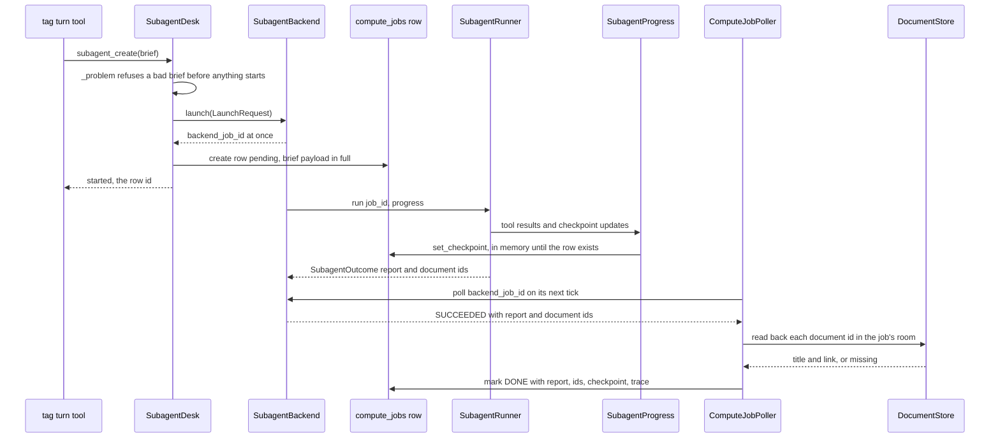
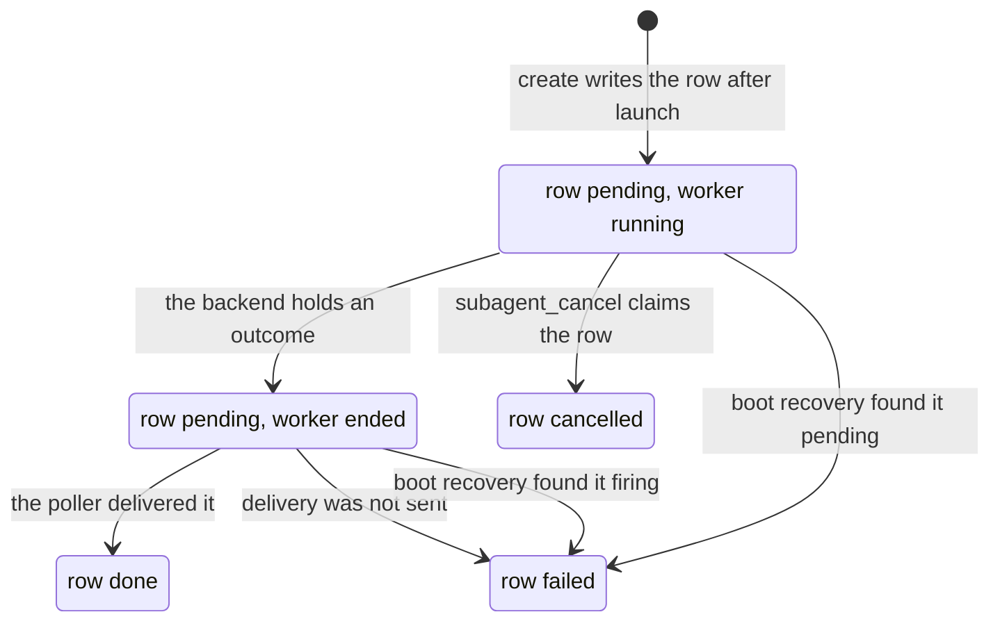
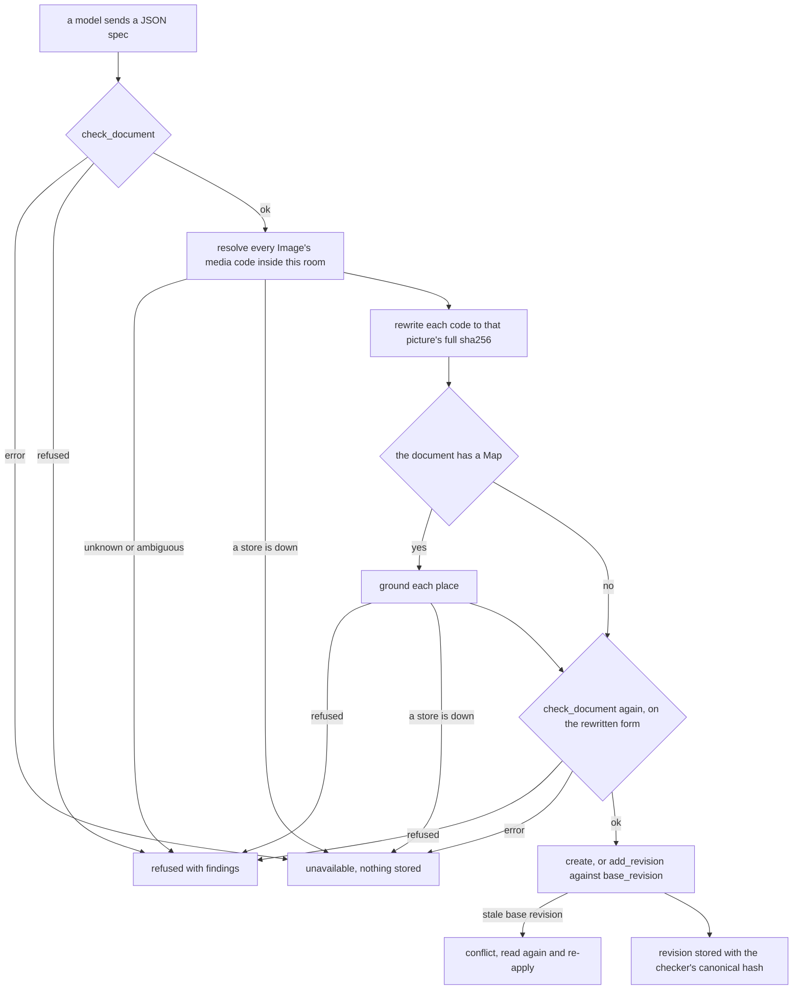

# Sub-agent jobs and documents

Two things are joined here, and the join is the point. A **sub-agent job** is a bounded worker that
Nora starts on one objective and that reports back exactly once; a **document** is the durable,
renderable artifact it — or Nora in a turn — produces. Neither speaks to anyone. The job's output is
a report to Nora; the document is stored in a room and reaches people through Nora's own message or
the portal.

Both halves therefore share one shape: what code owns and what a model produced are kept apart, and
the model's prose is never evidence that something exists.

- The brief, the launch and the job's state live on the `compute_jobs` row; the worker itself lives in
  process memory and is never resumed.
- A document is a JSON spec judged by a checker in Nora's own container; the checker's output — title,
  search text, canonical form, hash — is what the store keeps, not a reader's re-derivation.

The status words both halves use (`ok`, `refused`, `unavailable`, `bad_arguments`, never a failed read
as a confident empty one) are defined once in
[the status and failure contract](../architecture/failure-and-status-contract.md). This page uses
them rather than restating them.

## Who owns what

| piece | file | owns |
|---|---|---|
| `SubagentDesk` | [`nora/agent/subagent_desk.py`](../../nora/agent/subagent_desk.py) | the four `subagent_*` tools' work: launch, list, read, cancel **from a turn**, and the room rule over every row it touches |
| `SubagentBackend` | [`nora/app/subagent_backend.py`](../../nora/app/subagent_backend.py) | the job lifecycle in memory: one asyncio task per job, `poll`, `cancel`, live progress |
| `SubagentRunner` | [`nora/app/subagent_runner.py`](../../nora/app/subagent_runner.py) | **one run** to an outcome: inputs, tools, budgets, wall clock, report |
| `SubagentProgress` | [`nora/agent/subagent_progress.py`](../../nora/agent/subagent_progress.py) | what the worker has done: rounds, last tool, its checkpoint, and the outputs code recorded |
| `ComputeJobPoller` | [`nora/app/compute_poller.py`](../../nora/app/compute_poller.py) | delivery: polls each pending row, reads document ids back, speaks, writes the row's terminal state |
| `DocumentService` | [`nora/app/documents_service.py`](../../nora/app/documents_service.py) | the one path model-written bytes take into the document store |
| the checker | [`nora/documents/check.py`](../../nora/documents/check.py) | the one place a document is judged |

The split is deliberate and load-bearing: the **backend** owns whether a job is running, finished or
stopped; the **runner** owns only what happened inside one run and returns it as a value
(`SubagentOutcome`). The runner raises nothing at the caller — `asyncio.CancelledError` is not an
outcome of that class, and cancellation is recorded by the backend.

## The brief, and the facts code adds

A job is launched with a payload of two kinds of field, kept apart because the model reading it must
be able to tell them apart ([`nora/domain/subagent.py`](../../nora/domain/subagent.py)):

- **`SubagentBrief`** — what *Nora wrote*: `objective`, `title`, the `decisions` settled with the room
  (each with a question, an answer, and `by`: a person's name, or `nora` for an assumption she made
  without asking), `inputs` (workspace-relative paths), `document_ids` (documents to revise) and
  `deliverable`. It is the launch payload and is what `compute_jobs.payload` keeps **in full**.
- **`SubagentLaunch`** — what *code adds* and a model never chooses: the job id, room, requester,
  launching `tag_id`, time, timezone and the job's folder (`projects/<job_id>`).

Both are rendered once, by one formatter, into the prompt the worker reads. The worker starts blank:
no transcript, no peer card, no room block. Everything it knows about the request is in that brief.

Three invariants hold the brief together:

- **A title is required and bounded** (`TITLE_CHARS` = 60). `job_title` falls back to the objective,
  cut on one line, only for a payload that carries no title.
- **An input path cannot leave the workspace.** One function, `workspace_path`, is the rule:
  relative, not absolute, no `..`, not `.`. It is applied twice — `subagent_create` refuses a bad
  input as `bad_arguments` before anything is launched, and the runner re-applies it and fails the
  job `bad_inputs`. The same function is what staging quotes.
- **A decision cannot forge a block.** The renderer escapes each value, so a decision's text cannot
  impersonate a section of the prompt.

## The launch path

`SubagentDesk.create` is the one place a job is started from a turn. It takes the room's `platform`
and `conversation_id` from the turn — a model never names a room — and every row it later reads or
changes is checked against them, so a job id from another room behaves exactly as an unknown id.

The sequence is the launch-to-delivery handoff; note that the row is written *after* `launch`
returns, and that the poller — not the backend — writes the row's outcome, cancellation excepted
(the desk writes that one).

Four consequences worth knowing before changing anything here:

- **`launch` never raises** (the port's rule). A brief that is not a `SubagentBrief`, a requester who
  is not on file, or a backend that will not start is a job that is already failed, reported by
  `poll` — never an exception up into a turn.
- **One job per tag turn per room.** The first job a turn started is remembered under
  `(tag_id, platform, conversation_id)` and a second `create` in that turn returns it with
  `repeated=True`. Only a *created* job is recorded, so a refused first attempt leaves the next one
  free to start.
- **A worker with no row would run unwatched.** If the row cannot be written, the desk cancels the
  orphan worker and answers `unavailable` / `row_not_written`; nothing runs that could not be
  delivered or listed.
- **The id the model sees is the row id, not the backend handle.** `backend_job_id` is the poller's
  handle and stays internal.

With `[subagent] enabled = false` (the shipped default) no backend is built at all, and `create`
answers `unavailable` / `not_wired`.

## One run: staging, tools, a guard with no ceiling, one clock

`SubagentRunner._run` is a short, ordered pipeline, and the order is what makes each failure
attributable:

1. **Inputs** are validated (all of them, before anything else) — else `bad_inputs`.
2. **Tools** are built from the job's recorded room facts — else `tools`. `SubagentToolSource.build`
   derives its list from the registry (`read_only_tools() - NOT_LOOKUPS | ACTS`) and *refuses* a
   surface that holds anything on the `NEVER` list or outside the grant. The worker can run and write
   files, keep an export, publish a document and read what a read-only lookup may read; it cannot
   send, schedule, remember, change a document's state, or start another worker. The full surface
   rationale is on [the tool surface](../concepts/tool-surface.md).
3. **Staging** creates `projects/<job_id>` and copies each input into it through the worker's *own*
   `computer_run` — audited as actor `subagent`, under the job's lease key — and a non-zero exit fails
   the job `inputs_unavailable`. Staging runs inside the wall clock, so a step that blocks is bounded
   by the clock rather than holding the job open.
4. **The loop** runs under `factory.build_limits(turns, total_tokens, output_tokens)`.

The worker's `DreamGuard` has **no call ceiling of any kind**: every tool budget is 0,
`per_tool_ceilings=False`, and there is no memory or pass-wide budget. What the guard still keeps is
membership (a tool it does not hold is vetoed), argument declaration (an argument the tool does not
declare is vetoed) and the result size cap. Per-tool ceilings were removed on purpose: a research job
legitimately calls one tool many times, and only turns, tokens and the clock are the intended bounds.

That budget comes from `[dreamer.budgets.subagent]`. The config **refuses to load** a block that sets
a per-tool ceiling, and refuses `[subagent] enabled = true` without the block, so a bounded worker
cannot be started by accident. The numbers never enter the prompt: a cap stated in words makes a
model decline work instead of spending less.

## A bound is a failure, not a finish

This is the rule most likely to be broken by a later change, so it is stated where it is enforced.

Strands **returns** from a limit stop without raising. A caller that reads only "it returned" would
report a loop that ran out of rounds as a job that finished. So the runner reads the stop reason:
`limit_turns`, `limit_total_tokens`, `limit_output_tokens` are `failed` with that reason, never a
report.

The wall clock is the same argument in another form. One `asyncio.timeout` wraps staging *and* the
loop, and `clock.expired()` decides what a `TimeoutError` means: the expired clock is `timeout`, an
inner `TimeoutError` (a tool's own, a transport's) is `error`. A `PartialReplyError` — a reply cut at
`max_tokens` — is `limit_max_tokens`. An empty final assistant text is `no_report`, because a job that
ends without saying anything did not finish anything.

The whole failure vocabulary is one tuple, `FAILURE_REASONS`, and the metric's outcome labels are
derived from it (`SUBAGENT_OUTCOMES = ("done", "cancelled", *FAILURE_REASONS)`), so the metric can
never name a reason the code cannot produce. `lost` is the exception in reverse: it is not the
worker's to write — boot recovery writes it for a row whose in-memory handle did not survive a
restart.

## The report, and where document ids really come from

A job's answer is **the final assistant text**. The worker's doctrine asks for three parts — Done (what
exists, each checked), Not done (what is missing and why), Decisions (each choice the brief left open)
— because nobody in the room can answer a question and Nora has to be able to say what changed.

The rule that matters more than the format: **`document_ids` are never parsed out of the report.** The
report is prose a model wrote and may name a document that was never stored. The ids come from
`SubagentProgress`, which registers as a hook *after* the guard, so it sees the guard's verdicts, and
appends the `document_id` of a `document_publish` result whose status is `ok` — in order, once each. A
vetoed or refused call has no `ok` result and adds nothing. The same rule covers `kept_files`: a path
counts only when a `computer_export` to `keep` returned `ok` with `kept: true`.

A failed job still carries the ids it had: a job that published three documents and then ran out of
rounds did publish three documents.

## Lifecycle: who records each terminal state

The backend's view is in memory; the row's view is durable. They are written by different owners,
which is why cancellation, delivery and a restart each have exactly one writer.

The job lifecycle as the row records it. The backend tracks the same jobs in memory and loses them on restart, which is the reason the boot edges exist.

| terminal fact | written by | how |
|---|---|---|
| backend outcome (`done` / a failure reason) | the backend's `_work`, from the runner's return value | memory only; counted once on `nora_subagent_jobs_total{outcome}` |
| `cancelled` | the backend's `_mark_cancelled` | memory, once per job, and also for a task cancelled before its first step |
| row `cancelled` | `SubagentDesk.cancel` | it claims the row, calls `worker.cancel`, then marks the row `CANCELLED` — even if the worker would not stop, so the poller cannot still deliver it |
| row `done` | the poller | after `FirePath.speak` returns `SENT`; it also writes the report, document ids, trace id and final checkpoint |
| row `failed` | the poller | delivery not sent; it keeps the backend's `failure_reason` and the human-readable `error` |
| row `failed` / `lost` | boot recovery | every `PENDING` row whose kind's handle lives in memory, and every `FIRING` row (a crash mid-delivery). A kind whose handle is external and queryable keeps its pending rows |

Two invariants follow. **A job is never resumed**: resuming would mean saving the worker's
conversation, which is exactly what the design refuses. And **the requester is always told**: a swept
row is returned so the room can be told «I lost track of it», which is `unavailable`, never a claim
that the job failed.

Finished jobs stay in the backend's memory for `FINISHED_TTL_SECONDS` (an hour) and are pruned; the
row keeps them. A poll for an id the process does not know answers `FAILED` / `lost`, so a `pending`
row whose backend forgot it is visible as lost rather than eternally running.

## Progress: the worker's words and code's facts

`SubagentProgress` is one `HookProvider` per job and keeps two kinds of thing, deliberately separate
([`nora/domain/checkpoint.py`](../../nora/domain/checkpoint.py)):

- **The checkpoint** is the worker's own: four lists (`done`, `doing`, `next`, `decisions`), each
  capped (8 items, 160 characters), written through one `checkpoint_update` tool, and each call
  **replaces** the whole of it — no merge, so nothing stale survives a correction.
- **`Outputs`** is code's: the published document ids, the kept files, the round count. It is derived
  from tool results only, and the tool has no argument that could set it.

The checkpoint is a place-keeper, not a record of what exists. A checkpoint that names a document
nobody published produces no output line — the claim stays a claim in the worker's own list. A
separate anchor rewrites the latest checkpoint and outputs into the pinned first message once the
history window has trimmed, so the worker always sees where it stands after its early steps scroll
away.

Both are persisted on the job row (`compute_jobs.checkpoint` / `checkpoint_at`). The write is matched
by `backend_job_id`; the row is written *after* `launch` returns, so an early update finds no pending
row, stays in memory, and is counted `nora_subagent_checkpoint_unwritten_total`; the terminal `mark`
writes the final one.

One renderer, `render_checkpoint`, serves every reader in a mode: `block` (a running job in the room
block, Doing and Next only), `read` (Nora's read, with rounds), `anchor` (the worker's own, **without**
rounds, because nothing it reads should say how much of the run is spent) and `delivery` (the room's,
plain markdown).

### What the room actually reads

`SubagentsContextReader` builds the `<subagents>` block fresh from the job rows on every tag turn; no
model writes it, and `room_jobs` is the whole filter, so another room's job cannot appear. Running
lines carry live progress from the backend's memory, with `progress_known = False` when no worker is
attached or the read failed — never a default that reads as a measurement. A row still `pending` whose
worker has ended is `ended`, never `running`. Finished jobs are shown for 24 hours, five at a time,
and only the controlled `failure_reason` reaches the block: `error` is free text somebody wrote and is
never shown.

From a turn, `subagent_list` and `subagent_read` show the same row through `JobView`: state derived
from the row (with `finishing` for a pending row whose worker has ended), rounds and last tool while
running, the report cut to 6,000 characters on a read and 200 in a list, document ids with titles read
back one by one, and the rendered checkpoint. One deliberate exception: a `failed` row that carries a
report and no failure reason was a job that finished whose delivery did not land — the work is real,
so it reads as `done`. Every read carries a note saying how to report the state — «do not guess when
it will finish» for a running job, «say only what its `report` says» for a done one.

## Documents: a JSON spec, not written HTML

Per [ADR 0020](../../docs/adr/0020-documents-are-json-specs-the-portal-renders.md), a document is a
JSON spec `{version: 1, root: <Page>}` over a **closed catalog** of components, stored as a nested
tree so a dangling reference, a cycle or an orphan cannot exist. The catalog is defined once in
TypeScript; the JSON Schema, the catalog prompt the tool hands a model that calls with no spec, and
the accept/refuse corpus are generated from it, so there is no second definition to keep in step.

Documents render **inside the portal, on the portal's origin, next to the session cookie**. That is
why the schema and the checker are security boundaries rather than style checks: a rule that let a
model emit markup or a live link would be stored XSS. So nesting is capped at 8, a document at 500
nodes, no prop takes `className` or raw HTML, a picture is named by a media code and never a URL, and
a diagram's source is accepted by an allowlist (a known diagram keyword, no backslash, no `%%{`, no
`click`/`link`/`callback`, no `url(`) because Mermaid reads configuration and images from that source
and draws into the live page.

### The publish order, and why it is that order

`DocumentService.publish` is the one path a model-written document takes into the store. Each step
decides what the next may trust.

The publish pipeline. The second `check_document` is not redundant: media resolution and map grounding both rewrite the spec, and what is stored must be what was judged.

1. **A known person, and a base revision.** Only a known member can publish, and a revision without
   `base_revision` is refused (`base_revision_required`) — a revision that does not say what it
   started from would silently replace newer work.
2. **The checker judges the bytes.** `check_document` writes whatever arrives (a dict included) to
   JSON first so one path judges all input, then checks shape, schema and the rules a schema cannot
   state, stopping at the first group that fails. It never raises: a failure of the checker itself is
   `status="error"`, which no caller may read as `ok` and which the service answers as `unavailable`.
3. **Media codes resolve within the room, to exactly one picture.** A code is matched against the
   room's own message rows and the media index rows born in that room, images only (a clip or a
   shared item's cover is not material). Exactly one match is rewritten to that picture's full
   sha256; nothing matched is `media_unknown`; two or more is `media_ambiguous` with a hint to use a
   longer code — **it never picks**. A row with no room on it cannot be placed, so it never resolves:
   the rule fails closed, and a store that is down is `unavailable`, never a guess.
4. **Maps are grounded** — a Map names its places. The target's cheap checks (a stale base revision, an
   id from another room) run *before* any billed lookup, so a model re-publishing after a conflict
   does not pay for the same places twice.
5. **The checker runs again on the rewritten document.** This is the step that makes "what is stored
   is what was judged" true rather than intended: resolution changed `props.media`, so the canonical
   form, the sha256 and the search text must be computed on the bytes that are stored, and grounding
   can push a document that passed the first check past a limit. A refusal here is the writer's to fix;
   a checker error is `unavailable`, never a pass. The test that pins it publishes the same picture
   once by a short code and once by its full sha256 and asserts one hash.
6. **A new document or a new revision.** A new id is drawn so its 12-hex handle collides with nothing
   the room can already read, in *any* state, because a restore would bring a deleted document back. A
   revision is written with a compare-and-swap on `(document_id, revision)`: one writer wins, the other
   is `conflict` with the current revision and told to read again.

### The store: append-only, and room-scoped at the read

Nothing in the document store is ever updated in place ([`nora/domain/documents.py`](../../nora/domain/documents.py)):

- `documents` is the identity — who, which room, when — written once.
- `document_revision` is one full snapshot per revision, and the current document is the **highest
  revision**, so a listing is a read of the newest rows, never a cache that could drift.
- `document_state` is one more append-only table; a document's state is its latest row (`active`,
  `archived`, `deleted`), and a restore is one more row. A revision of a document that is not `active`
  is refused `document_not_active`.

Visibility lives in the read methods, not in the caller: a person sees a document they created and
every document made in a room that names them, with `rooms` derived from the current policy at the
moment of the read, so removing someone from a room revokes access. A `persons = "*"` room names
nobody, so only its creator reads what was made there. Everything else is `None` — the same answer as
"no such document", never a distinct "forbidden", so an id never confirms that a document exists.

`DocumentService.read` is the room-scoped read a worker and Nora use: current revision and spec, so a
change can be applied to what is actually stored. Another room's id, an unknown id, a handle that fits
none or two, and a deleted document all answer `no_such_document`. The human read side — listing,
opening, search, revision history, archive and restore — is the portal's; see
[the portal API and the web surfaces](portal-and-web-api.md) for its routes, session gate and access
rules.

A link, when an origin is configured, is `<public_url>/documents/<12-hex handle>`. The handle is
carried instead of the UUID because egress blocks any UUID at every exit, and it is resolved only
among the documents the viewer may read: 48 bits is an address, never a secret, and the page is
signed in.

## The handoff: ids, not prose

The two halves meet at delivery, and the meeting is a verification step rather than a string.

1. A worker's `document_publish` returns `ok` with an id; `SubagentProgress` records it.
2. The runner returns the ids with the report; the backend answers `poll` with them.
3. The poller **reads each id back through the document store, in the job's own room**, before
   speaking. A document that reads back contributes a title and a link; one that does not is reported
   *missing*, never linked (R-100). Nothing a failed or finished job claims is taken on trust.
4. `compute_occasion` builds what Nora is *told*: the job's title, its result summary, the read-back
   documents and their URLs, and — for a job that stopped — where it had got to, rendered by the same
   checkpoint renderer in `delivery` mode. Nora composes the room-facing message in her own voice.
5. The poller marks the row and counts the delivery.

The worker publishes **as the requester who launched it** (the person who asked did ask), and what it
publishes reaches the room only through that message. `document_set_status` deliberately stays a
tag-turn tool: a worker archives nothing.

## Configuration and operations

| knob | effect |
|---|---|
| `[subagent] enabled` | ships `false`; on, one `SubagentBackend` is registered under kind `subagent`. Enabling requires `[dreamer] enabled`, `[compute] enabled` and a `[dreamer.budgets.subagent]` block, or load is refused |
| `[subagent] reasoning_effort` | the worker's effort; its model is `[dreamer]`'s, with `tool_choice` AFTER_SPEAKING so the loop ends when the model stops calling tools |
| `[dreamer.budgets.subagent]` | turns, total tokens, output tokens, wall clock. Per-tool keys are refused at load. Never written into the prompt |
| `[documents] enabled` | gates `document_publish`, `document_read`, `document_set_status`; off, no turn is offered any of them |
| `[documents] public_url` | origin only; empty means no link and Nora points to Documents by title |

The worker's system prompt is its own doctrine plus `core/constraints.md`, read once at startup — a
missing or malformed file is a startup failure with its name, not the first job's failure.

What an operator watches:

- `nora_subagent_jobs_total{outcome}` — one per job, `done`, `cancelled` or a failure reason.
- `nora_subagent_checkpoint_unwritten_total` — a checkpoint that arrived before its row.
- `nora_compute_jobs_delivered_total{outcome}` — the poller's delivery result.
- `nora_dream_guard_vetoes_total{adaptor="subagent"}` — the three rules the guard still keeps; a
  `tool-budget` line here would mean a ceiling came back.
- the `subagent` trace span, whose id is carried to the job row for the trace link.

Operationally the sharp edge is the restart: the backend's registry is in memory, so **any** restart
orphans every running job. Boot recovery fails those rows `lost` and the requester is told «I lost
track of it» — `unavailable`, never «it failed», because nobody looked at the container. Shutdown
cancels every running task for the same reason.

## What pins it

- [`tests/unit/test_subagent_worker.py`](../../tests/unit/test_subagent_worker.py) — the turn cap ends
  the job `limit_turns` with no per-tool veto, the wall clock ends it `timeout`, a report naming a
  document adds no id, a loop with no report is `no_report`, inputs are copied before the model runs,
  an input outside the workspace fails before anything runs, cancel is idempotent, an unknown job polls
  `lost`, a finished job is evicted after its TTL.
- [`tests/unit/test_subagent_tools.py`](../../tests/unit/test_subagent_tools.py) — the `NEVER` list,
  the derived allowlist, and a surface holding an off-list tool being refused.
- [`tests/unit/test_subagent_checkpoint.py`](../../tests/unit/test_subagent_checkpoint.py),
  [`tests/unit/test_subagents_block.py`](../../tests/unit/test_subagents_block.py) — the checkpoint's
  caps and replacement, the anchor, and the room block's states.
- [`tests/unit/test_documents_service.py`](../../tests/unit/test_documents_service.py) — what is stored
  was judged and hashed on the rewritten form, code ambiguity and room rules, revision conflicts,
  another room's document reading like an unknown one.
- [`tests/unit/test_document_checker.py`](../../tests/unit/test_document_checker.py) and
  [`tests/unit/test_document_schema.py`](../../tests/unit/test_document_schema.py) — the checker's
  three outcomes and the corpus that must get the same verdict in Zod, ajv and Python.
