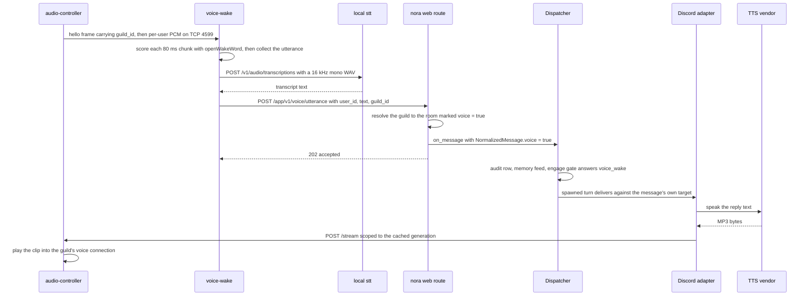
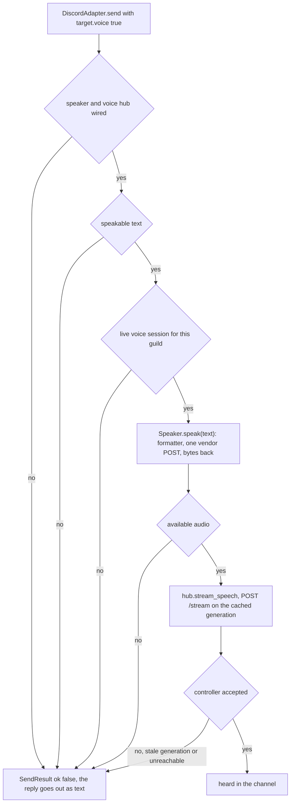

# Voice: the spoken entry point, speech output and the sidecars

Voice in Nora is **optional wiring**, and it is worth keeping three tiers apart because
they are owned by different files, fail differently, and can be switched on
independently:

| tier | what it is | who owns it | where it runs |
|---|---|---|---|
| local sidecar services | the audio-controller that is the sole holder of the Discord voice socket, the local speech-to-text service, and the wake gate that listens for 「喂 Nora」 | the operator's compose file plus three small images under `deploy/` | separate containers on the private `nora` network; nothing published to the host |
| Nora's own speech configuration | the transcriber, the speaker, the controller hub and the callback consumer the composition root builds from `[speech.stt]` and `[speech.tts]` | `config.toml`, read once at startup by `nora.config.load` | inside the `nora` process |
| the model-driven pacing of a reply | the `<spoken_turn>` situation in the prompt, the `voice` turn occasion, and the speech formatter that may add pauses and interjections to the copy about to be spoken | doctrine (`speech-format`) plus `[speech.tts.format]` | on the reply path, after her words are final |

The tiers do not imply one another. A deployment can run transcription for voice notes
with no voice channel at all, and it can wire the audio-controller without a wake gate —
that is what `/discord join` and `/music` need. A *spoken reply*, though, needs a spoken
turn, and the wake route is the only thing that produces one. Which provider either side
actually talks to, and whether it is enabled at all in a given deployment, is private
operator configuration — this page describes the seams and never asserts a deployed
choice.

## The utterance path: one text message, from a spoken sentence

The wake gate (`deploy/voice-wake/`) is the only thing that turns speech into a message.
It hears the wake word, collects the utterance that follows, transcribes it locally, and
POSTs the **transcript** — nothing else — to Nora's `POST /app/v1/voice/utterance`.

The route builds the same `NormalizedMessage` a platform parser would have built for a
typed message in that guild's text room — `platform="discord"`,
`conversation_type="group"` (a voice channel is a shared room, never a DM),
`body=text`, `timestamp` stamped at arrival, `sender_id` the Discord snowflake the
wake gate reported, and `sender_name=None` because the display name is Discord's to
give and this path never saw it. It then hands that message to the **same callable** a
platform adapter's `listen()` loop calls: `Dispatcher.on_message`. Everything
downstream — the audit row, the Honcho memory feed, the engage gate, the reactive turn,
delivery — is therefore not re-implemented for voice anywhere
(`nora/web/voice.py`, wired in `nora/__main__.py` with
`ingest=deps.dispatcher.on_message`). `tests/integration/test_voice_utterance.py` is
the proof: a POSTed transcript produces one audit row with the speaker resolved to
their person through `identity.toml` and one memory feed as that person's input.

### The guild decides the room, and that resolution *is* the admission check

A server has many voice channels and gains more, so the caller sends a **guild**, and
the route resolves it to the one room the operator marked `voice = true`
(`Policy.voice_room`). An unresolvable guild is a `400` with nothing ingested. There is
deliberately no fallback to the voice channel's own id: guessing a room would write one
server's spoken sentence into somebody else's notebook, and voice is a *surface* of a
room rather than a room of its own — one notebook, one culture, one unit, one `persons`
list, so a plan spoken aloud and the same plan typed land in the same place
(`Conversation.voice` in `nora/policy.py`).

Two consequences worth stating plainly:

- **The refusal is loud, and nothing downstream sees it.** The scope stage never sees
  this message, so it cannot report the refusal for the route; the route logs a warning
  naming the guild and the channel itself and answers `400 no voice room for this guild`.
  Answering `202` for something that was definitely not accepted would make a
  misconfigured guild look exactly like a quiet room.
- **Resolution is explicit, never inferred.** "The only allowlisted room in that guild"
  would work today and keep working right up until it silently picked the wrong one, so
  `load_policy` refuses two `voice = true` rooms in one guild at load time.

### What is not stored, and what provenance preserves

Audio is transient end to end. The controller forwards per-user PCM over a local TCP
seam and stores none of it; the wake gate consumes frames, scores them, and drops them —
nothing is queued if a downstream is down, because a memory that grows while the STT
service is busy is the failure the "no wake → no cost" posture exists to prevent. TTS
audio arrives as a bounded POST body and is played, not archived. There is no audio
storage anywhere on this path, by design, and no audio byte ever enters the `nora`
process: the route's body is `{user_id, text, guild_id}` plus an optional
`voice_channel_id`.

What survives is **provenance on the message**, in `raw`:

| field | meaning | used for routing? |
|---|---|---|
| `voice` | this message arrived spoken; the marker `VoiceWakePolicy` reads | yes — it is what makes the turn engage |
| `user_id` | who spoke, as the platform's own id | no — `sender_id` already carries it |
| `guild_id` | which server it was said in | no — `conversation_id` is already resolved from it |
| `voice_channel_id` | which channel it was said in | **never** — provenance only |

`voice_channel_id` is optional on purpose. Only the controller knows which channel it is
currently connected to, so a caller that could not read it must still be able to forward
the words: an absent channel is honest, while a stale configured one would be a lie in
the one field a trace is read for. The resolved `conversation_id` no longer carries the
channel, so these two ids are the only record of where a sentence was actually spoken.

### The engage gate has a voice arm, and it reads the marker

`VoiceWakePolicy` (`nora/ingest/policy.py`, wired into the composite engage chain in
`nora/app/composition.py`) engages when `message.raw["voice"] is True`. It checks the
marker, never the body text: a failed STT still engages, because Nora should see that
somebody said her name even if the words came back empty, and a *typed* message that
happens to contain the trigger phrase is left to the trigger policy. Without this arm a
transcript would land in the audit row and the turn would never run — which is the whole
point of the stage, since the reply has to come back aloud.

## Answering aloud: the reply path

`NormalizedMessage.voice` rides the message into `ConversationTarget.voice`
(`NormalizedMessage.target()`), and the Discord adapter's `send` routes on **the turn,
not the room**: one text room takes both spoken and typed questions, so the rule is
"answer the way you were asked". A typed question in a room Nora also listens to by
voice still gets a text reply.

A spoken turn is also told to the model rather than left to be inferred: the
`<spoken_turn>` block renders only when the message being answered was spoken, and says
what the situation is — the message reached her as a transcript and her reply will be
said aloud, heard once, not read. The same flag derives the turn's tool **occasion**
(`turn_occasion(voice=True) == "voice"`), which changes the resident tool set, because a
spoken request is waiting on her voice in a channel where each extra model call is heard
as silence.

Speech is fail-closed at every step before it falls back to text:

Two of those rungs are worth naming. `speakable()` is the content gate: anything that
reads as a long opaque string — a URL, a hostname, an `@handle`, a hash, a UUID, a
key-shaped base64 run — is refused, because a false negative costs one reply its voice
while a false positive reads a forty-character token aloud in a shared channel. And the
"live session" rung refuses **before paying**: `policy.toml`'s `voice = true` and
`[speech.tts] sidecars` are independent, so a guild whose speech is recorded may
legitimately have no controller to play through, and synthesizing a clip that can never
be played would bill the vendor for nothing.

The fallback is text, always. Speech is a surface of an ordinary room, so
`target.conversation_id` is a postable text channel, and an answer the room can read
beats an answer nobody gets.

### The speaker port: text in, audio bytes out

`Speaker.speak(*, text: str, voice: str = "") -> SpeakResult` is the entire surface: reply
**text** goes in, and a `SpeakResult` comes back. The synthesized clip travels in that
result's `audio` field as **bytes**, never a path or URL — the voice mixer consumes frames
in memory, a path would force every caller into a disk lifecycle it otherwise never has,
and the controller's player has no file concept at all. `media_type` rides beside the
bytes because one provider emits MP3 while another may emit WAV: whoever decodes to PCM
must know which, and sniffing the bytes would be a guess.

`voice` is a per-call override of the configured default, and an empty string means the
implementation's own default, so a caller can ask for another voice without a second
port. The direction of travel is also the quickest way to tell the two speech ports
apart: `Speaker` is text in and audio out, while `Transcriber.transcribe` is the one that
takes `data: bytes` and answers text.

The in-tree implementation speaks one cloud vendor's HTTP TTS API (`MiniMaxTtsSpeaker`, a
non-streaming POST); its answer is decoded from a hex field, its media type is a fact about
the request (the body pins MP3 out) rather than a guess at the returned bytes, and an HTTP
200 with a vendor status code that is not zero is *not* a success. The port's contract is
the important part:

- it **never raises** into a caller's turn: transport failure, timeout, a refused
  request, empty text and empty audio all come back as an unavailable `SpeakResult`;
- `empty` (a legitimate success with no clip, or text that was nothing but emoji) stays
  distinct from `error` (an outage), so the two never share a metric;
- a host that cannot be reached at all fails over to the documented fallback host, while
  a host that *answered* with a refusal does not — retrying it would only double the bill.

Everything downstream receives `Speaker | None`; the caller hands the result's `audio` and
`media_type` on to the one playout seam unchanged, and only the adapter registry's one
keyword knows which vendor is real.

### The playout seam: generation-scoped, and the only speech path

Synthesized audio leaves through exactly one call: `VoiceControllerHub.stream_speech`,
which POSTs the clip to the controller's `/stream` **scoped to the generation the hub
cached for that guild**. It never raises. `False` means no cached session, a stale
generation, or an unreachable controller — and a generation conflict additionally drops
the cached session, because the controller no longer recognises it and nothing may
stream through it again.

## The sidecars: what stays outside Nora's process

Nora keeps every decision and never touches the voice socket. That split is
**code-enforced**, not compose prose: `tests/architecture/test_no_discord_voice_ownership.py`
forbids `channel.connect(`, `VoiceClient` and `change_voice_state(` anywhere under
`nora/`, with an empty allow-list. The reason is a Discord constraint — one voice
connection per bot token per guild — so a second local join would silently kill the
first and `/music play` would report "playing" into a dead socket.

| service | responsibility | what it deliberately is not |
|---|---|---|
| the audio-controller (`deploy/voice-sidecar/`) | sole owner of the guild's voice connection; joins/exits on Nora's HTTP verbs; receives Opus, DAVE-decrypts, decodes to PCM and forwards `{user_id, pcm}` on the TCP seam; plays music from a stream URL and clips from `/stream` | a wake-word detector, an STT client, a resolver, a music queue, or anything that decides |
| the local STT service (`deploy/stt/`) | one OpenAI-compatible `/v1/audio/transcriptions` endpoint over two interchangeable engines, OpenCC s2t applied so callers always receive Traditional Chinese | on the internet, or reachable from the host; it publishes no port and audio never leaves the box |
| the wake gate (`deploy/voice-wake/`) | the only consumer of the seam: per-user wake scoring, utterance collection, local transcription, and the text-only POST into Nora | a holder of any Discord identity — the guild arrives per connection, so one gate serves every server |

Operationally these are healthy-but-idle processes, not failing ones. `/health` is
process liveness and answers 200 while a service idles without a token, a channel or a
model; the payload says which (`voice: idle`, `wake: disabled`) and carries per-user
frame/byte/wake/utterance counters, so an operator can tell "no model" from "nobody
spoke" from "woke but STT or forward failed" without reading logs. The wake model is
baked into the image with its provenance recorded beside it (`models/MODEL.md`, with
candidates and training code in `voice-lab/`), and both model-holding services are given
`mem_limit` equal to `memswap_limit` so nothing pages their weights out between
utterances.

### The wake gate's own state machine

Frames arrive as 48 kHz stereo s16le, are downmixed and downsampled to 16 kHz, and are
cut into 80 ms chunks. Each speaking user gets their own scorer instance, because the
model is stateful over rolling windows, and each gate is a two-state machine:

- **LISTENING** — every chunk is scored and kept in a short pre-roll ring. A score at or
  above `threshold` switches to COLLECTING with that pre-roll as the utterance's head,
  so the transcript carries 「喂 Nora」 itself and the reactive path sees the same words a
  typed message would have carried.
- **COLLECTING** — chunks accumulate until a silence tail or a ceiling, whichever comes
  first, and the gate resets. "Quiet" is decided by a voice-activity detector when one is
  enabled (a chunk with no speech in it is quiet however loud the music behind it) and by
  per-chunk RMS only as a fallback, which ducked music defeats.

The gate counts chunks, so it can only end an utterance while chunks keep arriving; the
controller's source sends packets only while its own mic gate is open, so the service
also arms a **wall-clock** flush on every frame while collecting. Without that second
end-pointer a fired gate would sit collecting and swallow every later 「喂 Nora」. The
failure posture is the design's own: an STT failure retries once with `language` unset,
then drops the utterance silently; a refused forward drops it too. Nothing is queued and
nothing is retried later.

## Transcription, from two directions

The same local service serves two callers with different postures, and the difference is
the point:

| caller | what it transcribes | posture |
|---|---|---|
| the ingest custody stage (`SenseVoiceTranscriber`) | an inbound **voice note**'s bytes | inline, before the audit write, never load-bearing: any failure returns an unavailable result and the note is still recorded with a bare handle |
| the wake gate | a completed **utterance** | off the frame path; one retry, then a silent drop, because audio is transient |

The transcriber's contract is one POST against Nora's own local service, and its result
vocabulary keeps `empty` (a legitimate 200 with no words) apart from `error` (a transport
or server failure) and from `unsupported` (a media type that is known and is not audio) —
conflating them would blind `nora_speech_transcriptions_total{status=...}` to the
difference between an outage and an ordinary silent note. A known non-audio type is
refused by the port itself; an *unresolved* type is let through, because refusing there
would drop a real voice note over a missing content-type header.

Where the transcript goes matters too. A voice note's transcript rides to the
comprehension subject (`media_objects.content`), **not** into the message body: it is a
member's words verbatim, with higher stakes than model-written prose, so the sanitize and
identifier screen run at render time on every render rather than once at store time where
a cache hit would skip them. A wake utterance's transcript, by contrast, *is* the body —
that is what makes it an ordinary message.

## Pacing a reply: the model's half and the deterministic half

Once her reply is final and about to be spoken, an optional formatter fits it to the
voice. It runs **late and on the spoken copy only**: the audit row, the memory feed and
the notes carry her text exactly as she wrote it, and nothing the formatter returns is
recorded anywhere but the audio. `<#0.40#>` in a stored reply would put markup into every
store that reads it, garnish a cheap model never chose, so the formatter lives where the
reaction picker lives — after the reply is written.

Its rule is **it may add, never change**. Pauses and interjection tags are the only two
things it may insert, from a closed list, and a code check — not the model's good
behaviour — decides whether the result may be spoken:

- the letters and digits of the candidate, markup removed, must equal her normalised
  reply's, in order, and the numbers must match including their internal punctuation
  (so `3.14` is not `314`, and a dropped minus sign is caught);
- every pause must be well-formed and inside a stricter bound than the vendor's (a reply
  that goes quiet too long in a voice channel reads as a dropped line), must sit between
  pronounceable text, may not be consecutive, and is capped at one per few spoken
  characters;
- at most a couple of *added* interjections; a tag outside the closed list is treated as
  an added word, because the vendor would read it aloud as one;
- anything the deterministic pass would have removed — an emoji, a stray symbol — may not
  come back.

Any refusal, timeout, error, empty answer, truncated answer or missing instruction
speaks `normalise(reply)` instead: her words with only the unreadable removed. That
normalisation preserves a pinned invariant — `spoken_skeleton(normalise(t)) ==
spoken_skeleton(t)` for every `t` — so it can be spoken with no model's say-so. A spoken
reply is never delayed past the formatter's own timeout and never dropped over
formatting.

| `[speech.tts.format] mode` | what happens | model call |
|---|---|---|
| `off` (default) | the reply reaches the vendor byte-identical | none |
| `normalise` | emoji, markdown markers and stray symbols removed deterministically | none |
| `model` | normalise, then one cheap call may add pauses and interjections, accepted only when the check passes | one, bounded by `timeout_seconds` |

The model half is skipped for a reply outside `min_chars`..`max_chars` — a pause needs a
stretch of speech on both sides, and most voice replies are a single short clause — and
its instruction is a separate doctrine instrument (`speech-format`, `applies_to:
[speech_format]`) that Nora never reads and whose own text records that her doctrine is
never shown to it. Outcomes are counted on `nora_speech_format_total{outcome}` with a
vocabulary derived from the same `Literal` the formatter increments, so the help text and
the increments cannot drift; only `formatted` speaks the model's text.

## Operating it

| knob | read by | change takes effect |
|---|---|---|
| `[speech.stt] enabled`, `endpoint`, `model`, `language` | the `nora` process (transcriber); `endpoint`/`language`/`timeout` also the wake container | recreate `nora`; restart `voice-wake` |
| `[speech.tts] enabled`, `provider`, `api_key_env`, `sidecars`, voice settings | the `nora` process, once at startup | recreate `nora` |
| `[speech.tts.format]` | the `nora` process | recreate `nora` |
| `[speech.wake]` | **only** the wake container, which loads it at boot | `docker compose restart voice-wake` |
| `policy.toml` `voice = true` on one room per guild | the `nora` process, at load | recreate `nora` |

`nora` validates `[speech.wake]` but reads nothing from it — a second reader would be a
second answer to "which threshold is running", and `voice-wake` ignores the old `WAKE_*` /
`STT_*` environment variables for the same reason. Two startup warnings are worth knowing
because they are the two ways this configuration goes quiet without erroring: a room
marked `voice = true` in a guild with **no** `[speech.tts] sidecars` entry logs that
nothing can join it, so no spoken utterance will ever be recorded there; and `[music]
enabled` with an empty sidecar list logs that every join will fail closed.

Two routes complete the picture. `POST /app/v1/voice/utterance` always exists.
`POST /app/v1/voice/event` exists **only** when the callback consumer was built (both the
hub and the music manager), so a deployment without a controller has no endpoint to poke.
Neither has authentication: the only callers are containers on the private network, and
what a forged POST could do is exactly what any message in an admitted conversation
does — policy and the engage gate still apply downstream, unchanged. The event route adds
one guard of its own for that reason: a guild Nora has no controller for is a `400`, both
because answering `200 ok` to something it can do nothing about is a fail-open and because
the per-guild bookmarks are keyed by request input.

### The controller contract Nora holds

`VoiceControllerClient` speaks one HTTP control plane, and every verb is one POST (`GET`
for status). Success is `{ok, request_id, state}`; failure is `{error, request_id, state}`.
Every failure maps onto exactly one of three exception types — unavailable, generation
conflict, rejected — and nothing else escapes the module: a wiring gap is reported as
`unavailable`, never as a silent wrong answer.

`VoiceControllerHub` owns what is scoped to "what Nora currently believes about the
controller" rather than to any one call:

- **one cached session per guild**, plus the channel it is connected to, because the
  cache is keyed by guild and any channel in a guild can be joined;
- **boot reconciliation** — a Nora restart loses the generation it minted while the
  controller's connection survives. A join that answers `409 already connected` is
  resolved by reading `/voice/status` and adopting the live generation **only** when it
  points at the channel Nora asked for; connected elsewhere is a real conflict and is
  re-raised. There is also a boot adoption pass for guilds with no persisted music
  session, because a wake-only guild would otherwise leave the controller's boot-joined
  connection un-adopted and every wake reply silent until a human happened to run
  `/discord join` or `/music play`. The controller says which channel, never config.
- **event bookkeeping** — the expected `playback_id` per guild and the exactly-once
  `event_id` window, sized per guild so one controller's bounded outbox replay cannot
  evict another's ids;
- **a per-guild `event_seq` bookmark**, so a controller ahead of it means events were
  emitted while Nora was down — a warning, never an exception.

`VoiceEventConsumer` is the other half: the controller POSTs `track-finished`,
`stream-failed`, `speech-finished`, `voice-death` and `channel-emptied`, and **every
decision stays in Nora** — the controller never advances the queue itself. Three guards
make a replayed, failed or stale event harmless:

1. `event_id` dedupe is committed only **after** the event's transition succeeded. A
   failure answers `500` and leaves the id unconsumed, so the controller's retry is
   processed rather than acknowledged as a duplicate while the work is still undone.
2. A music event may advance the queue only if its `playback_id` is the guild's current
   expected one — evaluated by the manager *under* the guild's lock, because a check made
   earlier would let an event arriving mid-skip pass against the old id and advance twice.
3. `voice-death` and `channel-emptied` carry the controller's `generation` and are
   validated against the live session under the same lock, so an outbox event delayed
   across an exit/rejoin cannot tear down the *new* session.

## Focused tests

| test | what it pins |
|---|---|
| `tests/web/test_voice.py` | the route's shape contract: the guild→room swap, `sender_name` left None, `raw` provenance, `voice=True`, and 400 for missing fields or an unmarked guild |
| `tests/integration/test_voice_utterance.py` | the wired pipeline: 202 before any agent work, an audit row with person attribution, a memory feed, and the refusal path recording nothing |
| `tests/unit/test_speech_markup.py` | the deterministic half: skeleton preservation, pause placement and bounds, number equivalence, refusal reasons |
| `tests/unit/test_speech_format.py` | the formatter's every fallback — timeout, error, refusal, short/long reply — all speaking her normalised text |
| `tests/unit/test_speech.py`, `tests/unit/test_tts.py` | the two external-call ports: never raising, and keeping `empty` apart from `error` |
| `tests/unit/test_voice_hub.py`, `tests/unit/test_voice_events.py`, `tests/unit/test_voice_pipeline.py` | generation-scoped verbs, exactly-once dedupe, stale-playback and delayed-event handling across real HTTP against a fake controller |
| `tests/architecture/test_no_discord_voice_ownership.py` | Nora never holds the voice socket, with a positive control so the detector cannot pass on an empty tree |
| `deploy/voice-wake/tests/` | the frame codec, the resampler, and the gate state machine with a stub scorer, without a model or a socket |

## Related pages

- [Context assembly](../concepts/context-assembly.md) — where `<spoken_turn>` sits in the prompt.
- [Policy and disclosure](../concepts/policy-and-disclosure.md) — the `voice = true` grant, and why it has no fallback.
- [Platform adapters](../integrations/platform-adapters.md) — the Discord adapter's send branch in full.
- [Configuration](../operations/configuration.md) and [Deployment](../operations/deployment.md) — the `[speech.*]` sections and which container reads each one.
- [Sessionless continuity](../concepts/sessionless-continuity.md) — the ingest and reply machinery a spoken utterance joins, unchanged.
