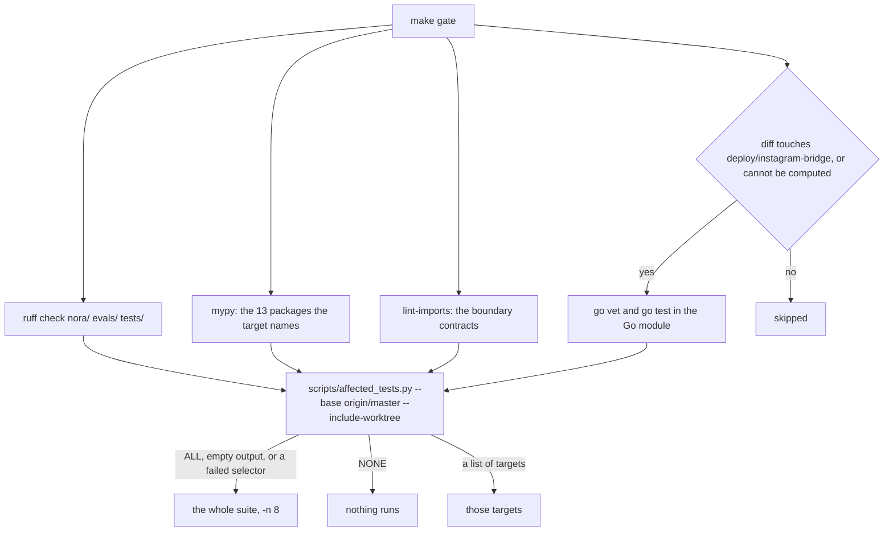
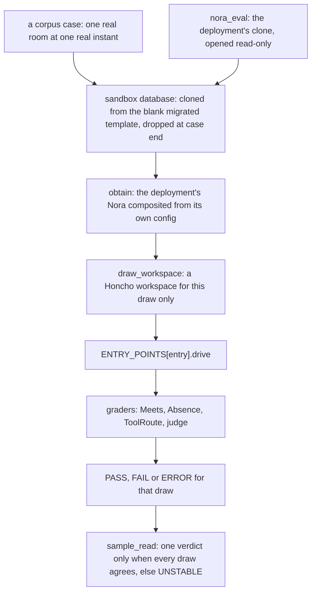

# Verification: proof, measurement and the gap between them

Nora is verified by two instruments that answer different questions, and the repo is
careful not to let one stand in for the other.

- **The gate** is offline, deterministic and model-free. It answers *is this tree
  consistent with the invariants the tests pin?*
- **The evaluation suite** (`evals/`, `python -m evals`) runs a real model against a
  reconstruction of the deployment. It answers *what does she do when asked?*

A green gate is not evidence that production is healthy, that the deployment has a
feature enabled, or that a model will behave — and `docs/eval-sop.md` says outright that
the live corpora are never part of the gate
([`docs/eval-sop.md`](../../docs/eval-sop.md#L108-L120)). This page covers what each
instrument is made of, what it is allowed to claim, and where a new test or a new
behavioural rule belongs.

## The gate: what runs, in what order

`make gate` runs once per PR, on the final head — not once per fix round. Its shape is
four static checks, then a change-scoped test run
([`Makefile`](../../Makefile#L49-L64)):



*What `make gate` decides: static checks in full, then the tests the branch can reach.*

`make full-gate` runs the same four checks plus the whole suite, serially and
unconditionally. While iterating, the documented loop is `make test-affected` (targets
from the last commit) or `make test-fast` (the whole suite with `-n 8`)
([`AGENTS.md`](../../AGENTS.md#L462-L485)).

Two properties of that recipe matter more than the list of commands.

**The selector fails closed.** `scripts/affected_tests.py` prints exactly one line:
`ALL`, `NONE`, or a list of pytest targets. The `test-affected` recipe treats a nonzero
exit, an empty line and `ALL` identically — run everything. Only an explicit `NONE` runs
nothing. `SELECTOR` and `PYTEST` are assigned with `:=` rather than `?=`, so an exported
environment variable in someone's shell cannot replace the gate's own command
([`Makefile`](../../Makefile#L97-L123)). The script's own contract states the same
asymmetry: a path its rules do not name classifies as `ALL`, and one `ALL` anywhere makes
the answer `ALL`, because "a confident wrong subset is the one failure mode this script
must never have" ([`scripts/affected_tests.py`](../../scripts/affected_tests.py#L18-L61)).
Its doc classes only ever *narrow* within documentation trees; the code trees are always
`ALL`, and the scan's blind spots (a path computed with no literal, a file opened by code
a test calls, an `importlib` import of a test module) are written down rather than
discovered later ([`scripts/affected_tests.py`](../../scripts/affected_tests.py#L82-L90)).

**Type-clean means thirteen packages.** The `typecheck` target names `nora/domain`,
`nora/config.py`, `nora/app`, `nora/infra`, `nora/presence`, `nora/engagement`,
`nora/language`, `nora/ingest`, `nora/analytics`, `nora/doctrine`, `nora/skills`,
`nora/instructions` and `nora/web` ([`Makefile`](../../Makefile#L43-L44)); everything else
under `nora/` — `agent`, `compute`, `platform`, `testing`, `obs` among them — is not
checked. A green gate means "those thirteen are", not "this repo is"
([`AGENTS.md`](../../AGENTS.md#L487-L495)).

### Import boundaries are a build failure, not a convention

`make imports` runs `lint-imports` over eight contracts declared in
[`pyproject.toml`](../../pyproject.toml#L188-L362). They are the enforcement half of
Nora's layering: a docstring saying "this layer must not learn that `nora.policy`
exists" is decoration until a contract refuses the import.

| contract | what it protects |
|---|---|
| domain is framework-free | `nora.domain` imports no `aiohttp`, `strands`, `sqlalchemy`, `pydantic`, `prometheus_client`, `opentelemetry`, `yaml`, `openai` |
| the room policy is composed in, never imported | `nora.platform`, `nora.domain` and `nora.infra` may not reach `nora.policy`; callables are threaded instead |
| the analytics substrate serves no consumer | `nora.analytics` sits under both the agent and the app rather than inside either |
| layered architecture | `nora.subject` above `nora.app`; ingest above engagement; `nora.testing` beside `nora.infra`; domain at the bottom, so nothing above it may be imported by it |
| the document checker imports nothing of ours | `nora.documents` stays standard-library plus `jsonschema` |
| only app and `__main__` read config | config loading is a composition-root act (`nora.subject` is named as a deliberate exception) |
| `nora/__init__.py` does not read config either | the package's own `__init__` checked as a single module, because a forbidden contract is otherwise a no-op across an overlap |
| `evals` may reach only `nora.app`, `nora.testing`, `nora.subject`, `nora.domain` | the eval layer cannot build a Nora of its own, and cannot import `tests/` |

Each contract carries its reasoning inline — why `allow_indirect_imports` is set, why a
package is absent from a list on purpose, and what a transitive walk would have flagged
that no module actually writes.

## The test-directory contract: what makes a test *true*

`tests/README.md` opens with the rule that decides where a new test goes: **a directory
names what makes the test true, not what the test is about**
([`tests/README.md`](../../tests/README.md#L7-L18)).

| directory | a test here is true because … | needs |
|---|---|---|
| `unit/` | the logic is right; every collaborator is a fake or a value | nothing |
| `contract/` | ONE suite passes against N implementations of a port — the fake and production | Postgres for the SQL ones, module-scoped, truncated between tests |
| `integration/` | the wired pipeline behaves, through the real composition root | Postgres, real HTTP servers |
| `infra/` | a real adapter agrees with its real backend | Postgres, rustfs, docker |
| `architecture/` | a property of the SOURCE holds — read off the AST | nothing |
| `web/` | the aiohttp control-plane surface answers | an aiohttp test server |
| `domain/` | legacy, subject-named; new pure-logic tests go in `unit/` | nothing |
| `.` (root) | legacy — takes no NEW test files | — |

Three rules sit under that table, each with its own gate. The reasoning and the
war-stories are in [`docs/CONVENTIONS.md`](../../docs/CONVENTIONS.md#L697-L738).

**R-A — where a test lives.** `tests/architecture/test_tests_root_takes_no_new_files.py`
pins exactly what is on disk in `tests/` root, generated from a real listing rather than
hand-typed, and checks the pin in **both** directions: a root file not in the pin fails,
and a pinned name with no file on disk fails too, because a stale pin would silently
re-admit a same-named file ([`tests/architecture/test_tests_root_takes_no_new_files.py`](../../tests/architecture/test_tests_root_takes_no_new_files.py#L1-L27)).
The list only shrinks; relocating a file is the intended way it shortens. The gate that
would forbid collecting a container fixture outside `integration/`/`infra/` is
*deliberately deferred* with the move of the root's files, because `contract/`
legitimately collects `pg_url` for its SQL implementations today
([`docs/CONVENTIONS.md`](../../docs/CONVENTIONS.md#L731-L738)).

**R-B — where a test gets its config.** Two fixtures in `tests/conftest.py` are the only
routes: `example_config_path` (a copy of `config.example.toml` in `tmp_path`) and
`example_config` (that copy loaded through the production loader, with the LLM-key
placeholder set because the load is fail-closed on the key exactly as startup is)
([`tests/conftest.py`](../../tests/conftest.py#L88-L110)). Only a test whose *subject* is
the deployment may read the real file, and those are pinned by name with a reason each:
the eval-subject drift check, the offline eval harness, the one copier in
`tests/builders.py`, the F11 template-drift gate, and the turn-budget rule that asserts
both files. The gate reads the AST, not a grep — a root-relative
`Path` chain, a cwd-relative `Path("config.toml")`, an import of `load_eval_config`, or a
module-level constant naming either file is an offence, while a message string that merely
mentions the file is not; and every pinned file must still show a read, so a detector that
went blind fails instead of passing green
([`tests/architecture/test_config_comes_from_the_template.py`](../../tests/architecture/test_config_comes_from_the_template.py#L1-L83)).
The failure this rule was written from: unit tests of the eval harness loaded the real
deployment config, so they went red the day the operator enabled an export — a false
dependency on the operator's choices
([`docs/CONVENTIONS.md`](../../docs/CONVENTIONS.md#L751-L759)).

**R-C — where a fake lives.** A class in `tests/` that defines every public method of a
port in `nora/domain/ports.py`, with exactly the port's parameter names, must live in
`nora/testing/` and be parametrized into that port's contract suite. The definition is
read off the source rather than guessed: exact parameter names, not a superset, so a
one-method port does not claim every class with a matching method name — "a noisy gate is
a disabled gate". Three exemptions are structural, not by name: a class inside
`tests/contract/` (under a suite by construction), a double whose port methods only fail
(the fault injector that drives `unavailable` and timeout paths), and a subclass of a
shared fake with one local twist. Everything else sits in `_ALLOWED` with a reason, the
pin is checked both ways, and a positive control runs the matcher against
`nora/testing/fakes.py` so a detector that stops seeing `FakeBlobStore` as a `BlobStore`
fails here rather than passing with an empty offender list
([`tests/architecture/test_port_fakes_live_in_nora_testing.py`](../../tests/architecture/test_port_fakes_live_in_nora_testing.py#L1-L99)).

The suite as a whole shares four modules: `conftest.py` (the Postgres testcontainer,
rustfs, the doctrine store, the exported-spans provider, the two config fixtures),
`builders.py` (the only module that constructs or copies a `nora.config` object),
`fakes.py` (doubles that are not port implementations — `SinkSender`, `FakeClock`,
`FixedModelSource`), and `fixtures/` for captured data
([`tests/README.md`](../../tests/README.md#L36-L45)).

## Architecture tests: invariants read off the source

`tests/architecture/` is roughly eighty modules that read the source — mostly through
`ast`, occasionally through a pure builder's output — and never a running service. That
is what lets them pin things no runtime test can see: *every* caller of a method, the
number of construction sites for a guard, a list that must not grow, the staleness of an
exemption, or whether a corpus would still be able to fail.

They also share a house style, visible in the files below: an inverted allowlist
(discovered, not listed), a pin checked in **both** directions, and a positive control
that proves the detector still detects.

| test | the invariant it protects |
|---|---|
| `test_only_two_paths_can_send.py` | the filename is historical; the invariant is a discovered set. Every module under `nora/` is parsed and the callers of `deliver.build` must be exactly `{nora/engagement/pipeline.py, nora/app/fire.py, nora/app/summons.py, nora/app/otp.py}` — the tag pipeline, the fire path, the public summons and the one-time code, four modules that reach the one builder rather than four direct callers of the adapter — while a separate assertion pins `Deliverer` as the only caller of `adapter.send` and `deliver.build` as the only place a `Deliverer` is constructed. Every guard between a model and the wire (the budget latch, the empty-reply check, the leak scan, the egress scan, the audit-first write) lives inside `Deliverer.deliver`, so a module outside that set that reached the wire would bypass all of them at once; a fifth sender means editing `CALLERS` *and* the decision index's R-1 row. The send match is on the port's keyword shape, because the adapter's own `self._sender.send(...)` is not a caller of `PlatformAdapter.send` at all ([`test_only_two_paths_can_send.py`](../../tests/architecture/test_only_two_paths_can_send.py#L50-L134)) |
| `test_the_summons_writes_in_one_place.py` | `post_comment` is the one public write Nora has on Instagram, and the account it writes with also carries her group chats, so the call is pinned structurally: exactly one call site under `nora/`, inside `SummonsOccasion._flush`, and both of `_flush`'s call sites are handed either the first held reply (`held[0]`, straight from the staging deliverer's `held_texts`) or the row that reply was stored in — never the model's `final_text`, never a join of every held message. A positive control asserts both call sites exist, so the check cannot pass by finding none ([`test_the_summons_writes_in_one_place.py`](../../tests/architecture/test_the_summons_writes_in_one_place.py#L1-L99)) |
| `test_the_gate_does_not_form_its_verdict_through_the_sdk.py` | the Relevance Gate's verdict is an admission decision, so it may not be formed through the SDK's structured output (whose tool-specification transport dropped reasoning before the verdict). Every `RelevanceGate(...)` construction under `nora/` is discovered and its `client=` resolved, and an unresolvable client must be exempted by hand rather than skipped ([`test_the_gate_does_not_form_its_verdict_through_the_sdk.py`](../../tests/architecture/test_the_gate_does_not_form_its_verdict_through_the_sdk.py#L1-L38)) |
| `test_no_module_level_mutable_singletons.py` | no module-level name bound to a call that constructs a class defined in the same module, and no `global` statement anywhere under `nora/` — the two shapes by which per-process state gets rebound from inside a function ([`test_no_module_level_mutable_singletons.py`](../../tests/architecture/test_no_module_level_mutable_singletons.py#L1-L17)) |
| `test_store_methods_have_production_callers.py` | a green contract suite proves a verb *works*, never that it is *used*. A store method with no production caller is pinned with one of four reason shapes, and wiring it up forces its row out. A docstring mentioning the method does not count as a caller, and neither does a call on the result of another call ([`test_store_methods_have_production_callers.py`](../../tests/architecture/test_store_methods_have_production_callers.py#L1-L58)) |
| `test_decision_index_tests_exist.py` | every decision row's named enforcing test resolves — the file *and* the `::selector` half — or the row carries a `DEPRECATED` banner that makes it a record rather than a live guarantee. The registry form and `-k`-style prefixes are named as accepted blind spots ([`test_decision_index_tests_exist.py`](../../tests/architecture/test_decision_index_tests_exist.py#L1-L55)) |
| `test_every_case_is_anchored_or_parked.py` | every corpus case is a real room at a real instant, parked with a reason, or counted in a named unanchored set that can only shrink by editing the pin. A case cannot state `knows:`, `config:`, `policy:`, `room:` or `now:` — that would smuggle an assembly in ([`test_every_case_is_anchored_or_parked.py`](../../tests/architecture/test_every_case_is_anchored_or_parked.py#L1-L17)) |
| `test_the_near_miss_corpora_exercise_their_rules.py` | a corpus case that passes by producing no reply cannot distinguish "the rule held" from "the input never reached the rule". So the near-miss corpora are rendered with the deployment's own trigger, and each case names the source rule it exercises — deleted, the corpus must break ([`test_the_near_miss_corpora_exercise_their_rules.py`](../../tests/architecture/test_the_near_miss_corpora_exercise_their_rules.py#L1-L19)) |

**The public summons is a staging deliverer, not a second wire.** `nora/app/summons.py`
builds its deliverer with `send_permitted=False` — the switch that sits after every guard
has measured the text, and before the audit row and the adapter. `send_reply` therefore
runs the empty-reply check, the doctrine leak scan, the identifier egress scan and the
markdown render, and what passes is appended to `held_texts` and to nothing else
([`guards.py`](../../nora/agent/guards.py#L436-L452)). The store and adapter it is built
with are a `_NoRoom` double, so a turn that reached either would be a wiring bug that
raises ([`summons.py`](../../nora/app/summons.py#L487-L507)). Publication is a separate
guard, the one seam `test_the_summons_writes_in_one_place.py` pins: `_flush` posts
`held_texts[0]` through the instagram-bridge's guarded comment write, in live mode only,
after `take_for_flush` has claimed the row so that of two flushes exactly one writes, and
the bridge's own `writes_disabled` / `writes_blocked` answers are read by code rather than
by status ([`summons.py`](../../nora/app/summons.py#L650-L711),
[`summons_client.py`](../../nora/infra/social/summons_client.py#L1-L29)). A summons is
also an answer to somebody tagging her, which is not the speech the rule protects against.

**The one-time code is a notice, not speech.** `nora/app/otp.py` sends a fixed template — no
model, no prompt, no tools, `budgets={"send_reply": 1}` — as a direct message to a person
already in `identity.toml`: the identifier is resolved against that file and the address
built from it, and the senders refuse an address that is not there, so no number outside
the roster can be named. The template still travels through `deliver.build` and
`Deliverer.deliver`, which is the point of routing it there: the leak scan, the egress scan
and the audit-first write stand between the template and the wire, and the audit row
records the message with the code blanked so the code is never at rest
([`otp.py`](../../nora/app/otp.py#L14-L18), [`otp.py`](../../nora/app/otp.py#L150-L169)).

**A call site inside an allowed module is not a new path.** The set is compared per module,
so `nora/app/fire.py` may hold several deliverer builds — the participation turn's, the
shadow mirror that reports what she would have said, the gate's review post — each under an
audience of its own. `nora/domain/audience.py` declares that vocabulary once: the speaking
audiences that run a model loop and can therefore produce a `reasoning_strip_log` row, the
two shadow audiences whose watch is built and never fires, and the one notice audience. A
row carrying a shadow or notice path is therefore legible as "a model loop grew here"
rather than as an unknown string ([`audience.py`](../../nora/domain/audience.py#L14-L72)).

The eval layer's own shape is pinned the same way, and those pins are the reason a green
gate says something about the harness even though it cannot run a model:

- `test_the_entry_point_is_a_port.py` — the eval layer **composes nothing**: driving
  `RelevanceGate.decide` and `FirePath.speak` through one runner must not need different
  lifecycles or outcome shapes, and the names an eval-side assembly would use
  (`build_dependencies`, `build_offline_pipeline`, `FirePath`, `Agent`, …) are forbidden
  in `evals/rebuilt/`, aliases resolved
  ([`test_the_entry_point_is_a_port.py`](../../tests/architecture/test_the_entry_point_is_a_port.py#L22-L42)).
- `test_the_subject_is_obtained_not_assembled.py` — `nora.subject` is the one way the
  graph is obtained; `nora.app` may not reach it; `SubjectSpec` names only seams (a time,
  a room, an override), never a collaborator, and the seam list is pinned in both
  directions so a new field has to be argued
  ([`test_the_subject_is_obtained_not_assembled.py`](../../tests/architecture/test_the_subject_is_obtained_not_assembled.py#L1-L45)).
- `test_the_eval_subject_is_the_deployed_nora.py` — the subject is composed from the
  deployment's own config rebuilt into `config.evaluation.toml`, never from the template,
  because the template ships with most capability flags off and a case run against it
  would measure a different model at a different reasoning effort with most of Nora
  switched off. The exemption list lives beside the check that reads it, not copied into
  the test, and the guards run against a deployment-*shaped* fixture so they cannot
  vacuously skip when the generated config is absent
  ([`test_the_eval_subject_is_the_deployed_nora.py`](../../tests/architecture/test_the_eval_subject_is_the_deployed_nora.py#L1-L53)).

## Contract suites: one suite, N implementations

A port never gains a second implementation — including a test fake — without a suite both
pass. `tests/contract/` is that suite, and the SQL implementations mean it runs against a
real database. The isolation is deliberately the narrow kind: one database and one
migration run per module, the table truncated between tests, because the property the
suite needs is "no rows from the last test", not "no schema from the last test"
([`tests/contract/test_standing_store_contract.py`](../../tests/contract/test_standing_store_contract.py#L1-L90)).

The suites are written around the property that would otherwise pass by accident. The
Standing suite always writes twice, because `write` is an upsert: a list-backed fake or a
plain `INSERT` passes a naive write-then-read assertion and fails on every turn after the
first. Its second property is that the two implementations **refuse identically** — the
in-memory store holds domain objects rather than dicts precisely so the body ceiling is
structural, and "a fake that stored whatever it was handed would turn a missing guarantee
into a passing gate"
([`tests/contract/test_standing_store_contract.py`](../../tests/contract/test_standing_store_contract.py#L8-L24)).
`tests/contract/test_port_conformance.py` holds the complementary reading: the concrete
classes an adapter is injected as must satisfy the ports, and where a class does not
conform the gap is asserted rather than forgotten
([`tests/contract/test_port_conformance.py`](../../tests/contract/test_port_conformance.py#L1-L43)).

These suites have already caught production. When a shared `FakeMediaObjectStore` and its
suite were written against `SqlMediaObjectStore`, one test went red **against
production**: the SQL `search` combined words with `or_` while its own docstring said it
ANDed them, so a two-word query returned every row matching either word. No offline test
could have found it, because every offline test ran against a fake that had invented its
own semantics — and a byte-for-byte duplicate of the memory fake had been living in
`tests/fakes.py`, outside every suite
([`docs/CONVENTIONS.md`](../../docs/CONVENTIONS.md#L803-L825)).

## Integration tests and the container-backed infra tests

`tests/integration/harness.py` is the single entry point for wired scenarios:
`build_handler` assembles a real `IngestPipeline` + `EngagementPipeline`, glued by the
real `Dispatcher`, against a real throwaway Postgres database and the real,
already-validated doctrine files, with **only** the model and the outbound sender faked.
`tests/offline_pipeline.build_offline_pipeline` is the one definition of that wiring, also
used by the offline eval harness, so neither harness keeps a second copy — and it
constructs no collaborator itself, which is what keeps it free of network concerns
([`tests/integration/harness.py`](../../tests/integration/harness.py#L1-L17),
[`tests/offline_pipeline.py`](../../tests/offline_pipeline.py#L1-L13)).

The database is a real Postgres container, and the container is chosen to match
production:

- One container per session, started lazily on the first `pg_url` request, so the
  pure-unit majority that uses `FakeRecordStore` pays nothing for it. **Each test that
  asks for `pg_url` gets its own freshly created database**, dropped on teardown — a
  separate catalog rather than a shared mutable one
  ([`tests/conftest.py`](../../tests/conftest.py#L1-L12)).
- The image must track `docker-compose.yml`'s `db` image, and a test pins the two
  together. The reasons are concrete: a different major version would make
  `tests/infra/test_schema_parity.py` validate against a version other than the one it
  guards, and a musl-based image sorts `en_US.utf8` differently from glibc, so
  collation-dependent indexes give wrong range scans when read across the two
  ([`tests/conftest.py`](../../tests/conftest.py#L39-L54)).

`tests/infra/` is the other side of that coin: a real adapter against its real backend
(Postgres, rustfs, docker). The most load-bearing of those is the schema gate. It is
`tests/infra/test_schema_parity.py`, **not** `alembic check`, because `alembic check` is
provably blind to the CHECK constraint and to the `ts DESC` index ordering
([`AGENTS.md`](../../AGENTS.md#L520-L523)). The gate reads Postgres's own catalogues and
asserts, independent of any baseline, that the CHECK constraint is present, that the index
is `(conversation_id, ts DESC)` read from the per-column `indoption` DESC *bit*, and that
every `sa.CheckConstraint` in `schema.py` is on the migrated table with the same predicate
and no extra one
([`tests/infra/test_schema_parity.py`](../../tests/infra/test_schema_parity.py#L1-L38)).

Its oracle is a checked-in normalised `pg_dump`. That is the scope of the claim: a frozen
dump catches drift *from that baseline* — metadata-plus-baseline parity — and it does not
reach live production. The live half is a `docker exec pg_dump` job, named in the file
rather than silently dropped
([`tests/infra/test_schema_parity.py`](../../tests/infra/test_schema_parity.py#L9-L13)).

## The evaluation suite: measuring behaviour

The suite is rebuilt around one spine — **comprehend a user journey, measure the
trajectory, serialise a verdict** — applied a layer above the app. It runs **on the
deploy host**, in a checkout of the branch under test (not the deploy checkout), against
the deployment's **clone**. Every corpus case names a real room at a real instant; the
runner composes the deployment's own Nora from its `config.toml`, `policy.toml` and
`identity.toml`, gives the case a sandbox database of its own, seeds it with what that
room held at that instant, and drives one entry point. Nothing is authored and nothing is
configurable per case ([`docs/eval-sop.md`](../../docs/eval-sop.md#L9-L35)).

```bash
uv run python -m evals --list                # corpora, entry points, classes
uv run python -m evals relevance_gate --sample 3
uv run python -m evals injections identity_grounding --judge
```

`make eval-gate` is the `relevance_gate` corpus, `make eval-participation` is the
15-case participation flip gate, and `make eval-adversarial-corpora` runs the injection,
grounding, scope and contradiction corpora judged. They need the model, they run on the
deploy host, and they are **never part of the gate**; the only eval material inside
`make gate` is the deterministic evaluators and the rubric tests
([`Makefile`](../../Makefile#L125-L138),
[`Makefile`](../../Makefile#L210-L220),
[`docs/eval-sop.md`](../../docs/eval-sop.md#L106-L120)).



*How one case becomes one measurement, and why a draw cannot see another draw's state.*

### Isolation is by database and by workspace

The clone is read through `create_readonly_sql_engine`, so a write is refused by the
server rather than promised away, and production itself is never opened. The sandbox is a
database of the case's own, cloned from a blank migrated template **beside** the source,
and dropped when the case ends — isolation is by database, not by room, so the real ids
and the copied rows stay usable
([`nora/subject/sandbox.py`](../../nora/subject/sandbox.py#L9-L25)). Every seeded row
keeps its real `ts` and the subject's clock is frozen at the case's instant, so a row that
was four minutes old at that instant is four minutes old to the model.

The shared source and the shared template are read by every session on the host and
**neither may ever be migrated by a run**. A branch ahead of or behind the shared
template's revision gets a throwaway private copy (`<template>_run_<nonce>`) migrated to
its own head instead; a source ahead of this checkout's head is refused before any case
runs; and a snapshot read that hits a missing column or table raises the same
`SourceRevisionMismatchError`, naming both revisions
([`nora/subject/sandbox.py`](../../nora/subject/sandbox.py#L56-L94)).

Postgres is not the only stateful collaborator. Each **draw** creates a Honcho workspace
of its own, before the subject is composed and deleted after the draw's own teardown,
because a shared `<deployment>-eval` workspace would be fed by every draw and read back by
the tag path — draw 3 would read draws 1 and 2 as the tagger card
([`evals/backbone.py`](../../evals/backbone.py#L1417-L1458)).

### One run at a time, and a bounded one

The deploy host holds a single eval lock (`/tmp/nora-eval.lock`), shared by every session,
and `python -m evals` refuses to start a run estimated over 60 minutes without
`--allow-long` — a run that holds the lock past an hour blocks every other session's PR.
The estimate prints before any draw; narrowing is `--case`, `--class` or a lower
`--sample` ([`evals/__main__.py`](../../evals/__main__.py#L125-L173)). `make eval-source`
refreshes the clone by `pg_dump` and drops every sandbox, so it may never run while a run
is in flight ([`docs/eval-sop.md`](../../docs/eval-sop.md#L25-L35)).

### Draws, verdicts and what a number is

A case can swap verdicts across runs, so `--sample N` draws it N times. The mechanism is
not a repeat parameter — the SDK caches on `case_name`, so N draws under one name would
collide rather than produce N rows. Each draw therefore gets a name of its own, and
`sample_read` groups them back by the base name
([`evals/backbone.py`](../../evals/backbone.py#L2526-L2547)).

The grouping is where the evidence rule lives: **a case reads PASS or FAIL only when every
draw agreed, otherwise UNSTABLE.** Collapsing disagreement into a majority vote would hide
exactly the instability; the one exception is that a group whose every draw read ERROR
stays ERROR, so a case that never once ran is not merely "unstable"
([`evals/backbone.py`](../../evals/backbone.py#L2560-L2597)). Report the draw count with
the verdict — one draw is a smoke check, and n=3 is not a rate
([`docs/eval-sop.md`](../../docs/eval-sop.md#L63-L67)).

Three further rules keep the vocabulary honest:

- **ERROR is never PASS.** A case with no anchor is loaded, driven and ERRORs; it is not
  skipped. A parked case is counted and never run, and the run prints the census — `N
  total, active, parked, unanchored` — plus a `counterfactual` count reported separately
  and never folded in, so the anchored rule cannot erode by arithmetic
  ([`evals/scenarios.py`](../../evals/scenarios.py#L12-L120)).
- **The task never raises.** In the installed SDK an exception out of a task is written
  as `test_pass=False` for *every* evaluator without calling any of them, which dresses a
  crash as a considered FAIL. So `nora_task` catches, scrubs and returns the failure as
  data on `environment_state` — the one channel the SDK preserves — and the grader reads
  it first ([`evals/backbone.py`](../../evals/backbone.py#L1-L27),
  [`evals/backbone.py`](../../evals/backbone.py#L1886-L1946)).
- **Absence is graded, not inferred from emptiness.** `AbsenceGrader` exists because
  every built-in evaluator judges `actual_output` and a crash produces the same empty
  string as a correct silence. It reads the case's `expect` and the entry point's own
  fail-closed signal: for a gate case the answer is whether she was *admitted*, for every
  other entry point whether a row was written, and `either` still requires that something
  happened ([`evals/backbone.py`](../../evals/backbone.py#L2127-L2189)).

### Entry points, corpora and graders

A corpus is a suite about **one** entry point: `CORPUS_ENTRY` maps each corpus to a name,
and `ENTRY_POINTS` supplies the implementations — `tag`, `participation`, `gate`,
`dreamer`, `proactive_act`, `standing`, `persona_identity`, `persona_coverage`
([`evals/scenarios.py`](../../evals/scenarios.py#L359-L401),
[`evals/rebuilt/entry.py`](../../evals/rebuilt/entry.py#L649-L693)). A new suite over an
existing entry point adds nothing to `ENTRY_POINTS`, and a test pins that. Each entry
point declares only the capability flags *it* needs (the tag path needs none, because the
trigger ships enabled; the Dreamer's runtime flag is declared there while which adaptor is
built stays the corpus's business).

Grading is layered: `MeetsGrader` delegates to the domain's own verdict vocabulary rather
than reimplementing it, `ToolRouteGrader` grades routing on the tools that actually
executed, and tagged replies go to a model judge whose base rubric, `RUBRIC`, names exactly
six criteria ([`tests/test_evals_rubric.py`](../../tests/test_evals_rubric.py#L7-L11),
[`evals/rebuilt/rubric.py`](../../evals/rebuilt/rubric.py#L12-L51)). Those six are the
tagged-reply rubric, not the rubric of every judged corpus, and a standing fold is read
against the property-per-kind `FOLD_KINDS`
([`evals/rebuilt/rubric.py`](../../evals/rebuilt/rubric.py#L325-L398)). Routing
is measured in the `tool_selection` corpus with `--reasons`, because a wrong route that
answers fluently is invisible to a reply grader
([`docs/eval-sop.md`](../../docs/eval-sop.md#L122-L126)).

The judge's third label, `REVIEW`, is its uncertain or mid-band answer, and it is not a
pass: a judge that did not answer the question is an error about the instrument, so
`Outcome.meets` returns `None` for it — the same third answer an unreachable subject gets —
and `MeetsGrader` serialises that ungradable verdict as ERROR rather than as a verdict
about her ([`evals/rebuilt/judge.py`](../../evals/rebuilt/judge.py#L7-L10),
[`evals/rebuilt/domain.py`](../../evals/rebuilt/domain.py#L220-L231),
[`evals/backbone.py`](../../evals/backbone.py#L2254-L2259)).

### Evidence rules for a run

The corpora are pseudonymised: a case's room id, person and names are pseudonyms, while
the clone and the deployment's policy and identity files carry the real values. A private
map on the deploy host resolves each case in memory as it loads, and it lives outside
every checkout. Unset, a pseudonymised anchor refuses and names the variable; a map that
does not exist refuses the run; a new case whose pseudonym is missing refuses with its
room withheld — add the line to the host file, never a real value to the tree
([`docs/eval-sop.md`](../../docs/eval-sop.md#L39-L53)). With the map in effect a run log
holds real names and room content: it stays on the host, and only case names,
PASS/FAIL/ERROR, counts and spend leave it — never into an issue, PR or commit. Every run
prints its own spend, and the PR carries the command with it
([`docs/eval-sop.md`](../../docs/eval-sop.md#L68)).

## What the offline gate proves about the harness itself

The evaluation harness is not exempt from the gate just because the model is not
available. `tests/integration/test_the_rebuilt_suite_runs.py` drives a case end to end
with **no provider reachable**, and the reading that matters is the negative one: a run
that reached no model must say so first and must not print a clean bar, because an
unreachable provider producing PASS is exactly the substitution this layer exists to
prevent. One case in three legitimately grades without a model — an untagged, unmentioning
line is refused by ingest before any model call, so "she did not answer" is a complete and
correct reading — while the gate and the participation turn come back as ERROR
([`tests/integration/test_the_rebuilt_suite_runs.py`](../../tests/integration/test_the_rebuilt_suite_runs.py#L1-L17)).

Between that and the architecture pins above, a green gate establishes: the runner drives
every entry point through one path, the subject is the deployment's, the corpus surface
refuses an authored assembly, the near-miss corpora can still fail, and an outage is never
mistaken for a pass. None of that is a claim about behaviour.

## The limits, per instrument

| instrument | a green reading proves | it does not prove |
|---|---|---|
| `make gate` | the changed tree is consistent with the invariants the tests pin, on template config, with the model faked; the thirteen listed packages type-check; the import contracts hold | production health; that the deployment has a feature *enabled* (tests load `config.example.toml` by design, R-B); any model behaviour; that the suite would have noticed the bug |
| `make full-gate` | the same, over the whole suite, serially | the same three gaps — still offline, still no model, still not a live service |
| `tests/infra/test_schema_parity.py` | the migrated database matches the checked-in baseline, and the CHECK/index invariants hold against Postgres's catalogues | anything about live production — the baseline is a frozen dump and the live half is a separate `docker exec` job |
| a live eval run | for each anchored case, a recorded verdict at a stated draw count, on a reconstruction of one real moment | a population error rate; the behaviour of a tool whose result differs in production; anything about a platform the sandbox does not carry; the truth of a rule whose corpus is narrow |

`docs/eval-sop.md` states four of those limitations in its own words, and they are the
ones to read before trusting a number
([`docs/eval-sop.md`](../../docs/eval-sop.md#L128-L144)):

1. **Repeated draws do not establish a population error rate.** Each draw has its own
   Honcho workspace, but the draws share a corpus, a model and an evaluation setup. Report
   the sample count and its scope.
2. **An eval whose tool results differ from production measures a different decision.**
   A recorded case: a handle the sandbox could not resolve made a tool fail in the eval and
   pushed the model on to the next step; live, the same tool succeeded and the model
   stopped there. The next step depends on what the last tool *returned*.
3. **A case must anchor on a room whose platform adapter the sandbox has.** Discord is off
   in the sandbox; a case anchored there errors before the model is called.
4. **A narrow corpus overstates detection**, and a judge detects the fabrications its
   corpus teaches it to. Read a green adversarial run as "not caught by this judge".

There is one more gap, specific to the suite itself: a passing case can pass for a reason
other than the one it names, which is why the near-miss corpora are checked against the
rules they claim. And some corpora are a *measured record of a doctrine gap* rather than a
gate the shipped doctrine clears — their tests pin that the measurement exists and is
findable, "not that the rule holds"
([`tests/test_acceptance_rules.py`](../../tests/test_acceptance_rules.py#L480-L515)).

## Proving a fix is guarded

`make gate` green says the suite passes. It does not say the suite would have **noticed**
the bug you just fixed. `make mutate TABLE=scripts/mutations/<name>.json` reverts each
fix, runs the test that is supposed to guard it, and requires RED; a fix no test guards can
be reverted and the full suite stays byte-identical
([`scripts/mutate.py`](../../scripts/mutate.py#L1-L26)). It is deliberately not part of
`gate`: a table names exact source text, so it is per-change and disposable, and a stale
table failing the gate would teach people to delete tables rather than write them
([`Makefile`](../../Makefile#L74-L82)).

The runner's own two harness rules are about not fooling yourself: pytest exit code 5 means
"nothing collected", not "failed", so the baseline is asserted green **and non-empty** and
a selector matching nothing is a BROKEN ENTRY rather than a caught defect; and a mutant
must die from the reverted behaviour rather than from a `NameError` some `except` swallows,
so the restore is re-verified green afterwards. Go targets follow the same logic — a
package reporting `[build failed]` collects nothing and is BROKEN, never caught
([`scripts/mutate.py`](../../scripts/mutate.py#L40-L64)).

## Where a new rule and a new test attach

- **A new behavioural rule** gets a row in the decision index and a named test registered
  in `tests/test_acceptance_rules.py::RULE_TESTS`
  ([`docs/CONVENTIONS.md`](../../docs/CONVENTIONS.md#L691-L695)). That registry is checked
  by collecting the suite (`pytest --collect-only`) and asserting every named test exists,
  so a rule cannot point at a test that was renamed away
  ([`tests/test_acceptance_rules.py`](../../tests/test_acceptance_rules.py#L468-L477)).
  A rule that is genuinely behavioural instead pins the corpus that *measures* it.
- **A new test** goes where what makes it true lives — `unit/` for pure logic, `contract/`
  for a port implementation, `integration/` for the wired pipeline, `architecture/` for a
  property of the source ([`tests/README.md`](../../tests/README.md#L9-L34)).
- **A new port implementation, including a fake**, needs a suite in `tests/contract/`
  parametrized over both, and a fake promoted out of a test module into `nora/testing/`.
  The fix for a new `_ALLOWED` entry is never the entry.
- **A new corpus** adds a dict entry to `evals.scenarios.CORPUS_ENTRY`, not a Makefile
  target ([`Makefile`](../../Makefile#L128-L131)).
- **Never grow a pinned allowlist.** `_ALLOWED`, `_DEPLOYMENT_SUBJECTS`,
  `UNANCHORED_BY_DESIGN` and `_KNOWN_DANGLING` are inventories to burn down; each is
  checked in both directions, so removing an entry is the intended edit and adding one is
  a claim that has to be argued in review. The sending boundary's `CALLERS` set is the same
  shape with the opposite default: it is short because a fifth sender needs the decision
  index's R-1 row *and* that set edited, not because it is being burnt down
  ([`test_only_two_paths_can_send.py`](../../tests/architecture/test_only_two_paths_can_send.py#L112-L134)).

## Related pages

The seams a change attaches to, and the artefact each one requires, are
[Changing the system](../contributing/changing-the-system.md); what a tool *is* once it
exists — the routing surface the `tool_selection` corpus measures — is
[The tool surface](../concepts/tool-surface.md); what the Standing, Culture and Lessons
corpora are measuring is [Contextual learning](../concepts/contextual-learning.md). Live
health, as opposed to a green gate, is [Deployment](../operations/deployment.md) and
[Observability](../operations/observability.md).
