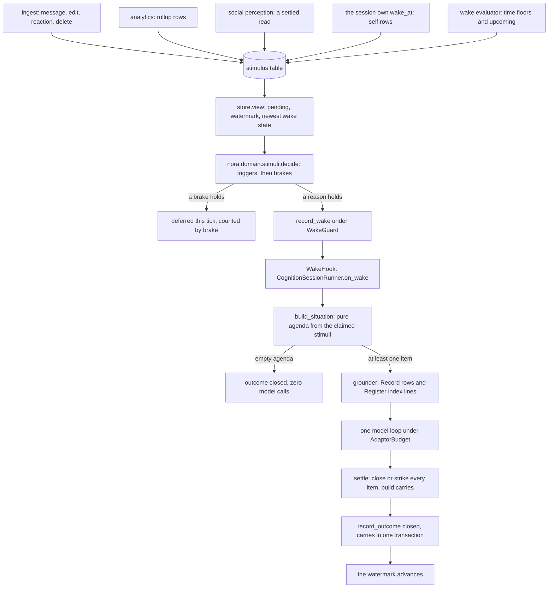
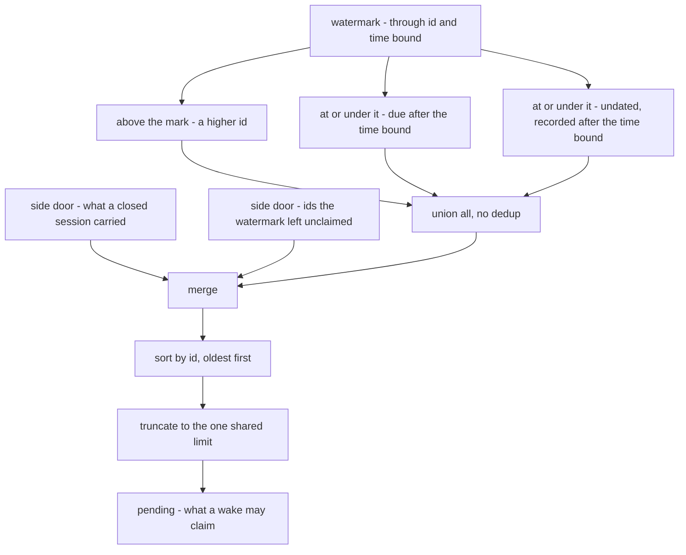
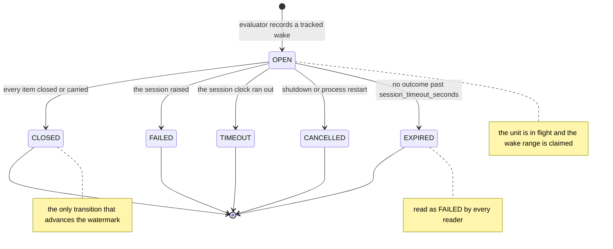

# Cognition: stimuli, wakes, bounded sessions and the agenda

Cognition is the one background writer in Nora: it reads the notebook, a room's Standing,
events and Nora's own reminders into a shared store, and it is the only place a model writes
those tiers without a person asking. It is **not** on the speaking path — nothing it produces
is delivered as she wrote it. The loop has three separable halves:

| half | module | what it is | what it may do |
|---|---|---|---|
| producers | ingest, analytics, social perception, the session's own `wake_at` | appends `stimulus` rows | write one durable row |
| the wake policy | `nora/app/wake.py` (`WakeEvaluator`) + `nora/domain/stimuli.py` (`decide`) | one read per unit per tick, no model | record a `cognition_wake` row and hand it to a hook |
| the session | `nora/app/cognition_session.py` (`CognitionSessionRunner`) | one bounded model loop per wake | read tools, its own write verbs, one outcome row |

**One optional flag governs the whole subsystem.** `[cognition] enabled` ships `false`
(`config.example.toml`); off, the composition root never builds the stimulus stage's wiring,
never builds the runner, never hands the evaluator a hook, and no evaluator runs at all — so no
stimulus is written, no wake is recorded and no model call is made ([runtime
topology](../architecture/runtime-topology.md), [configuration](../operations/configuration.md)).
On, `require_session_hook` (`nora/app/cognition_wiring.py`) refuses to boot a loop that would
wake and run nothing: enabled with no runner, with an evaluator holding no hook, or with no unit
that names a `home_room = true` room in `policy.toml` is a `StartupError`, not a silent loop.

One tick end to end: producers append rows, the evaluator decides, a recorded wake becomes a
session, and only a `closed` session moves the watermark.

## Producers: what raises which stimulus

A stimulus is `(unit, kind, ref, cues, at, due)` — one durable row per unit in `stimulus`, and
every kind is claimed by whoever produced it, never by the evaluator on its behalf. The
producer of each kind is the seam you extend when a new source of attention is added.

| kind | raised by | notes |
|---|---|---|
| `message` | the ingest stimulus stage (`nora/ingest/stages/stimulus.py`), item `message`, `edit`, `reaction` or `delete` | runs after the Record write it names, so every `ref` names an existing item; Nora's own items raise nothing (the echo rule, checked in the stage); a person's reply to her inside `reply_quiet_seconds` is recorded `waits`, so it is consumed but never starts a wake |
| `rollup` | the analytics daemon's unit rollups (`nora/analytics/units.py`) | a co-location, an arrival or a deviation; never a wake reason of its own (see `RIDES_ALONG`) |
| `social` | the social perception poller (`nora/app/social_perception.py`) | a settled social read, one row per unit that may be shown it, carrying its cues |
| `time` | the wake evaluator itself: daily floors and the daily look ahead | the only kind a clock raises |
| `self` | the session's own `wake_at` verb (`nora/agent/cognition_pace.py`) | a due time for the unit's next look; nothing leaves for a room |
| `play` | nothing in the tree raises one | the kind, its agenda summary and its skill slot exist; a `play` stimulus would wake a unit like any other observed kind |

The producers and their gates for the Rollup rows are documented in [Presence collection and
the Rollup's derived view](../systems/presence-and-rollup.md); the ingest half is in
[ingestion](ingestion.md).

## The pure wake decision

`nora.domain.stimuli.decide(view, policy, now_ms)` answers one question — does this unit wake
now, and why — and it is a pure function of a `UnitView`, a `WakePolicy` and a clock, so the
rule is testable with no database and no model. It returns a `Verdict` carrying the reason, the
claimed stimuli, the range the wake consumes and whether it cut a cooldown.

**Triggers, in the table's order, first one that holds wins:**

1. `settled` — an observed item (a `message`, `social` or `play` stimulus) is pending and the
   unit's rooms have been quiet `quiet_seconds`.
2. `strong_cue` — an observed item carries a cue that trips now, and the room has been quiet
   `cue_quiet_seconds`. After a `strong_cue` wake whose session actually ran, only re-arming
   cues count, so a date said twice in the room that just woke a session does not cut the
   cooldown again.
3. `batch` — at least `batch_max` eligible stimuli are pending.
4. `max_age` — the oldest eligible stimulus has waited `max_age_seconds`.
5. `time` — any eligible `time` stimulus is pending (a floor, an anchor day, a revisit).
6. `self` — any eligible `self` stimulus is pending (her own `wake_at`).

`settled` and `strong_cue` count observed kinds only: a pending `time` row would otherwise be
recorded under the wrong reason in a quiet unit. There is no `rollup` reason — the reason
vocabulary and the `cognition_wake.reason` CHECK still admit the old label for rows recorded
before the change.

**The brakes, in code order:** single-flight per unit, then a cooldown after each session, then
the per-unit failure backoff, and finally the cross-unit `max_concurrent_sessions`, which the
evaluator applies because it is the only bound that needs the whole tick. Every brake is
recomputed from durable rows on every tick, so `WakeEvaluator` is stateless between ticks and a
restart changes nothing.

- **Single-flight** asks `unit_in_flight`. With a session hook wired the newest wake is OPEN (no
  outcome row, younger than `session_timeout_seconds`) or its task is alive in this process.
  Without a hook — only a test builds such an evaluator — the wake is treated as a session that
  lasts `session_seconds`, a stated shadow assumption.
- **Cooldown** runs `cooldown_seconds` from when the last session *ended* (the outcome's real
  clock, not the wake's). ONE strong cue may cut it, and only once: a wake that cut a cooldown
  leaves a cooldown nothing can cut, so two strong cues in a row cannot chain past it. A strong
  cue never cuts a backoff — a unit whose sessions keep failing must not be woken every
  `cue_quiet_seconds` by a room that keeps naming a time.
- **Backoff** is `cooldown_seconds * 2 ** (failures - 1)`, capped at `backoff_max_seconds`, and
  only counts failed or timed-out wakes: an open wake and a `cancelled` one neither count nor
  end the run, and one `closed` wake resets it.

**What a wake claims** matters as much as why it fires. `settled`, `strong_cue`, `batch` and
`max_age` are about the pile or the room, so they claim every pending stimulus. A `time` or
`self` wake is about one kind, so it claims that kind (plus the kinds that ride along) and every
other pending stimulus inside its range is recorded as `unclaimed_ids` — **retained as pending,
not consumed**: the watermark carries the list, so a range read never writes off what the wake
did not take. A wake's `through_stimulus_id` is never set below the
watermark it read, or a stimulus appended early and due late would re-open every stimulus
between and resurrect them as pending.

Two exclusions apply everywhere the question "what could wake this unit" is asked (`decide`, the
pending-age gauge, the health command): a `waits` stimulus never starts a wake, and an *inert*
kind never does either. `RIDES_ALONG` holds `rollup`: a Rollup stimulus is context for a session
another reason started, so every wake takes it, and the bound on how long one waits is the daily
floor — which is why a silent unit with `time_floors = []` lets Rollup stimuli wait indefinitely,
an operator's choice rather than a bug.

## One tick of the evaluator

`WakeEvaluator.tick` (`nora/app/wake.py`) runs every `[cognition] tick_seconds`, one read per
unit and no model call. Per unit it: raises the floors whose instant has passed, reads the
pending view, applies `decide`, applies the global concurrency bound, records the wake and hands
it to the hook in a background task.

- **The daily floors are raised here.** `time` is the only kind a clock raises, and the two daily
  floors (07:00 and 00:00 in `[cognition] timezone` by default, `time_floors`) are the only `time`
  producers inside the evaluator itself. A floor is raised only while it is no more than
  `floor_grace_seconds` late, once per unit per day: the grace is what stops a deploy at 15:00
  from raising that morning's 07:00 as if due now, and a restart at 07:02 still raises it.
  Anchors, revisits and event dates are `time` stimuli too, but they arrive with the agenda.
- **The look ahead.** With each floor, `upcoming(unit, now_ms)` (DEC-303) names the unit's rooms
  holding an event starting within `upcoming_days`; each gets one room-bound `time` stimulus
  (`item = "upcoming"`) whose ref carries the floor's, so a floor's look ahead is written once
  however many ticks fall in its grace. Whether the room hears anything, and when, is the
  session's judgement: no event owns a reminder ([proactive
  occasions](proactive-occasions.md)).
- **`floors_ready`.** When no skill ships for the `time` agenda kind, a unit whose wakes start
  sessions raises NO floor — a session woken by one would have nothing to do — and any `time`
  stimulus already pending is inert: it stays pending but neither wakes the unit nor is claimed
  by any wake, so it acts the moment the kind is ready.
- **The settle window.** The pending read looks `settle_seconds` (default twice
  `store_timeout_seconds`) behind the clock, and the wake's `at_ms` — the watermark's time bound
  — is that cutoff. Ids are assigned at INSERT and become visible at COMMIT, so two concurrent
  ingests can commit out of id order; a read that saw id N+1 before N committed would set the
  watermark past N and N, once committed, would be consumed unseen. The cutoff is why the
  undated branch of the read exists, and why a stimulus recorded after the cutoff stays pending
  whatever its id.
- **One unit's failure is its own.** Each unit's read and write is bounded and caught; a unit
  whose store call fails is skipped this tick and counted
  (`nora_errors_total{stage="cognition_wake"}`), and the others still run. The watermark is only
  ever a written row, so a failure never moves it. A hook that raises while being called is
  logged, counted and contained; it never aborts the tick for the units after it.
- **The guarded write.** A tracked wake is written under a `WakeGuard` (the unit's newest wake id
  and that wake's outcome as the tick read them). The store re-checks both under a
  transaction-scoped advisory lock per unit; if either moved between the read and the write,
  nothing is written, the unit is read again next tick, and the deferral is counted as
  `single_flight`. Without that lock the guarded write and an outcome write can write-skew under
  READ COMMITTED: a guard sees "no outcome" while a close sees "no later wake", and both commit.
- **Failure strikes.** At `max_consecutive_failures` consecutive *agenda*-caused failures the
  evaluator retracts (`stimulus_retraction`, reason `failed`) exactly the stimuli the newest
  agenda-failed wake claimed, so an agenda that always fails stops instead of retrying the same
  input forever — and a stimulus that arrived since is never struck unseen. Infrastructure
  failures back the unit off and never strike.

## The watermark, and the one-outcome-per-wake state machine

Each unit's **watermark is the wake log itself**: the `(through_stimulus_id, at_ms)` of its
newest wake in the mode that did not fail or expire, plus the ids that wake left `unclaimed`.
Nothing is updated in place; loop state is transition rows and the current value is the newest
one.

### The pending predicate, and the read that answers it

**Consumed is a conjunction; pending is its negation, so pending is a disjunction.** A stimulus
is *consumed* when `id <= through_stimulus_id AND pending_since <= through_ms` — `through_ms`
being the newest wake's `at_ms`, and `pending_since` the stimulus's due time if it has one and
when it was recorded if it does not (`coalesce(due_ms, recorded_at)`) — and its id is not one that
wake left `unclaimed` (an exception a range cannot express, so a wake records the list on its own
row). Pending is `pending_since <= now_ms` (due by the read's cutoff) **and** any one of:

- `id > through_stimulus_id` — appended after the newest wake's range;
- `due_ms > through_ms` — an older id that only becomes due after that wake's time bound;
- `due_ms IS NULL AND recorded_at > through_ms` — an undated row committed after the time bound.

An older id under the watermark therefore does not by itself consume anything. A `self` stimulus
appended at 15:00 and due at 19:40 is not pending at 15:00 (the due cutoff keeps it out of the
list) and is not consumed by the 15:00 wake either: its due time is past that wake's `at_ms`, so
the clock reaching 19:40 puts it back in the pending list with an id below the watermark, and the
`self` wake at 19:40 takes it. Both bounds only ever grow — `decide` never sets
`through_stimulus_id` below the one it read, and `at_ms` is the read's cutoff, which moves forward
with the clock — so "consumed by some earlier wake" and "consumed by the newest" are the same
test, which is what lets one row carry the watermark.

**`view` spells that disjunction as three disjoint range reads**, because `stimulus` is
append-only and grows with every item of every room forever: the single `NOT (id <= t AND
coalesce(...) <= m)` predicate under `ORDER BY id LIMIT` plans as a walk of a unit's whole history
with the predicate as a filter. Every branch carries the same two conjuncts — the due cutoff
`coalesce(due_ms, recorded_at) <= now_ms` and the live-stimulus predicate (no
`stimulus_retraction` row, so a retracted `self` wake never comes back) — and differs only in the
range it asks an index for:

| branch | what it adds | index that answers it |
|---|---|---|
| above the mark | `id > through_id` | `idx_stimulus_unit_id` |
| older id, due later | `id <= through_id AND due_ms > through_ms` | `idx_stimulus_unit_due` |
| older id, undated, late commit | `id <= through_id AND due_ms IS NULL AND recorded_at > through_ms` | `idx_stimulus_unit_undated_recorded` |

The branches cannot overlap — one is above the id, the next requires a due time, the last
requires none — so they are unioned with `UNION ALL` and nothing is deduplicated. The third
branch is the late commit the evaluator's settle margin exists for: two concurrent ingests, the
lower id stamped later.

How one `view` call answers "what is pending": three disjoint range reads against the watermark,
then the two side doors, then one ordering and one limit.

**Two side doors past the range read.** Two sets of stimuli the range read would leave out are
still pending, and both stores re-read them rather than trusting the range: the ids a `closed`
session **carried** forward (its `cognition_carry` rows still `carried`, re-read under the unit
and live predicate and delivered `waits` when it was a person's wait that closed the item), and the
ids the watermark's own wake left **`unclaimed`**. Neither is consumed, and neither needs the due
cutoff to be re-argued: both doors only ever name stimuli that were already pending when the
wake that carried or skipped them read them. An unclaimed stimulus is
retained as pending, not written off: a `rollup` wake took the one Rollup stimulus in its range and
left the messages inside that range unclaimed, so those messages are pending — and the next wake
that claims all pending stimuli takes them exactly once. A carried stimulus is the same idea from
the other end: an item the session left `waiting`, or one deferred past `max_items`, is returned as
a carry row inside the wake's range and comes back through this door instead of being consumed
unseen.

**One ordering and one limit, after the merge.** The side doors are not exempt from the bound.
The union is sorted by id, oldest first, and truncated to the single `limit` the caller passed to
`StimulusStore.view` — the evaluator passes one bound for both doors and the range
(`pending_limit`, default `DEFAULT_PENDING_LIMIT` = 1000), so a tick's read stays bounded however
large a backlog grew, and `limit` is a different number from the agenda's `max_items`. Both
stores do exactly this, and the contract suite pins it: truncating the carried or unclaimed ids
in one store while the other read past the limit, or truncating before the merge, would hide an
older stimulus behind a newer one. Oldest-first is what makes the truncation safe — whatever the
limit cut has a higher id than everything shown, and a wake's `through_stimulus_id` is the highest
id it claimed, so the cut stimuli stay pending. `decide` closes the other end: the watermark's
`unclaimed` ids are carried into the next verdict's `unclaimed_ids` whether or not the truncated
read showed them, so a short read cannot consume unseen what an earlier wake refused.

A wake recorded with a hook wired is `tracked`; its fate is at most one `cognition_wake_outcome`
row keyed by the wake's id, and the first write stands.

The four fates of a tracked wake. `CLOSED` is the only one that moves the watermark; `EXPIRED`
is the absence of an outcome row, not a fifth kind of write.

| state | row in `cognition_wake_outcome` | watermark | carries | what a reader sees |
|---|---|---|---|---|
| OPEN | none, recorded < `session_timeout_seconds` ago | this wake claims the range, so no later wake can take its stimuli | none yet | `LastSession(state="running")`, unit in flight |
| CLOSED | `closed` | **advances** to this wake's range | its carry rows, written in ONE transaction with the outcome | `state="closed"`, cooldown runs from `ended_at_ms` |
| FAILED | `failed`, `timeout` or `cancelled` | does **not** advance; the mark falls back to the newest wake that did not fail | none | `state="failed"`, its stimuli pending again |
| EXPIRED | none, recorded `session_timeout_seconds` ago or more | does **not** advance (read exactly as FAILED) | none | `state="failed"`, cause `infra` |

Three details keep the machine sound. A later wake is recorded only when the newest is not OPEN,
and the guarded write re-checks that under the unit lock. A `closed` outcome for a wake a later
wake already superseded is refused and written `timeout` with no carries, so an expired session
that finishes late cannot close over stimuli another session took. And `cancelled` is the
shutdown outcome: the watermark skips it, so the wake's stimuli are pending again, and it neither
counts toward the failure streak nor resets it — an outage never strikes.

An **untracked** wake (no hook — only a test) has no outcome row and is a plain watermark: there
is no session to have a fate.

## The session: situation, agenda and grounding

`CognitionSessionRunner.on_wake` is the evaluator's `WakeHook`. Both sides are typed by the one
keyword-only `WakeHook` Protocol in `nora.domain.stimuli`, so neither can drift into a positional
order the other does not share.

**The situation and agenda are built once, by pure code.** `build_situation`
(`nora/domain/cognition_session.py`) turns the stimuli the wake claimed into a fixed `Situation`
and `Agenda`: one item per `(kind, room, item)`, and one item per room for `message`, `social`
and `play` (the agenda says "room R has 23 new messages", not one item per message). Each item
states a fact computed from the stimuli and never a conclusion — an item's summary is a count,
and no branch reads a cue's *content*. Code orders items by a deterministic surprise score (a
cue, a `rollup`/`self` kind, a `time` kind, then volume; every weight is a starting guess, ties
broken by the oldest stimulus id) and hands at most `max_items`. Everything downstream computes
on that fixed model and never re-reads raw stimulus rows: interpret once.

**Every item binds one room.** A `message` stimulus binds the room it came from; a `social` read
binds a room of the unit that lists its author; the look-ahead `time` item binds the room its
event is in; every other kind binds the unit's home room. That is why `build_situation` takes
`home_room` as a required argument — resolving it is `policy.toml`'s unit configuration, a
concern of the caller.

**Grounding is the input that explains itself.** An agenda line is a count, and a session handed
only counts cannot tell a plan from a joke, cannot cite a message id in a note, and cannot see
what is already recorded. So for each item the grounder (`nora/app/cognition_grounding.py`,
built around the pure types in `nora/domain/cognition_ground.py`) hands it the Record rows that
raised its stimuli — author, room, id, time, and what a photo shows — plus the index lines of the
Register rows the session would otherwise duplicate or contradict. Index lines, never bodies: a
body is one read tool away, and a pushed body is a disclosure decision nobody made.

The boundaries live *in* the read, not after it: only rooms of the unit, the row joined to its
own room, platform deletes absent rather than "withheld", lineage applied to every pushed note
and event line (`[lineage] mode` reading as it does on the tag path, `shadow` reporting what it
would have removed), Standing never pushed at all (it is pulled through `standing_read`), and
names resolved at read time and never serialized into the append-only session row. **The
grounder raises when it cannot read**: a session that could not be grounded must not run on the
bare counts, so the wake is recorded `failed` and its stimuli stay pending. A Rollup stimulus a
session cannot read is not an agenda item: a malformed ref is consumed, and a ref naming a person
the roster does not know yet is retained as a `waits` carry row, so it returns in the first
session after the roster knows them.

## What a session may read, and what it may write

The session's ceiling is "may look, may not write" — except through its own verbs, which are the
only writers.

**Reads.** `read_tools_for` (`nora/app/cognition_wiring.py`) builds the session's read tools from
`COGNITION_READ_CATALOGUE` through the same `RegistryToolSource` every other Dreamer adaptor
reads through, under `cognition_grant()`, so lineage, the roster disclosure guard and the record
read's own room rules are the ones the tag path already runs. The catalogue is spelled out rather
than derived from the registry's read-only set, because a session that quietly gained every read
tool the registry ever adds is a change nobody decided; `read_surface` reports which named tools
are wired, missing from the tree, or withheld by a flag, and the boot log states it. A session
spanning several rooms gets ONE tool per name that takes a `room` argument routing each read
through that room's own binding, refusing a room not on the agenda; the unit stays the read
boundary the session may read across. `_guarded_read_tools` then refuses anything not on
`read_only_tools` and anything that shadows a session verb (`NotReadOnlyToolError`), so a
read-tool source that ever returned a write is stopped there rather than trusted.

**Writes.** The session holds exactly `SESSION_VERB_NAMES` — `close`, four `note_*`, three
`memo_*`, three `event_*`, `standing_revise`, three `wake_*` and three `remind*` verbs. Each is
declared with named typed parameters and a docstring (ADR 0015: a `**kwargs` closure reaches the
model as one untyped parameter, which is not a tool), each runs **the validator the tag path
runs**, and each commits through the tier's own live store stamped `established_by =
cognition:<unit>` — provenance is code's, never a model argument.

| verb | validator it reuses | store it commits through |
|---|---|---|
| `close` | `close_or_strike` (close reasons and the strike count) | the cognition store's `record_close` |
| `note_create`, `note_update`, `note_merge` | `parse_note_body` against what the session was shown, plus `has_duplicate_open_title` | `SqlNoteStore` |
| `note_retire` | `NoteSupersedeReason` with the head revision the read showed | `SqlNoteStore.supersede` |
| `memo_write`, `memo_revise` | `parse_memo_body`, `title_carries_value`, `dream_screen.offence` | `SqlMemoStore` |
| `memo_withdraw` | the memo tier's own withdrawal rule | `SqlMemoStore` |
| `event_propose`, `event_revise`, `event_set_status` | the event tier's field modes (`FieldMeta`, `field_mode`) and `check_citations` | `GatheringService` |
| `standing_revise` | `nora.infra.sql.standing_revise.standing_revise` with the `base_revision_id` the read showed | `SqlStandingStore` |
| `wake_at`, `wake_move`, `wake_cancel` | `nora.domain.cognition_pace` guards: live pending cap, per-day cap, one per subject, the horizon | `CognitionStore` ledger + a `self` stimulus |
| `remind`, `remind_move`, `remind_cancel` | `check_remind` / `check_remind_time` with the room's `proactive` flag and the tag tool's own `ReminderCaps` | `ReminderStore` |

Two invariants wrap every verb. `close(written)` is measured against what actually landed — a
write of this session for that item, or an untagged write in a room that holds the only item —
never against the model's say-so. And **a verb never raises to the model**: a store or seam that
fails inside any verb is logged with its traceback and answered `unavailable` in words that say
nothing of the exception, counted once by
`nora_cognition_refused_total{verb,rule}`; only `close` can end the loop early, and only when
every item closed `no_change` or `covered` and no other verb was called.

## Boundedness, concretely

The loop is bounded in four places, and each bound fails in a defined direction.

- **Agenda size.** `max_items` (default 12) items per session. Items ranking past it are not
  shown to the model: `build_agenda` returns their stimulus ids separately as
  `deferred_stimulus_ids`, and `_settle` returns each of them as a carry row (`carried`, or
  `struck` once its strike reaches `max_strikes`) in the same transaction as the wake's `closed`
  outcome. They are inside the wake's range, so they come back through the read's carry side
  door: returned, not consumed unseen, and not written to the agenda either. A deferred stimulus
  accumulates a strike each time it is deferred.
- **Rounds, tokens, output tokens.** The session's `AdaptorBudget` (turns, `total_tokens`,
  `output_tokens`, `timeout_seconds`) comes from `[dreamer.budgets.cognition]`, converted by
  `cognition_budget`; the runner passes them to `factory.build_limits`. There is no per-tool,
  memory or pass-wide call ceiling (DEC-247): the config refuses a block that sets one rather
  than dropping the field in silence. Strands *returns normally* when it stops at one of these
  bounds, so a caller reading only "it returned" would take an unfinished session for a finished
  one — the runner checks `stop_reason` against `LIMIT_STOP_REASONS` and raises
  `SessionLimitError`, which is a **failed** session (cause `infra`, so the unit backs off and no
  human message is struck) with no close, no strike and no carry.
- **Wall clock.** The session's loop runs under `asyncio.wait_for(budget.timeout_seconds)` and is
  cancelled at the deadline, raising `SessionTimeoutError` and recording the wake `timeout`.
  The constructor refuses (`check_session_timeouts`) a budget that does not end at least
  `SESSION_TIMEOUT_MARGIN_SECONDS` (60 s) before `[cognition] session_timeout_seconds`, because a
  session still running when its wake expires would try to close into a range a later wake may
  already hold; the margin covers the work between the wake row and the loop (situation, session
  row, tools) and the settle write after it. Both startup refusals — the margin and a unit with no
  home room — are found at boot, not one wake at a time.
- **Nothing to do.** **An agenda with no items is no session.** `on_wake` returns before building
  a single tool or touching the agent runner at all, recording the wake `closed` with an "empty
  agenda" detail. The one call site in the whole runner that can make a model call is the single
  `await self._agent_runner.run(...)` inside `_run_session`, and everything before it is pure
  bookkeeping — so an empty agenda makes zero model calls by control flow rather than by a flag.

The model itself is resolved by the existing config/alias mechanism (`ModelSource` built from
`[cognition]`'s own model alias), never a second model-selection path: `LiveCognitionAgentRunner`
(`nora/app/cognition_agent_runner.py`) builds one `DreamGuard` per call — a spent ledger is spent
state, and a shared one would let an earlier session's tool calls count against a later session's
budget.

## How a session closes, strikes or fails

Every path out of `on_wake` writes exactly one outcome row, keyed by the **wake**, so an exit
before the session row exists (a missing home room, `build_situation` or `record_session`
raising, a cancel before the first step) is recorded like any other. A kill, or an outcome write
that itself fails, leaves the wake OPEN until it expires — the same fate, later.

**Closing.** When the loop returns, `_settle` closes every item the model did not close as
`waiting` with a strike (code's own close, counted `unclosed` so it is distinguishable from a
`waiting` the model chose), and `close_or_strike` escalates to `struck` once the item's strike
reaches `max_strikes` (default 3). A strike belongs to an *item*, so a fresh stimulus never
inherits the strike of a returning one. The stimuli of a waiting or struck item, and the ones
deferred past `max_items`, are returned as carry rows (`carried`, `released` or `struck`) —
**returned, not written**: they land in the same transaction as the wake's `closed` outcome, or
not at all. A session is therefore either closed with its carries or not closed. A `closed` write
that is refused because a later wake superseded it raises `SessionExpiredError`.

**Failing.** A failure is *raised* after it is recorded, never returned as a session that ran.
`classify_failure` (`nora/domain/stimuli.py`) is the one classifier: `agenda` only for an
`AgendaError`, `infra` for everything else, including anything unclassified — fail closed on the
side that keeps the message. The one SDK failure that can be the agenda's is a context overflow,
and only `prove_overflow_is_the_agenda` may turn it into one: it must actually be an overflow,
carry no transport evidence anywhere on its exception chain, have a prompt whose token estimate
is at least `overflow_window_fraction` of a *known* window, and be a repeat of the same agenda.
Without a known `model_window_tokens`, no overflow is ever the agenda's.

**Stopping.** `shutdown` and `WakeEvaluator.cancel_in_flight` cancel the sessions still in
flight; each records its wake `cancelled` with a restart detail while it unwinds, shielded from a
second cancel so a cancel can never interrupt the write. `CognitionShutdown` composes this: give
the running sessions `SESSION_SHUTDOWN_GRACE_SECONDS` to finish on their own, cancel the rest,
then let the runner finish its outcome writes. At the next boot, `reclaim_orphans` releases every
wake a previous process left open as `cancelled`/restart **before** the first tick, so a restart
never holds a unit for the rest of a session timeout and never turns an outage into a backoff
doubling or a strike.

## The architecture test that keeps the evaluator unable to act

The evaluator may *decide* and *record*, but it must not be able to start anything. That is a
property of the source, not a convention:
`tests/architecture/test_the_wake_evaluator_cannot_act.py` parses `nora/app/wake.py` and asserts
its `nora` imports are exactly `{"nora.domain.ports", "nora.domain.stimuli"}`. Reaching the
session would require importing the agent, the Dreamer runtime, the fire path or an adapter
first, so adding any other import is a design change that has to come with the step that makes
the evaluator live — and that test is where the change is noticed.

The only connection is a **slot**: `WakeEvaluator(on_wake=...)`, typed by the one `WakeHook`
Protocol, called right after a wake is recorded, awaited in a background task, and never imported
by name. The composition root always fills it when `[cognition] enabled` (it builds the evaluator
only together with the runner, and `require_session_hook` refuses boot otherwise). Without a hook
— which only a test builds — a wake is recorded and run by nothing, and it occupies its unit for
`session_seconds`.

## Operations

Configuration lives in `[cognition]` (`config.example.toml`), plus one budget block it cannot
boot without: `[dreamer.budgets.cognition]`. On requires `[dreamer] enabled`, `[notes] enabled`,
the budget block, and a `home_room = true` room per unit; a unit with none is named loudly at
boot and on a gauge, and is never woken. Operator-facing keys worth knowing by name:
`tick_seconds`, `quiet_seconds`, `cue_quiet_seconds`, `batch_max`, `max_age_seconds`,
`cooldown_seconds`, `max_concurrent_sessions`, `reply_quiet_seconds`, `time_floors`, `timezone`,
`floor_grace_seconds`, `upcoming_days`, `store_timeout_seconds`, `max_items`, `max_strikes`,
`session_timeout_seconds`, `max_self_wakes`, `max_self_wakes_per_day`, `backoff_max_seconds`,
`max_consecutive_failures`, `model_window_tokens`, `overflow_window_fraction`, and the render
budget (`record_chars`, `message_chars`, `register_lines`, `own_send_lookback_seconds`,
`own_sends_max`).

The signals that answer "why did she not look at this" ([observability](../operations/observability.md),
[troubleshooting](../operations/troubleshooting.md)):

| signal | what it says |
|---|---|
| `nora_stimulus_total{kind,cue}` | a producer appended a row; flat means the trigger never held |
| `nora_stimulus_pending_age_seconds{aggregate="max"}` | maximum age across units of a stimulus that *could* wake one — inert and riding kinds excluded, 0 when none is pending; absent until the evaluator's first tick |
| `nora_cognition_wake_total{reason,mode}`, `nora_cognition_wake_deferred_total{brake}` | a wake was recorded, or a trigger was held by `single_flight`, `cooldown`, `backoff` or `concurrency` |
| `nora_cognition_session_total{mode}`, `nora_cognition_session_ended_total{outcome}`, `nora_cognition_session_skipped_total{reason}` | a session started, ended `closed`/`failed`/`timeout`/`cancelled`, or was skipped (no home room, empty agenda) |
| `nora_cognition_session_limit_total{limit}`, `nora_cognition_unit_tokens_total{unit_kind}` | which bound cut a loop, and what the unit's agenda cost by kind |
| `nora_cognition_item_total{kind,outcome}`, `nora_cognition_carry_total{state}`, `nora_cognition_stimuli_struck_total{reason}` | how items closed, what came back with a strike, and what was retracted |
| `nora_cognition_wake_reclaimed_total`, `nora_errors_total{stage="cognition_wake"\|"cognition_session"\|"cognition_reclaim"}` | a restart released an orphaned wake, or a stage failed |

## Tests that hold this together

- `tests/contract/test_stimulus_session_lifecycle_contract.py` — the shared contract over **both**
  store implementations (SQL over real Postgres and the in-memory double), pinning the watermark,
  the four outcomes, first-write-wins, the guarded wake write, superseded closes, carries riding
  only a `closed` outcome, retraction, and the failure streak. The in-memory double must decide
  the watermark by exactly the rule the SQL does.
- `tests/contract/test_stimulus_store_contract.py` — the same two implementations, run against one
  answer set for the pending read: a wake consumes through its id, an older id that only becomes
  due later stays pending across an earlier wake and is taken by a later one (and is not pending
  before its due time), a lower id stamped later stays pending under the wake's time bound,
  unclaimed ids leave exactly themselves pending and are taken once, a retracted one is not
  pending, and a truncated read is the same bounded oldest-first list in both stores. Seeded
  random runs pin the load-bearing invariant: over a stream of arrivals and wakes, every stimulus
  is claimed exactly once.
- `tests/infra/test_stimulus_store_plan.py` — the read's cost, not its answer: with sequential
  scans priced out, each of the three branches must range over its own index and the activity read
  over `idx_stimulus_unit_message_recorded`; the single `NOT (...)` predicate plans as a walk of
  the unit's history, which is what reddens the test.
- `tests/architecture/test_the_wake_evaluator_cannot_act.py` — the import pin above.
- `tests/infra/test_a_cognition_sessions_read_tools_write_nothing.py` — runs every wired read tool
  against real stores and asserts no table outside `cognition_*` gained a row, with a positive
  control so a passing run means something.
- `tests/unit/test_cognition_session_runner.py` — an empty agenda makes no model call and records
  `closed`/`empty agenda`; a unit with no home room makes none and is recorded `failed`.
- `tests/unit/test_cognition_session_lifecycle.py` — the real evaluator composed with the real
  runner over in-memory stores and a scripted model: a would-wake produces a session row through
  the one typed hook, the brakes count sessions really in flight, and a failed session does not
  move the watermark.
- `tests/unit/test_cognition_restart_reclaim.py`, `test_cognition_failure_backoff.py`,
  `test_cognition_failure_cause.py`, `test_cognition_limit_stop.py` — the restart, backoff, cause
  classification and loop-bound behaviours, each with the control that fails without its guard.

## Limits worth knowing

- **The session row is append-only and holds inputs, not words.** It records the situation, the
  agenda, the stimulus range it was handed, the doctrine sha256, the injected skill versions, the config
  revision and the model id/route — a replayable record of what she was shown. Names are resolved
  at read time and never serialized, so a person's `forget` cannot leave a canonical name behind
  in it.
- **An inert kind is a real gap.** With no skill for `time`, floors are not raised and pending
  `time` stimuli stay pending indefinitely: nothing wakes the unit until another kind does.
- **A restart that loses the wake silently is only caught at the next boot.** Reclaim covers wakes
  a previous process left open; a wake whose outcome write failed mid-session is simply OPEN until
  it expires, which every reader counts as a failure (cause `infra`, so it never strikes).
- **The reasoning-strip watch is deliberately absent.** Nothing a session writes is delivered as
  she wrote it — every write passes its tier's validator and a reminder's text is read back by a
  fresh turn — so a `think` block that a validator accepted could land in a record, which is the
  accepted ceiling.
