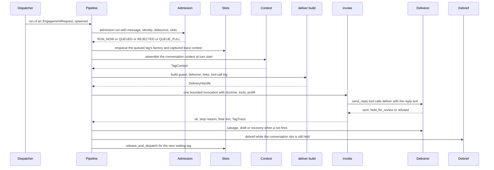
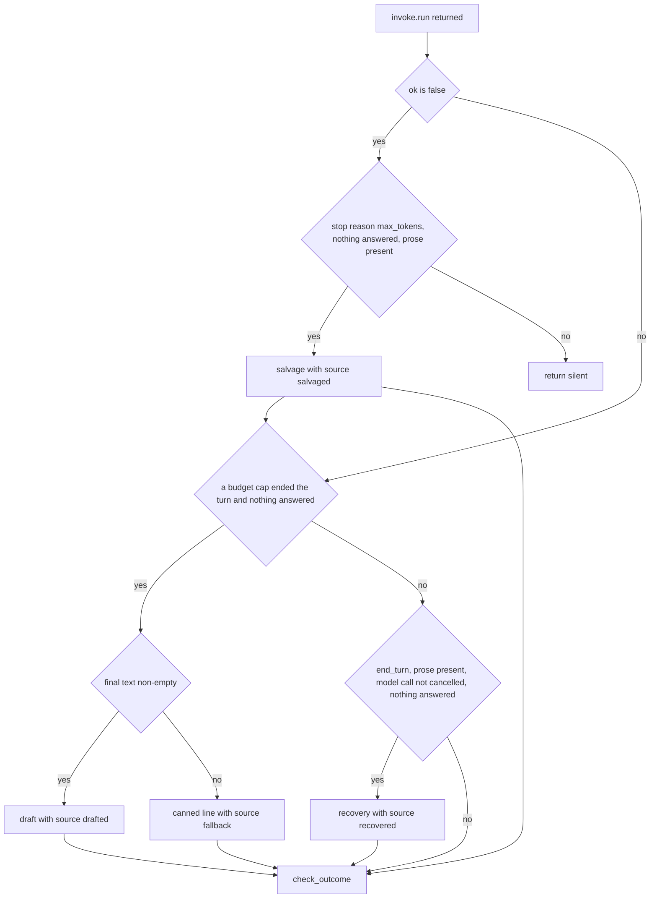

# The engagement turn

A **tag turn** is Nora answering a message that addressed her. `nora.ingest`
([Ingestion](ingestion.md)) has already decided *whether* to engage; this workflow decides *how*: it
admits the tag, assembles the context, runs one bounded model turn whose only way to speak is a tool,
records what happened, and hands the finished exchange to a fold that revises her position in the
conversation.

The entry point is `Dispatcher.on_message` (`nora/app/dispatch.py`): ingest runs inline, and a tag
that clears the engage gate becomes an `EngagementRequest` (message, `EngageDecision`, `tag_id`,
`occasion="tag"`) that is **spawned, never awaited**, into `EngagementPipeline.run`. A model call can
take seconds or hang, so nothing on the listener's path waits for it, and admission belongs to the
pipeline rather than to the dispatcher — two rapid events racing each other resolve inside
`EngagementPipeline.run`.

`EngagementPipeline` describes itself as "a readable table of contents, not a decision-maker"
(`nora/engagement/pipeline.py`): every branch belongs to the stage that owns it
(`nora/engagement/stages/*`), or to a collaborator it delegates straight to (`DoctrineStore.get`,
`nora.agent.registry.ToolRegistry.build`/`surface`).



*One tag turn in order: admission first, context at turn start, one bounded invocation, delivery only through `Deliverer`, then the fold — with the slot released last.*

## Admission: four verdicts before a model exists

`nora.engagement.stages.admission.run` is a **pure decision function** — no I/O, no await — that
returns one of four verdicts:

| verdict | condition | who owns what next |
|---|---|---|
| `RUN_NOW` | no turn in flight for this conversation | this stage has already called `slots.acquire(key)`; the caller owns the matching release |
| `QUEUED` | a turn is in flight and the queue is below `maxlen` | the pipeline enqueues; the verdict does **not** acquire |
| `QUEUE_FULL` | the conversation's queue is already at `maxlen` | refused as a flood, `nora_tags_dropped_total{reason="queue_full"}`, no reaction, no lock |
| `REJECTED` | `sender_id` is one of Nora's own aliases (R-12) or the debounce window refuses it (R-9) | dropped silently; neither is a person waiting for an answer |

The check order is fixed: self-tag, then debounce, then in-flight/queue depth, then acquire. Two
details are load-bearing:

- **R-12 tests membership in `identity.aliases`, not equality with one id.** signal-cli may deliver
  the same account as `source`, `sourceNumber` or a UUID, and Telegram has both a number and a
  username; equality against one form would stop recognising her own messages the moment another
  form or another platform is wired. The pipeline resolves the identity *before* admission via
  `adapter.resolve_identity()` — memoized after the adapter's first call, and already forced to
  succeed once at startup — so admission itself does no I/O.
- **The debounce write is fire-and-forget for this reason.** `Debounce.allow` may not await, because
  the `QUEUED` verdict and the enqueue that follows it must have no await between them; otherwise two
  concurrent tags read the same queue depth and FIFO order stops being arrival order.

The reaction (👀) is fired at admission, for both `RUN_NOW` and `QUEUED` tags, and never for
`REJECTED`/`QUEUE_FULL`: a person queued behind two others sees they were *seen* while they wait, and
a 👀 on a dropped flood tag would be a progress marker that never resolves. `indicate.begin` only
spawns, so it adds no latency, and `engagement.reactions.enabled = false` leaves the handle `None`
rather than branching again in the turn's `finally`.

A platform with no wired adapter is a hard `KeyError`, not a fallback: delivering into the wrong
group is the wrong answer made public, so it fails loudly instead (`_adapter_for`).

## The slot and the queue: one conversation, one turn

`ConversationSlots` (`nora/engagement/slots.py`) is R-10's single-in-flight lock and R-30's
per-conversation FIFO queue as **one injected collaborator**, because the heartbeat fire path
(`nora.app.heartbeat` / `nora.app.fire`) must contend for the *same* slot: a reminder may not run
while a tag is in flight for that conversation, and a tag may not start while a reminder is firing.
It is built once in the composition root with `maxlen = [engagement.queue] max_depth` and handed to
every path that may speak into a conversation; two instances would be two locks and no serialisation
at all. The heartbeat's fire path takes the *same* slot with `try_acquire` — never queued, never waited
on — so a due reminder that cannot get the slot leaves its row `PENDING` and is found again on the next
tick, while a tag arriving during a fire turn queues as usual.

**Lock ownership is split across two modules on purpose** — documented on both halves so a reader
landing on either sees the whole contract:

- `admission.run` **acquires**, and only on `RUN_NOW`. Nothing in that module ever releases, and
  `QUEUED` does not acquire: the conversation's lock already belongs to the running turn, and
  stealing it would let two turns reason from a room each is missing the other's reply.
- The turn's own `finally` (`EngagementPipeline._run_turn`) **releases** via
  `slots.release_and_dispatch(key)`, and the release block is opened only once admission has returned
  a verdict that runs the tag.

That ordering is the invariant, not a style: `admission.run` is called **outside** the
`try/finally` that owns the key, and the block opens only for an admitted tag. If the release wrapped
the admission call too, a **rejected** tag would release the key on its way out — and in the
in-flight case that key belongs to a *different, still-running* tag, so releasing it would take that
other tag's lock out from under it. `tests/unit/test_engagement_pipeline.py` pins both
`test_a_debounced_tag_is_never_admitted_and_never_releases_a_lock` and
`test_a_self_tag_is_refused_and_admission_never_runs_the_pipeline`.

**`release_and_dispatch` is deliberately one call rather than the two statements it replaced**, and
both halves are synchronous with no await between them:

1. `discard` the key from the in-flight set;
2. dequeue the front of that conversation's queue, re-add the key, and `spawn` the factory.

A release that forgot to dispatch would strand whatever queued behind this turn until the next tag
arrived — and that arriving tag would then jump the queue. Because there is no await in the gap, no
incoming tag can slip into the `RUN_NOW` path between releasing and re-acquiring. This runs on
**every** exit path, so a turn that timed out or crashed still lets the people behind it be answered.

The queue itself (`nora/engagement/queue.py`) is per-conversation and self-draining: an entry is
deleted the moment its last waiting tag is dequeued, so a quiet conversation retains nothing. It is
bounded against a flood, not against waiting — a person answering three group messages takes over a
minute, so a tag waiting 45 s is normal and there is deliberately **no staleness rule**. When the
queue is full, the *newest* tag is shed so everything already accepted keeps its place in line.

Two consequences follow from serialising a conversation, and both are the reason the queue exists:

- **Each turn's context is assembled at DEQUEUE time**, not at arrival, so tag 2 sees tag 1's reply
  already in the transcript. Two concurrent turns for one conversation would reason from a room
  missing the other's reply and could re-answer or contradict each other.
- **Nothing per-tag is carried except the work and the trace context.** `enqueue` takes a
  zero-argument factory, so the pipeline closes over its own request and 👀 handle and the slots
  object never holds a reference back into the pipeline. Identity is re-resolved at dequeue (memoized,
  in-process) rather than stored, and nothing is created until the slot actually frees — a queued tag
  holds no coroutine object either.

## Context, doctrine and the tool surface

Inside the turn's body (`_run_turn`), the order is fixed and each step's output is the next step's
input:

1. **`bind_tag_id(tag_id)`** — every log line for the rest of the tag carries the id through the
   contextvar bridge in `nora.obs.logging`, without any stage naming it.
2. **`context_assembler.assemble(request=request)`** returns the `TagContext`. A transcript read
   failure logs, counts `nora_errors_total{stage="context"}` and continues with an empty transcript
   rather than raising; an unmapped sender yields `tagger=None` with no Honcho call at all. The block
   table and the prompt it becomes are owned by [Context assembly](../concepts/context-assembly.md).
3. **Mention rehydration** (`MentionRenderer.rehydrate`): an @-mention arrives as a U+FFFC placeholder
   plus a parallel array, and left alone every name in the transcript — including Nora's own — would
   reach the model as that placeholder (DEC-34). It is rehydrated here, against `raw_json`, rather
   than at ingest (the audit stores what arrived) or in the prefill (which may not import
   `nora.platform`).
4. **`doctrine_store.get(applies_to="tag")`** selects the doctrine text and its `sha256`, which later
   labels the invoke span and every audit row this turn writes.
5. **The policy read** (`self._policy.conversation(platform, conversation_id)`) yields this room's
   MCP allowlist and its location-disclosure trust. The allowlist is computed **before**
   `deliver.build` and reused for its `budgets=`, because `ToolRegistry.budgets()` only folds an MCP
   tool's budget in when its server is in `allowed_mcp`; a guard built from a different set could
   disclose a tool name the conversation cannot call. A `None` conversation here means the ingest and
   engagement pipelines disagree about which `Policy` they were given — a wiring bug defaulted safely
   to an empty allowlist rather than crashing the tag.
6. **`deliver.build(...)`** returns the `DeliveryHandle`: the `Deliverer` (`send_reply`'s
   destination), the `ReplyGuard` (the agent's hook), the shared `LinkCarry`, the `ToolCallLog` and
   the `ReasoningStripWatch`. One carrier is minted here because this is the only place both of its
   users are in scope; reaching for `handle.deliverer.links` instead would let a caller wire the
   tools to one carrier and the sender to another, shipping the feature inert (DEC-89).
7. **`Room`** — one per tag, constructed from the assembled context (not from config) and closed over
   by the room-scoped tools. The platform roster is read lazily, at most once, only if one of those
   tools is actually called. A missing roster *source* for a platform degrades to `UNAVAILABLE`
   rather than raising — being blind and saying so is allowed, delivering to the wrong platform is
   not.
8. **`ToolRegistry.surface(...)`** builds the tool set, hooks, catalogue and loop limits for this
   turn: deferral (`[llm] defer_tools`, plus `hot_on` tools for a voice message), the transcript rows
   the model is shown, the deeper lookup window for `who_said` only, and the allowlist/location trust
   from step 5. What is admitted, shelved or budgeted is owned by
   [the tool surface](../concepts/tool-surface.md).
9. **`build_prefill` + `build_tag_message`** produce the three deterministic prefill messages and the
   invocation prompt. The clock line uses the pipeline's injected clock — the same clock the `now`
   tool reads — so the line and the tool state one instant.

## The bounded invocation

`invoke.run` (`nora/engagement/stages/invoke.py`) makes exactly **one** attempt and returns
`(ok, elapsed, stop_reason, final_text, trace)`. `ok` is `False` on a timeout or any other exception,
and on that path the caller must not proceed to delivery.

| what happened | result | counted |
|---|---|---|
| the loop returned | `ok=True`, `stop_reason` names how it ended (`end_turn`, `limit_turns`, `limit_total_tokens`, `limit_output_tokens`) | `nora_llm_stop_reason_total{reason,audience}` |
| `asyncio.wait_for` timed out | `ok=False`, `stop_reason=None`, blank trace with `outcome="timeout"` | `nora_silent_failures_total{reason="invocation_timeout"}` |
| `PartialReplyError` (a `max_tokens` cut-off carrying prose) | `ok=False`, `stop_reason="max_tokens"`, `final_text=partial text` | no silent-failure increment; the caller may salvage |
| any other exception | `ok=False`, `stop_reason=None`, blank trace with `outcome="llm_error"` | `nora_silent_failures_total{reason="llm_error"}` |

`stop_reason is None` therefore means "the invocation did not complete" and nothing else: there is no
loop outcome to report when the loop was abandoned. `nora_llm_latency_seconds` is observed in a
`finally` on every path, and its one clock read is reused by the pipeline for
`nora_overhead_seconds`, so the two series cannot drift.

The timeout is enforced twice from one number: `asyncio.wait_for(..., timeout=timeout_seconds)` bounds
the invocation, and `turn_deadline(timeout_seconds)` publishes the same budget to every tool the turn
runs, so a tool that spends wall clock on its own model call (the vision describer) can see how much
of it is left. Every series here takes a **required** `audience` keyword with no default: an omitted
one would record `audience=""`, which the runbook filter `audience="tag"` excludes silently.

The runner has no access to the assembled transcript window, so `invoke.run` fills `trace.transcript`
from `ctx.transcript` — the one place that holds both. On the `ok=False` paths the runner never
returned, so a blank trace is built instead (`messages=()`), and those turns debrief from the
transcript alone. The `ReasoningStripWatch.flush()` runs **after** the `try/finally`, deliberately not
inside it: awaiting in a cancelled task's cleanup re-raises `CancelledError`, and a record of work
already done must never be the reason a turn ends differently. `flush` is bounded internally, which
matters because it runs with the conversation slot held.

The stage is wrapped in an `engagement.invoke` span annotated with `nora.invoke_ok` and
`nora.stop_reason`, so what this stage decided lands on the invoke span while the turn's own copy of
those facts is annotated separately on the turn span.

## Delivery is explicit: the reply is a tool call

Nora's reply leaves through a tool, not through the model's final message. Three mechanisms make
that true, and each needs the others:

- `tool_choice="required"` on the turn's first model call (`nora/agent/tool_choice.py`), so the
  model reaches for a tool instead of writing prose into a `text` block where nobody reads it. Under
  `auto` on the first call the model simply answers in prose — R-5's silent shape.
- `ReplyGuard._before_model` **cancels** every model call after the terminal budget is spent, and
  relaxes `tool_choice` to `auto` once a terminal verb has run. Without the cancel the loop cannot
  terminate under `required`; with it, **nothing in her own loop runs after the reply**, which is why
  the post-turn fold needs a second model rather than being a reflection step.
- `send_reply(text, reply_to, more, heads_up)` is the terminal verb whose only job is
  `deliverer.deliver(clean, source="tool", ...)`. Its docstring states the rule to the model: "This
  and `send_gif` are the ONLY way a reply reaches the room… Do not return the reply as your final
  message instead." It answers `sent`, `held_for_review` or `refused`, and a landed `send_reply`
  ends the turn unless `more` or `heads_up` is set.

**`Deliverer` is the only caller of `adapter.send`**, and it is constructed in exactly one place,
`deliver.build`. `tests/architecture/test_only_two_paths_can_send.py` pins all three links on the AST
— the sender module, the construction site, and the set of `deliver.build` callers (the tag pipeline,
the fire path, the public summons and the one-time code) — because every guard that stands between a
model and the wire lives inside `Deliverer.deliver`: R-2's latch, R-4's empty-reply check, R-6's leak
scan, R-18's egress scan and A9's audit-first write. A direct `adapter.send` elsewhere would bypass
all five at once.

### What the sender latches

The `Deliverer` counts **attempts, not successes** (R-2): a failed or refused send still consumes one
of the message cap, because there is no auto-retry and a second attempt would be an unbounded loop.
`message_cap` and `ReplyGuard`'s R-7 budget are the *same number*, threaded from the same
`budgets["send_reply"]` mapping, because R-7's check runs before R-2's latch and two numbers that
disagree would resolve silently in favour of the smaller one.

| latch | means | read by |
|---|---|---|
| `_attempts` / `exhausted` | messages *spent*: sent, refused or failed in flight | R-2's latch, `ReplyGuard` |
| `_send_calls` / `called` | `deliver` was **entered** at all | `check_outcome`, the outcome partition |
| `_delivered_count` / `delivered` | messages that reached the room | `check_outcome`, `nora_messages_per_tag` |
| `_last_outcome` | why the last `deliver` answered as it did | `check_outcome`'s span attributes |
| `_sent_texts` | every message actually sent, in order | the Honcho feedback stage |
| `_held_texts` | what the participation cooldown held | the shadow mirror, never the room |

`deliver` is **audit-first**: it builds a `PENDING` row and appends it, then calls `adapter.send`,
then writes the outcome (`SENT`/`FAILED`, with the platform's timestamp). An audit failure refuses the
send and counts `audit_write_failed`, so a message that would be invisible in the transcript is never
delivered. In order, a single `deliver` call:

1. checks the latch (R-2);
2. refuses an empty reply (R-4) — before anything can rescue it, including a link;
3. applies the links this turn earned and scrubs ones the room does not get (DEC-89), *before* the
   render so `render_markdown` is called once;
4. converts the Markdown (`render_markdown`) into text plus style ranges;
5. scans **both** the rendered and the drafted form for a doctrine leak (R-6) and for egress (R-18) —
   no form is a superset of the other, because removing `*` can both reveal a broken-up doctrine span
   and destroy an identifier's word boundary (`"*+85298765432*a"` scans clean once the asterisks are
   gone);
6. spends one of the cap, composes the wire form (`OutboundComposer`, which owns the final text and
   is the only place allowed to answer what decoration rides with it), audits, sends, records;
7. on success, appends the sent text (except the canned fallback) and notifies the 👀 settler so the
   ✅ appears the instant the reply lands rather than one model round trip later (DEC-83).

Decoration never fails a message: a composer that raises degrades to plain text, and an unresolvable
@-mention drops to plain text rather than sending a range that would tag the wrong person. The outbound
offset rules — why the mention ranges are computed last, over the exact bytes the platform receives —
are in `nora/agent/outbound.py`, pinned by
`tests/architecture/test_outbound_offsets_are_computed_last.py`.

`send_reply`'s default budget is 3 and the verb is terminal, so a multi-message turn is allowed — but
only when she passes `more` or `heads_up`, because a landed `send_reply` without either closes the
turn. The guard's budget check (R-7) runs before the sender's latch (R-2), and both read the same
number, so the refusal cannot be reported under the wrong rule; `_terminal_budget_spent` is what ends
a turn at the cap, and at a budget of 1 it collapses into "a terminal verb has run".

## Did anything reach the room?

`deliver.check_outcome` is the post-invocation check and returns `True` iff a reply was actually
delivered. When nothing was delivered it distinguishes two very different turns by reading the latch:

- `deliverer.called` is **False** → she never called the tool. Counted
  `nora_silent_failures_total{reason="no_send_call"}`, **unless** `stop_reason` is one of the R-8 caps
  (`limit_turns`, `limit_total_tokens`, `limit_output_tokens`), in which case the label names the cap.
  This is R-23: a loop Strands terminated returns *normally*, with no exception and no warning, so
  without the stop reason the most likely cause of a silent turn would look byte-for-byte like the
  most benign one. `stop_reason` is required with no default so a new call site cannot quietly always
  say `no_send_call`.
- `called` is **True** → she tried and a guard (or the platform) stopped every attempt. Nothing extra
  is counted here; the refusal was already counted by name (`empty_reply`, `doctrine_leak`,
  `egress_block`, `audit_write_failed`, `send_failed`). Counting `no_send_call` on top would be a
  second, false increment for one turn.

`attempted` is deliberately not the predicate: it asks whether a message *reached the platform*, so
every guard-refused turn answers `False` there.

## Outcome recording and the visible resolution

The pipeline computes the turn's disposition from state that already exists, in one place:

```
real_outcome = ("recovered" if recovered_delivered else "send_reply") if delivered
               else ("vetoed" if handle.deliverer.called else "silent")
trace = dataclasses.replace(trace, outcome=real_outcome)
```

The vocabulary and the meaning of each label are owned by
[the status and failure contract](../architecture/failure-and-status-contract.md); what this workflow
contributes is *where* the fold happens and what it drives:

- **The shared decision log** is written after `real_outcome` is known and **before** the
  `not delivered` return, so a turn that said nothing is logged as loudly as one that replied. Three
  verdicts, not two: `replied`, `silent`, `failed` (with `reason` carrying the finer label). `failed`
  for a deliberate silence would be a mislabel of R-5 and would make a later decider read a working
  turn as a broken one. The write is **awaited inline**, not spawned: a spawned write would not be
  ordered before the next turn's read, which is the whole property (rows are written at turn
  completion).
- **The 👀 is resolved in the `finally`** on every exit path — timeout, `llm_error`, guard veto,
  `no_send_call`, and the outer `BaseException` — into ✅ or ⚠️. A resolution reachable only from the
  happy path would strand the 👀 on exactly the failures it exists to make legible, and ⚠️ is used
  rather than ✅ because a false ✅ is confidently wrong about a reply that is not coming.
- **The turn's own span** gets `nora.outcome`, `nora.delivered`, `nora.stop_reason`, `nora.messages`,
  `nora.latency_seconds` and `nora.llm_seconds`, and `nora_engagement_outcomes_total{outcome,
  audience="tag"}` is incremented unconditionally — unlike `nora_tagtrace_writes_total`, it does not
  ride on the retention store being wired, because "what did the turn end as" must not go dark because
  retention did. `_outcome_label` is the one place the span attribute and the counter read their value
  from, and it raises at runtime if `TagTrace` grows an outcome this module has not folded in.
- **Truncation is its own observable.** A turn that sent *some* of its messages and then stopped looks
  successful everywhere else — `delivered` is True, `check_outcome` returns True, the 👀 resolves ✅,
  the memory feed runs, and `nora_silent_failures_total` stays flat. `deliver.truncation_reason` takes
  `stop_reason` and `completed` (they answer different halves: a cap the loop returned from normally,
  versus a turn that never reached the end of its `try`) and the `finally` counts
  `nora_partial_replies_total{reason}` whenever at least one message went out. The reason names the cap
  (`limit_turns`, `limit_total_tokens`, `limit_output_tokens`), `invocation_failed` when the invocation
  itself never returned, or `pipeline_error` when the turn stopped short of its end.
- **Latency and fan-out**: `nora_tag_latency_seconds` and `nora_overhead_seconds` (total minus the
  model call) are observed from one number; `nora_messages_per_tag` observes `delivered_count`, with
  `0` for a silent turn so the series always has one observation per admitted tag.

Then, when something *was* delivered and the tagger is mapped, the Honcho feedback stage is spawned
(`feedback.run`): **Nora's own replies only, under the Nora aiPeer**, into this conversation's session.
A peer's stream holds one speaker's words, so the human side is fed by ingest's ambient memory feed and
never here; the canned fallback is excluded by `Deliverer` (`source != "fallback"`) because nobody
composed it, while a drafted or recovered sentence *is* her own and is fed.

## The three nets, and which one bends the rule

Three recovery paths exist because a reply can fail to reach the room *after* the model produced it.
They share one gate, `_nothing_answered(handle)`, which is true when nothing was delivered **or** when
only a heads-up was and its answer is still owed (`ReplyGuard.reply_still_owed`, DEC-294 — the guard's
own flag, because "a `more=true` send, then work" cannot tell a heads-up from an answer followed by a
note). Gating on delivery alone would drop an answer she then wrote as prose, or a turn cut off
mid-work, while the turn read as `replied`.



*Which net fires, in the order the pipeline tests them. All three are gated on `_nothing_answered` and all three are skipped for the participation occasion.*

| net | trigger | delivered as | what it is |
|---|---|---|---|
| **salvage** (`source="salvaged"`) | `stop_reason == "max_tokens"`, nothing answered, non-empty `final_text` | the partial message Strands appended before raising, carried up as `PartialReplyError` | the model's own words, written but dropped by the harness |
| **cut-off fallback** (`source="drafted"`, else `source="fallback"`) | a `BUDGET_STOP_REASONS` cap ended the loop with nothing answered | `final_text` — either prose the cut-off left, or the drafting call `factory.draft_from_exhausted_loop` makes over the context she had already gathered — else `_EXHAUSTED_FALLBACK` | her own drafted sentence, or the one canned apology |
| **recovery** (DEC-93, `source="recovered"`) | `stop_reason == "end_turn"`, non-empty `final_text`, `not guard.cancelled_model_call`, nothing answered | the words she wrote as prose without calling `send_reply` | her own sentence that took the wrong exit |

**Only the canned fallback bends the "she sends only what `send_reply` sent" rule**, and the reason is
that the alternative is a void the group reads as being ignored: a weak model that keeps flailing on a
hard query hits a cap repeatedly, so `_EXHAUSTED_FALLBACK` is one short, generic, identifier-free line
in her register (a non-Cantonese clone would override it). Every other net delivers words she actually
wrote, so it is not a forgery and it flows through `deliver`, which means R-4/R-6/R-18, the Markdown
conversion, the link carry and the audit row apply exactly as they would have. Ordering enforces the
preference: the fallback branch is checked before recovery, so a cut-off turn never ends as
`recovered`.

Each net has its own counter, and their readings are diagnostic rather than reassuring:
`nora_salvaged_replies_total{platform}`, `nora_budget_drafts_delivered_total{reason}`,
`nora_loop_exhausted_fallbacks_total{reason}` and `nora_recovered_replies_total{platform}`. A rising
`recovered` share means the provider is accepting and ignoring `tool_choice="required"`, not that the
safety net is working; a rising fallback share means turns are being cut off before they can answer, and
a drafted delivery is still counted there (`nora_budget_drafts_total{outcome}` records whether the
drafting call produced anything at all).

Four deliberate exclusions:

- **The `not ok` path has no never-silent fallback.** A timeout or a generic `llm_error` may already
  have sent messages (that is a partial delivery, counted as one), and that path carries DEC-42's
  partial-reply accounting; delivering a fallback there would forge a "partial reply" the tests pin
  apart. A timeout is also already an infra failure on
  `nora_silent_failures_total{reason="invocation_timeout"}`.
- **A cancelled model call is refused.** The text such a turn ends with is `ReplyGuard`'s veto string,
  not her words, and that string passes R-6 and R-18 trivially; `guard.cancelled_model_call` is the
  one place that knows (`test_a_guard_cancelled_turn_never_delivers_the_guards_own_veto_string`).
- **A plain `end_turn` with no send is a silence she is allowed** (strict-silence, R-4/R-2) and stays
  silent — recovery needs prose to deliver.
- **All three are occasion-gated off for `request.occasion == "participation"`
  ([Participation](participation.md))**: there, no grounded value is silence, and a salvaged or
  recovered draft would speak words she concluded without the tool.

A successful salvage deliberately does **not** return early and does not set `delivered` locally: the
turn flows on to `check_outcome`, which reads `deliverer.delivered` (now True), corrects the trace,
feeds Honcho and marks the turn completed — the same accounting a normal delivery gets. A refused
salvage returns silently, exactly like the generic failure paths.

## The post-turn fold

After the turn's disposition is known, the finished exchange is handed to the `debrief` stage — a
**second** model reading the whole turn, including its outcome, and revising the room's `Standing`.
What that fold writes and how it is screened belongs to
[Contextual learning](../concepts/contextual-learning.md); what matters here is its placement, which
is in the turn's `finally` and load-bearing four ways:

1. **In the `finally`, not at the end of the `try`**, so it runs on every completed turn. Three of the
   five exit paths — `not ok` (timeout/`llm_error`), `not delivered` (an R-5 silence or a guard veto),
   and the outer `except` — leave the `try` before `completed` is ever set. A fold hung off the happy
   path would review only the turns that already work, and a deliberate silence is the decision most
   likely to be wrong in a way nobody complains about.
2. **Before `release_and_dispatch`, so it holds the slot.** That is what makes it a stage rather than a
   background job, and it is why its cost lands on the *second* person queued behind a busy
   conversation rather than on the person it is reviewing, who already has their reply. The worst case
   is asserted at startup by `Config._the_standing_slot_hold_fits_its_budget`, from
   `[standing] timeout_seconds` + `store_timeout_seconds` × `STANDING_STORE_CALLS_PER_FOLD` against
   `[standing] max_slot_hold_seconds`; the pipeline deliberately does not restate that arithmetic.
3. **`completed` is already final** by the time it runs, so an escape here cannot make
   `truncation_reason` report a partial reply — and a false `nora_partial_replies_total` — on a turn
   that sent a complete one.
4. **It cannot be allowed to raise.** `debrief.run` never raises by construction (one `try` whose
   `except` is `BaseException`), and the call still sits in its own `try/except BaseException/finally`
   because an exception inside a `finally` skips the *rest* of it — and the next statement is the one
   that releases the lock and dispatches the queue. A fault here would wedge a conversation forever
   with no error anywhere, or crash past the outer handler into everything that awaits or spawned this
   tag.

Two guards decide whether it runs at all, and they are different questions: **no wiring**
(`[standing] enabled = false`, the shipped default, and every offline/eval composition) returns
without awaiting anything, so the slot is held no longer than before the stage existed; **no trace**
means `invoke.run` never returned, or the outer handler cleared a crashed turn's placeholder — and
reviewing a turn under a label that is a guess is worse than not reviewing it, because the fold would
write that guess into a row injected into every later turn. `now_ms` is stamped at the call site, so
the clock belongs to the caller that knows when the work happened. The stage opens its own
`engagement.debrief` span, because Strands instruments the agent loop and the debrief's own model call
is not in it.

Retaining the raw `TagTrace` is a separate, unconditional step — deliberately **not** gated on
"something was sent and the tagger is mapped" the way the Honcho feed is, because a silent, vetoed or
timed-out turn still produces reasoning worth retaining. The save is **spawned**, never awaited, so a
down retention store cannot take down an otherwise successful turn and the write never delays
`release_and_dispatch`; `nora_tagtrace_writes_total{outcome}` is incremented beside the spawn, because
what that series answers is "did the recording layer get handed a trace".

## One trace per tag, across the queue

A rootless span *is* a trace, so a tag opening three spans without a parent would produce three
engagement traces plus ingest's. `run` opens a root named `engagement`, carrying `nora.tag_id`,
`nora.platform` and `nora.conversation_id`, and declares `nora.trace_kind = "generation"` — the
declaration that keeps the trace. It is declared on the **entry point**, not on the run that happened
to reach the model: a tag refused at admission never gets there, and its trace is exactly the one
that must say "it was rejected" rather than being an unexplained stub
(`test_a_rejected_tag_leaves_a_trace_that_says_it_was_rejected`).

The root cannot simply wrap the work, because for a queued tag the work does not happen here: a
`RUN_NOW` tag is awaited inside `run`, while a `QUEUED` tag runs later on a task that
`release_and_dispatch` spawns. So:

- `engagement.turn` is opened in `_run_admitted`, *inside* the work. The root is already closed when a
  queued tag gets there, and an attribute set on an ended span is silently dropped by the OTel SDK —
  so the outcome, stop reason and latency the turn only learns in its `finally` need a span that is
  still open. Opening it here also makes the two admission paths render identically: the only
  difference in a trace viewer is the gap before `engagement.turn` starts, which is the queue wait.
- **The trace context is captured at admission** (`capture_context`) and **re-attached where the tag
  runs** (`attached(carrier)` in `_run_queued`), so a queued turn's spans land in the trace that
  admitted it. The alternative is not neutral: `asyncio.create_task` copies contextvars, and OTel's
  context is a contextvar, so the spawn happens in the *previous* turn's `finally`, inside that turn's
  own span — an un-attached queued tag would be filed under the tag ahead of it in the queue, asserting
  a causal relation between two people's messages that does not exist. `attached` **replaces** the
  inherited context rather than adding to it, and a capture that failed attaches an empty context: a
  trace of its own, never someone else's.

Nothing in the span layer may raise, and that constraint belongs to this pipeline rather than to the
tracer: `release_and_dispatch` runs in a `finally` *past* the outer `except BaseException`, so an
exception from an observation would skip the lock release and wedge the conversation. `span`,
`annotate`, `capture_context` and `attached` are each guarded on acquisition *and* on exit for exactly
this call site. How spans then leave the process — the parent-based sampler, and the two collector
pipelines this repo cannot see — is owned by
[Observability](../operations/observability.md).

## How a turn ends silent

Silence is a first-class ending here, not a missing one. The turn's `finally` converges every path, so
all of them record an outcome, resolve the 👀 and release the slot.

| exit path | outcome | recorded as | what the group sees |
|---|---|---|---|
| she called `send_reply` and it landed | `send_reply` | `replied` in the decision log, `nora_replies_total{status="sent"}` | the reply, and ✅ |
| a net delivered her own words | `recovered` (or `send_reply` for the fallback) | `replied` | the reply, and ✅ |
| `end_turn` with no send call | `silent` | `nora_silent_failures_total{reason="no_send_call"}`, verdict `silent` | ⚠️ and nothing else |
| every `send_reply` refused by a guard or the platform | `vetoed` | the guard's own reason, verdict `failed` | ⚠️ and nothing else |
| timeout or `llm_error` | `timeout` / `llm_error` (from `invoke.run`'s blank trace) | `nora_silent_failures_total{reason=...}`, verdict `failed` | ⚠️, and a partial count if messages had already gone out |
| a fault anywhere else, including cancellation | none — the trace is discarded | `nora_silent_failures_total{reason="handler_error", audience="tag"}`, verdict `failed` | ⚠️ |
| refused at admission | no turn at all — only the `engagement` root and its `engagement.admission` child | `nora_tags_debounced_total` for a debounce; a self-tag only logs; `nora_tags_dropped_total{reason="queue_full"}` for a flood | nothing at all — no 👀 |

The outer handler is `except BaseException`, not `except Exception`, and that is what makes the silence
guarantee unconditional: it absorbs faults that are not `Exception` at all (`asyncio.CancelledError`),
which would otherwise propagate out of `run` and crash whatever spawned the tag — an outage far wider
than one tag — *and* it is the only way `handler_error` gets counted. `finally` runs either way, so the
key is released regardless.

A crashed turn deliberately **drops its trace** (`trace = None`) even though it may already hold one:
a fault inside a net's delivery, the recovery delivery, or `check_outcome` lands in this handler having
reached `invoke.run`'s return but never the outcome correction, so the unconditional save would
persist a still-placeholder `"send_reply"` — retaining a turn that crashed and delivered nothing as if
it had succeeded. A wrong label is worse than no label, so this turn joins the "fault before
`invoke.run` ever returned" case: no attributable trace, no save.

One distinction is easy to lose and matters to an operator: on the tag path a deliberate silence is
still a *silent failure*, because somebody addressed her and «I chose not to speak» and «the loop was
cut off» would otherwise be byte-for-byte identical. That is not the participation occasion's rule,
where silence is the healthy default and is counted on a different series — see
[the status and failure contract](../architecture/failure-and-status-contract.md).

## Configuration and extension points

| key | effect on this workflow |
|---|---|
| `[engagement.reactions] enabled` | whether the 👀/✅/⚠️ progress reaction is placed at all |
| `[engagement.queue] max_depth` | `ConversationSlots.maxlen`; the depth at which an arriving tag is shed as a flood |
| `[engagement.trigger] min_interval_seconds` | R-9's debounce window |
| `[llm] timeout_seconds` | the whole invocation's `wait_for`, published to tools as `turn_deadline` |
| `[llm] defer_tools`, `[llm.budgets] send_reply` | the surface's shelf and the one message cap shared by R-7 and R-2 |
| `[store] context_window`, `prompt_window` | the transcript depth read, and how much of it the prompt shows |
| `[standing] enabled`, `model`, `timeout_seconds`, `store_timeout_seconds`, `max_slot_hold_seconds` | whether the fold runs, which model it uses, and the bound on the slot it holds |

Extension seams, all optional and all inert when unwired rather than silently half-wired:

- **A stage is a module** under `nora/engagement/stages/` with a narrow entry point
  (`admission.run`, `invoke.run`, `deliver.build`/`check_outcome`, `indicate.begin`/`resolve`,
  `debrief.run`, `feedback.run`); the pipeline sequences them and owns nothing they decide.
- **`ConversationSlots` is injected**, because the heartbeat fire path must hold the same instance.
- **`debrief.Wiring` is one object rather than four optional parameters**, so a deployment cannot wire
  the store and forget the model client and then report nothing.
- **Optional collaborators default to inert**: `tag_trace_store`, `tool_call_log_store`,
  `reasoning_strip_store`, `preview_source`, rosters and `decisions` are all `None` in offline/eval
  compositions, and `None` means "this process never built it", never "the feature is off by accident".
  `None` is a real production-shaped state for rosters (`nora.app.offline` has no daemon to ask), which
  is why `Room` reports an absent source as `UNAVAILABLE` rather than as an empty room.
- **Faking the model means injecting an `AgentRunner`**, never an `_invoke_fn` hook: the real runner
  wraps the already-built client and provider, created once at process start, never per tag.

## Focused tests

| test | what it holds |
|---|---|
| `tests/unit/test_engagement_admission.py` | the four verdicts, self-tag by any alias, debounce, queue-not-drop, flood shed at the bound |
| `tests/unit/test_conversation_slots.py` | release dispatches the next factory and re-acquires; an empty queue leaves the slot free; nothing retained once drained |
| `tests/unit/test_engagement_pipeline.py` | FIFO order for one conversation, a queued tag seeing the earlier reply, different conversations running concurrently, a rejected tag never releasing a lock, every net, every exit path's outcome and counters, the 👀 on every path, one trace per tag, the queued tag landing in the trace that admitted it |
| `tests/architecture/test_only_two_paths_can_send.py` | `Deliverer` is the only `adapter.send` caller, constructed only in `deliver.build`, whose callers are the named sending paths |
| `tests/architecture/test_outbound_offsets_are_computed_last.py` | the value handed to `adapter.send` is an attribute of the compose result, and the guards measure what is composed |
| `tests/architecture/test_slot_held_awaits_are_bounded.py` | every store await inside a held slot is bounded, so a wedged store cannot skip `release_and_dispatch` |
| `tests/architecture/test_no_retained_per_tag_state.py` | neither the queue nor the pipeline retains per-tag state after a turn |
| `tests/test_span_skeleton.py` | the spans are exported, and an observation never changes control flow |
