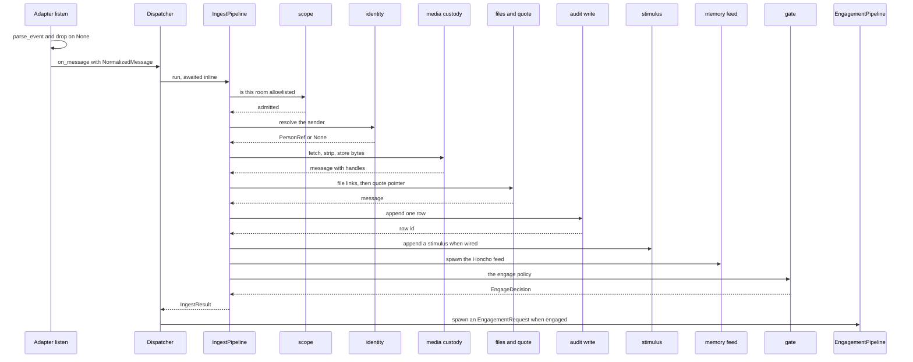
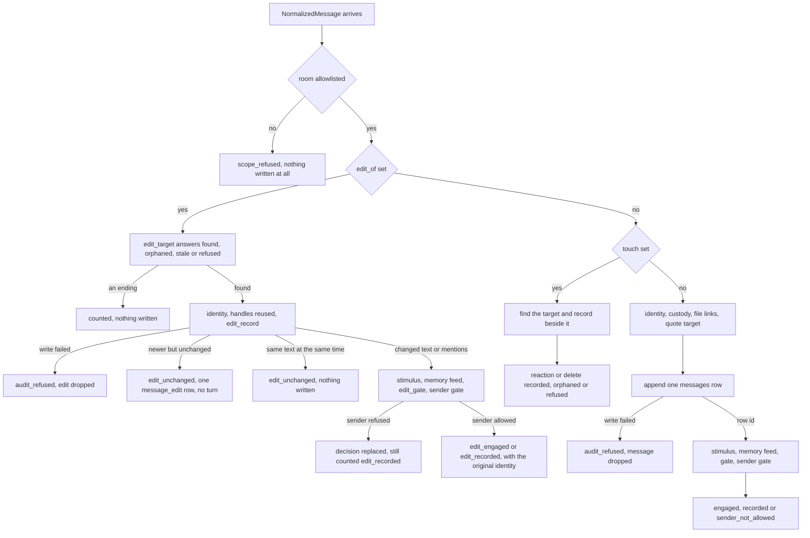

# Ingestion

**Ingestion** is everything Nora does with a message before anything decides to answer it. It is
deterministic, it constructs no agent, and it is the highest-volume entry point in the system: every
message in every room Nora watches walks it, including the large majority she was never going to
reply to.

Two things come out of it, and only two:

1. a **recorded observation** — a row in the Record (SQLite/Postgres via `RecordStore`), with the
   sender resolved to a person, the body carrying durable handles for any bytes Nora took custody of,
   and shared file links resolved to refs; an edit's observation is a `message_edit` row beside the
   message it changes, never a message of its own;
2. a **durable stimulus** — one `stimulus` row per person-authored item, when the Cognition wiring is
   present, naming the Record row it was raised by. See [Cognition](cognition.md) for the consumer.

A third thing — an `EngageDecision` — is *not* a result of ingestion in any deep sense. It is an
answer to one question ("does this message address her?" — for an edit, asked of the edit *and* of the
version it replaced), it is produced by a pluggable policy, and it is the only value from the ambient
path that can cause a turn. Everything about the pipeline's shape follows from keeping that answer
cheap and keeping its consequences out of ingest.

The entry point is `Dispatcher.on_message` in `nora/app/dispatch.py`. The module docstring explains
why it lives in `nora.app` at all: `nora.ingest` and `nora.engagement` are siblings in the layers
contract and neither may import the other, so the thing that runs `IngestPipeline`, reads its
`EngageDecision`, and hands an admitted tag to `EngagementPipeline` cannot live in either package.
The dispatcher takes dependencies only, never `Config` — like `nora.app.runtime`.

## Parsing is the adapter's, and it happens before ingest

`IngestPipeline.run` takes an already-normalized `NormalizedMessage`. There is no generic parse step
inside `nora.ingest`, and that is a port decision, not an omission: `PlatformAdapter` deliberately has
no `parse()` method (`nora/domain/ports.py`'s module docstring), because forcing a Discord or Telegram
transport into a dict-of-unknown-shape would be a fiction.

So each adapter parses its own transport internally and **drops what parses to `None` before
`on_message` is ever called**:

- `SignalAdapter.listen` (`nora/platform/signal/adapter.py`) runs `parse_event` per raw envelope and
  drops a DM, a sync message, a self-send and an empty body;
- `WhatsAppAdapter.listen` (`nora/platform/whatsapp/adapter.py`) drops a non-message event, `from_me`,
  a broadcast JID and an empty turn.

The consequence matters for every later section: a message that reaches ingestion has already cleared
the R-12 "her own words" pass and the "was there anything said" pass. Ingest re-checks authorship
where it must (an edit of her message, an unattributed delete, the stimulus echo rule) but it never
has to re-do parsing. `tests/unit/test_ingest_pipeline.py` states this explicitly in its module
docstring, and the drop cases live in `tests/test_signal_adapter.py`.

`IngestPipeline.run` also opens the root span and increments `nora_messages_total` once per message
**and once per edit** — an edit is not a message, but it is a version of one; a reaction or a delete is
neither, and is counted only on `nora_ingest_outcomes_total` (`reaction_*`, `delete_*`)
(`nora/ingest/pipeline.py`).

## `Dispatcher.on_message`: three exits

`Dispatcher.on_message` is what a platform adapter's `listen()` loop calls per parsed message. Its
whole body is four decisions (comments abridged):

```python
result = await self._ingest.run(message=message)
if result.message is None or result.decision is None:
    return                                    # a refusal, or a branch that writes no messages
if not result.decision.engage:
    if result.decision.relevance_gate and self._participation is not None:
        self._participation.note_message(result.message)   # NOTED, never admitted
    return
request = EngagementRequest(
    message=result.message, decision=result.decision, tag_id=uuid.uuid4().hex,
)
self._background.spawn(self._engagement.run(request))
```

Three properties are load-bearing here:

- **Ingest is awaited inline.** It is deterministic and builds no `Agent` (R-1), so there is nothing
  on it worth moving off the listener's path.
- **Engagement is spawned, never awaited.** A model call can take seconds or hang. The `tag_id` is
  minted here, per admission, and `EngagementPipeline.run` owns admission itself (debounce, in-flight,
  self-tag) as its own first step, so two rapid events racing each other resolve inside that pipeline.
  See [The engagement turn](engagement-turn.md).
- **`engage=False` is not the same as "do nothing".** `EngageDecision.relevance_gate` marks an untagged
  message in a room the operator opted in (`relevance_gate = true` on its `[[conversations]]` entry,
  set by `RelevanceGateRoomPolicy` in `nora/ingest/policy.py`). The dispatcher only *notes* it with
  `ParticipationTrigger`; the quiescence window owns every later decision, and a resulting turn goes
  through `FirePath.speak`, never through `EngagementPipeline`. No `EngagementRequest` is built, no
  gate call happens yet, and an `engage=True` decision is the only thing that may mean "admitted to
  the tag path".

## The ordered stages

`IngestPipeline` is a "readable table of contents, not a decision-maker" (`nora/ingest/pipeline.py`):
every branch belongs to the stage that owns it, under `nora/ingest/stages/`. Each stage module has
exactly one public `async def run(...)` (`nora/ingest/stages/__init__.py`).



*The happy path for an ordinary message: the room gate first, custody before the record, the stimulus
right behind the row it names, and the turn spawned only after the gate.*

The order is fixed and each position was chosen against an alternative:

| # | stage (span) | module | what it decides | conditional on |
|---|---|---|---|---|
| 0 | `parse_event`, before the pipeline | `nora/platform/*/adapter.py` + `parser.py` | whether this event is a message at all | content/transport |
| 1 | `nora_messages_total` | `nora/ingest/pipeline.py` | — (a count, not a branch) | `message.touch is None`, so edits count and reactions/deletes do not |
| 2 | `ingest.scope` | `stages/scope.py` | is the room allowlisted; is a DM's sender in `identity.toml` | `policy.toml` |
| 3 | `ingest.edit_target` | `stages/edit_target.py` | found / `edit_orphaned` / `edit_stale` / `edit_refused` | `message.edit_of` (content) |
| 4 | `ingest.touch` | `stages/touch.py` | where the target row is, whether the delete is legitimate | `message.touch` (content) |
| 5 | `ingest.identity` | `stages/identity.py` | `PersonRef` or `None` | `identity.toml` |
| 6 | `ingest.media` | `stages/media.py` | a durable handle per attachment, sticker ladder, inline STT | **wiring** (`media_sources` + `blobs`, `stickers`, `transcriber`) |
| 7 | `ingest.external_files` | `stages/external_files.py` | which links are provider file refs | content only |
| 8 | `ingest.quote_target` | `stages/quote_target.py` | rewrite a Signal revision quote to the row held | `platform == "signal"` + content |
| 9 | `ingest.audit` | `stages/audit.py` | the row id, or drop the message | storage |
| 10 | `ingest.stimulus` | `stages/stimulus.py` | one stimulus row per person-authored item | **wiring** (`stimulus_wiring`, i.e. `[cognition] enabled`) |
| 11 | `ingest.memory_feed` | `stages/memory_feed.py` | feed Honcho, or skip an unmapped sender (D6) | mapping + spawn |
| 12 | `ingest.gate` | `stages/gate.py` (and `stages/edit_gate.py` for edits) | the `EngageDecision` and its `reason` | the engage policy composition |
| 13 | sender gate (no span of its own) | `nora/ingest/pipeline.py` | replace an `engage=True` decision with `reason="sender_not_allowed"`; the edit path runs the same check but keeps its own outcome | `policy.toml` `persons` |

Which of these are **conditional on wiring rather than on message content** is the single most useful
thing to know when reading a trace or a counter that looks wrong: stages 6, 10 and the spawned
comprehension read inside stage 6 are absent by configuration in the shipped defaults, and their
absence is *counted*, not silent. Stage 2's DM clause reads identity but is not gated by wiring;
stage 6's sticker and STT sub-lanes are separate switches from custody itself. The wiring states are
tabulated below.

The branch structure, including the paths that never reach an engagement decision:



*The three paths ingest can take, and where each of them can end. An edit and a touch branch off
immediately after the room gate. The edit path meets its own gate (`edit_gate`) and can open a turn that
is answered as the original, so the message path and the edit path both reach an engagement gate; the
touch path never does.*

### Why the room gate runs before any write

`stages/scope.py` owns the "should Nora be in this conversation at all" half of the grant predicate,
and it runs **before the audit write**, so a denied conversation is never recorded. Auditing a room
the operator has not allowed would store message content he never authorised Nora to keep, and being
added to a group is not something he controls — anyone can do it. Deny-by-default would be hollow if
the refusal still wrote the messages to disk.

The sender half is deliberately enforced *elsewhere*: at the engagement gate, after the audit, in
`IngestPipeline._run`. In an allowed room an unrecognised sender is exactly what `nora persons pending`
needs to see, so the message is recorded and merely not answered. The two halves protect different
things and want different blast radii — that split is stated in `scope.py`'s docstring and pinned by
`tests/unit/test_ingest_scope.py` and the two matching cases in `tests/unit/test_ingest_pipeline.py`.

Two consequences worth knowing:

- **Discovery does not depend on auditing denied rooms.** `nora groups` reads signal-cli's
  `listGroups` directly, so a new group's id is still printable without Nora storing a word of it.
  The refusal log line names that command.
- **A denial is counted.** `nora_denied_conversations_total{platform}` moves for both the unlisted-room
  and the unknown-DM-sender case. A silently-denied Nora is indistinguishable from a working one under
  R-5, and "she stopped answering in that group" has to be answerable without a debugger.

A direct message is in scope only from somebody in `identity.toml`, asked before the audit for the
room's reason: in a 1:1 chat, "is this room allowed" and "is this person known" are the same question.

### Why an audit-write failure drops rather than raises

`stages/audit.py` catches every exception from `audit.append`, logs it, increments
`nora_errors_total{stage="ambient"}`, and returns `None`; the pipeline then records `audit_refused` and
returns `IngestResult(message=None, decision=None)`.

The reason is who is awaiting: `Dispatcher.on_message` is awaited by the adapter's SSE/listener loop,
so a raise here would stop ingest for **every conversation on that adapter**, not just the message
that failed. Dropping one message is the smaller loss, and it is counted so the loss is visible. The
same posture is taken by every other write on this path (`stages/edit_record.py`,
`stages/touch.py`'s append and hide, `stages/media.py`'s `media_objects` save and voice-transcript
write, `stages/quote_target.py`'s lookup), and by the observations in `_outcome` itself.

Note what a *lookup* failure means, as distinct from a write failure: in `edit_target` and `touch` a
failed `find_edited` also drops the item, **and counts an `nora_errors_total` besides** — "could not
look" is not "not there", and the error counter is what tells them apart.

## Three wiring states, three observable outcomes

Media is the part of ingestion where "is this enabled?" is most often mistaken for a single switch.
There are three independent wiring states, each with its own counter and its own shape of degradation,
and a missing one never fails a message.

| wiring state | what turns it on | what the ingest path then does | how to observe it | when absent |
|---|---|---|---|---|
| **custody** | `[media] enabled = true` **and** `media.encryption_key_env` names env var holding a valid base64 32-byte key → `MediaSourceRegistry` + `BlobStore` (`nora/app/composition.py::_build_media_custody`) | fetches each attachment from the platform's own store, strips EXIF, writes ciphertext to the content-addressed blob store, rewrites the body's placeholder to `[image a3f2c1]`, and puts `media_blobs` on the message so the row and the blob commit in one INSERT | `nora_media_attachments_total{platform,label}` for what arrived; `nora_media_custody_total{platform,status}` for what happened, with `stored`, `not_configured`, `not_supported`, `store_failed` and the source's own failure reason; `nora_sticker_descriptions_total{status,level}` for the sticker identity ladder | the message is recorded exactly as before with a bare placeholder and **no** handle; `status="not_configured"` counts every attachment. A missing or malformed key is warned and degraded, never fatal — media is a bonus beside the record, and losing it must not take the daemon down or write plaintext |
| **transcription** | `[speech.stt] enabled` → `transcriber` (`SenseVoiceTranscriber`) | voice notes *only* are transcribed **inline during custody**, before the record write, and the transcript is written to `media_objects.content` | `nora_speech_transcriptions_total{platform,status}` with R-27's three states | the voice note is recorded with a bare handle and no transcript; a failed transcription is likewise recorded with the bare handle, never a dropped note and never a guessed transcript |
| **comprehension** | `[media] comprehension` **and** custody on → `MediaComprehension` | a **spawned** read per held blob with a handle: the three fields (`title`, `description`, `content`) land in `media_objects` and are fed to Honcho under the sender's peer | `nora_media_comprehension_total{...}` with `ok`, `nothing_found`, `unavailable` | every attachment keeps its bare handle and nothing is MODEL-read. Crucially this does **not** silence the transcription lane: the STT transcript was captured synchronously and is written by the custody stage itself |

Three details that make the states genuinely separate rather than layered:

- **Custody is inline; comprehension is spawned.** `[image a3f2c1]` is a promise that `a3f2c1` can be
  produced, so a spawned copy would write the promise first and keep it second — the A9 violation of
  the record claiming custody that does not exist. Comprehension has no such property: an
  un-comprehended image is a row that says Nora holds the bytes and claims nothing about them. This is
  `stages/media.py`'s and `comprehension.py`'s shared argument, and `memory_feed` is spawned on the
  same reasoning.
- **The body carries a label and a handle, nothing else.** A sticker's description and a voice note's
  transcript are not baked into the body string: that string is read verbatim by two consumers with
  opposite needs (`memory_feed` wants everything, the prefill wants a line), and each selects fields
  from `media_objects` at render time. The `scan_identifiers` egress screen therefore runs at render
  time on every render, not once at store time — a screen applied before caching is one a cache hit
  skips. See [Policy and disclosure](../concepts/policy-and-disclosure.md).
- **`not_configured` and `not_supported` are different repairs.** The first means custody is off
  entirely at the composition root; the second means custody is on but this platform brought no
  fetcher (`MediaSourceRegistry.for_platform` returned `None`). Two different things to go fix, so two
  labels.

The sticker lane has its own wrinkle: `StickerReader` is built whenever custody is on — the identity
ladder is *custody*, it reads nothing — while `[media] sticker_descriptions` gates the comprehension
job's sticker subjects. Gating the ladder on the READ switch would have thrown away the dedup.

A fourth wiring state belongs to ingestion although it is not about media: **stimulus**. `None`
`stimulus_wiring` — the default, `[cognition] enabled = false`, and every offline/eval composition —
writes no stimulus at all, and stage 10 does not even open its span, "because a span for a stage that
cannot run would claim work that never happened".

## The outcome vocabulary

`IngestOutcome` (`nora/ingest/pipeline.py`) is a closed `Literal` of sixteen values, one per way an
ingest can end. It is a `Literal` rather than loose strings so the vocabulary is **derived from the
code**: `_OUTCOMES` is `frozenset(get_args(IngestOutcome))`, the label vocabulary of
`nora_ingest_outcomes_total`, and the test that says "every exit stamps an outcome" reads `get_args`
off it rather than hand-copying a list that could drift from the call sites.

An **exception is not an ending** on purpose: `nora.obs.tracing.span` already stamps `nora.outcome`
with the exception's type name and sets the span status to ERROR, and a name this module also declared
would be two records of one event disagreeing.

| outcome | path | what ended the ingest | what was written |
|---|---|---|---|
| `scope_refused` | message, edit, touch | the room is not allowlisted, or a DM's sender is not in `identity.toml` (`stages/scope.py`) | **nothing** — no row, no stimulus, no feed; `nora_denied_conversations_total` |
| `audit_refused` | message, edit, touch | the Record write raised and was caught (`stages/audit.py`, `edit_record.py`, `touch.py`) | nothing after the failure; custody may already have left a blob, which is the smaller loss |
| `sender_not_allowed` | message (the edit path replaces the decision and still ends `edit_recorded`) | the gate said `engage` but `Policy.is_allowed` refused the sender inside this room | the row, its stimulus and its spawned Honcho feed are already written — only the turn is withheld, so `nora persons pending` can still surface them; `nora_denied_senders_total{platform}` |
| `engaged` | message | the gate said `engage` and the sender gate passed | row + stimulus + spawned feed, and an `EngagementRequest` spawned; this does **not** promise a turn ran, because admission may still refuse |
| `recorded` | message | the gate said no (including a `relevance_gate` candidate) | row + stimulus + spawned feed; the ambient majority, which is why it says explicitly how it ended |
| `edit_recorded` | edit | folded onto its message and the gate did not engage | one `message_edit` row, a stimulus, a framed correction to Honcho |
| `edit_engaged` | edit | folded, and `edit_gate` found it *newly* addresses her | the same writes, plus a spawned request answered **as the original** (its `ts` and its platform handle) |
| `edit_unchanged` | edit | text and mentions match the version it replaces — a style-only edit, or the same version again | **a style-only edit writes one `message_edit` row** (newer, so the chain survives) but raises no stimulus, feeds no correction and opens no turn; a true duplicate — same text and that version's timestamp — writes nothing |
| `edit_stale` | edit | older than the newest edit on record (`edit_target._is_stale`); a redelivery | nothing |
| `edit_orphaned` | edit | no original on record, the original is hidden, or the lookup failed | nothing |
| `edit_refused` | edit | the original is Nora's own (R-12), or its author is not the editor | nothing |
| `reaction_recorded` | touch | the reacted-to message is on record | one `message_reaction` row beside it, plus a stimulus |
| `reaction_orphaned` | touch | no message on record to attach it to, or the lookup failed | nothing |
| `delete_recorded` | touch | the deleted message is on record | one `message_delete` row, the message hidden (`messages.hidden_at`), plus a stimulus |
| `delete_orphaned` | touch | no message on record to attach it to, or the lookup failed | nothing |
| `delete_refused` | touch | an author-only delete (`_AUTHOR_ONLY_DELETES = {"signal"}`) naming somebody else's message — malformed or forged | nothing |

`nora_ingest_outcomes_total{platform, conversation_type, outcome}` is written by `_outcome` on every
exit. `platform` and `conversation_type` ride along because they are the two dimensions that make the
series readable: a room type is what separates a group Nora watches from a DM, and a stuck platform is
invisible in a total. None of the three labels can carry an identifier — they are closed vocabularies,
and a test asserts `scan_identifiers` finds nothing in any of them while a positive control proves the
screen fires on a phone number.

**An undeclared outcome is still recorded, and only logged.** Refusing to record an unexpected value
would leave the case least understood with no record at all, and `make gate`'s mypy does not reach
`nora/ingest`, so the runtime membership test is the only guard the `Literal` actually has.

## The ending branches: which carry a decision, and what each one wrote

`Dispatcher.on_message` reads `IngestResult(message=None, decision=None)` as "nothing to do", and it
also stops on a decision that says `engage=False` — but the message path is not the only path that
reaches a gate. Five of the sixteen outcomes carry a message and a decision back to the dispatcher:
`engaged`, `recorded` and `sender_not_allowed` from the message path, and `edit_engaged` and
`edit_recorded` from the edit path. Every other ending returns
`IngestResult(message=None, decision=None)`, so it can never spawn a turn and never enters the
participation trigger either — but the endings are not interchangeable, because some of them wrote a
row and one of them is the reason the edit chain survives.

What an edit that *did* change something does is the part that is easy to lose: `_run_edit` runs the
ambient stages in the ambient order, records a `message_edit` row, feeds Honcho a *framed correction*
as a **new appended message** whose text quotes the original's first text and whose metadata carries
`edit_of_ts`, and asks `stages/edit_gate.py` whether the edit **newly** addresses her rather than
whether it addresses her at all. The framing and the storage operation are not alternatives: Honcho
stores a message's content once and updates metadata only, so nothing rewrites the original, and what
the deriver receives is one more message in the same session, read as a correction of the original
rather than as a second, independent assertion. `_run_edit` then counts `edit_engaged` or
`edit_recorded` and returns its own `IngestResult` with `message` set to the **original** message —
`answered_as`, the original's timestamp and platform message id, carrying the edit's body and
mentions — paired with the decision. That is why an edit which newly addresses her is admitted exactly
like a message, and answered as the message the room can see.

- `stages/edit_target.py` runs right after the room gate and before any write. It answers *found*
  (the original is on record and the editor is its author), `edit_orphaned`, `edit_stale` or
  `edit_refused`, and on *found* it fills in what the platform left out from the original — the sender
  when the platform named none (Instagram's edit delta carries no sender) and the mentions when it
  could not see them — so identity and the gate compute on the same facts the original had.
  Authorship is compared on the platform id first and the resolved person second, which is what lets a
  WhatsApp sender whose original arrived under a phone form and whose edit arrived under a LID still
  edit their own message. An unmapped sender whose two forms differ is refused: fail-closed costs the
  edit, not the message.
- `stages/edit_media.py` gives the original's handles back to the edit's placeholders and downloads
  nothing, because no network lets an edit ADD media. Re-fetching would make a Discord pin of an
  edited message look like a change, and a failed re-fetch would *lose* the handle from the transcript.
  When the counts differ (or the original has a bare placeholder gap), custody runs as for any
  message.
- `stages/edit_record.py` decides "unchanged" **on the text, after custody** — Discord fires
  `MESSAGE_UPDATE` for a link preview resolving or a pin, and comparing before custody would make
  every update to a message with a photo look like an edit. Unchanged is not the same as unrecorded:
  a style-only edit is still *written* when it is newer, because a Signal client addresses its next
  edit by this edit's timestamp, and an edit left unrecorded made every later one an orphan. It opens
  no turn, raises no stimulus and feeds Honcho nothing, but it is not a no-op: what it writes is one
  `message_edit` row, which the fold then shows as the version in front of her. The pipeline counts
  both that row and the true duplicate — same text *and* the same timestamp, which writes nothing at
  all — as `edit_unchanged`, so the outcome means "the room saw no change", not "nothing happened".
- `stages/edit_gate.py` runs the engage policy twice — on the edit, and on the version it replaced.
  The edit engages only when the first says yes and the second says no, which separates "@Nora added
  to a message that had none" from "a typo fixed in a message that already tagged her". It also clears
  `relevance_gate` unconditionally: a non-engaging edit is not new room activity.

**The touch path** (`_run_touch`) handles reactions and deletes. Neither is a message
(`nora.domain.models.Touch`), so neither becomes a `messages` row, a transcript line, a Honcho feed or
a turn; each is a Record item attached to the message it touches, because the cited-message cues and
the tie need them. Every touch ending returns `IngestResult(message=None, decision=None)` — the
recorded ones included — because a reaction or a delete never opens a turn: the row beside the target
and its stimulus are the whole of what it produces. A delete additionally hides the target, and every
replay and render reads through `transcript_select`, which excludes a hidden row — that is all a
delete does. Honcho keeps what it was already fed, and nothing derived is revisited.

## The durable stimulus

`stages/stimulus.py` appends **one row per recorded person-authored item** — a message, a changed
edit, a reaction, a delete — with its cues, and nothing else: no model. It runs *after* the Record
write it names, so every stimulus points at an item that exists, via `ref = "<table>:<row_id>"`
(`messages`, `message_edit` folded onto `messages`, `message_reaction`, `message_delete`).

- **Nora's own items raise no stimulus** (the echo rule). Her sends never pass through ingest (the
  parsers drop them, R-12), so this is the second line and it is checked in the stage, not assumed
  from upstream: an item whose sender is one of `self_ids`, or one whose platform names no sender and
  whose target is hers, is skipped.
- **A person's reply to her message inside `reply_quiet_seconds` is recorded and marked `waits`.** It
  is a real stimulus, consumed by the next wake like any other, but it never starts one by itself.
  Two things count as a reply: a message whose quote names her, and a reaction on her message; the
  window is measured from her message's time.
- **Inline, bounded, never load-bearing.** One INSERT under `asyncio.wait_for(...,
  timeout_seconds)`, and the *whole* body is guarded — a cue pattern, a policy read or a malformed
  quote that raised here would stop the memory feed and the gate for a message that is already
  recorded. A stimulus is never worth a lost turn, and a missing one costs lateness only.
- **A room with no unit gets no stimulus.** `unit_of` is the same `policy.toml` read every other
  unit-keyed writer makes; reaching that branch for an admitted room is a wiring fault and logs as one.

The types and the wake rule live in `nora/domain/stimuli.py` (`NewStimulus`, `Stimulus`,
`StimulusKind`, `MessageItem`, `WakeReason`, `RIDES_ALONG`), so the rule is testable without a
database or a clock. Ingestion is only the `kind="message"` producer; `time` and `self` come from the
evaluator and `rollup` from the Rollup. See [Cognition](cognition.md) for the wake state machine and
the watermark.

## Observability: a trace that is deliberately unexported, and counters that are not

Every stage runs under its own child span (`ingest.scope`, `ingest.identity`, `ingest.media`,
`ingest.external_files`, `ingest.quote_target`, `ingest.audit`, `ingest.stimulus`,
`ingest.memory_feed`, `ingest.gate`, plus `ingest.edit_target`, `ingest.edit_record` and `ingest.touch`
for the branches), and `run` wraps every exit — early returns included — in one `ingest` root.

The root declares itself **plumbing** (`TRACE_KIND = "plumbing"`) at span start, which is what stops
all of it reaching Langfuse (R-76): an ingest contains no model call, and Langfuse is for traces that
contain a generation. Ingest is the highest-volume entry point in the system and most of its messages
are ones Nora was never going to answer, so this one attribute is the difference between a collector
an operator can read and one swamped by them. `_outcome` writes the live instrument,
`nora_ingest_outcomes_total`, and the span attribute `nora.outcome` is kept **latent on purpose**: the
trace is opened, populated, dropped at the sampler, and that is what makes "ingest reaches the
collector with nothing" a measurement of the rule rather than of an absence.

What the root carries, and what it deliberately does not:

- `nora.platform`, `nora.conversation_id`, `nora.conversation_type`, `nora.attachments` — four
  room-scoped or structural facts that tell one ingest from another without expanding a child.
  `nora.attachments` is read **before** custody, so a slow `ingest.media` child explains itself and a
  trace where custody dropped everything is distinguishable from one with nothing to fetch.
- `nora.person_known` — a **bool**, never the `person_id` (R-73). Whether the sender is somebody
  `identity.toml` knows is the fact that explains the rest of the trace, and an unmapped sender is
  never fed to Honcho (D6).
- `nora.engage_reason` — the gate's own answer, recorded apart from the outcome because the sender
  gate *replaces* the decision, and `policy_error` is the value that most needs to be visible: the
  gate degrades closed (R-5), so a classifier outage renders exactly like `no_trigger` unless the
  trace says otherwise. See [the failure and status contract](../architecture/failure-and-status-contract.md).
- No sender id, no display name, no message body, no coordinate. A test asserts that of every
  attribute on every span this opens.

**Nothing here is load-bearing.** A tracer that cannot record must not stop an ingest: `annotate` is
guarded once inside `nora.obs.tracing`, and the counter half of `_outcome` is guarded here for the same
reason. Because an ingest runs on the listener's await path, an exception from an observation would
stop ingest for every conversation on the adapter. `tests/unit/test_ingest_pipeline.py` pins both
halves by breaking the tracer and the counter in turn.

## Configuration and operations

The composition root owes each wiring state exactly one line, in `nora/app/composition.py`:

| key | wires | default posture |
|---|---|---|
| `[media] enabled` (ships `true`) **and** `media.encryption_key_env` (empty by default) naming an env var that holds a valid base64 32-byte key | byte custody (`MediaSourceRegistry` + `BlobStore`) | **off in effect**, because the key names nothing by default: attachments are recorded with no handle and counted `not_configured`. `enabled` alone is not enough, and a missing or malformed key degrades to the same state rather than failing startup |
| `[media] sticker_descriptions` | comprehension subjects for stickers | ships `false`; the sticker identity ladder still runs whenever custody is on |
| `[media] comprehension` | the spawned model read per held blob | defaulted `true`, but only *constructed* when custody is on, so it is inert wherever `blobs` is `None`; the pipeline's own constructor default is `None`, which is what offline and eval compositions pass |
| `[speech.stt] enabled` + endpoint/model/language | inline voice-note transcription | ships `false`; voice notes recorded with a bare handle |
| `[cognition] enabled` | `stimulus_wiring` (store, `unit_of`, `self_ids`, `reply_quiet_seconds`, `store_timeout_seconds`) | ships `false`; stage 10 is inert and opens no span |
| `[relevance_gate] enabled` | `RelevanceGateRoomPolicy` appended last to the engage chain | off; config refuses `enabled = true` without `[participation] enabled`, and an untagged message never becomes a participation candidate without both a wired policy and a room opted in with `relevance_gate = true` |
| `policy.toml` `[[conversations]]` (`id`, `persons`, `unit`, `relevance_gate`, `proactive`) | the room gate, the sender gate, the stimulus unit | deny by default |

Reading a failure, in order of how much it tells you: `nora_ingest_outcomes_total` for *what happened
to the messages*, `nora_denied_conversations_total` for a room that is not listed,
`nora_unmapped_senders_total` for an identity mapping gap (the counter is the live tripwire, the
`person_id` column the durable record — mapping is startup-only, so "I fixed `identity.toml` but never
restarted" is a real state the file on disk cannot reveal), `nora_media_custody_total` for custody, and
`nora_errors_total{stage=...}` for the stages that drop rather than raise (`ambient`, `engage_gate`,
`edit_target`, `edit_record`, `touch_target`, `touch_record`, `touch_hide`, `quote_target`, `stimulus`).
The warning log lines name the fix: `nora groups` for a new group's label beside its id, `nora persons
pending` for a pasteable unmapped sender id, and "restart if you have edited it" for identity. See
[Observability](../operations/observability.md) and [Troubleshooting](../operations/troubleshooting.md).

`tests/integration/harness.py`'s `_HandlerView.on_event` is a test-side stand-in for the adapter's
parse-then-dispatch step (`parse_event`, drop on `None`, then `Dispatcher.on_message`) — the same shape
as the production `_on_event` closures. Offline and eval compositions use `nora.policy.permissive_policy()`
so the room gate admits synthetic conversation ids; production must never reach it, and
`tests/test_boundaries.py` asserts that.

## Focused tests

| file | what it pins |
|---|---|
| `tests/unit/test_ingest_pipeline.py` | stage order and `IngestResult` assembly; the room gate before the write and the sender gate after it; custody before the audit so one row carries both the handle and the hash; the `not_configured` degrade; voice-note transcription and its failure; the outcome vocabulary in both directions (`every_exit_is_counted`, `every_declared_outcome_is_reachable`); the counter's labels and their freedom from identifiers; a broken tracer and a broken counter never stopping an ingest |
| `tests/unit/test_ingest_stages.py` | per-stage failure behaviour: an audit failure drops and counts `stage="ambient"`; an unmapped sender is audited but never fed; the memory feed runs off the listener path; a policy error becomes a `no_engage` decision |
| `tests/unit/test_ingest_scope.py` | the room gate's three answers and the "same id on another platform is a different room" distinction |
| `tests/unit/test_ingest_edit_path.py` | what each edit outcome *means*, driven through the real pipeline over the contract-bound `FakeRecordStore`: a style-only edit writes its `message_edit` row while opening no turn and feeding nothing, a redelivery writes and feeds nothing, and a turn an edit opens is answered as the original — its `ts` and its platform handle, never the edit's |
| `tests/unit/test_ingest_stimuli.py` | one stimulus per person-authored item, the echo rule, `waits` inside and outside `reply_quiet_seconds`, touch endings, and silence with no wiring |
| `tests/unit/test_ingest_policy.py` | the engage policies themselves: the deterministic trigger with no model and no raise, and `CompositePolicy`'s first-match-wins short-circuit on either an `engage` verdict or a `relevance_gate` one |
| `tests/integration/test_ambient.py`, `tests/integration/test_tagging.py` | end to end over the real SQL store: every message is appended; ambient traffic constructs zero agents; unmapped senders are never fed but still audited; a db failure drops the message and not the listener; ingest never awaits a slow Honcho; a tag produces one reply, one row and one feed |

## Related pages

- [The engagement turn](engagement-turn.md) — what happens to the tag ingest admits and spawns.
- [Cognition](cognition.md) — the consumer of the stimulus rows, and the wake policy.
- [Platform adapters](../integrations/platform-adapters.md) — the parsing and normalization that
  happen before `Dispatcher.on_message`, and the media fetchers custody depends on.
- [Policy and disclosure](../concepts/policy-and-disclosure.md) — the room and sender grants, and the
  render-time egress screen.
- [Memory and record](../concepts/memory-and-record.md) — the Record the audit row lands in.
- [The failure and status contract](../architecture/failure-and-status-contract.md) — the outcome
  vocabulary as one of the system's closed status sets.
- [Voice and speech](../systems/voice-and-speech.md) — the STT lane, and the spoken-message entry point
  that walks the same dispatcher.
- [Observability](../operations/observability.md) — the metric catalogue these counters belong to.
