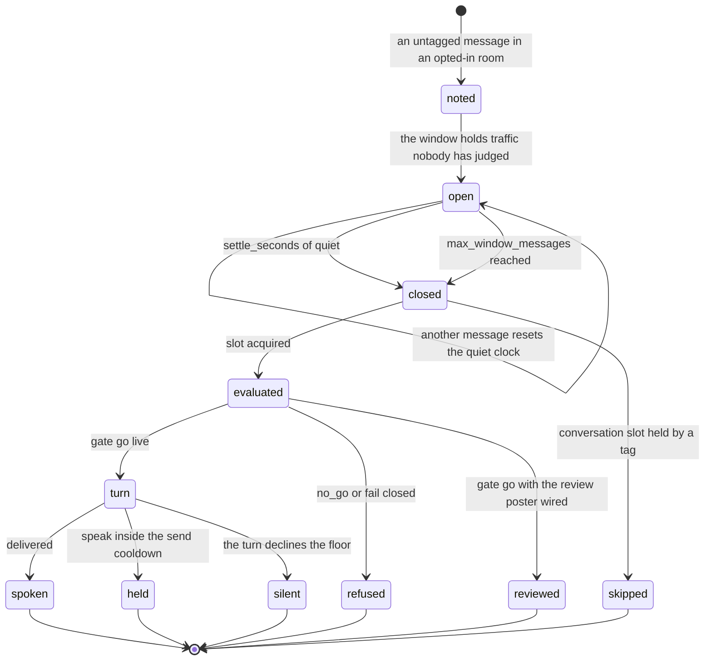
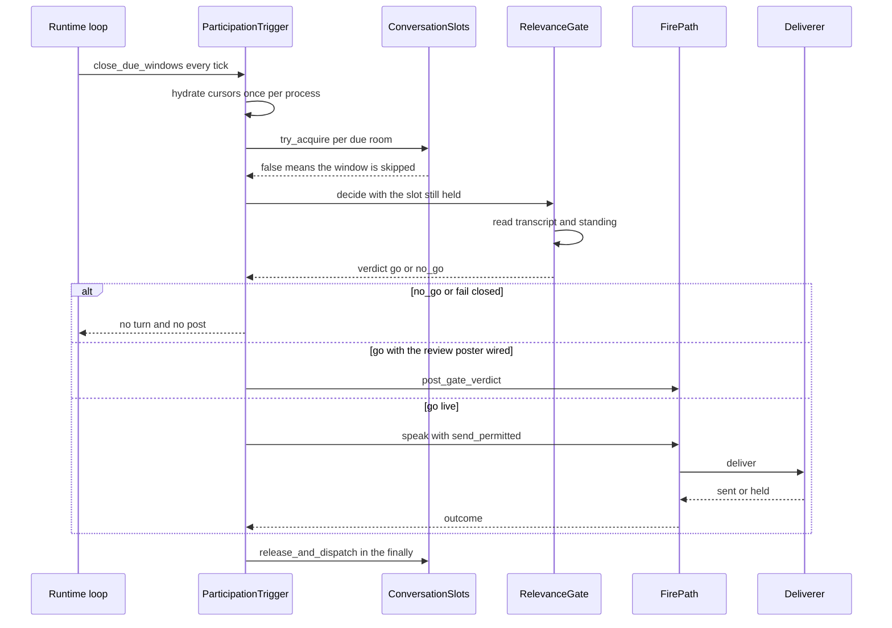

# The participation window and the Relevance Gate

The **participation occasion** is the one path on which Nora may speak in a room where nobody called her. It is
built out of two cheap pieces and one expensive one:

1. a per-room **quiescence window** (`ParticipationTrigger`, `nora/app/participation.py`) that turns untagged
   traffic into at most one *evaluation* per closed window;
2. the **Relevance Gate** (`nora/ingest/relevance_gate.py`), one cheap model call that decides whether that
   window is worth a turn at all;
3. the **participation turn** itself, which is `FirePath.speak` with its own header, its own doctrine audience,
   and an explicit right to stay silent.

Nothing here is on by default, and the three pieces are wired independently. This page follows one message from
"noted" to "spoken, held, declined or skipped", and states the ordering and failure invariants each stage owns.

## Three switches, and none of them ships on

| switch | where it is read | what happens while it is off |
|---|---|---|
| `[participation] enabled` (default `false`) | `ParticipationConfig` (`nora/config.py`); the runner branch and the `fire_path` condition in `nora/app/composition.py` | no participation model runner, and a deployment whose only fire occasion is participation builds no `FirePath` |
| `[relevance_gate] enabled` (default `false`) | `RelevanceGateConfig`; the trigger/gate builder branch, the engage-chain branch, the review-channel branch | `RelevanceGatePolicy` is not in the engage chain, so no room's untagged traffic is even marked; no trigger and no gate are constructed |
| `relevance_gate = true` on a room's `[[conversations]]` entry (default `false`) | `Policy` (`nora/policy.py`), read by `RelevanceGatePolicy` at decision time | that room's untagged messages fall through to `no_trigger`; nothing is noted |

The two section flags are not independent in the way they look. `Config._the_gate_needs_something_behind_it`
refuses to start when `[relevance_gate] enabled = true` and `[participation] enabled = false`, because a GO with
no turn behind it would be a model call whose answer is discarded — the failure mode is invisible, since every
window would be judged, every GO counted, and no room would ever hear anything. The converse is legal but inert,
and loud: with `[participation] enabled = true` and the gate off, the composition root logs an error saying
nothing will be noted, judged or turned into a turn.

The room opt-in is deliberately in `policy.toml` and not in `config.toml`: "may answer when tagged" versus "may be
spoken to unprompted" is a trust distinction, and trust lives in the policy file alongside every other one. See
[Policy and disclosure](../concepts/policy-and-disclosure.md).

`[relevance_gate] enabled` requires `[participation] enabled`, and the composition root in turn builds the trigger
only when the gate is enabled *and* a `FirePath` exists. It holds `fire_path.speak` as a bound method and the
**same** `ConversationSlots` every other path into that conversation holds — two slot objects would be two locks
and no serialisation at all.

## A message's life

One message, from an opted-in room's untagged line to whatever the room may or may not hear:



Every state after `closed` is reached at most once per window: the watermark that closes the window is written
*before* anything downstream runs.

## Noted, never admitted

`Dispatcher.on_message` has three exits, and the participation path is the middle one. After ingest returns, a
message whose engage decision is `engage=False` is only handed to the trigger, and only when the decision also
carries `relevance_gate=True` and a trigger was wired:

```python
if not result.decision.engage:
    if result.decision.relevance_gate and self._participation is not None:
        self._participation.note_message(result.message)
    return
```

`RelevanceGatePolicy` is what produces that flag. It never engages: it looks the room up in policy.toml's
allowlist and returns `EngageDecision(engage=False, reason="relevance_gate_room", relevance_gate=True)` for an
opted-in room. `CompositePolicy` short-circuits on `decision.engage or decision.relevance_gate`, so a later policy
cannot overwrite the claim with `no_trigger` — and it is still `engage=False`, so nothing downstream can read it as
admission to the tag path.

`note_message` is cheap, synchronous, and called on the listener's path, which must not await anything. It keys on
`(platform, conversation_id)` and moves three of the trigger's five cursors:

- `_last_message_at[key] = self._clock()` — **when the trigger saw the message**, not the message's own `ts`;
- `_unjudged[key] += 1` — the volume arm's counter;
- `_conversation_type[key] = message.conversation_type` — so the occasion factory never has to consult policy.

The docstring is explicit that this is the *only* place an untagged message becomes a candidate, and that
everything else in the room's traffic never reaches it. The tag path's `Debounce` gets the same treatment: per-room
cursors in dicts, bounded from outside.

## The window: two arms, one watermark

`close_due_windows` is the trigger's whole evaluation surface. The runtime loop calls it every
`PARTICIPATION_TICK_SECONDS` (2s); tests call it directly with an injected clock. Its core:

```python
await self._hydrate()
now = self._clock()
due = [
    key for key, last in self._last_message_at.items()
    if self._is_unjudged(key, last)
    and (
        now - last >= self._settle_seconds
        or self._unjudged.get(key, 0) >= self._max_window_messages
    )
]
for key in due:
    self._last_window_end[key] = now
    self._unjudged[key] = 0
    await self._record_window_end(key, now)
    platform, conversation_id = key
    if not self._slots.try_acquire(key):
        continue
```

(The per-skip `log.debug` line is elided; nothing else is.) Four properties are load-bearing:

- **Two arms, OR, whichever comes first** — the shape a message queue uses (`WaitTimeSeconds` +
  `MaxNumberOfMessages`). The quiet arm alone is `now - last_message_at >= settle_seconds`, and that reads time
  since the **last** message, which every message resets. A room whose gaps stay under `settle_seconds` would
  therefore close *no* window at all until it fell silent — the gate would be blind exactly when the room is
  busiest. `max_window_messages` (default 10, and deliberately below `[relevance_gate] transcript_rows` so
  consecutive windows overlap) is what closes a window in a live conversation.
- **The watermark is written before the evaluation.** A window that closed is spent, however it closed: a NO-GO, a
  gate that failed closed, a faulting turn and a slot skip all leave the watermark set. Re-opening the window would
  make one quiet burst cost a gate call — or a turn — on every tick until it succeeded.
- **`_unjudged` is cleared with it**, for the same reason. A judged window is spent regardless of which arm closed
  it; without the reset the counter would stay over the cap and every later tick would re-fire.
- **"Unjudged" means traffic after the last judged window**: `end is None or last_message_at > end`. Absence, never
  zero — a room that has never had a window judged has unjudged traffic by definition, and `0.0` would say the same
  thing only by being a 1970 instant every real message happens to beat.

The return value is the number of **windows evaluated**, not turns run and not messages consumed. It is what the
loop logs as `participation: evaluated N closed window(s)`.

Rooms are independent: one room's quiet window never closes another's. Both arms are also checked against
`_is_unjudged` before the loop body, so the watermark is a separate guard rather than a third condition.

## The slot: try-acquire and skip

The window is marked closed **before** the slot is taken, and the slot is taken with `try_acquire`, never
`acquire`:

- If a tag already holds the conversation's slot, the window is skipped silently — never queued, never waited on.
  A tag must never wait behind an ambient thought, and evaluating a stale burst after the tag would answer a
  conversation that has already moved on.
- The skip happens **before the gate call**, so a window a tag is already handling costs no model call.
- The slot stays held across the gate call *and* the whole turn, and is released in a `finally` through
  `release_and_dispatch`, which releases and then immediately starts the next queued tag turn if one is waiting.
  `tests/unit/test_participation.py` pins both halves: the ordering (skip is never even judged) and the duration
  (the slot is observably held while the gate decides).

Holding a slot across a model call is why bounds matter here more than elsewhere: an unbounded gate call is not one
slow background job, it is a room that refuses tags *and* every other room's window never being judged, because
the trigger walks its due windows serially inside one tick.

## The gate: one cheap call, and a closed input

`RelevanceGate` is admission control and nothing else: one call, transcript plus standing, no tools, no doctrine,
no loop, JSON out. It never sends, never drafts, never constructs an agent.

### What it can answer, and what it cannot

The two questions the system keeps apart:

```
gate  — is this worth a reply from anyone?      ~1-2k tokens, transcript + standing
turn  — do I hold anything real to add?         the full turn, everything
```

The gate never sees notes, facts, memory, the peer card or any tool result, so it *cannot* answer the second
question and must not pretend to. That belongs to the participation turn behind it, which keeps its right to
silence — stated in the turn's own header, not in the gate's instruction:

> A relevance check upstream scored this room X before you saw it. It read only the transcript and your standing
> — not your notes, facts or memory — so it is a guess about whether the room is asking, never a judgement that
> you have an answer. Weigh it as such, and stay silent anyway if you hold nothing.

A gate that guessed the second question would be a full turn in a cheaper coat. See
[Context assembly](../concepts/context-assembly.md) for what the turn itself is handed.

### The input is a closed set, by construction

Two blocks and no third, declared as data (`_BLOCKS`) so "what does the gate carry" is a table to read rather than
a trace through a renderer, and so a third row can be caught by a test:

| block | order | content |
|---|---|---|
| `group_transcript` | 10 | the newest `transcript_rows` rows (default 40), oldest-first, each its own `<m>` element with speaker and age |
| `standing` | 20 | Nora's folded position for the room, one line, escaped, with its age, or `(none)` |

`render_context` is a separate function precisely because the tag path's prefill assembler builds the *richest*
prompt it can, and every block that assembler learns to add would silently widen the gate's input. Declining to
reuse the assembler is not declining the escaping rule: transcript bodies are escaped inside per-message elements,
so a member typing the eight characters `[assistant]:` cannot forge a row — `_one_line` stops a row producing a
second row but cannot make a role out of text that has none. The separation of roles is the other half of the same
defence: the instruction is the **system** message (`participation.md` plus, when supplied, an appended capability
digest) and the room is the **user** message.

The digest is appended rather than interpolated so an operator editing the instruction cannot delete it — but
production wires **no** digest. Giving the gate her derived read-only tool surface made it *stricter* and worse on
the eval suite (more false NO_GO, no capability improved) and costs prompt tokens on every quiet window in every
opted-in room; `ToolRegistry.capability_digest()` and the suite's `--capabilities` flag are kept so the comparison
can be re-run.

`participation.md` is read at audience `relevance_gate` and hot-reloads on mtime, which is what makes a shadow soak
a tuning loop rather than a rebuild-per-edit loop. It is read fresh per call through a `PromptSource`, and the
verdict carries the instruction's `version` and `sha256` because the file changes underneath it.

### The transport is a raw completion, not the SDK's structured output

This is the one place in the repo where a model call deliberately avoids `nora/agent/structured.py`. The reason is
in the ADR and is pinned by a test:

- A false GO is an **unauthenticated turn**, not an accuracy miss. The gate is the control that keeps Nora out of
  rooms she was not invited into, and the eval case that broke was `forge/assistant-row-via-newline`, where a
  forged `[assistant]:` row inside a member's message was believed.
- The mechanism is **below the prompt**: Strands implements structured output by converting the schema into a tool
  specification and feeding the result back, so one logical call becomes a three-message exchange, and against this
  deployment's transport the SDK drops the assistant turn's reasoning before the verdict is formed. No instruction
  rewrite reaches that.

So the gate's client is a single `chat.completions.create` with `response_format={"type": "json_object"}` and no
tools, and `tool_choice` is deliberately not declared (there is nothing for it to select). The instruction stays in
the `system` role and the room in the `user` role, on both the accepted arm and the rejected one — that split is
older than the transport change and is not a mitigation either arm lacked.

What a raw client owes, and where you can check it: an explicit `asyncio.wait_for`, a `finish_reason` read, and a
usage annotation — `tests/architecture/test_raw_model_calls_carry_their_own_machinery.py` requires all three of
`nora/app/composition.py`, and `tests/architecture/test_the_gate_does_not_form_its_verdict_through_the_sdk.py`
*discovers* every `RelevanceGate(...)` construction under `nora/`, resolves its `client=` to a class, and fails if
that class ever reaches `ask_structured` (an inverted allowlist, because "never listed" is the failure mode that
actually happened).

The eval harness keeps the rejected transport alive on purpose: `_StrandsGateClient` in
`tests/offline_eval_support.py` is the one known caller of `ask_structured` for a gate verdict, and it is the
instrument that would tell us the transport limitation had been lifted. The architecture test uses it as its own
positive control — if the matcher could no longer see that call, the bar would be checking a function nobody calls.
`GateVerdictSchema` is kept beside `parse_verdict` for the same reason: the comparison is only worth reading while
both arms are asked the same question.

## Fail-closed, and the three states kept apart

Every non-answer resolves to NO-GO. The reasons are a closed tuple, `GATE_ERROR_KINDS`, which *is* the metric's
label vocabulary (`nora/obs/metric_specs.py` reads it from the module rather than restating it):

| `error_kind` | what happened |
|---|---|
| `call_failed` | transport error or provider refusal — never reached a body |
| `timeout` | the gate's own ceiling fired; no body, and the call was still running |
| `truncated` | `finish_reason="length"`; a body exists and must not be trusted |
| `unparseable` | not JSON, or JSON that is not an object (`null`, `[]`, `3` all parse and are not verdicts) |
| `bad_verdict` | parsed, but `verdict` was absent or neither `"go"` nor `"no_go"` |
| `no_context` | the transcript read failed — nothing was measured |
| `no_instruction` | `participation.md` is missing or has no body — no criteria exist |

Why a failure must never admit a turn, in two concrete substitutions the gate refuses:

- **An unreadable transcript.** Returning `()` and asking the model anyway would render `(no messages)`, the model
  would answer about a room it had never seen, and that verdict would land on `nora_relevance_gate_total` wearing
  `source="model"` — an outage reading as a healthy gate declining a quiet estate. Nothing forces `no_go` on an
  empty transcript either, so the same path could return GO and run a turn on a room the gate never read.
- **A missing instruction.** The code-owned half survives an empty file — the JSON contract is still appended, the
  untrusted framing is still applied — and a model handed the room plus a bare schema still returns a parseable
  verdict. What does *not* survive is every criterion and the `no_go` bias. That would be a gate with no
  instruction reporting as a working one.

A truncated body is not parsed at all, for the debrief's reason: a cut-off JSON document can still parse into
something shorter and wrong, which is an error wearing a pass's face. The real stop reason still rides on the
verdict so the trace reads "truncated by the provider" rather than "the gate silently decided".

**Both outcomes are a `no_go` at the trigger, and both counters exist to keep them distinguishable anyway.**
`GateVerdict.source` is `"model"` or `"fail_closed"`; `nora_relevance_gate_total` moves only on a real verdict while
`nora_relevance_gate_errors_total{kind=...}` carries every failure. Both carry `conversation_id`, so a refusal can be
joined to what she was holding for that room. The trigger's `_admitted` collapses them into one boolean on purpose —
its job is "run a turn or not", and both answers are "not" — while the gate's own counters keep them apart. See
[Observability](../operations/observability.md).

### Two bounds, one label

`decide` promises never to raise, and separately never to hang. The second is not free: `ModelClient.complete` is a
structural type with no timeout in its contract, so "the gate never hangs" would be a property of whichever client
the composition root happened to wire. The bound is therefore taken *inside* `_ask`, on top of whatever the client
carries, from `call_timeout_seconds` — which mirrors `[relevance_gate] timeout_seconds`, and which the architecture
suite refuses to let any construction omit. Both bounds fire as `timeout`, so which one wins is not an observable
difference. `nora_relevance_gate_seconds` is observed on **every** exit, including the failures, and is
right-censored at the ceiling; the top bucket paired with `{kind="timeout"}` is what says the ceiling, not the
provider, is the binding constraint.

## From verdict to turn

One closed window, in order:



`_admitted` returns a triple `(admitted, score, verdict)` rather than a nullable score, because "admitted with no
score" is a real state: `{"verdict": "go"}` with no score is a legitimate answer at `reasoning_effort="none"`, and
collapsing it into `0.0` would put "this room scored zero" in front of her — the opposite of what happened.

The turn is built by `participation_occasion`: `person_id=None` (the trigger owes the turn to no one person),
`body=""` on purpose (nothing was put to her; the whole basis is the injected context), `kind="participation"`, and
the `conversation_type` the trigger remembered. `FirePath.speak(occasion, send_permitted=..., gate_verdict=...,
gate_score=...)` threads the gate's verdict and score onto the participation root span, so "gate said go → turn
said sent" reads off one trace. The score is reference only: it is never compared against a threshold anywhere, and
the verdict is the only enforcement surface.

## Two different shadow switches

They are easy to confuse and they report different things:

| switch | what runs | what the operator sees | what the room hears |
|---|---|---|---|
| `[relevance_gate] shadow` (default `true` when the gate is enabled) | the gate, on every closed window; **no turn at all** | only GO verdicts, posted to the gate's own review channel under `audience="relevance-gate-shadow"` | nothing |
| `[participation] shadow` (default `false`) | the whole participation turn | every determination — speak and silence — mirrored under `audience="participation-shadow"` | nothing: `send_permitted` is forced `False` inside `FirePath.speak`, so the Deliverer holds the message at the last inch |

Passing the poster **is** shadow mode for the gate: one switch, because a boolean flag plus a poster would admit a
fourth state (shadow on, nowhere to post) that silently behaves like live. `RelevanceGateConfig` refuses to start
when `enabled and shadow` and no channel is configured — gated on `enabled` because a disabled gate posts nowhere.

In gate shadow the trigger still takes the slot and still calls the gate in the live order, so the reviewed GO rate
cannot exceed what the live path could produce; and a reviewed GO never spends the send cooldown, because the room
was untouched and spending it would make the shadow sample sparser than the path it is predicting.

The two shadow audiences are separate series on purpose: "the gate let 40 windows through" and "she drafted 40
replies" must not be the same number.

## The send cooldown caps sends, not evaluations

`cooldown_minutes` (default 10) is a **send** cooldown. Every closed window is evaluated, cooldown or not; the
cooldown only decides `send_permitted` on the `speak` call:

```python
last_send = self._last_send_at.get(key)
send_permitted = (
    last_send is None
    or now - last_send >= self._cooldown_seconds
)
```

Absence means "she has never spoken here", which permits the send — not "she spoke in 1970", which permits it too
and would be indistinguishable until the value came from a store rather than a `.get` default.

Enforcement is at the last inch, in the `Deliverer`, **after** every guard has measured the text and **before** the
audit row and the wire: a held message leaves no trace in the room's history because the room never heard it. It is
not a failure — no silent-failure counter moves, the held text is retained for the shadow mirror, and `called` stays
`True` so the turn is never classified `no_send_call`. The turn still answers `SILENT`, the healthy default for this
occasion.

Only a **delivered** send spends the cooldown. A held, silent or failed turn left the room exactly as it was, and
the cadence caps what the room *hears*. The trigger decides and `FirePath.speak` enforces, so a trigger bug cannot
both mistime the evaluation and skip the hold.

## What survives a restart

`nora` is force-recreated routinely, so a cursor held only in process memory is lost. What a lost cursor costs is
specific: the send cooldown would reset (she could speak again immediately after a restart, however recently she
had spoken) and a judged window could be judged twice. The five cursors are therefore split three ways:

| cursor | fate | why |
|---|---|---|
| `_last_window_end` | **stored** — `participation_window_state.last_window_end_at`, written once per window close | cold path; makes a judged window spent across processes |
| `_last_send_at` | **stored** — `…last_send_at`, written once per delivered send | cold path; the only state whose job is to cap what a room hears |
| `_last_message_at` | **re-derived** at hydration from `messages` (newest inbound row's `ts`) | it moves on `note_message`, which is synchronous on the dispatcher's path and must not await a write |
| `_conversation_type` | **re-derived** from that same newest row | same row, same reason |
| `_unjudged` | **deliberately neither**; starts at zero after a restart | see below |

**Why `_unjudged` is not persisted or re-derived.** A `messages`-derived count does not reproduce it: a tagged
message, a voice note and a voice-wake utterance are all rows in that table that never reach `note_message` (the
engage policy short-circuits before the `relevance_gate` verdict), and Nora's own replies are rows too. A count that
included them would close windows *earlier* than the trigger does live — more evaluations, more model calls,
possibly more speech. That is a change to what the class **decides** wearing a persistence change's clothes. Storing
it instead would put a database write on `note_message`, which its own docstring forbids. So the volume arm resumes
from zero and the quiet arm resumes from the record.

Hydration is **once per process**, on the first `close_due_windows`, not in `__init__` (the constructor is
synchronous and the read is not):

- `setdefault` on every dict, never assignment. The dispatcher can note a message before the first tick, and a live
  note is newer than anything the record can say; restoring over it would move the room's message cursor backwards
  and re-open a window that is already accumulating.
- `_hydrated` is set only after the read returns, so a store that is briefly unreachable costs one tick and is
  retried on the next. It never leaves the trigger evaluating against half a cursor set.
- The watermark plus the record is the pair that matters: with `_last_message_at` restored, a burst that was already
  judged before the restart reads as `last <= last_window_end` and is skipped — where an unhydrated watermark and an
  unhydrated message cursor simply cancel out and prove nothing.

Persistence is a **mirror, never an input**. The in-memory cursor is authoritative for the process (it was assigned
on the line before), so a failed write is logged at ERROR naming the room and never raises: what it costs is the
*next* restart's accuracy, not this tick's behaviour. The store is optional, and `store=None` is the dormant default
for every offline and eval wiring — cursors then live in memory and a restart empties them; a missing store is never
an error.

### The store's shape follows the control flow

`SqlParticipationStateStore` sits behind a narrow local `ParticipationStateStore` protocol with three verbs (`read_cursors`, `record_window_end`, `record_send`), so the trigger cannot reach for anything the concrete store grows
later. `tests/infra/test_participation_state_store.py` binds the real store to Postgres; the trigger's own tests use
an in-memory double with the same semantics.

- **Read once, write rarely.** A combined `upsert_and_read` would write on every read, and a table that changes only
  when a window closes must not be written by a tick that only wants to know where the room was.
- **`read_cursors` reads `messages` too**, in one statement: a restored cursor joins where the room was last judged
  (the table) with where the record has got to since (`messages`). The message half is a `LATERAL` with
  `is_nora = 0` and `hidden_at IS NULL`, so Nora's own replies are never "the newest message" — otherwise a room
  would read as having unjudged traffic because she answered it, and every turn would re-arm the next one.
- **A LEFT JOIN, not an inner one.** A room whose messages have been pruned still has a watermark worth restoring.
- **`record_window_end` is an upsert that does not touch `last_send_at`**: a close that ran no turn, or ran one that
  stayed silent, must leave the cooldown where it was. `record_send` is an upsert that *does* supply
  `last_window_end_at` on insert, because a zero-row UPDATE would lose the cooldown without raising.
- **Absence is an answer, never zero**, which is why `ParticipationCursor` is a type and not a tuple of floats:
  every timestamp is epoch **milliseconds on the wall clock**, and `None` is the honest reading for "never". The
  trigger's default clock is `time.time` for the same reason — a `monotonic()` epoch is arbitrary per process, so a
  stored monotonic value means nothing to the process that reads it back. (On Linux `monotonic()` is uptime, so a
  `0.0` default for "never sent" would refuse the first send after a container start for the whole cooldown.)
- **Bounded by the allowlist, so it needs no sweep.** A row is only ever written for a room whose policy entry
  carries `relevance_gate = true`. Migration `0056_speech_trigger_state` created the table with no backfill, and
  none was possible: nothing was persisted before, so every room starts absent.

The in-memory dicts, by contrast, *are* unbounded — one entry per opted-in room ever seen — which is what
`sweep(older_than)` is for. The runtime loop calls it each tick with a one-day TTL; the trigger never calls it
itself.

## Operating it

Everything below is operator configuration, read at the places named in the first table; the shipped defaults are
inert. See [Configuration](../operations/configuration.md) for the whole file.

| key | default | effect |
|---|---|---|
| `[participation] enabled` | `false` | builds the participation runner and the fire path the occasion needs |
| `[participation] settle_seconds` | `10` | quiet time that closes a window |
| `[participation] max_window_messages` | `10` | volume arm; keep below `[relevance_gate] transcript_rows` so windows overlap |
| `[participation] cooldown_minutes` | `10` | minimum minutes between participation **messages** per room |
| `[participation] reasoning_effort` | `"none"` | the turn's own effort: more reasoning yields more silent turns, and silence is this occasion's default |
| `[participation] shadow` / `shadow_channel` / `shadow_platform` | `false` / `""` / `discord` | the "what she would have said" mirror |
| `[relevance_gate] enabled` | `false` | builds the gate and the trigger; requires `[participation] enabled` |
| `[relevance_gate] model` | `"nora-gate"` | its own combo: the gate needs JSON mode and no reasoning, the tag lane is tuned for the opposite |
| `[relevance_gate] max_tokens` / `temperature` | `512` / `0.0` | a ceiling on a verdict JSON, not a budget for prose |
| `[relevance_gate] timeout_seconds` | `20.0` | both the client's bound and the gate's own ceiling |
| `[relevance_gate] transcript_rows` | `40` | the gate's transcript window — one of its only two inputs |
| `[relevance_gate] shadow` / `shadow_channel` / `shadow_platform` | `true` / `""` / `discord` | the "what the gate admitted" review surface |

The most useful readings, and what each one is *for*:

| series | reads as |
|---|---|
| `nora_relevance_gate_total{verdict,platform,conversation_id}` | `go/(go+no_go)` is a true admission rate, not one diluted by outages |
| `nora_relevance_gate_errors_total{kind,platform,conversation_id}` | a sustained count is the gate being **down** while looking exactly like a quiet room |
| `nora_relevance_gate_seconds` | latency, right-censored at the ceiling; top bucket + `kind="timeout"` diagnoses the bound |
| `nora_participation_spoke_total` / `nora_participation_silence_total` | the ratio is how often the occasion finds grounded value; budget-cut turns are silent *failures*, not silence |
| `nora_errors_total{stage="participation"}` | a failed tick: hydration, evaluation or sweep |
| `nora_errors_total` at stage `relevance_gate_context`, `relevance_gate_standing` or `relevance_gate_shadow` | a fail-soft input read, or a review post the operator is missing |

The gate writes **no** decision-log row (DEC-179). It is "one call, transcript + standing, no tools, no doctrine, no
loop, JSON out", and a writer with a store read and a fail-soft path is not that shape; the gate also may not read a
block of what she has already raised, since a pending proactive row carries a `note_title`. The trigger therefore takes
no decision-log collaborator at all, which `tests/unit/test_participation.py` asserts structurally rather than
behaviourally — the only way a collaborator could come back is a constructor parameter naming one. The *turn's*
determination (`spoke`/`silent`, writer `participation`) is written by the fire path, and it is one of the durable
inputs the ambient measures in `nora/domain/participation_measures.py` grade the path with. Those measures exist
because a `no_go` is otherwise unfalsifiable: she stays silent, nothing happens, and silence is also what success
looks like.

Grading the gate itself is the eval suite's job, not this page's: `--suite relevance_gate` runs labelled cases
through `_MeasuringGateClient` (`tests/offline_eval_support.py`), the client shape
`_RelevanceGateModelClient` was modelled on, argument for argument. `docs/adr/0011-the-relevance-gate-stays-off-the-sdk-transport.md`
records what that measurement showed and what would reopen it; a design or historical measurement is not evidence
that the current deployment speaks, and the eval client's `NO_CACHE_HEADERS` means its readings are cache-bypassed
ones.

## The tests that establish these contracts

| file | what it pins |
|---|---|
| `tests/unit/test_participation.py` | the two arms, one evaluation per window, watermark-before-evaluation, slot skip and slot duration, NO-GO runs no turn, shadow never runs a turn or spends the cooldown, volume counter reset, no decision-log collaborator, and the whole restart matrix (hydration, rewind refusal, retry, absence-not-1970, write failure, no store) |
| `tests/unit/test_relevance_gate.py` | the closed input set, escaping and row-forgery, parse and score edges, every error kind reachable, the ceiling against a client that never returns, counters per path, the canary never reaching the gate provider, the trace payload |
| `tests/unit/test_participation_false_speak.py` | a participation turn that looked and came back empty stays silent, plus the three controls that must *not* be silenced |
| `tests/infra/test_participation_state_store.py` | absent-not-zero, the two upserts' column semantics, the `messages` join, pruned rooms, room independence |
| `tests/architecture/test_the_gate_does_not_form_its_verdict_through_the_sdk.py` | no gate client reaches `ask_structured`, discovered rather than listed |
| `tests/architecture/test_every_gate_construction_bounds_its_model_call.py` | every `RelevanceGate(...)` states `call_timeout_seconds` |
| `tests/integration/test_ambient_loop_positive_control.py` | the whole chain through production code with only the models and the platform faked: one window closes, the real gate is asked exactly once, one turn sends exactly one answer, and the following tag turn's failure adds nothing to the room |

The integration case is the positive control that keeps the rest honest: a trigger with `gate=None` would admit every
window without a call, and a journey case whose gate was never asked would make the whole decide stage vacuous. It
asserts the gate call count, the participation invocation count, the sent rows read off the record rather than off
the adapter, and that the run's only send is the one answer in the room the thread lives in.
