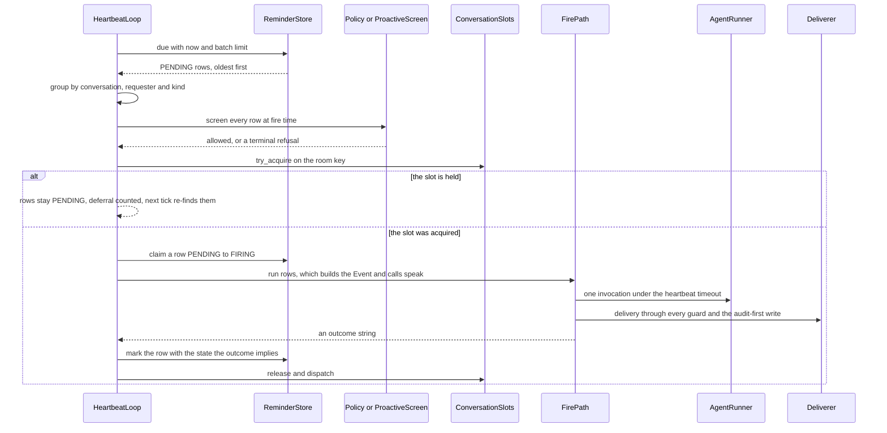
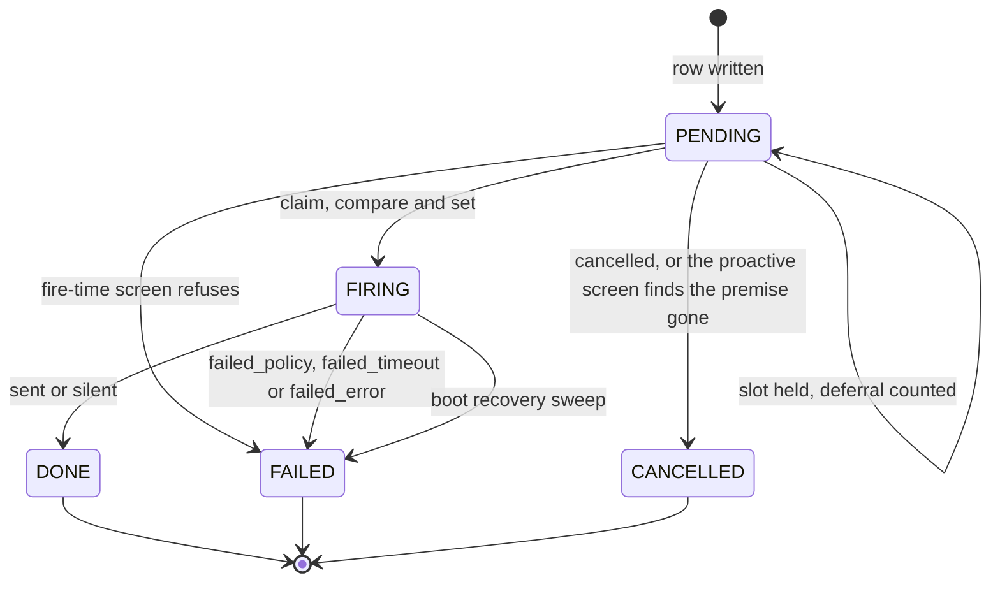

# Proactive occasions: the fire path for reminders, results, relays and acts

Nora speaks unprompted in only one way. A **reminder** comes due, a **compute job** finishes, somebody asks her to
**relay** a message into another room, her own earlier **proactive** decision comes back round, or a room goes quiet
and she is offered the floor (**participation**). In every one of those cases the message is produced by the same
object, `FirePath`, running the same turn.

The split is one sentence long and it decides where every rule lives:

- `nora.app.heartbeat.HeartbeatLoop` owns **when** a row comes due, **whether** policy still allows it, **where** the
  turn may run (the conversation's serialisation slot), and **what the row then says** — its terminal state and its
  counter.
- `nora.app.fire.FirePath` owns **the turn**: the synthetic `TagContext`, the prompt, the model call, the delivery,
  and the outcome string the tick records.

Between them sits one small value object, `Event` (`nora/domain/events.py`): *why* this turn is happening, and
everything that differs because of it. `Event` carries the conversation, **whose authority** the turn runs under
(`person_id`, or `None` for a turn held on nobody's behalf), the words put to her (`body`), the situation paragraph
(`header`, a callable because it is rendered against values only the turn knows), and the `kind` that names the
occasion. Everything else about the turn is identical, and that identity is the design.

The tick per conversation group: screening happens before the slot, the slot before the claim, and the row's state
is derived from the string the turn answered with.

## The occasions

Six `kind` values exist, and `nora/domain/framing.py`'s `FIRE_HEADERS` table is the exhaustive list (an architecture
test refuses a kind with no header, a kind headed twice, and a header written inline at a construction site).

| `kind` | Trigger source | Stored row | Admission rule | Authority (`person_id`) | May stay silent |
|---|---|---|---|---|---|
| `reminder` | `HeartbeatLoop.tick` → `due()` on `due_at` | `Reminder` row, `kind="reminder"` (the default) | `policy.is_allowed(platform, conversation_id, requester)` re-read at fire time, then a mapping check in `identity.toml` inside the turn | the requester | no — the group was promised the sentence |
| `proactive` | the same tick; a row Nora's own Cognition session wrote via `remind` | `Reminder` row, `kind="proactive"`, owned by the reserved `ai_peer` id | `ProactiveScreen.refusal`: the room's `proactive` flag **and** the state of the note the row was linked to | nobody (`None`) | yes |
| `compute` | `ComputeJobPoller.tick` → `ComputeBackend.poll`, no `due_at` anywhere | `ComputeJob` row in `PENDING` | the job's own claim plus the destination room's slot | the requester | no |
| `compute_lost` | boot: `compute_poller.recover` sweeps rows a restart orphaned | the swept `ComputeJob` row | already swept — the occasion closes a promise nobody else can | the requester | no |
| `relay` | the `send_to` tool, inside a live turn | none: the text is already in the calling turn | `Relay`'s five fail-closed gates at call time, then the destination room's slot | the requester who asked, resolved in the **source** room | no — the asker is owed a report either way |
| `participation` | `ParticipationTrigger.close_due_windows`, on quiescence | none | the room opt-in, the Relevance Gate's GO, and the conversation slot | nobody (`None`) | yes |

Two of the six are the *same* kind of occasion twice: `compute` and `compute_lost` are both a finished-or-lost job,
but they must never be confused, because a lost job may not be described as a failed one.

DEC-139 named a `gathering` kind as the second reminder-derived occasion. No factory is registered for it today, so
what a `gathering` row would meet is the unregistered-kind path described below — never a guessed header.

## The tick: when, whether, where, what happened

### The batch, and the grouping

A wake reads `ReminderStore.due(now, limit)`: every `PENDING` row with `due_at <= now`, oldest first with `id`
ascending inside an equal `due_at` (`DUE_BATCH_LIMIT` caps one pass at 100, and the remainder is still due next tick
because `due()` never mutates a row). Rows are then grouped into one turn per `(platform, conversation_id,
requester, kind)`. All four components are load-bearing: one conversation because a turn has one `Room`, one policy
decision and one `Deliverer` binding; one requester because the whole turn derives from a single
`requester_person_id` — that person is the `tagger`, and the tagger is what scopes the room; and one kind, so a mixed
batch is never rendered through the wrong factory.

### The policy re-check, at fire time and per row

`policy.toml` is read **once at startup**. A reminder row may be thirty days old, and in between trust can be
withdrawn — someone leaves the group, a room is delisted — while the row still says «speak into conv-1». The
create-time check answered a question about a world that no longer exists, so the fire-time check is the one that
counts.

A revoked row is resolved `FAILED` with `outcome="failed_policy"`: never retried, and never spoken. R-5 keeps the
failure out of the room, so `nora_reminders_fired_total{outcome="failed_policy"}` is the only trace it leaves —
which is exactly why the counter exists. The loop stays per row even though `_by_turn` has already made each group
one requester's: two people can have rows due in one group with only one of them having since lost the room, and the
predicate is about a `(room, person)` grant.

The same re-check is repeated *inside* the turn for the weaker case: a person who is still allowed by policy but has
since fallen out of `identity.toml`. There is no `PersonRef` to attribute the message to, so `speak` answers
`failed_policy` rather than `failed_error` — nothing went wrong, the grant went away.

### The proactive screen is a different grant

`is_allowed` is `(room, person)`, and a proactive row's owner is Nora's reserved `ai_peer` id, which nobody in
`identity.toml` can be by construction. So `ProactiveScreen.refusal(row)` asks two questions instead, both at fire
time for the same reason policy is re-read:

1. **the room's flag** — `proactive = true` on the `[[conversations]]` entry. Refused: `FAILED` /
   `failed_policy`.
2. **the note the row is about** — `remind` stamped the note's id and the head revision it was linked at. A note
   that has been retired, or that the tag path has revised past that revision, means the premise is gone: a human
   settled the thing at 11:00, so she does not raise it at 14:00. Refused: `CANCELLED` /
   `cancelled_note_retired` or `cancelled_note_moved`. A row on a `retired-merged` note follows its survivor
   instead, because its question was folded into an open note rather than closed.

The screen is **fail-closed and keeps the three states apart**. No note store wired, a note that cannot be read, a
note the row's unit cannot reach, or a policy that cannot name the room's unit is «I could not check» →
`FAILED` / `failed_error`, logged. Never `cancelled` (which would claim the note moved) and never admitted (which
would speak on a premise nobody verified). No model is called for a refused row.

### The slot: try, never queue, never shed

The conversation's serialisation slot is the same `ConversationSlots` the tag path holds — one object, because two
instances would be two locks and no serialisation at all. The tick takes it with **`try_acquire`**, and this is the
rule that makes the whole design work:

- it does **not** queue behind a tag in flight: a reminder answered forty minutes late, into a conversation that has
  moved on, is worse than one answered a tick late;
- it does **not** shed the row either. Nothing is claimed and nothing is written, so **a deferred row simply stays
  `PENDING`** with no `fired_at`, no `outcome` and no terminal state. `due()` is a query rather than a claim, so
  "deferred" needs no state of its own: the next tick finds the same row, in the same `due_at, id` order.

The deferral is **counted**, not merely logged (`nora_heartbeat_deferrals_total`, per *turn* per tick). It has to be:
a deferral is the one way a reminder goes hours late while every other signal reads healthy. Nothing fired, so
`nora_reminders_fired_total` does not move; the tick itself completed, so the liveness gauge returns to zero. A group
under continuous tag load could starve its own reminders indefinitely, and this series is the only thing that says so.

The other occasions answer "slot busy" differently, and each difference is deliberate:

| occasion | disposition when the slot is held |
|---|---|
| heartbeat (reminder, proactive) | leave the row `PENDING`, count a deferral, retry next tick |
| compute poller | leave the job `PENDING`, count `outcome="deferred"` on `nora_compute_jobs_delivered_total`, retry next tick |
| relay | refuse to the *model* with `status="unavailable"` and a sentence that says it did not go — the asker is mid-turn and must not be left believing it went |
| participation | skip the window entirely; the watermark already closed it, so it is never evaluated late |

In every one of them the slot is taken **before** any claim, which is what guarantees a deferral never leaves a row
`FIRING`.

### Claim, turn, terminal write

The rows pass `PENDING → FIRING` through `ReminderStore.claim`, a compare-and-set, **before** the turn runs. That is
what makes delivery at-most-once: a crash mid-turn leaves the rows `FIRING`, and boot recovery resolves those to
`FAILED` rather than re-queueing, because nothing links a row to a delivered message and a retry would double-send
anything that died after egress. `claim` rather than `mark` because `due()`'s batch is a snapshot and a coroutine
awaits a whole turn for the groups ahead of it — a cancel landing in that window must win. `mark` matches on id
alone and would resurrect a cancelled row.

For a recurring row the **successor is minted inside `claim`**, in the same transaction (DEC-85). Minted after the
turn instead, a crash mid-fire — the one case `recover()` exists for — would end a daily series silently.

After the turn the state comes **from the outcome string**, not from whether anything raised (`_state_for`): only
`sent` and `silent` are `DONE`. A turn that timed out or reported its own error answers normally, without raising,
and writing those `done` would record a delivery that never happened, leaving the truth in a free-text column nothing
joins on. `fired_at` is stamped on every terminal write, including a row that never spoke, because it records when
the tick *handled* the reminder — the one fact an operator asking "when did she stop being allowed in that group?"
needs.

The reminder row's whole life. `FIRING` is reachable only through the claim, which is why at-most-once survives a
crash anywhere after it.

### Boot recovery is unconditional

`heartbeat.recover` sweeps `FIRING` rows to `FAILED` and counts them, as a module-level function called
**unconditionally** — a heartbeat switched off is exactly the state in which a stranded row would otherwise sit
forever. `compute_poller.recover` sweeps both non-terminal states, and returns the swept rows rather than a count:
a pending compute job is a handle into an in-process backend's memory registry, so any restart orphans it, and the
database must not claim the job failed — but the requester was told «I'm working on it» and must not then hear
nothing. See [Failure and the status contract](../architecture/failure-and-status-contract.md).

## The turn: `speak(occasion)`

One public method, `FirePath.speak`, plus one adapter onto it: `run(rows)` is the heartbeat's reminder-shaped entry
point, which dispatches on `rows[0].kind` through the event registry and calls `speak`. An **unregistered kind
raises inside `run`, before `speak`**, so the tick's guard resolves the claimed rows `FAILED` / `failed_error`
immediately — never rendered as a malformed sentence, never left `FIRING` for boot recovery. `run` is a separate
method rather than a lambda in the composition root so the heartbeat keeps a *bound method* of the real fire path (a
composition test asserts it) and so the event factories stay beside the header prose they need.

`speak` then runs the same sequence for every occasion:

1. `build_context(occasion)` — the `TagContext`.
2. `bind_tag_id(ctx.tag_id)` — every log line for the rest of the turn is greppable like a tag.
3. One root span named for the `kind`, of `generation` kind, carrying `nora.platform`, `nora.conversation_id`,
   `nora.occasion`, an always-present `nora.shadow` and relevance-gate pair, and `nora.outcome` annotated on the way
   out. Nobody is waiting on an unprompted turn, so a silent failure has no human to notice it — the trace is the
   only place the outcome is readable outside the row.
4. `_turn` — the stages, the last-resort guard, and the delivery bookkeeping.
5. `clear_tag_id()` in a `finally`.

### The context is assembled by the fire path, not by the assembler

`ContextAssembler.assemble` (the tag path's entry into context assembly) is **not** used, and this is the trap the
module docstring is written around. The synthetic message carries a blank `sender_id` **on purpose** — that is what
makes "no reactions" true by construction. But `TranscriptInjection.assemble` resolves the tagger as
`persons.resolve(platform, msg.sender_id)`, and a blank id resolves to `None`. Every one of these then follows
*silently*, with every gate still green:

- `ctx.tagger is None`, so `peer_card` is empty — she remembers nothing about the person she is answering;
- `Room(tagger=None).scope()` returns UNAVAILABLE, so every room-scoped tool goes dark;
- `search_memory` refuses outright;
- the `tagger is None → refuse` gate fires on **every** fire turn, for a reason that has nothing to do with trust.

So `build_context` takes the tagger from the **occasion's** `person_id` — for a reminder, the id the tick already
screened `policy.is_allowed` against — through `Persons.by_person`, and never from the message. `sender_name` has the
same shape and is the second half of the same trap: `Persons.display_name(msg)` reads `sender_id` and would return
an empty string, so it comes off the `PersonRef` too.

An occasion with `person_id=None` therefore has `tagger is None` **deliberately**, and accepts every consequence
rather than escaping it: nobody asked, so there is no peer card to read and no person whose room membership scopes a
lookup. What makes that safe is that `speak` skips the unmapped-person refusal only for such an occasion, and that
the tools which go dark are exactly the ones such an occasion has no use for.

The context read itself is fail-soft, in `TranscriptInjection`'s own manner: a record-store failure logs, counts
`nora_errors_total{stage="fire_context"}` and continues with an empty transcript — a thinner turn beats no turn,
because delivery is at-most-once and a raise here writes `failed_error` and the reminder is gone. The peer card has
its own `stage="fire_peer_card"` label for the same reason: an operator asking which half of the context went blind
must not have to guess.

### Then everything the tag path owns is reused as-is

- `MentionRenderer.rehydrate` on the assembled context — without it every @-mention in the transcript, including
  mentions of Nora herself, reaches the model as U+FFFC.
- `deliver.build` + `Deliverer`, bound to the target from `ctx.message.target()`, Nora's own id **on this platform**
  from `resolve_identity()`, and the audience label for this occasion. `allowed_mcp` is left at its empty default on
  purpose: a turn nobody asked for gets no MCP tool.
- `Room` (with `tagger` possibly `None`), `ToolRegistry.surface` with **`fire_turn=True`** — the one thing that tells
  a tool this was not a tag, and the reason `remind` refuses here (a reminder that can set a reminder is an unbounded
  loop into this same conversation) — and `location_trusted` from the room's own flag so a fire turn is held to the
  same geospatial gate a tag in that room is.
- `build_prefill(..., header=occasion.header(tagger, now))` and `build_tag_message(..., tagger_name=...)`, which
  render the same blocks a tag turn carries — `<standing>`, `<presence>`, `<culture>`, `<notes>`, `<memos>`,
  `<documents>`, `<computer>` — through the same escaping rules (R-13/R-13b). An occasion with no person falls back
  to the name the occasion itself gives its author (`Event.speaker`), because an unattributed `<tag_message>` is
  unsourced text in the prompt.
- The link carrier: document URLs handed to her in the body are minted (`mint_document`), a job's own result URL is
  attached, media bytes are carried — seeded *after* the surface is built, because building the tools arms the
  carrier and minting before it is a no-op that would strip the very links being delivered.
- `feedback.run`, awaited rather than spawned: a fire turn is still something she said, and omitting it makes her
  memory of her own speech incomplete.
- `post_gate_verdict` / `_mirror` for the two operator review surfaces — both inside this module, because R-1b's
  allowlist is per *module*, and both fail-soft so review traffic can never break the path it reviews.

## What is reused, and what is refused

The refusals are the design, not an omission. Each one names the failure it prevents.

| tag-path stage | refused | the failure it prevents |
|---|---|---|
| `admission.run` | yes | R-9's debounce would reject a fire turn within five seconds of a tag **and consume the tag's window**; R-30 sheds the newest arrival, which is always the reminder that waited hours; R-12 tests a synthetic sender against Nora's own aliases. The slot is taken by the *tick* instead, through the same `ConversationSlots` |
| `audit_stage` | yes | it would write a message the requester never sent, under the requester's peer, at the wrong time |
| `memory_feed_stage` | yes | same: a fabricated inbound turn enters her memory as something somebody said |
| `indicate.begin` | yes | it reacts to `(author, timestamp)` and returns `None` when either is falsy — which the synthetic message's blank `sender_id` and `timestamp=0` make true **by construction**. Fabricating them means a failed `sendReaction` every tick, or 👀 then ⚠️ on an unrelated old message |
| `ContextAssembler.assemble` | yes | the blank-sender cascade above: empty peer card, an UNAVAILABLE room scope, refusing memory, and a `tagger is None` refusal on every fire turn |
| `invoke.run` | yes | it answers `bool` and the tag path calls it with `[llm] timeout_seconds` — chosen because a human is staring at a group chat, which is the wrong bound when nobody is waiting. A `bool` cannot distinguish `failed_timeout` from `failed_error`, which is precisely what the row must record |
| `deliver.check_outcome` | yes | same `bool`; the one side effect worth keeping (`llm_state.last_success_at`) is reimplemented, because a successful fire turn *is* a successful invocation and without the touch a healthy process reports a stale LLM to `/health` |

Two smaller refusals follow from the same logic. The R-97 "looked and found nothing" rule (`lookups=`) is armed on
the **participation** occasion alone: a reminder, a relay and a finished job all exist *because* something is owed,
so a turn that looked and found nothing still owes the sentence — `compute_lost` is the extreme case, a whole
occasion whose only content is «I couldn't check». Proactive is the near-miss: it shares participation's right to
silence, but its false-speak rate is unmeasured, and arming a rule no instrument watches ships a change nothing can
report on. And the send cooldown travels as `send_permitted` **through `deliver.build`** rather than sitting in the
trigger, so the trigger decides and the `Deliverer` enforces at the last inch — a trigger bug cannot both mistime
the evaluation and skip the hold.

`_turn`'s outer guard is the fire path's counterpart to the tag pipeline's, and its one deliberate divergence is
catching `Exception` rather than `BaseException`: this coroutine is awaited by the heartbeat loop, which is cancelled
at shutdown, and absorbing a `CancelledError` would answer `failed_error`, write a terminal row, and swallow the
cancellation of the loop itself.

## What each occasion re-reads at action time

Nothing that was true when the row was written is trusted to still be true when the turn runs. What gets re-read
differs by occasion, and the differences are the decisions.

| read | reminder | proactive | compute / lost | relay | participation |
|---|---|---|---|---|---|
| `policy.toml` grant | per row, in the tick | the room's `proactive` flag, in the screen | **none** — the poller re-checks no grant, so only the identity mapping below stands between a finished job and the room | five fail-closed gates at call time, including `is_allowed` on the destination | the room opt-in upstream, and the room's `location` flag read at turn time — except a shadow-held turn, which stays strict because its text is posted to another room |
| `identity.toml` mapping | inside `speak` → `failed_policy` | skipped (`person_id=None`) | inside `speak` | requester already resolved | skipped |
| the note the row is about | — | **yes**: the screen (retired / moved / survivor), then `note_read` gives the current body | — | — | — |
| doctrine (`applies_to=`) | `heartbeat` | `proactive` | `heartbeat` | `heartbeat` | `participation` |
| transcript | window, quote-chased (DEC-195) | same | same | destination room's | same, and it is the *whole* basis of the turn (`body=""`) |
| standing / notes / culture / presence / memos / documents / computer | yes | yes | yes | yes | yes |
| memory (`peer_card`, `<people_in_window>`) | peer card for the requester | none | peer card | peer card | `<people_in_window>` only |
| the shared decision log | no | **yes** | no | no | **yes** |

Three of those rows need their reasons stated, because each is a decision rather than a gap:

- **Doctrine is read per occasion at its own audience.** At `applies_to="tag"` it would carry the silence rules that
  are false here, and an audience that resolved to nothing would deliver with no persona, no constraints, and a
  `LeakGuard` corpus carrying nothing but the authored sections. The three audiences are `heartbeat` (obliged to
  speak), `participation` and `proactive` (permitted to), and they also label every series the turn moves, so a
  participation failure is never charged to the heartbeat's budget. See
  [Policy and disclosure](../concepts/policy-and-disclosure.md).
- **The decision log is read only by the two occasions that weigh a floor.** «The loop already took this floor 31
  minutes ago» is a fact about the room, and it changes the answer — but only for a turn deciding whether to speak
  into a room nobody addressed her in. A reminder firing was decided when its row was written. The read is
  **unit-scoped** rather than room-scoped, because a proactive row fires into the unit's home room, which can be a
  Discord channel while the thread is on Signal; «this room» would see nothing and speak anyway.
- **Memory is read only by participation.** «What do I know about these people» is research the Cognition session
  already did at decide time, at Honcho round trips rather than one SQL read. The split is research at decide time,
  re-read of the room at act time. See [Cognition](cognition.md).

The proactive occasion shows why the whole re-read discipline exists. Its `body` is the intent her earlier self
wrote — «raise the dinner plan now that people know where they are coming from» — put to her the way a reminder puts
the requester's own sentence: as what was asked, in the asker's words, and the asker is her earlier self. The note's
*current* body is deliberately not in that body: research at 08:00 is what to raise, research at 14:00 is where
everybody is. The header says as much, and says that the note and the reminder are **why** she is here, never
**what** she has to say.

## Silence is an outcome, not a failure

The outcome vocabulary is one string, and it decides a row's terminal state — so spelling one differently records a
delivery that never happened.

| string | meaning | row state | what it is counted on |
|---|---|---|---|
| `sent` | the `Deliverer` actually delivered | `done` | `nora_reminders_fired_total{outcome="sent"}` and the occasion's own series |
| `silent` | the turn ran, said nothing, and that was **right** | `done` | `nora_participation_silence_total` / `nora_proactive_silence_total` |
| `failed_policy` | the grant went away | `failed` | `nora_reminders_fired_total{outcome="failed_policy"}` |
| `failed_timeout` | the invocation hit `[heartbeat] timeout_seconds` | `failed` | the same series, plus `nora_silent_failures_total{reason="invocation_timeout"}` |
| `failed_error` | the loop raised, or finished without calling `send_reply` | `failed` | the same series, plus a `reason` label naming which |

**A reminder that says nothing is broken; a participation or proactive turn that says nothing is working.** That is
the whole asymmetry, and it is enforced in three places rather than one:

1. `_turn` returns `SILENT` **only** when nothing was delivered *and* the occasion is participation or proactive.
   Every other occasion falls through to `failed_error`.
2. `HeartbeatLoop._state_for` maps `silent` to `DONE`. Mapped to `FAILED` it would read as a failed delivery in
   every query, in the metric, and in the decision log the next decider learns from — and a restraint recorded as a
   failure teaches the next decider that restraint fails.
3. `_invoke` counts it on the occasion's own *silence* series, not on `nora_silent_failures_total` — and only when
   the invocation **completed** and the stop reason is not one of R-8's budget caps. A turn a cap cut off before it
   could decide is an ordinary silent failure, so the budget-cut signal cannot read as success.

The distinction is even visible in what is left behind for review. A declined participation turn with prose in hand —
the model wrote the answer as text and never routed it through `send_reply` — logs the *length* at INFO and the prose
itself at DEBUG, so an operator can tell "she had nothing to say" from "she wrote it and never sent it" without group
speech reaching the log. On a proactive occasion the decline reaches `_determined(verdict="silent")`, which writes
the determination to the log and the decision log; otherwise the act turn's restraint would leave only a counter and
a row.

DEC-93's prose recovery — rescue text the model wrote without calling `send_reply` — is applied on this path too, but
**never** on participation or proactive: there the prose was written under `tool_choice="auto"`, so ending in text
*is* the model declining the floor. The two occasions that may decline therefore run on their own `AgentRunner`
composed with `tool_choice="auto"`; the tag runner's `required` pin makes silence inexpressible, and a participation or
proactive turn arriving with no such runner composed is a wiring fault that `_invoke` raises on rather than a turn to
run on the tag runner.

### A determination reaches three places

`_determined` is the one method all four determination exits converge on (participation and proactive, silent and
spoke), so the writer cannot come apart from the record it writes:

- **the determination log** takes both occasions, needs no channel and costs no send;
- **the shadow mirror** takes participation only, and only where an operator wired a review channel — and while it is
  wired, a participation turn **never live-sends** (`send_permitted` is forced `False`), so the mirror is a review
  surface rather than a live send with a copy. The mirror is itself a send through `deliver.build`, under its own
  `SHADOW` audience, so its failures never pollute the tag, heartbeat or participation budgets.
- **the shared decision log** takes a row with the *disposition* — `spoke` / `held_shadow` / `held_cooldown` /
  `declined` — and never her words. The label is derived by code, not authored by a model, which is what lets the row
  ride into a cheap external gate call without becoming an egress question.

## Why the shared path is structural

None of the above is enforced by review. `tests/architecture/test_only_two_paths_can_send.py` pins the three-link
send chain in AST:

1. **`Deliverer` is the only caller of `PlatformAdapter.send`.** Every guard between a model and the wire — R-2's
   latch, R-4's empty-reply check, R-6's leak scan, R-18's egress scan, A9's audit-first write — lives inside
   `Deliverer.deliver`, so a direct `adapter.send` elsewhere bypasses all five at once.
2. **`Deliverer` is constructed in exactly one place**, `deliver.build` — which is what makes (1) enforceable, since
   `audience` (the label every silent-failure counter carries) has no default precisely so it cannot be forgotten
   there.
3. **`deliver.build` has an explicit allowlist of caller modules.** The tag pipeline and `nora/app/fire.py` are the
   two model loops; later decisions added `nora/app/summons.py` (a staging deliverer whose sends are held and
   published once by its own flush) and `nora/app/otp.py` (a fixed template, no model, into a direct message). A new
   module reaching the wire is a test failure, not a review comment.

That is why a relay holds a **`speak` callable rather than an adapter**, and why `ComputeJobPoller` is handed
`fire_path.speak` rather than `fire_path.run` (`run` is the heartbeat's reminder-shaped adapter and would need rows
this occasion does not have). A relay that called `adapter.send` itself would bypass R-2, R-4, R-6, R-18 **and** the
audit-first write in one step — and the last of those bites quietly: the relayed message would appear in the
destination room with no row recording it, leaving a hole in that room's transcript Nora cannot see. DEC-99's ruling
is exactly this: a new way for Nora to speak is **an occasion on this path**, never a further send mechanism.

The relay's own gate is not "is this allowed here" — every other guardrail is scoped to one conversation, and a relay
reaches past all of them by construction. So its five fail-closed refusals ask a different question: are these two
rooms the same group of people, and is the asker one of them? An unmapped asker gets nothing; the destination is
named by **platform**, never by id (a model that could name an id could be talked into naming one), and two rooms of
one platform in one unit refuses rather than picks; both rooms must share a `unit`; the asker must independently be
allowed in the destination; and the text must pass the same egress scan a reply does. The attribution
`"{name}: {text}"` is built by code, not left to the model, because Nora saying «dinner at 8» and Nora saying «Miles
says: dinner at 8» are different claims and only the second is true.

## Making a new occasion

The extension points are two tables and one registry, and each has a test that fails if it is bypassed.

1. **A factory** — `EventFactory` is `Callable[[Sequence[Reminder]], Event]`, registered in the composition root's
   `event_registry` when the occasion is produced by a due `Reminder` row. Today that is `{"reminder":
   reminder_occasion, "proactive": proactive_occasion}`; compute, relay and lost-job call `speak` directly and are
   not registry entries. The registry is a plain dict because keeping the domain type free of app wiring matters more
   than a strategy hierarchy for two cases.
2. **A header** in `nora/domain/framing.py`'s `FIRE_HEADERS`, authored in that one typed module — a header written
   inline at a construction site is refused.
3. **Nothing else.** No new sender, no new stage list, no new guard set: the audience label, the doctrine read, the
   prefill, the deliverer and the outcome vocabulary all follow from the `Event`.

What a new occasion must decide, explicitly, are the three things `Event` cannot infer: whose authority it runs
under (`person_id`, or `None` and every consequence of it), whether it may stay silent, and which of the re-reads
above it needs.

## Operating it

| knob / series | what it decides |
|---|---|
| `[heartbeat] enabled`, `tick_seconds`, `timeout_seconds` | the wake cadence, and the turn's own bound — **not** `[llm] timeout_seconds`, because nobody is waiting on a fire turn |
| `[participation] enabled`, `shadow`, `shadow_channel` | the ambient occasion and its review surface (see [Participation](participation.md)) |
| `[compute] poll_tick_seconds` | the poll cadence; `durable_kinds` for boot recovery is not a knob but derived from which backend is wired (a video row's handle is the provider's task id, so it survives a restart instead of being swept) |
| `proactive = true` per `[[conversations]]` entry | whether Nora's own decisions may speak there at all |
| `nora_reminders_fired_total{outcome}` | one increment per reminder resolved, whatever the outcome |
| `nora_heartbeat_deferrals_total` | turns left `PENDING` because a tag owned the conversation |
| `nora_silent_failures_total{audience,reason}` | a turn the group never heard, labelled by which loop was speaking |
| `nora_participation_silence_total`, `nora_proactive_silence_total` | a floor declined, which is success |
| `nora_heartbeat_last_tick_age_seconds` | a gauge *function*, computed at scrape: written from inside the tick it would freeze at its last value the moment the loop stopped |

The liveness gauge reads a negative sentinel when there is no loop at all, because `0.0` is both "never started" and
"just ticked" and an alert expression cannot tell them apart. Diagnosis by series is in
[Troubleshooting](../operations/troubleshooting.md); the wider metric vocabulary is in
[Observability](../operations/observability.md).

## Focused tests

| test file | what it holds the line on |
|---|---|
| `tests/unit/test_fire_path.py` | the tagger comes from the occasion not the message; an unmapped requester sends nothing while an occasion nobody asked for still speaks; the unreachable-platform failure; `run` dispatching by kind and an unregistered kind failing closed; participation never passing through `indicate`, never recovering a written draft, and answering `SILENT` on a quiet turn; a budget cut being an ordinary silent failure; proactive silence, the brief's intent on the sent row, and the decline readable as a determination; one named root span per turn |
| `tests/unit/test_heartbeat_loop.py` | one turn per conversation-and-requester-and-kind; a revoked conversation never firing; a held slot deferring with no state change; the slot released even when `fire` raises; only `sent` (and `silent`) resolving `DONE`; a store failure while claiming or resolving stranding neither row nor conversation; a row cancelled mid-batch not being resurrected; the proactive screen's four outcomes and its fail-closed states |
| `tests/architecture/test_only_two_paths_can_send.py` | `Deliverer` as the only caller of `adapter.send`, `deliver.build` as the only construction site, and the allowlist of modules that may call it |
| `tests/architecture/test_every_model_call_is_a_declared_occasion.py` | `nora/app/fire.py` declared as a RUNNER over `nora/agent/prefill.py` — it never builds a prompt of its own |
| `tests/integration/test_guards_reply_more.py` | the `Deliverer`/`ReplyGuard` behaviour both senders inherit: `more=false` ending the turn with no further model call, the send cap, a refused send keeping the turn open for a retry, and a held send ending it |

The last of those is worth reading as a fire-path test even though it drives a tag: the guards it exercises are the
ones `deliver.build` installs for both paths, and the fire path's only difference is which audience label they carry
and which outcome vocabulary they feed. See [Verification](../testing/verification.md) for how the architecture
tests are organised as a whole.
